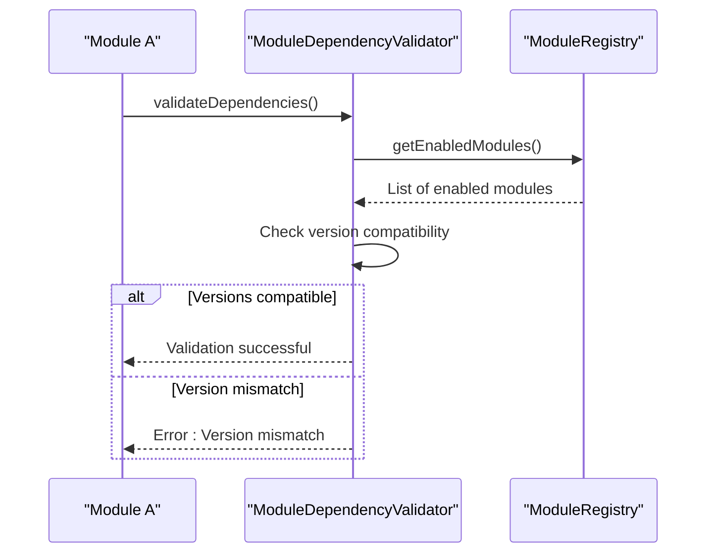
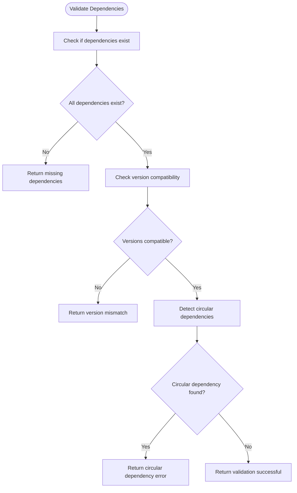
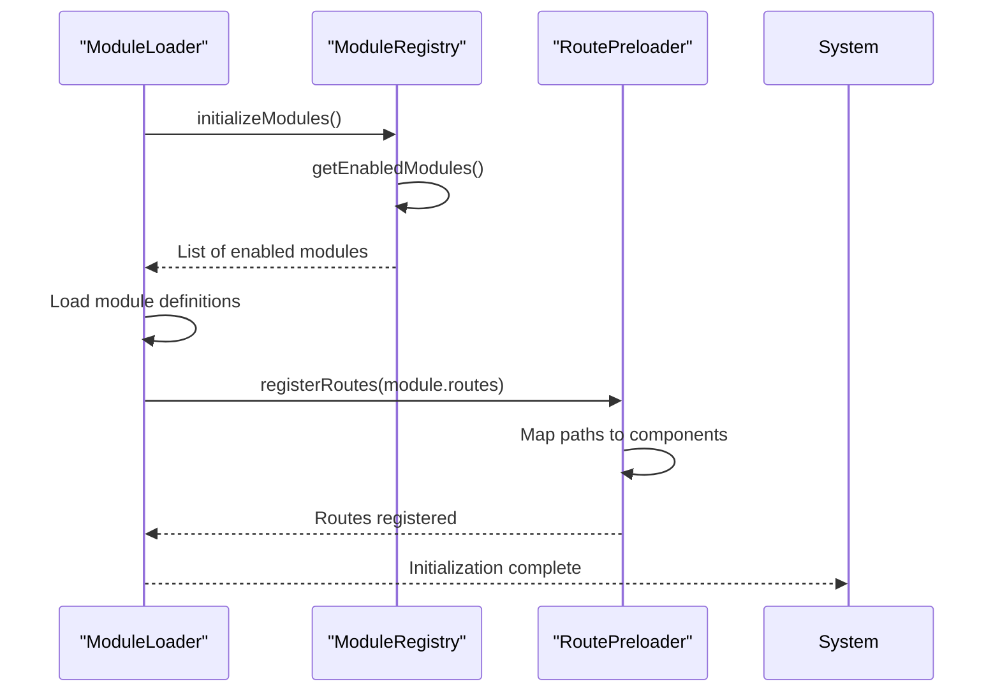
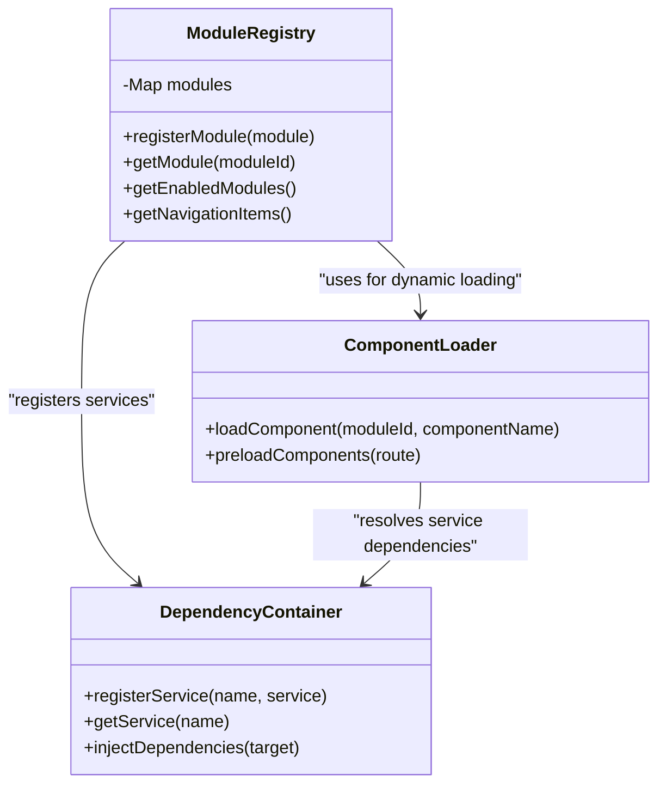
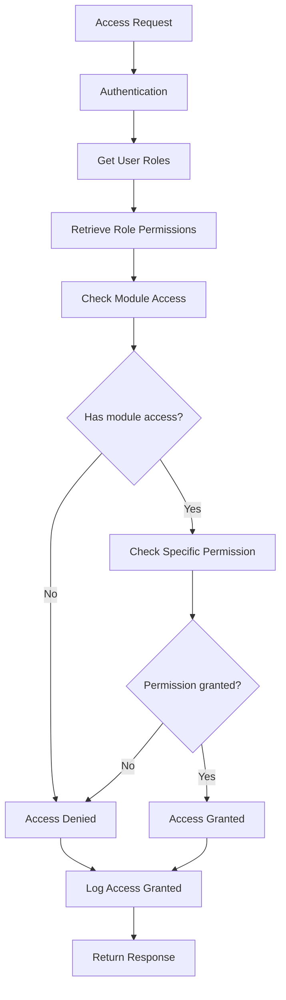
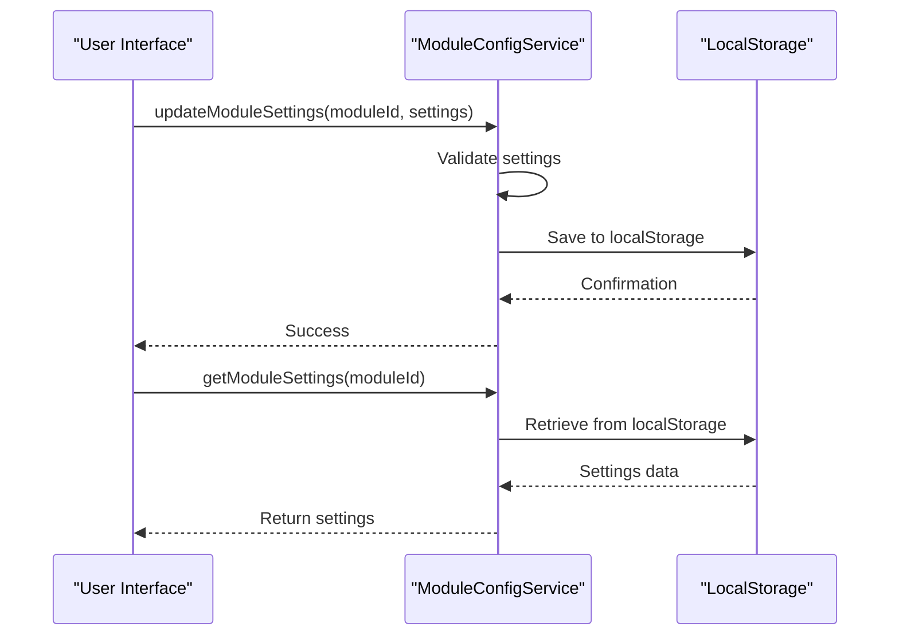
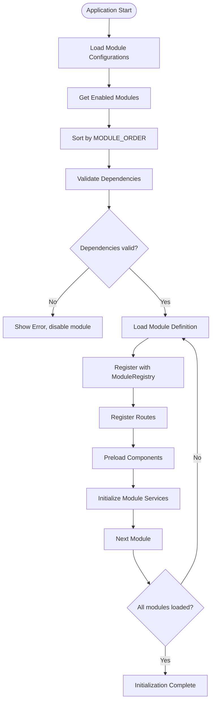

# Module Definition Properties

<cite>
**Referenced Files in This Document**   
- [types.ts](file://src/core/types.ts#L1449-L1648)
- [moduleRegistry.ts](file://src/core/moduleRegistry.ts#L0-L194)
- [ModuleDependencyValidator.ts](file://src/core/services/ModuleDependencyValidator.ts#L0-L296)
- [moduleLoader.ts](file://src/core/moduleLoader.ts#L0-L85)
- [moduleConfigService.ts](file://src/services/moduleConfigService.ts#L0-L324)
- [rbac.ts](file://src/modules/academics/rbac.ts#L0-L77)
- [rbacService.ts](file://src/core/rbacService.ts#L0-L696)
</cite>

## Table of Contents
1. [Introduction](#introduction)
2. [Core Module Definition Structure](#core-module-definition-structure)
3. [Name Property](#name-property)
4. [Version Property](#version-property)
5. [Dependencies Property](#dependencies-property)
6. [Routes Property](#routes-property)
7. [Components and Services Registration](#components-and-services-registration)
8. [Permissions and RBAC Integration](#permissions-and-rbac-integration)
9. [Metadata and Configuration](#metadata-and-configuration)
10. [Module Loading and Initialization](#module-loading-and-initialization)
11. [Performance and Best Practices](#performance-and-best-practices)

## Introduction
The ModuleDefinition interface in schoolpilot3 provides a comprehensive structure for defining modular components within the educational management system. This document details each property of the module definition, explaining its purpose, implementation, and interaction with other system components. The modular architecture enables independent development, deployment, and configuration of functional areas such as academics, finance, HR, and administration, while maintaining system-wide consistency and integration.

**Section sources**
- [types.ts](file://src/core/types.ts#L1449-L1648)

## Core Module Definition Structure
The ModuleDefinition interface defines the contract for all modules in the schoolpilot3 system. It contains essential properties that govern module identification, behavior, dependencies, and security. The interface has evolved to support versioned dependencies and enhanced RBAC integration, reflecting the system's growing complexity and requirements.

```mermaid
classDiagram
class ModuleDefinition {
+string id
+string name
+string description?
+React.ComponentType<any> icon
+string path
+boolean isActive
+string version
+ModuleDependency[] dependencies?
+NavItem[] navigation
+string[] features?
+Array<{path : string, page : string}> routes?
+settings : {category : string, items : Array<{key : string, type : 'boolean'|'string'|'number'|'select', defaultValue : any, options? : Array<{value : any, label : string}>}>}?
+Permission[] rbacPermissions?
+string[] defaultRoles?
+boolean requiresAuthentication?
+boolean publicAccess?
}
class ModuleDependency {
+string moduleId
+string version
+boolean required
+boolean optional?
}
class NavItem {
+string name
+string path
+React.ComponentType<any> icon?
+boolean isGroup?
+string modulePath?
+NavItem[] children?
+string[] permissions?
+boolean isActive?
+string page?
}
class Permission {
+string id
+string name
+string description
+string resource
+'create'|'read'|'update'|'delete'|'execute' action
+string moduleId
+string feature?
}
ModuleDefinition --> ModuleDependency : "has"
ModuleDefinition --> NavItem : "contains"
ModuleDefinition --> Permission : "defines"
```

**Diagram sources**
- [types.ts](file://src/core/types.ts#L1449-L1648)

**Section sources**
- [types.ts](file://src/core/types.ts#L1449-L1648)

## Name Property
The name property serves dual purposes in the module definition: UI display and internal identification. It contains a translation key that is resolved through the i18n system to display the module name in the user's preferred language. This approach enables multilingual support while maintaining consistent internal references.

The name is used in navigation menus, module headers, and settings interfaces. It must be unique across all modules to prevent conflicts in the UI and routing system. For example, the academics module uses "Academics" as its name, which is translated from the academics.json locale file.

```typescript
// Example from academics module
const academicsModule: ModuleDefinition = {
  id: 'academics',
  name: 'Academics', // Translation key for UI display
  // ... other properties
};
```

The name property is also used internally for sorting modules according to the MODULE_ORDER configuration, ensuring consistent navigation ordering across the application.

**Section sources**
- [types.ts](file://src/core/types.ts#L1449-L1648)
- [moduleRegistry.ts](file://src/core/moduleRegistry.ts#L0-L194)

## Version Property
The version property implements semantic versioning (SemVer) to manage module compatibility and evolution. It enables the system to perform compatibility checks during module loading and dependency resolution. The version follows the standard format of "MAJOR.MINOR.PATCH" (e.g., "1.2.0"), allowing for precise dependency management.

Version compatibility is enforced by the ModuleDependencyValidator, which uses the semver library to check if dependent modules meet the required version constraints. This prevents runtime errors caused by incompatible API changes between module versions.



**Diagram sources**
- [types.ts](file://src/core/types.ts#L1449-L1648)
- [ModuleDependencyValidator.ts](file://src/core/services/ModuleDependencyValidator.ts#L0-L296)

**Section sources**
- [types.ts](file://src/core/types.ts#L1449-L1648)
- [ModuleDependencyValidator.ts](file://src/core/services/ModuleDependencyValidator.ts#L0-L296)

## Dependencies Property
The dependencies property defines the module loading order and ensures that required modules are available before a module is initialized. It has evolved from a simple string array to a structured ModuleDependency object that includes version constraints and requirement status.

```typescript
// Old format (backward compatible)
dependencies: ['administration', 'finance']

// New format with version constraints
dependencies: [
  { moduleId: 'administration', version: '^1.2.0', required: true },
  { moduleId: 'finance', version: '~1.5.0', required: false }
]
```

The ModuleDependencyValidator performs several checks on dependencies:
1. Existence of required modules
2. Version compatibility using semver ranges
3. Circular dependency detection
4. Optional dependency handling

For example, the nutrition module depends on the administration module, ensuring that student and staff data is available before nutrition services are initialized.



**Diagram sources**
- [ModuleDependencyValidator.ts](file://src/core/services/ModuleDependencyValidator.ts#L0-L296)

**Section sources**
- [types.ts](file://src/core/types.ts#L1449-L1648)
- [ModuleDependencyValidator.ts](file://src/core/services/ModuleDependencyValidator.ts#L0-L296)

## Routes Property
The routes property enables dynamic URL routing by mapping path patterns to page components. It supports both flat and nested route structures, allowing for complex navigation hierarchies within modules.

```typescript
routes: [
  { path: '/academics/subjects', page: 'SubjectsPage' },
  { path: '/academics/exams/:examId', page: 'ExamDetailsPage' },
  { path: '/academics/results/upload', page: 'BulkResultUploadPage' }
]
```

Dynamic parameters (e.g., :examId) are supported and passed to page components as props. The route registration mechanism integrates with the module registry to ensure that routes are only active when their parent module is enabled.

The system uses a centralized routing approach where the module loader registers all enabled module routes during initialization. This ensures that only accessible routes are available in the application, enhancing security and performance.



**Diagram sources**
- [moduleLoader.ts](file://src/core/moduleLoader.ts#L0-L85)
- [moduleRegistry.ts](file://src/core/moduleRegistry.ts#L0-L194)

**Section sources**
- [moduleLoader.ts](file://src/core/moduleLoader.ts#L0-L85)
- [moduleRegistry.ts](file://src/core/moduleRegistry.ts#L0-L194)

## Components and Services Registration
Components and services are automatically registered through the module definition structure. When a module is loaded, its components and services are made available to the global UI registry and dependency injection container.

The system uses a lazy loading approach where components are only imported when needed, improving initial load performance. Services are registered with the dependency container, allowing for inversion of control and easier testing.

```typescript
// Component registration happens implicitly through module definition
const module: ModuleDefinition = {
  id: 'academics',
  // ... other properties
  navigation: [
    {
      name: 'Subjects',
      path: '/subjects',
      page: 'SubjectsPage', // This references a component in the pages directory
      permissions: ['academics.subjects.read']
    }
  ]
};
```

The module registry maintains a map of all registered modules and their components, enabling dynamic component resolution at runtime. This allows the system to render the appropriate component based on the current route and user permissions.



**Diagram sources**
- [moduleRegistry.ts](file://src/core/moduleRegistry.ts#L0-L194)

**Section sources**
- [moduleRegistry.ts](file://src/core/moduleRegistry.ts#L0-L194)

## Permissions and RBAC Integration
The permissions property integrates with the Role-Based Access Control (RBAC) system to enforce security at the module level. It defines the permissions required to access the module and its features, ensuring that users can only access functionality they are authorized for.

The RBAC system uses a hierarchical permission model where permissions are organized by module and resource. Each permission has a unique ID, name, description, resource identifier, action type, and associated module.

```typescript
// Example from academics module
export const academicsPermissions: Permission[] = [
  {
    id: 'academics.subjects.read',
    name: 'View Subjects',
    description: 'View subject information',
    resource: 'academics.subjects',
    action: 'read',
    moduleId: 'academics',
    feature: 'subject-management',
  },
  // ... other permissions
];
```

The RBAC service evaluates user permissions by:
1. Retrieving the user's assigned roles
2. Checking if any role grants access to the requested module
3. Verifying specific permissions for the requested action
4. Filtering navigation items based on available permissions



**Diagram sources**
- [rbac.ts](file://src/modules/academics/rbac.ts#L0-L77)
- [rbacService.ts](file://src/core/rbacService.ts#L0-L696)

**Section sources**
- [rbac.ts](file://src/modules/academics/rbac.ts#L0-L77)
- [rbacService.ts](file://src/core/rbacService.ts#L0-L696)

## Metadata and Configuration
The metadata and configuration properties provide additional information about the module and its settings. The settings property defines configurable options that can be managed through the system's administration interface.

```typescript
settings: {
  category: 'Academics',
  items: [
    {
      key: 'enableGradeRounding',
      type: 'boolean',
      defaultValue: true,
      description: 'Enable rounding of final grades'
    },
    {
      key: 'gradingScale',
      type: 'select',
      defaultValue: 'percentage',
      options: [
        { value: 'percentage', label: 'Percentage' },
        { value: 'letter', label: 'Letter Grade' },
        { value: 'gpa', label: 'GPA' }
      ]
    }
  ]
}
```

Module configurations are persisted in localStorage through the moduleConfigService, allowing settings to survive browser sessions. The service provides methods to enable/disable modules, update settings, and retrieve configuration state.



**Diagram sources**
- [moduleConfigService.ts](file://src/services/moduleConfigService.ts#L0-L324)

**Section sources**
- [moduleConfigService.ts](file://src/services/moduleConfigService.ts#L0-L324)

## Module Loading and Initialization
The module loading process follows a specific sequence to ensure proper initialization and dependency resolution. The system uses a combination of static and dynamic loading to balance performance and flexibility.



The process begins with loading module configurations from localStorage, determining which modules are enabled. Core modules (dashboard, settings, reports) are always enabled, while others respect the user's configuration.

The module loader uses dynamic imports to load module definitions on-demand, reducing initial bundle size. This approach enables true plugin-like architecture where modules can be added or removed without recompiling the entire application.

**Section sources**
- [moduleLoader.ts](file://src/core/moduleLoader.ts#L0-L85)
- [moduleRegistry.ts](file://src/core/moduleRegistry.ts#L0-L194)
- [moduleConfigService.ts](file://src/services/moduleConfigService.ts#L0-L324)

## Performance and Best Practices
The modular architecture introduces several performance considerations that should be addressed through best practices:

1. **Minimize Dependencies**: Large dependency trees increase initialization time and create tight coupling. Modules should only depend on essential services.

2. **Lazy Loading**: Use dynamic imports for components and services that are not needed immediately, improving initial load performance.

3. **Version Pinning**: Specify exact version ranges in dependencies to prevent unexpected breaking changes.

4. **Circular Dependency Prevention**: Regularly run the ModuleDependencyValidator to detect and resolve circular dependencies.

5. **Efficient Permission Checks**: Cache permission evaluations when possible to avoid repeated calculations.

Common misconfigurations include:
- Missing required dependencies
- Version ranges that are too broad (e.g., "*" instead of "^1.2.0")
- Circular dependencies between modules
- Overly broad permissions that compromise security

The ModuleDependencyValidator enforces the following validation rules:
- All required dependencies must be satisfied
- Version constraints must be met
- No circular dependencies are allowed
- Module IDs must be unique
- Required properties (id, name, version) must be present

```typescript
// Good practice: Minimal dependencies with specific version ranges
dependencies: [
  { moduleId: 'administration', version: '^1.2.0', required: true }
]

// Bad practice: Broad version range and unnecessary dependencies
dependencies: [
  { moduleId: 'administration', version: '*', required: true },
  { moduleId: 'finance', version: '^1.0.0', required: true }, // Unnecessary dependency
  'hr' // Old string format without version
]
```

Following these best practices ensures a maintainable, performant, and secure modular architecture.

**Section sources**
- [ModuleDependencyValidator.ts](file://src/core/services/ModuleDependencyValidator.ts#L0-L296)
- [moduleLoader.ts](file://src/core/moduleLoader.ts#L0-L85)
- [moduleRegistry.ts](file://src/core/moduleRegistry.ts#L0-L194)