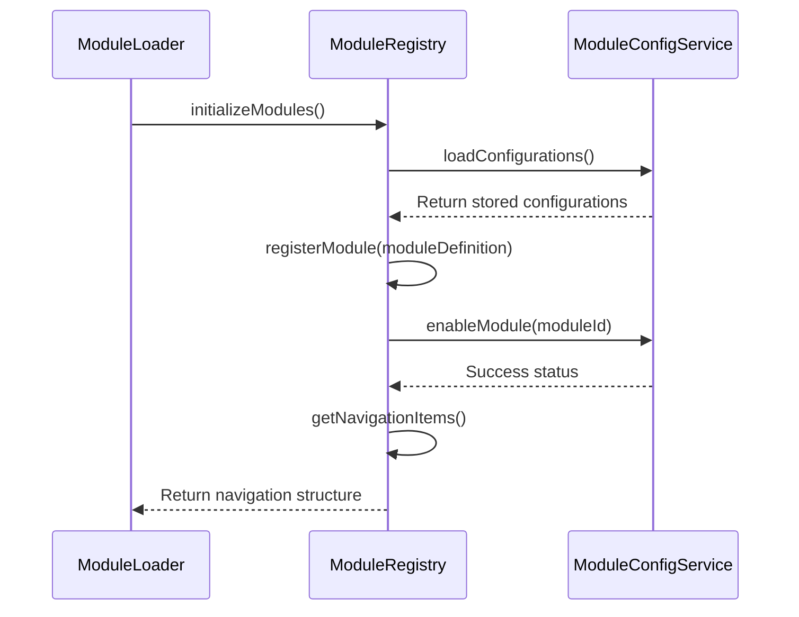
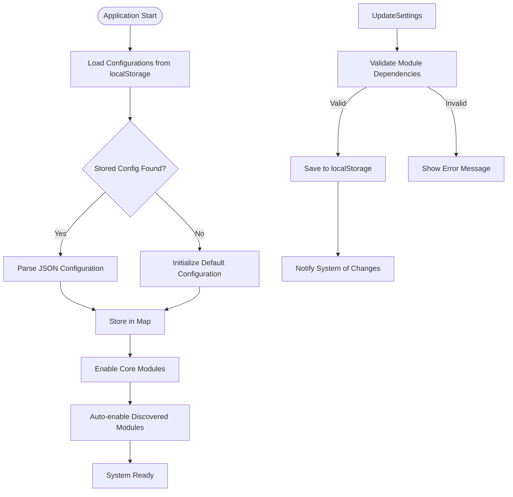
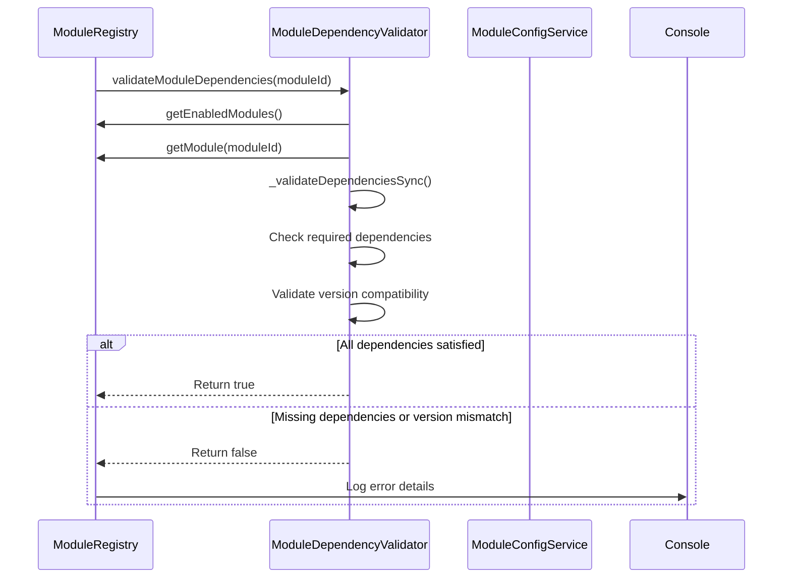
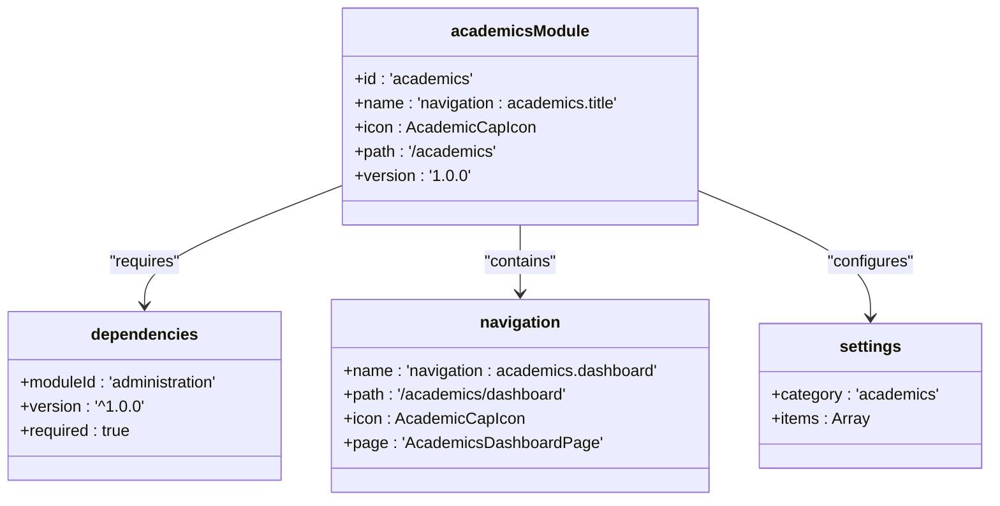
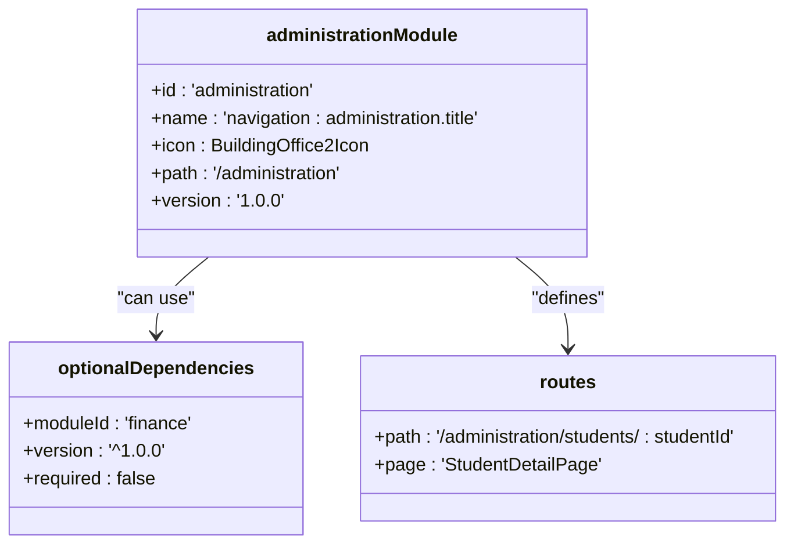
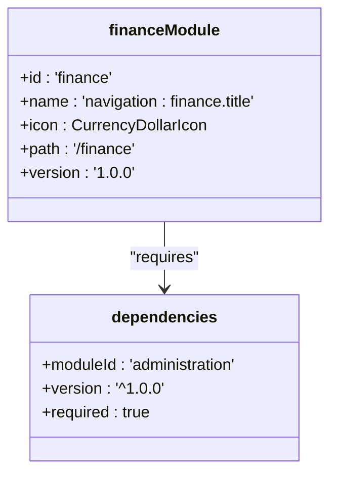

# Module Definition Structure

<cite>
**Referenced Files in This Document**   
- [types.ts](file://src/core/types.ts#L1597-L1623)
- [moduleRegistry.ts](file://src/core/moduleRegistry.ts)
- [moduleLoader.ts](file://src/core/moduleLoader.ts)
- [moduleConfigService.ts](file://src/services/moduleConfigService.ts)
- [ModuleDependencyValidator.ts](file://src/core/services/ModuleDependencyValidator.ts)
- [academics\moduleDefinition.tsx](file://src/modules/academics/moduleDefinition.tsx)
- [administration\moduleDefinition.tsx](file://src/modules/administration/moduleDefinition.tsx)
- [finance\moduleDefinition.tsx](file://src/modules/finance/moduleDefinition.tsx)
- [hr\moduleDefinition.tsx](file://src/modules/hr/moduleDefinition.tsx)
</cite>

## Table of Contents
1. [Introduction](#introduction)
2. [Core Module Definition Interface](#core-module-definition-interface)
3. [Module Registration and Management](#module-registration-and-management)
4. [Module Configuration and Persistence](#module-configuration-and-persistence)
5. [Dependency Validation and Error Handling](#dependency-validation-and-error-handling)
6. [Module Integration with Core System](#module-integration-with-core-system)
7. [Concrete Module Examples](#concrete-module-examples)
8. [Common Issues and Best Practices](#common-issues-and-best-practices)
9. [Creating New Module Definitions](#creating-new-module-definitions)

## Introduction
The SchoolPilot3 system employs a modular architecture where functionality is organized into discrete, self-contained modules. Each module is defined by a `ModuleDefinition` interface that specifies its metadata, navigation structure, dependencies, and configuration. This document provides a comprehensive analysis of the module definition structure, explaining how modules are defined, registered, configured, and integrated with the core system. The modular approach enables flexible feature management, dynamic navigation generation, and role-based access control.

## Core Module Definition Interface
The `ModuleDefinition` interface serves as the blueprint for all modules in the SchoolPilot3 system. It defines the essential properties that characterize a module's identity, behavior, and relationships within the application ecosystem.

```mermaid
classDiagram
class ModuleDefinition {
+string id
+string name
+string description
+React.ComponentType<any> icon
+string path
+boolean isActive
+string version
+ModuleDependency[] dependencies
+NavItem[] navigation
+string[] features
+Array<{path : string, page : string}> routes
+Settings settings
+Permission[] rbacPermissions
+string[] defaultRoles
+boolean requiresAuthentication
+boolean publicAccess
}
class ModuleDependency {
+string moduleId
+string version
+boolean required
}
class NavItem {
+string name
+string path
+React.ComponentType<any> icon
+boolean isGroup
+string modulePath
+NavItem[] children
+boolean isActive
}
class Settings {
+string category
+Array<{key : string, type : string, defaultValue : any, options : Array<{value : any, label : string}>}> items
}
ModuleDefinition --> ModuleDependency : "has"
ModuleDefinition --> NavItem : "contains"
ModuleDefinition --> Settings : "configures"
```

**Diagram sources**
- [types.ts](file://src/core/types.ts#L1597-L1623)

**Section sources**
- [types.ts](file://src/core/types.ts#L1597-L1623)

### Required Properties
The `ModuleDefinition` interface includes several required properties that must be provided for every module:

- **id**: A unique identifier for the module (e.g., "academics", "finance")
- **name**: A translation key for the module's display name
- **icon**: A React component used as the module's visual representation
- **path**: The base URL path for the module
- **isActive**: A boolean indicating whether the module is currently active
- **version**: Semantic version string for the module

### Optional Properties
Several optional properties provide additional configuration and functionality:

- **description**: A translation key for the module's detailed description
- **dependencies**: An array of required and optional module dependencies with version constraints
- **navigation**: An array of navigation items that define the module's menu structure
- **features**: A list of feature identifiers that the module provides
- **routes**: Custom route definitions for dynamic routing
- **settings**: Configuration options for the module
- **rbacPermissions**: Role-based access control permissions
- **defaultRoles**: Roles that have access to the module by default
- **requiresAuthentication**: Whether the module requires user authentication
- **publicAccess**: Whether the module can be accessed without authentication

## Module Registration and Management
The module registration system is responsible for managing the lifecycle of modules, including registration, enabling/disabling, and navigation generation.



**Diagram sources**
- [moduleRegistry.ts](file://src/core/moduleRegistry.ts)
- [moduleLoader.ts](file://src/core/moduleLoader.ts)
- [moduleConfigService.ts](file://src/services/moduleConfigService.ts)

**Section sources**
- [moduleRegistry.ts](file://src/core/moduleRegistry.ts)
- [moduleLoader.ts](file://src/core/moduleLoader.ts)

### Module Registry
The `ModuleRegistry` class serves as the central repository for all registered modules. It provides methods for:

- Registering new modules via `registerModule()`
- Unregistering modules via `unregisterModule()`
- Enabling/disabling modules via `enableModule()` and `disableModule()`
- Retrieving all modules or only enabled modules
- Getting navigation items for enabled modules
- Checking module dependencies

The registry implements a singleton pattern to ensure a single source of truth for module state across the application.

### Module Loading Process
The module loading process begins with the `initializeModules()` function in `moduleLoader.ts`, which orchestrates the registration of all modules through the dynamic module loading system. The process involves:

1. Initializing the dynamic module loading system
2. Registering each module's definition with the module registry
3. Loading module configurations from persistent storage
4. Determining the enabled state of each module
5. Generating the navigation structure based on enabled modules

## Module Configuration and Persistence
Module configurations are managed by the `ModuleConfigService`, which handles the persistence and retrieval of module settings across application sessions.



**Diagram sources**
- [moduleConfigService.ts](file://src/services/moduleConfigService.ts)

**Section sources**
- [moduleConfigService.ts](file://src/services/moduleConfigService.ts)

### Configuration Storage
Module configurations are persisted in the browser's localStorage using the key `module_configurations`. Each module's configuration includes:

- **id**: The module identifier
- **enabled**: Boolean indicating if the module is enabled
- **settings**: Module-specific configuration settings
- **lastModified**: Timestamp of the last configuration change

The service automatically saves configurations after any changes to ensure persistence across sessions.

### Core Module Handling
Certain modules are designated as core modules (dashboard, settings, reports) and are always enabled regardless of configuration. This ensures essential system functionality remains available. The `isModuleEnabled()` method checks if a module is a core module before consulting the configuration store.

## Dependency Validation and Error Handling
The module system includes robust dependency validation to ensure modules are loaded in the correct order and with compatible versions.



**Diagram sources**
- [ModuleDependencyValidator.ts](file://src/core/services/ModuleDependencyValidator.ts)
- [moduleRegistry.ts](file://src/core/moduleRegistry.ts)

**Section sources**
- [ModuleDependencyValidator.ts](file://src/core/services/ModuleDependencyValidator.ts)

### Dependency Validation Process
The `ModuleDependencyValidator` class performs synchronous validation of module dependencies to avoid race conditions. The validation process includes:

1. Retrieving the list of enabled modules from the registry
2. Checking each required dependency to ensure it exists and is enabled
3. Validating version compatibility using semver for dependencies with version constraints
4. Returning a boolean indicating whether all dependencies are satisfied

### Circular Dependency Detection
The system includes functionality to detect circular dependencies in the module graph. The detection algorithm uses depth-first search (DFS) to identify cycles in the dependency graph. If a circular dependency is detected, the system prevents the modules from being enabled and logs an error message.

### Compatibility Reporting
The `generateCompatibilityReport()` method provides a comprehensive overview of module dependency issues, including:

- Total number of modules
- Number of modules with dependency issues
- Detailed list of issues (missing dependencies, version mismatches, circular dependencies)

This report can be used for system diagnostics and troubleshooting.

## Module Integration with Core System
Modules integrate with the core system through several mechanisms that enable dynamic functionality and seamless user experience.

### Router Registration
When a module is registered, its routes are automatically registered with the application router. The system uses the module's `path` property as the base path and combines it with route definitions from the `routes` array. For example, the administration module defines routes like `/administration/students/add` which are registered with the corresponding page components.

### UI Registry Integration
Module navigation items are integrated into the main application navigation through the `getNavigationItems()` method of the module registry. This method:

1. Retrieves all enabled modules
2. Sorts them according to the `MODULE_ORDER` constant
3. Creates navigation items for each module using the module's `name`, `path`, and `icon`
4. Includes the module's child navigation items
5. Returns the complete navigation structure

### Dependency Injection Container
Services defined within modules are registered with the dependency injection container through the module's initialization process. While not explicitly shown in the module definition, this integration allows modules to provide services that can be consumed by other modules or the core system.

## Concrete Module Examples
Analyzing specific module implementations provides insight into how the `ModuleDefinition` interface is used in practice.

### Academics Module
The academics module demonstrates a comprehensive implementation with multiple dependencies and features.



**Diagram sources**
- [academics\moduleDefinition.tsx](file://src/modules/academics/moduleDefinition.tsx)

**Section sources**
- [academics\moduleDefinition.tsx](file://src/modules/academics/moduleDefinition.tsx)

Key characteristics:
- Depends on the administration module (required) and finance/reports modules (optional)
- Provides features like subject management, timetable, and exam management
- Includes RBAC permissions and default roles
- Defines settings for enabling/disabling specific functionality

### Administration Module
The administration module serves as a foundational module with minimal dependencies.



**Diagram sources**
- [administration\moduleDefinition.tsx](file://src/modules/administration/moduleDefinition.tsx)

**Section sources**
- [administration\moduleDefinition.tsx](file://src/modules/administration/moduleDefinition.tsx)

Key characteristics:
- No required dependencies, making it a foundational module
- Defines dynamic routes with parameters (e.g., `:studentId`)
- Includes comprehensive settings for feature toggles
- Extensive navigation structure covering student and staff management

### Finance Module
The finance module demonstrates dependency on core administrative data.



**Diagram sources**
- [finance\moduleDefinition.tsx](file://src/modules/finance/moduleDefinition.tsx)

**Section sources**
- [finance\moduleDefinition.tsx](file://src/modules/finance/moduleDefinition.tsx)

Key characteristics:
- Requires the administration module for student and staff data
- Focuses on financial operations like fee management and payment processing
- Includes role-based access control configuration

## Common Issues and Best Practices
Understanding common issues and best practices is essential for maintaining a stable and scalable modular system.

### Common Issues
**Incorrect Route Registration**: When route paths don't follow the module's base path, navigation breaks. Ensure all route paths are prefixed with the module path.

**Missing Required Fields**: Omitting required properties like `id`, `name`, or `path` prevents proper module registration. Always validate module definitions against the interface.

**Service Registration Conflicts**: When multiple modules register services with the same name, conflicts occur. Use module-specific prefixes for service names.

**Circular Dependencies**: When Module A depends on Module B, and Module B depends on Module A, a circular dependency occurs. Use the compatibility report to detect and resolve these issues.

### Best Practices
**Version Pinning**: Use semantic versioning with appropriate constraints (e.g., `^1.0.0`) to ensure compatibility while allowing minor updates.

**Feature Flags**: Use the `features` array to expose module capabilities that can be used by other modules or the core system.

**Comprehensive Settings**: Define settings for major functionality to allow administrators to customize module behavior.

**Clear Dependencies**: Explicitly declare all dependencies, even if they seem obvious, to ensure proper loading order.

**Error Handling**: Implement robust error handling in module initialization to prevent application crashes when modules fail to load.

## Creating New Module Definitions
Creating a new module definition involves several steps to ensure proper integration with the system.

### Step-by-Step Guide
1. **Create Module Directory**: Create a new directory under `src/modules/` with the module name
2. **Define Module Interface**: Create a `moduleDefinition.tsx` file that implements the `ModuleDefinition` interface
3. **Implement Required Properties**: Provide values for all required properties (id, name, icon, path, version)
4. **Define Navigation**: Create navigation items for the module's pages
5. **Declare Dependencies**: List any required or optional dependencies
6. **Add Settings**: Define configurable settings for the module
7. **Implement RBAC**: Define permissions and default roles if applicable
8. **Register Module**: Ensure the module is imported and registered in the application

### Example New Module
```typescript
import React from 'react';
import { ModuleDefinition } from '../../core/types';
import { BuildingOffice2Icon, UsersIcon, ChartBarIcon } from '../../components/ui/icons';

export const newModule: ModuleDefinition = {
  id: 'newmodule',
  name: 'navigation:newmodule.title',
  description: 'navigation:newmodule.description',
  icon: BuildingOffice2Icon,
  path: '/newmodule',
  isActive: true,
  version: '1.0.0',
  navigation: [
    { 
      name: 'navigation:newmodule.dashboard', 
      path: '/newmodule/dashboard', 
      icon: ChartBarIcon, 
      page: 'NewModuleDashboardPage' 
    },
    { 
      name: 'navigation:newmodule.items', 
      path: '/newmodule/items', 
      icon: UsersIcon, 
      page: 'NewModuleItemsPage' 
    }
  ],
  features: ['item-management', 'analytics'],
  dependencies: [
    {
      moduleId: 'administration',
      version: '^1.0.0',
      required: true
    }
  ],
  settings: {
    category: 'newmodule',
    items: [
      {
        key: 'enableAnalytics',
        type: 'boolean',
        defaultValue: true
      },
      {
        key: 'itemDisplayLimit',
        type: 'number',
        defaultValue: 50
      }
    ]
  }
};

export default newModule;
```

This example demonstrates a new module with proper structure, dependencies, and configuration options.