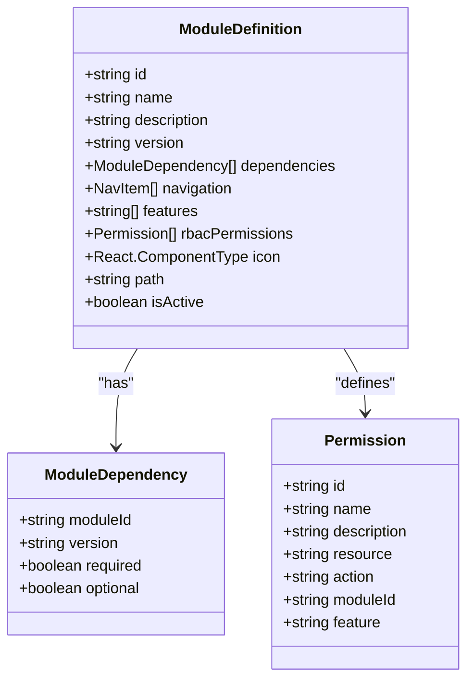
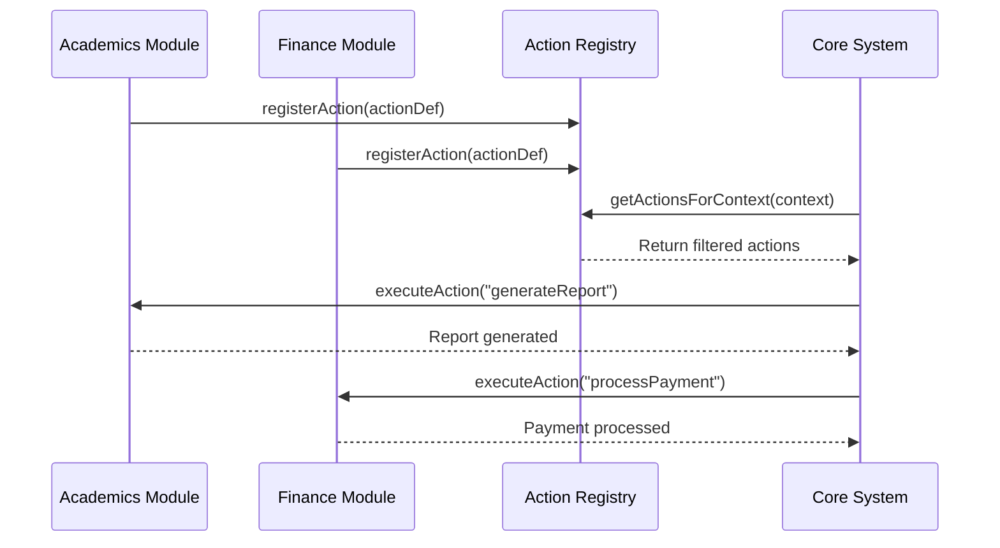
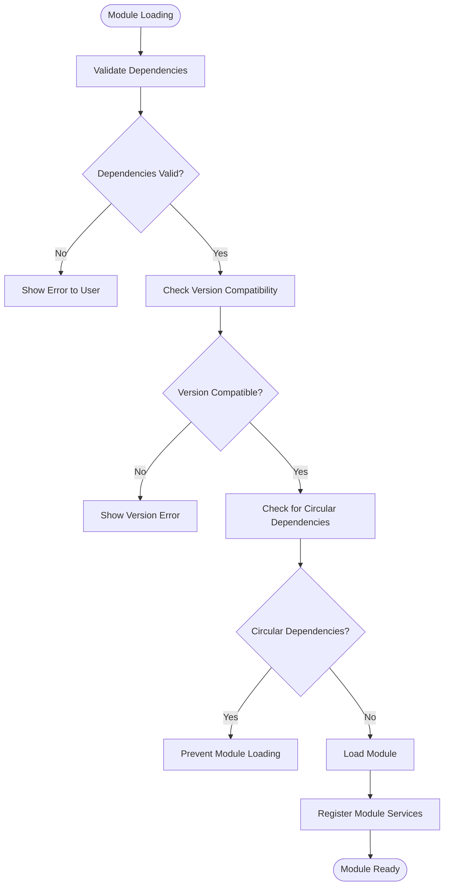
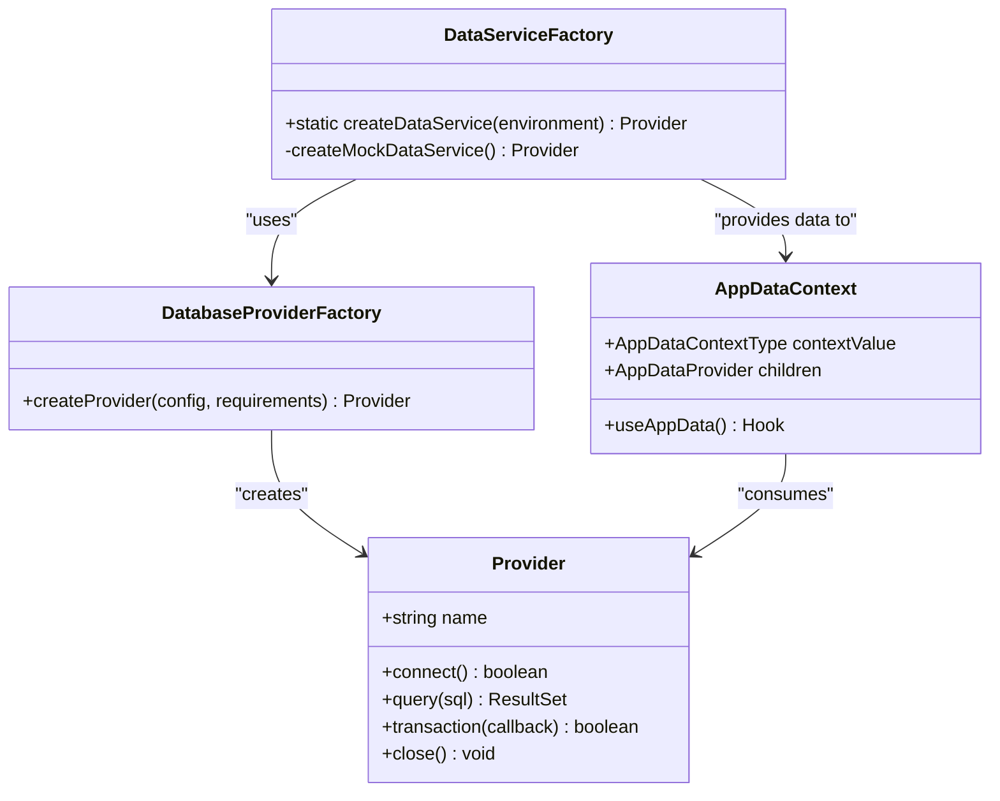
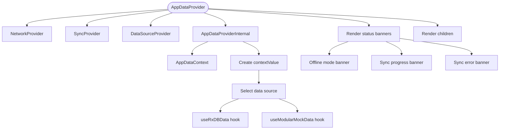
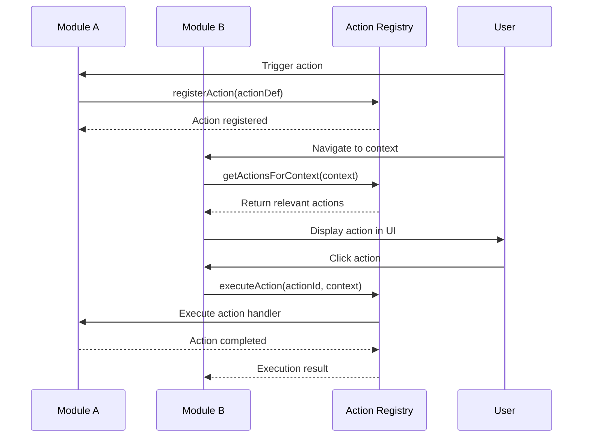
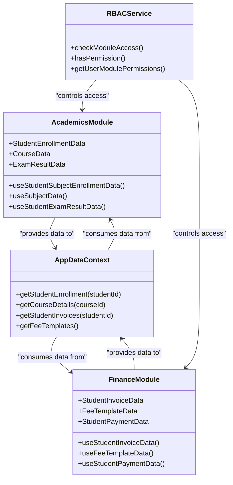
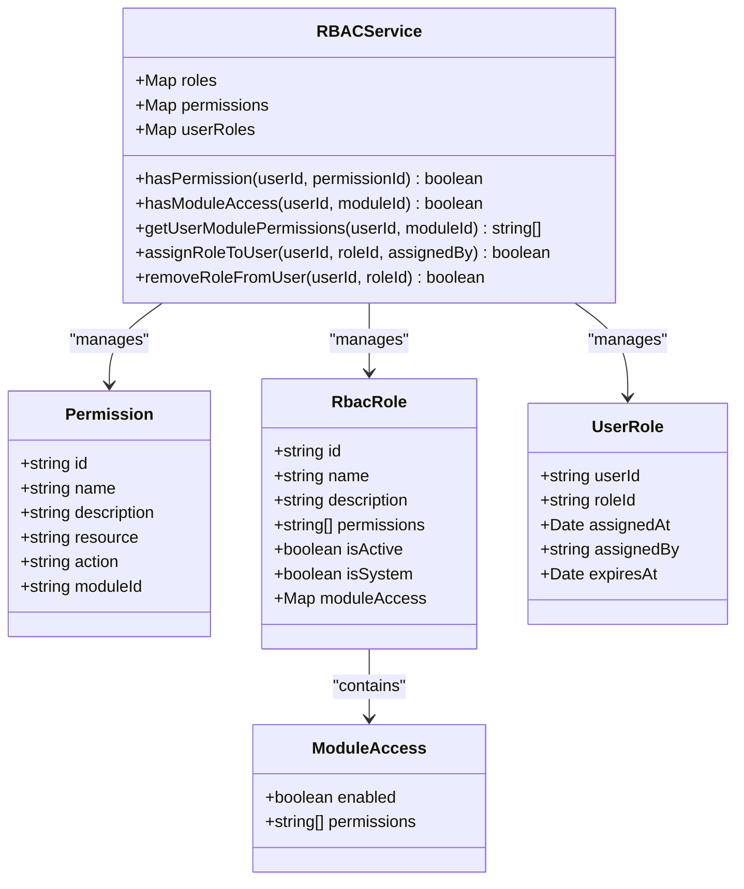

# Module Integration Patterns

<cite>
**Referenced Files in This Document**   
- [actionRegistry.ts](file://src/services/actionRegistry.ts)
- [DataServiceFactory.ts](file://src/services/DataServiceFactory.ts)
- [ModuleDependencyValidator.ts](file://src/core/services/ModuleDependencyValidator.ts)
- [rbacService.ts](file://src/core/rbacService.ts)
- [AppDataContext.tsx](file://src/contexts/AppDataContext.tsx)
- [moduleDefinition.tsx](file://src/modules/academics/moduleDefinition.tsx)
- [moduleDefinition.tsx](file://src/modules/administration/moduleDefinition.tsx)
- [moduleDefinition.tsx](file://src/modules/finance/moduleDefinition.tsx)
- [moduleDefinition.tsx](file://src/modules/hr/moduleDefinition.tsx)
</cite>

## Table of Contents
1. [Introduction](#introduction)
2. [Module Definition Structure](#module-definition-structure)
3. [Service Sharing Patterns](#service-sharing-patterns)
4. [Data Integration Patterns](#data-integration-patterns)
5. [UI Composition Patterns](#ui-composition-patterns)
6. [Event-Driven Integration](#event-driven-integration)
7. [Cross-Module Data Access Case Study](#cross-module-data-access-case-study)
8. [Security Considerations](#security-considerations)
9. [Best Practices for Module Design](#best-practices-for-module-design)
10. [Performance Considerations](#performance-considerations)

## Introduction
The schoolpilot3 application implements a modular architecture that enables various modules to interact with each other and the core system through well-defined integration patterns. This document details the mechanisms for module integration, focusing on the moduleDefinition structure, service sharing, data integration, UI composition, and event-driven communication. The system is designed to promote loose coupling between modules while enabling rich functionality through controlled interactions.

**Section sources**
- [rbacService.ts](file://src/core/rbacService.ts#L0-L696)
- [actionRegistry.ts](file://src/services/actionRegistry.ts#L0-L457)

## Module Definition Structure

The foundation of module integration in schoolpilot3 is the moduleDefinition structure, which serves as the contract between modules and the core system. Each module contains a moduleDefinition.tsx file that exports a ModuleDefinition object conforming to the interface defined in the core types.

**Diagram sources**
- [types.ts](file://src/core/types.ts#L1572-L1607)
- [rbacService.ts](file://src/core/rbacService.ts#L194-L244)

**Section sources**
- [types.ts](file://src/core/types.ts#L1572-L1607)
- [rbacService.ts](file://src/core/rbacService.ts#L194-L244)

The moduleDefinition structure includes several key properties that enable integration:

- **id**: A unique identifier for the module (e.g., "academics", "finance")
- **name**: The display name of the module, typically a translation key
- **version**: Semantic versioning string for version compatibility checks
- **dependencies**: An array of ModuleDependency objects specifying required and optional dependencies with version constraints
- **navigation**: Navigation items that will be integrated into the application's navigation system
- **features**: A list of features the module provides, used for feature-based access control
- **rbacPermissions**: Role-Based Access Control permissions defined by the module
- **icon**: React component used as the module's icon in the UI
- **path**: Base path for routing to the module
- **isActive**: Boolean indicating whether the module is enabled

The dynamic module loader discovers modules by scanning for moduleDefinition.tsx files using Vite's import.meta.glob functionality. This allows the system to automatically detect and register modules without requiring manual configuration.

## Service Sharing Patterns

Module integration in schoolpilot3 leverages a dependency injection container pattern to share services between modules. The core system provides a registry where modules can expose APIs and services to other modules.

The actionRegistry service is a prime example of service sharing, providing a centralized mechanism for modules to register actions that can be executed by other modules or the core system.

**Diagram sources**
- [actionRegistry.ts](file://src/services/actionRegistry.ts#L0-L457)

**Section sources**
- [actionRegistry.ts](file://src/services/actionRegistry.ts#L0-L457)

The ActionDefinition interface defines the contract for shared actions:

- **id**: Unique identifier for the action
- **label**: Display label, typically a translation key
- **icon**: Visual representation of the action
- **onClick/execute**: Function to execute when the action is triggered
- **permissions**: Required permissions to execute the action
- **condition**: Function to determine if the action should be visible/enabled
- **context**: Contexts in which the action is available

Modules register actions through the actionRegistry's registerAction method, which stores them in a central registry. Other modules or the core system can then retrieve actions based on context, permissions, and user roles.

The ModuleDependencyValidator ensures that service sharing is secure and reliable by validating dependencies before modules are loaded. It checks for:

- Required dependencies being present
- Version compatibility using semver
- Circular dependencies in the module graph

**Diagram sources**
- [ModuleDependencyValidator.ts](file://src/core/services/ModuleDependencyValidator.ts#L0-L296)

**Section sources**
- [ModuleDependencyValidator.ts](file://src/core/services/ModuleDependencyValidator.ts#L0-L296)

## Data Integration Patterns

Data integration across module boundaries is achieved through the DataServiceFactory and AppDataContext, creating a unified data access layer that abstracts the underlying data storage implementation.

The DataServiceFactory creates data services based on the environment (development, production, demo), selecting appropriate database providers and configurations.

**Diagram sources**
- [DataServiceFactory.ts](file://src/services/DataServiceFactory.ts#L0-L89)
- [AppDataContext.tsx](file://src/contexts/AppDataContext.tsx#L0-L168)

**Section sources**
- [DataServiceFactory.ts](file://src/services/DataServiceFactory.ts#L0-L89)
- [AppDataContext.tsx](file://src/contexts/AppDataContext.tsx#L0-L168)

The DataServiceFactory determines the appropriate data provider based on the environment:

- **Development**: Uses RxDB with auto-compaction enabled and debug mode active
- **Production**: Uses RxDB with higher storage quota and sync capabilities
- **Demo**: Uses a lightweight provider with limited storage

The AppDataContext serves as the primary mechanism for sharing data models across module boundaries. It provides a unified interface for accessing application data, regardless of the underlying data source.

Key features of the AppDataContext include:

- **Data source abstraction**: Switches between RxDB and mock data based on configuration
- **Loading states**: Manages loading and error states for data retrieval
- **Network awareness**: Integrates with NetworkContext to handle offline scenarios
- **Sync status**: Displays sync progress and errors through status banners
- **Error handling**: Provides appropriate error messages and recovery options

The context selects the appropriate data source based on the enhancedDataLayer feature flag in the unified configuration. When enabled, it uses RxDB for enhanced data layer capabilities; otherwise, it falls back to modular mock data.

## UI Composition Patterns

UI composition in schoolpilot3 allows one module to extend another's interface through component registration and dynamic rendering. This pattern enables modules to integrate seamlessly into the application's user interface.

The AppDataProvider component wraps all context providers and manages the composition of the application's UI, including status banners for network and sync states.

**Diagram sources**
- [AppDataContext.tsx](file://src/contexts/AppDataContext.tsx#L0-L168)

**Section sources**
- [AppDataContext.tsx](file://src/contexts/AppDataContext.tsx#L0-L168)

Modules can extend the UI by:

1. Registering navigation items in their moduleDefinition
2. Creating components that consume shared context data
3. Registering actions that appear in context menus
4. Using shared UI components from the core library

The useAppData hook provides access to the AppDataContext, allowing components to consume shared data models. This enables modules to display data from other modules while maintaining separation of concerns.

## Event-Driven Integration

Event-driven integration in schoolpilot3 uses the actionRegistry for decoupled communication between modules. This pattern promotes loose coupling by allowing modules to broadcast events without direct dependencies on each other.

The actionRegistry implements a publish-subscribe pattern where modules can register actions (publish) and the core system or other modules can execute them (subscribe).

**Diagram sources**
- [actionRegistry.ts](file://src/services/actionRegistry.ts#L0-L457)

**Section sources**
- [actionRegistry.ts](file://src/services/actionRegistry.ts#L0-L457)

The event-driven integration process involves:

1. **Action Registration**: Modules register actions with metadata including permissions, context, and execution handlers
2. **Context Management**: The current application context is tracked, including active module, user, and data
3. **Action Retrieval**: Modules request actions relevant to the current context
4. **Permission Filtering**: Actions are filtered based on user permissions and roles
5. **Execution**: Actions are executed with proper error handling and loading states

The actionRegistry provides several key benefits:

- **Decoupling**: Modules don't need direct references to each other
- **Dynamic UI**: Actions appear only when relevant to the current context
- **Security**: Built-in permission checks prevent unauthorized access
- **Extensibility**: New actions can be added without modifying existing code

## Cross-Module Data Access Case Study

The relationship between the academics and finance modules serves as a case study for cross-module data access patterns in schoolpilot3.

The academics module manages student enrollment, course information, and academic performance, while the finance module handles tuition fees, payments, and financial records. These modules need to share data to support features like fee calculation based on course enrollment.

**Diagram sources**
- [rbacService.ts](file://src/core/rbacService.ts#L0-L696)
- [AppDataContext.tsx](file://src/contexts/AppDataContext.tsx#L0-L168)

**Section sources**
- [rbacService.ts](file://src/core/rbacService.ts#L0-L696)
- [AppDataContext.tsx](file://src/contexts/AppDataContext.tsx#L0-L168)

The integration between these modules follows these patterns:

1. **Shared Data Models**: Both modules expose their data models through the AppDataContext
2. **Permission-Based Access**: The RBAC service controls access to sensitive data
3. **Event-Driven Communication**: Actions in one module can trigger processes in another
4. **Context-Aware UI**: Components display relevant information based on the current context

For example, when calculating fees for a student, the finance module accesses the student's course enrollment data from the academics module through the AppDataContext. The RBAC service ensures that only users with appropriate permissions can access this cross-module data.

## Security Considerations

Security is a critical aspect of module integration, particularly when exposing module capabilities to other modules or external systems. The schoolpilot3 architecture implements multiple layers of security controls.

The RBAC (Role-Based Access Control) service is the primary mechanism for managing permissions and data access controls. It implements a comprehensive security model that includes:

- **Role Management**: System-defined and custom roles with specific permissions
- **Permission Hierarchy**: Granular permissions for different resources and actions
- **Module Access Control**: Per-module access configuration
- **User Role Assignment**: Multiple roles per user with expiration support

**Diagram sources**
- [rbacService.ts](file://src/core/rbacService.ts#L0-L696)

**Section sources**
- [rbacService.ts](file://src/core/rbacService.ts#L0-L696)

Key security considerations include:

- **Permission Checks**: Every action execution includes permission validation
- **Data Access Controls**: The RBAC service filters data access based on user roles
- **Module Isolation**: Modules are isolated by default and must explicitly expose capabilities
- **Dependency Validation**: Module dependencies are validated for security and compatibility
- **Context-Aware Security**: Actions are filtered based on the current context and user permissions

The actionRegistry integrates with the RBAC service to ensure that only authorized users can execute actions. Before executing an action, the registry validates that the user has the required permissions and roles specified in the action definition.

## Best Practices for Module Design

Designing loosely coupled modules requires adherence to specific best practices to avoid maintenance challenges and ensure system stability.

### Avoiding Tight Integration

Tight integration creates maintenance challenges and reduces module reusability. To avoid tight coupling:

- **Use Interfaces, Not Implementations**: Depend on abstractions rather than concrete implementations
- **Minimize Direct Dependencies**: Use event-driven communication instead of direct method calls
- **Follow the Dependency Inversion Principle**: High-level modules should not depend on low-level modules
- **Use Configuration Over Code**: Externalize integration points through configuration

### Designing for Extensibility

Modules should be designed to be easily extended and integrated:

- **Define Clear Contracts**: Use well-documented interfaces for module interactions
- **Provide Extension Points**: Include hooks and APIs for other modules to extend functionality
- **Use Feature Flags**: Enable optional functionality through configuration
- **Support Multiple Environments**: Ensure modules work in development, production, and demo environments

### Ensuring Testability

Testable modules are easier to maintain and integrate:

- **Separate Concerns**: Keep business logic separate from UI and data access
- **Use Dependency Injection**: Make dependencies injectable for testing
- **Provide Mock Implementations**: Include mock services for testing integrations
- **Write Integration Tests**: Test module interactions thoroughly

## Performance Considerations

Inter-module communication and data sharing have performance implications that must be addressed to maintain application responsiveness.

### Optimizing Data Sharing

Data sharing between modules can impact performance, especially when dealing with large datasets. Strategies for optimization include:

- **Lazy Loading**: Load data only when needed
- **Caching**: Cache frequently accessed data to reduce database queries
- **Pagination**: Implement pagination for large datasets
- **Data Filtering**: Filter data at the source rather than in the client

The DataServiceFactory optimizes performance by selecting appropriate database configurations based on the environment. In production, it configures higher storage quotas and sync capabilities to handle larger datasets.

### Minimizing Inter-Module Communication Overhead

Inter-module communication should be optimized to reduce overhead:

- **Batch Operations**: Combine multiple operations into single requests when possible
- **Debounce Events**: Prevent rapid-fire events from overwhelming the system
- **Use Efficient Data Structures**: Choose data structures that optimize for common operations
- **Implement Connection Pooling**: Reuse database connections to reduce overhead

The actionRegistry includes performance optimizations such as:

- **Action Caching**: Cache filtered action lists to avoid repeated filtering
- **Lazy Execution**: Execute actions only when triggered by user interaction
- **Error Handling**: Graceful degradation when actions fail
- **Loading States**: Provide feedback during long-running operations

These performance considerations ensure that module integration does not compromise the overall application performance, maintaining a responsive user experience even with complex inter-module interactions.