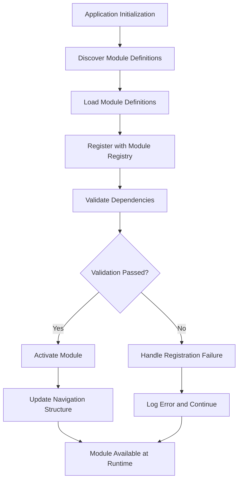
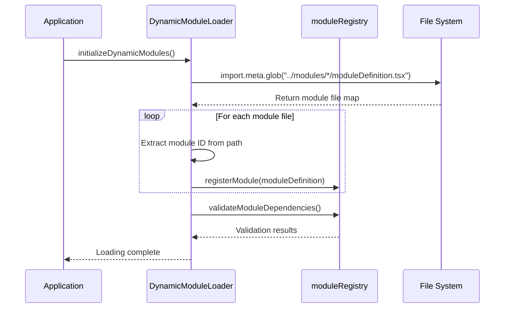
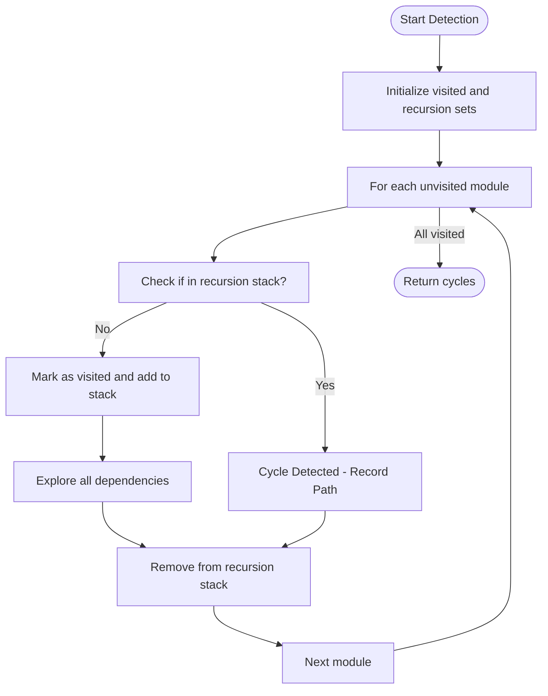
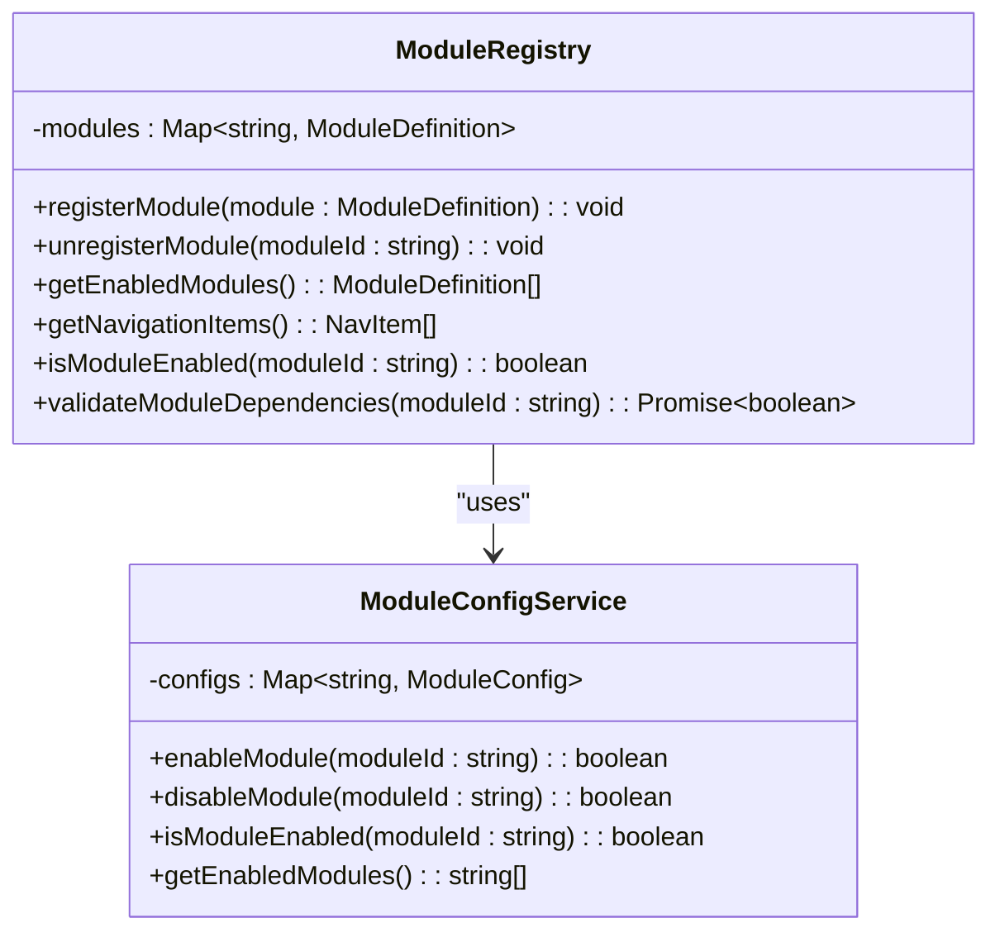
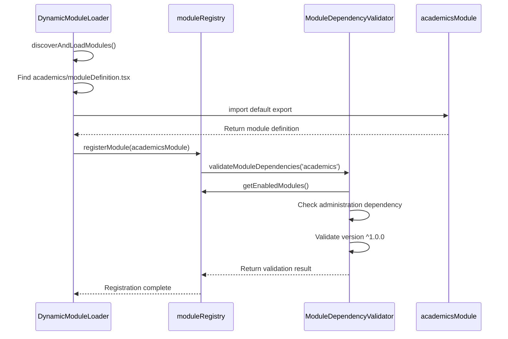

# Module Registration Mechanism

<cite>
**Referenced Files in This Document**   
- [moduleRegistry.ts](file://src/core/moduleRegistry.ts)
- [moduleConfigService.ts](file://src/services/moduleConfigService.ts)
- [ModuleDependencyValidator.ts](file://src/core/services/ModuleDependencyValidator.ts)
- [dynamicModuleLoader.ts](file://src/services/dynamicModuleLoader.ts)
- [moduleDefinition.tsx](file://src/modules/academics/moduleDefinition.tsx)
- [types.ts](file://src/core/types.ts)
</cite>

## Table of Contents
1. [Introduction](#introduction)
2. [Module Registration Lifecycle](#module-registration-lifecycle)
3. [Dynamic Module Discovery and Loading](#dynamic-module-discovery-and-loading)
4. [Dependency Validation and Circular Dependency Detection](#dependency-validation-and-circular-dependency-detection)
5. [Module Registry and Global State Management](#module-registry-and-global-state-management)
6. [Validation Process During Registration](#validation-process-during-registration)
7. [Error Handling for Failed Registrations](#error-handling-for-failed-registrations)
8. [Integration with Lazy Loading and Code Splitting](#integration-with-lazy-loading-and-code-splitting)
9. [Concurrency and Thread Safety Considerations](#concurrency-and-thread-safety-considerations)
10. [Academics Module Registration Flow Example](#academics-module-registration-flow-example)

## Introduction
The module registration mechanism in schoolpilot3 is a dynamic system that enables modular architecture by allowing features to be registered, enabled/disabled, and integrated at runtime. This document details the complete lifecycle of module registration, from initialization to runtime availability, with a focus on the core components responsible for discovery, validation, dependency resolution, and state management.

The system supports a plugin-like architecture where each module defines its structure, dependencies, navigation, and permissions through a standardized `ModuleDefinition` interface. Modules are discovered dynamically at startup, validated for dependencies and configuration integrity, and then registered into a global registry that manages their state and availability throughout the application lifecycle.

**Section sources**
- [moduleRegistry.ts](file://src/core/moduleRegistry.ts#L1-L195)
- [types.ts](file://src/core/types.ts#L1488-L1623)

## Module Registration Lifecycle
The module registration lifecycle consists of four primary phases: discovery, loading, validation, and activation. The process begins when the application initializes and ends when all modules are either successfully registered or gracefully degraded with fallback mechanisms.

1. **Discovery Phase**: The `DynamicModuleLoader` scans the `src/modules` directory using Vite's `import.meta.glob` to locate all `moduleDefinition.tsx` files.
2. **Loading Phase**: Each discovered module definition is imported and passed to the `moduleRegistry` for registration.
3. **Validation Phase**: The `ModuleDependencyValidator` checks for missing dependencies, version compatibility, and circular dependencies.
4. **Activation Phase**: Modules are enabled based on configuration stored in localStorage, with core modules always active.

The lifecycle ensures that modules are only made available if they satisfy all dependencies and pass validation checks, preventing runtime errors due to incomplete or incompatible module configurations.



**Diagram sources**
- [dynamicModuleLoader.ts](file://src/services/dynamicModuleLoader.ts#L0-L263)
- [moduleRegistry.ts](file://src/core/moduleRegistry.ts#L0-L195)

**Section sources**
- [dynamicModuleLoader.ts](file://src/services/dynamicModuleLoader.ts#L0-L263)
- [moduleRegistry.ts](file://src/core/moduleRegistry.ts#L0-L195)

## Dynamic Module Discovery and Loading
The dynamic module loading system uses Vite's build-time feature `import.meta.glob` to discover and load module definitions without requiring manual imports. This approach enables true dynamic discovery of modules, allowing new modules to be added simply by placing them in the correct directory structure.

The `DynamicModuleLoader` class implements a robust discovery mechanism with fallback capabilities to ensure system stability even when module discovery fails:

```typescript
const moduleFiles = import.meta.glob('../modules/*/moduleDefinition.tsx', { eager: true });
```

This glob pattern matches all module definition files across the modules directory. The `{ eager: true }` option ensures synchronous loading during application initialization.

Key features of the dynamic loading system include:
- **Timeout Protection**: A 5-second timeout prevents infinite loading states
- **Fallback Mechanism**: Predefined module list used if discovery fails
- **Force Completion**: Emergency method to bypass loading issues
- **Performance Monitoring**: Built-in reporting for loading metrics

The loader also handles both single module exports and arrays of modules (used for core modules), making it flexible enough to accommodate different module organization patterns.



**Diagram sources**
- [dynamicModuleLoader.ts](file://src/services/dynamicModuleLoader.ts#L0-L263)

**Section sources**
- [dynamicModuleLoader.ts](file://src/services/dynamicModuleLoader.ts#L0-L263)

## Dependency Validation and Circular Dependency Detection
The `ModuleDependencyValidator` class is responsible for resolving dependency graphs and detecting circular dependencies among modules. It performs both synchronous and asynchronous validation to ensure compatibility with different execution contexts.

### Dependency Structure
Modules define dependencies using the `ModuleDependency` interface:
```typescript
interface ModuleDependency {
  moduleId: string;
  version: string; // SemVer range
  required: boolean;
}
```

The validator checks:
- **Existence**: Required dependencies are present in the registry
- **Version Compatibility**: Using `semver.satisfies()` to validate version ranges
- **Circular Dependencies**: Using depth-first search to detect cycles

### Circular Dependency Detection Algorithm
The detection algorithm uses a classic depth-first search approach with recursion stack tracking:



The algorithm maintains three data structures:
- `visited`: Set of modules that have been fully processed
- `recursionStack`: Set of modules in the current DFS path
- `path`: Array tracking the current traversal path

When a module is encountered that already exists in the recursion stack, a cycle is detected, and the path from the first occurrence to the current position forms the circular dependency chain.

**Section sources**
- [ModuleDependencyValidator.ts](file://src/core/services/ModuleDependencyValidator.ts#L0-L297)

## Module Registry and Global State Management
The `moduleRegistry` is a singleton instance of the `ModuleRegistry` class that maintains the global state of all registered modules. It serves as the central authority for module information, providing methods to register, unregister, enable, disable, and query modules.

### Core Functionality
The registry implements several key methods:
- `registerModule()`: Adds a module to the internal Map
- `getEnabledModules()`: Returns modules that are currently active
- `getNavigationItems()`: Generates navigation structure from enabled modules
- `isModuleEnabled()`: Determines if a module should be active

### State Management Strategy
The registry uses a hybrid approach to determine module activation:
- **Core Modules**: Always enabled (dashboard, settings, reports)
- **Configured Modules**: Enabled state stored in localStorage
- **New Modules**: Auto-enabled by default unless explicitly disabled

```typescript
class ModuleRegistry {
  private modules: Map<string, ModuleDefinition> = new Map();
  
  getEnabledModules(): ModuleDefinition[] {
    return Array.from(this.modules.values()).filter(module => {
      const isCoreModule = CORE_MODULE_IDS.includes(module.id);
      const isConfigEnabled = moduleConfigService.isModuleEnabled(module.id);
      return isCoreModule || isConfigEnabled;
    });
  }
}
```

The registry also integrates with the `moduleConfigService` to persist configuration changes, ensuring that module enable/disable states survive application restarts.



**Diagram sources**
- [moduleRegistry.ts](file://src/core/moduleRegistry.ts#L0-L195)
- [moduleConfigService.ts](file://src/services/moduleConfigService.ts#L0-L325)

**Section sources**
- [moduleRegistry.ts](file://src/core/moduleRegistry.ts#L0-L195)
- [moduleConfigService.ts](file://src/services/moduleConfigService.ts#L0-L325)

## Validation Process During Registration
During module registration, several validation checks are performed to ensure system integrity and prevent runtime errors.

### Schema Validation
The `ModuleDefinition` interface enforces a strict schema that all modules must adhere to:
```typescript
interface ModuleDefinition {
  id: string;
  name: string;
  icon: React.ComponentType<any>;
  path: string;
  isActive: boolean;
  version: string;
  dependencies?: ModuleDependency[];
  navigation: NavItem[];
  features?: string[];
  settings?: ModuleSettings;
  rbacPermissions?: Permission[];
  defaultRoles?: string[];
}
```

### Route Conflict Detection
The system prevents route conflicts by:
1. Using a hierarchical path structure (`/module/subpage`)
2. Validating navigation paths during registration
3. Relying on React Router's path resolution which prioritizes more specific routes

### Permission Validation
RBAC (Role-Based Access Control) validation occurs through:
- `rbacPermissions`: Array of permissions required by the module
- `defaultRoles`: Roles that automatically receive access
- Integration with the global RBAC service for runtime permission checks

The validation process logs detailed information about each check, making it easier to debug configuration issues:

```typescript
console.log(`[ModuleRegistry] DEBUG: Module ${module.id} - core: ${isCoreModule}, configEnabled: ${isConfigEnabled}, finalEnabled: ${isEnabled}`);
```

**Section sources**
- [moduleRegistry.ts](file://src/core/moduleRegistry.ts#L0-L195)
- [types.ts](file://src/core/types.ts#L1488-L1623)

## Error Handling for Failed Registrations
The module registration system implements comprehensive error handling strategies to maintain application stability when modules fail to register.

### Common Failure Scenarios
1. **Missing Dependencies**: Required modules not found in the registry
2. **Version Mismatches**: Dependency version outside acceptable range
3. **Circular Dependencies**: Modules that depend on each other directly or indirectly
4. **Invalid Configuration**: Malformed module definition

### Error Handling Strategies
- **Graceful Degradation**: Use fallback module list if discovery fails
- **Detailed Logging**: Comprehensive console output for debugging
- **Timeout Protection**: Prevent infinite loading states
- **Partial Success**: Continue registration even if some modules fail

```typescript
try {
  await Promise.race([
    this.discoverAndLoadModules(),
    timeoutPromise
  ]);
} catch (error) {
  console.warn('⚠️ [DynamicModuleLoader] Module loading failed, using fallback:', error);
  this.useFallbackModules();
}
```

The fallback mechanism registers basic module definitions for all known modules, ensuring that the application remains functional even when full module discovery fails.

**Section sources**
- [dynamicModuleLoader.ts](file://src/services/dynamicModuleLoader.ts#L0-L263)

## Integration with Lazy Loading and Code Splitting
The module registration system is designed to work seamlessly with lazy loading and code splitting for optimal performance.

### Dynamic Imports
While the current implementation uses eager loading for module definitions, the architecture supports lazy loading through dynamic imports:

```typescript
const moduleDefinition = await import(`../modules/${moduleId}/moduleDefinition.tsx`);
```

### Code Splitting Benefits
- **Reduced Initial Bundle Size**: Only core modules loaded initially
- **On-Demand Loading**: Feature modules loaded when first accessed
- **Improved Startup Performance**: Faster application initialization

The system could be enhanced to support true lazy loading by:
1. Modifying `import.meta.glob` to use lazy loading
2. Implementing route-based code splitting
3. Adding preload hints for likely-to-be-used modules


**Section sources**
- [dynamicModuleLoader.ts](file://src/services/dynamicModuleLoader.ts#L0-L263)

## Concurrency and Thread Safety Considerations
Although JavaScript is single-threaded, the module registration system addresses potential race conditions during concurrent module loading.

### Race Condition Prevention
- **Loading State Tracking**: `isLoading` and `isCompleted` flags prevent duplicate initialization
- **Promise Caching**: `loadingPromise` ensures only one loading operation at a time
- **Synchronous Validation**: `_validateDependenciesSync` method avoids async race conditions

```typescript
if (this.isLoading && this.loadingPromise) {
  return this.loadingPromise;
}
```

### Thread Safety
The registry uses a simple Map data structure which is safe for single-threaded access. In a multi-threaded environment (e.g., Web Workers), additional synchronization mechanisms would be required.

The system also implements a reset mechanism to clear state if needed:
```typescript
reset(): void {
  this.isLoading = false;
  this.isCompleted = false;
  this.loadingPromise = null;
}
```

These measures ensure that the module registration process is idempotent and can be safely retried if necessary.

**Section sources**
- [dynamicModuleLoader.ts](file://src/services/dynamicModuleLoader.ts#L0-L263)
- [moduleRegistry.ts](file://src/core/moduleRegistry.ts#L0-L195)

## Academics Module Registration Flow Example
The academics module serves as a comprehensive example of the registration flow, demonstrating dependencies, navigation, and configuration.

### Module Definition Analysis
The `academicsModule` definition includes:
- **Dependencies**: Requires administration module, optionally uses finance and reports
- **Navigation**: 14 navigation items organized by functionality
- **Features**: Five distinct feature flags
- **Settings**: Three configurable boolean settings

```typescript
export const academicsModule: ModuleDefinition = {
  id: 'academics',
  name: 'navigation:academics.title',
  icon: AcademicCapIcon,
  path: '/academics',
  dependencies: [
    { moduleId: 'administration', version: '^1.0.0', required: true },
    { moduleId: 'finance', version: '^1.0.0', required: false },
    { moduleId: 'reports', version: '^1.0.0', required: false }
  ],
  navigation: [/* 14 items */],
  features: ['subject-management', 'class-management', 'timetable', 'exam-management', 'grading'],
  settings: { /* 3 items */ }
};
```

### Registration Flow
1. **Discovery**: `import.meta.glob` finds `src/modules/academics/moduleDefinition.tsx`
2. **Loading**: File is imported and the default export is retrieved
3. **Registration**: `moduleRegistry.registerModule(academicsModule)` is called
4. **Validation**: Dependency validator checks for administration module
5. **Activation**: Module enabled if dependencies satisfied and config allows

### Dependency Resolution
The validation process for the academics module:
1. Checks for `administration` module (required)
2. Verifies version compatibility (`^1.0.0`)
3. Optionally checks `finance` and `reports` modules
4. Returns success only if required dependencies are satisfied

If the administration module is missing or has an incompatible version, the academics module will fail validation and not be activated, preventing potential runtime errors.



**Diagram sources**
- [moduleDefinition.tsx](file://src/modules/academics/moduleDefinition.tsx#L0-L88)
- [dynamicModuleLoader.ts](file://src/services/dynamicModuleLoader.ts#L0-L263)
- [ModuleDependencyValidator.ts](file://src/core/services/ModuleDependencyValidator.ts#L0-L297)

**Section sources**
- [moduleDefinition.tsx](file://src/modules/academics/moduleDefinition.tsx#L0-L88)
- [dynamicModuleLoader.ts](file://src/services/dynamicModuleLoader.ts#L0-L263)
- [ModuleDependencyValidator.ts](file://src/core/services/ModuleDependencyValidator.ts#L0-L297)