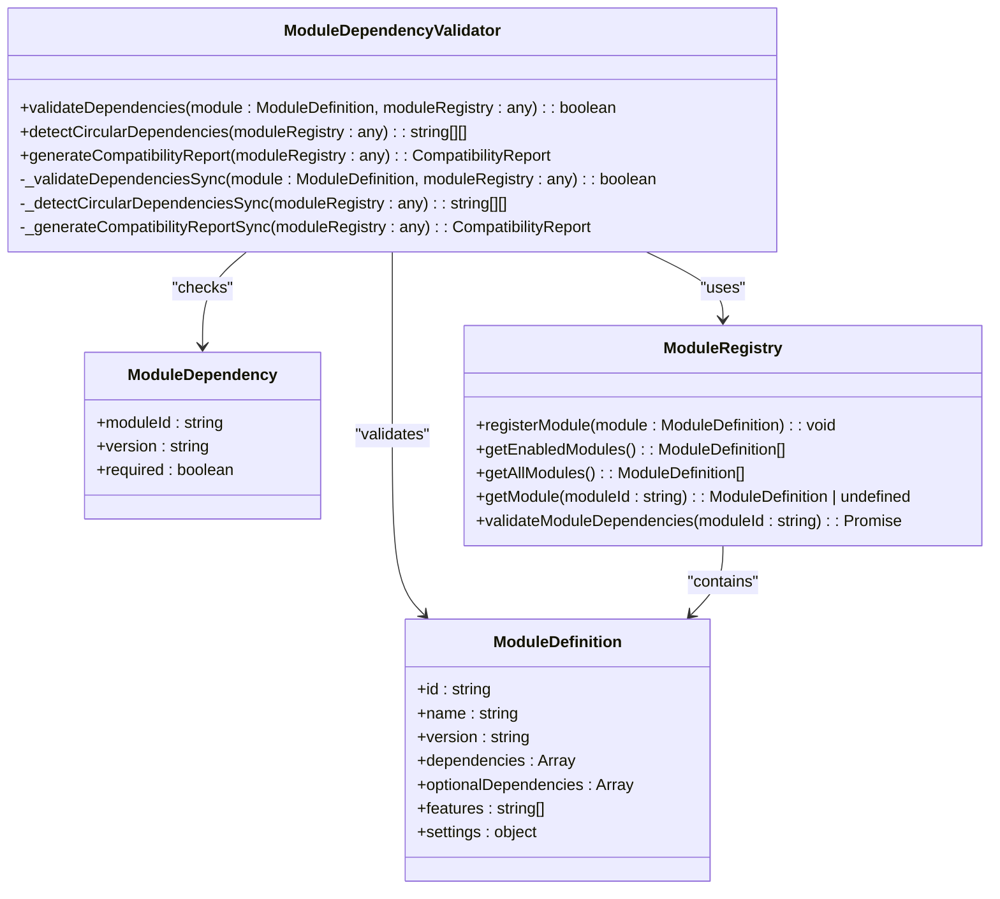
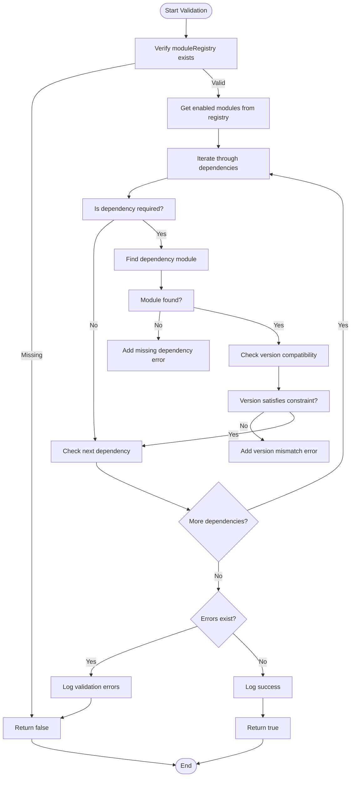
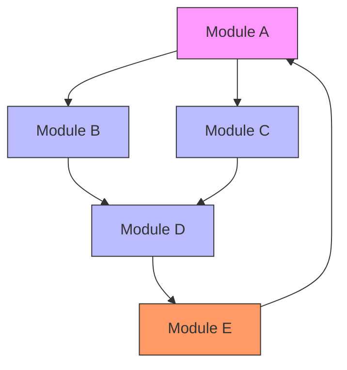
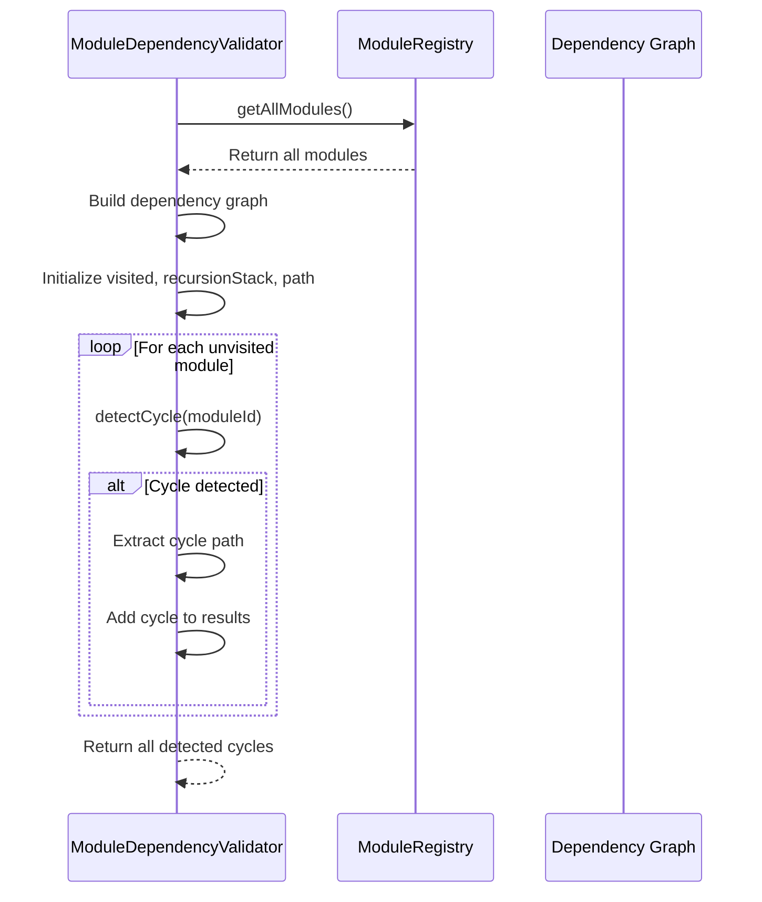
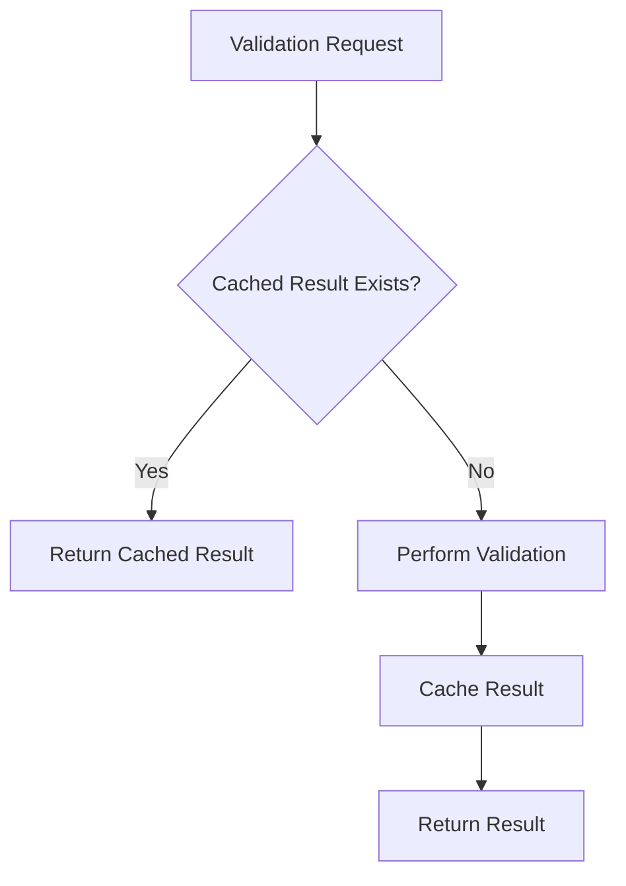
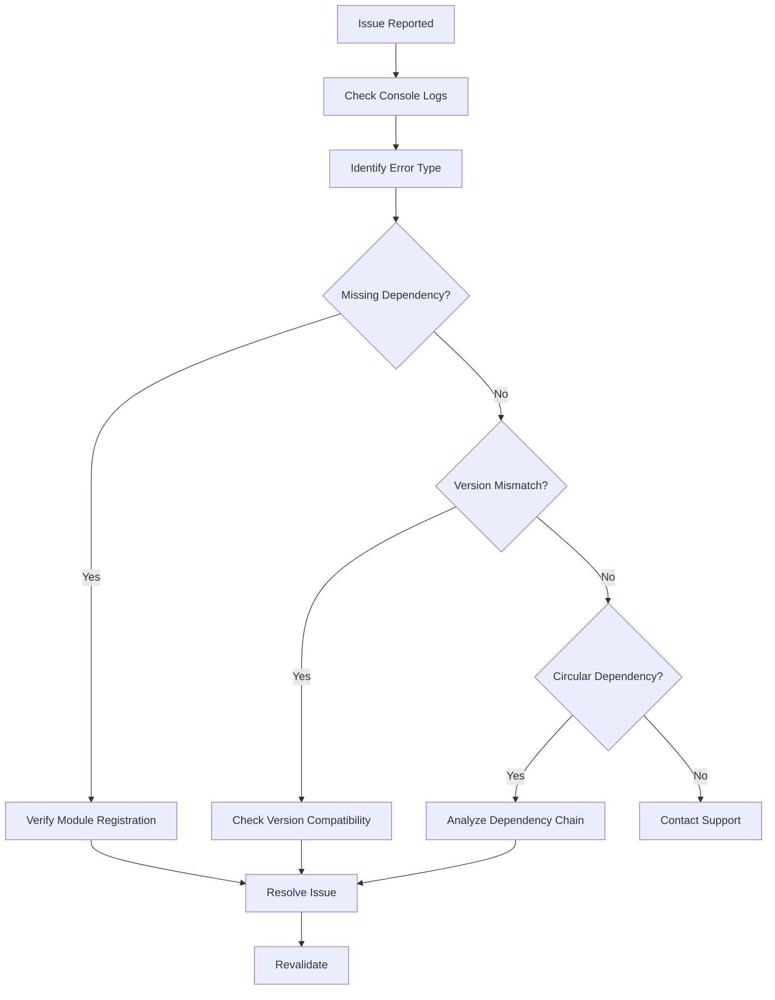

# Dependency Validation Mechanism

<cite>
**Referenced Files in This Document**   
- [ModuleDependencyValidator.ts](file://src/core/services/ModuleDependencyValidator.ts)
- [moduleRegistry.ts](file://src/core/moduleRegistry.ts)
- [types.ts](file://src/core/types.ts)
- [ModuleDependencyReportPage.tsx](file://src/modules/settings/pages/ModuleDependencyReportPage.tsx)
</cite>

## Table of Contents
1. [Introduction](#introduction)
2. [Core Components](#core-components)
3. [Dependency Validation Process](#dependency-validation-process)
4. [Dependency Graph Construction](#dependency-graph-construction)
5. [Error Reporting System](#error-reporting-system)
6. [Performance Considerations](#performance-considerations)
7. [Troubleshooting Guide](#troubleshooting-guide)
8. [Best Practices](#best-practices)

## Introduction
The Dependency Validation Mechanism in schoolpilot3 ensures module integrity during registration by validating dependencies between modules. This system prevents runtime errors by verifying that all required modules are available and compatible before they are loaded. The mechanism uses semantic versioning rules to check version compatibility and detects circular dependencies that could cause system instability.

**Section sources**
- [ModuleDependencyValidator.ts](file://src/core/services/ModuleDependencyValidator.ts#L1-L20)
- [moduleRegistry.ts](file://src/core/moduleRegistry.ts#L1-L10)

## Core Components

The dependency validation system consists of several key components that work together to ensure module integrity:

### ModuleDependencyValidator Class
The `ModuleDependencyValidator` class is the central component responsible for validating module dependencies. It provides static methods for dependency checking, circular dependency detection, and generating compatibility reports.



**Diagram sources**
- [ModuleDependencyValidator.ts](file://src/core/services/ModuleDependencyValidator.ts#L24-L296)
- [types.ts](file://src/core/types.ts#L1-L50)
- [moduleRegistry.ts](file://src/core/moduleRegistry.ts#L11-L194)

**Section sources**
- [ModuleDependencyValidator.ts](file://src/core/services/ModuleDependencyValidator.ts#L24-L296)
- [types.ts](file://src/core/types.ts#L1-L50)

## Dependency Validation Process

The dependency validation process follows a systematic approach to ensure all module requirements are met before registration.

### Step-by-Step Validation Flow
The validation process begins when a module is registered or enabled in the system. The `ModuleDependencyValidator` performs the following steps:



**Diagram sources**
- [ModuleDependencyValidator.ts](file://src/core/services/ModuleDependencyValidator.ts#L25-L72)
- [ModuleDependencyValidator.ts](file://src/core/services/ModuleDependencyValidator.ts#L74-L100)

**Section sources**
- [ModuleDependencyValidator.ts](file://src/core/services/ModuleDependencyValidator.ts#L25-L100)

### Required Modules Verification
The system verifies required modules by checking if they exist in the enabled modules list. The validation process handles both string-based dependencies and structured dependency objects:

```typescript
// Example from ModuleDependencyValidator.ts
for (const dep of dependencies.filter(d => typeof d !== 'string' && d.required)) {
  const depId = typeof dep === 'string' ? dep : dep.moduleId;
  const depModule = enabledModules.find(m => m.id === depId);
  
  if (!depModule) {
    errors.push(`Required dependency '${depId}' not found`);
    continue;
  }
}
```

This code demonstrates how the validator filters for required dependencies and checks their presence in the enabled modules collection.

### Version Constraint Evaluation
Version compatibility is evaluated using the semver library, which implements semantic versioning rules. The validator checks if the installed module version satisfies the required version constraint:

```typescript
// Example from ModuleDependencyValidator.ts
if (typeof dep !== 'string' && dep.version) {
  console.log(`Checking version compatibility for ${depId}: required ${dep.version}, found ${depModule.version}`);
  if (!semver.satisfies(depModule.version, dep.version)) {
    errors.push(
      `Version mismatch for '${depId}': ` +
      `required ${dep.version}, found ${depModule.version}`
    );
  }
}
```

The system supports all standard semver ranges including exact versions, caret ranges (^), tilde ranges (~), and logical operators.

### Optional Plugin Resolution
While the current implementation focuses on required dependencies, the system also acknowledges optional dependencies in the dependency graph construction. These are included in the graph for circular dependency detection but are not required for validation success.

**Section sources**
- [ModuleDependencyValidator.ts](file://src/core/services/ModuleDependencyValidator.ts#L51-L72)
- [ModuleDependencyValidator.ts](file://src/core/services/ModuleDependencyValidator.ts#L137-L178)

## Dependency Graph Construction

The system constructs a dependency graph to visualize and analyze module relationships, which is essential for detecting circular dependencies.

### Graph Building Process
The dependency graph is built by iterating through all registered modules and mapping their dependencies:



**Diagram sources**
- [ModuleDependencyValidator.ts](file://src/core/services/ModuleDependencyValidator.ts#L137-L178)

The graph construction process:
1. Retrieves all modules from the module registry
2. For each module, extracts both required and optional dependencies
3. Creates a mapping of module ID to its dependencies
4. Stores this mapping in a Map data structure for efficient lookup

### Circular Dependency Detection
Circular dependencies are detected using a depth-first search (DFS) algorithm with recursion stack tracking:



**Diagram sources**
- [ModuleDependencyValidator.ts](file://src/core/services/ModuleDependencyValidator.ts#L137-L178)
- [ModuleDependencyValidator.ts](file://src/core/services/ModuleDependencyValidator.ts#L97-L135)

The algorithm works as follows:
- Maintains three data structures: `visited` (Set), `recursionStack` (Set), and `path` (Array)
- When visiting a module, it's added to both `visited` and `recursionStack`
- If a module is encountered that's already in the `recursionStack`, a cycle is detected
- The cycle path is extracted from the current path array
- After exploring all dependencies, the module is removed from the `recursionStack`

**Section sources**
- [ModuleDependencyValidator.ts](file://src/core/services/ModuleDependencyValidator.ts#L137-L178)

## Error Reporting System

The system provides comprehensive error reporting to help developers identify and resolve dependency issues.

### Validation Error Types
The validator identifies three main types of validation errors:

```typescript
type ValidationErrorType = 'missing' | 'version' | 'circular';

interface ValidationError {
  moduleId: string;
  type: ValidationErrorType;
  details: string;
}
```

**Section sources**
- [ModuleDependencyValidator.ts](file://src/core/services/ModuleDependencyValidator.ts#L268-L296)

#### Missing Dependency
Occurs when a required module is not found in the enabled modules list:
- **Error Type**: missing
- **Example**: `Required dependency 'finance' not found`
- **Cause**: The dependent module is not installed or not enabled

#### Version Mismatch
Occurs when the installed module version doesn't satisfy the required version constraint:
- **Error Type**: version
- **Example**: `Version mismatch for 'hr': required ^2.1.0, found 1.5.0`
- **Cause**: The installed version is incompatible with the required version range

#### Circular Reference
Occurs when modules depend on each other in a circular chain:
- **Error Type**: circular
- **Example**: `Circular dependency detected: academics -> finance -> hr -> academics`
- **Cause**: Modules form a dependency loop that cannot be resolved

### Error Communication
Errors are communicated through multiple channels:

1. **Console Logging**: Detailed error messages are logged with timestamps and module context
2. **Return Values**: Validation methods return boolean values indicating success/failure
3. **Compatibility Reports**: Comprehensive reports with structured error data

The `generateCompatibilityReport` method provides a detailed overview of all dependency issues across the system:

```typescript
interface CompatibilityReport {
  totalModules: number;
  modulesWithIssues: number;
  issues: Array<{
    moduleId: string;
    type: 'missing' | 'version' | 'circular';
    details: string;
  }>;
}
```

**Section sources**
- [ModuleDependencyValidator.ts](file://src/core/services/ModuleDependencyValidator.ts#L268-L296)
- [ModuleDependencyReportPage.tsx](file://src/modules/settings/pages/ModuleDependencyReportPage.tsx#L34-L148)

## Performance Considerations

The dependency validation system incorporates several optimizations to handle large-scale deployments efficiently.

### Caching Validation Results
While the current implementation doesn't explicitly show caching, the synchronous nature of the validation methods suggests opportunities for caching:



Implementing a caching layer could significantly improve performance for frequently validated modules.

### Parallel Checking
The current implementation uses synchronous validation to avoid race conditions, but parallel checking could be implemented for independent modules:

```typescript
// Potential optimization for parallel checking
async validateAllModulesParallel(moduleRegistry) {
  const modules = moduleRegistry.getAllModules();
  const validationPromises = modules.map(module => 
    this.validateDependencies(module, moduleRegistry)
  );
  return Promise.all(validationPromises);
}
```

### Optimization Techniques
The system employs several performance optimization techniques:

1. **Synchronous Validation**: Prevents race conditions by using synchronous methods
2. **Efficient Data Structures**: Uses Maps and Sets for O(1) lookup operations
3. **Early Termination**: Stops validation at the first error in some contexts
4. **Lazy Loading**: Uses dynamic imports to avoid circular dependency issues

The use of `Set` data structures for tracking visited modules and recursion stack ensures O(1) lookup time, which is crucial for performance when dealing with large dependency graphs.

**Section sources**
- [ModuleDependencyValidator.ts](file://src/core/services/ModuleDependencyValidator.ts#L25-L54)
- [ModuleDependencyValidator.ts](file://src/core/services/ModuleDependencyValidator.ts#L137-L178)

## Troubleshooting Guide

This section provides guidance for resolving common dependency validation failures.

### Common Validation Failures
#### Missing Module Error
**Symptom**: `Required dependency 'moduleName' not found`
**Solution**:
1. Verify the module is properly registered in the system
2. Check if the module is enabled in the configuration
3. Ensure the module ID in the dependency matches the registered module ID
4. Confirm the module file is present and correctly imported

#### Version Mismatch Error
**Symptom**: `Version mismatch for 'moduleName': required ^2.1.0, found 1.5.0`
**Solution**:
1. Update the dependent module to a compatible version
2. Adjust the version constraint in the dependency definition to be more permissive
3. Check the semver range syntax for correctness
4. Verify the version number in the module's package.json or module definition

#### Circular Dependency Error
**Symptom**: `Circular dependency detected: moduleA -> moduleB -> moduleA`
**Solution**:
1. Analyze the dependency chain to understand the circular reference
2. Refactor one of the modules to remove the direct dependency
3. Consider using dependency injection or service locators
4. Move shared functionality to a common utility module
5. Use asynchronous loading or dynamic imports to break the cycle

### Diagnostic Tools
The system provides several tools for diagnosing dependency issues:

1. **Console Logs**: Detailed logging with debug information
2. **Dependency Report Page**: Visual interface showing all dependencies and issues
3. **Compatibility Report**: Structured data with all validation issues



**Section sources**
- [ModuleDependencyValidator.ts](file://src/core/services/ModuleDependencyValidator.ts#L51-L72)
- [ModuleDependencyValidator.ts](file://src/core/services/ModuleDependencyValidator.ts#L268-L296)
- [ModuleDependencyReportPage.tsx](file://src/modules/settings/pages/ModuleDependencyReportPage.tsx#L34-L148)

## Best Practices

Follow these best practices when working with the dependency validation system.

### Writing Compatible Module Definitions
When defining modules, follow these guidelines:

1. **Use Semantic Versioning**: Always specify version numbers using semver format
2. **Be Specific with Dependencies**: Only list truly required dependencies
3. **Use Appropriate Version Ranges**: Choose version constraints carefully
   - Use `^` for backward-compatible updates
   - Use `~` for patch-level updates
   - Use exact versions for critical dependencies

```typescript
// Good practice example
const moduleDefinition = {
  id: 'academics',
  name: 'Academics Module',
  version: '2.1.0',
  dependencies: [
    { moduleId: 'core', version: '^1.0.0', required: true },
    { moduleId: 'ui', version: '~2.1.0', required: true }
  ],
  optionalDependencies: [
    { moduleId: 'analytics', version: '^3.0.0', required: false }
  ]
};
```

### Version Management
Follow these version management practices:

1. **Increment Versions Properly**:
   - Major version: Breaking changes
   - Minor version: New features (backward compatible)
   - Patch version: Bug fixes (backward compatible)

2. **Test Compatibility**: Always test your module with the minimum and maximum supported versions of dependencies

3. **Document Breaking Changes**: Clearly document any breaking changes in release notes

### Dependency Organization
Organize dependencies effectively:

1. **Minimize Dependencies**: Only depend on modules that are absolutely necessary
2. **Avoid Deep Nesting**: Keep dependency chains as shallow as possible
3. **Use Optional Dependencies**: Mark non-critical dependencies as optional
4. **Regular Audits**: Periodically review and clean up dependencies

By following these best practices, developers can ensure their modules integrate smoothly with the schoolpilot3 ecosystem and avoid common dependency-related issues.

**Section sources**
- [ModuleDependencyValidator.ts](file://src/core/services/ModuleDependencyValidator.ts#L51-L72)
- [types.ts](file://src/core/types.ts#L1-L50)