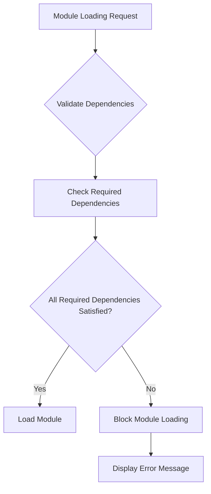
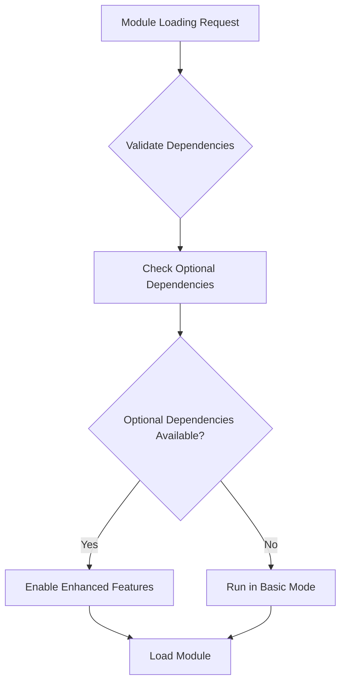
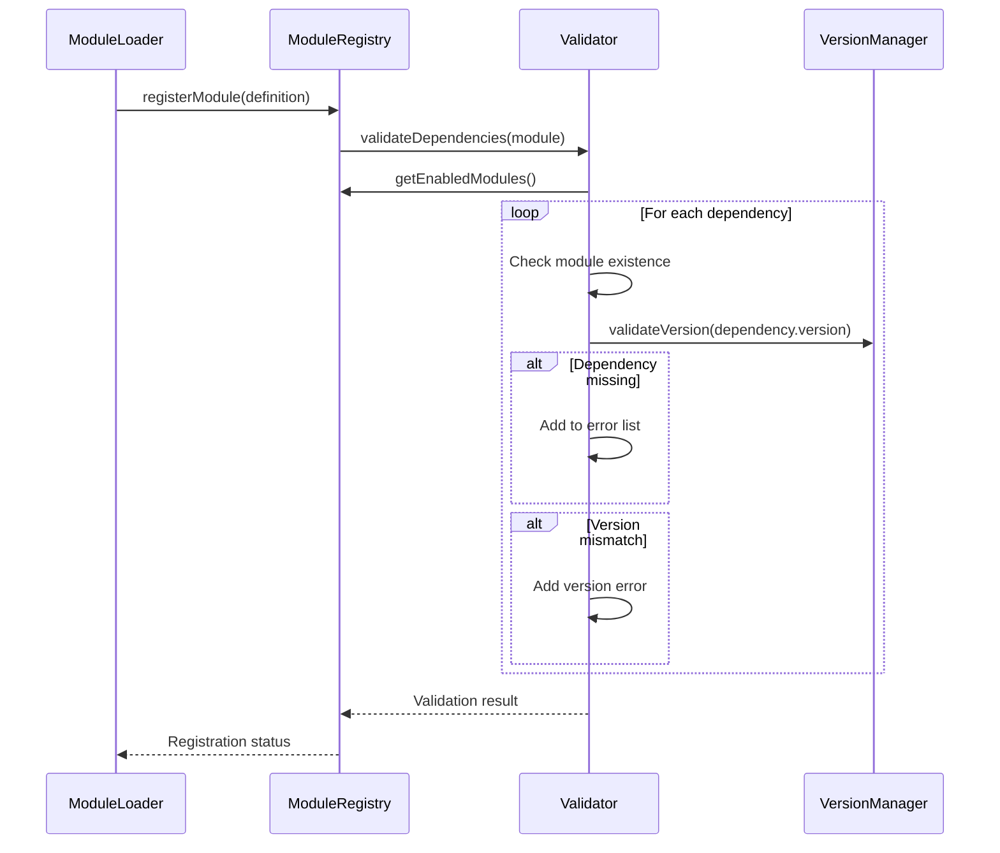
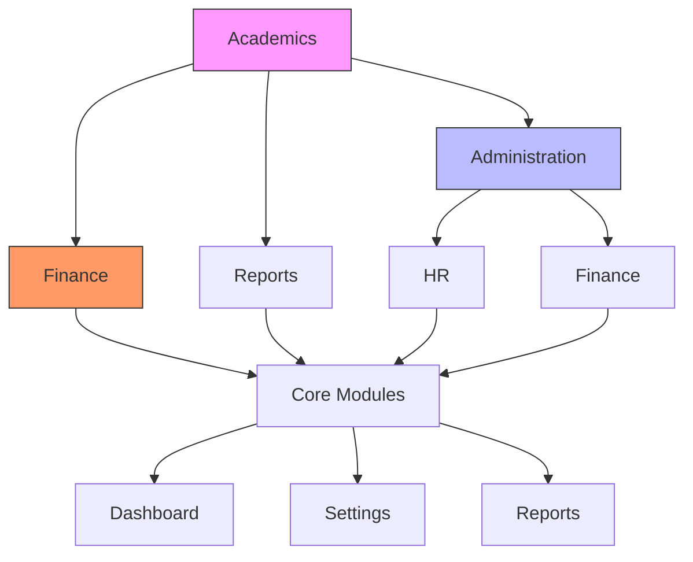
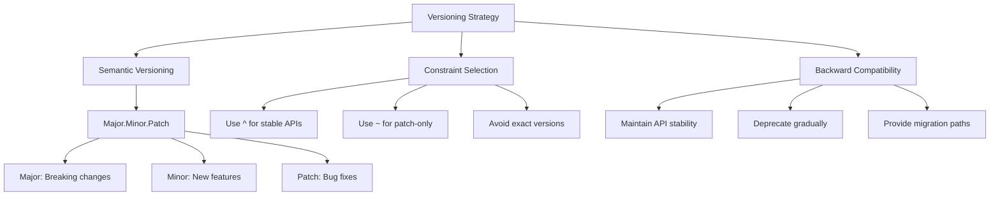
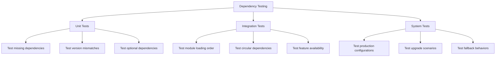
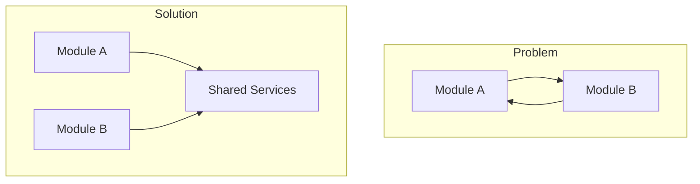

# Module Definition Dependencies

<cite>
**Referenced Files in This Document**   
- [ModuleDefinition.tsx](file://src/modules/academics/moduleDefinition.tsx)
- [moduleDefinition.tsx](file://src/modules/administration/moduleDefinition.tsx)
- [types.ts](file://src/core/types.ts)
- [moduleRegistry.ts](file://src/core/moduleRegistry.ts)
- [ModuleDependencyValidator.ts](file://src/core/services/ModuleDependencyValidator.ts)
- [VersionManager.ts](file://src/core/services/VersionManager.ts)
</cite>

## Table of Contents
1. [Introduction](#introduction)
2. [Dependency Declaration Syntax](#dependency-declaration-syntax)
3. [Dependency Types and Semantics](#dependency-types-and-semantics)
4. [Real-World Examples](#real-world-examples)
5. [Dependency Validation Process](#dependency-validation-process)
6. [Global Dependency Graph Integration](#global-dependency-graph-integration)
7. [Best Practices for Dependency Management](#best-practices-for-dependency-management)
8. [Common Pitfalls and Solutions](#common-pitfalls-and-solutions)

## Introduction
The module dependency system in schoolpilot3 provides a robust mechanism for managing inter-module relationships and ensuring proper module loading order. This system enables modules to declare their dependencies on other modules, specify version constraints, and define both hard and soft dependencies. The dependency metadata is used during module registration to validate compatibility, prevent circular references, and ensure that required functionality is available before a module is loaded. This document provides a comprehensive overview of how dependency declarations are structured, validated, and integrated into the system's architecture.

**Section sources**
- [types.ts](file://src/core/types.ts#L1597-L1631)

## Dependency Declaration Syntax

### ModuleDefinition Interface Structure
The dependency system is built around the `ModuleDefinition` interface, which includes a `dependencies` property that specifies the modules required for proper functionality. The syntax follows a standardized structure that supports both required and optional dependencies with version constraints.

```typescript
export interface ModuleDefinition {
  id: string;
  name: string;
  description?: string;
  icon: React.ComponentType<any>;
  path: string;
  isActive: boolean;
  version: string;
  dependencies?: ModuleDependency[];
  navigation: NavItem[];
  features?: string[];
  routes?: Array<{ path: string; page: string }>;
  settings?: {
    category: string;
    items: Array<{
      key: string;
      type: 'boolean' | 'string' | 'number' | 'select';
      defaultValue: any;
      options?: Array<{ value: any; label: string }>;
    }>;
  };
  rbacPermissions?: Permission[];
  defaultRoles?: string[];
  requiresAuthentication?: boolean;
  publicAccess?: boolean;
}
```

### ModuleDependency Interface
The `ModuleDependency` interface defines the structure for individual dependency declarations, allowing for precise control over version requirements and dependency type.

```typescript
export interface ModuleDependency {
  moduleId: string;
  version: string; // Semver range (e.g., "^1.2.0", "~1.2.3")
  required: boolean;
  optional?: boolean;
}
```

The interface properties serve specific purposes:
- **moduleId**: Unique identifier of the dependent module
- **version**: Semantic versioning range constraint using standard npm version syntax
- **required**: Boolean flag indicating whether the dependency is mandatory
- **optional**: Optional flag that can be used to explicitly mark a dependency as optional

**Section sources**
- [types.ts](file://src/core/types.ts#L1626-L1631)

## Dependency Types and Semantics

### Hard Requirements (Required Dependencies)
Required dependencies are essential for a module to function properly. If a required dependency is missing or has an incompatible version, the module will fail to load. These dependencies are enforced during the validation process and prevent the module from being enabled in the system.



**Diagram sources**
- [ModuleDependencyValidator.ts](file://src/core/services/ModuleDependencyValidator.ts#L25-L54)

### Soft Dependencies (Optional Dependencies)
Optional dependencies provide enhanced functionality but are not essential for core operations. Modules should implement graceful degradation when optional dependencies are not available, ensuring that core functionality remains intact.



**Diagram sources**
- [administration/moduleDefinition.tsx](file://src/modules/administration/moduleDefinition.tsx#L50-L58)

### Version Constraints
The system supports semantic versioning (SemVer) ranges to specify compatible versions of dependent modules. The following version constraint formats are supported:

- **Exact version**: `1.2.3` - Requires exactly version 1.2.3
- **Caret range**: `^1.2.3` - Allows changes that do not modify the left-most non-zero digit (1.x.x)
- **Tilde range**: `~1.2.3` - Allows patch-level changes (1.2.x)

```mermaid
flowchart TD
A[Version Constraint] --> B{Constraint Type}
B --> C[Caret Range ^]
B --> D[Tilde Range ~]
B --> E[Exact Version]
C --> F[Allows: 1.2.3 to 2.0.0)
D --> G[Allows: 1.2.3 to 1.3.0)
E --> H[Allows: Only 1.2.3]
F --> I[Major version locked]
G --> J[Minor version locked]
H --> K[Exact version required]
```

**Diagram sources**
- [VersionManager.ts](file://src/core/services/VersionManager.ts#L50-L85)

## Real-World Examples

### Academics Module Dependencies
The academics module demonstrates a typical dependency structure with both required and optional dependencies. It requires the administration module for core student and staff data, while optionally integrating with finance and reports modules for enhanced functionality.

```typescript
dependencies: [
  {
    moduleId: 'administration',
    version: '^1.0.0',
    required: true
  },
  {
    moduleId: 'finance',
    version: '^1.0.0',
    required: false
  },
  {
    moduleId: 'reports',
    version: '^1.0.0',
    required: false
  }
]
```

This configuration ensures that:
- The administration module (v1.x.x) must be present and enabled
- Finance and reports modules (v1.x.x) are optional but preferred for full functionality
- The caret range allows for backward-compatible updates within the 1.x series

**Section sources**
- [moduleDefinition.tsx](file://src/modules/academics/moduleDefinition.tsx#L68-L80)

### Administration Module Dependencies
The administration module takes a different approach, having no required dependencies but several optional ones. This design makes it a foundational module that can operate independently while providing integration points for other modules.

```typescript
dependencies: [],
optionalDependencies: [
  {
    moduleId: 'finance',
    version: '^1.0.0',
    required: false
  },
  {
    moduleId: 'hr',
    version: '^1.0.0',
    required: false
  }
]
```

This pattern allows the administration module to:
- Function as a standalone student and staff management system
- Provide data to finance and HR modules when they are enabled
- Maintain loose coupling with other functional modules

**Section sources**
- [moduleDefinition.tsx](file://src/modules/administration/moduleDefinition.tsx#L50-L58)

## Dependency Validation Process

### Validation Workflow
The dependency validation process occurs during module registration and loading, ensuring that all requirements are met before a module becomes active in the system.



**Diagram sources**
- [moduleRegistry.ts](file://src/core/moduleRegistry.ts#L140-L155)
- [ModuleDependencyValidator.ts](file://src/core/services/ModuleDependencyValidator.ts#L25-L54)

### Synchronous Validation Implementation
The system uses synchronous validation to prevent race conditions and ensure consistent state during module loading.

```typescript
private static _validateDependenciesSync(
  module: ModuleDefinition, 
  moduleRegistry?: any
): boolean {
  if (!moduleRegistry) {
    console.error('❌ [ModuleDependencyValidator] moduleRegistry not provided');
    return false;
  }
  
  const enabledModules = moduleRegistry.getEnabledModules();
  const errors: string[] = [];
  const dependencies = module.dependencies || [];
  
  for (const dep of dependencies.filter(d => typeof d !== 'string' && d.required)) {
    const depId = typeof dep === 'string' ? dep : dep.moduleId;
    const depModule = enabledModules.find(m => m.id === depId);
    
    if (!depModule) {
      errors.push(`Required dependency '${depId}' not found`);
      continue;
    }
    
    if (typeof dep !== 'string' && dep.version) {
      if (!semver.satisfies(depModule.version, dep.version)) {
        errors.push(
          `Version mismatch for '${depId}': ` +
          `required ${dep.version}, found ${depModule.version}`
        );
      }
    }
  }
  
  return errors.length === 0;
}
```

**Section sources**
- [ModuleDependencyValidator.ts](file://src/core/services/ModuleDependencyValidator.ts#L25-L54)

## Global Dependency Graph Integration

### Dependency Graph Construction
The system maintains a global dependency graph that represents all module relationships, enabling advanced features like circular dependency detection and impact analysis.



**Diagram sources**
- [ModuleDependencyValidator.ts](file://src/core/services/ModuleDependencyValidator.ts#L137-L178)

### Circular Dependency Detection
The system employs depth-first search (DFS) to detect circular dependencies that could cause loading failures or runtime issues.

```typescript
private static _detectCircularDependenciesSync(moduleRegistry: any): string[][] {
  const modules = moduleRegistry.getAllModules();
  const graph = new Map<string, string[]>();
  const cycles: string[][] = [];
  
  // Build dependency graph
  for (const module of modules) {
    const requiredDeps = (module.dependencies || []).map(d => 
      typeof d === 'string' ? d : d.moduleId
    );
    const optionalDeps = (module.optionalDependencies || []).map(d => 
      typeof d === 'string' ? d : d.moduleId
    );
    const allDeps = [...requiredDeps, ...optionalDeps];
    graph.set(module.id, allDeps);
  }
  
  // Detect cycles using DFS
  const visited = new Set<string>();
  const recursionStack = new Set<string>();
  const path: string[] = [];
  
  const detectCycle = (moduleId: string): boolean => {
    if (recursionStack.has(moduleId)) {
      const cycleStart = path.indexOf(moduleId);
      if (cycleStart !== -1) {
        const cycle = [...path.slice(cycleStart), moduleId];
        cycles.push(cycle);
      }
      return true;
    }
    
    if (visited.has(moduleId)) {
      return false;
    }
    
    visited.add(moduleId);
    recursionStack.add(moduleId);
    path.push(moduleId);
    
    const dependencies = graph.get(moduleId) || [];
    for (const dep of dependencies) {
      if (detectCycle(dep)) {
        return true;
      }
    }
    
    recursionStack.delete(moduleId);
    path.pop();
    return false;
  };
  
  for (const module of modules) {
    if (!visited.has(module.id)) {
      detectCycle(module.id);
    }
  }
  
  return cycles;
}
```

**Section sources**
- [ModuleDependencyValidator.ts](file://src/core/services/ModuleDependencyValidator.ts#L137-L178)

## Best Practices for Dependency Management

### Versioning Strategies
Effective versioning is crucial for maintaining compatibility while allowing for system evolution. The following strategies are recommended:



**Diagram sources**
- [VersionManager.ts](file://src/core/services/VersionManager.ts#L50-L85)

### Testing Approaches
Comprehensive testing ensures that dependency configurations work as expected across different scenarios.



**Section sources**
- [ModuleDependencyValidator.ts](file://src/core/services/ModuleDependencyValidator.ts#L200-L297)

## Common Pitfalls and Solutions

### Over-Specifying Dependencies
A common mistake is declaring too many required dependencies, which creates unnecessary coupling and reduces module flexibility.

**Problem**: 
- Modules become dependent on functionality they don't actually need
- System becomes fragile and difficult to configure
- Upgrade paths are restricted

**Solution**:
- Only declare truly essential dependencies as required
- Use optional dependencies for nice-to-have integrations
- Implement feature detection rather than dependency enforcement

### Tight Coupling
Excessive dependencies create tight coupling that makes modules difficult to maintain and evolve independently.

**Problem**:
- Changes in one module force changes in many others
- Testing becomes complex and time-consuming
- Deployment flexibility is reduced

**Solution**:
- Define clear interface contracts between modules
- Use event-driven communication where possible
- Implement adapter patterns for integration points

### Circular References
Circular dependencies prevent modules from loading and can cause runtime failures.

**Problem**:
- Module A depends on Module B
- Module B depends on Module A
- Neither can load first

**Solution**:
- Refactor shared functionality into a third module
- Use dependency injection to break direct references
- Implement event-based communication patterns



**Diagram sources**
- [ModuleDependencyValidator.ts](file://src/core/services/ModuleDependencyValidator.ts#L137-L178)