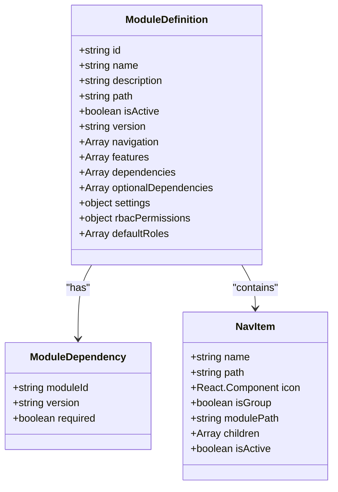
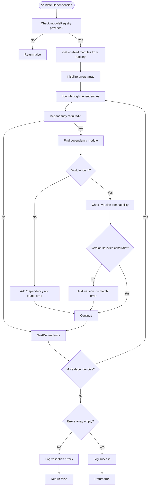
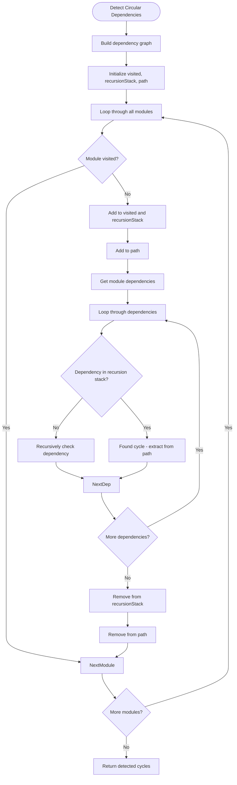
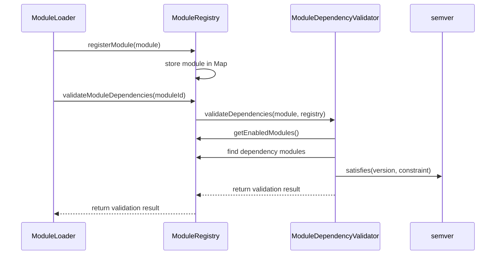
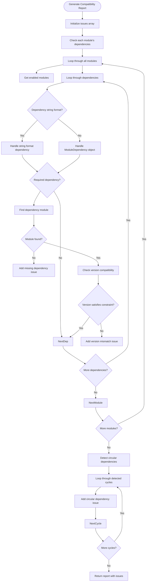

# Module Dependency Management

<cite>
**Referenced Files in This Document**   
- [ModuleDependencyValidator.ts](file://src/core/services/ModuleDependencyValidator.ts)
- [types.ts](file://src/core/types.ts)
- [moduleDefinition.tsx](file://src/modules/academics/moduleDefinition.tsx)
- [moduleDefinition.tsx](file://src/modules/administration/moduleDefinition.tsx)
- [moduleRegistry.ts](file://src/core/moduleRegistry.ts)
- [moduleLoader.ts](file://src/core/moduleLoader.ts)
- [package.json](file://package.json)
</cite>

## Table of Contents
1. [Introduction](#introduction)
2. [Core Data Structures and Interfaces](#core-data-structures-and-interfaces)
3. [Dependency Validation Process](#dependency-validation-process)
4. [Circular Dependency Detection](#circular-dependency-detection)
5. [Module Definition Examples](#module-definition-examples)
6. [Integration with Module Registry](#integration-with-module-registry)
7. [Error Reporting and Compatibility Checks](#error-reporting-and-compatibility-checks)
8. [Performance and Optimization Considerations](#performance-and-optimization-considerations)
9. [Common Issues and Best Practices](#common-issues-and-best-practices)

## Introduction
The Module Dependency Management system in schoolpilot3 ensures that modules are loaded in the correct order and that all dependencies are satisfied before activation. This document details the implementation of the ModuleDependencyValidator, which analyzes module dependencies, prevents circular references, and validates version compatibility. The system uses synchronous validation during module registration to avoid race conditions and ensure reliable dependency resolution.

## Core Data Structures and Interfaces

The dependency management system relies on well-defined interfaces that represent modules and their dependencies.



**Diagram sources**
- [types.ts](file://src/core/types.ts#L0-L799)

**Section sources**
- [types.ts](file://src/core/types.ts#L0-L799)

## Dependency Validation Process

The ModuleDependencyValidator performs synchronous validation of module dependencies during the registration process. It checks for required dependencies, version compatibility, and missing modules.



**Section sources**
- [ModuleDependencyValidator.ts](file://src/core/services/ModuleDependencyValidator.ts#L25-L72)

The validation process uses the semver library to check version compatibility. When a module declares a dependency with a version constraint (e.g., "^1.0.0"), the validator ensures that the available module version satisfies this constraint using semver.satisfies().

## Circular Dependency Detection

The system detects circular dependencies using a depth-first search (DFS) algorithm that traverses the dependency graph.



**Section sources**
- [ModuleDependencyValidator.ts](file://src/core/services/ModuleDependencyValidator.ts#L137-L178)

The circular dependency detection algorithm works as follows:
1. Builds a dependency graph including both required and optional dependencies
2. Uses DFS with a recursion stack to track the current path
3. When a node is encountered that is already in the recursion stack, a cycle is detected
4. Extracts the cycle from the current path and adds it to the results
5. Continues until all modules have been processed

## Module Definition Examples

### Academics Module Dependencies
The academics module demonstrates a typical dependency declaration with required and optional dependencies.

```typescript
export const academicsModule: ModuleDefinition = {
  id: 'academics',
  name: 'navigation:academics.title',
  description: 'navigation:academics.description',
  icon: AcademicCapIcon,
  path: '/academics',
  isActive: true,
  version: '1.0.0',
  navigation: [/* navigation items */],
  features: ['subject-management', 'class-management', 'timetable', 'exam-management', 'grading'],
  dependencies: [
    {
      moduleId: 'administration',
      version: '^1.0.0',
      required: true
    },
    {
      moduleId: 'finance',
      version: '^1.0.0',
      required: false
    },
    {
      moduleId: 'reports',
      version: '^1.0.0',
      required: false
    }
  ],
  settings: {
    category: 'academics',
    items: [
      {
        key: 'enableExamManagement',
        type: 'boolean',
        defaultValue: true
      }
    ]
  }
};
```

**Section sources**
- [moduleDefinition.tsx](file://src/modules/academics/moduleDefinition.tsx#L0-L87)

### Administration Module Dependencies
The administration module has no required dependencies but includes optional dependencies.

```typescript
export const administrationModule: ModuleDefinition = {
  id: 'administration',
  name: 'navigation:administration.title',
  description: 'navigation:administration.description',
  icon: BuildingOffice2Icon,
  path: '/administration',
  isActive: true,
  version: '1.0.0',
  navigation: [/* navigation items */],
  features: ['student-management', 'staff-management', 'academic-structure', 'communication', 'attendance', 'admissions-management'],
  dependencies: [],
  optionalDependencies: [
    {
      moduleId: 'finance',
      version: '^1.0.0',
      required: false
    },
    {
      moduleId: 'hr',
      version: '^1.0.0',
      required: false
    }
  ],
  routes: [/* route definitions */],
  settings: {
    category: 'administration',
    items: [
      {
        key: 'enableStudentRegistration',
        type: 'boolean',
        defaultValue: true
      }
    ]
  }
};
```

**Section sources**
- [moduleDefinition.tsx](file://src/modules/administration/moduleDefinition.tsx#L0-L111)

## Integration with Module Registry

The ModuleDependencyValidator integrates with the module registry system to validate dependencies during the module registration process.



**Section sources**
- [moduleRegistry.ts](file://src/core/moduleRegistry.ts#L117-L158)

The integration occurs through the `validateModuleDependencies` method in the module registry, which dynamically imports the ModuleDependencyValidator to avoid circular dependency issues:

```typescript
async validateModuleDependencies(moduleId: string): Promise<boolean> {
  const module = this.modules.get(moduleId);
  if (!module) {
    return false;
  }
  
  // Use dynamic import to avoid circular dependency issues
  const { ModuleDependencyValidator } = await import('./services/ModuleDependencyValidator');
  return ModuleDependencyValidator.validateDependencies(module, this);
}
```

## Error Reporting and Compatibility Checks

The system provides comprehensive error reporting through the generateCompatibilityReport method, which identifies various types of dependency issues.



**Section sources**
- [ModuleDependencyValidator.ts](file://src/core/services/ModuleDependencyValidator.ts#L172-L231)

The compatibility report includes three types of issues:
- **Missing**: Required dependencies that are not found in the enabled modules
- **Version**: Version mismatches where the available module version doesn't satisfy the required constraint
- **Circular**: Circular dependency chains detected in the module graph

## Performance and Optimization Considerations

The dependency management system includes several performance optimizations:

1. **Synchronous Validation**: Uses synchronous validation to avoid race conditions during module registration
2. **Caching**: The module registry caches enabled modules to avoid repeated calculations
3. **Efficient Graph Traversal**: Uses DFS with recursion stack for efficient cycle detection
4. **Lazy Loading**: Modules are loaded dynamically only when needed

The system also leverages external libraries for graph operations, as evidenced by the presence of graphology in package-lock.json:

```json
"node_modules/graphology": {
  "version": "0.26.0-alpha1",
  "resolved": "https://registry.npmjs.org/graphology/-/graphology-0.26.0-alpha1.tgz",
  "integrity": "sha512-XQ3b+P3Vvljq/mF+O15R5PlR8kVpRL8K8vhJWW9Enh2+iGNn5c3WZNpXP2OaAacfNV3a9gV3Ia6+Qz6do2JZ8w==",
  "license": "MIT",
  "dependencies": {
    "events": "^3.3.0",
    "obliterator": "^2.0.2"
  }
}
```

**Section sources**
- [package.json](file://package.json#L0-L130)

## Common Issues and Best Practices

### Common Issues

1. **Missing Dependencies**: Occurs when a required module is not enabled or registered
2. **Version Mismatches**: Happens when the available module version doesn't satisfy the required constraint
3. **Circular Dependencies**: Results from modules that depend on each other directly or indirectly
4. **Optional Dependency Confusion**: Developers may expect optional dependencies to be available when they're not enabled

### Best Practices for Module Developers

1. **Explicit Version Constraints**: Always specify version constraints using semantic versioning
2. **Minimize Required Dependencies**: Only mark dependencies as required when absolutely necessary
3. **Clear Error Messages**: Provide descriptive error messages when dependencies are not met
4. **Graceful Degradation**: Design modules to function partially when optional dependencies are missing
5. **Documentation**: Clearly document all dependencies and their purposes in module documentation

### Recovery Strategies

1. **Fallback Mechanisms**: Implement fallback behavior when optional dependencies are unavailable
2. **Dynamic Feature Toggling**: Disable features that depend on missing modules rather than failing completely
3. **User Notifications**: Inform users when dependencies are missing and how to resolve them
4. **Automatic Resolution**: Where possible, automatically enable required dependencies

The module dependency management system in schoolpilot3 provides a robust foundation for managing complex module interactions while ensuring system stability and preventing common dependency-related issues.