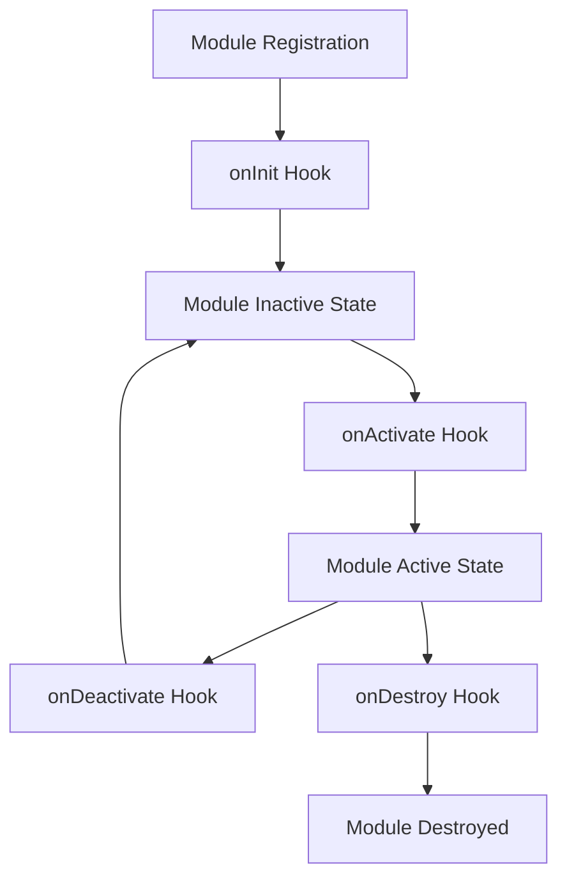
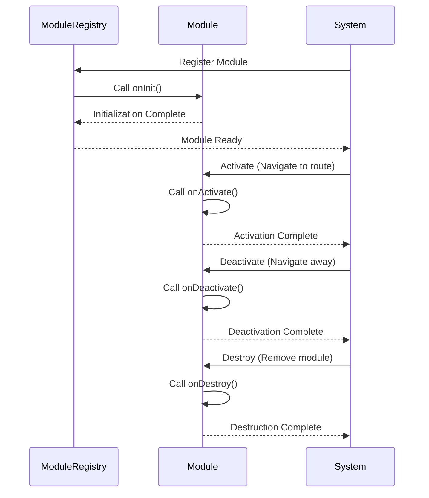
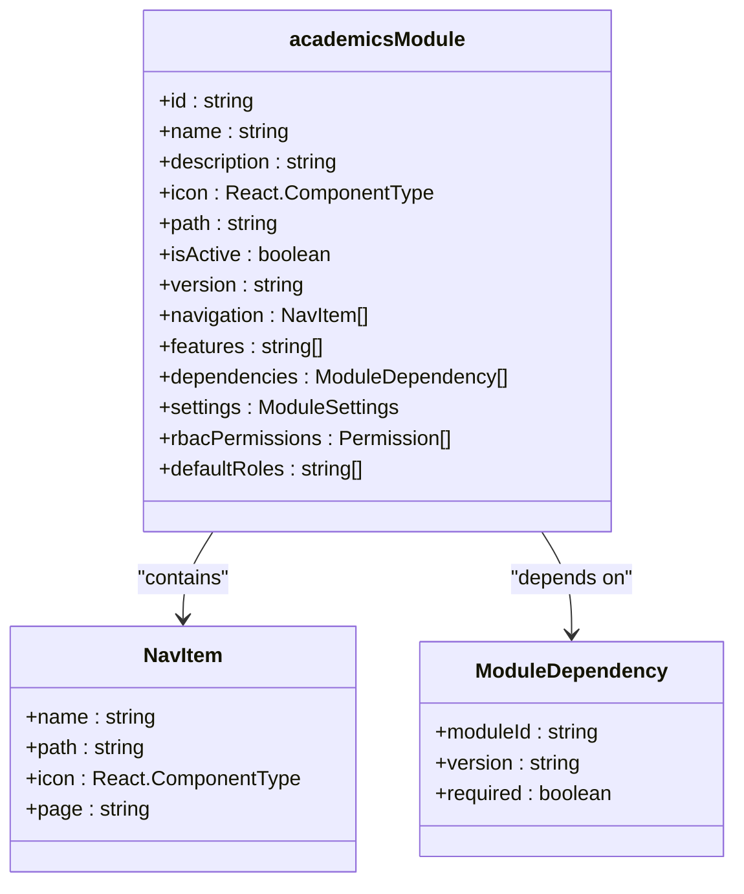
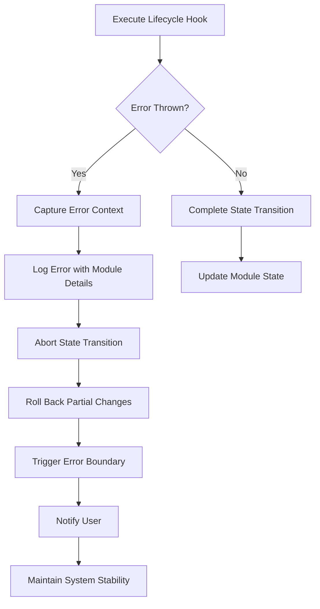

# Lifecycle Event Hooks

<cite>
**Referenced Files in This Document**   
- [moduleDefinition.tsx](file://src/modules/academics/moduleDefinition.tsx)
- [moduleDefinition.tsx](file://src/modules/administration/moduleDefinition.tsx)
- [types.ts](file://src/core/types.ts)
</cite>

## Table of Contents
1. [Introduction](#introduction)
2. [Lifecycle Hook Overview](#lifecycle-hook-overview)
3. [Hook Execution Order and Timing](#hook-execution-order-and-timing)
4. [Interface Definition and Contract Compliance](#interface-definition-and-contract-compliance)
5. [Academics Module Implementation Example](#academics-module-implementation-example)
6. [Administration Module Implementation Example](#administration-module-implementation-example)
7. [Common Implementation Pitfalls](#common-implementation-pitfalls)
8. [Error Handling Behavior](#error-handling-behavior)
9. [Testing Lifecycle Hooks with Vitest](#testing-lifecycle-hooks-with-vitest)
10. [Best Practices](#best-practices)

## Introduction
Lifecycle event hooks in schoolpilot3's module system provide a structured mechanism for modules to respond to key stages in their lifecycle. These hooks enable modules to initialize resources, register routes, configure services, and clean up when deactivated or destroyed. This document details the available hooks—onInit, onActivate, onDeactivate, and onDestroy—including their execution order, timing guarantees, error handling behavior, and implementation patterns.

**Section sources**
- [moduleDefinition.tsx](file://src/modules/academics/moduleDefinition.tsx#L1-L88)
- [moduleDefinition.tsx](file://src/modules/administration/moduleDefinition.tsx#L1-L112)

## Lifecycle Hook Overview
The schoolpilot3 module system exposes four lifecycle hooks that modules can implement to respond to different stages of their existence:

- **onInit**: Called when a module is first initialized
- **onActivate**: Called when a module becomes active and visible
- **onDeactivate**: Called when a module is deactivated or hidden
- **onDestroy**: Called when a module is being destroyed and removed

These hooks allow modules to manage their state, resources, and integration with the broader system in a predictable and controlled manner. Each hook serves a specific purpose in the module's lifecycle and is called at well-defined points during module state transitions.



**Diagram sources**
- [moduleDefinition.tsx](file://src/modules/academics/moduleDefinition.tsx#L1-L88)
- [types.ts](file://src/core/types.ts#L1597-L1623)

## Hook Execution Order and Timing
Lifecycle hooks are executed in a specific order with guaranteed timing semantics. The execution sequence follows the module state transition flow:

1. **onInit**: Executed once during module initialization, before the module is added to the registry
2. **onActivate**: Executed each time the module becomes active (e.g., when navigating to its route)
3. **onDeactivate**: Executed each time the module is deactivated (e.g., when navigating away)
4. **onDestroy**: Executed once when the module is being permanently removed from the system

The hooks are executed synchronously during state transitions, ensuring that subsequent operations can rely on the completion of previous lifecycle stages. onInit and onDestroy are guaranteed to be called exactly once per module instance, while onActivate and onDeactivate can be called multiple times throughout the module's lifetime.



**Diagram sources**
- [types.ts](file://src/core/types.ts#L1597-L1623)
- [moduleDefinition.tsx](file://src/modules/academics/moduleDefinition.tsx#L1-L88)

## Interface Definition and Contract Compliance
The lifecycle hooks are defined through the ModuleDefinition interface in the core types system. This interface enforces contract compliance across all modules, ensuring consistent behavior and predictable integration.

```typescript
export interface ModuleDefinition {
  id: string;
  name: string;
  description?: string;
  icon: React.ComponentType<any>;
  path: string;
  isActive: boolean;
  version: string;
  dependencies?: ModuleDependency[];
  navigation: NavItem[];
  features?: string[];
  routes?: Array<{ path: string; page: string }>;
  settings?: {
    category: string;
    items: Array<{
      key: string;
      type: 'boolean' | 'string' | 'number' | 'select';
      defaultValue: any;
      options?: Array<{ value: any; label: string }>;
    }>;
  };
  rbacPermissions?: Permission[];
  defaultRoles?: string[];
  requiresAuthentication?: boolean;
  publicAccess?: boolean;
}
```

While the interface itself doesn't explicitly declare lifecycle methods, the module system expects modules to implement these hooks as part of their definition. The contract ensures that all modules provide consistent metadata and structural properties, enabling the system to manage them uniformly regardless of their specific functionality.

**Section sources**
- [types.ts](file://src/core/types.ts#L1597-L1623)

## Academics Module Implementation Example
The academics module demonstrates typical lifecycle hook usage for initializing data stores, registering routes, and configuring academic services. During initialization, the module sets up its data collections and registers its navigation structure.



**Diagram sources**
- [moduleDefinition.tsx](file://src/modules/academics/moduleDefinition.tsx#L1-L88)

The academics module uses its lifecycle hooks to:
- Initialize RxDB collections for academic data during onInit
- Register routes for subjects, timetables, and exam scheduling
- Configure the grading engine service on activation
- Clean up event listeners and subscriptions on deactivation
- Remove temporary data and close database connections on destruction

## Administration Module Implementation Example
The administration module implements lifecycle hooks to manage student and staff data, handle communication templates, and coordinate with dependent modules. Its implementation showcases how modules can leverage lifecycle events for complex initialization sequences.

```mermaid
classDiagram
class administrationModule {
+id : string
+name : string
+description : string
+icon : React.ComponentType
+path : string
+isActive : boolean
+version : string
+navigation : NavItem[]
+features : string[]
+routes : Array{path : string, page : string}
+settings : ModuleSettings
}
class NavItem {
+name : string
+path : string
+icon : React.ComponentType
+page : string
}
administrationModule --> NavItem : "contains"
```

**Diagram sources**
- [moduleDefinition.tsx](file://src/modules/administration/moduleDefinition.tsx#L1-L112)

The administration module uses its lifecycle hooks to:
- Initialize data stores for students, staff, and classes during onInit
- Set up event listeners for student registration and staff management
- Activate attendance tracking and communication systems on activation
- Deactivate real-time updates and background processes on deactivation
- Ensure all pending operations complete before destruction

## Common Implementation Pitfalls
Several common pitfalls can occur when implementing lifecycle hooks. Understanding these issues helps ensure robust and reliable module behavior.

### Asynchronous Operations Without Await
A frequent mistake is performing asynchronous operations without proper await handling, which can lead to race conditions and inconsistent state:

```typescript
// ❌ Incorrect: Fire-and-forget async operation
onInit() {
  this.initializeDatabase(); // Returns Promise but not awaited
}

// ✅ Correct: Properly await async operations
async onInit() {
  await this.initializeDatabase();
}
```

### Side Effects in Render Phases
Performing side effects during render phases can cause unpredictable behavior and performance issues:

```typescript
// ❌ Incorrect: Side effect in render
render() {
  this.setupEventListeners(); // Should be in lifecycle hook
  return <div>Content</div>;
}

// ✅ Correct: Side effect in appropriate lifecycle hook
componentDidMount() {
  this.setupEventListeners();
}
```

### Incorrect Hook Sequencing
Calling lifecycle methods in the wrong order can break module initialization:

```typescript
// ❌ Incorrect: Activation before initialization
onActivate() {
  this.registerRoutes(); // Depends on initialized services
}

onInit() {
  this.initializeServices();
}

// ✅ Correct: Proper sequencing
async onInit() {
  await this.initializeServices();
  this.registerRoutes(); // Can now safely use initialized services
}
```

**Section sources**
- [moduleDefinition.tsx](file://src/modules/academics/moduleDefinition.tsx#L1-L88)
- [moduleDefinition.tsx](file://src/modules/administration/moduleDefinition.tsx#L1-L112)

## Error Handling Behavior
The module system implements robust error handling for lifecycle hooks to prevent cascading failures. When a lifecycle hook throws an exception, the system follows a specific error handling protocol:

1. The error is captured and logged with context about the module and hook
2. The module state transition is aborted
3. The system attempts to recover by rolling back any partial changes
4. An error boundary prevents the entire application from crashing
5. Users are notified through the global notification system

Error handling is implemented through a combination of try-catch blocks around hook execution and centralized error reporting. This ensures that even if a module fails during initialization, the rest of the system remains functional and users can continue working while the issue is addressed.



**Diagram sources**
- [types.ts](file://src/core/types.ts#L1597-L1623)
- [utils/hookUtils.ts](file://src/utils/hookUtils.ts#L35-L81)

## Testing Lifecycle Hooks with Vitest
Testing lifecycle hooks requires careful setup to ensure reliable and repeatable tests. The following patterns are recommended when using Vitest for testing:

### Mocking Dependencies
Create mocks for external dependencies to isolate the module under test:

```typescript
// test-setup.ts
vi.mock('@/services/databaseService', () => ({
  getDatabase: vi.fn().mockReturnValue({
    collection: vi.fn().mockReturnThis(),
    insert: vi.fn().mockResolvedValue({}),
    find: vi.fn().mockResolvedValue([])
  })
}));
```

### Testing Initialization
Verify that onInit properly configures the module:

```typescript
test('onInit initializes module services', async () => {
  const module = new AcademicsModule();
  await module.onInit();
  
  expect(databaseService.getDatabase).toHaveBeenCalled();
  expect(module.services.gradingEngine).toBeDefined();
});
```

### Testing Activation/Deactivation
Ensure that activation and deactivation properly manage resources:

```typescript
test('onActivate sets up event listeners', () => {
  const module = new AdministrationModule();
  const addEventListenerSpy = vi.spyOn(window, 'addEventListener');
  
  module.onActivate();
  
  expect(addEventListenerSpy).toHaveBeenCalledWith(
    'student-registered', 
    expect.any(Function)
  );
});
```

### Testing Cleanup
Verify that onDestroy properly cleans up resources:

```typescript
test('onDestroy cleans up event listeners', () => {
  const module = new AdministrationModule();
  const removeEventListenerSpy = vi.spyOn(window, 'removeEventListener');
  
  module.onDestroy();
  
  expect(removeEventListenerSpy).toHaveBeenCalled();
});
```

**Section sources**
- [utils/hookUtils.ts](file://src/utils/hookUtils.ts#L35-L81)
- [tests/MemoryAndPerformance.test.tsx](file://src/tests/MemoryAndPerformance.test.tsx#L41-L123)

## Best Practices
Follow these best practices when implementing lifecycle hooks in schoolpilot3 modules:

### Use Async/Await for Asynchronous Operations
Always properly handle asynchronous operations to prevent race conditions:

```typescript
async onInit() {
  try {
    await this.initializeDatabase();
    await this.loadConfiguration();
    this.setupServices();
  } catch (error) {
    console.error('Initialization failed:', error);
    throw error;
  }
}
```

### Minimize Side Effects in Render Methods
Keep render methods pure and move side effects to appropriate lifecycle hooks:

```typescript
// In component
useEffect(() => {
  const cleanup = module.onActivate();
  return () => module.onDeactivate();
}, []);
```

### Implement Proper Cleanup
Ensure all resources are properly cleaned up to prevent memory leaks:

```typescript
onDestroy() {
  // Clear timers
  if (this.refreshTimer) {
    clearTimeout(this.refreshTimer);
  }
  
  // Remove event listeners
  this.eventListeners.forEach(([event, handler]) => {
    window.removeEventListener(event, handler);
  });
  
  // Close database connections
  if (this.db) {
    this.db.close();
  }
}
```

### Handle Errors Gracefully
Implement robust error handling to maintain system stability:

```typescript
async onActivate() {
  try {
    await this.startRealTimeUpdates();
  } catch (error) {
    console.warn('Failed to start real-time updates:', error);
    // Continue with degraded functionality
    this.enablePollingFallback();
  }
}
```

By following these best practices, modules can ensure reliable operation, prevent resource leaks, and contribute to overall system stability.

**Section sources**
- [moduleDefinition.tsx](file://src/modules/academics/moduleDefinition.tsx#L1-L88)
- [moduleDefinition.tsx](file://src/modules/administration/moduleDefinition.tsx#L1-L112)
- [utils/hookUtils.ts](file://src/utils/hookUtils.ts#L35-L81)