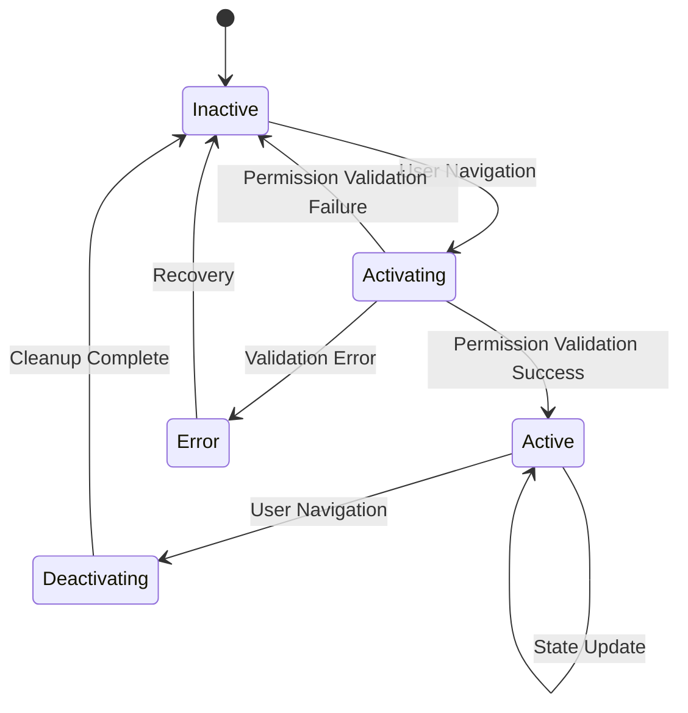
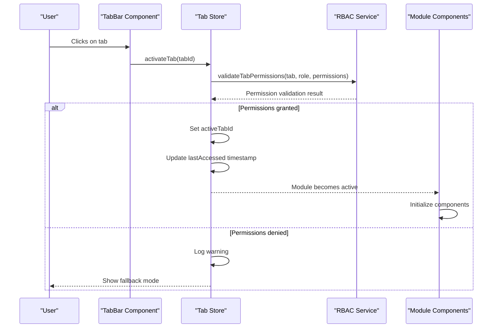
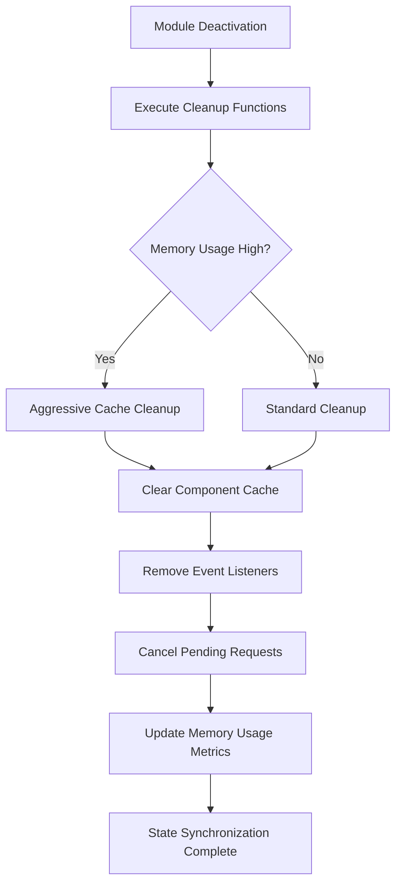
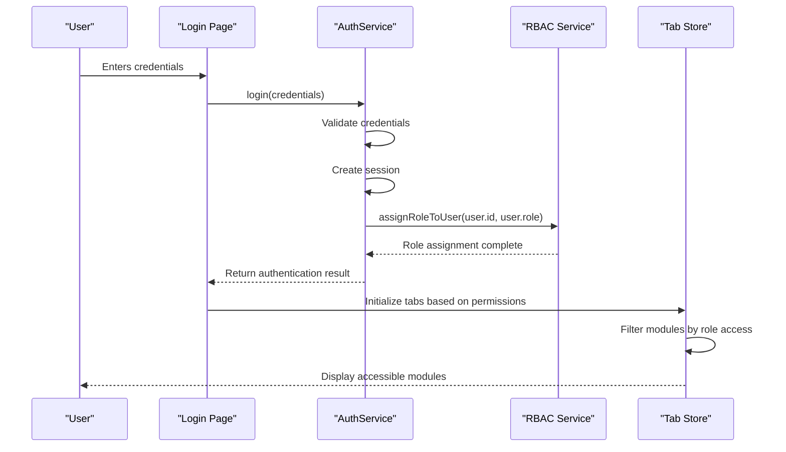
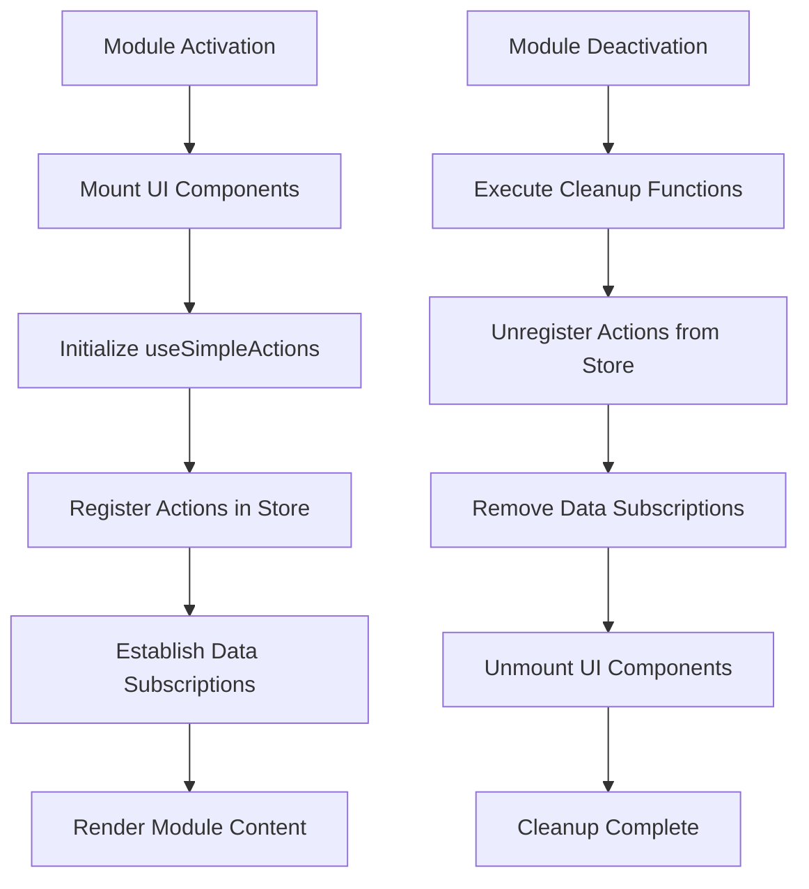
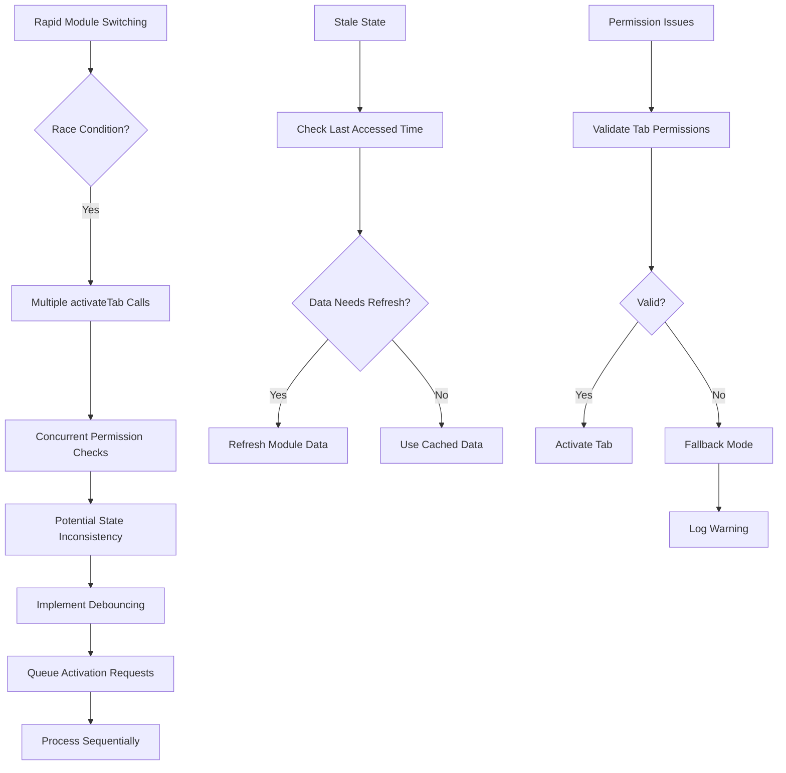
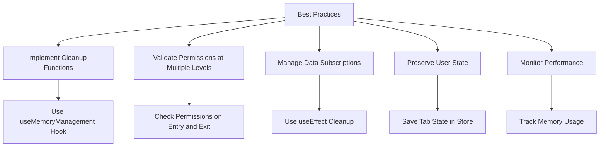

# Module Activation and Deactivation

<cite>
**Referenced Files in This Document**   
- [useMemoryManagement.ts](file://src/hooks/useMemoryManagement.ts)
- [tabStore.ts](file://src/stores/tabStore.ts)
- [tabbedModeFeatureFlag.ts](file://src/services/tabbedModeFeatureFlag.ts)
- [AuthContext.tsx](file://src/contexts/AuthContext.tsx)
- [authService.ts](file://src/services/authService.ts)
- [rbacService.ts](file://src/core/rbacService.ts)
- [DataSyncMonitoringService.ts](file://src/services/DataSyncMonitoringService.ts)
- [NetworkStateManager.ts](file://src/services/NetworkStateManager.ts)
- [useSimpleActions.ts](file://src/hooks/useSimpleActions.ts)
</cite>

## Table of Contents
1. [Introduction](#introduction)
2. [Module Lifecycle Management](#module-lifecycle-management)
3. [Event-Driven Architecture for Module Activation](#event-driven-architecture-for-module-activation)
4. [State Synchronization During Transitions](#state-synchronization-during-transitions)
5. [Authentication-Based Module Activation](#authentication-based-module-activation)
6. [UI Component and Data Subscription Management](#ui-component-and-data-subscription-management)
7. [Common Issues in Module Transitions](#common-issues-in-module-transitions)
8. [Best Practices for Module State Management](#best-practices-for-module-state-management)

## Introduction
This document provides a comprehensive analysis of the module activation and deactivation workflows in schoolpilot3, a comprehensive educational management system. The system employs a sophisticated event-driven architecture to manage module states based on user navigation, permissions, and feature flags. The documentation covers the complete lifecycle of modules from inactive to active states, detailing how state synchronization is maintained during transitions. Special attention is given to the core login page as an example of conditional activation based on authentication status and role-based access control. The document also addresses UI component mounting/unmounting, data subscription management, and common issues such as stale state retention and race conditions during rapid module switching.

## Module Lifecycle Management

The schoolpilot3 application implements a sophisticated module lifecycle management system that governs the transition of modules between inactive and active states. The system uses a combination of user navigation patterns, permission checks, and feature flag configurations to determine when modules should be activated or deactivated. At the core of this system is a tab-based architecture that manages module states through a centralized store.

The module lifecycle is primarily controlled through the tab management system, which tracks the activation state of each module. When a user navigates to a specific module, the system triggers an activation sequence that validates permissions, checks feature flags, and initializes the necessary components. Conversely, when a user navigates away from a module, a deactivation sequence is initiated to clean up resources and preserve state.

**Diagram sources**
- [tabStore.ts](file://src/stores/tabStore.ts#L340-L379)
- [tabbedModeFeatureFlag.ts](file://src/services/tabbedModeFeatureFlag.ts#L96-L122)

**Section sources**
- [tabStore.ts](file://src/stores/tabStore.ts#L340-L379)
- [tabbedModeFeatureFlag.ts](file://src/services/tabbedModeFeatureFlag.ts#L96-L122)

## Event-Driven Architecture for Module Activation

The schoolpilot3 application employs an event-driven architecture to manage module activation and deactivation. This architecture is centered around the tab store, which serves as the single source of truth for module states. When a user interacts with the application, events are triggered that propagate through the system, causing modules to transition between states.

The activation process begins when a user clicks on a tab or navigates to a specific module. The `activateTab` function in the tab store is called, which first validates the user's permissions before proceeding with activation. This validation is performed using the RBAC (Role-Based Access Control) service, which checks whether the current user role has access to the requested module.

**Diagram sources**
- [tabStore.ts](file://src/stores/tabStore.ts#L340-L379)
- [rbacService.ts](file://src/core/rbacService.ts#L679-L696)

**Section sources**
- [tabStore.ts](file://src/stores/tabStore.ts#L340-L379)
- [rbacService.ts](file://src/core/rbacService.ts#L679-L696)

## State Synchronization During Transitions

State synchronization during module activation and deactivation is a critical aspect of maintaining data consistency across the schoolpilot3 application. The system employs several mechanisms to ensure that state is properly managed during transitions, including cleanup functions, subscription management, and memory tracking.

The `useMemoryManagement` hook plays a crucial role in state synchronization by tracking component lifecycle events and managing cleanup functions. When a module is deactivated, all registered cleanup functions are executed to prevent memory leaks and ensure proper resource cleanup. This includes canceling pending API requests, clearing intervals, and removing event listeners.

The system also implements a sophisticated memory management strategy that monitors memory usage and triggers cleanup operations when memory pressure is detected. This ensures that the application remains responsive even when multiple modules are active simultaneously.

**Diagram sources**
- [useMemoryManagement.ts](file://src/hooks/useMemoryManagement.ts#L154-L196)
- [memoryManager.ts](file://src/services/memoryManager.ts#L284-L336)

**Section sources**
- [useMemoryManagement.ts](file://src/hooks/useMemoryManagement.ts#L154-L196)
- [memoryManager.ts](file://src/services/memoryManager.ts#L284-L336)

## Authentication-Based Module Activation

The core login page in schoolpilot3 serves as a prime example of conditional module activation based on authentication status and role-based access control. The authentication system is implemented through the `AuthContext` and `authService`, which work together to manage user sessions and determine which modules should be accessible.

When a user attempts to log in, the authentication service validates the credentials and creates a session if successful. The session includes the user's role and permissions, which are then used to determine module access. The RBAC service checks these permissions against the module configuration to determine which modules should be activated.

The system also supports demo mode, where any password is accepted for predefined demo users. This feature is useful for demonstration purposes but is disabled in production environments. The authentication service handles both demo and production modes, ensuring that the appropriate security measures are applied based on the environment.

**Diagram sources**
- [AuthContext.tsx](file://src/contexts/AuthContext.tsx#L0-L38)
- [authService.ts](file://src/services/authService.ts#L366-L417)
- [rbacService.ts](file://src/core/rbacService.ts#L679-L696)

**Section sources**
- [AuthContext.tsx](file://src/contexts/AuthContext.tsx#L0-L38)
- [authService.ts](file://src/services/authService.ts#L366-L417)
- [rbacService.ts](file://src/core/rbacService.ts#L679-L696)

## UI Component and Data Subscription Management

The management of UI components and data subscriptions during module activation cycles is a critical aspect of the schoolpilot3 architecture. The system employs several strategies to ensure that components are properly mounted and unmounted, and that data subscriptions are managed efficiently.

When a module is activated, the system initializes the necessary UI components and establishes data subscriptions. This is handled through React's useEffect hook, which registers cleanup functions that are executed when the component is unmounted. The `useSimpleActions` hook demonstrates this pattern by registering actions when the component mounts and unregistering them when it unmounts.

The system also implements a tab-based workspace that manages multiple modules simultaneously. The TabBar component handles tab clicks by validating access and activating the appropriate tab. When a tab is closed, the system ensures that all associated resources are properly cleaned up.

**Diagram sources**
- [useSimpleActions.ts](file://src/hooks/useSimpleActions.ts#L220-L257)
- [TabBar.tsx](file://src/components/tabbedWorkspace/TabBar.tsx#L142-L174)

**Section sources**
- [useSimpleActions.ts](file://src/hooks/useSimpleActions.ts#L220-L257)
- [TabBar.tsx](file://src/components/tabbedWorkspace/TabBar.tsx#L142-L174)

## Common Issues in Module Transitions

Despite the robust architecture, several common issues can arise during module transitions in schoolpilot3. These issues include stale state retention, improper permission checks, and race conditions when rapidly switching between modules.

Stale state retention occurs when a module retains outdated data after being reactivated. This can happen if the module's state is not properly refreshed when it becomes active again. The system addresses this issue by updating the last accessed timestamp when a tab is activated, which can trigger data refresh operations.

Improper permission checks can occur when the system fails to validate user permissions correctly. The tab store includes a permission validation step during tab activation, but it allows access in "fallback mode" if validation fails. This design choice ensures that the application remains usable even if there are temporary issues with the permission system.

Race conditions can occur when users rapidly switch between modules, potentially causing multiple activation requests to be processed simultaneously. The system mitigates this risk by using async functions with proper error handling, but additional safeguards such as debouncing or queuing activation requests could further improve reliability.

**Diagram sources**
- [tabStore.ts](file://src/stores/tabStore.ts#L340-L379)
- [TabbedWorkspace.tsx](file://src/components/tabbedWorkspace/TabbedWorkspace.tsx#L188-L225)

**Section sources**
- [tabStore.ts](file://src/stores/tabStore.ts#L340-L379)
- [TabbedWorkspace.tsx](file://src/components/tabbedWorkspace/TabbedWorkspace.tsx#L188-L225)

## Best Practices for Module State Management

Based on the analysis of the schoolpilot3 architecture, several best practices emerge for managing module state during activation and deactivation cycles. These practices ensure a smooth user experience and maintain application stability.

First, always implement proper cleanup functions for all resources that need to be released when a module is deactivated. The `useMemoryManagement` hook provides a robust pattern for registering and executing cleanup functions, which should be used consistently across all modules.

Second, implement permission validation at multiple levels. The system already validates permissions when activating tabs, but additional validation should be performed within modules to ensure that users cannot access restricted functionality through direct URL manipulation.

Third, manage data subscriptions carefully to prevent memory leaks. The use of React's useEffect hook with cleanup functions is the recommended approach, as demonstrated in the `useSimpleActions` hook.

Fourth, implement state preservation strategies to maintain user context when switching between modules. The tab store already saves the last accessed time for each tab, which can be extended to preserve more detailed state information.

Finally, monitor performance and memory usage during module transitions. The memory management system provides valuable insights into resource usage, which can be used to optimize module loading and unloading.

**Diagram sources**
- [useMemoryManagement.ts](file://src/hooks/useMemoryManagement.ts#L154-L196)
- [useSimpleActions.ts](file://src/hooks/useSimpleActions.ts#L338-L373)
- [tabStore.ts](file://src/stores/tabStore.ts#L641-L687)

**Section sources**
- [useMemoryManagement.ts](file://src/hooks/useMemoryManagement.ts#L154-L196)
- [useSimpleActions.ts](file://src/hooks/useSimpleActions.ts#L338-L373)
- [tabStore.ts](file://src/stores/tabStore.ts#L641-L687)