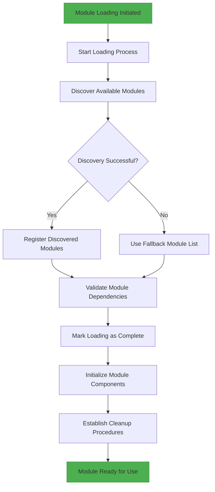
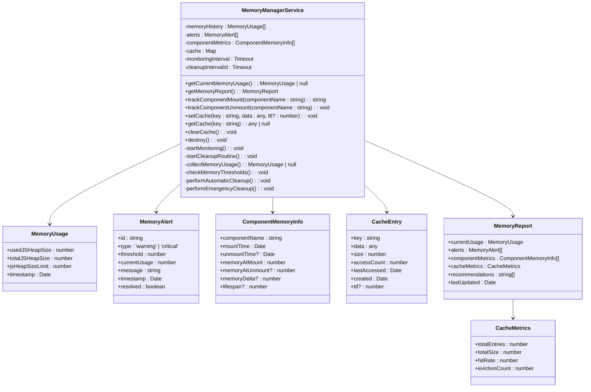
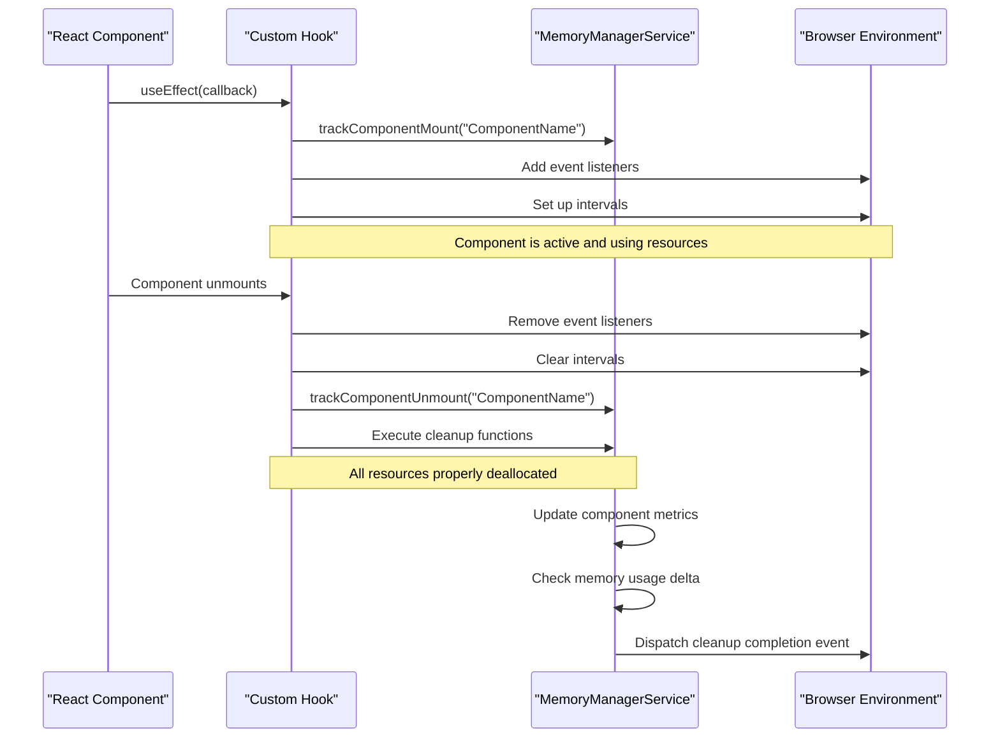
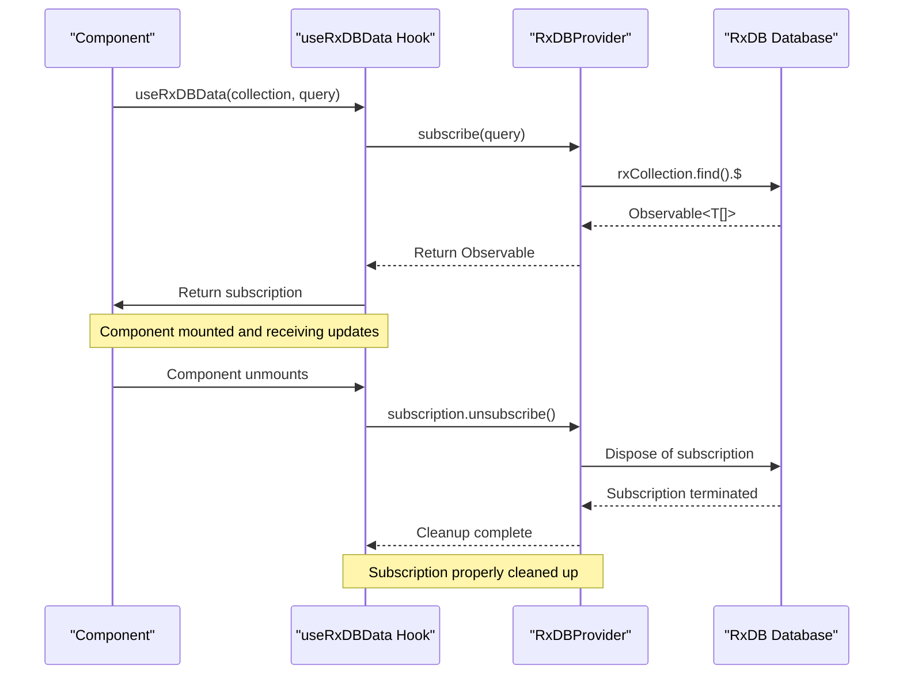
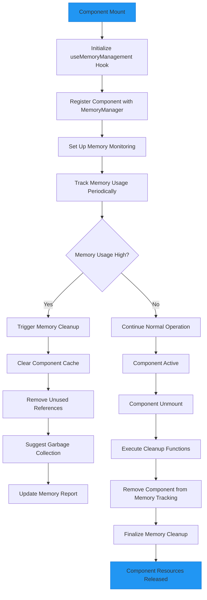
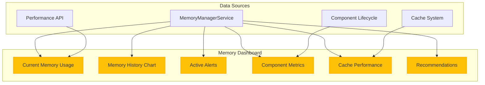
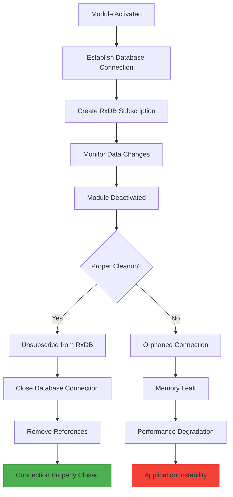
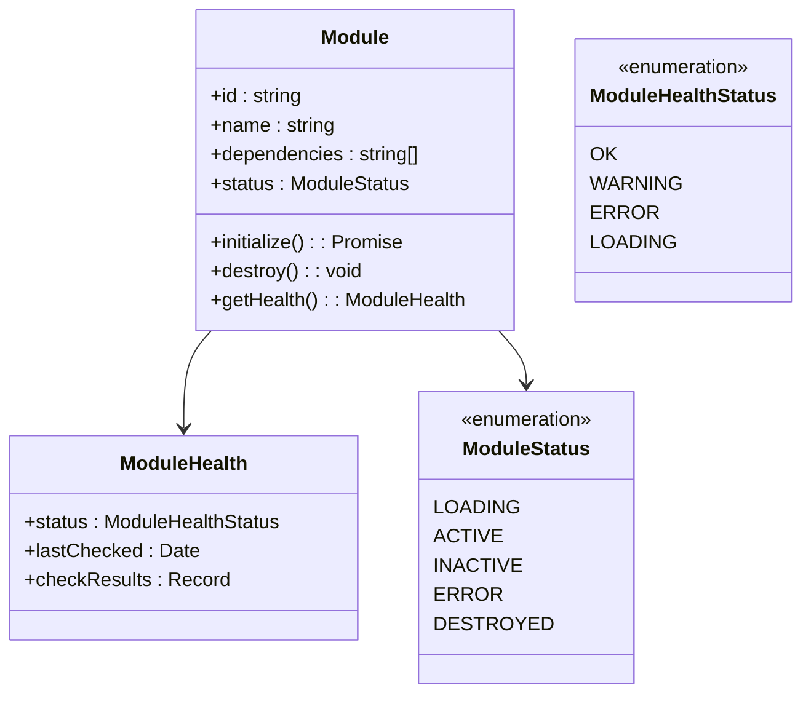

# Module Cleanup and Destruction

<cite>
**Referenced Files in This Document**   
- [useMemoryManagement.ts](file://src/hooks/useMemoryManagement.ts)
- [memoryManager.ts](file://src/services/memoryManager.ts)
- [dynamicModuleLoader.ts](file://src/services/dynamicModuleLoader.ts)
- [ModuleLoadingProgress.tsx](file://src/components/ModuleLoadingProgress.tsx)
- [test-livestore-integration.ts](file://src/scripts/test-livestore-integration.ts)
- [RxDBProvider.ts](file://src/services/database/RxDBProvider.ts)
</cite>

## Table of Contents
1. [Introduction](#introduction)
2. [Core Cleanup Mechanisms](#core-cleanup-mechanisms)
3. [Lifecycle Management and Resource Deallocation](#lifecycle-management-and-resource-deallocation)
4. [RxJS Subscription Management](#rxjs-subscription-management)
5. [Memory Leak Prevention Strategies](#memory-leak-prevention-strategies)
6. [Performance Monitoring and Detection](#performance-monitoring-and-detection)
7. [Common Resource Management Issues](#common-resource-management-issues)
8. [Best Practices for Self-Contained Modules](#best-practices-for-self-contained-modules)
9. [Conclusion](#conclusion)

## Introduction
The schoolpilot3 application implements a comprehensive module cleanup and destruction system to ensure proper resource deallocation when modules are deactivated or unloaded. This documentation details the mechanisms that prevent memory leaks and maintain application stability through proper lifecycle management, event listener cleanup, RxJS subscription handling, and context provider management. The system is designed to handle complex scenarios including orphaned database connections, unclosed WebSocket links, and persistent timers, ensuring long-term application stability during extended usage.

**Section sources**
- [useMemoryManagement.ts](file://src/hooks/useMemoryManagement.ts#L1-L274)
- [memoryManager.ts](file://src/services/memoryManager.ts#L1-L511)

## Core Cleanup Mechanisms

### Dynamic Module Loading and Unloading
The dynamic module loader in schoolpilot3 provides a robust mechanism for loading and unloading modules with proper cleanup procedures. The system includes timeout protection and fallback mechanisms to prevent infinite loading states, ensuring that modules are properly initialized and cleaned up.



**Diagram sources**
- [dynamicModuleLoader.ts](file://src/services/dynamicModuleLoader.ts#L0-L211)

**Section sources**
- [dynamicModuleLoader.ts](file://src/services/dynamicModuleLoader.ts#L0-L211)

### Memory Management Service
The MemoryManagerService provides a centralized system for tracking and optimizing memory usage across the application. It implements automatic cleanup routines, memory threshold monitoring, and cache management to prevent memory leaks and optimize performance.



**Diagram sources**
- [memoryManager.ts](file://src/services/memoryManager.ts#L1-L511)

**Section sources**
- [memoryManager.ts](file://src/services/memoryManager.ts#L1-L511)

## Lifecycle Management and Resource Deallocation

### React useEffect Cleanup Patterns
The application implements React's useEffect cleanup patterns to ensure proper resource deallocation when components are unmounted. This includes cleanup of event listeners, intervals, and other resources that could cause memory leaks if not properly managed.



**Diagram sources**
- [useMemoryManagement.ts](file://src/hooks/useMemoryManagement.ts#L1-L274)
- [memoryManager.ts](file://src/services/memoryManager.ts#L1-L511)

**Section sources**
- [useMemoryManagement.ts](file://src/hooks/useMemoryManagement.ts#L1-L274)

### onDestroy Lifecycle Hook Implementation
The onDestroy lifecycle hook is implemented through React's useEffect cleanup function, which serves as the primary mechanism for resource deallocation when a component or module is destroyed. This pattern ensures that all allocated resources are properly released.

```typescript
useEffect(() => {
  // Setup: allocate resources
  const interval = setInterval(() => {
    // Periodic task
  }, 1000);
  
  const eventListener = (event: Event) => {
    // Handle event
  };
  window.addEventListener('resize', eventListener);
  
  // Cleanup function returned from useEffect
  return () => {
    // Teardown: release resources
    clearInterval(interval);
    window.removeEventListener('resize', eventListener);
    
    // Additional cleanup logic
    if (componentIdRef.current) {
      memoryManager.trackComponentUnmount(componentName);
    }
  };
}, [componentName]);
```

This implementation pattern is consistently applied across the application to ensure that all components properly clean up their resources when unmounted.

**Section sources**
- [useMemoryManagement.ts](file://src/hooks/useMemoryManagement.ts#L58-L75)

## RxJS Subscription Management

### Subscription Cleanup in Reactive Programming
The application uses RxJS for reactive programming patterns, particularly in database operations and real-time data updates. Proper subscription management is critical to prevent memory leaks when components are unmounted.



**Diagram sources**
- [test-livestore-integration.ts](file://src/scripts/test-livestore-integration.ts#L248-L273)
- [RxDBProvider.ts](file://src/services/database/RxDBProvider.ts#L309-L359)

**Section sources**
- [test-livestore-integration.ts](file://src/scripts/test-livestore-integration.ts#L248-L273)
- [RxDBProvider.ts](file://src/services/database/RxDBProvider.ts#L309-L359)

### RxDB Subscription Implementation
The RxDBProvider implements a robust subscription mechanism that includes proper cleanup procedures. When a subscription is no longer needed, it is explicitly unsubscribed to prevent memory leaks.

```typescript
// Example from RxDBProvider.ts
subscribe(query: QueryOptions = {}): Observable<T[]> {
  try {
    let rxQuery = this.rxCollection.find(query.selector || {});
    
    // Apply query modifiers
    if (query.sort) {
      rxQuery = rxQuery.sort(query.sort as any);
    }
    
    if (query.limit) {
      rxQuery = rxQuery.limit(query.limit);
    }
    
    // Return observable with error handling
    return rxQuery.$.pipe(
      map(docs => docs.map(doc => this.transformDoc(doc))),
      catchError(error => {
        console.error(`Subscription error in ${this.name}:`, error);
        return [];
      })
    );
  } catch (error) {
    throw new CollectionError(
      `Failed to create subscription for ${this.name}: ${error.message}`,
      this.name
    );
  }
}
```

The subscription is managed by the consuming component, which is responsible for unsubscribing when the component unmounts, typically through the useEffect cleanup function.

**Section sources**
- [RxDBProvider.ts](file://src/services/database/RxDBProvider.ts#L309-L359)

## Memory Leak Prevention Strategies

### Component-Level Memory Tracking
The useMemoryManagement hook provides component-level memory tracking and optimization capabilities. It integrates with the global memoryManager service to monitor memory usage and trigger cleanup procedures when necessary.



**Diagram sources**
- [useMemoryManagement.ts](file://src/hooks/useMemoryManagement.ts#L1-L274)

**Section sources**
- [useMemoryManagement.ts](file://src/hooks/useMemoryManagement.ts#L1-L274)

### Automatic Cleanup Routines
The MemoryManagerService implements automatic cleanup routines that run at regular intervals to prevent memory leaks. These routines include cache cleanup, component metric cleanup, and alert cleanup.

```typescript
// From memoryManager.ts
private startCleanupRoutine() {
  this.cleanupIntervalId = setInterval(() => {
    this.performAutomaticCleanup();
  }, this.cleanupInterval);
}

private performAutomaticCleanup() {
  const currentUsage = this.getCurrentMemoryUsage();
  if (!currentUsage) return;

  const usageRatio = currentUsage.usedJSHeapSize / currentUsage.jsHeapSizeLimit;
  
  if (usageRatio > this.warningThreshold) {
    // Clean up old cache entries
    this.cleanupCache();
    
    // Clean up old component metrics
    this.cleanupComponentMetrics();
    
    // Clean up old alerts
    this.cleanupAlerts();
    
    // Suggest garbage collection (if available)
    this.suggestGarbageCollection();
  }
}
```

These automatic routines ensure that memory is consistently managed even if individual components fail to clean up properly.

**Section sources**
- [memoryManager.ts](file://src/services/memoryManager.ts#L1-L511)

## Performance Monitoring and Detection

### Memory Dashboard and Reporting
The application includes a comprehensive memory dashboard that provides real-time insights into memory usage, component metrics, and cache performance. This allows developers to detect and resolve lingering resources before they become critical issues.



**Diagram sources**
- [memoryManager.ts](file://src/services/memoryManager.ts#L1-L511)
- [useMemoryManagement.ts](file://src/hooks/useMemoryManagement.ts#L1-L274)

**Section sources**
- [memoryManager.ts](file://src/services/memoryManager.ts#L1-L511)

### Performance Monitoring Components
The usePerformanceMonitoring hook and related components provide detailed insights into application performance, including memory usage, component lifecycle, and resource allocation. These tools help identify potential memory leaks and performance bottlenecks.

```typescript
// Example from useMemoryManagement.ts
useEffect(() => {
  let isActive = true;
  
  const updateReport = () => {
    if (!isActive) return;
    
    try {
      const report = memoryManager.getMemoryReport();
      setMemoryReport(prevReport => {
        // Only update if there are meaningful changes
        if (!prevReport || 
            Math.abs(report.currentUsage.usedJSHeapSize - prevReport.currentUsage.usedJSHeapSize) > 1024 * 1024 || // 1MB change
            report.alerts.length !== prevReport.alerts.length) {
          return report;
        }
        return prevReport;
      });
      setActiveAlerts(report.alerts);
    } catch (error) {
      console.warn('Error updating memory report:', error);
    }
  };

  updateReport(); // Initial update
  
  // Use longer interval and only update when component is visible
  const interval = setInterval(() => {
    if (document.visibilityState === 'visible') {
      updateReport();
    }
  }, 60000); // Update every 60 seconds when visible

  return () => {
    isActive = false;
    clearInterval(interval);
  };
}, []);
```

This implementation ensures that performance monitoring does not itself become a performance bottleneck by throttling updates and only running when the application is visible.

**Section sources**
- [useMemoryManagement.ts](file://src/hooks/useMemoryManagement.ts#L108-L147)

## Common Resource Management Issues

### Orphaned Database Connections
Orphaned database connections can occur when modules are unloaded without properly closing their database connections. The application addresses this issue through the RxDBProvider's cleanup mechanisms and the MemoryManagerService's automatic cleanup routines.



The system prevents orphaned connections by ensuring that all subscriptions are properly unsubscribed and database connections are closed when modules are deactivated.

**Section sources**
- [RxDBProvider.ts](file://src/services/database/RxDBProvider.ts#L309-L359)
- [memoryManager.ts](file://src/services/memoryManager.ts#L1-L511)

### Persistent Timers and Intervals
Persistent timers and intervals that are not properly cleared can cause memory leaks and unexpected behavior. The application addresses this issue through consistent use of cleanup functions in useEffect hooks.

```typescript
// Example of proper timer cleanup
useEffect(() => {
  const interval = setInterval(() => {
    // Periodic task
  }, 1000);
  
  // Cleanup function
  return () => {
    clearInterval(interval);
  };
}, []);
```

This pattern is consistently applied throughout the application to ensure that all timers and intervals are properly cleared when components are unmounted.

**Section sources**
- [useMemoryManagement.ts](file://src/hooks/useMemoryManagement.ts#L108-L147)
- [ModuleLoadingProgress.tsx](file://src/components/ModuleLoadingProgress.tsx#L37-L81)

## Best Practices for Self-Contained Modules

### Self-Contained Module Design
The application follows best practices for creating self-contained modules that fully release dependencies and maintain application stability. Each module is responsible for cleaning up its own resources when deactivated.



**Diagram sources**
- [moduleHealthMonitor.ts](file://src/services/moduleHealthMonitor.ts#L359-L396)

**Section sources**
- [moduleHealthMonitor.ts](file://src/services/moduleHealthMonitor.ts#L359-L396)

### Module Destruction Best Practices
The following best practices are implemented in the schoolpilot3 application to ensure proper module destruction:

1. **Always clean up event listeners**: Remove all event listeners when a module is destroyed to prevent memory leaks.
2. **Unsubscribe from all observables**: Ensure all RxJS subscriptions are properly unsubscribed.
3. **Clear all timers and intervals**: Clear any setTimeout or setInterval calls.
4. **Release database connections**: Close any open database connections.
5. **Remove references to large objects**: Clear references to large data structures that are no longer needed.
6. **Notify cleanup completion**: Provide a mechanism to confirm that cleanup has been completed.

```typescript
// Example of comprehensive cleanup
const cleanupFunctionsRef = useRef<(() => void)[]>([]);

const addCleanupFunction = useCallback((cleanupFn: () => void) => {
  cleanupFunctionsRef.current.push(cleanupFn);
}, []);

// Cleanup on unmount
useEffect(() => {
  return () => {
    cleanupFunctionsRef.current.forEach(cleanup => {
      try {
        cleanup();
      } catch (error) {
        console.warn(`Cleanup function failed:`, error);
      }
    });
    cleanupFunctionsRef.current = [];
  };
}, []);
```

This pattern allows modules to register multiple cleanup functions that will all be executed when the module is destroyed.

**Section sources**
- [useMemoryManagement.ts](file://src/hooks/useMemoryManagement.ts#L228-L274)

## Conclusion
The schoolpilot3 application implements a comprehensive and robust system for module cleanup and destruction. Through the use of React's useEffect cleanup patterns, RxJS subscription management, and a centralized memory management service, the application ensures proper resource deallocation when modules are deactivated or unloaded. The system includes mechanisms for preventing memory leaks, detecting lingering resources, and maintaining application stability over extended usage. By following best practices for self-contained modules and implementing consistent cleanup procedures, the application provides a stable and performant user experience even during long sessions with multiple module activations and deactivations.

The combination of automatic cleanup routines, performance monitoring, and explicit resource management ensures that the application remains responsive and stable. The modular design allows each component to be responsible for its own cleanup while the centralized memory manager provides an additional layer of protection against memory leaks and performance degradation.