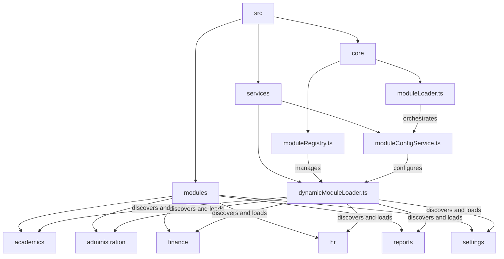
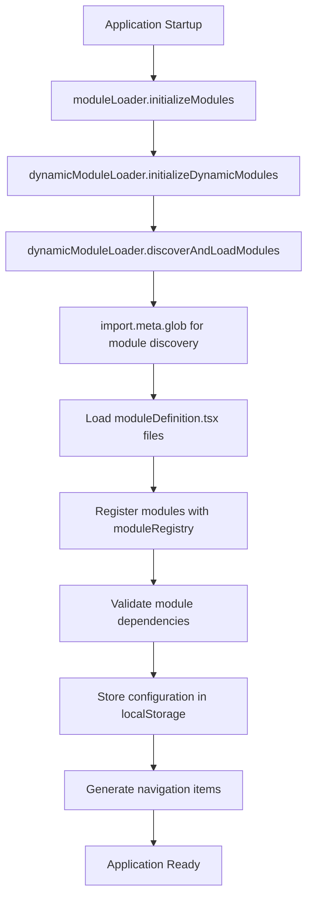
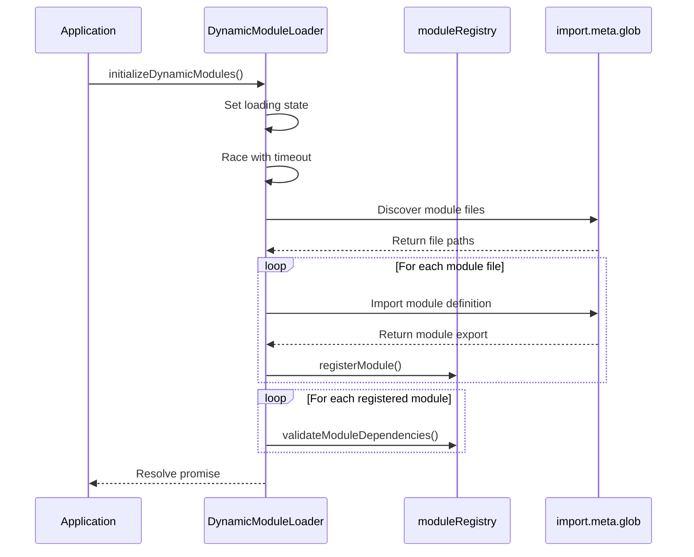
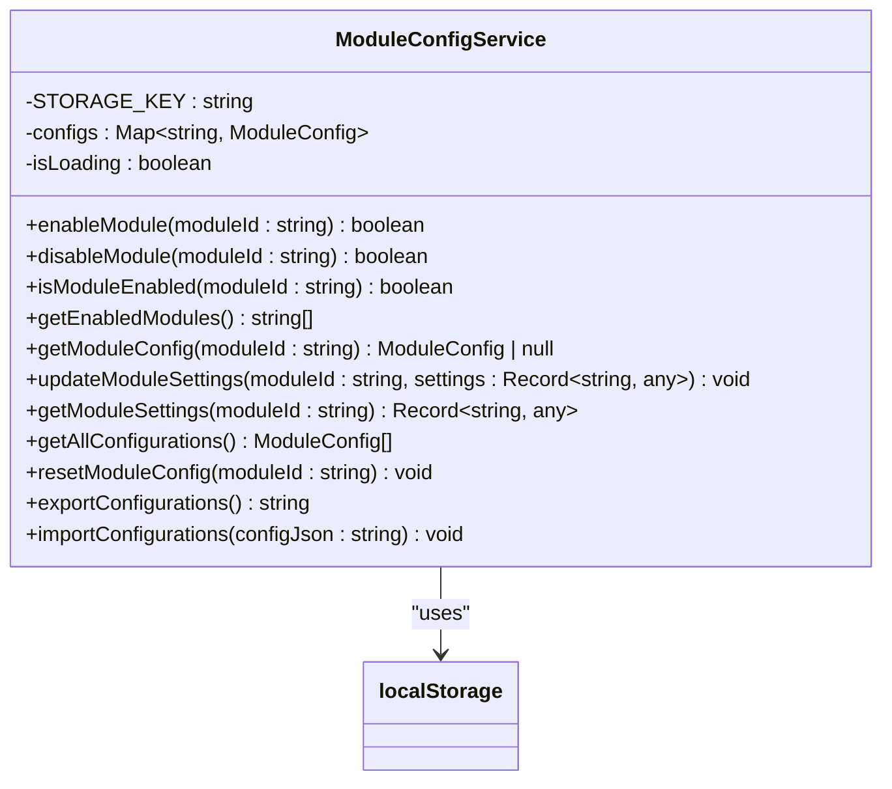
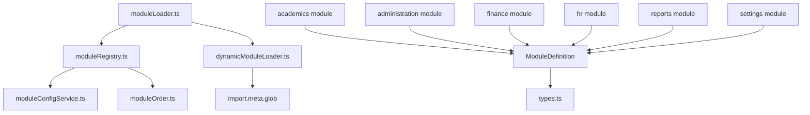

# Module Initialization

<cite>
**Referenced Files in This Document**   
- [moduleLoader.ts](file://src/core/moduleLoader.ts)
- [moduleRegistry.ts](file://src/core/moduleRegistry.ts)
- [moduleConfigService.ts](file://src/services/moduleConfigService.ts)
- [dynamicModuleLoader.ts](file://src/services/dynamicModuleLoader.ts)
- [moduleOrder.ts](file://src/moduleOrder.ts)
- [types.ts](file://src/core/types.ts)
- [academics\moduleDefinition.tsx](file://src/modules/academics/moduleDefinition.tsx)
</cite>

## Table of Contents
1. [Introduction](#introduction)
2. [Project Structure](#project-structure)
3. [Core Components](#core-components)
4. [Architecture Overview](#architecture-overview)
5. [Detailed Component Analysis](#detailed-component-analysis)
6. [Dependency Analysis](#dependency-analysis)
7. [Performance Considerations](#performance-considerations)
8. [Troubleshooting Guide](#troubleshooting-guide)
9. [Conclusion](#conclusion)

## Introduction
The module initialization system in schoolpilot3 is a sophisticated, dynamic architecture designed to support a plugin-like modular application. This system enables the discovery, registration, configuration, and activation of various functional modules such as academics, finance, and HR. The initialization process is asynchronous, allowing for efficient startup performance while handling complex dependency resolution and configuration injection. The core of this system revolves around the `moduleLoader.ts`, `moduleRegistry.ts`, and `dynamicModuleLoader.ts` files, which work in concert to orchestrate the entire module lifecycle. This document provides a comprehensive analysis of how modules are discovered, validated, registered, and prepared for activation within the application lifecycle, including error handling, fallback strategies, and performance optimizations.

## Project Structure
The project follows a feature-based modular architecture with a clear separation of concerns. The core module initialization logic resides in the `src/core` and `src/services` directories, while individual modules are organized under the `src/modules` directory. This structure supports a scalable and maintainable codebase where each module can be developed, tested, and deployed independently.



**Diagram sources**
- [moduleLoader.ts](file://src/core/moduleLoader.ts)
- [moduleRegistry.ts](file://src/core/moduleRegistry.ts)
- [moduleConfigService.ts](file://src/services/moduleConfigService.ts)
- [dynamicModuleLoader.ts](file://src/services/dynamicModuleLoader.ts)

**Section sources**
- [moduleLoader.ts](file://src/core/moduleLoader.ts)
- [moduleRegistry.ts](file://src/core/moduleRegistry.ts)
- [moduleConfigService.ts](file://src/services/moduleConfigService.ts)
- [dynamicModuleLoader.ts](file://src/services/dynamicModuleLoader.ts)

## Core Components
The module initialization system in schoolpilot3 consists of several core components that work together to manage the lifecycle of application modules. The `moduleLoader.ts` file serves as the primary entry point for module initialization, orchestrating the entire process through the `initializeModules` function. This function delegates to the `dynamicModuleLoader.ts` service, which handles the actual discovery and loading of modules. The `moduleRegistry.ts` file maintains a central registry of all modules, providing methods to register, enable, disable, and retrieve module information. Configuration management is handled by `moduleConfigService.ts`, which persists module states in localStorage and manages the enabled/disabled status of modules. Together, these components form a robust system that supports dynamic module loading, dependency resolution, and configuration persistence.

**Section sources**
- [moduleLoader.ts](file://src/core/moduleLoader.ts#L1-L85)
- [moduleRegistry.ts](file://src/core/moduleRegistry.ts#L1-L195)
- [moduleConfigService.ts](file://src/services/moduleConfigService.ts#L1-L199)
- [dynamicModuleLoader.ts](file://src/services/dynamicModuleLoader.ts#L1-L199)

## Architecture Overview
The module initialization architecture in schoolpilot3 follows a layered approach with clear separation of responsibilities. At the highest level, the `moduleLoader.ts` file provides a simple API for initializing modules, abstracting away the complexity of the underlying implementation. This file imports and uses the `moduleRegistry` to manage module state and delegates the actual loading process to the `dynamicModuleLoader.ts` service. The `dynamicModuleLoader.ts` service is responsible for discovering available modules using Vite's `import.meta.glob` functionality, which allows for true dynamic module loading without requiring explicit imports. Once modules are discovered, they are registered with the `moduleRegistry`, which maintains a Map of all registered modules and provides methods to query and manipulate module state. Configuration is managed separately by `moduleConfigService.ts`, which stores module configurations in localStorage and provides methods to enable, disable, and query module states. This separation of concerns allows for a flexible and extensible architecture where modules can be added or removed without modifying core application code.



**Diagram sources**
- [moduleLoader.ts](file://src/core/moduleLoader.ts#L1-L85)
- [dynamicModuleLoader.ts](file://src/services/dynamicModuleLoader.ts#L1-L199)
- [moduleRegistry.ts](file://src/core/moduleRegistry.ts#L1-L195)

## Detailed Component Analysis

### Module Loader Analysis
The `moduleLoader.ts` file serves as the primary interface for module initialization in schoolpilot3. It exports an `initializeModules` function that orchestrates the entire module loading process by delegating to the `dynamicModuleLoader.ts` service. The file also provides a suite of utility functions for interacting with the module registry, including `getModule`, `getEnabledModules`, `getModulesByFeature`, and `checkModuleDependencies`. These functions provide a clean API for other parts of the application to query module state and capabilities without directly accessing the registry. The `loadModule` function implements a caching mechanism using a Map to prevent duplicate loading of the same module, improving performance and ensuring consistency. Error handling is implemented at the module loading level, with failed loads being removed from the cache and rethrown for higher-level handling.

```mermaid
classDiagram
class ModuleLoader {
+initializeModules() Promise~void~
+getModule(moduleId : string) ModuleDefinition | undefined
+getEnabledModules() ModuleDefinition[]
+getModulesByFeature(feature : string) ModuleDefinition[]
+checkModuleDependencies(moduleId : string) {satisfied : boolean, missing : string[]}
+getDynamicNavigationItems() NavItem[]
+isModuleEnabled(moduleId : string) boolean
+enableModule(moduleId : string) boolean
+disableModule(moduleId : string) boolean
}
ModuleLoader --> moduleRegistry : "uses"
ModuleLoader --> dynamicModuleLoader : "delegates to"
```

**Diagram sources**
- [moduleLoader.ts](file://src/core/moduleLoader.ts#L1-L85)

**Section sources**
- [moduleLoader.ts](file://src/core/moduleLoader.ts#L1-L85)

### Module Registry Analysis
The `moduleRegistry.ts` file implements a singleton registry pattern for managing module state in schoolpilot3. The `ModuleRegistry` class maintains a Map of all registered modules, providing methods to register, unregister, enable, disable, and query modules. The registry integrates with the `moduleConfigService` to determine module enablement status, treating core modules (dashboard, settings, reports) as always enabled while respecting configuration for other modules. The `getNavigationItems` method generates navigation items for all enabled modules, sorting them according to the `MODULE_ORDER` array for consistent presentation. Dependency checking is implemented through the `checkDependencies` method, which verifies that all required dependencies for a module are satisfied. The registry also provides methods to query modules by feature and retrieve module settings, supporting advanced use cases like feature-based access control and dynamic settings management.

```mermaid
classDiagram
class ModuleRegistry {
-modules : Map~string, ModuleDefinition~
+registerModule(module : ModuleDefinition) void
+unregisterModule(moduleId : string) void
+getAllModules() ModuleDefinition[]
+getEnabledModules() ModuleDefinition[]
+getModule(moduleId : string) ModuleDefinition | undefined
+isModuleEnabled(moduleId : string) boolean
+getNavigationItems() NavItem[]
+getModuleNavigation(moduleId : string) NavItem[]
+checkDependencies(moduleId : string) {satisfied : boolean, missing : string[]}
+validateModuleDependencies(moduleId : string) Promise~boolean~
+getModulesByFeature(feature : string) ModuleDefinition[]
+getAllFeatures() string[]
+getModuleSettings() {moduleId : string, settings : ModuleDefinition['settings']}[]
}
ModuleRegistry --> moduleConfigService : "uses"
ModuleRegistry --> MODULE_ORDER : "uses"
```

**Diagram sources**
- [moduleRegistry.ts](file://src/core/moduleRegistry.ts#L1-L195)

**Section sources**
- [moduleRegistry.ts](file://src/core/moduleRegistry.ts#L1-L195)

### Dynamic Module Loader Analysis
The `dynamicModuleLoader.ts` file implements the core module discovery and loading functionality in schoolpilot3. The `DynamicModuleLoader` class uses Vite's `import.meta.glob` feature to dynamically discover and load module definitions without requiring explicit imports. This approach enables true plugin-like architecture where modules can be added or removed by simply placing or removing directories in the `src/modules` folder. The loader implements a robust error handling strategy with timeout protection and fallback mechanisms to prevent the application from hanging during module loading. The `discoverAndLoadModules` method uses eager loading to immediately load all module definitions, registering them with the `moduleRegistry`. Dependency validation is performed after module registration, ensuring that all modules have their dependencies satisfied before the application proceeds. The loader also implements caching of discovered modules to improve performance on subsequent loads.



**Diagram sources**
- [dynamicModuleLoader.ts](file://src/services/dynamicModuleLoader.ts#L1-L199)

**Section sources**
- [dynamicModuleLoader.ts](file://src/services/dynamicModuleLoader.ts#L1-L199)

### Module Configuration Service Analysis
The `moduleConfigService.ts` file manages the persistent configuration of modules in schoolpilot3, storing module states in localStorage. The service provides methods to enable, disable, and query the state of modules, with core modules (dashboard, settings, reports) treated as always enabled regardless of configuration. The service implements a sophisticated auto-enablement strategy where modules without explicit configuration are automatically enabled by default, simplifying setup for new installations. Configuration is stored as a Map of `ModuleConfig` objects, each containing the module ID, enablement status, settings, and last modified timestamp. The service handles serialization and deserialization of configuration data, including proper handling of Date objects. Error handling is implemented to gracefully handle cases where localStorage is unavailable or corrupted, ensuring the application can still function in degraded mode.



**Diagram sources**
- [moduleConfigService.ts](file://src/services/moduleConfigService.ts#L1-L199)

**Section sources**
- [moduleConfigService.ts](file://src/services/moduleConfigService.ts#L1-L199)

## Dependency Analysis
The module initialization system in schoolpilot3 has a well-defined dependency graph that ensures proper loading order and functionality. The `moduleLoader.ts` file depends on both `moduleRegistry.ts` and `dynamicModuleLoader.ts`, orchestrating their interaction to initialize modules. The `moduleRegistry.ts` file depends on `moduleConfigService.ts` to determine module enablement status and on `moduleOrder.ts` to sort navigation items. The `dynamicModuleLoader.ts` file has no direct dependencies on other module system files, making it a self-contained discovery and loading mechanism. Individual modules depend on the `ModuleDefinition` interface defined in `types.ts` and may have dependencies on other modules as specified in their `dependencies` array. This dependency structure enables a flexible and extensible architecture where modules can be developed independently while still participating in the global module system.



**Diagram sources**
- [moduleLoader.ts](file://src/core/moduleLoader.ts#L1-L85)
- [moduleRegistry.ts](file://src/core/moduleRegistry.ts#L1-L195)
- [moduleConfigService.ts](file://src/services/moduleConfigService.ts#L1-L199)
- [dynamicModuleLoader.ts](file://src/services/dynamicModuleLoader.ts#L1-L199)
- [types.ts](file://src/core/types.ts#L1400-L1599)

**Section sources**
- [moduleLoader.ts](file://src/core/moduleLoader.ts#L1-L85)
- [moduleRegistry.ts](file://src/core/moduleRegistry.ts#L1-L195)
- [moduleConfigService.ts](file://src/services/moduleConfigService.ts#L1-L199)
- [dynamicModuleLoader.ts](file://src/services/dynamicModuleLoader.ts#L1-L199)
- [types.ts](file://src/core/types.ts#L1400-L1599)

## Performance Considerations
The module initialization system in schoolpilot3 incorporates several performance optimizations to ensure fast startup times and efficient resource usage. The `dynamicModuleLoader.ts` file implements eager loading of module definitions using `import.meta.glob` with the `eager: true` option, reducing the number of network requests during application startup. A caching mechanism in `moduleLoader.ts` prevents duplicate loading of the same module, improving performance for modules that are accessed multiple times. The system implements lazy evaluation of module dependencies, only validating dependencies when explicitly requested rather than during initial loading. Code splitting is achieved through the modular architecture, allowing the application to load only the modules needed for the current user session. The fallback mechanism in `dynamicModuleLoader.ts` ensures that the application can still start even if module discovery fails, providing a graceful degradation path. Additionally, the use of localStorage for module configuration reduces the need for server requests to retrieve module states.

## Troubleshooting Guide
Common issues with the module initialization system in schoolpilot3 include circular dependencies, missing configuration, and race conditions during concurrent module registration. Circular dependencies can be identified by examining the `dependencies` array in each module's `moduleDefinition.tsx` file and ensuring that no module depends on a module that in turn depends on it. Missing configuration issues can occur when a module is not properly registered or when its configuration is corrupted in localStorage; these can be resolved by clearing the localStorage entry for `module_configurations` or by manually registering the module. Race conditions during concurrent module registration are mitigated by the use of Promises and async/await patterns in the loading process, but can still occur if multiple parts of the application attempt to modify module state simultaneously; these should be addressed by ensuring that module state modifications are serialized. Performance issues can be diagnosed by examining the console logs for module loading times and by using the browser's developer tools to analyze network requests and memory usage.

**Section sources**
- [moduleLoader.ts](file://src/core/moduleLoader.ts#L1-L85)
- [moduleRegistry.ts](file://src/core/moduleRegistry.ts#L1-L195)
- [moduleConfigService.ts](file://src/services/moduleConfigService.ts#L1-L199)
- [dynamicModuleLoader.ts](file://src/services/dynamicModuleLoader.ts#L1-L199)
- [academics\moduleDefinition.tsx](file://src/modules/academics/moduleDefinition.tsx#L1-L88)

## Conclusion
The module initialization system in schoolpilot3 represents a sophisticated and well-architected approach to dynamic module loading in a complex educational management application. By leveraging modern JavaScript features like dynamic imports and the module pattern, the system achieves a high degree of flexibility and extensibility. The separation of concerns between module discovery, registration, configuration, and activation enables a clean and maintainable codebase where new modules can be added with minimal impact on existing functionality. The robust error handling and fallback mechanisms ensure that the application remains functional even in the face of configuration errors or network issues. Performance optimizations like eager loading, caching, and code splitting contribute to a responsive user experience, while the comprehensive API for querying module state supports advanced use cases like feature-based access control and dynamic navigation. This system serves as a strong foundation for the continued evolution of schoolpilot3 as a modular, plugin-based educational platform.