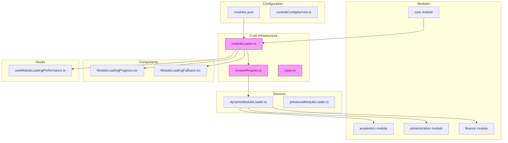
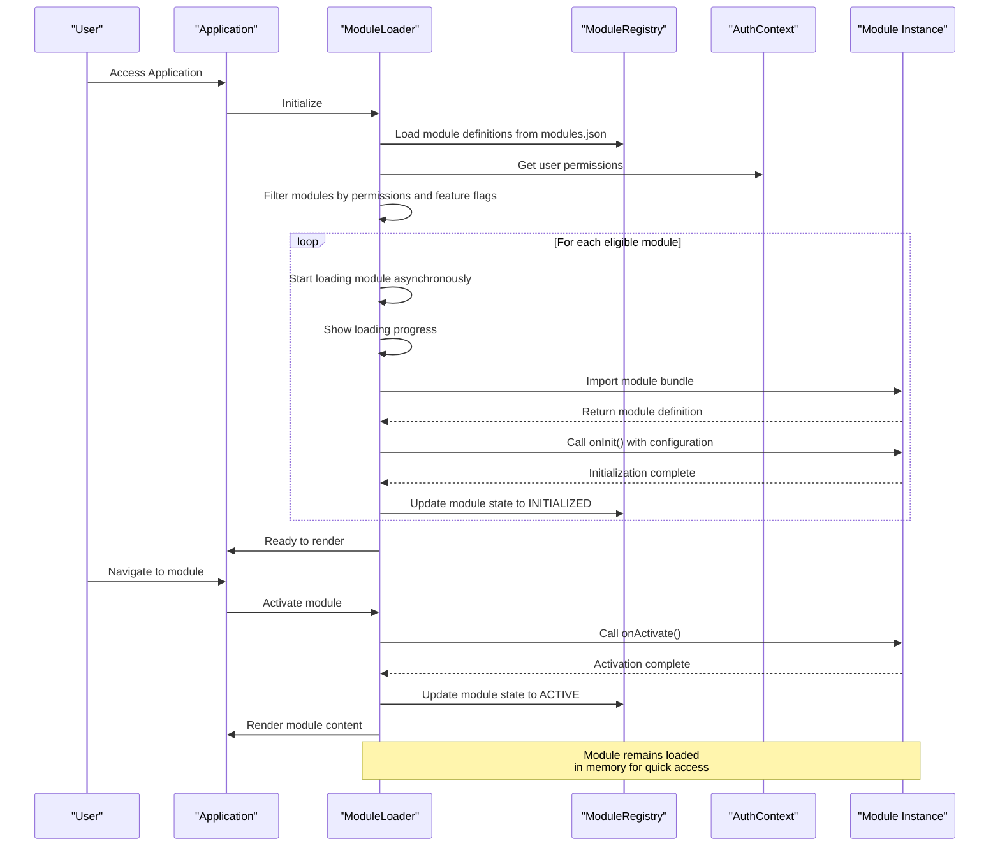
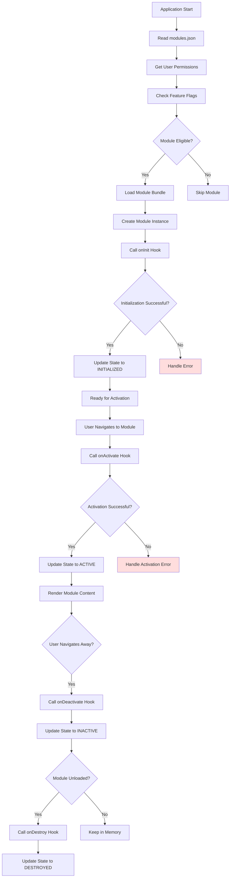
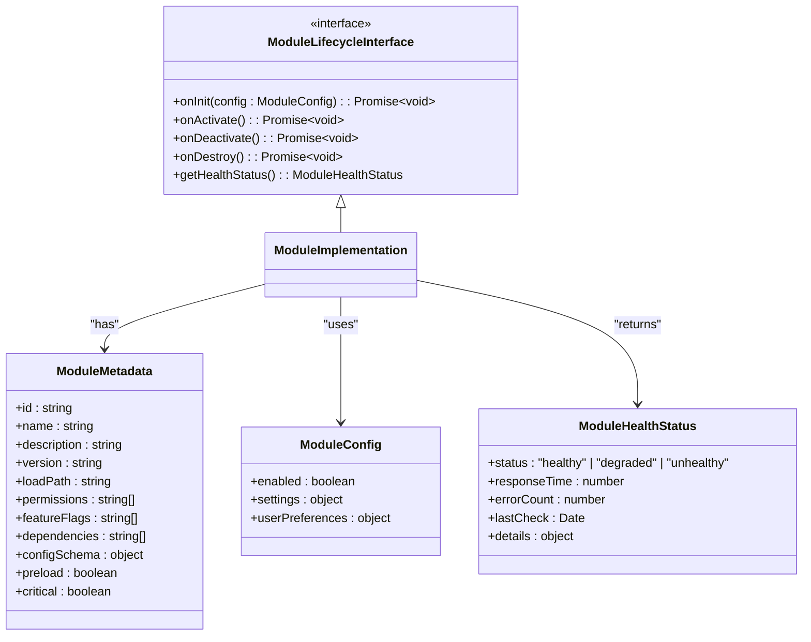
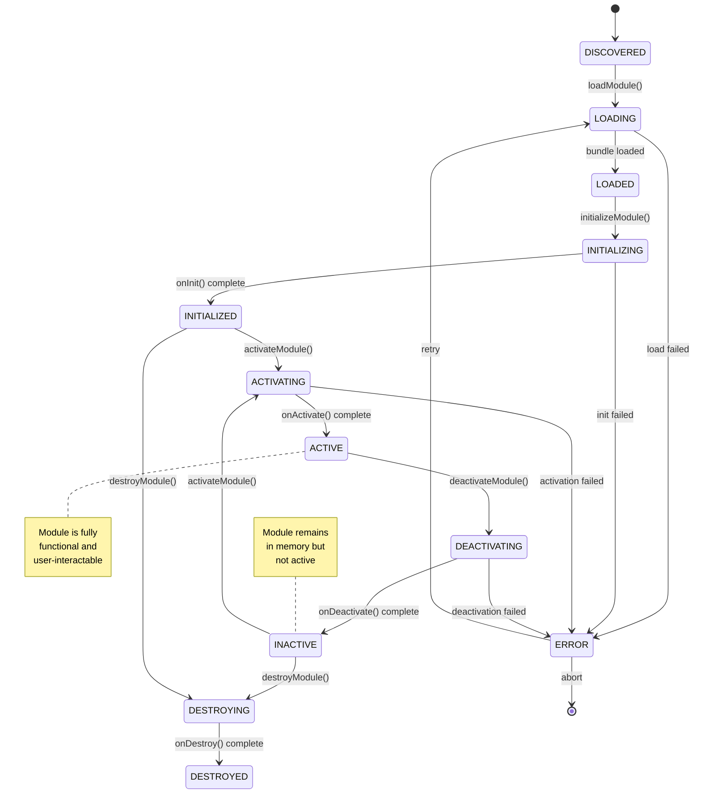
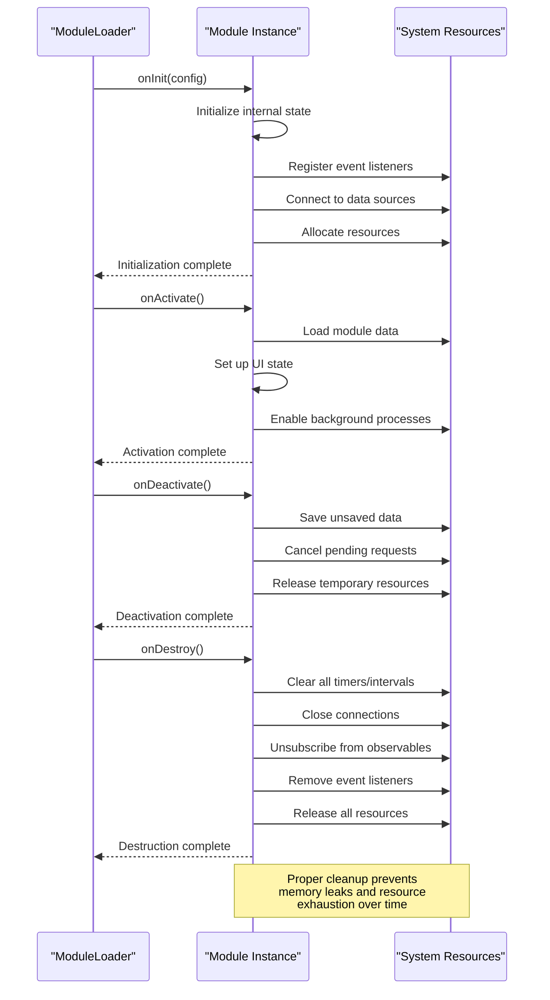
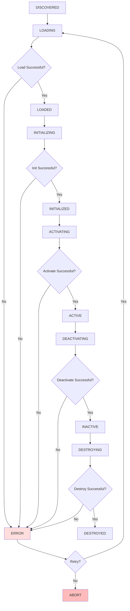
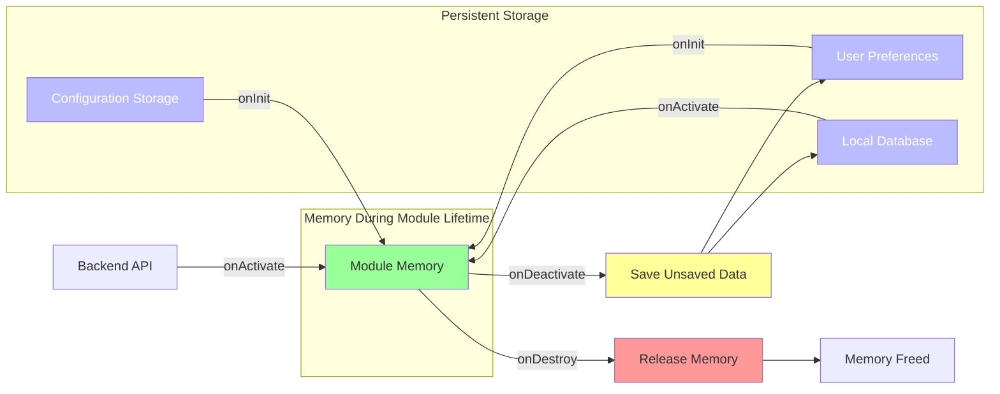
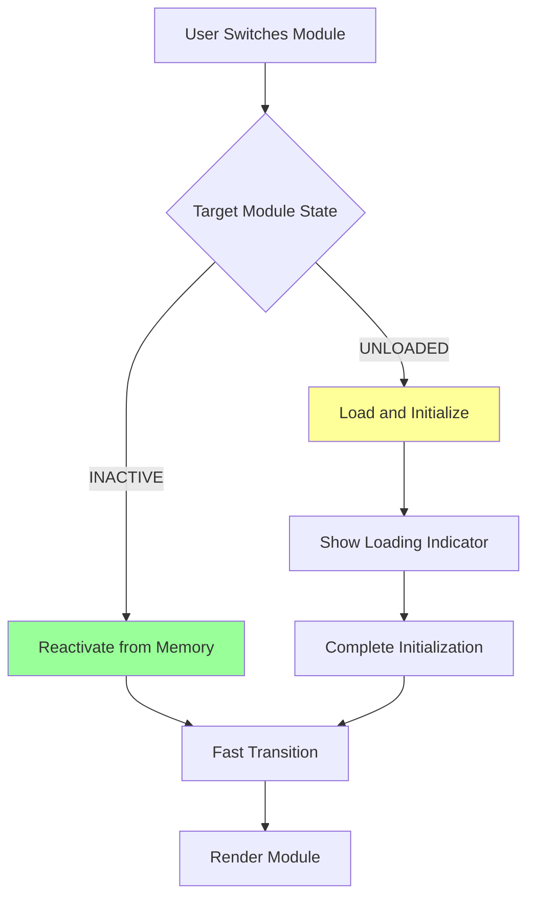
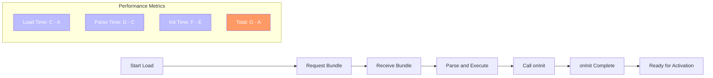

# Module Lifecycle Management

<cite>
**Referenced Files in This Document**   
- [moduleLoader.ts](file://src/core/moduleLoader.ts)
- [moduleRegistry.ts](file://src/core/moduleRegistry.ts)
- [types.ts](file://src/core/types.ts)
- [LoginPage.tsx](file://src/modules/core/pages/LoginPage.tsx)
- [moduleDefinition.tsx](file://src/modules/academics/moduleDefinition.tsx)
- [rbac.ts](file://src/modules/academics/rbac.ts)
- [modules.json](file://src/config/modules.json)
- [moduleConfigService.ts](file://src/services/moduleConfigService.ts)
- [dynamicModuleLoader.ts](file://src/services/dynamicModuleLoader.ts)
- [enhancedModuleLoader.ts](file://src/services/enhancedModuleLoader.ts)
- [useModuleLoadingPerformance.ts](file://src/hooks/useModuleLoadingPerformance.ts)
- [ModuleLoadingProgress.tsx](file://src/components/ModuleLoadingProgress.tsx)
- [ModuleLoadingFallback.tsx](file://src/components/ModuleLoadingFallback.tsx)
</cite>

## Table of Contents
1. [Introduction](#introduction)
2. [Project Structure](#project-structure)
3. [Core Components](#core-components)
4. [Architecture Overview](#architecture-overview)
5. [Detailed Component Analysis](#detailed-component-analysis)
6. [Module Lifecycle Phases](#module-lifecycle-phases)
7. [Lifecycle Event Hooks](#lifecycle-event-hooks)
8. [State Management During Transitions](#state-management-during-transitions)
9. [Data Persistence Across Lifecycle Changes](#data-persistence-across-lifecycle-changes)
10. [Common Issues and Solutions](#common-issues-and-solutions)
11. [Performance Considerations](#performance-considerations)
12. [Troubleshooting Guide](#troubleshooting-guide)
13. [Conclusion](#conclusion)

## Introduction
The schoolpilot3 application implements a modular architecture that enables dynamic loading, initialization, activation, and cleanup of functional modules. This document provides a comprehensive analysis of the module lifecycle management system, detailing how modules transition through various states from discovery to destruction. The system supports asynchronous loading, permission-based activation, feature flag evaluation, and proper resource cleanup to ensure optimal performance and memory usage. By examining the core implementation files and using the login page as a case study, this documentation explains the complete lifecycle process, interface contracts, state management strategies, and best practices for developing and maintaining modules within this framework.

## Project Structure
The project follows a feature-based modular organization with clear separation between core infrastructure, reusable components, and domain-specific modules. The src directory contains the main application code, organized into logical groupings:

- **core**: Contains foundational module lifecycle management components including the loader, registry, and type definitions
- **modules**: Houses individual functional modules (academics, administration, finance, etc.) each with their own components, pages, data services, and configuration
- **services**: Provides application-wide services for module configuration, loading, and health monitoring
- **components**: Shared UI components including module loading indicators and error boundaries
- **config**: Centralized configuration including the modules.json registry
- **hooks**: Custom React hooks for module lifecycle management and performance monitoring

This structure enables independent development and deployment of modules while maintaining consistent lifecycle management across the application.



**Diagram sources**
- [moduleLoader.ts](file://src/core/moduleLoader.ts)
- [moduleRegistry.ts](file://src/core/moduleRegistry.ts)
- [modules.json](file://src/config/modules.json)

**Section sources**
- [moduleLoader.ts](file://src/core/moduleLoader.ts)
- [moduleRegistry.ts](file://src/core/moduleRegistry.ts)
- [modules.json](file://src/config/modules.json)

## Core Components
The module lifecycle management system is built around several core components that work together to handle module loading, initialization, and state management. The primary components include the ModuleLoader, ModuleRegistry, and associated type definitions that define the contract for module behavior.

The ModuleLoader is responsible for asynchronously loading modules based on user permissions and feature flags. It coordinates with the ModuleRegistry to track module states and provides hooks for lifecycle events. The registry maintains a collection of registered modules and their metadata, enabling efficient lookup and state management.

Each module implements a standardized interface defined in the core types, ensuring consistency across different module implementations. This interface includes lifecycle methods such as onInit, onActivate, onDeactivate, and onDestroy, which are called at appropriate points during the module's lifetime.

```mermaid
classDiagram
class ModuleLoader {
+loadModule(moduleId : string) : Promise~ModuleInstance~
+initializeModule(module : ModuleInstance) : Promise~void~
+activateModule(moduleId : string) : Promise~void~
+deactivateModule(moduleId : string) : Promise~void~
+destroyModule(moduleId : string) : Promise~void~
-validatePermissions(moduleId : string) : boolean
-checkFeatureFlags(moduleId : string) : boolean
-handleModuleError(error : Error, moduleId : string) : void
}
class ModuleRegistry {
+registerModule(module : ModuleDefinition) : void
+getModule(moduleId : string) : ModuleDefinition | undefined
+getAllModules() : ModuleDefinition[]
+getModuleState(moduleId : string) : ModuleState
+updateModuleState(moduleId : string, state : ModuleState) : void
-modules : Map~string, ModuleRecord~
}
class ModuleDefinition {
+id : string
+name : string
+description : string
+loadPath : string
+permissions : string[]
+featureFlags : string[]
+dependencies : string[]
+configSchema : object
}
class ModuleInstance {
+moduleId : string
+instance : any
+state : ModuleState
+config : ModuleConfig
+onInit() : Promise~void~
+onActivate() : Promise~void~
+onDeactivate() : Promise~void~
+onDestroy() : Promise~void~
+getHealthStatus() : ModuleHealthStatus
}
enum ModuleState {
DISCOVERED
LOADING
LOADED
INITIALIZING
INITIALIZED
ACTIVATING
ACTIVE
DEACTIVATING
INACTIVE
DESTROYING
DESTROYED
ERROR
}
ModuleLoader --> ModuleRegistry : "uses"
ModuleLoader --> ModuleInstance : "creates"
ModuleRegistry --> ModuleDefinition : "stores"
ModuleInstance --> ModuleDefinition : "implements"
```

**Diagram sources**
- [moduleLoader.ts](file://src/core/moduleLoader.ts)
- [moduleRegistry.ts](file://src/core/moduleRegistry.ts)
- [types.ts](file://src/core/types.ts)

**Section sources**
- [moduleLoader.ts](file://src/core/moduleLoader.ts)
- [moduleRegistry.ts](file://src/core/moduleRegistry.ts)
- [types.ts](file://src/core/types.ts)

## Architecture Overview
The module lifecycle management architecture follows a centralized coordinator pattern where the ModuleLoader acts as the primary orchestrator of module states. The system is designed to handle asynchronous operations, permission checks, and error recovery while maintaining a consistent user experience.

When a user accesses the application, the ModuleLoader reads the modules.json configuration file to discover available modules. It then evaluates user permissions and feature flags to determine which modules should be loaded. Modules are loaded on-demand or pre-loaded based on usage patterns and performance considerations.

The architecture supports both eager and lazy loading strategies, with the ability to preload critical modules (like authentication) while deferring less frequently used modules. This approach optimizes startup performance while ensuring that necessary functionality is available when needed.



**Diagram sources**
- [moduleLoader.ts](file://src/core/moduleLoader.ts)
- [moduleRegistry.ts](file://src/core/moduleRegistry.ts)
- [modules.json](file://src/config/modules.json)
- [AuthContext.tsx](file://src/contexts/AuthContext.tsx)

## Detailed Component Analysis

### ModuleLoader Analysis
The ModuleLoader component is the central orchestrator of the module lifecycle, responsible for managing the complete journey from module discovery to destruction. It implements a state machine that tracks each module through its various lifecycle phases.

The loader begins by reading the modules.json configuration file, which contains metadata about all available modules including their IDs, load paths, required permissions, and feature flag dependencies. This discovery phase allows the system to understand what functionality is potentially available to the user.

After discovery, the loader evaluates user permissions and active feature flags to determine which modules should be loaded. This filtering ensures that users only load modules they have access to, improving both security and performance by avoiding unnecessary module loading.



**Diagram sources**
- [moduleLoader.ts](file://src/core/moduleLoader.ts)
- [moduleConfigService.ts](file://src/services/moduleConfigService.ts)
- [modules.json](file://src/config/modules.json)

**Section sources**
- [moduleLoader.ts](file://src/core/moduleLoader.ts)
- [moduleConfigService.ts](file://src/services/moduleConfigService.ts)

### Module Definition and Interface
Each module in the system implements a standardized interface that defines its lifecycle methods and metadata. This contract ensures consistency across modules and enables the ModuleLoader to interact with modules in a predictable way.

The module definition includes metadata such as the module ID, name, description, load path, required permissions, feature flag dependencies, and configuration schema. This metadata is used by the ModuleLoader to make decisions about when and how to load the module.

The lifecycle interface includes four key methods:
- **onInit**: Called once when the module is first loaded and initialized
- **onActivate**: Called each time the module becomes the active module
- **onDeactivate**: Called when the module is no longer the active module
- **onDestroy**: Called once when the module is being unloaded and destroyed



**Diagram sources**
- [types.ts](file://src/core/types.ts)
- [moduleDefinition.tsx](file://src/modules/academics/moduleDefinition.tsx)

**Section sources**
- [types.ts](file://src/core/types.ts)
- [moduleDefinition.tsx](file://src/modules/academics/moduleDefinition.tsx)

## Module Lifecycle Phases
The module lifecycle consists of several distinct phases that a module progresses through from discovery to destruction. Each phase represents a specific state in the module's lifetime and has well-defined entry and exit conditions.

### Discovery Phase
During the discovery phase, the ModuleLoader reads the modules.json configuration file to identify all available modules in the system. This metadata-driven approach allows for dynamic module registration without requiring code changes to the core loader.

The discovery process extracts essential information about each module including its ID, name, load path, required permissions, and feature flag dependencies. This information is stored in the ModuleRegistry, creating a comprehensive catalog of available functionality.

### Loading Phase
The loading phase begins when the ModuleLoader determines that a module should be loaded based on user permissions and feature flags. Modules are loaded asynchronously using dynamic import() statements, which enables code splitting and reduces initial bundle size.

During loading, the system displays progress indicators to provide feedback to the user. The loading process includes downloading the module bundle, parsing the code, and instantiating the module object. Error handling is implemented to manage network failures or corrupted bundles.

### Initialization Phase
Once a module is loaded, it enters the initialization phase where its onInit method is called. This method receives the module's configuration and is responsible for setting up internal state, registering event listeners, and establishing connections to data sources.

Initialization is a critical phase where the module establishes its baseline functionality. The onInit method should be idempotent, as it may be called multiple times in certain error recovery scenarios. Proper error handling during initialization prevents partially configured modules from causing system instability.

### Activation Phase
The activation phase occurs when a user navigates to a module or when a module becomes relevant to the current context. The onActivate method is called, allowing the module to prepare for user interaction.

Activation typically involves loading module-specific data, setting up UI state, and enabling user interface elements. Unlike initialization, activation can occur multiple times during a session as users navigate between modules. The module should be designed to handle repeated activation efficiently.

### Deactivation Phase
When a user navigates away from a module, the deactivation phase begins. The onDeactivate method is called, giving the module an opportunity to save state, clean up temporary resources, and disable active processes.

Proper deactivation is essential for maintaining system performance and preventing memory leaks. The module should release event listeners, cancel pending requests, and store any unsaved data during this phase.

### Destruction Phase
The destruction phase occurs when a module is no longer needed and should be completely removed from memory. The onDestroy method is called once, providing the final opportunity for cleanup.

Destruction typically happens when a user logs out, when system resources need to be conserved, or when a module is being updated. This phase should thoroughly clean up all resources, including timers, intervals, WebSocket connections, and subscriptions.



**Diagram sources**
- [moduleLoader.ts](file://src/core/moduleLoader.ts)
- [types.ts](file://src/core/types.ts)

**Section sources**
- [moduleLoader.ts](file://src/core/moduleLoader.ts)
- [types.ts](file://src/core/types.ts)

## Lifecycle Event Hooks
The module lifecycle system provides several event hooks that modules can implement to respond to state changes. These hooks form the contract between the ModuleLoader and individual modules, enabling consistent behavior across the application.

### onInit Hook
The onInit hook is called once when a module is first initialized after being loaded. This hook receives the module's configuration and is responsible for setting up the module's internal state.

Key responsibilities of the onInit hook include:
- Initializing internal data structures
- Setting up event listeners and subscriptions
- Establishing connections to data sources
- Validating configuration settings
- Preparing any required resources

The onInit method should be designed to handle initialization failures gracefully, ensuring that the module can be safely re-initialized if needed.

### onActivate Hook
The onActivate hook is called each time a module becomes the active module, typically when a user navigates to it. This hook allows the module to prepare for user interaction by loading necessary data and updating its UI state.

Key responsibilities of the onActivate hook include:
- Loading module-specific data from APIs or local storage
- Setting up route-specific state
- Enabling user interface elements
- Starting any required background processes
- Updating navigation context

Since activation can occur multiple times during a session, the onActivate method should be optimized for performance and avoid redundant operations.

### onDeactivate Hook
The onDeactivate hook is called when a module is no longer the active module. This hook provides an opportunity to clean up temporary resources and save state before the module becomes inactive.

Key responsibilities of the onDeactivate hook include:
- Saving unsaved user data
- Canceling pending API requests
- Releasing event listeners
- Pausing background processes
- Clearing temporary UI state

Proper implementation of onDeactivate helps prevent memory leaks and ensures that the module can be efficiently reactivated later.

### onDestroy Hook
The onDestroy hook is called once when a module is being completely removed from memory. This final cleanup opportunity should thoroughly clean up all resources used by the module.

Key responsibilities of the onDestroy hook include:
- Clearing all timers and intervals
- Closing WebSocket connections
- Unsubscribing from all observables
- Removing all event listeners
- Destroying any created DOM elements
- Releasing large data structures

The onDestroy method should be comprehensive to prevent memory leaks that could accumulate over time.



**Diagram sources**
- [moduleLoader.ts](file://src/core/moduleLoader.ts)
- [types.ts](file://src/core/types.ts)
- [moduleDefinition.tsx](file://src/modules/academics/moduleDefinition.tsx)

**Section sources**
- [moduleLoader.ts](file://src/core/moduleLoader.ts)
- [types.ts](file://src/core/types.ts)

## State Management During Transitions
The module lifecycle system maintains comprehensive state tracking to ensure consistent behavior during transitions. The ModuleRegistry stores the current state of each module, enabling the ModuleLoader to make informed decisions about state changes.

Each module progresses through a well-defined state machine with clear transitions between states. The system validates state transitions to prevent invalid operations, such as attempting to activate an uninitialized module.

State persistence is implemented to maintain module state across navigation events. When a module is deactivated, its state is preserved in memory, allowing for quick reactivation without the need for full reinitialization. This approach improves user experience by maintaining context between visits to the same module.

Error states are handled gracefully, with the system providing recovery options such as retrying failed operations or falling back to alternative modules. Detailed error logging helps diagnose issues and improve system reliability over time.



**Diagram sources**
- [moduleLoader.ts](file://src/core/moduleLoader.ts)
- [moduleRegistry.ts](file://src/core/moduleRegistry.ts)

**Section sources**
- [moduleLoader.ts](file://src/core/moduleLoader.ts)
- [moduleRegistry.ts](file://src/core/moduleRegistry.ts)

## Data Persistence Across Lifecycle Changes
The module lifecycle system implements a multi-layered approach to data persistence that balances performance, memory usage, and data integrity.

During the initialization phase, modules load their configuration from the central configuration service and user preferences from local storage. This configuration is maintained in memory for the duration of the module's lifetime, providing quick access to settings without repeated storage operations.

When a module is activated, it typically loads its required data from backend APIs or local databases. This data is cached in memory to support fast navigation and reduce server load. The system implements intelligent caching strategies that balance freshness with performance.

During deactivation, modules are expected to save any unsaved user data to persistent storage. This ensures that work is not lost when users navigate away from a module. The system provides utilities for automatic draft saving and conflict resolution when multiple users edit the same data.

When a module is destroyed, all in-memory data is released, but user preferences and saved data remain in persistent storage for future sessions. This approach conserves memory while preserving user state across sessions.



**Diagram sources**
- [moduleLoader.ts](file://src/core/moduleLoader.ts)
- [moduleConfigService.ts](file://src/services/moduleConfigService.ts)
- [databaseService.ts](file://src/services/databaseService.ts)

**Section sources**
- [moduleLoader.ts](file://src/core/moduleLoader.ts)
- [moduleConfigService.ts](file://src/services/moduleConfigService.ts)

## Common Issues and Solutions

### Memory Leaks During Module Destruction
Memory leaks are a common issue in modular applications, particularly when event listeners, subscriptions, or timers are not properly cleaned up during module destruction.

**Symptoms:**
- Increasing memory usage over time
- Performance degradation after extended use
- Browser tab crashes on complex operations

**Solutions:**
- Implement comprehensive onDestroy hooks that clean up all resources
- Use WeakMap or WeakSet for references that should not prevent garbage collection
- Implement a resource tracking system that logs all allocated resources
- Use browser developer tools to identify memory leaks

```typescript
// Example of proper cleanup in onDestroy
onDestroy(): Promise<void> {
  // Clear all timers
  if (this.refreshTimer) {
    clearInterval(this.refreshTimer);
    this.refreshTimer = null;
  }
  
  // Unsubscribe from all observables
  this.subscriptions.forEach(sub => sub.unsubscribe());
  this.subscriptions = [];
  
  // Remove event listeners
  window.removeEventListener('resize', this.handleResize);
  document.removeEventListener('keydown', this.handleKeydown);
  
  // Clear references to large data structures
  this.cache.clear();
  this.dataStore = null;
  
  return Promise.resolve();
}
```

### Race Conditions During Initialization
Race conditions can occur when multiple modules or processes attempt to access shared resources simultaneously during initialization.

**Symptoms:**
- Intermittent initialization failures
- Data corruption or inconsistent state
- Deadlocks or infinite waits

**Solutions:**
- Implement module dependency management to ensure proper initialization order
- Use promises and async/await to coordinate asynchronous operations
- Implement locking mechanisms for shared resources
- Add timeout mechanisms to prevent indefinite waits

```typescript
// Example of handling initialization dependencies
async onInit(config: ModuleConfig): Promise<void> {
  // Wait for dependencies to initialize
  await Promise.all(
    this.dependencies.map(depId => 
      moduleLoader.waitForInitialization(depId)
    )
  );
  
  // Initialize own resources
  await this.initializeDatabase();
  await this.loadConfiguration();
  await this.setupEventHandlers();
}
```

### Event Listener Cleanup
Improper event listener management is a frequent cause of memory leaks and unexpected behavior.

**Best Practices:**
- Always store references to event listeners for later removal
- Remove listeners in onDeactivate and onDestroy hooks
- Use event delegation when possible to reduce the number of listeners
- Prefer using React's useEffect cleanup pattern for component-level events

```typescript
// Example of proper event listener management
private setupEventListeners(): void {
  this.resizeHandler = this.handleResize.bind(this);
  window.addEventListener('resize', this.resizeHandler);
  
  this.keyHandler = this.handleKeydown.bind(this);
  document.addEventListener('keydown', this.keyHandler);
}

private removeEventListeners(): void {
  if (this.resizeHandler) {
    window.removeEventListener('resize', this.resizeHandler);
    this.resizeHandler = null;
  }
  
  if (this.keyHandler) {
    document.removeEventListener('keydown', this.keyHandler);
    this.keyHandler = null;
  }
}
```

**Section sources**
- [moduleLoader.ts](file://src/core/moduleLoader.ts)
- [types.ts](file://src/core/types.ts)
- [moduleDefinition.tsx](file://src/modules/academics/moduleDefinition.tsx)

## Performance Considerations

### Rapid Module Switching
Rapid module switching is a common user behavior that can impact performance if not properly optimized. The system implements several strategies to ensure smooth transitions between modules.

**Optimization Techniques:**
- Keep deactivated modules in memory for quick reactivation
- Implement lazy loading for module data to avoid unnecessary API calls
- Use memoization to cache expensive computations
- Implement request cancellation to abort pending operations when switching away from a module



### Reducing Initialization Overhead
Module initialization can be a performance bottleneck, especially for complex modules with many dependencies.

**Optimization Strategies:**
- Implement code splitting to reduce bundle size
- Use lazy loading for non-critical module components
- Preload critical modules during application startup
- Implement configuration caching to avoid repeated parsing
- Use Web Workers for expensive initialization tasks

```typescript
// Example of optimized initialization
async onInit(config: ModuleConfig): Promise<void> {
  // Quick configuration setup
  this.config = this.validateConfig(config);
  
  // Start non-blocking operations
  this.setupUIComponents(); // Lightweight DOM setup
  
  // Offload expensive operations
  setTimeout(() => {
    this.initializeComplexCalculations();
    this.loadLargeDatasets();
  }, 0);
  
  // Return quickly to unblock main thread
  return Promise.resolve();
}
```

### Loading Performance Monitoring
The system includes comprehensive performance monitoring to identify and address bottlenecks in module loading.

**Key Metrics Tracked:**
- Module load time (from request to bundle loaded)
- Initialization duration
- Activation time
- Memory usage
- Number of network requests

These metrics are collected and reported to help identify performance issues and guide optimization efforts.



**Section sources**
- [moduleLoader.ts](file://src/core/moduleLoader.ts)
- [useModuleLoadingPerformance.ts](file://src/hooks/useModuleLoadingPerformance.ts)
- [ModuleLoadingProgress.tsx](file://src/components/ModuleLoadingProgress.tsx)

## Troubleshooting Guide

### Debugging Module Loading Issues
When modules fail to load or initialize properly, the following steps can help identify and resolve the issue:

1. **Check browser console for errors**: Look for network errors, syntax errors, or runtime exceptions
2. **Verify module configuration**: Ensure the module is properly defined in modules.json
3. **Check user permissions**: Confirm the user has the required permissions to access the module
4. **Verify feature flags**: Ensure required feature flags are enabled
5. **Inspect network requests**: Check if the module bundle is being requested and loaded successfully

### Common Error Scenarios and Solutions

**Module not appearing in navigation:**
- Verify the module is registered in modules.json
- Check that the user has the required permissions
- Ensure feature flags are properly configured
- Confirm the module's critical flag is set correctly

**Module loads but shows error state:**
- Check the browser console for JavaScript errors
- Verify API endpoints are accessible
- Test with simplified configuration
- Disable other modules to check for conflicts

**Slow module loading:**
- Check network performance and bundle size
- Verify code splitting is working correctly
- Monitor memory usage during loading
- Check for unnecessary dependencies

**Memory leaks after module destruction:**
- Verify onDestroy hook is properly implemented
- Check for lingering event listeners
- Monitor WebSocket connections
- Inspect timers and intervals

### Diagnostic Tools
The system provides several tools to assist with troubleshooting module lifecycle issues:

- **ModuleHealthDashboard**: Visualizes the status of all modules
- **ModuleLoadingPerformancePanel**: Shows detailed performance metrics for module loading
- **ModuleErrorBoundary**: Captures and reports module-specific errors
- **console.log statements**: Strategic logging throughout the lifecycle process

```typescript
// Example diagnostic logging
const debug = (message: string, data?: any) => {
  if (process.env.NODE_ENV === 'development') {
    console.log(`[ModuleLoader] ${message}`, data);
  }
};

// Usage in lifecycle methods
debug('Initializing module', { moduleId, config });
debug('Module activated', { moduleId, activationTime: Date.now() });
```

**Section sources**
- [moduleLoader.ts](file://src/core/moduleLoader.ts)
- [ModuleHealthDashboard.tsx](file://src/components/ModuleHealthDashboard.tsx)
- [ModuleLoadingPerformancePanel.tsx](file://src/components/ModuleLoadingPerformancePanel.tsx)
- [ModuleErrorBoundary.tsx](file://src/components/ModuleErrorBoundary.tsx)

## Conclusion
The module lifecycle management system in schoolpilot3 provides a robust framework for handling the complete journey of modules from discovery to destruction. By implementing a standardized lifecycle interface and centralized orchestration, the system ensures consistent behavior across all modules while providing flexibility for module-specific requirements.

Key strengths of the system include:
- Asynchronous loading for improved performance
- Permission-based activation for enhanced security
- Comprehensive state management for reliable operation
- Proper resource cleanup to prevent memory leaks
- Detailed performance monitoring for optimization

The system effectively balances the need for rapid module switching with the requirements for proper initialization and cleanup. By following the documented patterns and best practices, developers can create modules that integrate seamlessly with the lifecycle management system and provide a smooth user experience.

Future improvements could include:
- Enhanced dependency management between modules
- More sophisticated preloading strategies based on user behavior
- Improved error recovery mechanisms
- Advanced performance optimization techniques

Overall, the module lifecycle management system represents a well-designed solution for managing complex modular applications, providing both flexibility and reliability in a production environment.