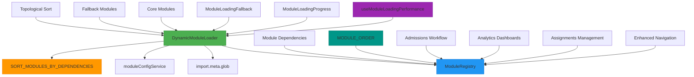
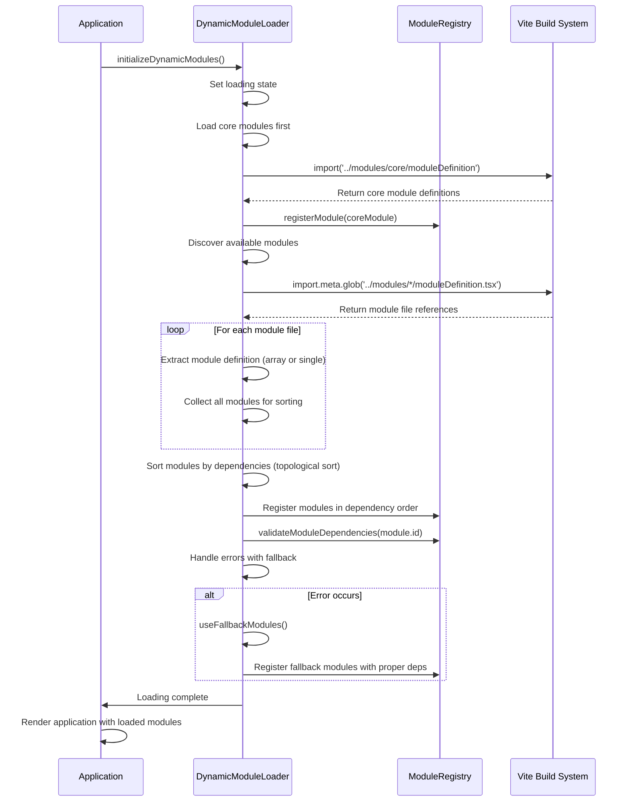
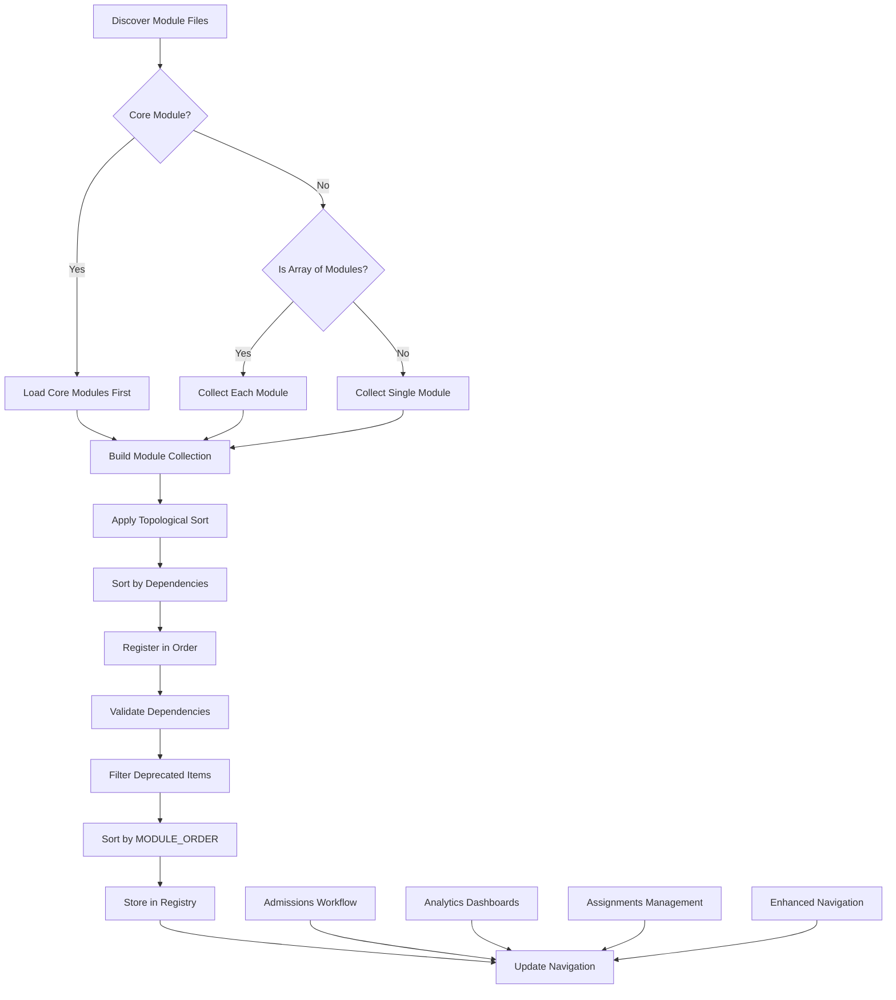
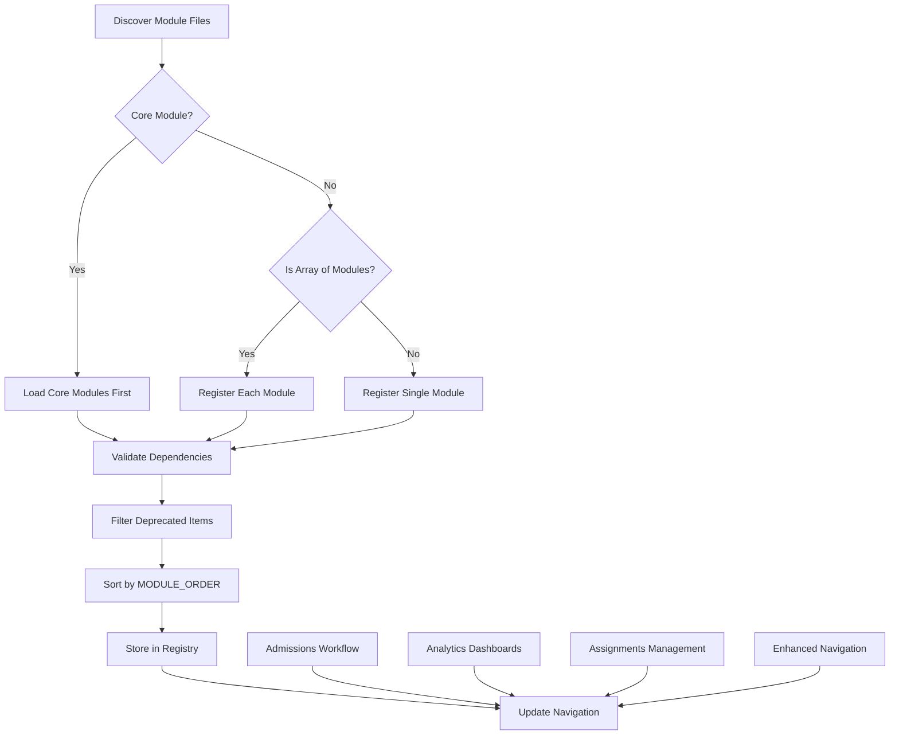
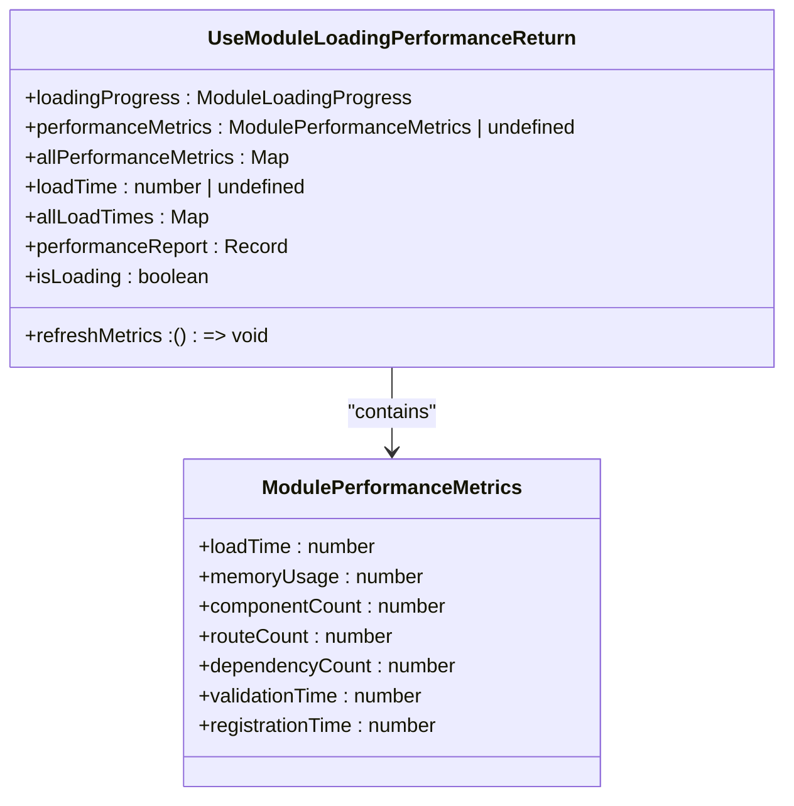
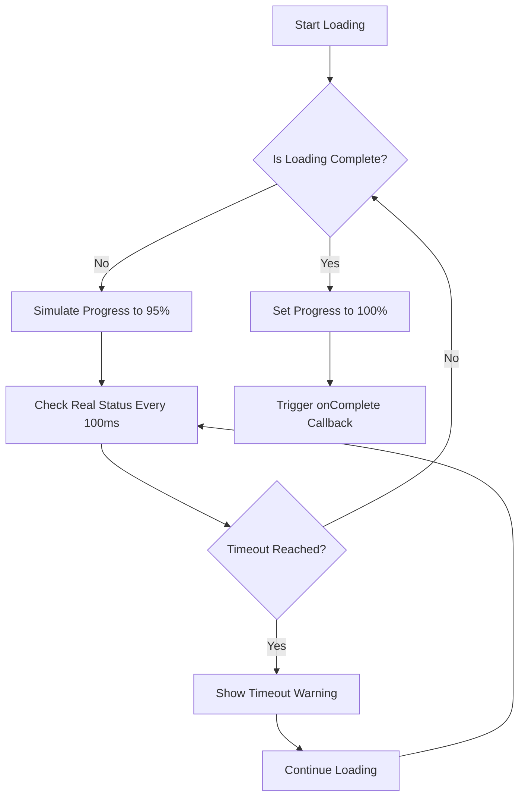
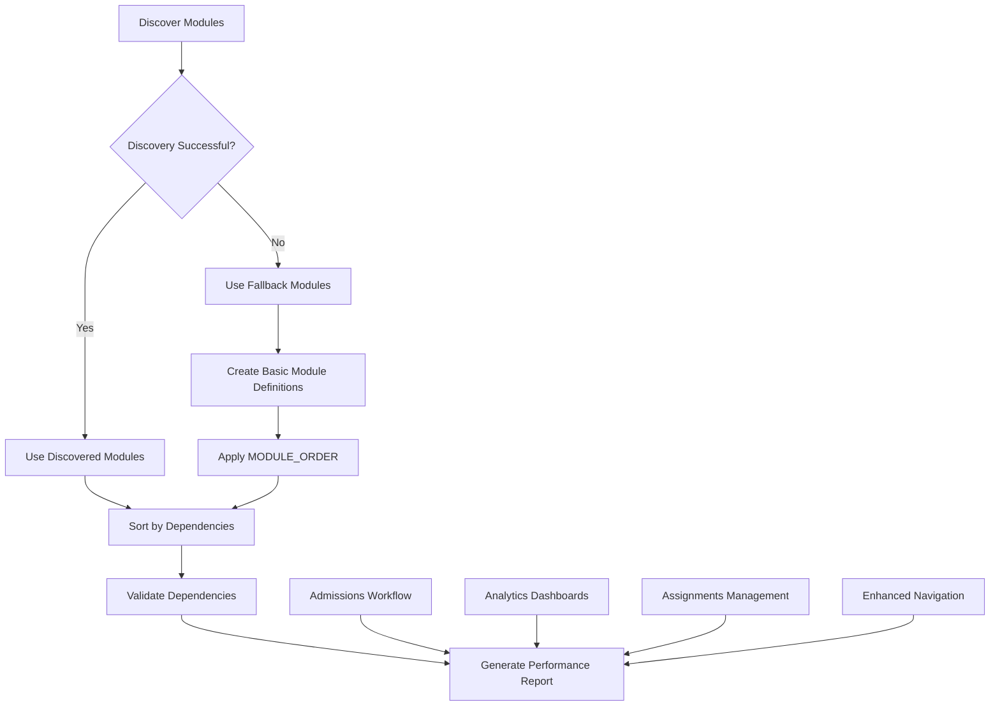
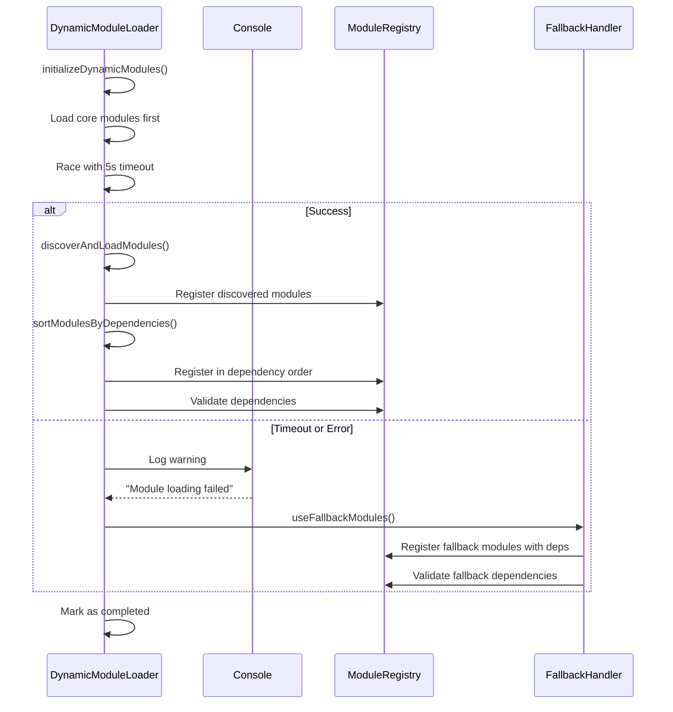

# Dynamic Module Loading

<cite>
**Referenced Files in This Document**
- [dynamicModuleLoader.ts](file://src/services/module/dynamicModuleLoader.ts)
- [moduleRegistry.ts](file://src/core/moduleRegistry.ts)
- [useModuleLoadingPerformance.ts](file://src/hooks/useModuleLoadingPerformance.ts)
- [ModuleLoadingProgress.tsx](file://src/components/ModuleLoadingProgress.tsx)
- [ModuleLoadingFallback.tsx](file://src/components/ModuleLoadingFallback.tsx)
- [moduleOrder.ts](file://src/moduleOrder.ts)
- [admissionsModuleDefinition.tsx](file://src/modules/admissions/moduleDefinition.tsx)
- [EnhancedNavigation.tsx](file://src/components/EnhancedNavigation.tsx)
</cite>

## Update Summary
**Changes Made**
- Enhanced dynamic module loader with new admissions workflow support and analytics dashboards
- Updated module order configuration to include analytics, assignments, lessonplans, portal, pickup, houses, and inventory modules
- Added comprehensive admissions module with full application workflow support
- Integrated enhanced navigation system with automatic secondary menu collapse functionality
- Improved module discovery and registration with enhanced dependency validation
- Expanded module ordering system with new module categories and improved loading sequence

## Table of Contents
1. [Introduction](#introduction)
2. [Core Architecture](#core-architecture)
3. [Dynamic Loading Mechanism](#dynamic-loading-mechanism)
4. [Enhanced Module Collections and Types](#enhanced-module-collections-and-types)
5. [Module Registry and Management](#module-registry-and-management)
6. [Performance Monitoring](#performance-monitoring)
7. [Loading State Communication](#loading-state-communication)
8. [Caching and Fallback Strategies](#caching-and-fallback-strategies)
9. [Error Recovery and Timeout Handling](#error-recovery-and-timeout-handling)
10. [Preload and Prefetch Mechanisms](#preload-and-prefetch-mechanisms)
11. [Troubleshooting and Debugging](#troubleshooting-and-debugging)

## Introduction
The Dynamic Module Loading system in schoolpilot3 is a sophisticated mechanism designed to enable lazy loading of module bundles based on route access and user permissions. This system significantly reduces initial bundle size by loading only required modules on demand, leveraging Vite's code splitting capabilities. The architecture combines dynamic import features with a robust module registry, performance monitoring, and comprehensive error recovery mechanisms to ensure a seamless user experience even under challenging network conditions.

**Updated** Enhanced with new module collections, improved fallback mechanisms, comprehensive dependency validation, and enhanced module ordering system supporting admissions workflow, analytics dashboards, and assignments management

**Section sources**
- [dynamicModuleLoader.ts:1-365](file://src/services/module/dynamicModuleLoader.ts#L1-L365)

## Core Architecture
The dynamic module loading system consists of several key components that work together to provide an efficient and reliable module loading experience:

- **DynamicModuleLoader**: Central class responsible for discovering, loading, and managing modules with enhanced fallback mechanisms and topological sorting
- **ModuleRegistry**: Singleton that maintains module definitions and handles registration with dependency validation and module ordering
- **useModuleLoadingPerformance**: React hook for monitoring loading performance with enhanced metrics
- **ModuleLoadingProgress**: UI component for displaying loading status with improved timeout handling
- **ModuleLoadingFallback**: Fallback UI components for loading states with skeleton loaders
- **MODULE_ORDER**: Enhanced module ordering system ensuring deterministic loading based on dependencies



**Diagram sources**
- [dynamicModuleLoader.ts:294-355](file://src/services/module/dynamicModuleLoader.ts#L294-L355)
- [moduleRegistry.ts:154-162](file://src/core/moduleRegistry.ts#L154-L162)
- [moduleOrder.ts:1-19](file://src/moduleOrder.ts#L1-L19)

**Section sources**
- [dynamicModuleLoader.ts:1-365](file://src/services/module/dynamicModuleLoader.ts#L1-L365)
- [moduleRegistry.ts:1-281](file://src/core/moduleRegistry.ts#L1-L281)
- [moduleOrder.ts:1-19](file://src/moduleOrder.ts#L1-L19)

## Dynamic Loading Mechanism
The dynamic loading mechanism uses Vite's `import.meta.glob` feature to discover and load module definitions asynchronously. This approach enables true lazy loading, where modules are only fetched when needed, with enhanced dependency management and ordering.

### Enhanced Loading Lifecycle with Topological Sorting
The module loading process follows a well-defined lifecycle with improved error handling, fallback mechanisms, and dependency-aware ordering:



**Diagram sources**
- [dynamicModuleLoader.ts:65-162](file://src/services/module/dynamicModuleLoader.ts#L65-L162)

**Section sources**
- [dynamicModuleLoader.ts:65-162](file://src/services/module/dynamicModuleLoader.ts#L65-L162)

### Enhanced Module Discovery and Registration
The system now implements comprehensive module discovery with dependency-aware sorting and enhanced error recovery:



**Diagram sources**
- [dynamicModuleLoader.ts:122-152](file://src/services/module/dynamicModuleLoader.ts#L122-L152)
- [moduleRegistry.ts:154-162](file://src/core/moduleRegistry.ts#L154-L162)

**Section sources**
- [dynamicModuleLoader.ts:122-152](file://src/services/module/dynamicModuleLoader.ts#L122-L152)
- [moduleRegistry.ts:154-162](file://src/core/moduleRegistry.ts#L154-L162)

### Code Splitting Integration with Enhanced Ordering
The system integrates with Vite's code splitting through the use of dynamic imports and glob patterns with enhanced dependency management:

```typescript
// Enhanced module discovery with core priority and dependency awareness
const coreModulesImport = await import('../modules/core/moduleDefinition.tsx');
const coreModules = coreModulesImport.coreModules || coreModulesImport.default;

// Handle both single modules and arrays of modules
if (Array.isArray(coreModules)) {
  for (const module of coreModules) {
    if (module && module.id) {
      modulesToRegister.push(module);
    }
  }
}

// Use import.meta.glob to discover and load other module definitions
const moduleFiles = import.meta.glob('../modules/*/moduleDefinition.tsx', { eager: true });

// Load and register each module with dependency collection
for (const [path, moduleExport] of Object.entries(moduleFiles)) {
  try {
    // Skip core modules as they're already loaded
    if (path.includes('/core/')) {
      continue;
    }
    
    const moduleDefinition = (moduleExport as any).default;
    
    // Handle both single modules and arrays of modules
    if (Array.isArray(moduleDefinition)) {
      for (const module of moduleDefinition) {
        if (module && module.id) {
          modulesToRegister.push(module);
        }
      }
    } else if (moduleDefinition && moduleDefinition.id) {
      modulesToRegister.push(moduleDefinition);
    }
  } catch (error) {
    console.error(`Error loading module from ${path}:`, error);
  }
}

// Sort modules by dependency order using topological sort
const sortedModules = this.sortModulesByDependencies(modulesToRegister);
console.log('Registration order:', sortedModules.map(m => m.id));

// Register modules in dependency order
for (const module of sortedModules) {
  try {
    console.log(`Registering module: ${module.id}`);
    moduleRegistry.registerModule(module);
  } catch (error) {
    console.error(`Error registering module ${module.id}:`, error);
  }
}
```

This approach ensures that each module is packaged as a separate chunk during the build process, allowing for on-demand loading with enhanced error recovery and proper dependency resolution.

**Section sources**
- [dynamicModuleLoader.ts:75-134](file://src/services/module/dynamicModuleLoader.ts#L75-L134)

## Enhanced Module Collections and Types
The system now supports expanded module collections with enhanced type definitions, improved module organization, and comprehensive dependency management.

### New Module Collections with Enhanced Ordering
The enhanced system includes comprehensive module collections covering all major educational domains with proper dependency relationships:

**Core System Modules (Loaded First):**
- Dashboard: Main system dashboard with overview widgets
- Settings: System configuration and user preferences
- Reports: Comprehensive reporting and analytics functionality

**Administrative Modules (Core Dependencies):**
- Administration: Student and staff management with extensive features
- **Admissions**: Student admission and enrollment processes with complete workflow
- Academics: Curriculum management and academic tracking
- Finance: Financial management and accounting
- HR: Human resources and payroll systems
- Houses: House system and dormitory management (merged into administration)
- Pickup: Student pick-up and transportation management (merged into administration)

**Advanced Features and Specialized Modules:**
- **Analytics**: Advanced analytics and insights dashboards
- **Assignments**: Homework and assignment management system
- **Lesson Plans**: Detailed lesson planning and delivery tracking
- Inventory: School inventory and procurement
- Library: Library management system
- Nutrition: Meal planning and nutrition tracking
- Portal: Student and parent portal access (depends on administration and academics)

### Enhanced Module Type Definitions
The module system now supports comprehensive type definitions with enhanced validation and dependency management:

```typescript
interface ModuleDefinition {
  id: string;
  name: string;
  description: string;
  icon: React.ComponentType<any>;
  path: string;
  version: string;
  navigation: NavItem[];
  features: string[];
  dependencies: ModuleDependency[];
  optionalDependencies?: ModuleDependency[];
  settings: ModuleSettings;
  rbacPermissions: RBACPermission[];
  defaultRoles: string[];
  isActive?: boolean;
  routes?: RouteDefinition[];
  permissions?: string[];
  publicAccess?: boolean;
}

interface ModuleDependency {
  moduleId: string;
  version?: string;
  required: boolean;
}

interface ModuleSettings {
  category: string;
  items: SettingItem[];
}

interface SettingItem {
  key: string;
  type: 'boolean' | 'string' | 'number';
  defaultValue: any;
  label?: string;
  description?: string;
}
```

**Section sources**
- [moduleOrder.ts:1-19](file://src/moduleOrder.ts#L1-L19)
- [admissionsModuleDefinition.tsx:19-140](file://src/modules/admissions/moduleDefinition.tsx#L19-L140)

## Module Registry and Management
The ModuleRegistry class serves as the central repository for all registered modules, providing methods for registration, retrieval, and dependency management with enhanced validation and module ordering.

### Enhanced Module Registration Process with Dependency Validation


**Diagram sources**
- [moduleRegistry.ts:154-162](file://src/core/moduleRegistry.ts#L154-L162)

**Section sources**
- [moduleRegistry.ts:154-162](file://src/core/moduleRegistry.ts#L154-L162)

### Module Definition Structure with Enhanced Dependencies
The module configuration file defines the structure and properties of available modules with enhanced dependency management and ordering:

```json
{
  "enabledModules": [
    "dashboard",
    "administration", 
    "admissions",
    "academics",
    "finance",
    "hr",
    "inventory",
    "library",
    "nutrition",
    "reports",
    "settings"
  ],
  "disabledModules": [],
  "moduleSettings": {
    "dashboard": {
      "enabled": true,
      "required": true,
      "description": "Core dashboard functionality"
    },
    "administration": {
      "enabled": true,
      "required": false,
      "description": "Student and staff administration"
    },
    "admissions": {
      "enabled": true,
      "required": false,
      "description": "Student admission and enrollment workflow"
    }
  },
  "moduleDependencies": {
    "academics": ["administration"],
    "finance": ["administration"],
    "hr": ["administration"],
    "nutrition": ["administration"],
    "reports": ["administration", "academics", "finance"],
    "portal": ["administration", "academics"],
    "admissions": ["administration", "finance"],
    "analytics": ["academics", "hr"],
    "assignments": ["academics"],
    "lessonplans": ["academics"]
  }
}
```

**Section sources**
- [moduleOrder.ts:1-19](file://src/moduleOrder.ts#L1-L19)

## Performance Monitoring
The system provides comprehensive performance monitoring capabilities through the `useModuleLoadingPerformance` hook and associated enhanced metrics.

### Enhanced Performance Metrics Structure
```typescript
interface ModulePerformanceMetrics {
  loadTime: number;
  memoryUsage: number;
  componentCount: number;
  routeCount: number;
  dependencyCount: number;
  validationTime: number;
  registrationTime: number;
}

interface ModuleHealth {
  moduleId: string;
  status: ModuleHealthStatus;
  loadTime: number;
  lastError: Error | null;
  loadAttempts: number;
  lastLoadAttempt: Date | null;
  dependencies: ModuleDependency[];
  features: ModuleFeature[];
  performance: ModulePerformanceMetrics;
  lastChecked?: Date;
  checkResults?: Record<string, any>;
}
```

### Enhanced Performance Monitoring Hook
The `useModuleLoadingPerformance` hook provides real-time access to enhanced loading performance data:



**Diagram sources**
- [useModuleLoadingPerformance.ts:1-110](file://src/hooks/useModuleLoadingPerformance.ts#L1-L110)

**Section sources**
- [useModuleLoadingPerformance.ts:1-110](file://src/hooks/useModuleLoadingPerformance.ts#L1-L110)

## Loading State Communication
The system communicates loading states to the UI through dedicated components that provide visual feedback during the loading process with enhanced timeout handling.

### Enhanced ModuleLoadingProgress Component
The `ModuleLoadingProgress` component displays real-time loading progress with improved timeout detection:



**Diagram sources**
- [ModuleLoadingProgress.tsx:1-121](file://src/components/ModuleLoadingProgress.tsx#L1-L121)

**Section sources**
- [ModuleLoadingProgress.tsx:1-121](file://src/components/ModuleLoadingProgress.tsx#L1-L121)

### Enhanced Loading State Management
The component uses a combination of simulated and real progress tracking with improved timeout handling:

```typescript
// Enhanced progress simulation with timeout detection
setProgress(prev => {
  if (dynamicModuleLoader.isLoadingComplete()) {
    return 100;
  }
  const newProgress = prev + Math.random() * 5;
  return Math.min(newProgress, 95); // Cap at 95% until real loading completes
});

// Timeout handler with configurable timeout
setTimeout(() => {
  setIsTimedOut(true);
  if (onTimeout) {
    onTimeout();
  }
}, timeoutMs);
```

This approach ensures a smooth user experience while accurately reflecting the actual loading state and providing clear timeout notifications.

**Section sources**
- [ModuleLoadingProgress.tsx:1-121](file://src/components/ModuleLoadingProgress.tsx#L1-L121)

## Caching and Fallback Strategies
The system implements robust caching and fallback mechanisms to ensure reliability and backward compatibility with enhanced error recovery and comprehensive module ordering.

### Enhanced Discovery and Caching with Module Ordering
```typescript
private async discoverAvailableModules(): Promise<string[]> {
  try {
    console.log('🔍 [DynamicModuleLoader] Starting module discovery...');
    
    // Use import.meta.glob to discover module directories with moduleDefinition.tsx files
    const moduleDirectories = import.meta.glob('../modules/*/moduleDefinition.tsx', { eager: true });
    const coreModuleDirectories = import.meta.glob('../modules/core/moduleDefinition.tsx', { eager: true });
    
    // Combine all discovered modules
    const allModuleDirectories = { ...moduleDirectories, ...coreModuleDirectories };
    
    // Extract module IDs from paths
    const moduleIds = Object.keys(allModuleDirectories).map(path => {
      const match = path.match(/\.\.\/modules\/([^/]+)\/moduleDefinition\.tsx$/);
      return match ? match[1] : null;
    }).filter(Boolean) as string[];
    
    console.log(`[DynamicModuleLoader] Discovered module files:`, Object.keys(allModuleDirectories));
    console.log(`[DynamicModuleLoader] Extracted module IDs:`, moduleIds);
    
    // Always include core modules
    const allModules = [...new Set([...this.CORE_MODULES, ...moduleIds])];
    
    // Cache discovered modules
    this.discoveredModules = allModules;
    
    console.log(`✅ [DynamicModuleLoader] Successfully discovered ${allModules.length} modules:`, allModules);
    return allModules;
    
  } catch (error) {
    console.error('❌ [DynamicModuleLoader] Error during module discovery:', error);
    console.log('🔄 [DynamicModuleLoader] Falling back to predefined module list');
    
    // Fallback to predefined list if discovery fails
    this.discoveredModules = this.CORE_MODULES;
    return this.CORE_MODULES;
  }
}
```

### Enhanced Fallback Mechanism with Proper Dependency Ordering
When module discovery fails, the system falls back to a comprehensive predefined list of modules with enhanced error handling and proper dependency relationships:

**Updated** Enhanced fallback modules array to include seven new modules: analytics, assignments, lessonplans, portal, pickup, houses, and inventory

```typescript
private async useFallbackModules(): Promise<void> {
  console.log('🔄 [DynamicModuleLoader] Using fallback modules...');
  
  // Import moduleRegistry to register modules
  const { moduleRegistry } = await import('../core/moduleRegistry');

  // Define fallback modules with proper dependency order
  // Core modules first (no dependencies), then modules with dependencies
  const fallbackModules = [
    // Core modules - no dependencies
    { id: 'dashboard', deps: [] },
    { id: 'settings', deps: [] },
    { id: 'reports', deps: [] },
    { id: 'administration', deps: [] },
    // Modules depending on administration
    { id: 'admissions', deps: ['administration'] },
    { id: 'academics', deps: ['administration'] },
    { id: 'finance', deps: ['administration'] },
    { id: 'hr', deps: ['administration'] },
    { id: 'inventory', deps: ['administration'] },
    { id: 'library', deps: ['administration'] },
    { id: 'nutrition', deps: ['administration'] },
    // New modules with enhanced functionality
    { id: 'analytics', deps: ['academics', 'hr'] },
    { id: 'assignments', deps: ['academics'] },
    { id: 'lessonplans', deps: ['academics'] },
    { id: 'portal', deps: ['administration', 'academics'] },
    { id: 'pickup', deps: ['administration'] },
    { id: 'houses', deps: ['administration'] },
  ];

  // Register fallback modules in dependency order
  for (const { id: moduleId, deps } of fallbackModules) {
    try {
      const fallbackModule = {
        id: moduleId,
        name: moduleId.charAt(0).toUpperCase() + moduleId.slice(1),
        description: `${moduleId} module`,
        icon: 'Grid3X3',
        path: `/${moduleId}`,
        version: '1.0.0',
        navigation: [],
        features: [],
        dependencies: deps.map((dep: string) => ({ moduleId: dep, version: '^1.0.0', required: true })),
        settings: {},
        rbacPermissions: [],
        defaultRoles: []
      };
      
      moduleRegistry.registerModule(fallbackModule);
      console.log(`✅ [DynamicModuleLoader] Registered fallback module: ${moduleId}`);
    } catch (error) {
      console.error(`❌ [DynamicModuleLoader] Failed to register fallback module ${moduleId}:`, error);
    }
  }
}
```



**Diagram sources**
- [dynamicModuleLoader.ts:228-278](file://src/services/module/dynamicModuleLoader.ts#L228-L278)
- [moduleOrder.ts:1-19](file://src/moduleOrder.ts#L1-L19)

**Section sources**
- [dynamicModuleLoader.ts:228-278](file://src/services/module/dynamicModuleLoader.ts#L228-L278)
- [moduleOrder.ts:1-19](file://src/moduleOrder.ts#L1-L19)

## Error Recovery and Timeout Handling
The system includes comprehensive error recovery and timeout handling to prevent infinite loading states with enhanced debugging capabilities and graceful degradation.

### Enhanced Timeout Implementation with Graceful Degradation
```typescript
async initializeDynamicModules(): Promise<void> {
  console.log('🚀 [DynamicModuleLoader] Initializing dynamic modules...');
  
  // Mark as loading started
  this.isLoading = true;
  this.isCompleted = false;
  
  try {
    // Add timeout to prevent infinite loading
    const timeoutPromise = new Promise((_, reject) => {
      setTimeout(() => reject(new Error('Module loading timeout')), 5000);
    });
    
    // Race between module loading and timeout
    await Promise.race([
      this.discoverAndLoadModules(),
      timeoutPromise
    ]);
  } catch (error) {
    console.warn('⚠️ [DynamicModuleLoader] Module loading failed, using fallback:', error);
    // Use fallback modules if discovery fails
    this.useFallbackModules();
  }
  
  // Always mark as completed to prevent infinite loading
  this.isCompleted = true;
  this.isLoading = false;
}
```

### Enhanced Error Recovery Flow with Dependency Awareness


**Diagram sources**
- [dynamicModuleLoader.ts:36-63](file://src/services/module/dynamicModuleLoader.ts#L36-L63)

**Section sources**
- [dynamicModuleLoader.ts:36-63](file://src/services/module/dynamicModuleLoader.ts#L36-L63)

## Preload and Prefetch Mechanisms
The system includes mechanisms for preloading and prefetching modules to improve perceived performance with enhanced loading strategies and module ordering.

### Enhanced Force Completion and Loading Control
The `forceCompleteLoading` method allows the system to exit loading state even if modules haven't fully loaded:

```typescript
forceCompleteLoading(): void {
  console.warn('🚨 [DynamicModuleLoader] Force completing module loading');
  this.isCompleted = true;
  this.isLoading = false;
}
```

### Enhanced Preload Strategy with Module Ordering
While explicit prefetching isn't implemented in the current code, the architecture supports it through:

1. **Early initialization** of the module loader during application startup
2. **Caching of discovered modules** for faster subsequent loads
3. **Core module prioritization** ensuring critical modules load first
4. **Enhanced fallback mechanisms** for failed loads with graceful degradation
5. **Performance monitoring** for optimization and bottleneck identification
6. **Dependency-aware sorting** to ensure modules load in correct order
7. **MODULE_ORDER integration** for deterministic loading sequence
8. **Circular dependency detection** to prevent infinite loops

### Enhanced Loading Optimization with Topological Sorting
The system implements several optimization strategies with enhanced dependency management:

```typescript
// Core modules are always loaded first
private readonly CORE_MODULES = ['dashboard', 'settings', 'reports'];

// Enhanced discovery and loading with dependency-aware processing
try {
  // Stage 1: Load core modules immediately
  const coreModulesImport = await import('../modules/core/moduleDefinition.tsx');
  // Stage 2: Discover available modules with dependency collection
  const moduleFiles = import.meta.glob('../modules/*/moduleDefinition.tsx', { eager: true });
  // Stage 3: Sort modules by dependencies using topological sort
  const sortedModules = this.sortModulesByDependencies(modulesToRegister);
  // Stage 4: Load remaining modules with error handling
} catch (error) {
  // Stage 5: Fallback to predefined modules with proper dependency order
  this.useFallbackModules();
}
```

## Troubleshooting and Debugging
The system includes several tools and techniques for troubleshooting module loading issues with enhanced debugging capabilities and comprehensive error recovery.

### Enhanced Common Issues and Solutions
**Network-Related Loading Issues:**
- **Symptom**: Modules fail to load or timeout
- **Solution**: Check network connectivity, verify server availability, and ensure proper CORS configuration

**Module Discovery Failures:**
- **Symptom**: Modules not appearing in navigation
- **Solution**: Verify moduleDefinition.tsx files exist and are properly exported

**Dependency Validation Errors:**
- **Symptom**: Modules show as disabled or have validation warnings
- **Solution**: Check module dependencies in modules.json and ensure required modules are enabled

**Circular Dependency Issues:**
- **Symptom**: Loading hangs or modules fail to register
- **Solution**: Review module dependencies and use topological sort to detect circular references

### Enhanced Debugging Tools
```typescript
// Force complete loading (emergency exit)
dynamicModuleLoader.forceCompleteLoading();

// Reset loader state
dynamicModuleLoader.reset();

// Generate enhanced performance report
const report = dynamicModuleLoader.generatePerformanceReport();
console.log('Module Loading Report:', report);

// Get available modules
const availableModules = await dynamicModuleLoader.getAvailableModules();
console.log('Available Modules:', availableModules);

// Check module health
const moduleHealth = moduleRegistry.getModuleHealth('administration');
console.log('Module Health:', moduleHealth);

// Get module registration order
const registrationOrder = moduleRegistry.getEnabledModules().map(m => m.id);
console.log('Registration Order:', registrationOrder);
```

### Enhanced Debugging Commands with Module Ordering
```typescript
// Enhanced logging throughout the loading process
console.log('[DynamicModuleLoader] Loading core modules...');
console.log('[DynamicModuleLoader] Found module files:', Object.keys(moduleFiles));
console.log('[DynamicModuleLoader] Registration order:', sortedModules.map(m => m.id));
console.log('[DynamicModuleLoader] Registering module:', moduleDefinition.id);
console.log('[DynamicModuleLoader] Module dependencies validated:', module.id);

// Performance monitoring
const performanceMetrics = useModuleLoadingPerformance();
console.log('Performance Metrics:', performanceMetrics.allPerformanceMetrics);

// Module health monitoring
const moduleHealth = moduleRegistry.getModuleHealth('academics');
console.log('Module Health Status:', moduleHealth.status);

// Module ordering verification
const moduleOrder = MODULE_ORDER;
console.log('Module Order Configuration:', moduleOrder);

// Admissions workflow debugging
const admissionsModule = moduleRegistry.getModule('admissions');
console.log('Admissions Module Dependencies:', admissionsModule?.dependencies);
```

**Section sources**
- [dynamicModuleLoader.ts:222-288](file://src/services/module/dynamicModuleLoader.ts#L222-L288)
- [ModuleLoadingFallback.tsx:1-88](file://src/components/ModuleLoadingFallback.tsx#L1-L88)
- [moduleRegistry.ts:167-195](file://src/core/moduleRegistry.ts#L167-L195)
- [moduleOrder.ts:1-19](file://src/moduleOrder.ts#L1-L19)