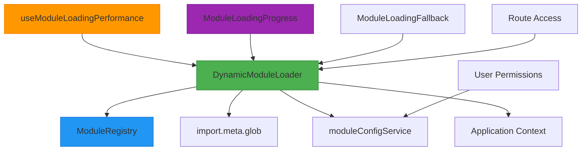
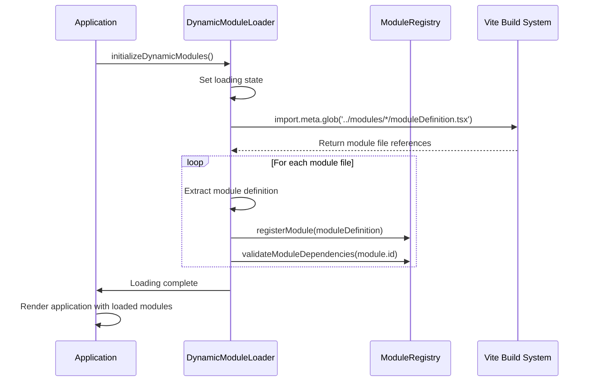
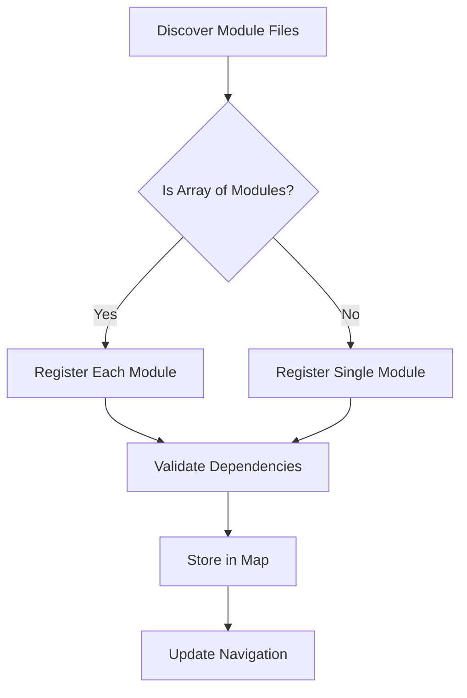
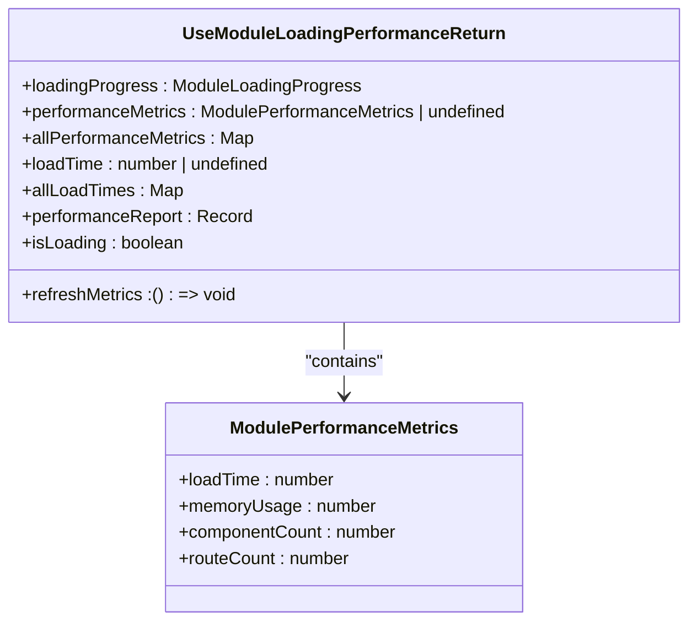
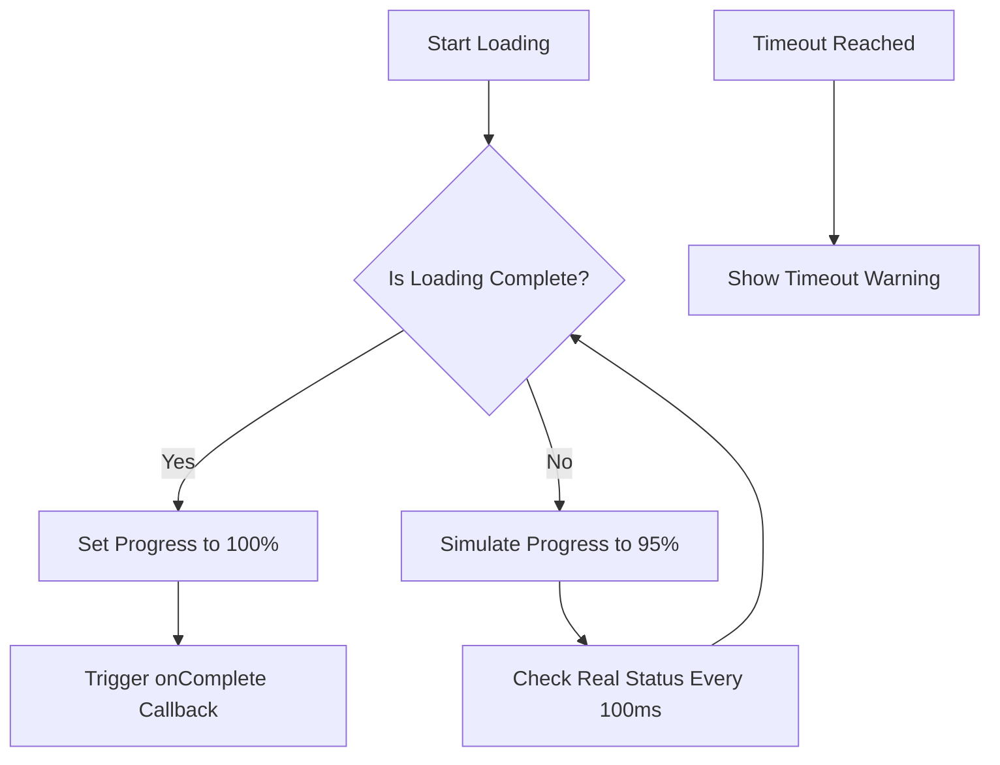
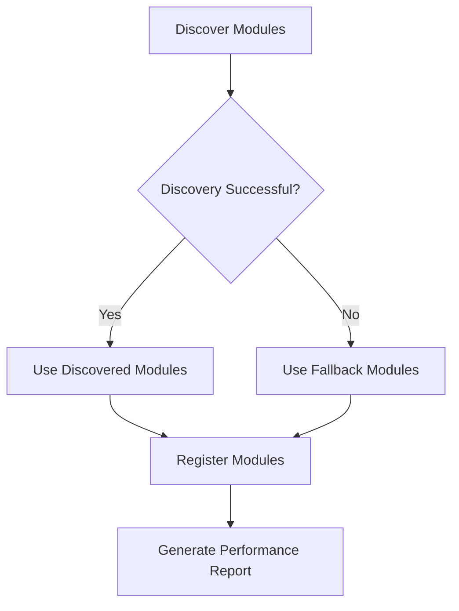
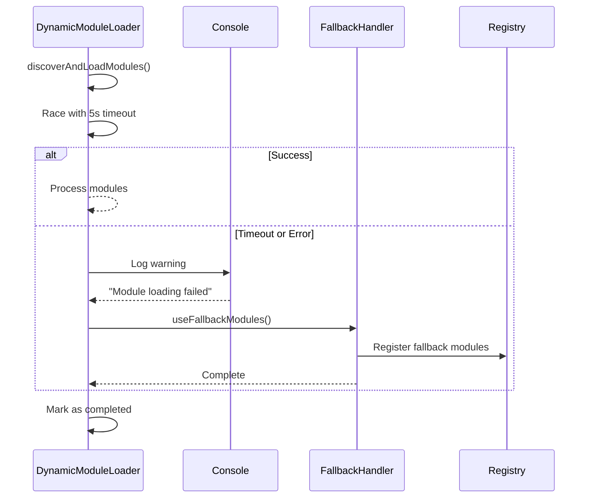

# Dynamic Module Loading

<cite>
**Referenced Files in This Document**   
- [dynamicModuleLoader.ts](file://src/services/dynamicModuleLoader.ts)
- [moduleRegistry.ts](file://src/core/moduleRegistry.ts)
- [useModuleLoadingPerformance.ts](file://src/hooks/useModuleLoadingPerformance.ts)
- [enhancedModuleLoader.ts](file://src/services/enhancedModuleLoader.ts)
- [ModuleLoadingProgress.tsx](file://src/components/ModuleLoadingProgress.tsx)
- [ModuleLoadingFallback.tsx](file://src/components/ModuleLoadingFallback.tsx)
- [modules.json](file://src/config/modules.json)
</cite>

## Table of Contents
1. [Introduction](#introduction)
2. [Core Architecture](#core-architecture)
3. [Dynamic Loading Mechanism](#dynamic-loading-mechanism)
4. [Module Registry and Management](#module-registry-and-management)
5. [Performance Monitoring](#performance-monitoring)
6. [Loading State Communication](#loading-state-communication)
7. [Caching and Fallback Strategies](#caching-and-fallback-strategies)
8. [Error Recovery and Timeout Handling](#error-recovery-and-timeout-handling)
9. [Preload and Prefetch Mechanisms](#preload-and-prefetch-mechanisms)
10. [Troubleshooting and Debugging](#troubleshooting-and-debugging)

## Introduction
The Dynamic Module Loading system in schoolpilot3 is a sophisticated mechanism designed to enable lazy loading of module bundles based on route access and user permissions. This system significantly reduces initial bundle size by loading only required modules on demand, leveraging Vite's code splitting capabilities. The architecture combines dynamic import features with a robust module registry, performance monitoring, and comprehensive error recovery mechanisms to ensure a seamless user experience even under challenging network conditions.

**Section sources**
- [dynamicModuleLoader.ts](file://src/services/dynamicModuleLoader.ts#L1-L262)

## Core Architecture
The dynamic module loading system consists of several key components that work together to provide an efficient and reliable module loading experience:

- **DynamicModuleLoader**: Central class responsible for discovering, loading, and managing modules
- **ModuleRegistry**: Singleton that maintains module definitions and handles registration
- **useModuleLoadingPerformance**: React hook for monitoring loading performance
- **ModuleLoadingProgress**: UI component for displaying loading status
- **ModuleLoadingFallback**: Fallback UI components for loading states



**Diagram sources**
- [dynamicModuleLoader.ts](file://src/services/dynamicModuleLoader.ts#L1-L262)
- [moduleRegistry.ts](file://src/core/moduleRegistry.ts#L1-L194)

**Section sources**
- [dynamicModuleLoader.ts](file://src/services/dynamicModuleLoader.ts#L1-L262)
- [moduleRegistry.ts](file://src/core/moduleRegistry.ts#L1-L194)

## Dynamic Loading Mechanism
The dynamic loading mechanism uses Vite's `import.meta.glob` feature to discover and load module definitions asynchronously. This approach enables true lazy loading, where modules are only fetched when needed.

### Loading Lifecycle
The module loading process follows a well-defined lifecycle:



**Diagram sources**
- [dynamicModuleLoader.ts](file://src/services/dynamicModuleLoader.ts#L1-L262)

**Section sources**
- [dynamicModuleLoader.ts](file://src/services/dynamicModuleLoader.ts#L1-L262)

### Code Splitting Integration
The system integrates with Vite's code splitting through the use of dynamic imports and glob patterns:

```typescript
// Vite's import.meta.glob enables code splitting
const moduleFiles = import.meta.glob('../modules/*/moduleDefinition.tsx', { eager: true });
const coreModuleFiles = import.meta.glob('../modules/core/moduleDefinition.tsx', { eager: true });

// Combine all module files
const allModuleFiles = { ...moduleFiles, ...coreModuleFiles };

// Load and register each module
for (const [path, moduleExport] of Object.entries(allModuleFiles)) {
  const moduleDefinition = (moduleExport as any).default;
  moduleRegistry.registerModule(moduleDefinition);
}
```

This approach ensures that each module is packaged as a separate chunk during the build process, allowing for on-demand loading.

**Section sources**
- [dynamicModuleLoader.ts](file://src/services/dynamicModuleLoader.ts#L1-L262)

## Module Registry and Management
The ModuleRegistry class serves as the central repository for all registered modules, providing methods for registration, retrieval, and dependency management.

### Module Registration Process


**Diagram sources**
- [moduleRegistry.ts](file://src/core/moduleRegistry.ts#L1-L194)

**Section sources**
- [moduleRegistry.ts](file://src/core/moduleRegistry.ts#L1-L194)

### Module Definition Structure
The module configuration file defines the structure and properties of available modules:

```json
{
  "modules": [
    {
      "id": "dashboard",
      "name": "Dashboard",
      "description": "System dashboard module",
      "icon": "Grid3X3",
      "path": "/dashboard",
      "version": "1.0.0",
      "navigation": [],
      "features": [],
      "dependencies": [],
      "settings": {},
      "rbacPermissions": [],
      "defaultRoles": []
    },
    {
      "id": "administration",
      "name": "Administration",
      "description": "School administration module",
      "icon": "Settings",
      "path": "/administration",
      "version": "1.0.0",
      "navigation": [],
      "features": [],
      "dependencies": [],
      "settings": {},
      "rbacPermissions": [],
      "defaultRoles": []
    }
  ]
}
```

**Section sources**
- [modules.json](file://src/config/modules.json#L1-L20)

## Performance Monitoring
The system provides comprehensive performance monitoring capabilities through the `useModuleLoadingPerformance` hook and associated metrics.

### Performance Metrics Structure
```typescript
interface ModulePerformanceMetrics {
  loadTime: number;
  memoryUsage: number;
  componentCount: number;
  routeCount: number;
}
```

### Performance Monitoring Hook
The `useModuleLoadingPerformance` hook provides real-time access to loading performance data:



**Diagram sources**
- [useModuleLoadingPerformance.ts](file://src/hooks/useModuleLoadingPerformance.ts#L1-L109)
- [enhancedModuleLoader.ts](file://src/services/enhancedModuleLoader.ts#L1-L50)

**Section sources**
- [useModuleLoadingPerformance.ts](file://src/hooks/useModuleLoadingPerformance.ts#L1-L109)
- [enhancedModuleLoader.ts](file://src/services/enhancedModuleLoader.ts#L1-L50)

## Loading State Communication
The system communicates loading states to the UI through dedicated components that provide visual feedback during the loading process.

### ModuleLoadingProgress Component
The `ModuleLoadingProgress` component displays real-time loading progress:



**Diagram sources**
- [ModuleLoadingProgress.tsx](file://src/components/ModuleLoadingProgress.tsx#L1-L120)

**Section sources**
- [ModuleLoadingProgress.tsx](file://src/components/ModuleLoadingProgress.tsx#L1-L120)

### Loading State Management
The component uses a combination of simulated and real progress tracking:

```typescript
// Simulate smooth progress while waiting for real completion
setProgress(prev => {
  if (dynamicModuleLoader.isLoadingComplete()) {
    return 100;
  }
  const newProgress = prev + Math.random() * 5;
  return Math.min(newProgress, 95); // Cap at 95% until real loading completes
});
```

This approach ensures a smooth user experience while accurately reflecting the actual loading state.

**Section sources**
- [ModuleLoadingProgress.tsx](file://src/components/ModuleLoadingProgress.tsx#L1-L120)

## Caching and Fallback Strategies
The system implements robust caching and fallback mechanisms to ensure reliability and backward compatibility.

### Discovery and Caching
```typescript
private async discoverAvailableModules(): Promise<string[]> {
  // Cache discovered modules
  this.discoveredModules = allModules;
  return allModules;
}
```

### Fallback Mechanism
When module discovery fails, the system falls back to a predefined list of modules:

```typescript
private readonly FALLBACK_MODULES = [
  'dashboard',
  'administration', 
  'academics',
  'finance',
  'hr',
  'inventory',
  'library',
  'nutrition',
  'reports',
  'settings'
];
```



**Diagram sources**
- [dynamicModuleLoader.ts](file://src/services/dynamicModuleLoader.ts#L1-L262)

**Section sources**
- [dynamicModuleLoader.ts](file://src/services/dynamicModuleLoader.ts#L1-L262)

## Error Recovery and Timeout Handling
The system includes comprehensive error recovery and timeout handling to prevent infinite loading states.

### Timeout Implementation
```typescript
async initializeDynamicModules(): Promise<void> {
  // Add timeout to prevent infinite loading
  const timeoutPromise = new Promise((_, reject) => {
    setTimeout(() => reject(new Error('Module loading timeout')), 5000);
  });
  
  // Race between module loading and timeout
  await Promise.race([
    this.discoverAndLoadModules(),
    timeoutPromise
  ]);
}
```

### Error Recovery Flow


**Diagram sources**
- [dynamicModuleLoader.ts](file://src/services/dynamicModuleLoader.ts#L1-L262)

**Section sources**
- [dynamicModuleLoader.ts](file://src/services/dynamicModuleLoader.ts#L1-L262)

## Preload and Prefetch Mechanisms
The system includes mechanisms for preloading and prefetching modules to improve perceived performance.

### Force Completion
The `forceCompleteLoading` method allows the system to exit loading state even if modules haven't fully loaded:

```typescript
forceCompleteLoading(): void {
  console.warn('🚨 [DynamicModuleLoader] Force completing module loading');
  this.isCompleted = true;
  this.isLoading = false;
}
```

### Preload Strategy
While explicit prefetching isn't implemented in the current code, the architecture supports it through:

1. Early initialization of the module loader
2. Caching of discovered modules
3. Fallback mechanisms for failed loads
4. Performance monitoring for optimization

## Troubleshooting and Debugging
The system includes several tools and techniques for troubleshooting module loading issues.

### Common Issues and Solutions
**Network-Related Loading Issues:**
- **Symptom**: Modules fail to load or timeout
- **Solution**: Check network connectivity, verify server availability, and ensure proper CORS configuration

**Debugging Tools:**
- Console logging with detailed status messages
- Performance monitoring hook for real-time metrics
- Force completion capability for stuck loading states

### Debugging Commands
```typescript
// Force complete loading (emergency exit)
dynamicModuleLoader.forceCompleteLoading();

// Reset loader state
dynamicModuleLoader.reset();

// Generate performance report
const report = dynamicModuleLoader.generatePerformanceReport();
console.log(report);
```

**Section sources**
- [dynamicModuleLoader.ts](file://src/services/dynamicModuleLoader.ts#L1-L262)
- [ModuleLoadingFallback.tsx](file://src/components/ModuleLoadingFallback.tsx#L1-L87)