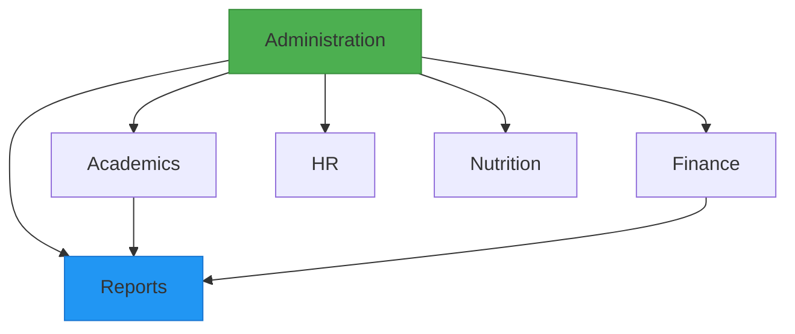
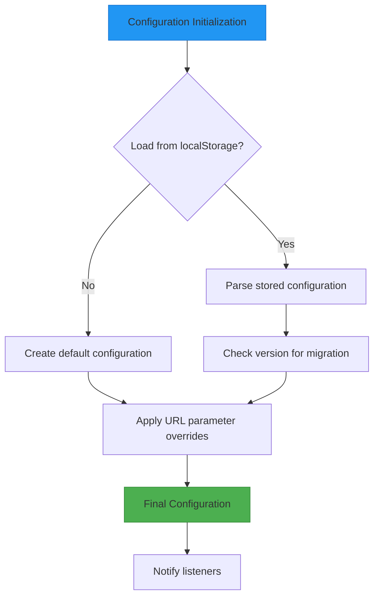
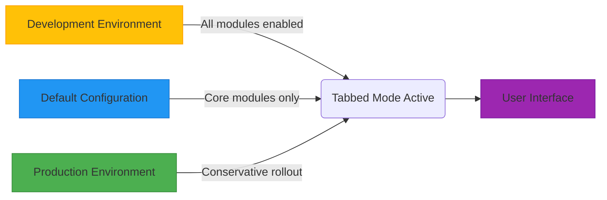

# Module Configuration and Activation

<cite>
**Referenced Files in This Document**   
- [modules.json](file://src/config/modules.json)
- [moduleConfigService.ts](file://src/services/moduleConfigService.ts)
- [tabbedModeConfig.ts](file://src/config/tabbedModeConfig.ts)
- [unifiedConfig.ts](file://src/config/unifiedConfig.ts)
</cite>

## Table of Contents
1. [Introduction](#introduction)
2. [Central Configuration with modules.json](#central-configuration-with-modulesjson)
3. [Module Configuration Service](#module-configuration-service)
4. [Unified Configuration System](#unified-configuration-system)
5. [Tabbed Mode Configuration](#tabbed-mode-configuration)
6. [Configuration Inheritance and Overrides](#configuration-inheritance-and-overrides)
7. [Runtime Reconfiguration and Validation](#runtime-reconfiguration-and-validation)
8. [Troubleshooting Configuration Issues](#troubleshooting-configuration-issues)
9. [Conclusion](#conclusion)

## Introduction
The schoolpilot3 application implements a comprehensive module configuration and activation system that enables flexible control over feature availability, environment-specific behavior, and user experience customization. This document details the architecture and functionality of the module configuration system, focusing on the central `modules.json` file, the `moduleConfigService`, unified configuration capabilities, and specialized configuration for tabbed interface modes. The system supports feature flags, dependency management, environment-specific rules, and runtime reconfiguration, providing administrators with granular control over application functionality.

**Section sources**
- [modules.json](file://src/config/modules.json)
- [moduleConfigService.ts](file://src/services/moduleConfigService.ts)

## Central Configuration with modules.json

The `modules.json` file serves as the central configuration file that controls module enablement and global settings for the schoolpilot3 application. Located at `src/config/modules.json`, this configuration file defines which modules are enabled or disabled by default and specifies dependencies between modules.

```json
{
  "enabledModules": [
    "dashboard",
    "administration", 
    "academics",
    "finance",
    "hr",
    "inventory",
    "library",
    "nutrition",
    "reports",
    "settings"
  ],
  "disabledModules": [],
  "moduleSettings": {
    "dashboard": {
      "enabled": true,
      "required": true,
      "description": "Core dashboard functionality"
    },
    "administration": {
      "enabled": true,
      "required": false,
      "description": "Student and staff administration"
    }
    // Additional module settings...
  },
  "moduleDependencies": {
    "academics": ["administration"],
    "finance": ["administration"],
    "hr": ["administration"],
    "nutrition": ["administration"],
    "reports": ["administration", "academics", "finance"]
  }
}
```

The configuration structure includes four main sections:
- **enabledModules**: Array of module identifiers that are enabled by default
- **disabledModules**: Array of module identifiers that are disabled by default
- **moduleSettings**: Object containing module-specific settings including enabled state, required status, and description
- **moduleDependencies**: Object defining dependency relationships between modules

Module dependencies ensure that prerequisite modules are activated before dependent modules. For example, the "academics" module depends on the "administration" module, meaning administration functionality must be available before academics features can be properly utilized.



**Diagram sources**
- [modules.json](file://src/config/modules.json)

**Section sources**
- [modules.json](file://src/config/modules.json)

## Module Configuration Service

The `moduleConfigService` is responsible for managing module configurations at runtime, validating settings against module requirements, and handling activation conditions. Implemented in `src/services/moduleConfigService.ts`, this service provides a comprehensive API for module management.

### Core Functionality

The service stores configurations in localStorage using the key `module_configurations` and provides methods for enabling, disabling, and querying module states:

```typescript
class ModuleConfigService {
  private readonly STORAGE_KEY = 'module_configurations';
  private configs: Map<string, ModuleConfig> = new Map();
  private isLoading = false;
}
```

Key methods include:
- `enableModule(moduleId: string)`: Activates a specific module
- `disableModule(moduleId: string)`: Deactivates a specific module  
- `isModuleEnabled(moduleId: string)`: Checks if a module is currently enabled
- `getEnabledModules()`: Returns array of all enabled module identifiers
- `updateModuleSettings(moduleId: string, settings: Record<string, any>)`: Updates module-specific settings

### Core Module Handling

Certain modules are designated as core modules that are always enabled regardless of configuration:

```typescript
// Core modules are always enabled
const coreModules = ['dashboard', 'settings', 'reports'];
if (coreModules.includes(moduleId)) {
  return true;
}
```

This ensures essential functionality like the dashboard, system settings, and reporting remain available at all times.

### Dependency Management

The service validates module dependencies to prevent activation of modules when prerequisites are not met:

```typescript
checkDependencies(moduleId: string): { satisfied: boolean; missing: string[] } {
  const module = moduleRegistry.getModule(moduleId);
  if (!module || !module.dependencies) {
    return { satisfied: true, missing: [] };
  }
  
  const missing = module.dependencies.filter(dep => !this.isModuleEnabled(dep));
  return {
    satisfied: missing.length === 0,
    missing
  };
}
```

The service also detects circular dependencies during configuration validation to prevent infinite loops in the dependency chain.

```mermaid
classDiagram
class ModuleConfigService {
+STORAGE_KEY : string
+configs : Map~string, ModuleConfig~
+isLoading : boolean
-loadConfigurations() : void
-saveConfigurations() : void
+enableModule(moduleId : string) : boolean
+disableModule(moduleId : string) : boolean
+isModuleEnabled(moduleId : string) : boolean
+getEnabledModules() : string[]
+getModuleConfig(moduleId : string) : ModuleConfig | null
+updateModuleSettings(moduleId : string, settings : Record~string, any~) : void
+getModuleSettings(moduleId : string) : Record~string, any~
+getAllConfigurations() : ModuleConfig[]
+resetModuleConfig(moduleId : string) : void
+exportConfigurations() : string
+importConfigurations(configJson : string) : void
+getAllModuleInfo() : ModuleInfo[]
+validateConfig() : { valid : boolean; errors : string[] }
+checkDependencies(moduleId : string) : { satisfied : boolean; missing : string[] }
+getModuleDependencies(moduleId : string) : string[]
+getConfig() : { moduleDependencies : Record~string, string[]~ }
}
class ModuleInfo {
+id : string
+name : string
+description? : string
+enabled : boolean
+required : boolean
+dependencies : string[]
+dependencySatisfied : boolean
+missingDependencies : string[]
}
class ModuleConfig {
+id : string
+enabled : boolean
+settings? : Record~string, any~
+lastModified : Date
}
ModuleConfigService --> ModuleInfo : "returns"
ModuleConfigService --> ModuleConfig : "manages"
```

**Diagram sources**
- [moduleConfigService.ts](file://src/services/moduleConfigService.ts)

**Section sources**
- [moduleConfigService.ts](file://src/services/moduleConfigService.ts)

## Unified Configuration System

The unified configuration system, implemented in `src/config/unifiedConfig.ts`, provides a comprehensive framework for managing application settings across different environments and deployment scenarios. This system integrates environment detection, data mode management, and feature flag controls.

### Configuration Structure

The `UnifiedAppConfig` interface defines the complete configuration structure:

```typescript
export interface UnifiedAppConfig {
  // Core Configuration
  environment: Environment;
  dataMode: DataMode;
  useEnhancedFeatures: boolean;
  
  // Environment Integration
  environmentConfig: EnvironmentConfigIntegration;
  
  // Database Configuration
  database: DatabaseConfig;
  
  // Backend Configuration (Legacy)
  backend: BackendConfig;
  
  // Demo Configuration (Enhanced)
  demo: DemoConfig;
  
  // Production Demo Integration
  productionDemo: ProductionDemoConfigIntegration;
  
  // Feature flags for experimental functionality
  features: FeatureConfig;
  
  // Development Configuration
  development: DevelopmentConfig;
  
  // Metadata
  version: string;
  lastUpdated: Date;
  configVersion: string;
}
```

### Environment-Specific Configuration

The system supports different configuration presets for development, staging, and production environments:

```typescript
function createConfigPresets() {
  return {
    development: {
      environment: 'development',
      dataMode: 'mock',
      features: {
        enableDebugMode: true,
        enableMockData: true,
        logLevel: 'debug'
      }
    },
    staging: {
      environment: 'staging',  
      dataMode: 'demo',
      features: {
        enablePerformanceMonitoring: true,
        logLevel: 'info'
      }
    },
    production: {
      environment: 'production',
      dataMode: 'demo',
      features: {
        enableAuditLog: true,
        logLevel: 'warn'
      }
    }
  };
}
```

### Configuration Management

The `UnifiedConfigManager` class handles configuration persistence, updates, and validation:

```typescript
export class UnifiedConfigManager {
  private static instance: UnifiedConfigManager;
  private config: UnifiedAppConfig;
  private listeners: Set<(config: UnifiedAppConfig) => void> = new Set();

  public static getInstance(): UnifiedConfigManager {
    if (!UnifiedConfigManager.instance) {
      UnifiedConfigManager.instance = new UnifiedConfigManager();
    }
    return UnifiedConfigManager.instance;
  }
}
```

The manager supports URL parameter overrides for configuration, allowing temporary changes without modifying stored settings:

- `?preset=development` - Apply development configuration preset
- `?mode=demo` - Switch to demo data mode
- `?enhanced=true` - Enable enhanced features
- `?environment=staging` - Override detected environment



**Diagram sources**
- [unifiedConfig.ts](file://src/config/unifiedConfig.ts)

**Section sources**
- [unifiedConfig.ts](file://src/config/unifiedConfig.ts)

## Tabbed Mode Configuration

The tabbed mode configuration system, defined in `src/config/tabbedModeConfig.ts`, enables conditional loading of tabbed interface modules based on environment and testing requirements.

### Configuration Structure

The system defines three configuration variants:

```typescript
// Default configuration
export const defaultTabbedModeConfig: TabbedModeConfig = {
  globalEnabled: true,
  enablePerModuleControl: true,
  enableTabbedMode: true,
  moduleOverrides: {
    'dashboard': true,
    'settings': true,
    'reports': true,
    'academics': false,
    'administration': false,
    // Additional modules...
  }
};

// Development configuration
export const devTabbedModeConfig: TabbedModeConfig = {
  globalEnabled: true,
  enablePerModuleControl: true,
  enableTabbedMode: true,
  moduleOverrides: {
    // All modules enabled for testing
    'dashboard': true,
    'settings': true,
    'reports': true,
    'academics': true,
    'administration': true,
    // Additional modules...
  }
};

// Production configuration
export const prodTabbedModeConfig: TabbedModeConfig = {
  globalEnabled: true,
  enablePerModuleControl: true,
  enableTabbedMode: true,
  moduleOverrides: {
    // Only core modules enabled initially
    'dashboard': true,
    'settings': true,
    'reports': true,
    'academics': false,
    'administration': false,
    // Additional modules...
  }
};
```

### Gradual Rollout Strategy

The configuration supports a gradual rollout strategy for new interface features:

1. **Development**: All modules have tabbed mode enabled for comprehensive testing
2. **Default**: Core modules enabled, others disabled for stability
3. **Production**: Conservative approach with only essential modules enabled

This allows the team to test the tabbed interface thoroughly before enabling it for all modules in production environments.



**Diagram sources**
- [tabbedModeConfig.ts](file://src/config/tabbedModeConfig.ts)

**Section sources**
- [tabbedModeConfig.ts](file://src/config/tabbedModeConfig.ts)

## Configuration Inheritance and Overrides

The configuration system implements a hierarchical approach to settings management, allowing for inheritance and targeted overrides at multiple levels.

### Inheritance Chain

Configuration values follow a specific inheritance chain:

1. **Default values** - Hardcoded defaults in configuration files
2. **Environment presets** - Development, staging, or production defaults
3. **Stored configuration** - User-saved settings in localStorage
4. **URL parameters** - Temporary overrides via query string

```typescript
private loadConfig(): UnifiedAppConfig {
  let config = createDefaultConfig();

  // Apply stored configuration
  if (stored) {
    const parsed = JSON.parse(stored);
    const mergedConfig = {
      ...config,
      ...parsed,
      features: {
        ...config.features,
        ...parsed.features
      }
    };
    config = mergedConfig;
  }

  // Apply URL parameter overrides
  if (preset && CONFIG_PRESETS[preset]) {
    const presetConfig = CONFIG_PRESETS[preset];
    config = {
      ...config,
      ...presetConfig,
      features: {
        ...config.features,
        ...presetConfig.features
      }
    };
  }
}
```

### Override Mechanisms

The system provides several mechanisms for configuration overrides:

- **Feature flags**: Boolean switches for experimental functionality
- **Module-specific settings**: Per-module configuration options
- **Environment-based rules**: Different settings for development, staging, and production
- **URL parameters**: Temporary overrides for testing and debugging

The deep merge strategy ensures that new feature flags are automatically added to existing configurations while preserving user preferences for existing settings.

```mermaid
flowchart TB
A[Default Configuration] --> B[Environment Preset]
B --> C[Stored Configuration]
C --> D[URL Parameter Overrides]
D --> E[Active Configuration]
style A fill:#9E9E9E,stroke:#616161
style B fill:#757575,stroke:#424242
style C fill:#616161,stroke:#212121
style D fill:#424242,stroke:#000000
style E fill:#009688,stroke:#00695C
```



**Diagram sources**
- [unifiedConfig.ts](file://src/config/unifiedConfig.ts)

**Section sources**
- [unifiedConfig.ts](file://src/config/unifiedConfig.ts)

## Runtime Reconfiguration and Validation

The configuration system supports runtime reconfiguration with comprehensive validation to ensure system stability.

### Dynamic Updates

The `UnifiedConfigManager` allows for dynamic configuration updates:

```typescript
public updateConfig(updates: Partial<UnifiedAppConfig>): void {
  this.config = {
    ...this.config,
    ...updates,
    lastUpdated: new Date(),
  };
  this.saveConfig();
  this.notifyListeners();
}
```

Components can subscribe to configuration changes to react to updates:

```typescript
const configManager = UnifiedConfigManager.getInstance();
configManager.addListener((newConfig) => {
  // React to configuration changes
  updateUI(newConfig);
});
```

### Configuration Validation

The system performs multiple validation checks:

1. **Version migration**: Automatically migrates older configuration versions
2. **Feature flag completeness**: Ensures all feature flags are present
3. **Dependency validation**: Checks for circular dependencies
4. **Environment compatibility**: Validates settings against current environment

```typescript
validateConfig(): { valid: boolean; errors: string[] } {
  const errors: string[] = [];
  
  // Check for circular dependencies
  const allModules = moduleRegistry.getAllModules();
  for (const module of allModules) {
    if (module.dependencies) {
      const visited = new Set<string>();
      const stack = new Set<string>();
      
      if (this.hasCircularDependency(module.id, module.dependencies, visited, stack, allModules)) {
        errors.push(`Circular dependency detected for module: ${module.id}`);
      }
    }
  }
  
  return { valid: errors.length === 0, errors };
}
```

### Data Mode Switching

The system supports safe data mode switching with validation:

```typescript
public async switchDataMode(toMode: DataMode, options: {
  skipConfirmation?: boolean;
  skipValidation?: boolean;
} = {}): Promise<DataModeSwitchResult> {
  const result = await switchDataMode(toMode, this.config.dataMode, this.config.environment, options);
  
  if (result.success) {
    this.config.dataMode = result.newMode;
    this.config.demo.active = result.newMode === 'demo';
    this.saveConfig();
    this.notifyListeners();
  }
  
  return result;
}
```

**Section sources**
- [unifiedConfig.ts](file://src/config/unifiedConfig.ts)
- [moduleConfigService.ts](file://src/services/moduleConfigService.ts)

## Troubleshooting Configuration Issues

This section provides guidance for diagnosing and resolving common configuration problems.

### Common Issues and Solutions

**Issue: Module not appearing in the interface**
- **Check**: Verify the module is listed in `enabledModules` array in `modules.json`
- **Check**: Ensure no dependency requirements are preventing activation
- **Check**: Confirm the module is not explicitly disabled in localStorage configuration
- **Solution**: Use the Module Management Panel to enable the module

**Issue: Configuration changes not persisting**
- **Check**: Verify localStorage is available and not blocked by browser settings
- **Check**: Ensure the `module_configurations` key exists in localStorage
- **Solution**: Clear configuration storage and reload: `localStorage.removeItem('module_configurations')`

**Issue: Tabbed interface not working**
- **Check**: Verify tabbed mode is enabled in the active configuration
- **Check**: Confirm the specific module has tabbed mode enabled in `moduleOverrides`
- **Solution**: Use URL parameter `?enableTabbedMode=true` to temporarily enable

### Diagnostic Tools

The system includes several diagnostic tools:

1. **Console logging**: The `moduleConfigService` outputs detailed debug information
2. **Configuration export**: Use `exportConfigurations()` to get a complete configuration dump
3. **Validation checks**: Run `validateConfig()` to identify configuration issues

```typescript
// Export current configuration for debugging
const configService = moduleConfigService;
const exported = configService.exportConfigurations();
console.log('Current configuration:', exported);

// Validate configuration
const validation = configService.validateConfig();
if (!validation.valid) {
  console.error('Configuration errors:', validation.errors);
}
```

### Recovery Procedures

**Reset to defaults**:
```typescript
// Clear all module configurations
for (const moduleId of Object.keys(configService.configs)) {
  configService.resetModuleConfig(moduleId);
}

// Reload with defaults
configService.loadConfigurations();
```

**Import backup configuration**:
```typescript
// Restore from a known good configuration
try {
  configService.importConfigurations(backupConfigJson);
  console.log('Configuration restored successfully');
} catch (error) {
  console.error('Failed to import configuration:', error);
}
```

**Section sources**
- [moduleConfigService.ts](file://src/services/moduleConfigService.ts)
- [unifiedConfig.ts](file://src/config/unifiedConfig.ts)

## Conclusion

The module configuration and activation system in schoolpilot3 provides a robust and flexible framework for managing application functionality. The central `modules.json` file establishes default module states and dependencies, while the `moduleConfigService` manages runtime configuration with validation and persistence. The unified configuration system enables environment-specific settings and feature flags, supporting different deployment scenarios from development to production. The tabbed mode configuration allows for gradual feature rollout, ensuring stability while introducing new interface elements. Together, these components create a comprehensive configuration ecosystem that balances flexibility with reliability, enabling administrators to tailor the application to their specific needs while maintaining system integrity.

The system's design emphasizes backward compatibility, automatic migration, and comprehensive validation to prevent configuration errors. Runtime reconfiguration capabilities allow for dynamic adjustments without requiring application restarts, while the hierarchical override system provides granular control over settings at multiple levels. This sophisticated configuration architecture supports the complex requirements of an educational management system while remaining accessible to administrators through intuitive interfaces and clear diagnostic tools.