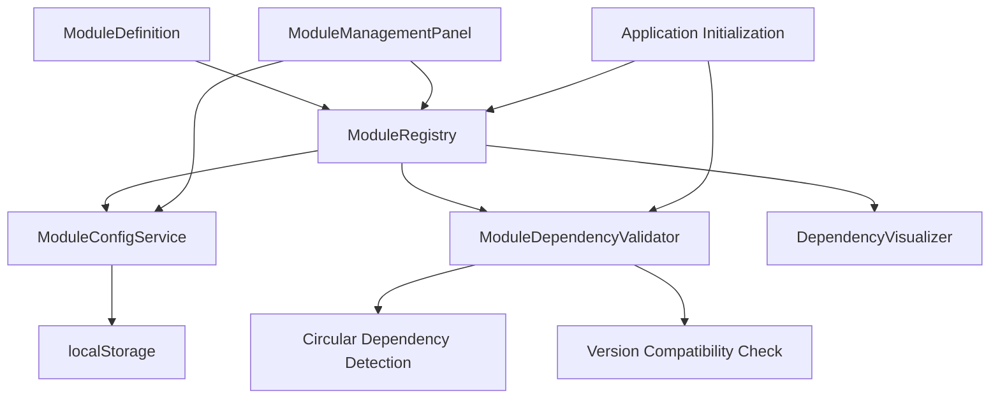
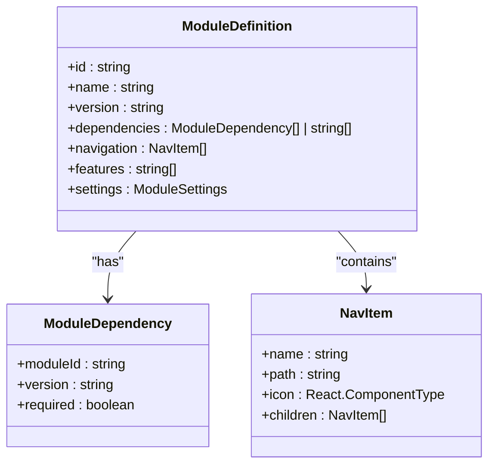
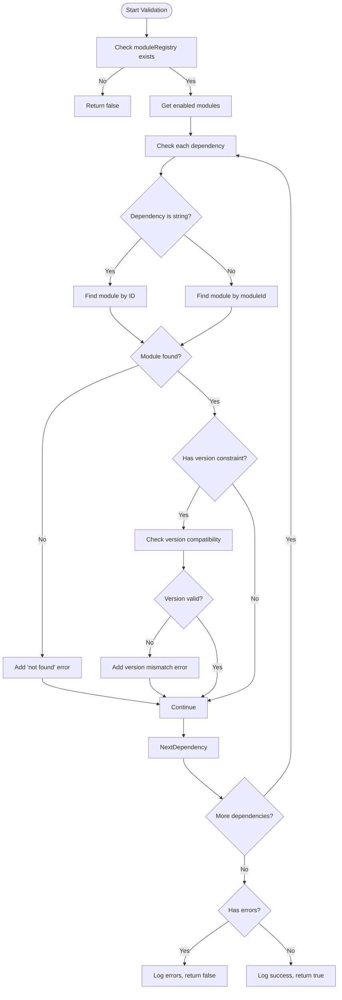
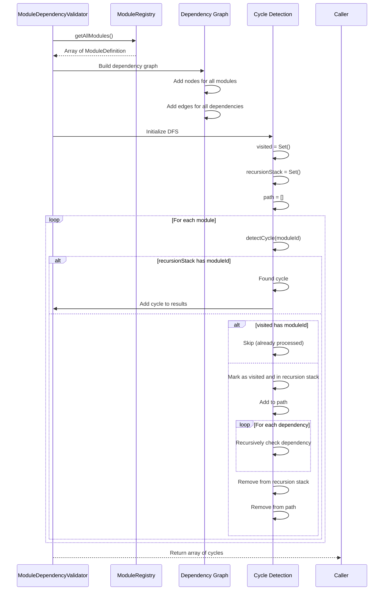
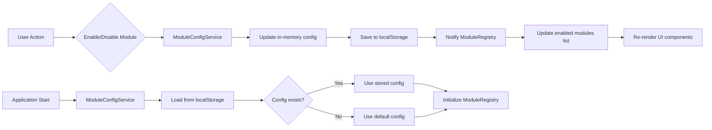
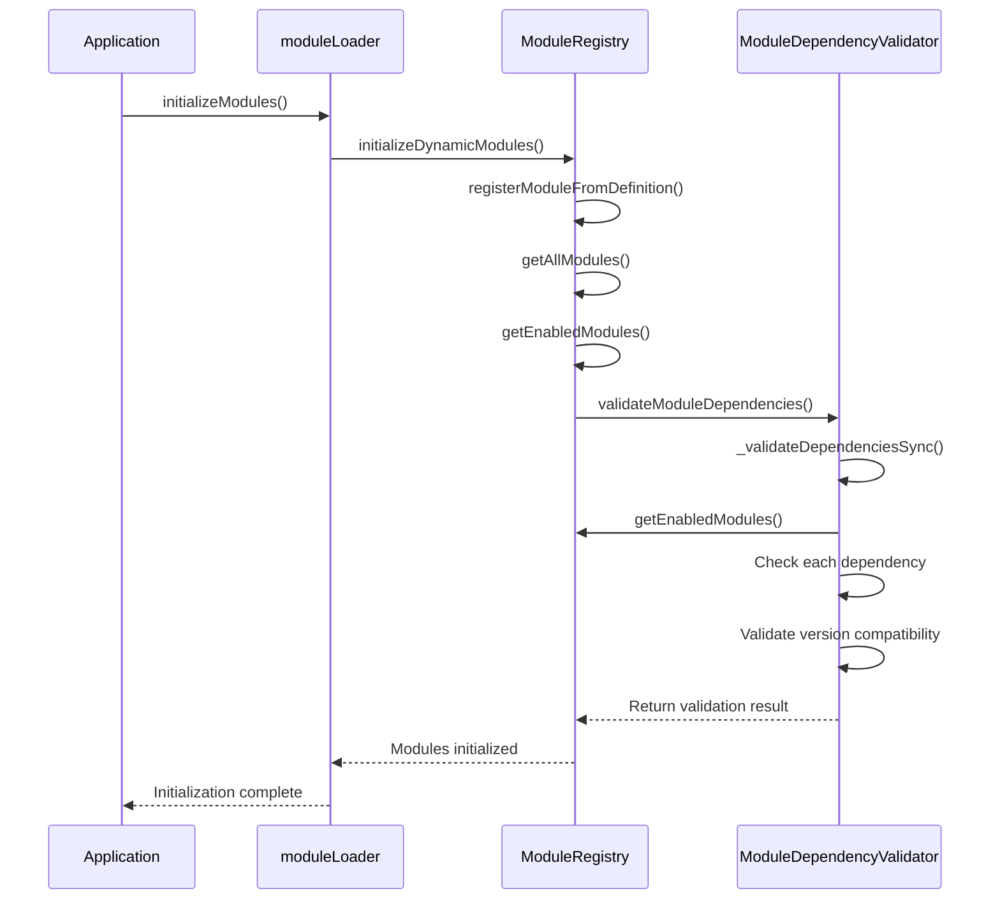
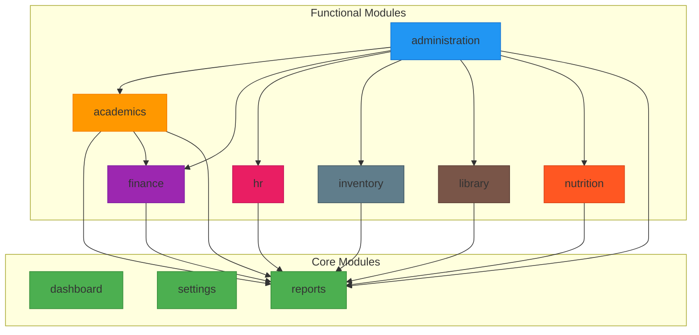
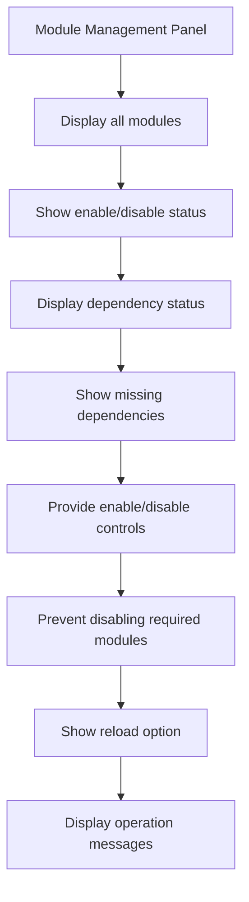

# Module Dependency Management

<cite>
**Referenced Files in This Document**   
- [ModuleDependencyValidator.ts](file://src/core/services/ModuleDependencyValidator.ts)
- [moduleDefinition.tsx](file://src/modules/academics/moduleDefinition.tsx)
- [modules.json](file://src/config/modules.json)
- [moduleLoader.ts](file://src/core/moduleLoader.ts)
- [moduleRegistry.ts](file://src/core/moduleRegistry.ts)
- [moduleConfigService.ts](file://src/services/moduleConfigService.ts)
- [types.ts](file://src/core/types.ts)
- [DependencyVisualizer.ts](file://src/core/services/DependencyVisualizer.ts)
- [ModuleManagementPanel.tsx](file://src/components/settings/ModuleManagementPanel.tsx)
</cite>

## Table of Contents
1. [Introduction](#introduction)
2. [Core Components and Architecture](#core-components-and-architecture)
3. [Module Definition and Dependency Specification](#module-definition-and-dependency-specification)
4. [Dependency Validation Process](#dependency-validation-process)
5. [Circular Dependency Detection](#circular-dependency-detection)
6. [Module Enable/Disable and Configuration](#module-enable-disable-and-configuration)
7. [Dependency Resolution During Initialization](#dependency-resolution-during-initialization)
8. [Optional Dependencies and Fallback Behavior](#optional-dependencies-and-fallback-behavior)
9. [Troubleshooting Dependency Issues](#troubleshooting-dependency-issues)
10. [Visualization and Diagnostic Tools](#visualization-and-diagnostic-tools)

## Introduction
The schoolpilot3 application implements a modular architecture where functionality is organized into discrete, independently manageable modules. This document details the module dependency management system that ensures modules are loaded in the correct order, dependencies are satisfied, and the application remains stable during initialization. The system uses a combination of static configuration, runtime validation, and dependency graph analysis to manage inter-module relationships.

## Core Components and Architecture
The module dependency management system consists of several key components working together to ensure proper module loading and initialization:

- **ModuleDependencyValidator**: Validates dependencies and detects circular dependencies
- **ModuleRegistry**: Central registry for all modules and their states
- **ModuleConfigService**: Manages persistent module enable/disable state
- **moduleLoader**: Coordinates module initialization
- **ModuleDefinition**: Interface defining module metadata and dependencies



**Diagram sources**
- [ModuleDependencyValidator.ts](file://src/core/services/ModuleDependencyValidator.ts)
- [moduleRegistry.ts](file://src/core/moduleRegistry.ts)
- [moduleConfigService.ts](file://src/services/moduleConfigService.ts)

**Section sources**
- [ModuleDependencyValidator.ts](file://src/core/services/ModuleDependencyValidator.ts#L6-L294)
- [moduleRegistry.ts](file://src/core/moduleRegistry.ts#L0-L194)
- [moduleConfigService.ts](file://src/services/moduleConfigService.ts#L0-L199)

## Module Definition and Dependency Specification
Modules declare their dependencies in their `moduleDefinition.tsx` files using the `ModuleDefinition` interface. Dependencies can be specified in two formats: simple string references or detailed `ModuleDependency` objects with version constraints.

### Dependency Declaration Formats
The system supports both legacy and enhanced dependency declaration formats:

```typescript
// Simple string format (legacy)
dependencies: ['administration', 'finance']

// Enhanced object format with version constraints
dependencies: [
  {
    moduleId: 'administration',
    version: '^1.0.0',
    required: true
  },
  {
    moduleId: 'finance',
    version: '^1.0.0',
    required: false
  }
]
```

### Real-World Example: Academics Module
The academics module demonstrates a typical dependency configuration with both required and optional dependencies:



**Diagram sources**
- [types.ts](file://src/core/types.ts#L1398-L1648)
- [moduleDefinition.tsx](file://src/modules/academics/moduleDefinition.tsx#L0-L87)

**Section sources**
- [moduleDefinition.tsx](file://src/modules/academics/moduleDefinition.tsx#L0-L87)
- [types.ts](file://src/core/types.ts#L1398-L1648)

## Dependency Validation Process
The `ModuleDependencyValidator` class performs comprehensive validation of module dependencies, checking for missing modules, version compatibility, and other issues.

### Validation Workflow
The validation process follows a synchronous approach to avoid race conditions during application startup:



**Diagram sources**
- [ModuleDependencyValidator.ts](file://src/core/services/ModuleDependencyValidator.ts#L6-L294)

**Section sources**
- [ModuleDependencyValidator.ts](file://src/core/services/ModuleDependencyValidator.ts#L6-L294)

### Version Compatibility Checking
The system uses semantic versioning (semver) to validate version compatibility between modules. When a module specifies a version constraint like `^1.0.0`, the validator checks if the actual version of the dependency satisfies this constraint.

```typescript
// Example from ModuleDependencyValidator
if (typeof dep !== 'string' && dep.version) {
  console.log(`Checking version compatibility for ${depId}: required ${dep.version}, found ${depModule.version}`);
  if (!semver.satisfies(depModule.version, dep.version)) {
    errors.push(
      `Version mismatch for '${depId}': ` +
      `required ${dep.version}, found ${depModule.version}`
    );
  }
}
```

## Circular Dependency Detection
Circular dependencies can cause infinite loops and application crashes during initialization. The `ModuleDependencyValidator` includes a robust circular dependency detection mechanism.

### Detection Algorithm
The system uses a depth-first search (DFS) algorithm to detect cycles in the dependency graph:



**Diagram sources**
- [ModuleDependencyValidator.ts](file://src/core/services/ModuleDependencyValidator.ts#L6-L294)

**Section sources**
- [ModuleDependencyValidator.ts](file://src/core/services/ModuleDependencyValidator.ts#L6-L294)

### Example of Circular Dependency
A circular dependency occurs when modules depend on each other in a loop. For example:
- Module A depends on Module B
- Module B depends on Module C  
- Module C depends on Module A

This creates a cycle (A → B → C → A) that the validator will detect and report.

## Module Enable/Disable and Configuration
Module activation state is managed through the `modules.json` configuration file and persisted in localStorage via the `ModuleConfigService`.

### Configuration Structure
The `modules.json` file defines the initial state of modules:

```json
{
  "enabledModules": [
    "dashboard",
    "administration", 
    "academics",
    "finance"
  ],
  "disabledModules": [],
  "moduleSettings": {
    "academics": {
      "enabled": true,
      "required": false,
      "description": "Academic curriculum and exam management"
    }
  },
  "moduleDependencies": {
    "academics": ["administration"],
    "finance": ["administration"],
    "reports": ["administration", "academics", "finance"]
  }
}
```

### State Management
The `ModuleConfigService` manages the persistent state of module enable/disable settings:



**Diagram sources**
- [modules.json](file://src/config/modules.json#L0-L73)
- [moduleConfigService.ts](file://src/services/moduleConfigService.ts#L0-L199)

**Section sources**
- [modules.json](file://src/config/modules.json#L0-L73)
- [moduleConfigService.ts](file://src/services/moduleConfigService.ts#L0-L199)

## Dependency Resolution During Initialization
During application startup, modules are loaded and initialized in a specific order based on their dependencies.

### Initialization Sequence
The module loading process follows a well-defined sequence:



**Diagram sources**
- [moduleLoader.ts](file://src/core/moduleLoader.ts#L0-L85)
- [moduleRegistry.ts](file://src/core/moduleRegistry.ts#L0-L194)
- [ModuleDependencyValidator.ts](file://src/core/services/ModuleDependencyValidator.ts#L6-L294)

**Section sources**
- [moduleLoader.ts](file://src/core/moduleLoader.ts#L0-L85)
- [moduleRegistry.ts](file://src/core/moduleRegistry.ts#L0-L194)

### Load Order Determination
The system determines the correct load order by analyzing the dependency graph. Modules with no dependencies are loaded first, followed by modules whose dependencies have already been loaded.

## Optional Dependencies and Fallback Behavior
The system supports both required and optional dependencies, allowing modules to function even when non-essential dependencies are unavailable.

### Optional Dependency Configuration
Optional dependencies are marked with `required: false` in the dependency specification:

```typescript
dependencies: [
  {
    moduleId: 'finance',
    version: '^1.0.0',
    required: false  // This dependency is optional
  }
]
```

### Fallback Behavior
When an optional dependency is disabled or missing, the dependent module should implement appropriate fallback behavior:

1. **Feature degradation**: Disable specific features that require the missing module
2. **UI adaptation**: Hide or disable UI elements that depend on the missing functionality
3. **Error prevention**: Prevent errors by checking dependency availability before accessing functionality

The ModuleManagementPanel provides visual feedback about dependency status:

```typescript
const getDependencyStatus = (module: ModuleInfo) => {
  if (module.dependencies.length === 0) {
    return <span className="text-gray-500 text-sm">No dependencies</span>;
  }
  
  if (module.dependencySatisfied) {
    return (
      <span className="text-green-600 text-sm flex items-center gap-1">
        <CheckIcon className="w-4 h-4" />
        Dependencies satisfied
      </span>
    );
  } else {
    return (
      <span className="text-red-600 text-sm flex items-center gap-1">
        <ExclamationTriangleIcon className="w-4 h-4" />
        Missing: {module.missingDependencies.join(', ')}
      </span>
    );
  }
};
```

## Troubleshooting Dependency Issues
When dependency-related issues occur during startup, the system provides several mechanisms for diagnosis and resolution.

### Common Startup Failures
Common dependency-related startup failures include:

- **Missing required modules**: A module depends on another module that is disabled or not installed
- **Version incompatibilities**: A module requires a specific version range that is not satisfied
- **Circular dependencies**: Modules depend on each other in a loop
- **Configuration errors**: Incorrect module IDs or malformed dependency specifications

### Diagnostic Commands
The system provides diagnostic tools to identify and resolve dependency issues:

```typescript
// Generate a comprehensive compatibility report
const report = ModuleDependencyValidator.generateCompatibilityReport(moduleRegistry);
console.log('Compatibility Report:', report);

// Detect circular dependencies
const cycles = ModuleDependencyValidator.detectCircularDependencies(moduleRegistry);
if (cycles.length > 0) {
  console.error('Circular dependencies detected:', cycles);
}

// Check specific module dependencies
const isValid = ModuleDependencyValidator.validateDependencies(module, moduleRegistry);
```

### Troubleshooting Steps
When encountering dependency issues:

1. **Check the browser console** for error messages from the ModuleDependencyValidator
2. **Verify module configuration** in `modules.json` and individual module definitions
3. **Ensure required modules are enabled** in the ModuleManagementPanel
4. **Check version compatibility** between dependent modules
5. **Look for circular dependencies** using the diagnostic tools
6. **Clear localStorage** if configuration corruption is suspected

## Visualization and Diagnostic Tools
The system includes several tools to visualize and diagnose module dependencies.

### Dependency Visualizer
The `DependencyVisualizer` service generates data for visualizing the dependency graph:



**Diagram sources**
- [DependencyVisualizer.ts](file://src/core/services/DependencyVisualizer.ts#L0-L87)

**Section sources**
- [DependencyVisualizer.ts](file://src/core/services/DependencyVisualizer.ts#L0-L87)

### Module Management Interface
The `ModuleManagementPanel` provides a user interface for managing modules and viewing dependency status:



The panel uses color-coded indicators:
- **Green checkmark**: Module is enabled and dependencies satisfied
- **Red X**: Module is disabled
- **Yellow warning**: Module enabled but has missing dependencies
- **Blue badge**: Module is required and cannot be disabled