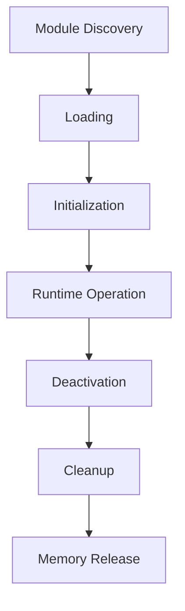
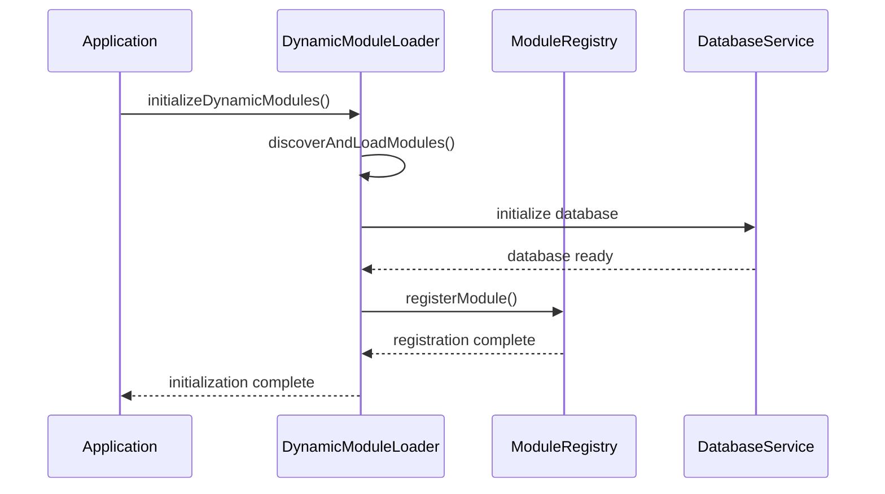
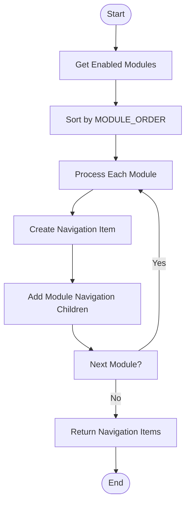
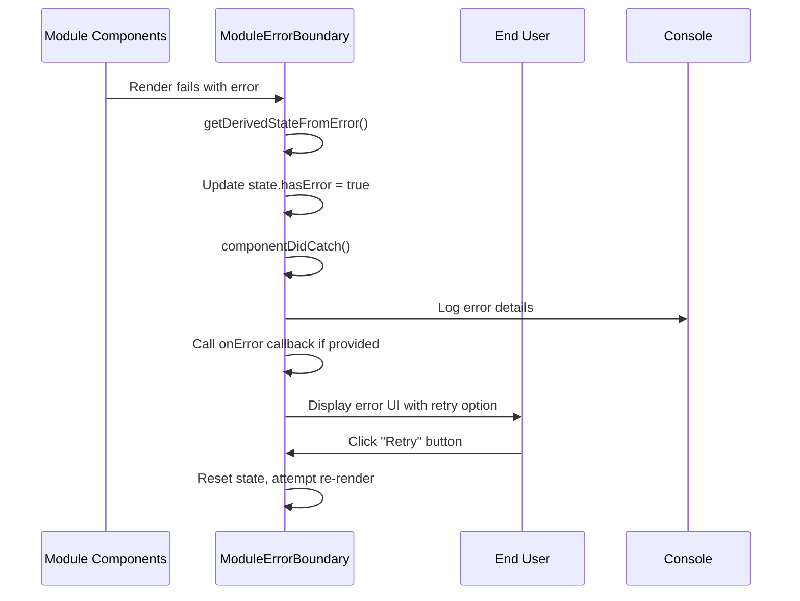
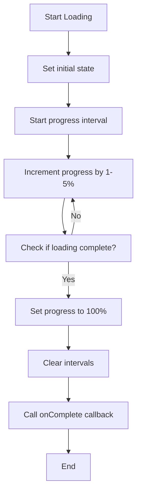
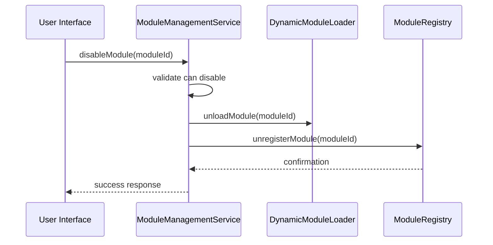
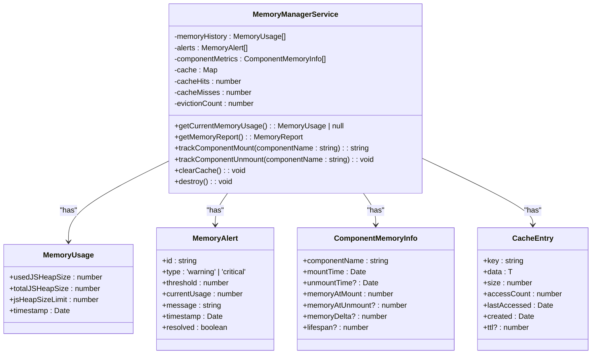

# Module Lifecycle Management

<cite>
**Referenced Files in This Document**   
- [ModuleErrorBoundary.tsx](file://src/components/ModuleErrorBoundary.tsx)
- [ModuleLoadingProgress.tsx](file://src/components/ModuleLoadingProgress.tsx)
- [dynamicModuleLoader.ts](file://src/services/dynamicModuleLoader.ts)
- [moduleRegistry.ts](file://src/core/moduleRegistry.ts)
- [rbacService.ts](file://src/core/rbacService.ts)
- [userPermissionsService.ts](file://src/services/userPermissionsService.ts)
- [useMemoryManagement.ts](file://src/hooks/useMemoryManagement.ts)
- [memoryManager.ts](file://src/services/memoryManager.ts)
- [moduleManagementService.ts](file://src/services/moduleManagementService.ts)
</cite>

## Table of Contents
1. [Introduction](#introduction)
2. [Module Lifecycle Overview](#module-lifecycle-overview)
3. [Initialization Sequence](#initialization-sequence)
4. [Error Handling with ModuleErrorBoundary](#error-handling-with-moduleerrorboundary)
5. [User Feedback with ModuleLoadingProgress](#user-feedback-with-moduleloadingprogress)
6. [Resource Cleanup and Memory Management](#resource-cleanup-and-memory-management)
7. [Hot Reloading Strategies](#hot-reloading-strategies)
8. [Troubleshooting Guide](#troubleshooting-guide)

## Introduction
The schoolpilot3 application implements a modular architecture that allows for dynamic loading, initialization, and management of various functional modules. This document details the complete lifecycle of a module from discovery through initialization, runtime operation, and cleanup. The system is designed with robust error isolation, user feedback mechanisms, and memory management considerations to ensure stability and performance.

## Module Lifecycle Overview
The module lifecycle in schoolpilot3 consists of four main phases: discovery and loading, initialization, runtime operation, and deactivation/cleanup. Each module follows this standardized lifecycle, ensuring consistent behavior across the application. The lifecycle is managed by several core services including the dynamic module loader, module registry, and RBAC service.



**Diagram sources**
- [dynamicModuleLoader.ts](file://src/services/dynamicModuleLoader.ts)
- [moduleRegistry.ts](file://src/core/moduleRegistry.ts)

## Initialization Sequence
The initialization sequence begins with data store setup, followed by route registration and permission configuration. When the application starts, the dynamic module loader discovers available modules and loads them asynchronously.

### Data Store Setup
The data store setup process involves initializing the database provider based on the environment configuration. The DataServiceFactory creates the appropriate data service for development, production, or demo environments, configuring the database with the necessary collections and options.



**Diagram sources**
- [dynamicModuleLoader.ts](file://src/services/dynamicModuleLoader.ts#L46-L76)
- [DataServiceFactory.ts](file://src/services/DataServiceFactory.ts)

**Section sources**
- [dynamicModuleLoader.ts](file://src/services/dynamicModuleLoader.ts)
- [DataServiceFactory.ts](file://src/services/DataServiceFactory.ts)

### Route Registration
Route registration is handled through the module registry, which collects navigation items from all enabled modules. The getNavigationItems method processes each enabled module, creating navigation entries based on the module's configuration. Modules are sorted according to the MODULE_ORDER array, with any additional modules sorted alphabetically.



**Diagram sources**
- [moduleRegistry.ts](file://src/core/moduleRegistry.ts#L70-L103)

**Section sources**
- [moduleRegistry.ts](file://src/core/moduleRegistry.ts)

### Permission Configuration
Permission configuration is managed by the RBAC (Role-Based Access Control) service, which dynamically generates permissions for each module. For each module, four standard permissions are created: read, create, update, and delete. These permissions are stored in the system and associated with user roles to control access.

```mermaid
classDiagram
class RBACService {
+roles : Map<string, RbacRole>
+userRoles : Map<string, UserRole[]>
+permissions : Map<string, Permission>
+modules : Map<string, ModuleDefinition>
+initialize() : Promise<void>
+addPermission(permission : Permission) : Promise<void>
+updatePermission(permission : Permission) : Promise<void>
+deletePermission(id : string) : Promise<void>
+assignRoleToUser(userId : string, roleId : string, assignedBy : string) : boolean
+checkModuleAccess(userRole : string, moduleId : string) : Promise<boolean>
}
class Permission {
+id : string
+name : string
+description : string
+resource : string
+action : 'create' | 'read' | 'update' | 'delete' | 'execute'
+moduleId : string
+feature? : string
}
class RbacRole {
+id : string
+name : string
+description : string
+permissions : string[]
+isActive : boolean
+isSystem : boolean
+moduleAccess : { [moduleId : string] : { enabled : boolean; permissions : string[] } }
}
class UserRole {
+userId : string
+roleId : string
+assignedAt : Date
+assignedBy : string
+expiresAt? : Date
}
RBACService --> Permission : "has"
RBACService --> RbacRole : "has"
RBACService --> UserRole : "has"
```

**Diagram sources**
- [rbacService.ts](file://src/core/rbacService.ts)
- [types.ts](file://src/core/types.ts)

**Section sources**
- [rbacService.ts](file://src/core/rbacService.ts)
- [UserPermissionsPanel.tsx](file://src/components/settings/UserPermissionsPanel.tsx)

## Error Handling with ModuleErrorBoundary
The ModuleErrorBoundary component provides isolated error handling for individual modules, preventing a single module failure from crashing the entire application. This error boundary wraps each module and catches any JavaScript errors that occur during rendering or lifecycle methods.

### Implementation Details
The ModuleErrorBoundary uses React's error boundary pattern with getDerivedStateFromError and componentDidCatch lifecycle methods. When an error occurs, it captures the error object and component stack, logs the details to the console, and displays a fallback UI to the user.



**Diagram sources**
- [ModuleErrorBoundary.tsx](file://src/components/ModuleErrorBoundary.tsx)

**Section sources**
- [ModuleErrorBoundary.tsx](file://src/components/ModuleErrorBoundary.tsx)

### Error Isolation Benefits
The error isolation provided by ModuleErrorBoundary ensures that:
- Other modules continue to function normally
- The application remains responsive
- Users can retry the failed module without reloading the entire application
- Detailed error information is captured for debugging

This approach significantly improves application stability and user experience by containing failures within their scope.

## User Feedback with ModuleLoadingProgress
The ModuleLoadingProgress component provides visual feedback during the asynchronous module loading process, keeping users informed about the application's status. This component simulates progress while monitoring the actual loading state, creating a smooth user experience.

### Progress Simulation
The progress simulation works by incrementing the progress value at regular intervals while checking for the actual completion of module loading. The simulation is capped at 95% until the real loading completes, preventing the UI from showing 100% prematurely.



**Diagram sources**
- [ModuleLoadingProgress.tsx](file://src/components/ModuleLoadingProgress.tsx)

**Section sources**
- [ModuleLoadingProgress.tsx](file://src/components/ModuleLoadingProgress.tsx)

### Timeout Handling
The component includes timeout handling to prevent indefinite loading states. If the loading process exceeds the specified timeout (default 10 seconds), a timeout warning is displayed to inform the user that the process is taking longer than expected.

## Resource Cleanup and Memory Management
Proper resource cleanup is essential for maintaining application performance and preventing memory leaks. The system implements comprehensive cleanup mechanisms for module deactivation and memory management.

### Module Deactivation
When a module is disabled, the system performs the following cleanup steps:
1. Unload the module from the dynamic module loader
2. Unregister the module from the module registry
3. Remove associated RBAC permissions and role assignments



**Diagram sources**
- [moduleManagementService.ts](file://src/services/moduleManagementService.ts)

**Section sources**
- [moduleManagementService.ts](file://src/services/moduleManagementService.ts)

### Memory Management
The memory management system tracks component lifecycle and cache usage to prevent memory leaks. The useMemoryManagement hook allows components to register cleanup functions that are automatically executed when the component unmounts.



**Diagram sources**
- [memoryManager.ts](file://src/services/memoryManager.ts)
- [useMemoryManagement.ts](file://src/hooks/useMemoryManagement.ts)

**Section sources**
- [memoryManager.ts](file://src/services/memoryManager.ts)
- [useMemoryManagement.ts](file://src/hooks/useMemoryManagement.ts)

## Hot Reloading Strategies
During development, the system supports hot reloading of modules to improve developer productivity. The dynamic module loader and module registry work together to allow modules to be reloaded without requiring a full application restart.

### Development Reload Process
The hot reloading process involves:
1. Detecting changes to module files
2. Unloading the existing module instance
3. Loading the updated module code
4. Reinitializing the module with current state

This approach allows developers to see changes immediately while preserving the application state, significantly reducing development iteration time.

## Troubleshooting Guide
This section provides guidance for diagnosing and resolving common issues related to module lifecycle management.

### Initialization Failures
Common causes of initialization failures include:
- Missing module dependencies
- Database connection issues
- Invalid module configuration
- Permission conflicts

To troubleshoot initialization failures:
1. Check the browser console for error messages
2. Verify that all required dependencies are available
3. Ensure the database is properly configured and accessible
4. Validate the module's configuration against the schema

### Memory Leaks
Symptoms of memory leaks include:
- Increasing memory usage over time
- Application slowdown
- Browser tab crashes

To identify and resolve memory leaks:
1. Use the MemoryDashboard component to monitor memory usage
2. Check for components that are not properly unmounting
3. Verify that all event listeners are cleaned up
4. Review cache usage and implement appropriate TTL policies

### Module Loading Issues
When modules fail to load:
1. Verify the module exists in the modules directory
2. Check that the module definition file is properly formatted
3. Ensure the module's dependencies are satisfied
4. Review network requests for any failed resource loading

The system's comprehensive logging and monitoring capabilities provide detailed information for diagnosing these issues.