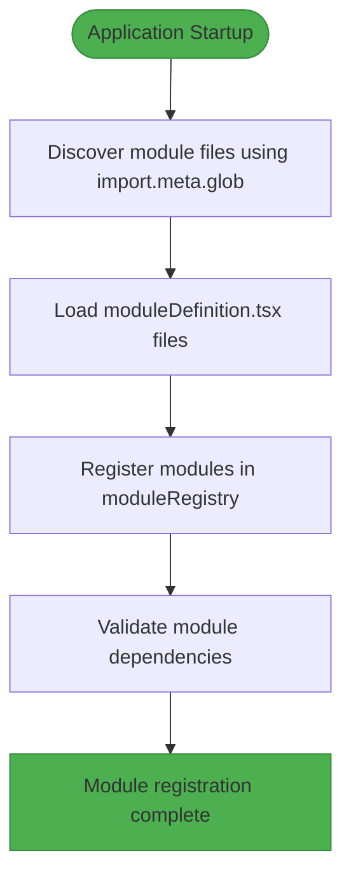
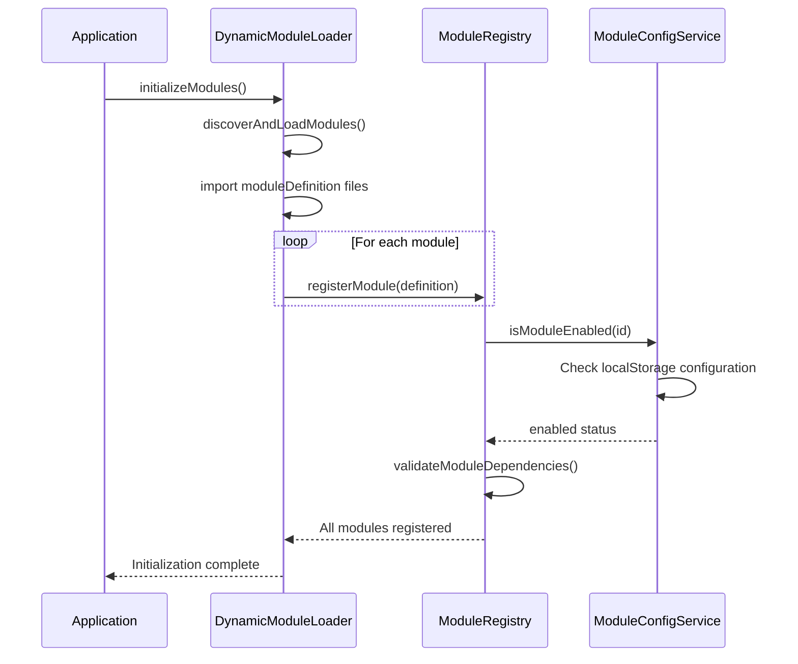
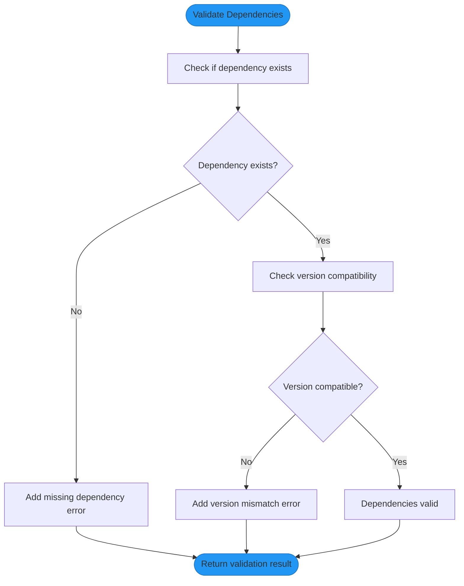
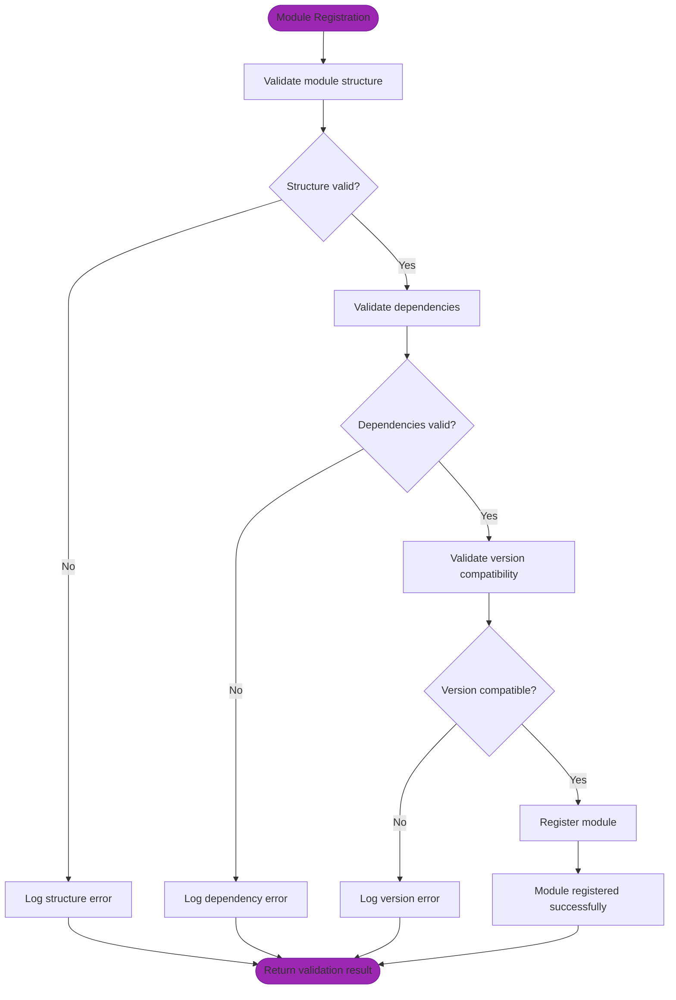

# Module Registration Process

<cite>
**Referenced Files in This Document**   
- [moduleDefinition.tsx](file://src/modules/academics/moduleDefinition.tsx)
- [moduleDefinition.tsx](file://src/modules/administration/moduleDefinition.tsx)
- [moduleDefinition.tsx](file://src/modules/core/moduleDefinition.tsx)
- [moduleDefinition.tsx](file://src/modules/finance/moduleDefinition.tsx)
- [moduleDefinition.tsx](file://src/modules/hr/moduleDefinition.tsx)
- [moduleDefinition.tsx](file://src/modules/inventory/moduleDefinition.tsx)
- [moduleDefinition.tsx](file://src/modules/library/moduleDefinition.tsx)
- [moduleDefinition.tsx](file://src/modules/nutrition/moduleDefinition.tsx)
- [moduleDefinition.tsx](file://src/modules/reports/moduleDefinition.tsx)
- [moduleDefinition.tsx](file://src/modules/settings/moduleDefinition.tsx)
- [types.ts](file://src/core/types.ts)
- [moduleRegistry.ts](file://src/core/moduleRegistry.ts)
- [moduleLoader.ts](file://src/core/moduleLoader.ts)
- [dynamicModuleLoader.ts](file://src/services/dynamicModuleLoader.ts)
- [ModuleDependencyValidator.ts](file://src/core/services/ModuleDependencyValidator.ts)
- [moduleConfigService.ts](file://src/services/moduleConfigService.ts)
- [moduleOrder.ts](file://src/moduleOrder.ts)
</cite>

## Table of Contents
1. [Introduction](#introduction)
2. [Module Definition Structure](#module-definition-structure)
3. [Module Registration Lifecycle](#module-registration-lifecycle)
4. [Module Registry and Storage](#module-registry-and-storage)
5. [Dependency Management](#dependency-management)
6. [Error Handling and Validation](#error-handling-and-validation)
7. [Performance Considerations](#performance-considerations)
8. [Troubleshooting Common Issues](#troubleshooting-common-issues)
9. [Conclusion](#conclusion)

## Introduction
The module registration process in schoolpilot3 is a comprehensive system that enables dynamic loading, configuration, and management of application modules. This system allows for a modular architecture where features can be enabled, disabled, and configured independently. The process begins with module discovery at startup and culminates in the registration of modules in a central registry, making them available for use throughout the application. This documentation provides a detailed explanation of how modules are defined, discovered, validated, and registered within the schoolpilot3 system.

**Section sources**
- [moduleLoader.ts](file://src/core/moduleLoader.ts#L1-L86)
- [moduleRegistry.ts](file://src/core/moduleRegistry.ts#L1-L195)

## Module Definition Structure

### ModuleDefinition Interface
The foundation of the module system is the `ModuleDefinition` interface, which defines the structure and metadata for each module in the application. This interface ensures consistency across all modules while providing flexibility for specific requirements.

```typescript
export interface ModuleDefinition {
  id: string;
  name: string;
  description?: string;
  icon: React.ComponentType<any>;
  path: string;
  isActive: boolean;
  version: string;
  dependencies?: ModuleDependency[];
  navigation: NavItem[];
  features?: string[];
  routes?: Array<{ path: string; page: string }>;
  settings?: {
    category: string;
    items: Array<{
      key: string;
      type: 'boolean' | 'string' | 'number' | 'select';
      defaultValue: any;
      options?: Array<{ value: any; label: string }>;
    }>;
  };
  rbacPermissions?: Permission[];
  defaultRoles?: string[];
  requiresAuthentication?: boolean;
  publicAccess?: boolean;
}
```

**Section sources**
- [types.ts](file://src/core/types.ts#L1597-L1623)

### Required Properties
The `ModuleDefinition` interface requires several key properties that define the essential characteristics of a module:

- **id**: A unique identifier for the module (e.g., "academics", "finance")
- **name**: A translation key for the module's display name
- **icon**: A React component used as the module's visual representation
- **path**: The base URL path for the module
- **isActive**: A boolean indicating whether the module is enabled
- **version**: The semantic version of the module
- **navigation**: An array of navigation items that define the module's menu structure
- **dependencies**: An array of required and optional module dependencies with version constraints

### Navigation Structure
The navigation property defines how a module appears in the application's menu system. Each navigation item includes:

- **name**: Translation key for the menu item
- **path**: URL path for the navigation item
- **icon**: Optional icon component
- **isGroup**: Boolean indicating if the item is a group/container
- **children**: Optional array of child navigation items
- **permissions**: Optional array of permissions required to access the item
- **page**: Optional explicit page component name for dynamic import

**Section sources**
- [types.ts](file://src/core/types.ts#L1478-L1493)

### Example Module Definition
The academics module provides a concrete example of a complete module definition:

```typescript
export const academicsModule: ModuleDefinition = {
  id: 'academics',
  name: 'navigation:academics.title',
  description: 'navigation:academics.description',
  icon: AcademicCapIcon,
  path: '/academics',
  isActive: true,
  version: '1.0.0',
  navigation: [
    { name: 'navigation:academics.dashboard', path: '/academics/dashboard', icon: AcademicCapIcon, page: 'AcademicsDashboardPage' },
    { name: 'navigation:academics.subjects', path: '/academics/subjects', icon: BookOpenIcon, page: 'SubjectsPage' },
    // Additional navigation items...
  ],
  features: ['subject-management', 'class-management', 'timetable', 'exam-management', 'grading'],
  dependencies: [
    {
      moduleId: 'administration',
      version: '^1.0.0',
      required: true
    },
    {
      moduleId: 'finance',
      version: '^1.0.0',
      required: false
    }
  ],
  settings: {
    category: 'academics',
    items: [
      {
        key: 'enableExamManagement',
        type: 'boolean',
        defaultValue: true
      }
    ]
  },
  rbacPermissions: academicsPermissions,
  defaultRoles: academicsDefaultRoles,
};
```

**Section sources**
- [moduleDefinition.tsx](file://src/modules/academics/moduleDefinition.tsx#L1-L88)

## Module Registration Lifecycle

### Module Discovery Process
The module registration lifecycle begins with the discovery of available modules at application startup. The system uses Vite's `import.meta.glob` feature to dynamically discover module definition files:



**Diagram sources**
- [dynamicModuleLoader.ts](file://src/services/dynamicModuleLoader.ts#L1-L263)

### Dynamic Module Loading
The `DynamicModuleLoader` class orchestrates the module loading process, providing both dynamic discovery and fallback mechanisms:

```typescript
class DynamicModuleLoader {
  async discoverAndLoadModules(): Promise<any[]> {
    const { moduleRegistry } = await import('../core/moduleRegistry');
    const moduleFiles = import.meta.glob('../modules/*/moduleDefinition.tsx', { eager: true });
    
    for (const [path, moduleExport] of Object.entries(moduleFiles)) {
      const moduleDefinition = (moduleExport as any).default;
      if (Array.isArray(moduleDefinition)) {
        for (const module of moduleDefinition) {
          moduleRegistry.registerModule(module);
        }
      } else if (moduleDefinition && moduleDefinition.id) {
        moduleRegistry.registerModule(moduleDefinition);
      }
    }
    
    return moduleRegistry.getAllModules();
  }
}
```

The loader implements several important features:
- **Timeout protection**: Prevents infinite loading states with a 5-second timeout
- **Fallback mechanism**: Uses a predefined list of modules if discovery fails
- **Error handling**: Logs errors but continues loading other modules
- **Force completion**: Provides a method to force complete loading in case of issues

**Section sources**
- [dynamicModuleLoader.ts](file://src/services/dynamicModuleLoader.ts#L1-L263)

### Registration Sequence
The complete module registration sequence follows these steps:

1. Application initialization triggers `initializeModules()`
2. `DynamicModuleLoader` discovers all module definition files
3. Each module definition is imported and registered in the `moduleRegistry`
4. Dependencies are validated for each registered module
5. Enabled modules are determined based on configuration and dependencies
6. Navigation structure is generated from enabled modules



**Diagram sources**
- [moduleLoader.ts](file://src/core/moduleLoader.ts#L1-L86)
- [dynamicModuleLoader.ts](file://src/services/dynamicModuleLoader.ts#L1-L263)
- [moduleRegistry.ts](file://src/core/moduleRegistry.ts#L1-L195)

## Module Registry and Storage

### ModuleRegistry Class
The `ModuleRegistry` class serves as the central storage and management system for all registered modules. It provides methods for registration, retrieval, and state management:

```typescript
class ModuleRegistry {
  private modules: Map<string, ModuleDefinition> = new Map();
  
  registerModule(module: ModuleDefinition): void {
    this.modules.set(module.id, module);
  }
  
  getModule(moduleId: string): ModuleDefinition | undefined {
    return this.modules.get(moduleId);
  }
  
  getAllModules(): ModuleDefinition[] {
    return Array.from(this.modules.values());
  }
}
```

**Section sources**
- [moduleRegistry.ts](file://src/core/moduleRegistry.ts#L1-L195)

### State Management
Module states (enabled/disabled) are managed through the `ModuleConfigService`, which persists configuration to localStorage:

```typescript
class ModuleConfigService {
  private readonly STORAGE_KEY = 'module_configurations';
  private configs: Map<string, ModuleConfig> = new Map();
  
  enableModule(moduleId: string): boolean {
    const config = this.configs.get(moduleId) || {
      id: moduleId,
      enabled: false,
      lastModified: new Date()
    };
    
    config.enabled = true;
    config.lastModified = new Date();
    this.configs.set(moduleId, config);
    this.saveConfigurations();
    return true;
  }
  
  private saveConfigurations(): void {
    try {
      const configsObj = Object.fromEntries(
        Array.from(this.configs.entries()).map(([id, config]) => [
          id,
          {
            ...config,
            lastModified: config.lastModified.toISOString()
          }
        ])
      );
      localStorage.setItem(this.STORAGE_KEY, JSON.stringify(configsObj));
    } catch (error) {
      console.error('Failed to save module configurations:', error);
    }
  }
}
```

Core modules (dashboard, settings, reports) are always enabled and cannot be disabled through the configuration interface.

**Section sources**
- [moduleConfigService.ts](file://src/services/moduleConfigService.ts#L1-L325)

### Navigation Generation
The module registry generates the application's navigation structure by combining the navigation items from all enabled modules:

```typescript
getNavigationItems(): NavItem[] {
  const enabledModules = this.getEnabledModules();
  
  // Sort by predefined order, then alphabetically
  enabledModules.sort((a, b) => {
    const aIdx = MODULE_ORDER.indexOf(a.id);
    const bIdx = MODULE_ORDER.indexOf(b.id);
    if (aIdx !== -1 && bIdx !== -1) return aIdx - bIdx;
    if (aIdx !== -1) return -1;
    if (bIdx !== -1) return 1;
    return a.name.localeCompare(b.name);
  });
  
  return enabledModules.map(module => ({
    name: module.name,
    path: module.path,
    icon: module.icon,
    isGroup: (module.navigation?.length || 0) > 0,
    modulePath: module.path,
    children: module.navigation || [],
    isActive: this.isModuleEnabled(module.id)
  }));
}
```

The navigation is sorted according to the `MODULE_ORDER` array, with any additional modules sorted alphabetically.

**Section sources**
- [moduleRegistry.ts](file://src/core/moduleRegistry.ts#L1-L195)
- [moduleOrder.ts](file://src/moduleOrder.ts)

## Dependency Management

### ModuleDependency Interface
The system supports sophisticated dependency management through the `ModuleDependency` interface:

```typescript
export interface ModuleDependency {
  moduleId: string;
  version: string;
  required: boolean;
  optional?: boolean;
}
```

This allows modules to specify both required and optional dependencies with semantic version constraints.

**Section sources**
- [types.ts](file://src/core/types.ts#L1640-L1647)

### Dependency Validation
The `ModuleDependencyValidator` class performs comprehensive validation of module dependencies:



**Diagram sources**
- [ModuleDependencyValidator.ts](file://src/core/services/ModuleDependencyValidator.ts#L1-L297)

### Circular Dependency Detection
The system includes protection against circular dependencies using a depth-first search algorithm:

```typescript
private static _detectCircularDependenciesSync(moduleRegistry: any): string[][] {
  const modules = moduleRegistry.getAllModules();
  const graph = new Map<string, string[]>();
  const cycles: string[][] = [];
  
  // Build dependency graph
  for (const module of modules) {
    const requiredDeps = (module.dependencies || []).map(d => 
      typeof d === 'string' ? d : d.moduleId
    );
    graph.set(module.id, requiredDeps);
  }
  
  // Detect cycles using DFS
  const visited = new Set<string>();
  const recursionStack = new Set<string>();
  const path: string[] = [];
  
  const detectCycle = (moduleId: string): boolean => {
    if (recursionStack.has(moduleId)) {
      const cycleStart = path.indexOf(moduleId);
      if (cycleStart !== -1) {
        const cycle = [...path.slice(cycleStart), moduleId];
        cycles.push(cycle);
      }
      return true;
    }
    
    if (visited.has(moduleId)) {
      return false;
    }
    
    visited.add(moduleId);
    recursionStack.add(moduleId);
    path.push(moduleId);
    
    const dependencies = graph.get(moduleId) || [];
    for (const dep of dependencies) {
      if (detectCycle(dep)) {
        return true;
      }
    }
    
    recursionStack.delete(moduleId);
    path.pop();
    return false;
  };
  
  for (const module of modules) {
    if (!visited.has(module.id)) {
      detectCycle(module.id);
    }
  }
  
  return cycles;
}
```

**Section sources**
- [ModuleDependencyValidator.ts](file://src/core/services/ModuleDependencyValidator.ts#L1-L297)

## Error Handling and Validation

### Validation Process
The module registration system includes comprehensive validation at multiple levels:



**Diagram sources**
- [ModuleDependencyValidator.ts](file://src/core/services/ModuleDependencyValidator.ts#L1-L297)

### Error Types
The system handles several types of registration errors:

- **Missing dependencies**: Required modules are not available
- **Version mismatches**: Dependency version does not satisfy requirements
- **Circular dependencies**: Modules depend on each other in a cycle
- **Invalid module definitions**: Missing required properties or incorrect types
- **Duplicate registrations**: Attempting to register a module with an existing ID

Each error type is logged with detailed information to aid in troubleshooting.

**Section sources**
- [ModuleDependencyValidator.ts](file://src/core/services/ModuleDependencyValidator.ts#L1-L297)
- [moduleRegistry.ts](file://src/core/moduleRegistry.ts#L1-L195)

### Fallback Mechanisms
To ensure application stability, the system implements several fallback mechanisms:

1. **Fallback module list**: If dynamic discovery fails, a predefined list of modules is used
2. **Force completion**: A method to force complete loading if the process hangs
3. **Core module protection**: Essential modules are always available
4. **Error isolation**: Errors in one module do not prevent others from loading

```typescript
private async useFallbackModules(): Promise<void> {
  console.log('🔄 [DynamicModuleLoader] Using fallback modules...');
  
  for (const moduleId of this.FALLBACK_MODULES) {
    const fallbackModule = {
      id: moduleId,
      name: moduleId.charAt(0).toUpperCase() + moduleId.slice(1),
      description: `${moduleId} module`,
      icon: 'Grid3X3',
      path: `/${moduleId}`,
      version: '1.0.0',
      navigation: [],
      features: [],
      dependencies: [],
      settings: {},
      rbacPermissions: [],
      defaultRoles: []
    };
    
    moduleRegistry.registerModule(fallbackModule);
  }
}
```

**Section sources**
- [dynamicModuleLoader.ts](file://src/services/dynamicModuleLoader.ts#L1-L263)

## Performance Considerations

### Synchronous vs Asynchronous Registration
The module registration system balances performance and reliability through careful use of synchronous and asynchronous operations:

- **Synchronous operations**: Module registration, state checking, and navigation generation
- **Asynchronous operations**: Module discovery, file loading, and dependency validation

This approach ensures that critical operations complete quickly while allowing time-consuming tasks to run in the background.

**Section sources**
- [moduleRegistry.ts](file://src/core/moduleRegistry.ts#L1-L195)
- [dynamicModuleLoader.ts](file://src/services/dynamicModuleLoader.ts#L1-L263)

### Startup Optimization
Several strategies are employed to optimize startup performance:

1. **Eager loading**: Module definitions are loaded eagerly to reduce latency
2. **Caching**: Module configurations are cached in localStorage
3. **Parallel processing**: Multiple modules are processed concurrently
4. **Timeout protection**: Prevents indefinite loading states
5. **Lazy initialization**: Non-critical components are initialized after startup

```typescript
async initializeDynamicModules(): Promise<void> {
  // Add timeout to prevent infinite loading
  const timeoutPromise = new Promise((_, reject) => {
    setTimeout(() => reject(new Error('Module loading timeout')), 5000);
  });
  
  // Race between module loading and timeout
  await Promise.race([
    this.discoverAndLoadModules(),
    timeoutPromise
  ]);
}
```

**Section sources**
- [dynamicModuleLoader.ts](file://src/services/dynamicModuleLoader.ts#L1-L263)

### Memory Management
The system manages memory efficiently by:

- Using a Map for module storage to ensure O(1) lookup times
- Implementing proper cleanup in the reset method
- Avoiding memory leaks through proper event handling
- Minimizing object creation during the registration process

## Troubleshooting Common Issues

### Missing Dependencies
When a module has missing dependencies, the system logs an error and prevents the module from being enabled:

```typescript
if (!depModule) {
  errors.push(`Required dependency '${depId}' not found`);
  continue;
}
```

**Troubleshooting steps:**
1. Verify that the dependent module exists in the modules directory
2. Check that the module is properly exported in its moduleDefinition.tsx file
3. Ensure the dependency ID matches the module's ID exactly
4. Confirm that the dependent module is not disabled in the configuration

**Section sources**
- [ModuleDependencyValidator.ts](file://src/core/services/ModuleDependencyValidator.ts#L1-L297)

### Route Conflicts
Route conflicts occur when multiple modules define the same path. The system handles this by:

1. Registering modules in a specific order (defined by MODULE_ORDER)
2. Allowing later modules to override earlier ones
3. Logging warnings about potential conflicts

**Prevention strategies:**
- Use unique path prefixes for each module
- Follow the convention of /{module-id}/{feature}
- Avoid generic paths like "/settings" or "/admin"
- Use the moduleOrder.ts file to control registration sequence

**Section sources**
- [moduleRegistry.ts](file://src/core/moduleRegistry.ts#L1-L195)

### Configuration Issues
Common configuration problems and their solutions:

- **Module not appearing**: Check if the module is enabled in localStorage
- **Navigation not working**: Verify the page property matches the actual component name
- **Permissions not applying**: Ensure rbacPermissions are properly defined
- **Settings not saving**: Check browser localStorage permissions

The ModuleManagementPanel provides a user interface for diagnosing and resolving these issues.

**Section sources**
- [moduleConfigService.ts](file://src/services/moduleConfigService.ts#L1-L325)
- [ModuleManagementPanel.tsx](file://src/components/settings/ModuleManagementPanel.tsx)

## Conclusion
The module registration process in schoolpilot3 provides a robust and flexible system for managing application functionality. By using a combination of dynamic discovery, comprehensive validation, and persistent configuration, the system enables a modular architecture that can be easily extended and customized. The careful balance of synchronous and asynchronous operations ensures reliable performance, while comprehensive error handling and fallback mechanisms maintain application stability. This architecture allows schoolpilot3 to support a wide range of educational institution needs while maintaining a clean, organized codebase.