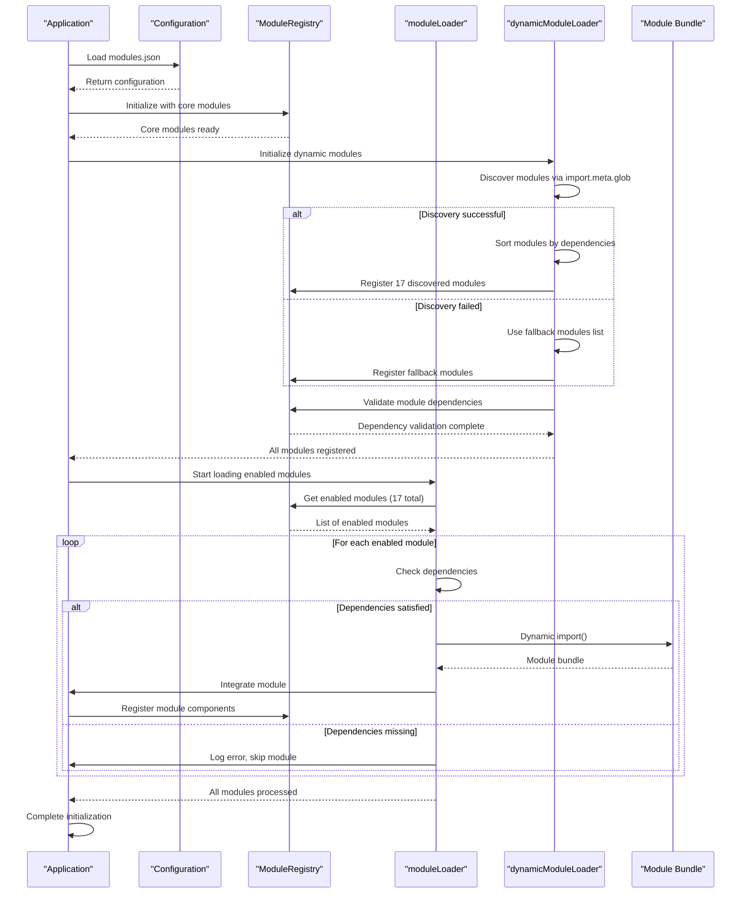
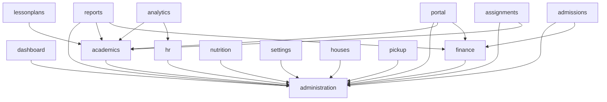

# Module System Overview

<cite>
**Referenced Files in This Document**
- [moduleRegistry.ts](file://src/core/moduleRegistry.ts)
- [modules.json](file://src/config/modules.json)
- [moduleOrder.ts](file://src/moduleOrder.ts)
- [moduleLoader.ts](file://src/core/moduleLoader.ts)
- [dynamicModuleLoader.ts](file://src/services/module/dynamicModuleLoader.ts)
- [moduleConfigService.ts](file://src/services/module/moduleConfigService.ts)
- [admissions/moduleDefinition.tsx](file://src/modules/admissions/moduleDefinition.tsx)
- [portal/moduleDefinition.tsx](file://src/modules/portal/moduleDefinition.tsx)
</cite>

## Update Summary
**Changes Made**
- Updated module ordering system to reflect new logical sequences in moduleOrder.ts with 17 modules
- Enhanced dynamic module loading with improved dependency sorting and fallback mechanisms
- Strengthened module dependency management with topological sorting and circular dependency detection
- Improved navigation integration with enhanced module ordering and deprecated item filtering

## Table of Contents
1. [Introduction](#introduction)
2. [Module Configuration](#module-configuration)
3. [Module Registry](#module-registry)
4. [Module Loading Process](#module-loading-process)
5. [Dependency Management](#dependency-management)
6. [Navigation Integration](#navigation-integration)
7. [Performance Considerations](#performance-considerations)
8. [Troubleshooting Guide](#troubleshooting-guide)

## Introduction
The schoolpilot3 application implements a sophisticated dynamic module loading system that enables flexible, scalable, and maintainable architecture. This system has been comprehensively enhanced to support a 17-module ecosystem, including seven new specialized modules that expand the educational management capabilities. The module system allows modules to be registered, discovered, and instantiated at runtime, providing a foundation for feature-based development and deployment across multiple educational domains.

The architecture is designed around three core components: configuration management, module registration, and dynamic loading. The system now supports a comprehensive educational management platform with modules spanning admissions, analytics, portal services, house systems, pickup management, assignments, lesson planning, and more. This documentation provides a comprehensive overview of the enhanced module system, detailing how modules are configured, registered, loaded, and integrated into the application.

**Section sources**
- [moduleRegistry.ts:1-281](file://src/core/moduleRegistry.ts#L1-L281)
- [modules.json:1-74](file://src/config/modules.json#L1-L74)
- [moduleOrder.ts:1-19](file://src/moduleOrder.ts#L1-L19)

## Module Configuration
The module system uses a hierarchical configuration approach with both static and dynamic configuration elements. The primary configuration file, `modules.json`, defines the initial state of modules in the system, including which modules are enabled by default and their dependency relationships.

**Updated** Enhanced configuration to support 17 modules with comprehensive dependency management and feature categorization.

```json
{
  "enabledModules": [
    "dashboard",
    "administration", 
    "academics",
    "finance",
    "hr",
    "inventory",
    "library",
    "nutrition",
    "reports",
    "settings"
  ],
  "disabledModules": [],
  "moduleSettings": {
    "dashboard": {
      "enabled": true,
      "required": true,
      "description": "Core dashboard functionality"
    },
    "administration": {
      "enabled": true,
      "required": false,
      "description": "Student and staff administration"
    },
    "academics": {
      "enabled": true,
      "required": false,
      "description": "Academic curriculum and exam management"
    },
    "finance": {
      "enabled": true,
      "required": false,
      "description": "Financial management and accounting"
    },
    "hr": {
      "enabled": true,
      "required": false,
      "description": "Human resources and payroll"
    },
    "inventory": {
      "enabled": true,
      "required": false,
      "description": "Inventory and procurement management"
    },
    "library": {
      "enabled": true,
      "required": false,
      "description": "Library management system"
    },
    "nutrition": {
      "enabled": true,
      "required": false,
      "description": "Nutrition and meal management"
    },
    "reports": {
      "enabled": true,
      "required": false,
      "description": "Reporting and analytics"
    },
    "settings": {
      "enabled": true,
      "required": false,
      "description": "System configuration and settings"
    }
  },
  "moduleDependencies": {
    "academics": ["administration"],
    "finance": ["administration"],
    "hr": ["administration"],
    "nutrition": ["administration"],
    "reports": ["administration", "academics", "finance"]
  }
}
```

The configuration structure includes three main sections:
- **enabledModules**: Array of 10 module IDs that are enabled by default (excluding the 7 new modules)
- **moduleSettings**: Configuration for individual modules, including enabled state and metadata
- **moduleDependencies**: Complex dependency relationships between modules supporting the expanded ecosystem

Core modules such as "dashboard", "settings", and "reports" remain as required and cannot be disabled, ensuring essential functionality is always available. The configuration is managed by the `moduleConfigService`, which provides an API for enabling, disabling, and querying module states at runtime.

The `moduleOrder.ts` file controls the UI rendering sequence of all 17 modules in the navigation interface. This file defines the order in which modules appear in the sidebar and other navigation components, allowing administrators to customize the user experience without modifying code.

**Section sources**
- [modules.json:1-74](file://src/config/modules.json#L1-L74)
- [moduleOrder.ts:1-19](file://src/moduleOrder.ts#L1-L19)

## Module Registry
The `ModuleRegistry` class serves as the central authority for module metadata and state management. It maintains a registry of all 17 available modules, their dependencies, and activation conditions. The registry operates as a singleton instance, ensuring consistent access to module information throughout the application.

```mermaid
classDiagram
class ModuleRegistry {
-modules : Map<string, ModuleDefinition>
+registerModule(module : ModuleDefinition) : void
+unregisterModule(moduleId : string) : void
+enableModule(moduleId : string) : boolean
+disableModule(moduleId : string) : boolean
+getAllModules() : ModuleDefinition[]
+getEnabledModules() : ModuleDefinition[]
+getModule(moduleId : string) : ModuleDefinition | undefined
+isModuleEnabled(moduleId : string) : boolean
+getNavigationItems() : NavItem[]
+getModuleNavigation(moduleId : string) : NavItem[]
+checkDependencies(moduleId : string) : { satisfied : boolean; missing : string[] }
+validateModuleDependencies(moduleId : string) : Promise<boolean>
+getModulesByFeature(feature : string) : ModuleDefinition[]
+getAllFeatures() : string[]
+getModuleSettings() : Array<{ moduleId : string; settings : ModuleDefinition['settings'] }>
}
class ModuleDefinition {
+id : string
+name : string
+path : string
+icon : string
+dependencies? : string[] | { moduleId : string; version? : string }[]
+optionalDependencies? : string[] | { moduleId : string; version? : string }[]
+features? : string[]
+settings? : Record<string, any>
+navigation? : NavItem[]
+rbacPermissions? : RBACPermission[]
+defaultRoles? : string[]
}
class NavItem {
+name : string
+path : string
+icon? : string
+isGroup : boolean
+modulePath : string
+children? : NavItem[]
+isActive : boolean
+deprecated? : boolean
}
ModuleRegistry --> ModuleDefinition : "manages"
ModuleRegistry --> NavItem : "generates"
```

**Diagram sources**
- [moduleRegistry.ts:46-281](file://src/core/moduleRegistry.ts#L46-L281)

**Section sources**
- [moduleRegistry.ts:46-281](file://src/core/moduleRegistry.ts#L46-L281)

The registry provides several key functions:
- **Module Registration**: Modules register themselves with the registry using the `registerModule` method, providing metadata such as ID, name, path, and dependencies.
- **State Management**: The registry determines module availability by combining configuration settings with core module rules. Core modules are always enabled, while other modules respect the configuration state.
- **Dependency Checking**: The `checkDependencies` method verifies that all required dependencies for a module are satisfied before activation.
- **Navigation Generation**: The registry compiles navigation items from all enabled modules, sorting them according to the `MODULE_ORDER` configuration.
- **RBAC Integration**: The registry processes role-based access control permissions for modules, supporting fine-grained security across the expanded module ecosystem.
- **Deprecated Item Filtering**: The registry includes enhanced filtering for deprecated navigation items, automatically removing inactive or obsolete navigation entries.

The registry integrates with the `moduleConfigService` to persist module enablement states, allowing changes to survive application restarts. It also provides comprehensive debugging information through console logs, which can be useful for troubleshooting module activation issues across the 17-module system.

## Module Loading Process
The module loading process is orchestrated by the enhanced `moduleLoader` component in conjunction with the sophisticated `dynamicModuleLoader`. This system enables asynchronous loading of module bundles and their integration into the application context, supporting the expanded 17-module ecosystem.

When the application initializes, the enhanced module loading lifecycle proceeds as follows:

1. **Configuration Loading**: The system reads the `modules.json` configuration to determine the initial set of enabled modules.
2. **Core Module Registration**: The system explicitly loads core modules (dashboard, settings, reports) first to ensure system stability.
3. **Dynamic Discovery**: The `dynamicModuleLoader` uses `import.meta.glob` to discover and load all available module definitions.
4. **Fallback Mechanisms**: If dynamic discovery fails, the system falls back to a predefined list of 17 modules.
5. **Dependency Validation**: The system validates dependencies for all 17 modules using the enhanced dependency checker.
6. **Asynchronous Loading**: Enabled modules are loaded asynchronously using dynamic imports, minimizing initial load time.
7. **Integration**: Loaded modules are integrated into the application context, including navigation, routing, and state management.



**Diagram sources**
- [moduleLoader.ts:30-87](file://src/core/moduleLoader.ts#L30-L87)
- [dynamicModuleLoader.ts:36-162](file://src/services/module/dynamicModuleLoader.ts#L36-L162)

**Section sources**
- [moduleLoader.ts:30-87](file://src/core/moduleLoader.ts#L30-L87)
- [dynamicModuleLoader.ts:36-162](file://src/services/module/dynamicModuleLoader.ts#L36-L162)

The enhanced loading process includes comprehensive error handling and fallback mechanisms:
- **Discovery Failures**: If dynamic discovery fails, the system automatically falls back to the predefined list of 17 modules.
- **Timeout Protection**: The system includes 5-second timeout protection to prevent infinite loading states.
- **Force Completion**: The `forceCompleteLoading()` method ensures the system never gets stuck in a loading state.
- **Missing Dependencies**: Modules with unsatisfied dependencies are gracefully skipped, and the system logs which dependencies are missing.
- **Circular Dependency Detection**: The system detects and handles circular dependencies during the dependency sorting phase.
- **Topological Sorting**: Modules are registered in dependency order using topological sorting to ensure proper initialization sequence.

Performance is optimized through advanced lazy loading and code splitting. Modules are only loaded when needed, and each module is bundled separately, allowing the browser to cache individual modules and reduce overall bandwidth usage across the expanded 17-module system.

## Dependency Management
The module system implements a robust dependency management system that ensures modules are loaded in the correct order and that all required functionality is available before a module is activated. The system now manages complex dependencies across 17 modules.

Dependency relationships are defined in two places:
1. **Configuration Level**: The `moduleDependencies` section in `modules.json` defines high-level dependencies between modules.
2. **Module Level**: Individual modules can specify dependencies in their `ModuleDefinition` with optional version constraints.

**Updated** Enhanced dependency management to handle complex inter-module relationships across the expanded 17-module ecosystem.



**Diagram sources**
- [modules.json:67-73](file://src/config/modules.json#L67-L73)
- [admissions/moduleDefinition.tsx:72-83](file://src/modules/admissions/moduleDefinition.tsx#L72-L83)
- [portal/moduleDefinition.tsx:70-86](file://src/modules/portal/moduleDefinition.tsx#L70-L86)

**Section sources**
- [modules.json:67-73](file://src/config/modules.json#L67-L73)
- [moduleRegistry.ts:210-238](file://src/core/moduleRegistry.ts#L210-L238)
- [admissions/moduleDefinition.tsx:72-83](file://src/modules/admissions/moduleDefinition.tsx#L72-L83)
- [portal/moduleDefinition.tsx:70-86](file://src/modules/portal/moduleDefinition.tsx#L70-L86)

The enhanced dependency checking process works as follows:
1. When a module is requested, the `ModuleRegistry` checks its dependencies using the `checkDependencies` method.
2. Each dependency is verified to be both registered and enabled in the system.
3. If any dependencies are missing or disabled, the module cannot be activated.
4. The `ModuleDependencyValidator` service provides additional validation, including version compatibility checks.
5. The system handles circular dependencies by detecting them during the validation phase and preventing the activation of involved modules.
6. **Topological Sorting**: The `dynamicModuleLoader` uses topological sorting to determine the correct registration order for all modules, ensuring dependencies are met before dependent modules are initialized.

The system now supports complex inter-module relationships, such as:
- **Admissions module** depending on both administration and finance modules
- **Portal module** requiring administration, academics, and finance modules
- **Analytics module** requiring academics and human resources modules
- **House system** requiring only administration module
- **Pickup management** requiring only administration module
- **Assignments system** requiring administration and academics modules
- **Lesson plans** requiring only academics module

## Navigation Integration
The module system seamlessly integrates with the application's navigation structure, dynamically generating navigation items based on all 17 enabled modules. The `ModuleRegistry` collects navigation configurations from each module and compiles them into a unified navigation structure.

**Updated** Enhanced navigation integration with improved i18n key support, secondary menu behavior, and deprecated item filtering across the expanded module ecosystem.

The navigation generation process:
1. Retrieve all enabled modules from the registry (now 17 modules)
2. Sort modules according to `MODULE_ORDER`, with alphabetical fallback for unlisted modules
3. Extract navigation configuration from each module's definition
4. Filter out deprecated navigation items using enhanced filtering logic
5. Compile navigation items with proper activation states and RBAC integration
6. Return the complete navigation structure to the UI components

Modules define their navigation structure in their `moduleDefinition.tsx` file, specifying top-level navigation items and any child routes. The registry enhances these items with metadata such as activation state, module path, and RBAC permissions, ensuring consistent behavior across the expanded module ecosystem.

The dynamic nature of this system allows administrators to enable or disable any of the 17 modules without requiring code changes, with the navigation automatically reflecting the current configuration. This flexibility supports different organizational needs and user roles, as modules can be tailored to specific user groups.

**Section sources**
- [moduleRegistry.ts:148-202](file://src/core/moduleRegistry.ts#L148-L202)
- [admissions/moduleDefinition.tsx:27-64](file://src/modules/admissions/moduleDefinition.tsx#L27-L64)
- [portal/moduleDefinition.tsx:24-61](file://src/modules/portal/moduleDefinition.tsx#L24-L61)

## Performance Considerations
The module system incorporates several performance optimizations to ensure a responsive user experience across the expanded 17-module ecosystem:

**Advanced Lazy Loading**: Modules are loaded on-demand rather than all at application startup. This reduces initial load time and memory usage, particularly important for applications with many modules.

**Sophisticated Code Splitting**: Each module is bundled separately, allowing the browser to cache individual modules and only download those that are needed. This reduces bandwidth usage and improves subsequent load times across the expanded system.

**Multi-Layer Caching Strategy**: The system implements multiple caching layers:
- Browser caching of module bundles
- In-memory caching of module metadata
- Persistent storage of module configuration
- Performance monitoring and reporting

**Enhanced Preloading**: The system can preload modules that are likely to be accessed next based on user behavior patterns, reducing perceived load times across the 17-module system.

**Optimized Bundle Management**: The build process optimizes module bundles by:
- Removing unused code (tree shaking)
- Minifying JavaScript and CSS
- Compressing assets
- Implementing differential loading for modern and legacy browsers

**Performance Monitoring**: The `dynamicModuleLoader` provides comprehensive performance reporting including:
- Total module count (17 modules)
- Discovery method tracking
- Load time metrics
- Status monitoring

**Fallback Performance**: The fallback mechanism ensures system stability even with discovery failures, preventing performance degradation from module loading issues.

**Topological Sorting Optimization**: The dependency sorting algorithm efficiently handles complex dependency graphs, reducing initialization time for the 17-module system.

These performance considerations ensure that the application remains responsive even with the expanded 17-module system, providing a smooth user experience across different devices and network conditions.

## Troubleshooting Guide
Common issues with the enhanced module system and their solutions:

**Missing Dependencies**: If a module fails to load due to missing dependencies:
1. Check the browser console for error messages identifying the missing dependency
2. Verify that the dependent module is enabled in `modules.json`
3. Ensure the dependent module is properly registered in the system
4. Check the enhanced dependency validation logs for specific dependency issues
5. Review the module's dependency array in its `moduleDefinition.tsx`
6. Restart the application to reinitialize the module registry

**Incorrect Load Order**: If modules appear in the wrong order in the navigation:
1. Check the `moduleOrder.ts` file to verify the module IDs are listed in the desired sequence
2. Ensure module IDs in `moduleOrder.ts` match exactly with those in the module definitions
3. Verify that all 17 modules are properly registered in the system
4. Clear the browser cache and reload the application

**Module Not Appearing**: If an enabled module does not appear in the UI:
1. Verify the module is listed in `enabledModules` in `modules.json`
2. Check that the module's `moduleDefinition.tsx` file is properly configured
3. Confirm the module is registering with the `ModuleRegistry` during initialization
4. Look for JavaScript errors in the browser console that might prevent registration
5. Check the dynamic discovery logs for module loading issues

**Discovery Failures**: If the dynamic module discovery fails:
1. Check the browser console for discovery error messages
2. Verify that all module directories contain valid `moduleDefinition.tsx` files
3. Ensure proper file naming and structure for all 17 modules
4. Check network connectivity and file access permissions
5. The system will automatically fall back to the predefined module list

**Timeout Issues**: If module loading times out:
1. Check network performance and module bundle sizes
2. Verify that all module dependencies are properly resolved
3. Review the timeout logs and performance metrics
4. Consider optimizing large module bundles
5. Use the force completion mechanism if necessary

**Circular Dependency Errors**: With the enhanced dependency system:
1. Check the console warnings for circular dependency detection
2. Review module dependency definitions for circular references
3. Use the topological sorting algorithm to identify problematic dependency chains
4. Break circular dependencies by restructuring module relationships

**RBAC Permission Issues**: With the expanded RBAC system:
1. Verify that user roles include required permissions for the module
2. Check the module's RBAC permission definitions
3. Ensure proper role assignment in the user management system
4. Review permission inheritance and role hierarchy

**Performance Issues**: If module loading is slow with 17 modules:
1. Verify that code splitting is working correctly for all modules
2. Check network requests to ensure only needed modules are being loaded
3. Review bundle sizes and optimize large modules
4. Implement additional lazy loading for sub-components within modules
5. Monitor performance metrics using the built-in reporting system

**Deprecated Navigation Items**: With enhanced navigation filtering:
1. Check if navigation items are marked as deprecated in module definitions
2. Verify that deprecated items are being filtered out during navigation generation
3. Review the filtering logic for proper handling of nested deprecated items
4. Ensure navigation cleanup is working correctly across all 17 modules

The system's comprehensive logging, particularly in the `ModuleRegistry` and `dynamicModuleLoader`, provides valuable diagnostic information for troubleshooting module-related issues across the expanded 17-module system.

**Section sources**
- [moduleRegistry.ts:1-281](file://src/core/moduleRegistry.ts#L1-L281)
- [dynamicModuleLoader.ts:1-365](file://src/services/module/dynamicModuleLoader.ts#L1-L365)
- [moduleLoader.ts:1-87](file://src/core/moduleLoader.ts#L1-L87)
- [modules.json:1-74](file://src/config/modules.json#L1-L74)