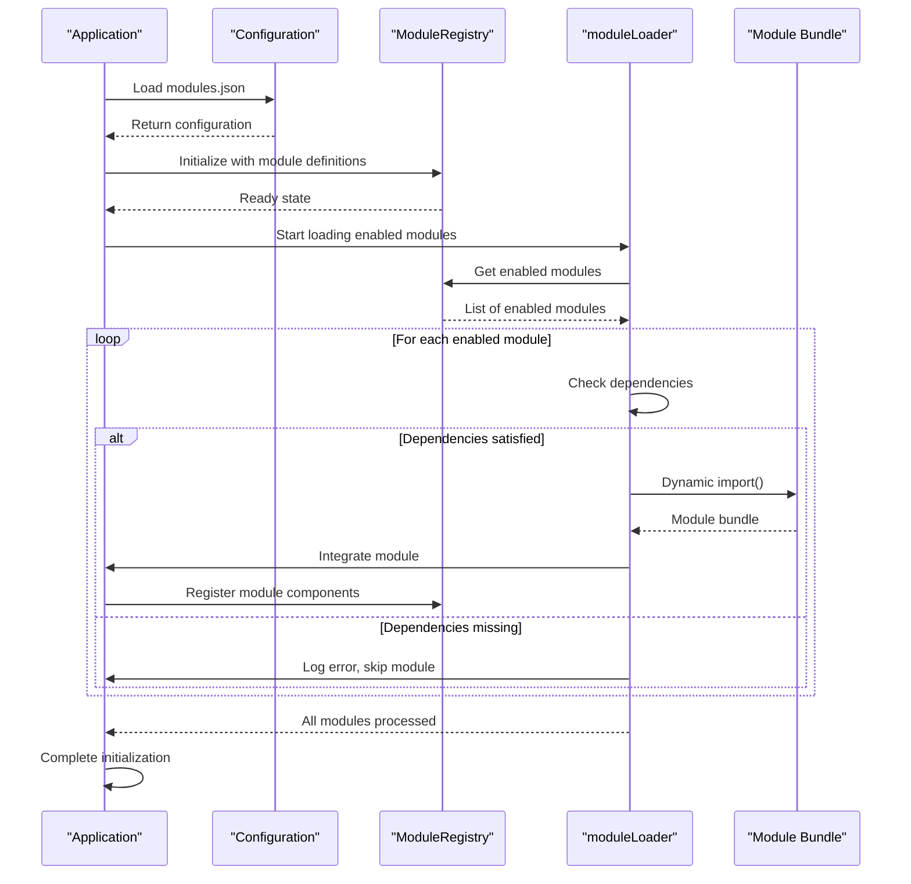
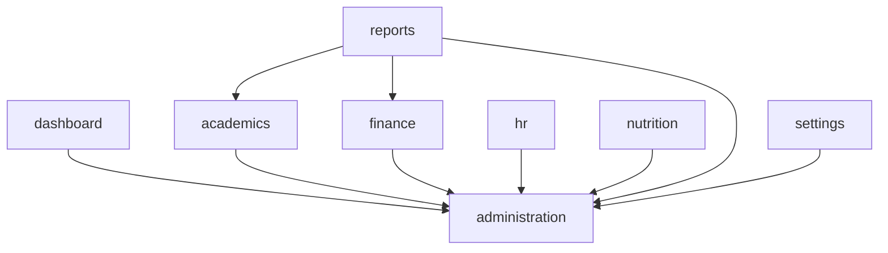

# Module System Overview

<cite>
**Referenced Files in This Document**   
- [moduleRegistry.ts](file://src/core/moduleRegistry.ts)
- [modules.json](file://src/config/modules.json)
- [moduleOrder.ts](file://src/moduleOrder.ts)
- [moduleLoader.ts](file://src/core/moduleLoader.ts)
- [moduleConfigService.ts](file://src/services/moduleConfigService.ts)
- [moduleDefinition.tsx](file://src/modules/academics/moduleDefinition.tsx)
</cite>

## Table of Contents
1. [Introduction](#introduction)
2. [Module Configuration](#module-configuration)
3. [Module Registry](#module-registry)
4. [Module Loading Process](#module-loading-process)
5. [Dependency Management](#dependency-management)
6. [Navigation Integration](#navigation-integration)
7. [Performance Considerations](#performance-considerations)
8. [Troubleshooting Guide](#troubleshooting-guide)

## Introduction
The schoolpilot3 application implements a dynamic module loading system that enables flexible, scalable, and maintainable architecture. This system allows modules to be registered, discovered, and instantiated at runtime, providing a foundation for feature-based development and deployment. The module system supports lazy loading, dependency management, and configurable module activation, enabling administrators to enable or disable functionality based on organizational needs.

The architecture is designed around three core components: configuration management, module registration, and dynamic loading. Modules are defined as self-contained units of functionality that can be independently developed, tested, and deployed. This documentation provides a comprehensive overview of the module system, detailing how modules are configured, registered, loaded, and integrated into the application.

**Section sources**
- [moduleRegistry.ts](file://src/core/moduleRegistry.ts#L1-L195)
- [modules.json](file://src/config/modules.json#L1-L74)

## Module Configuration
The module system uses a hierarchical configuration approach with both static and dynamic configuration elements. The primary configuration file, `modules.json`, defines the initial state of modules in the system, including which modules are enabled by default and their dependency relationships.

```json
{
  "enabledModules": [
    "dashboard",
    "administration", 
    "academics",
    "finance",
    "hr",
    "inventory",
    "library",
    "nutrition",
    "reports",
    "settings"
  ],
  "disabledModules": [],
  "moduleSettings": {
    "dashboard": {
      "enabled": true,
      "required": true,
      "description": "Core dashboard functionality"
    },
    "administration": {
      "enabled": true,
      "required": false,
      "description": "Student and staff administration"
    }
  },
  "moduleDependencies": {
    "academics": ["administration"],
    "finance": ["administration"],
    "reports": ["administration", "academics", "finance"]
  }
}
```

The configuration structure includes three main sections:
- **enabledModules**: Array of module IDs that are enabled by default
- **moduleSettings**: Configuration for individual modules, including enabled state and metadata
- **moduleDependencies**: Dependency relationships between modules

Core modules such as "dashboard", "settings", and "reports" are treated as required and cannot be disabled, ensuring essential functionality is always available. The configuration is managed by the `moduleConfigService`, which provides an API for enabling, disabling, and querying module states at runtime.

The `moduleOrder.ts` file controls the UI rendering sequence of modules in the navigation interface. This file defines the order in which modules appear in the sidebar and other navigation components, allowing administrators to customize the user experience without modifying code.

**Section sources**
- [modules.json](file://src/config/modules.json#L1-L74)
- [moduleOrder.ts](file://src/moduleOrder.ts)

## Module Registry
The `ModuleRegistry` class serves as the central authority for module metadata and state management. It maintains a registry of all available modules, their dependencies, and activation conditions. The registry operates as a singleton instance, ensuring consistent access to module information throughout the application.

```mermaid
classDiagram
class ModuleRegistry {
-modules : Map<string, ModuleDefinition>
+registerModule(module : ModuleDefinition) : void
+unregisterModule(moduleId : string) : void
+enableModule(moduleId : string) : boolean
+disableModule(moduleId : string) : boolean
+getAllModules() : ModuleDefinition[]
+getEnabledModules() : ModuleDefinition[]
+getModule(moduleId : string) : ModuleDefinition | undefined
+isModuleEnabled(moduleId : string) : boolean
+getNavigationItems() : NavItem[]
+getModuleNavigation(moduleId : string) : NavItem[]
+checkDependencies(moduleId : string) : { satisfied : boolean; missing : string[] }
+validateModuleDependencies(moduleId : string) : Promise<boolean>
+getModulesByFeature(feature : string) : ModuleDefinition[]
+getAllFeatures() : string[]
+getModuleSettings() : Array<{ moduleId : string; settings : ModuleDefinition['settings'] }>
}
class ModuleDefinition {
+id : string
+name : string
+path : string
+icon : string
+dependencies? : string[] | { moduleId : string; version? : string }[]
+features? : string[]
+settings? : Record<string, any>
+navigation? : NavItem[]
}
class NavItem {
+name : string
+path : string
+icon? : string
+isGroup : boolean
+modulePath : string
+children? : NavItem[]
+isActive : boolean
}
ModuleRegistry --> ModuleDefinition : "manages"
ModuleRegistry --> NavItem : "generates"
```

**Diagram sources**
- [moduleRegistry.ts](file://src/core/moduleRegistry.ts#L15-L195)

**Section sources**
- [moduleRegistry.ts](file://src/core/moduleRegistry.ts#L15-L195)

The registry provides several key functions:
- **Module Registration**: Modules register themselves with the registry using the `registerModule` method, providing metadata such as ID, name, path, and dependencies.
- **State Management**: The registry determines module availability by combining configuration settings with core module rules. Core modules are always enabled, while other modules respect the configuration state.
- **Dependency Checking**: The `checkDependencies` method verifies that all required dependencies for a module are satisfied before activation.
- **Navigation Generation**: The registry compiles navigation items from all enabled modules, sorting them according to the `MODULE_ORDER` configuration.

The registry integrates with the `moduleConfigService` to persist module enablement states, allowing changes to survive application restarts. It also provides debugging information through console logs, which can be useful for troubleshooting module activation issues.

## Module Loading Process
The module loading process is orchestrated by the `moduleLoader` component in conjunction with the `dynamicModuleLoader`. This system enables asynchronous loading of module bundles and their integration into the application context.

When the application initializes, the module loading lifecycle proceeds as follows:

1. **Configuration Loading**: The system reads the `modules.json` configuration to determine the initial set of enabled modules.
2. **Registry Initialization**: The `ModuleRegistry` is populated with module definitions from each module's `moduleDefinition.tsx` file.
3. **Dependency Resolution**: The system checks dependency relationships to ensure modules are loaded in the correct order.
4. **Asynchronous Loading**: Enabled modules are loaded asynchronously using dynamic imports, minimizing initial load time.
5. **Integration**: Loaded modules are integrated into the application context, including navigation, routing, and state management.



**Diagram sources**
- [moduleLoader.ts](file://src/core/moduleLoader.ts)
- [moduleRegistry.ts](file://src/core/moduleRegistry.ts#L100-L120)

**Section sources**
- [moduleLoader.ts](file://src/core/moduleLoader.ts)
- [moduleRegistry.ts](file://src/core/moduleRegistry.ts#L100-L120)

The loading process includes error handling and fallback mechanisms:
- **Failed Loads**: If a module fails to load, the system logs the error and continues with other modules, preventing a single failure from blocking the entire application.
- **Missing Dependencies**: Modules with unsatisfied dependencies are skipped, and the system logs which dependencies are missing.
- **Fallback UI**: The `ModuleLoadingFallback` component provides a user-friendly interface when modules fail to load or are temporarily unavailable.

Performance is optimized through lazy loading and code splitting. Modules are only loaded when needed, and each module is bundled separately, allowing the browser to cache individual modules and reduce overall bandwidth usage.

## Dependency Management
The module system implements a robust dependency management system that ensures modules are loaded in the correct order and that all required functionality is available before a module is activated.

Dependency relationships are defined in two places:
1. **Configuration Level**: The `moduleDependencies` section in `modules.json` defines high-level dependencies between modules.
2. **Module Level**: Individual modules can specify dependencies in their `ModuleDefinition` with optional version constraints.



**Diagram sources**
- [modules.json](file://src/config/modules.json#L60-L70)

**Section sources**
- [modules.json](file://src/config/modules.json#L60-L70)
- [moduleRegistry.ts](file://src/core/moduleRegistry.ts#L150-L170)

The dependency checking process works as follows:
1. When a module is requested, the `ModuleRegistry` checks its dependencies using the `checkDependencies` method.
2. Each dependency is verified to be both registered and enabled in the system.
3. If any dependencies are missing or disabled, the module cannot be activated.
4. The `ModuleDependencyValidator` service provides additional validation, including version compatibility checks.

The system handles circular dependencies by detecting them during the validation phase and preventing the activation of involved modules. This prevents infinite loading loops and ensures system stability.

## Navigation Integration
The module system seamlessly integrates with the application's navigation structure, dynamically generating navigation items based on enabled modules. The `ModuleRegistry` collects navigation configurations from each module and compiles them into a unified navigation structure.

The navigation generation process:
1. Retrieve all enabled modules from the registry
2. Sort modules according to `MODULE_ORDER`, with alphabetical fallback for unlisted modules
3. Extract navigation configuration from each module's definition
4. Compile navigation items with proper activation states
5. Return the complete navigation structure to the UI components

Modules define their navigation structure in their `moduleDefinition.tsx` file, specifying top-level navigation items and any child routes. The registry enhances these items with metadata such as activation state and module path, ensuring consistent behavior across the application.

The dynamic nature of this system allows administrators to enable or disable modules without requiring code changes, with the navigation automatically reflecting the current configuration. This flexibility supports different organizational needs and user roles, as modules can be tailored to specific user groups.

**Section sources**
- [moduleRegistry.ts](file://src/core/moduleRegistry.ts#L120-L150)
- [moduleDefinition.tsx](file://src/modules/academics/moduleDefinition.tsx)

## Performance Considerations
The module system incorporates several performance optimizations to ensure a responsive user experience:

**Lazy Loading**: Modules are loaded on-demand rather than all at application startup. This reduces initial load time and memory usage, particularly important for applications with many modules.

**Code Splitting**: Each module is bundled separately, allowing the browser to cache individual modules and only download those that are needed. This reduces bandwidth usage and improves subsequent load times.

**Caching Strategies**: The system implements multiple caching layers:
- Browser caching of module bundles
- In-memory caching of module metadata
- Persistent storage of module configuration

**Preloading Hints**: The system can preload modules that are likely to be accessed next based on user behavior patterns, reducing perceived load times.

**Bundle Optimization**: The build process optimizes module bundles by:
- Removing unused code (tree shaking)
- Minifying JavaScript and CSS
- Compressing assets
- Implementing differential loading for modern and legacy browsers

These performance considerations ensure that the application remains responsive even as the number of modules grows, providing a smooth user experience across different devices and network conditions.

## Troubleshooting Guide
Common issues with the module system and their solutions:

**Missing Dependencies**: If a module fails to load due to missing dependencies:
1. Check the browser console for error messages identifying the missing dependency
2. Verify that the dependent module is enabled in `modules.json`
3. Ensure the dependent module is properly registered in the system
4. Restart the application to reinitialize the module registry

**Incorrect Load Order**: If modules appear in the wrong order in the navigation:
1. Check the `moduleOrder.ts` file to verify the module IDs are listed in the desired sequence
2. Ensure module IDs in `moduleOrder.ts` match exactly with those in the module definitions
3. Clear the browser cache and reload the application

**Module Not Appearing**: If an enabled module does not appear in the UI:
1. Verify the module is listed in `enabledModules` in `modules.json`
2. Check that the module's `moduleDefinition.tsx` file is properly configured
3. Confirm the module is registering with the `ModuleRegistry` during initialization
4. Look for JavaScript errors in the browser console that might prevent registration

**Circular Dependencies**: If modules fail to load due to circular dependencies:
1. Review the dependency chain in `modules.json`
2. Restructure the modules to eliminate the circular reference
3. Consider merging tightly coupled modules into a single module
4. Use interface-based dependencies instead of direct module references

**Performance Issues**: If module loading is slow:
1. Verify that code splitting is working correctly
2. Check network requests to ensure only needed modules are being loaded
3. Review bundle sizes and optimize large modules
4. Implement additional lazy loading for sub-components within modules

The system's comprehensive logging, particularly in the `ModuleRegistry`, provides valuable diagnostic information for troubleshooting module-related issues.

**Section sources**
- [moduleRegistry.ts](file://src/core/moduleRegistry.ts)
- [modules.json](file://src/config/modules.json)
- [moduleLoader.ts](file://src/core/moduleLoader.ts)