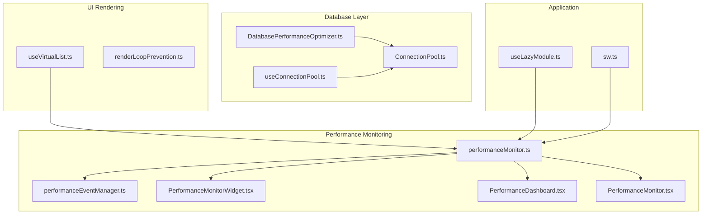
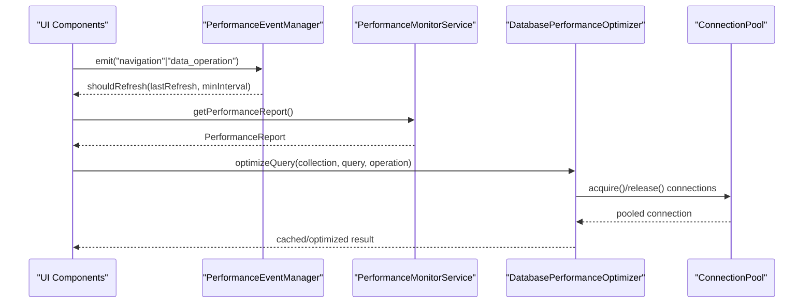
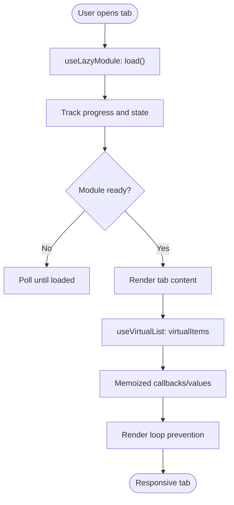
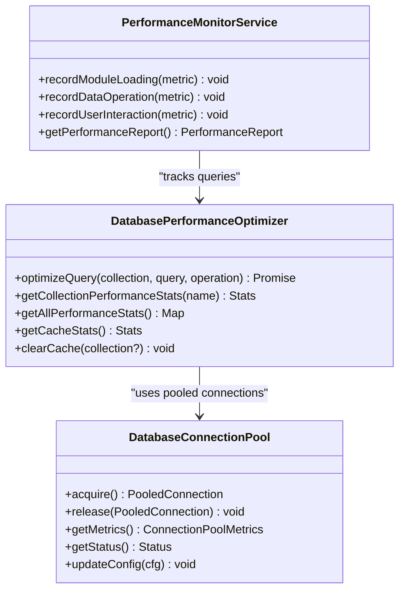
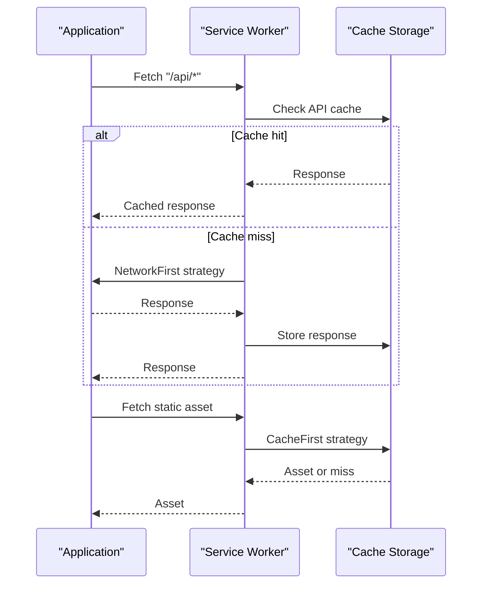
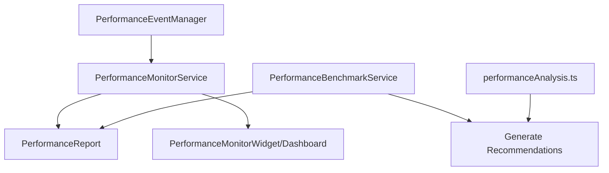
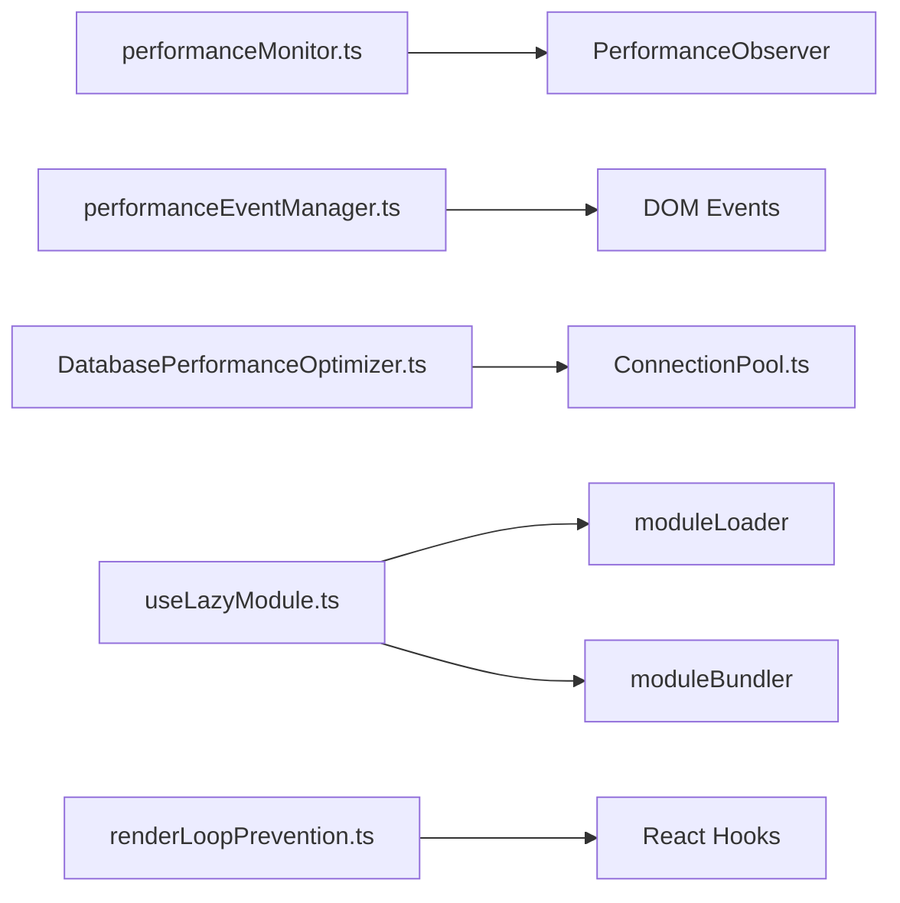

# Performance Optimization

<cite>
**Referenced Files in This Document**
- [useVirtualList.ts](file://src/hooks/useVirtualList.ts)
- [DatabasePerformanceOptimizer.ts](file://src/services/database/performance/DatabasePerformanceOptimizer.ts)
- [performanceBenchmark.ts](file://src/services/performance/performanceBenchmark.ts)
- [performanceMonitor.ts](file://src/services/performance/performanceMonitor.ts)
- [performanceEventManager.ts](file://src/services/performance/performanceEventManager.ts)
- [PerformanceMonitor.tsx](file://src/components/PerformanceMonitor.tsx)
- [PerformanceDashboard.tsx](file://src/components/PerformanceDashboard.tsx)
- [PerformanceMonitorWidget.tsx](file://src/components/PerformanceMonitorWidget.tsx)
- [useLazyModule.ts](file://src/hooks/useLazyModule.ts)
- [useConnectionPool.ts](file://src/hooks/useConnectionPool.ts)
- [ConnectionPool.ts](file://src/services/database/ConnectionPool.ts)
- [renderLoopPrevention.ts](file://src/utils/renderLoopPrevention.ts)
- [sw.ts](file://src/sw.ts)
- [task-6.3-performance-benchmarking-workflow.md](file://docs/workflows/task-6.3-performance-benchmarking-workflow.md)
- [performanceAnalysis.ts](file://src/utils/performanceAnalysis.ts)
</cite>

## Table of Contents
1. [Introduction](#introduction)
2. [Project Structure](#project-structure)
3. [Core Components](#core-components)
4. [Architecture Overview](#architecture-overview)
5. [Detailed Component Analysis](#detailed-component-analysis)
6. [Dependency Analysis](#dependency-analysis)
7. [Performance Considerations](#performance-considerations)
8. [Troubleshooting Guide](#troubleshooting-guide)
9. [Conclusion](#conclusion)

## Introduction
This document details SchoolPilot3’s performance optimization strategies across three major domains:
- Tabbed workspace optimizations: lazy loading, memoization, virtual scrolling, and render loop prevention
- Database performance: connection pooling, query caching, indexed queries, and batch operations
- General application optimizations: code splitting, tree shaking, asset optimization, and service worker caching
It also covers performance monitoring, benchmarking, and profiling approaches used throughout the system.

## Project Structure
SchoolPilot3 organizes performance-related capabilities across services, hooks, components, and utilities:
- Services: performance monitoring, benchmarking, database performance optimizer, connection pooling
- Hooks: lazy module loading, connection pool monitoring, virtual list rendering
- Components: performance monitor widgets and dashboards
- Utilities: render loop prevention helpers and analysis tools
- Build/runtime: service worker caching strategies

**Diagram sources**
- [performanceMonitor.ts:1-316](file://src/services/performance/performanceMonitor.ts#L1-L316)
- [performanceEventManager.ts:1-211](file://src/services/performance/performanceEventManager.ts#L1-L211)
- [PerformanceMonitorWidget.tsx:1-247](file://src/components/PerformanceMonitorWidget.tsx#L1-L247)
- [PerformanceDashboard.tsx:1-383](file://src/components/PerformanceDashboard.tsx#L1-L383)
- [PerformanceMonitor.tsx:1-311](file://src/components/PerformanceMonitor.tsx#L1-L311)
- [DatabasePerformanceOptimizer.ts:1-598](file://src/services/database/performance/DatabasePerformanceOptimizer.ts#L1-L598)
- [ConnectionPool.ts:1-434](file://src/services/database/ConnectionPool.ts#L1-L434)
- [useConnectionPool.ts:1-100](file://src/hooks/useConnectionPool.ts#L1-L100)
- [useVirtualList.ts:1-210](file://src/hooks/useVirtualList.ts#L1-L210)
- [renderLoopPrevention.ts:1-550](file://src/utils/renderLoopPrevention.ts#L1-L550)
- [useLazyModule.ts:1-389](file://src/hooks/useLazyModule.ts#L1-L389)
- [sw.ts:40-97](file://src/sw.ts#L40-L97)

**Section sources**
- [performanceMonitor.ts:1-316](file://src/services/performance/performanceMonitor.ts#L1-L316)
- [performanceEventManager.ts:1-211](file://src/services/performance/performanceEventManager.ts#L1-L211)
- [DatabasePerformanceOptimizer.ts:1-598](file://src/services/database/performance/DatabasePerformanceOptimizer.ts#L1-L598)
- [ConnectionPool.ts:1-434](file://src/services/database/ConnectionPool.ts#L1-L434)
- [useConnectionPool.ts:1-100](file://src/hooks/useConnectionPool.ts#L1-L100)
- [useVirtualList.ts:1-210](file://src/hooks/useVirtualList.ts#L1-L210)
- [renderLoopPrevention.ts:1-550](file://src/utils/renderLoopPrevention.ts#L1-L550)
- [useLazyModule.ts:1-389](file://src/hooks/useLazyModule.ts#L1-L389)
- [sw.ts:40-97](file://src/sw.ts#L40-L97)

## Core Components
- PerformanceMonitorService: collects startup, module loading, data operation, and interaction metrics; exposes averages and memory usage
- PerformanceEventManager: coordinates event-driven updates to avoid aggressive polling
- DatabasePerformanceOptimizer: query caching, slow-query detection, auto-index suggestions, and maintenance scheduling
- DatabaseConnectionPool: connection lifecycle management, pooling, and metrics
- useVirtualList: virtualized list rendering with dynamic heights and overscan
- renderLoopPrevention: utilities to prevent render loops and stabilize callbacks/values
- useLazyModule: lazy loading with preloading, progress tracking, and batch loading
- Service Worker caching: network-first for pages/APIs, cache-first for assets, expiration policies

**Section sources**
- [performanceMonitor.ts:1-316](file://src/services/performance/performanceMonitor.ts#L1-L316)
- [performanceEventManager.ts:1-211](file://src/services/performance/performanceEventManager.ts#L1-L211)
- [DatabasePerformanceOptimizer.ts:1-598](file://src/services/database/performance/DatabasePerformanceOptimizer.ts#L1-L598)
- [ConnectionPool.ts:1-434](file://src/services/database/ConnectionPool.ts#L1-L434)
- [useVirtualList.ts:1-210](file://src/hooks/useVirtualList.ts#L1-L210)
- [renderLoopPrevention.ts:1-550](file://src/utils/renderLoopPrevention.ts#L1-L550)
- [useLazyModule.ts:1-389](file://src/hooks/useLazyModule.ts#L1-L389)
- [sw.ts:40-97](file://src/sw.ts#L40-L97)

## Architecture Overview
The performance architecture centers on event-driven updates and modular optimization:
- Components subscribe to performance events and update only on relevant triggers
- Database operations are optimized via caching and auto-indexing
- UI rendering leverages virtualization and memoization
- Lazy loading reduces initial payload and improves perceived performance

**Diagram sources**
- [performanceEventManager.ts:139-149](file://src/services/performance/performanceEventManager.ts#L139-L149)
- [performanceMonitor.ts:169-205](file://src/services/performance/performanceMonitor.ts#L169-L205)
- [DatabasePerformanceOptimizer.ts:90-143](file://src/services/database/performance/DatabasePerformanceOptimizer.ts#L90-L143)
- [ConnectionPool.ts:105-158](file://src/services/database/ConnectionPool.ts#L105-L158)

## Detailed Component Analysis

### Tabbed Workspace Optimizations
SchoolPilot3 employs several strategies to keep tabbed navigation responsive:
- Lazy loading: modules are loaded on demand with preloading and progress tracking
- Memoization: stable callbacks and values reduce unnecessary re-renders
- Virtual scrolling: only visible items are rendered in large lists
- Render loop prevention: guards and debounced refs to avoid infinite loops

**Diagram sources**
- [useLazyModule.ts:67-124](file://src/hooks/useLazyModule.ts#L67-L124)
- [useVirtualList.ts:51-208](file://src/hooks/useVirtualList.ts#L51-L208)
- [renderLoopPrevention.ts:87-126](file://src/utils/renderLoopPrevention.ts#L87-L126)
- [renderLoopPrevention.ts:224-295](file://src/utils/renderLoopPrevention.ts#L224-L295)

**Section sources**
- [useLazyModule.ts:1-389](file://src/hooks/useLazyModule.ts#L1-L389)
- [useVirtualList.ts:1-210](file://src/hooks/useVirtualList.ts#L1-L210)
- [renderLoopPrevention.ts:1-550](file://src/utils/renderLoopPrevention.ts#L1-L550)

### Database Performance Optimizations
Database performance is handled through:
- Connection pooling: lifecycle management, metrics, and health checks
- Query caching: configurable TTL, eviction policy, and cache hit reporting
- Indexed queries: auto-suggestion of indexes for slow queries
- Batch operations: batch loading of modules and chunked module loading

**Diagram sources**
- [ConnectionPool.ts:52-434](file://src/services/database/ConnectionPool.ts#L52-L434)
- [DatabasePerformanceOptimizer.ts:48-598](file://src/services/database/performance/DatabasePerformanceOptimizer.ts#L48-L598)
- [performanceMonitor.ts:49-316](file://src/services/performance/performanceMonitor.ts#L49-L316)

**Section sources**
- [ConnectionPool.ts:1-434](file://src/services/database/ConnectionPool.ts#L1-L434)
- [DatabasePerformanceOptimizer.ts:1-598](file://src/services/database/performance/DatabasePerformanceOptimizer.ts#L1-L598)
- [useConnectionPool.ts:1-100](file://src/hooks/useConnectionPool.ts#L1-L100)

### General Application Optimizations
- Code splitting and lazy loading: implemented via useLazyModule and module bundler
- Tree shaking: configured via build tooling (refer to Vite configuration)
- Asset optimization: service worker caching with cache-first for static assets and network-first for API
- Performance monitoring: widgets and dashboards driven by event manager

**Diagram sources**
- [sw.ts:40-97](file://src/sw.ts#L40-L97)

**Section sources**
- [useLazyModule.ts:1-389](file://src/hooks/useLazyModule.ts#L1-L389)
- [sw.ts:40-97](file://src/sw.ts#L40-L97)
- [PerformanceMonitorWidget.tsx:1-247](file://src/components/PerformanceMonitorWidget.tsx#L1-L247)
- [PerformanceDashboard.tsx:1-383](file://src/components/PerformanceDashboard.tsx#L1-L383)

### Performance Monitoring, Benchmarking, and Profiling
- PerformanceMonitorService aggregates metrics and computes averages
- PerformanceEventManager coordinates updates to avoid frequent refreshes
- PerformanceBenchmarkService manages baselines, comparisons, and regression detection
- PerformanceMonitor components provide real-time dashboards and widgets

**Diagram sources**
- [performanceMonitor.ts:169-205](file://src/services/performance/performanceMonitor.ts#L169-L205)
- [performanceEventManager.ts:171-207](file://src/services/performance/performanceEventManager.ts#L171-L207)
- [performanceBenchmark.ts:86-672](file://src/services/performance/performanceBenchmark.ts#L86-L672)
- [performanceAnalysis.ts:284-327](file://src/utils/performanceAnalysis.ts#L284-L327)

**Section sources**
- [performanceMonitor.ts:1-316](file://src/services/performance/performanceMonitor.ts#L1-L316)
- [performanceEventManager.ts:1-211](file://src/services/performance/performanceEventManager.ts#L1-L211)
- [performanceBenchmark.ts:1-672](file://src/services/performance/performanceBenchmark.ts#L1-L672)
- [PerformanceMonitor.tsx:1-311](file://src/components/PerformanceMonitor.tsx#L1-L311)
- [PerformanceDashboard.tsx:1-383](file://src/components/PerformanceDashboard.tsx#L1-L383)
- [PerformanceMonitorWidget.tsx:1-247](file://src/components/PerformanceMonitorWidget.tsx#L1-L247)
- [performanceAnalysis.ts:284-327](file://src/utils/performanceAnalysis.ts#L284-L327)
- [task-6.3-performance-benchmarking-workflow.md:324-374](file://docs/workflows/task-6.3-performance-benchmarking-workflow.md#L324-L374)

## Dependency Analysis
Key dependencies and their roles:
- PerformanceMonitorService depends on PerformanceObserver for navigation/resource timings
- PerformanceEventManager listens to DOM events and emits performance events
- DatabasePerformanceOptimizer integrates with ConnectionPool for connection reuse
- useLazyModule coordinates with module loader and bundler for chunked loading
- renderLoopPrevention utilities integrate with React hooks for stability

**Diagram sources**
- [performanceMonitor.ts:64-111](file://src/services/performance/performanceMonitor.ts#L64-L111)
- [performanceEventManager.ts:32-95](file://src/services/performance/performanceEventManager.ts#L32-L95)
- [DatabasePerformanceOptimizer.ts:48-598](file://src/services/database/performance/DatabasePerformanceOptimizer.ts#L48-L598)
- [ConnectionPool.ts:52-434](file://src/services/database/ConnectionPool.ts#L52-L434)
- [useLazyModule.ts:1-389](file://src/hooks/useLazyModule.ts#L1-L389)
- [renderLoopPrevention.ts:1-550](file://src/utils/renderLoopPrevention.ts#L1-L550)

**Section sources**
- [performanceMonitor.ts:1-316](file://src/services/performance/performanceMonitor.ts#L1-L316)
- [performanceEventManager.ts:1-211](file://src/services/performance/performanceEventManager.ts#L1-L211)
- [DatabasePerformanceOptimizer.ts:1-598](file://src/services/database/performance/DatabasePerformanceOptimizer.ts#L1-L598)
- [ConnectionPool.ts:1-434](file://src/services/database/ConnectionPool.ts#L1-L434)
- [useLazyModule.ts:1-389](file://src/hooks/useLazyModule.ts#L1-L389)
- [renderLoopPrevention.ts:1-550](file://src/utils/renderLoopPrevention.ts#L1-L550)

## Performance Considerations
- Minimize re-renders: use stable callbacks/values and memoization
- Prefer virtualization for large lists
- Use lazy loading for non-critical modules
- Leverage caching (query cache, service worker) and connection pooling
- Monitor performance continuously with event-driven updates and dashboards
- Keep benchmarking overhead low and automate regression detection

[No sources needed since this section provides general guidance]

## Troubleshooting Guide
Common issues and mitigations:
- Render loops: use render loop prevention utilities and guards
- Excessive refreshes: rely on PerformanceEventManager’s shouldRefresh to throttle updates
- Slow database queries: review slow-query logs and auto-index suggestions
- Connection pool saturation: adjust pool size and timeouts; monitor utilization

**Section sources**
- [renderLoopPrevention.ts:1-550](file://src/utils/renderLoopPrevention.ts#L1-L550)
- [performanceEventManager.ts:139-149](file://src/services/performance/performanceEventManager.ts#L139-L149)
- [DatabasePerformanceOptimizer.ts:272-280](file://src/services/database/performance/DatabasePerformanceOptimizer.ts#L272-L280)
- [ConnectionPool.ts:373-392](file://src/services/database/ConnectionPool.ts#L373-L392)

## Conclusion
SchoolPilot3’s performance strategy combines event-driven monitoring, modular lazy loading, virtualized rendering, and robust database optimizations. The system’s service worker caching, benchmarking, and profiling tools provide continuous insight into performance trends and regressions, enabling proactive optimization.