# Plugin Architecture Overview

<cite>
**Referenced Files in This Document**
- [BuiltinLoader.ts](file://src/plugins/BuiltinLoader.ts)
- [types.ts](file://src/plugins/types.ts)
- [PluginManager.ts](file://src/plugins/PluginManager.ts)
- [PluginsProvider.tsx](file://src/plugins/PluginsProvider.tsx)
- [usePlugins.ts](file://src/plugins/usePlugins.ts)
- [PLUGIN_ARCHITECTURE_SPEC.md](file://docs/architecture/PLUGIN_ARCHITECTURE_SPEC.md)
- [PluginMarketplace.ts](file://src/services/PluginMarketplace.ts)
- [PluginSandbox.ts](file://src/utils/PluginSandbox.ts)
- [PluginSettingsPage.tsx](file://src/modules/settings/pages/PluginSettingsPage.tsx)
- [plugin-dev-guide.md](file://docs/guides/plugin-dev-guide.md)
- [PLUGIN_DEVELOPMENT_MANUAL.md](file://docs/guides/PLUGIN_DEVELOPMENT_MANUAL.md)
- [index.ts](file://src/plugins/index.ts)
</cite>

## Update Summary
**Changes Made**
- Added comprehensive documentation for the new BuiltinLoader service and automatic plugin discovery system
- Updated architecture overview to reflect the major architectural overhaul with enhanced security model
- Expanded marketplace integration documentation with new marketplace key management and installation tracking
- Enhanced security model documentation with detailed sandbox tier configuration and privilege management
- Updated plugin lifecycle management to include automatic builtin plugin loading
- Added comprehensive plugin architecture specification with new type definitions and security features

## Table of Contents
1. [Introduction](#introduction)
2. [Architecture Overview](#architecture-overview)
3. [Core Components](#core-components)
4. [Plugin Types and Categories](#plugin-types-and-categories)
5. [Automatic Plugin Discovery System](#automatic-plugin-discovery-system)
6. [Plugin Lifecycle Management](#plugin-lifecycle-management)
7. [Hook System](#hook-system)
8. [Enhanced Security Model](#enhanced-security-model)
9. [Marketplace Integration](#marketplace-integration)
10. [React Integration](#react-integration)
11. [Development Guidelines](#development-guidelines)
12. [Troubleshooting Guide](#troubleshooting-guide)
13. [Conclusion](#conclusion)

## Introduction

SchoolPilot3 implements a comprehensive plugin architecture that enables extensibility, customization, and integration with external systems. This architecture provides a robust foundation for extending the application's functionality through modular plugins while maintaining security, performance, and maintainability standards.

The plugin system has undergone a major architectural overhaul featuring automatic plugin discovery, enhanced security model, and comprehensive marketplace integration. The system now supports seven distinct plugin types, from simple UI extensions to complex computational engines, with built-in security mechanisms, marketplace integration, and administrative controls.

## Architecture Overview

The plugin architecture follows a layered design pattern with clear separation of concerns and automatic plugin discovery:

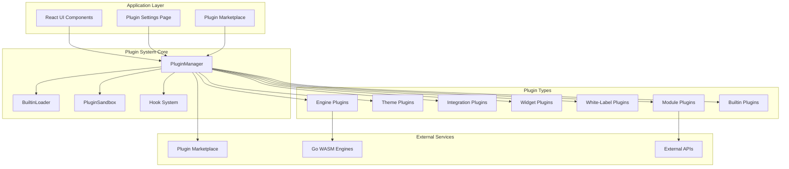

**Diagram sources**
- [PluginManager.ts:25-765](file://src/plugins/PluginManager.ts#L25-L765)
- [BuiltinLoader.ts:1-83](file://src/plugins/BuiltinLoader.ts#L1-L83)
- [PluginSandbox.ts:113-502](file://src/utils/PluginSandbox.ts#L113-L502)
- [PluginMarketplace.ts:70-762](file://src/services/PluginMarketplace.ts#L70-L762)

The architecture consists of several key layers:

1. **Application Layer**: React components, user interfaces, and marketplace integration
2. **Plugin System Core**: Central management, automatic discovery, and orchestration
3. **Plugin Types**: Different categories of plugins with specific capabilities
4. **External Services**: Marketplace, engines, and third-party integrations

## Core Components

### PluginManager - Central Orchestrator

The `PluginManager` serves as the central orchestrator for all plugin operations, handling lifecycle management, dependency resolution, and plugin coordination with enhanced security features.

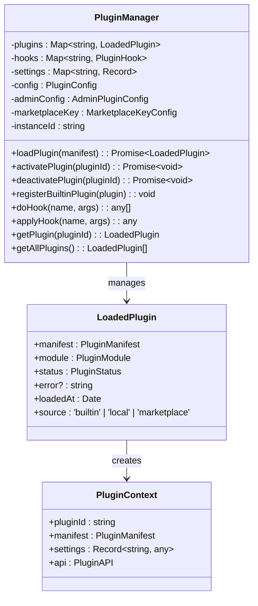

**Diagram sources**
- [PluginManager.ts:25-765](file://src/plugins/PluginManager.ts#L25-L765)
- [types.ts:211-235](file://src/plugins/types.ts#L211-L235)
- [types.ts:230-235](file://src/plugins/types.ts#L230-L235)

**Section sources**
- [PluginManager.ts:25-765](file://src/plugins/PluginManager.ts#L25-L765)
- [types.ts:211-235](file://src/plugins/types.ts#L211-L235)

### BuiltinLoader - Automatic Plugin Discovery

The `BuiltinLoader` provides automatic discovery and loading of builtin plugins from the `/src/plugins/builtin/` directory, serving as the foundation for the new plugin discovery system.

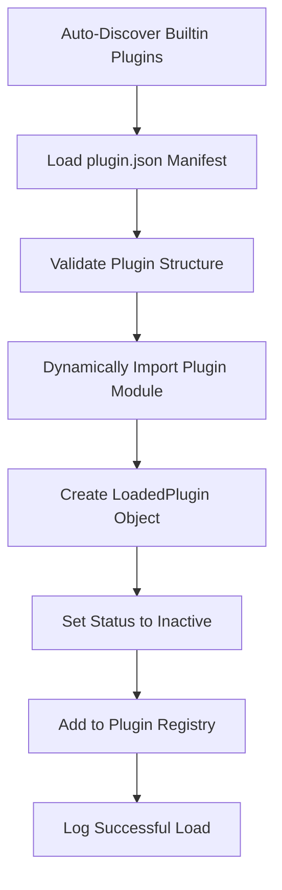

**Diagram sources**
- [BuiltinLoader.ts:28-54](file://src/plugins/BuiltinLoader.ts#L28-L54)

**Section sources**
- [BuiltinLoader.ts:1-83](file://src/plugins/BuiltinLoader.ts#L1-L83)

## Plugin Types and Categories

The system supports seven distinct plugin types, each designed for specific use cases, with enhanced categorization for security and trust levels:

| Plugin Type | Purpose | Examples | Security Category |
|-------------|---------|----------|-------------------|
| `module` | Full feature modules | Advanced grading, finance systems | Verified/Private |
| `theme` | Visual customization | Dark/light themes, custom styling | Verified/Private |
| `integration` | External service connections | Payment gateways, API integrations | Verified/Private |
| `report` | Custom reporting | Transcript generators, analytics | Verified/Private |
| `widget` | Dashboard components | KPI cards, charts | Verified/Private |
| `whitelabel` | Branding customization | Logo replacement, color schemes | Verified/Private |
| `engine` | Computation engines | Go WASM calculators | Engine |

**Section sources**
- [types.ts:14-21](file://src/plugins/types.ts#L14-L21)
- [types.ts:23-28](file://src/plugins/types.ts#L23-L28)

### Enhanced Plugin Manifest System

Every plugin must define a comprehensive manifest that describes its identity, capabilities, and requirements with enhanced marketplace and security metadata:

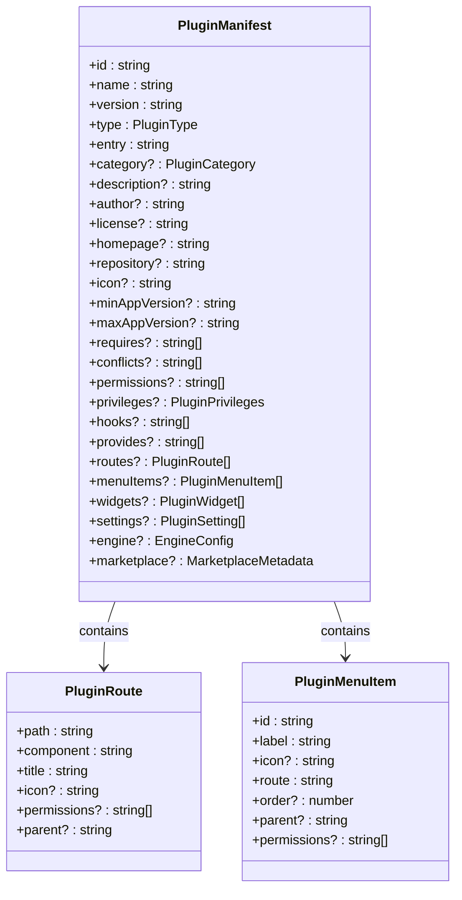

**Diagram sources**
- [types.ts:60-111](file://src/plugins/types.ts#L60-L111)
- [types.ts:165-182](file://src/plugins/types.ts#L165-L182)

**Section sources**
- [types.ts:60-111](file://src/plugins/types.ts#L60-L111)
- [types.ts:165-182](file://src/plugins/types.ts#L165-L182)

## Automatic Plugin Discovery System

The new automatic plugin discovery system provides seamless builtin plugin loading with enhanced security and configuration management:

### Builtin Plugin Directory Structure

The system automatically discovers plugins from predefined directories:

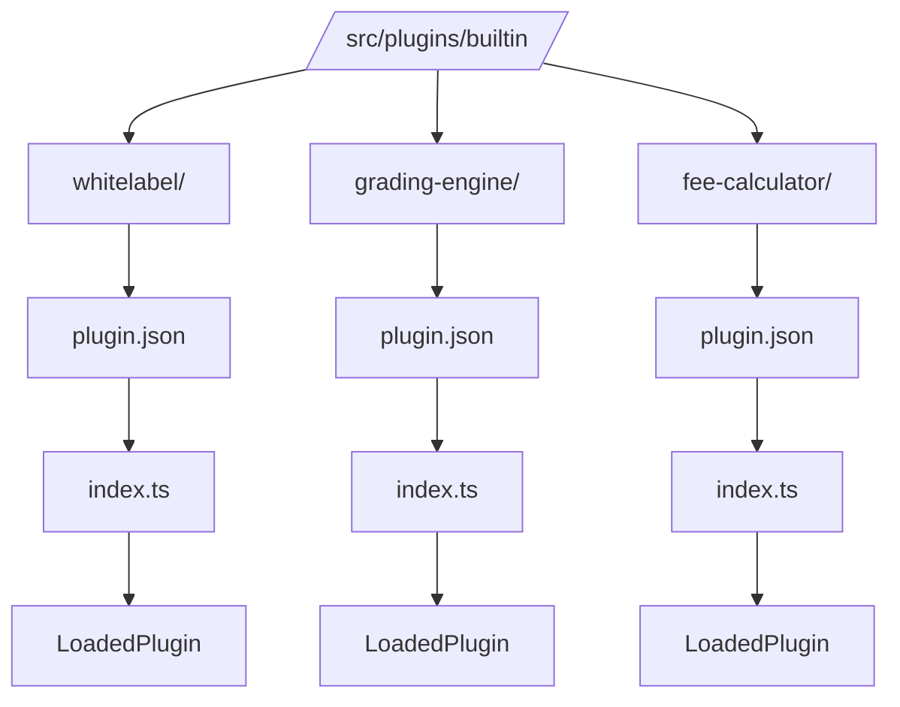

**Diagram sources**
- [BuiltinLoader.ts:19-23](file://src/plugins/BuiltinLoader.ts#L19-L23)

### Discovery Process

The discovery process follows a structured workflow:

1. **Directory Enumeration**: Scan predefined builtin plugin directories
2. **Manifest Loading**: Load plugin.json from each discovered directory
3. **Module Validation**: Verify plugin module structure and exports
4. **Security Assessment**: Evaluate plugin category and trust level
5. **Dynamic Import**: Safely import plugin module with sandboxing
6. **Registry Registration**: Register loaded plugins with PluginManager

**Section sources**
- [BuiltinLoader.ts:19-82](file://src/plugins/BuiltinLoader.ts#L19-L82)

## Plugin Lifecycle Management

The plugin lifecycle follows a structured flow from automatic discovery to deactivation with enhanced security:

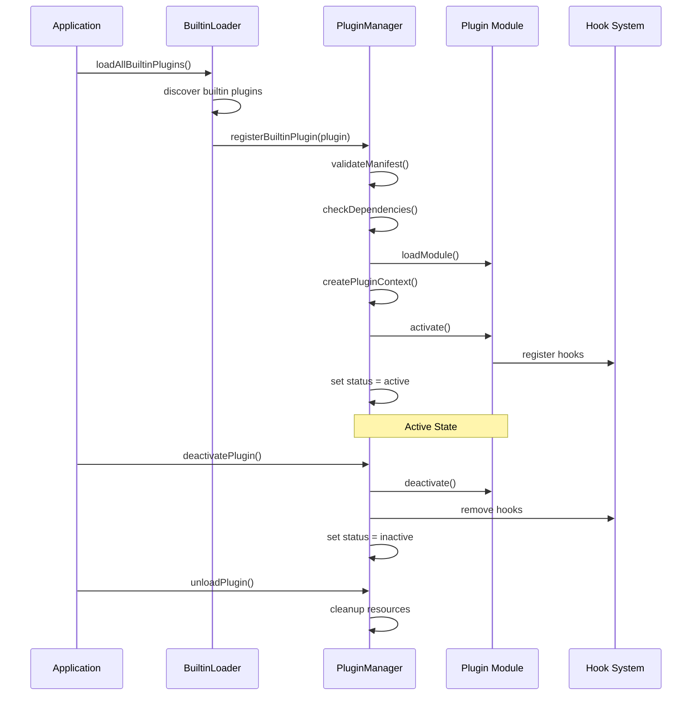

**Diagram sources**
- [BuiltinLoader.ts:60-75](file://src/plugins/BuiltinLoader.ts#L60-L75)
- [PluginManager.ts:234-373](file://src/plugins/PluginManager.ts#L234-L373)

The lifecycle includes six main states:
- **Unloaded**: Plugin registered but not loaded
- **Loaded**: Manifest loaded, module not yet activated
- **Active**: Fully functional with hooks registered
- **Inactive**: Deactivated but still loaded
- **Installing**: In process of marketplace installation
- **Updating**: In process of plugin updates
- **Error**: Failed during loading/activation

**Section sources**
- [PluginManager.ts:303-373](file://src/plugins/PluginManager.ts#L303-L373)
- [types.ts:436-436](file://src/plugins/types.ts#L436-L436)

## Hook System

The hook system provides a powerful mechanism for plugins to extend application functionality without direct coupling with enhanced security measures:

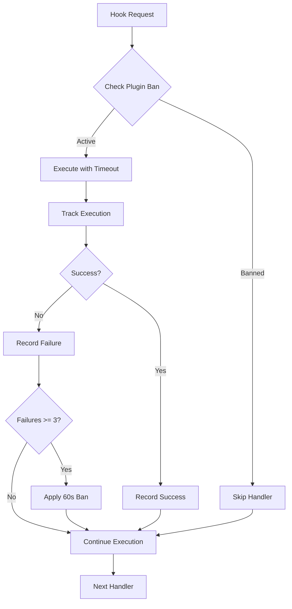

**Diagram sources**
- [PluginManager.ts:416-487](file://src/plugins/PluginManager.ts#L416-L487)

### Enhanced Hook Types and Behavior

| Hook Type | Execution | Return Behavior | Use Case | Security Level |
|-----------|-----------|-----------------|----------|----------------|
| `action` | Synchronous | Void | Side effects, logging | Low Risk |
| `filter` | Synchronous | Modified data | Data transformation | Medium Risk |
| `async` | Asynchronous | Promise | Async operations | High Risk |

**Section sources**
- [PluginManager.ts:416-487](file://src/plugins/PluginManager.ts#L416-L487)
- [types.ts:413-430](file://src/plugins/types.ts#L413-L430)

## Enhanced Security Model

The plugin system implements a comprehensive multi-layered security approach with tiered sandboxing and privilege management:

```mermaid
graph LR
subgraph "Trust Levels"
TRUSTED[Trusted<br/>Builtin Plugins]
VERIFIED[Verified<br/>Marketplace Plugins]
COMMUNITY[Community<br/>Third-party Plugins]
END
subgraph "Security Measures"
SANDBOX[Sandbox Environment]
TIMEOUT[Execution Timeout]
VALIDATION[Code Validation]
PRIVILEGES[Permission Control]
EVENTS[Event Tracking]
end
TRUSTED --> SANDBOX
VERIFIED --> SANDBOX
COMMUNITY --> SANDBOX
SANDBOX --> TIMEOUT
SANDBOX --> VALIDATION
SANDBOX --> PRIVILEGES
SANDBOX --> EVENTS
```

**Diagram sources**
- [PluginSandbox.ts:113-502](file://src/utils/PluginSandbox.ts#L113-L502)
- [PluginManager.ts:37-41](file://src/plugins/PluginManager.ts#L37-L41)

### Enhanced Sandbox Configuration Matrix

| Trust Level | Execution Environment | Timeout | Allowed Globals | Blocked Globals | Privilege Preset |
|-------------|----------------------|---------|-----------------|-----------------|------------------|
| Trusted | Direct execution | 5000ms | All | None | Strict |
| Verified | Proxy-sandboxed iframe | 2000ms | Limited | localStorage, fetch | Balanced |
| Community | Web Worker | 1000ms | Basic | eval, Proxy, Reflect | Permissive |

### Enhanced Plugin Privileges

The system introduces granular privilege control with three preset configurations:

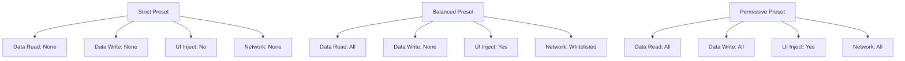

**Diagram sources**
- [PluginSandbox.ts:35-66](file://src/utils/PluginSandbox.ts#L35-L66)

**Section sources**
- [PluginSandbox.ts:72-107](file://src/utils/PluginSandbox.ts#L72-L107)
- [PluginSandbox.ts:450-486](file://src/utils/PluginSandbox.ts#L450-L486)

## Marketplace Integration

The marketplace system provides secure plugin distribution and management with enhanced key validation and installation tracking:

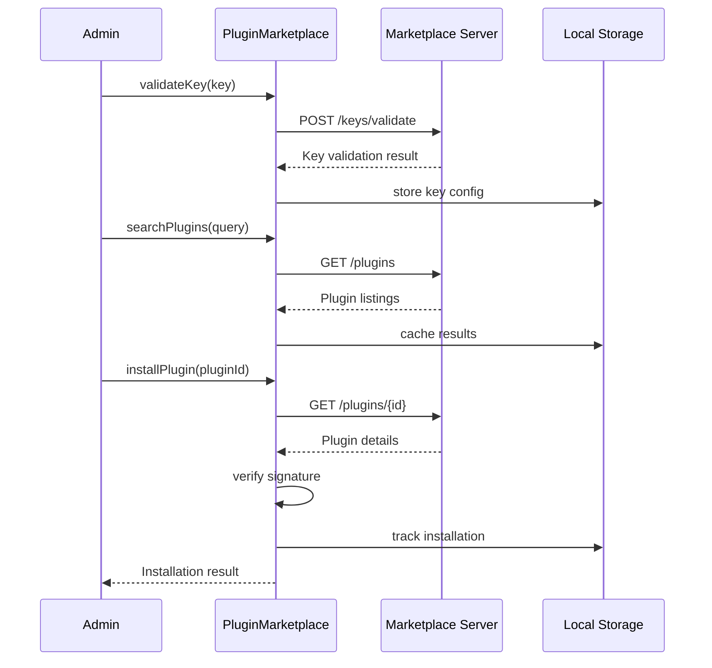

**Diagram sources**
- [PluginMarketplace.ts:107-152](file://src/services/PluginMarketplace.ts#L107-L152)
- [PluginMarketplace.ts:239-284](file://src/services/PluginMarketplace.ts#L239-L284)
- [PluginMarketplace.ts:401-473](file://src/services/PluginMarketplace.ts#L401-L473)

### Enhanced Marketplace Key Management

The system implements comprehensive key validation with offline fallback capabilities:

| Key Type | Format | Permissions | Limitations |
|----------|--------|-------------|-------------|
| Free | `sp3_free_<random>_<checksum>` | Limited plugins, basic access | 5 plugins max |
| Standard | `sp3_standard_<random>_<checksum>` | Up to 25 plugins, paid access | $0.99/month |
| Enterprise | `sp3_enterprise_<random>_<checksum>` | Unlimited plugins, priority support | Custom pricing |

### Installation Tracking and Analytics

The marketplace tracks plugin installations with comprehensive metadata:

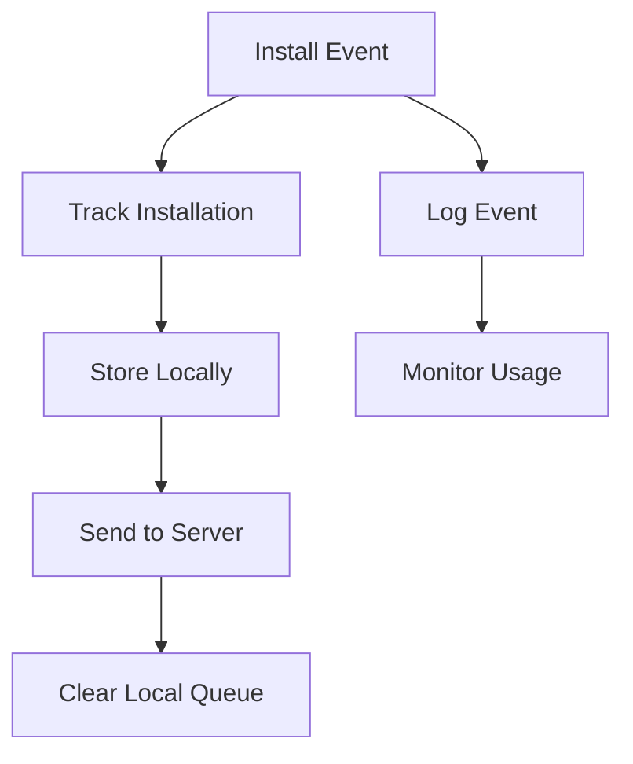

**Diagram sources**
- [PluginMarketplace.ts:528-567](file://src/services/PluginMarketplace.ts#L528-L567)

**Section sources**
- [PluginMarketplace.ts:70-762](file://src/services/PluginMarketplace.ts#L70-L762)

## React Integration

The plugin system integrates seamlessly with React through context providers and hooks with enhanced automatic discovery:

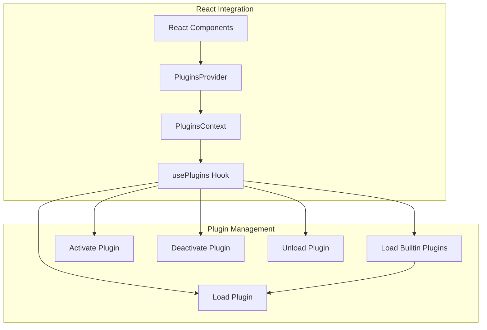

**Diagram sources**
- [PluginsProvider.tsx:35-68](file://src/plugins/PluginsProvider.tsx#L35-L68)
- [usePlugins.ts:40-99](file://src/plugins/usePlugins.ts#L40-L99)

### Enhanced Plugin Provider

The PluginsProvider now includes automatic builtin plugin loading:

**Section sources**
- [PluginsProvider.tsx:17-68](file://src/plugins/PluginsProvider.tsx#L17-L68)
- [usePlugins.ts:40-99](file://src/plugins/usePlugins.ts#L40-L99)

## Development Guidelines

### Plugin Structure Best Practices

1. **Directory Organization**: Maintain clear separation between components, utilities, and assets
2. **Manifest Completeness**: Include all required metadata and capability declarations
3. **Security Considerations**: Request only necessary permissions and validate inputs
4. **Error Handling**: Implement robust error handling and graceful degradation
5. **Testing**: Provide comprehensive unit and integration tests
6. **Documentation**: Include comprehensive README and usage examples

### Development Workflow

```mermaid
flowchart LR
Setup[Setup Development Environment] --> Create[Create Plugin Structure]
Create --> Manifest[Define Plugin Manifest]
Manifest --> Implement[Implement Plugin Logic]
Implement --> Test[Test Plugin Functionality]
Test --> Package[Package Plugin]
Package --> Sign[Sign Plugin Package]
Sign --> Publish[Publish to Marketplace]
Publish --> Monitor[Monitor Plugin Performance]
```

**Section sources**
- [plugin-dev-guide.md:1-42](file://docs/guides/plugin-dev-guide.md#L1-L42)
- [PLUGIN_DEVELOPMENT_MANUAL.md:28-78](file://docs/guides/PLUGIN_DEVELOPMENT_MANUAL.md#L28-L78)

## Troubleshooting Guide

### Common Issues and Solutions

| Issue | Symptoms | Solution |
|-------|----------|----------|
| Plugin fails to load | Error in console, plugin shows error state | Check manifest validity, verify dependencies |
| Plugin activates but no hooks work | Hooks not registered | Verify hook registration in activate() |
| Performance issues | Slow UI, timeouts | Check execution timeouts, optimize heavy operations |
| Security violations | Blocked by sandbox | Review requested permissions, use allowed globals only |
| Marketplace key invalid | Installation blocked | Validate key format, check expiration date |
| Automatic discovery fails | Builtin plugins not loading | Verify plugin.json structure, check directory paths |

### Debugging Tools

1. **Plugin Status Monitoring**: Use `getPlugin(pluginId)` to inspect plugin state
2. **Hook Execution Logs**: Monitor hook execution through console output
3. **Performance Profiling**: Analyze plugin execution times and resource usage
4. **Error Tracking**: Implement comprehensive error handling and reporting
5. **Marketplace Connectivity**: Test marketplace key validation and API access

**Section sources**
- [PluginManager.ts:528-544](file://src/plugins/PluginManager.ts#L528-L544)
- [PluginSettingsPage.tsx:73-106](file://src/modules/settings/pages/PluginSettingsPage.tsx#L73-L106)

## Conclusion

SchoolPilot3's enhanced plugin architecture provides a robust, secure, and extensible foundation for building modular educational applications. The system successfully addresses the challenge of creating a flexible educational platform while maintaining security, performance, and maintainability standards essential for educational environments.

Key strengths of the enhanced architecture include:

- **Security-First Design**: Multi-level sandboxing prevents malicious code execution
- **Automatic Discovery**: Seamless builtin plugin loading reduces manual configuration
- **Comprehensive Hook System**: Enhanced security with timeout and circuit breaker protection
- **Marketplace Integration**: Secure distribution with key validation and installation tracking
- **Administrative Control**: Fine-grained permissions and configuration options
- **Enhanced Developer Experience**: Clear APIs, comprehensive documentation, and automated discovery
- **Tiered Trust Model**: Different security levels based on plugin source and category
- **Privilege Management**: Granular control over plugin capabilities and access rights

The architecture successfully balances flexibility with security through its comprehensive sandboxing, enhanced hook system, automatic discovery, and marketplace integration, providing a solid foundation for future plugin ecosystem growth.