# Plugin System Architecture

<cite>
**Referenced Files in This Document**
- [index.ts](file://src/plugins/index.ts)
- [types.ts](file://src/plugins/types.ts)
- [PluginManager.ts](file://src/plugins/PluginManager.ts)
- [PluginHookSystem.ts](file://src/plugins/PluginHookSystem.ts)
- [PluginEventSystem.ts](file://src/plugins/PluginEventSystem.ts)
- [PluginSecuritySandbox.ts](file://src/plugins/PluginSecuritySandbox.ts)
- [BuiltinLoader.ts](file://src/plugins/BuiltinLoader.ts)
- [PluginsProvider.tsx](file://src/plugins/PluginsProvider.tsx)
- [usePlugins.ts](file://src/plugins/usePlugins.ts)
- [PluginSettingsManager.ts](file://src/plugins/PluginSettingsManager.ts)
- [whitelabel/index.ts](file://src/plugins/builtin/whitelabel/index.ts)
- [grading-engine/index.ts](file://src/plugins/builtin/grading-engine/index.ts)
- [PLUGIN_ARCHITECTURE_SPEC.md](file://docs/architecture/PLUGIN_ARCHITECTURE_SPEC.md)
- [plugin-dev-guide.md](file://docs/guides/plugin-dev-guide.md)
</cite>

## Table of Contents
1. [Introduction](#introduction)
2. [Project Structure](#project-structure)
3. [Core Components](#core-components)
4. [Architecture Overview](#architecture-overview)
5. [Detailed Component Analysis](#detailed-component-analysis)
6. [Dependency Analysis](#dependency-analysis)
7. [Performance Considerations](#performance-considerations)
8. [Troubleshooting Guide](#troubleshooting-guide)
9. [Conclusion](#conclusion)
10. [Appendices](#appendices)

## Introduction
This document describes SchoolPilot3's plugin architecture system, covering plugin lifecycle management, built-in plugin discovery, marketplace integration, tiered sandboxing security model, plugin types, hook system, permission-based access control, and security measures such as circuit breakers, code validation, and timeout protection. It also provides practical examples of plugin development, registration, and integration patterns.

## Project Structure
The plugin system is organized around a core manager, subsystems for hooks, events, settings, and security, and a provider for React integration. Built-in plugins are auto-discovered and loaded from a dedicated directory.

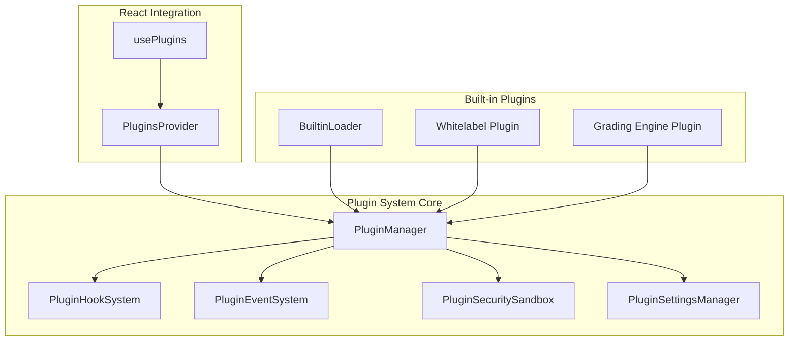

**Diagram sources**
- [PluginManager.ts:28-57](file://src/plugins/PluginManager.ts#L28-L57)
- [PluginHookSystem.ts:16-24](file://src/plugins/PluginHookSystem.ts#L16-L24)
- [PluginEventSystem.ts:23-26](file://src/plugins/PluginEventSystem.ts#L23-L26)
- [PluginSecuritySandbox.ts:45-46](file://src/plugins/PluginSecuritySandbox.ts#L45-L46)
- [PluginSettingsManager.ts:16-18](file://src/plugins/PluginSettingsManager.ts#L16-L18)
- [PluginsProvider.tsx:37-44](file://src/plugins/PluginsProvider.tsx#L37-L44)
- [usePlugins.ts:40-47](file://src/plugins/usePlugins.ts#L40-L47)
- [BuiltinLoader.ts:91-105](file://src/plugins/BuiltinLoader.ts#L91-L105)
- [whitelabel/index.ts:47-167](file://src/plugins/builtin/whitelabel/index.ts#L47-L167)
- [grading-engine/index.ts:52-130](file://src/plugins/builtin/grading-engine/index.ts#L52-L130)

**Section sources**
- [index.ts:28-61](file://src/plugins/index.ts#L28-L61)
- [PluginsProvider.tsx:37-86](file://src/plugins/PluginsProvider.tsx#L37-L86)
- [BuiltinLoader.ts:91-114](file://src/plugins/BuiltinLoader.ts#L91-L114)

## Core Components
- PluginManager: Central orchestrator for plugin lifecycle, delegation to subsystems, and admin/marketplace configuration.
- PluginHookSystem: Hook registration, execution with timeouts and circuit breaker protection.
- PluginEventSystem: Event lifecycle tracking, history, and subscription management.
- PluginSecuritySandbox: Security tiers, permissions, privilege validation, and manifest checks.
- PluginSettingsManager: Per-plugin settings schema, validation, persistence, and defaults.
- BuiltinLoader: Auto-discovery and loading of built-in plugins from the builtin directory.
- PluginsProvider and usePlugins: React context provider and hooks for plugin management.

**Section sources**
- [PluginManager.ts:28-57](file://src/plugins/PluginManager.ts#L28-L57)
- [PluginHookSystem.ts:16-24](file://src/plugins/PluginHookSystem.ts#L16-L24)
- [PluginEventSystem.ts:23-26](file://src/plugins/PluginEventSystem.ts#L23-L26)
- [PluginSecuritySandbox.ts:45-46](file://src/plugins/PluginSecuritySandbox.ts#L45-L46)
- [PluginSettingsManager.ts:16-18](file://src/plugins/PluginSettingsManager.ts#L16-L18)
- [BuiltinLoader.ts:91-114](file://src/plugins/BuiltinLoader.ts#L91-L114)
- [PluginsProvider.tsx:37-86](file://src/plugins/PluginsProvider.tsx#L37-L86)
- [usePlugins.ts:40-96](file://src/plugins/usePlugins.ts#L40-L96)

## Architecture Overview
The plugin system follows a modular architecture with clear separation of concerns:
- Lifecycle orchestration via PluginManager
- Hook execution with safety nets (timeouts, circuit breakers)
- Event-driven lifecycle tracking
- Permission-based security with tiered sandboxing
- Settings management with schema validation
- Built-in plugin discovery and registration
- React context for easy consumption

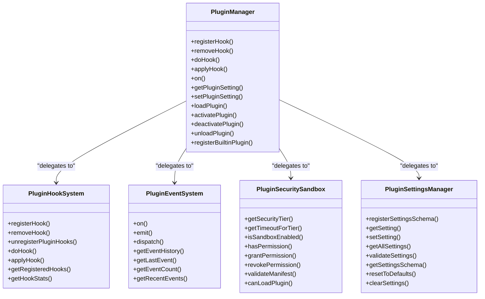

**Diagram sources**
- [PluginManager.ts:63-101](file://src/plugins/PluginManager.ts#L63-L101)
- [PluginHookSystem.ts:28-71](file://src/plugins/PluginHookSystem.ts#L28-L71)
- [PluginEventSystem.ts:31-55](file://src/plugins/PluginEventSystem.ts#L31-L55)
- [PluginSecuritySandbox.ts:108-142](file://src/plugins/PluginSecuritySandbox.ts#L108-L142)
- [PluginSettingsManager.ts:23-72](file://src/plugins/PluginSettingsManager.ts#L23-L72)

**Section sources**
- [PLUGIN_ARCHITECTURE_SPEC.md:23-76](file://docs/architecture/PLUGIN_ARCHITECTURE_SPEC.md#L23-L76)

## Detailed Component Analysis

### Plugin Lifecycle Management
The lifecycle spans discovery, loading, activation, deactivation, and unloading. Dependencies are validated, and hooks are registered/unregistered accordingly.

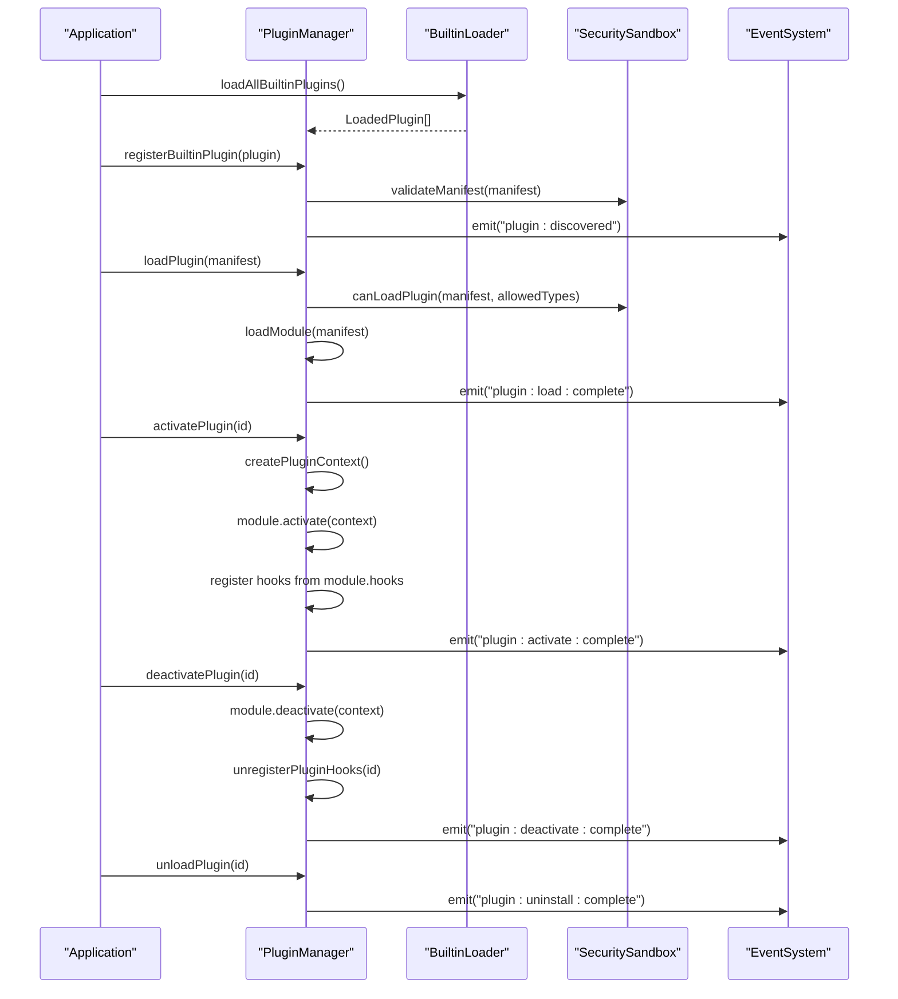

**Diagram sources**
- [BuiltinLoader.ts:91-105](file://src/plugins/BuiltinLoader.ts#L91-L105)
- [PluginManager.ts:110-132](file://src/plugins/PluginManager.ts#L110-L132)
- [PluginManager.ts:137-201](file://src/plugins/PluginManager.ts#L137-L201)
- [PluginManager.ts:227-267](file://src/plugins/PluginManager.ts#L227-L267)
- [PluginManager.ts:272-295](file://src/plugins/PluginManager.ts#L272-L295)
- [PluginManager.ts:300-309](file://src/plugins/PluginManager.ts#L300-L309)
- [PluginEventSystem.ts:60-80](file://src/plugins/PluginEventSystem.ts#L60-L80)

**Section sources**
- [PluginManager.ts:107-201](file://src/plugins/PluginManager.ts#L107-L201)
- [PluginManager.ts:227-295](file://src/plugins/PluginManager.ts#L227-L295)
- [PluginManager.ts:300-309](file://src/plugins/PluginManager.ts#L300-L309)

### Built-in Plugin Discovery
Built-in plugins are auto-discovered from the builtin directory using Vite's glob import. The loader validates structure and returns LoadedPlugin objects for registration.

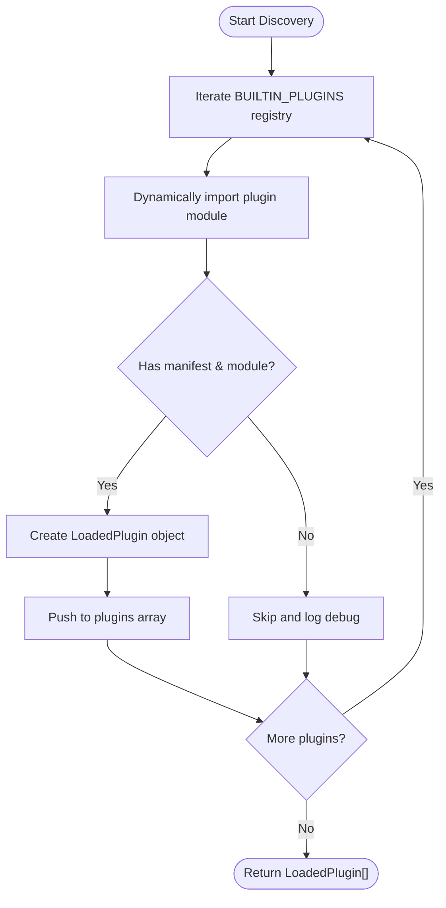

**Diagram sources**
- [BuiltinLoader.ts:91-105](file://src/plugins/BuiltinLoader.ts#L91-L105)
- [BuiltinLoader.ts:35-85](file://src/plugins/BuiltinLoader.ts#L35-L85)

**Section sources**
- [BuiltinLoader.ts:23-30](file://src/plugins/BuiltinLoader.ts#L23-L30)
- [BuiltinLoader.ts:91-114](file://src/plugins/BuiltinLoader.ts#L91-L114)

### Plugin Types, Categories, and Capabilities
The system defines seven plugin types and four categories. Each type supports different capabilities and UI integrations.

```mermaid
classDiagram
class PluginType {
<<enumeration>>
"module"
"theme"
"integration"
"report"
"widget"
"whitelabel"
"engine"
}
class PluginCategory {
<<enumeration>>
"builtin"
"verified"
"community"
"private"
"engine"
}
class PluginManifest {
+id : string
+name : string
+version : string
+type : PluginType
+entry : string
+category? : PluginCategory
+routes? : PluginRoute[]
+menuItems? : PluginMenuItem[]
+widgets? : PluginWidget[]
+settings? : PluginSetting[]
+engine? : EngineSpec
+marketplace? : MarketplaceMeta
}
PluginManifest --> PluginType
PluginManifest --> PluginCategory
```

**Diagram sources**
- [types.ts:14-28](file://src/plugins/types.ts#L14-L28)
- [types.ts:60-111](file://src/plugins/types.ts#L60-L111)

**Section sources**
- [types.ts:14-28](file://src/plugins/types.ts#L14-L28)
- [types.ts:60-111](file://src/plugins/types.ts#L60-L111)

### Hook System and Circuit Breaker Protection
The hook system enforces timeouts and tracks failures to prevent plugin-induced instability. Handlers are executed with bounded time and can be temporarily banned after repeated failures.

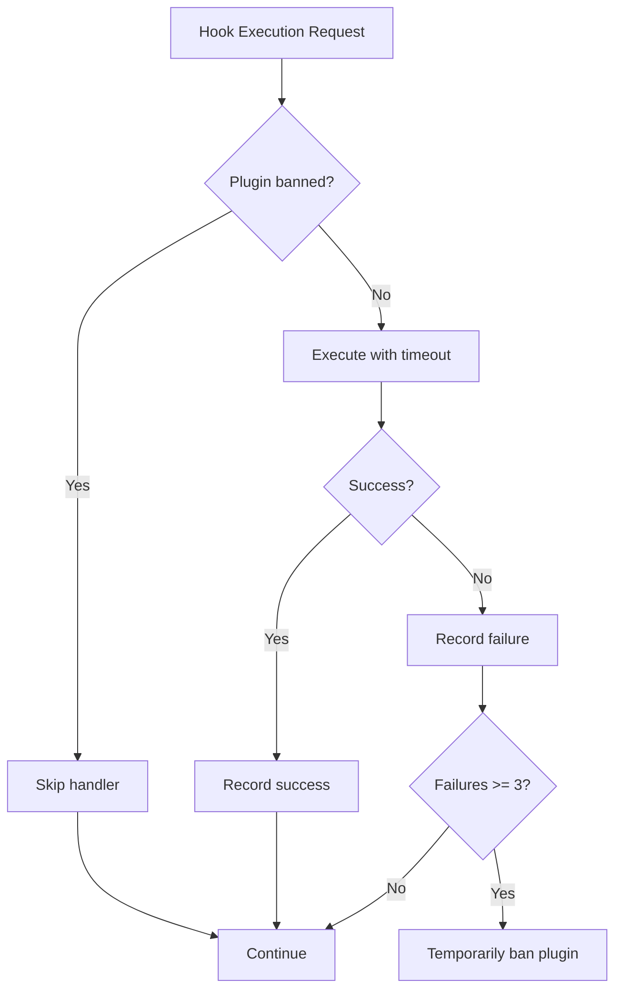

**Diagram sources**
- [PluginHookSystem.ts:77-104](file://src/plugins/PluginHookSystem.ts#L77-L104)
- [PluginHookSystem.ts:141-155](file://src/plugins/PluginHookSystem.ts#L141-L155)
- [PluginHookSystem.ts:176-188](file://src/plugins/PluginHookSystem.ts#L176-L188)

**Section sources**
- [PluginHookSystem.ts:20-24](file://src/plugins/PluginHookSystem.ts#L20-L24)
- [PluginHookSystem.ts:141-171](file://src/plugins/PluginHookSystem.ts#L141-L171)

### Security Model: Tiered Sandboxing
The security model uses three tiers based on plugin category:
- Trusted: builtin and engine (direct execution, full access)
- Verified/Private: proxy-sandboxed iframe
- Community: Web Worker with blocked globals

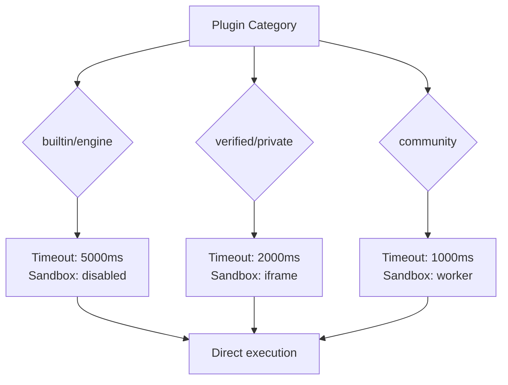

**Diagram sources**
- [PluginSecuritySandbox.ts:70-82](file://src/plugins/PluginSecuritySandbox.ts#L70-L82)
- [PluginSecuritySandbox.ts:49-65](file://src/plugins/PluginSecuritySandbox.ts#L49-L65)

**Section sources**
- [PluginSecuritySandbox.ts:16-32](file://src/plugins/PluginSecuritySandbox.ts#L16-L32)
- [PluginSecuritySandbox.ts:70-82](file://src/plugins/PluginSecuritySandbox.ts#L70-L82)

### Permission-Based Access Control
Plugins declare privileges in their manifest. The security sandbox validates operations and grants/denies based on requested permissions.

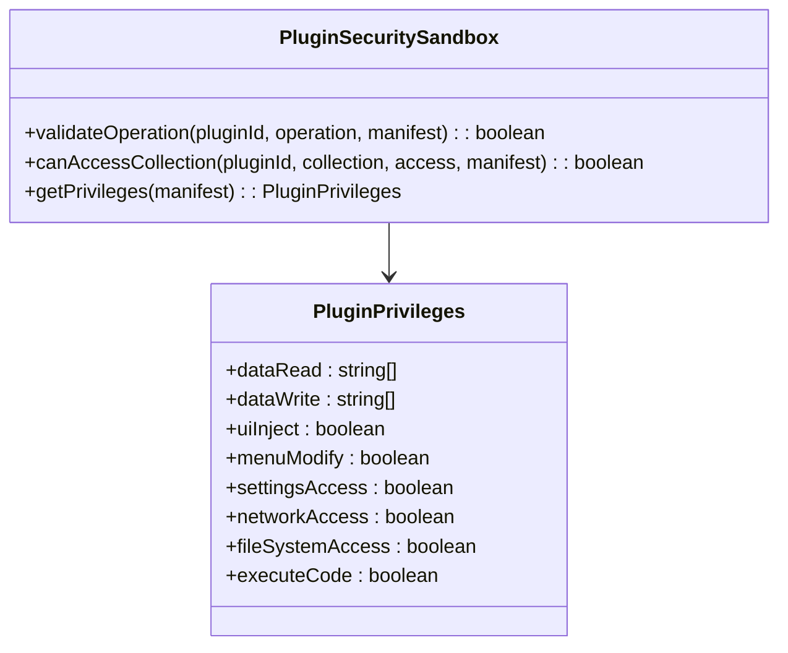

**Diagram sources**
- [types.ts:38-52](file://src/plugins/types.ts#L38-L52)
- [PluginSecuritySandbox.ts:154-184](file://src/plugins/PluginSecuritySandbox.ts#L154-L184)

**Section sources**
- [types.ts:38-52](file://src/plugins/types.ts#L38-L52)
- [PluginSecuritySandbox.ts:154-184](file://src/plugins/PluginSecuritySandbox.ts#L154-L184)

### Marketplace Integration
The system supports marketplace configuration, installation tracking, and key validation. Admin controls govern marketplace availability and plugin loading policies.

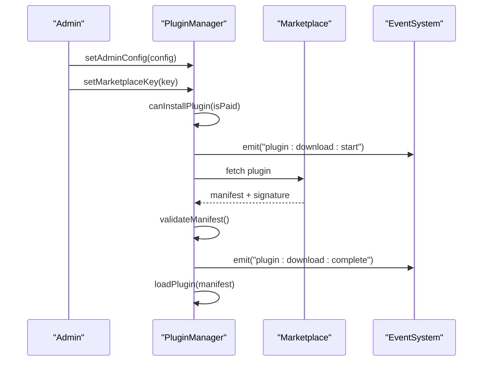

**Diagram sources**
- [PluginManager.ts:339-394](file://src/plugins/PluginManager.ts#L339-L394)
- [types.ts:343-359](file://src/plugins/types.ts#L343-L359)

**Section sources**
- [PluginManager.ts:339-394](file://src/plugins/PluginManager.ts#L339-L394)
- [types.ts:343-359](file://src/plugins/types.ts#L343-L359)

### React Integration Patterns
The PluginsProvider initializes the system and registers built-in plugins. The usePlugins hook exposes lifecycle operations and state.

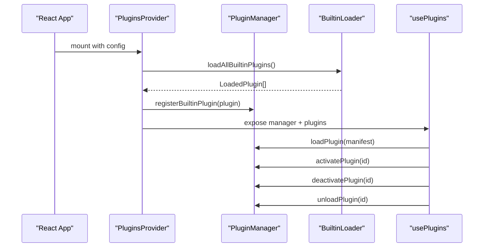

**Diagram sources**
- [PluginsProvider.tsx:46-75](file://src/plugins/PluginsProvider.tsx#L46-L75)
- [usePlugins.ts:49-95](file://src/plugins/usePlugins.ts#L49-L95)

**Section sources**
- [PluginsProvider.tsx:37-86](file://src/plugins/PluginsProvider.tsx#L37-L86)
- [usePlugins.ts:40-96](file://src/plugins/usePlugins.ts#L40-L96)

### Built-in Plugin Examples

#### Whitelabel Plugin
Demonstrates branding customization, label overrides, and feature visibility controls via hooks and settings.

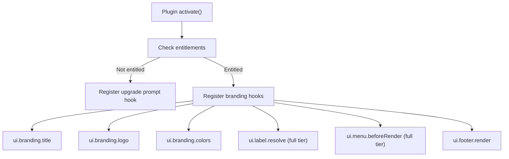

**Diagram sources**
- [whitelabel/index.ts:174-281](file://src/plugins/builtin/whitelabel/index.ts#L174-L281)

**Section sources**
- [whitelabel/index.ts:47-167](file://src/plugins/builtin/whitelabel/index.ts#L47-L167)
- [whitelabel/index.ts:174-281](file://src/plugins/builtin/whitelabel/index.ts#L174-L281)

#### Grading Engine Plugin
Shows WASM integration, fallback behavior, and hook-based pre/post-processing.

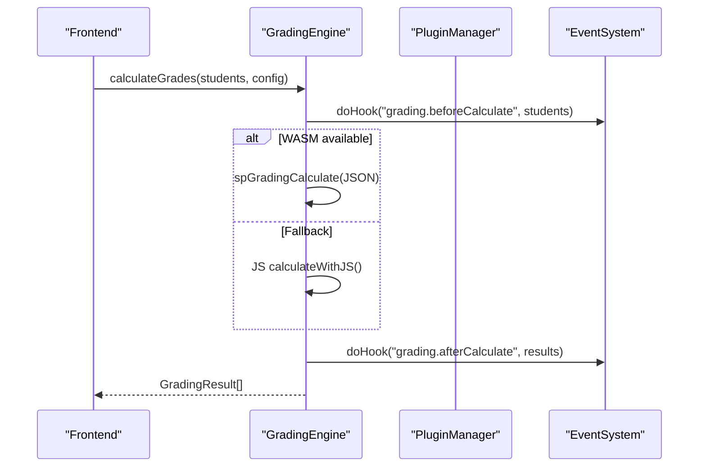

**Diagram sources**
- [grading-engine/index.ts:166-187](file://src/plugins/builtin/grading-engine/index.ts#L166-L187)
- [grading-engine/index.ts:364-376](file://src/plugins/builtin/grading-engine/index.ts#L364-L376)

**Section sources**
- [grading-engine/index.ts:52-130](file://src/plugins/builtin/grading-engine/index.ts#L52-L130)
- [grading-engine/index.ts:143-348](file://src/plugins/builtin/grading-engine/index.ts#L143-L348)

## Dependency Analysis
The PluginManager delegates to specialized subsystems, ensuring single responsibility and maintainability. Dependencies are explicit and well-contained.

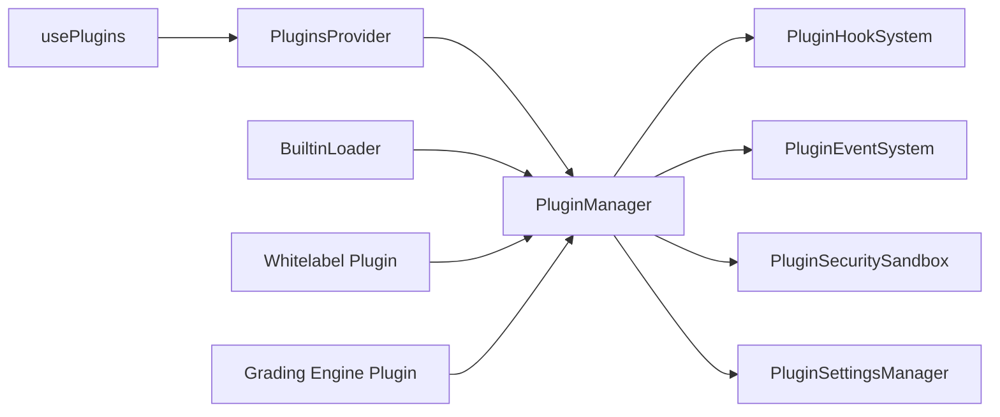

**Diagram sources**
- [PluginManager.ts:22-25](file://src/plugins/PluginManager.ts#L22-L25)
- [PluginsProvider.tsx:8-11](file://src/plugins/PluginsProvider.tsx#L8-L11)
- [BuiltinLoader.ts:8-9](file://src/plugins/BuiltinLoader.ts#L8-L9)

**Section sources**
- [PluginManager.ts:22-25](file://src/plugins/PluginManager.ts#L22-L25)
- [PluginsProvider.tsx:8-11](file://src/plugins/PluginsProvider.tsx#L8-L11)

## Performance Considerations
- Hook timeouts: enforced via bounded execution to prevent slow or blocking handlers.
- Circuit breaker: temporary banning of failing plugins to protect stability.
- Security tiers: reduced timeouts for community plugins to enforce stricter limits.
- Settings persistence: localStorage-backed with validation to avoid heavy re-computation.
- Dependency sorting: topological sort prevents loading incompatible plugin orders.

[No sources needed since this section provides general guidance]

## Troubleshooting Guide
Common issues and remedies:
- Plugin fails to load: verify manifest validity and type/category restrictions.
- Activation errors: inspect hook execution logs and circuit breaker bans.
- Settings validation failures: review schema and required fields.
- Marketplace key invalid: confirm format, expiration, and permissions.

**Section sources**
- [PluginSecuritySandbox.ts:239-273](file://src/plugins/PluginSecuritySandbox.ts#L239-L273)
- [PluginHookSystem.ts:160-171](file://src/plugins/PluginHookSystem.ts#L160-L171)
- [PluginSettingsManager.ts:98-180](file://src/plugins/PluginSettingsManager.ts#L98-L180)
- [PluginManager.ts:375-380](file://src/plugins/PluginManager.ts#L375-L380)

## Conclusion
SchoolPilot3’s plugin system provides a robust, secure, and extensible foundation for feature enhancement. Its modular design, tiered sandboxing, comprehensive hook system, and marketplace-ready architecture enable safe experimentation while maintaining application stability.

[No sources needed since this section summarizes without analyzing specific files]

## Appendices

### Plugin Development and Registration Patterns
- Create a plugin directory under the builtin folder with a manifest and module.
- Register the plugin in the BUILTIN_PLUGINS registry.
- Use hooks to integrate UI, branding, and data processing.
- Manage settings via the PluginSettingsManager schema.

**Section sources**
- [BuiltinLoader.ts:23-30](file://src/plugins/BuiltinLoader.ts#L23-L30)
- [whitelabel/index.ts:47-167](file://src/plugins/builtin/whitelabel/index.ts#L47-L167)
- [plugin-dev-guide.md:1-42](file://docs/guides/plugin-dev-guide.md#L1-L42)