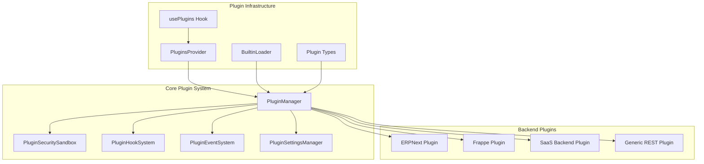
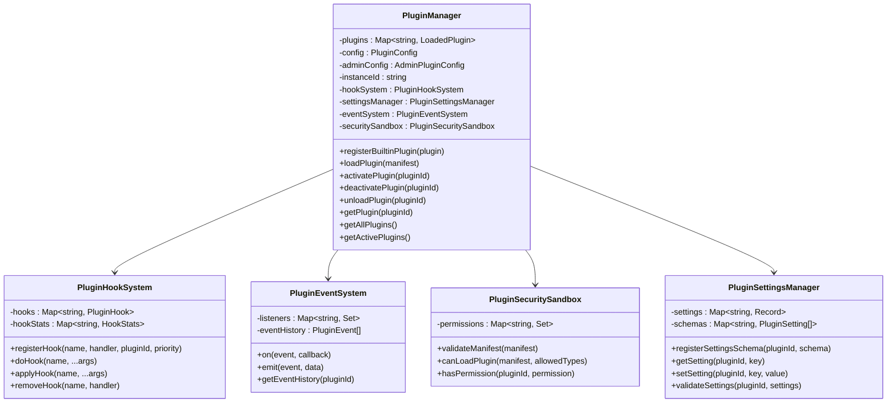
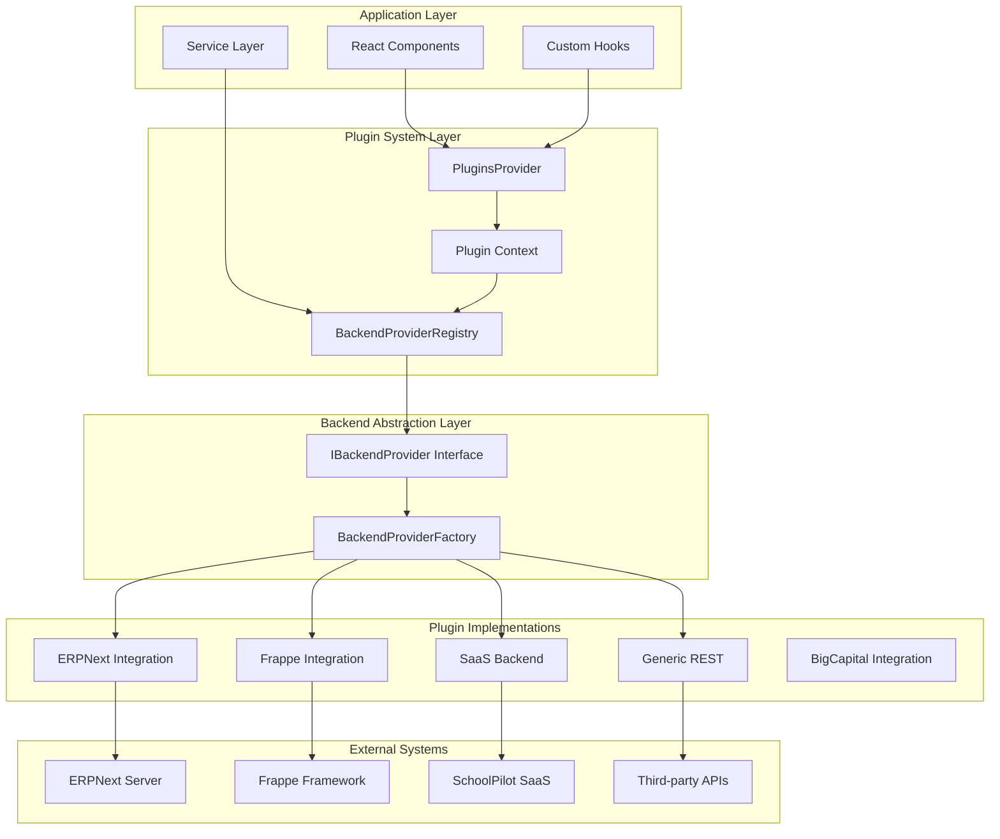
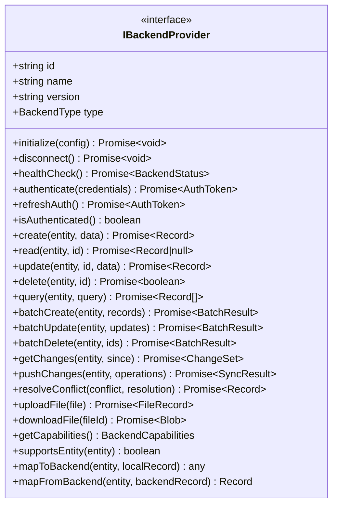
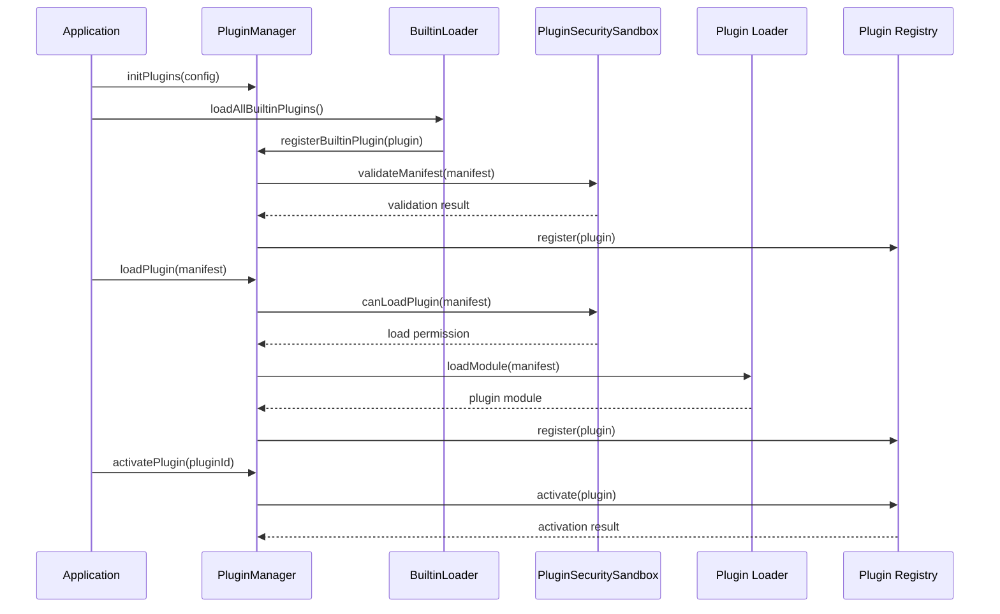
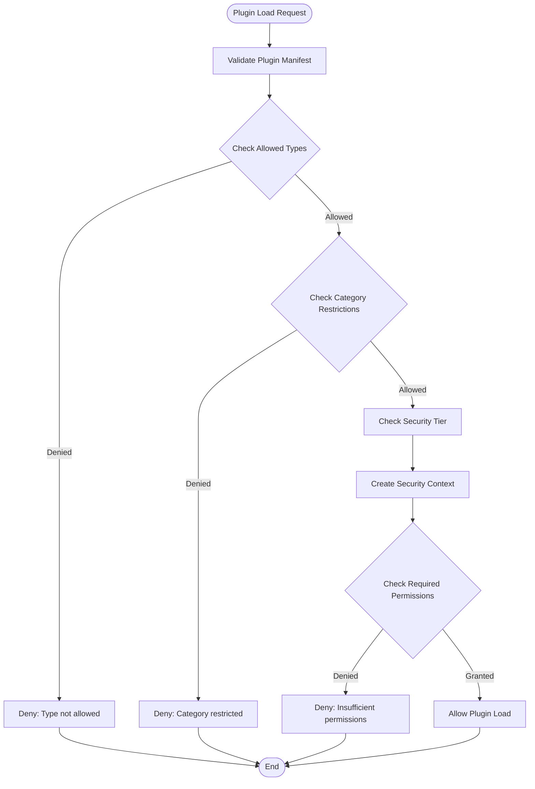
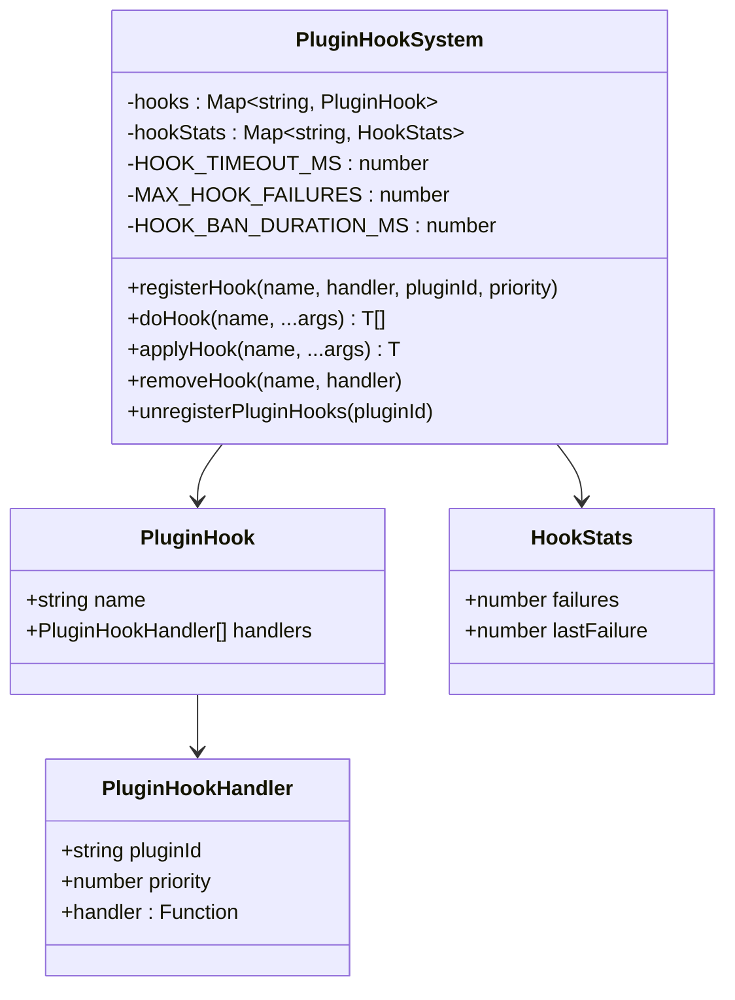
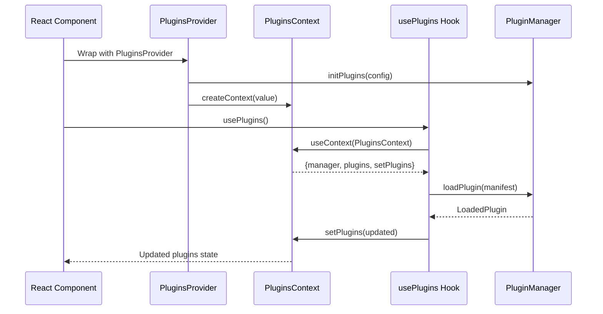
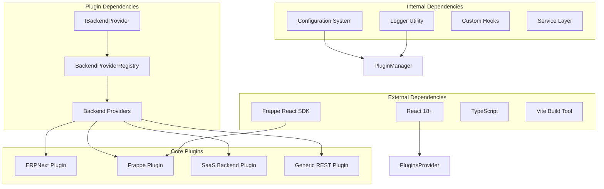

# Backend Plugin Architecture

<cite>
**Referenced Files in This Document**
- [PluginManager.ts](file://src/plugins/PluginManager.ts)
- [PluginHookSystem.ts](file://src/plugins/PluginHookSystem.ts)
- [PluginEventSystem.ts](file://src/plugins/PluginEventSystem.ts)
- [PluginSecuritySandbox.ts](file://src/plugins/PluginSecuritySandbox.ts)
- [PluginSettingsManager.ts](file://src/plugins/PluginSettingsManager.ts)
- [PluginsProvider.tsx](file://src/plugins/PluginsProvider.tsx)
- [usePlugins.ts](file://src/plugins/usePlugins.ts)
- [BuiltinLoader.ts](file://src/plugins/BuiltinLoader.ts)
- [types.ts](file://src/plugins/types.ts)
- [index.ts](file://src/plugins/index.ts)
- [backend-plugin-architecture.md](file://docs/architecture/backend-plugin-architecture.md)
- [backend-plugin-implementation-guide.md](file://docs/guides/backend-plugin-implementation-guide.md)
- [BACKEND_PLUGIN_IMPLEMENTATION_COMPLETE.md](file://docs/BACKEND_PLUGIN_IMPLEMENTATION_COMPLETE.md)
- [SAAS_AND_GENERIC_REST_PLUGINS.md](file://docs/SAAS_AND_GENERIC_REST_PLUGINS.md)
</cite>

## Table of Contents
1. [Introduction](#introduction)
2. [Project Structure](#project-structure)
3. [Core Components](#core-components)
4. [Architecture Overview](#architecture-overview)
5. [Detailed Component Analysis](#detailed-component-analysis)
6. [Dependency Analysis](#dependency-analysis)
7. [Performance Considerations](#performance-considerations)
8. [Troubleshooting Guide](#troubleshooting-guide)
9. [Conclusion](#conclusion)

## Introduction

The Backend Plugin Architecture represents a comprehensive refactoring of SchoolPilot3's backend integration system. This architecture decouples backend-specific implementations from the core system while maintaining high integration capabilities through a robust plugin-based approach.

The system enables seamless integration with multiple backend providers including ERPNext, Frappe Framework, custom SaaS solutions, and generic REST APIs through a unified interface. This approach provides extensibility, maintainability, and the ability to leverage official SDKs like the Frappe React SDK.

## Project Structure

The backend plugin architecture follows a modular structure with clear separation of concerns:

**Diagram sources**
- [PluginManager.ts:1-592](file://src/plugins/PluginManager.ts#L1-L592)
- [PluginsProvider.tsx:1-96](file://src/plugins/PluginsProvider.tsx#L1-L96)
- [BuiltinLoader.ts:1-119](file://src/plugins/BuiltinLoader.ts#L1-L119)

**Section sources**
- [index.ts:1-61](file://src/plugins/index.ts#L1-L61)
- [types.ts:1-562](file://src/plugins/types.ts#L1-L562)

## Core Components

### Plugin Management System

The PluginManager serves as the central orchestrator for all plugin operations, implementing a factory pattern with delegation to specialized subsystems:

**Diagram sources**
- [PluginManager.ts:28-574](file://src/plugins/PluginManager.ts#L28-L574)
- [PluginHookSystem.ts:16-216](file://src/plugins/PluginHookSystem.ts#L16-L216)
- [PluginEventSystem.ts:23-194](file://src/plugins/PluginEventSystem.ts#L23-L194)
- [PluginSecuritySandbox.ts:45-311](file://src/plugins/PluginSecuritySandbox.ts#L45-L311)
- [PluginSettingsManager.ts:16-239](file://src/plugins/PluginSettingsManager.ts#L16-L239)

### Plugin Types and Manifest System

The architecture defines a comprehensive type system supporting various plugin categories and capabilities:

| Plugin Type | Description | Use Case |
|-------------|-------------|----------|
| `module` | Full feature modules | Advanced grading systems |
| `theme` | Visual customization | Branding and UI themes |
| `integration` | Backend integrations | ERPNext, Frappe, REST APIs |
| `report` | Reporting templates | Custom report generation |
| `widget` | Dashboard widgets | Analytics and monitoring |
| `whitelabel` | Branding customization | White-label deployments |
| `engine` | Computation engines | Go-based WASM processors |

**Section sources**
- [types.ts:14-21](file://src/plugins/types.ts#L14-L21)
- [types.ts:23-28](file://src/plugins/types.ts#L23-L28)
- [types.ts:60-111](file://src/plugins/types.ts#L60-L111)

## Architecture Overview

The backend plugin architecture implements a layered approach with clear separation between core functionality and backend-specific implementations:

**Diagram sources**
- [backend-plugin-architecture.md:15-67](file://docs/architecture/backend-plugin-architecture.md#L15-L67)
- [PluginManager.ts:28-574](file://src/plugins/PluginManager.ts#L28-L574)

### Core Abstractions

The architecture establishes several key abstractions that remain in the core system:

#### IBackendProvider Interface
The central abstraction defining the contract for all backend providers:

**Diagram sources**
- [backend-plugin-architecture.md:74-121](file://docs/architecture/backend-plugin-architecture.md#L74-L121)

**Section sources**
- [backend-plugin-architecture.md:69-158](file://docs/architecture/backend-plugin-architecture.md#L69-L158)

## Detailed Component Analysis

### Plugin Lifecycle Management

The plugin lifecycle follows a structured progression from discovery to activation:

**Diagram sources**
- [PluginManager.ts:137-202](file://src/plugins/PluginManager.ts#L137-L202)
- [BuiltinLoader.ts:96-111](file://src/plugins/BuiltinLoader.ts#L96-L111)
- [PluginManager.ts:227-267](file://src/plugins/PluginManager.ts#L227-L267)

### Security and Permission Management

The PluginSecuritySandbox implements a multi-tier security model with granular permission controls:

**Diagram sources**
- [PluginSecuritySandbox.ts:278-310](file://src/plugins/PluginSecuritySandbox.ts#L278-L310)
- [PluginSecuritySandbox.ts:239-273](file://src/plugins/PluginSecuritySandbox.ts#L239-L273)

**Section sources**
- [PluginSecuritySandbox.ts:45-311](file://src/plugins/PluginSecuritySandbox.ts#L45-L311)

### Hook System Architecture

The hook system provides a robust event-driven mechanism for plugin communication:

**Diagram sources**
- [PluginHookSystem.ts:16-216](file://src/plugins/PluginHookSystem.ts#L16-L216)

**Section sources**
- [PluginHookSystem.ts:16-216](file://src/plugins/PluginHookSystem.ts#L16-L216)

### React Integration Components

The plugin system provides seamless React integration through context and hooks:

**Diagram sources**
- [PluginsProvider.tsx:37-96](file://src/plugins/PluginsProvider.tsx#L37-L96)
- [usePlugins.ts:40-99](file://src/plugins/usePlugins.ts#L40-L99)

**Section sources**
- [PluginsProvider.tsx:1-96](file://src/plugins/PluginsProvider.tsx#L1-L96)
- [usePlugins.ts:1-99](file://src/plugins/usePlugins.ts#L1-L99)

## Dependency Analysis

The backend plugin architecture demonstrates excellent separation of concerns with minimal coupling between components:

**Diagram sources**
- [PluginManager.ts:22-26](file://src/plugins/PluginManager.ts#L22-L26)
- [backend-plugin-architecture.md:48-66](file://docs/architecture/backend-plugin-architecture.md#L48-L66)

### Plugin Communication Patterns

The architecture supports multiple communication patterns between plugins and the core system:

| Pattern | Description | Use Case |
|---------|-------------|----------|
| **Event-Driven** | Hook-based communication | Plugin lifecycle events |
| **Direct API** | Method calls | Data operations and CRUD |
| **Context Injection** | Shared state access | Configuration and settings |
| **Registry Pattern** | Provider registration | Backend abstraction layer |
| **Factory Pattern** | Object creation | Plugin instantiation |

**Section sources**
- [PluginHookSystem.ts:77-136](file://src/plugins/PluginHookSystem.ts#L77-L136)
- [PluginEventSystem.ts:60-87](file://src/plugins/PluginEventSystem.ts#L60-L87)

## Performance Considerations

The backend plugin architecture incorporates several performance optimization strategies:

### Circuit Breaker Pattern
The hook system implements automatic failure detection and temporary plugin banning to prevent cascading failures:

- **Failure Threshold**: 3 consecutive failures trigger temporary ban
- **Ban Duration**: 1 minute cooldown period
- **Timeout Protection**: 200ms execution timeout per hook
- **Statistics Tracking**: Failure rates and timing analysis

### Caching Strategies
Multiple caching layers prevent redundant API calls and improve response times:

- **Client-Side Caching**: Built into SaaS and Generic REST plugins
- **HTTP Caching**: REST clients with configurable TTL
- **GraphQL Caching**: Query result caching with automatic invalidation
- **WebSocket Caching**: Real-time subscription caching

### Async Operation Handling
Non-blocking operations ensure UI responsiveness during long-running tasks:

- **Background Processing**: Plugin activation and deactivation
- **Queue Management**: Offline operation queuing
- **Progress Tracking**: Long-running operation monitoring
- **Resource Pooling**: Connection and thread management

## Troubleshooting Guide

### Common Plugin Issues

#### Plugin Loading Failures
**Symptoms**: Plugin fails to load or activate
**Causes**: 
- Invalid plugin manifest
- Missing dependencies
- Security restrictions
- Configuration errors

**Solutions**:
1. Check plugin manifest format and required fields
2. Verify dependency resolution
3. Review security sandbox restrictions
4. Validate plugin settings

#### Hook Execution Problems
**Symptoms**: Hooks not firing or causing timeouts
**Causes**:
- Excessive hook execution time
- Plugin failure leading to temporary bans
- Priority conflicts
- Memory leaks

**Solutions**:
1. Monitor hook execution times
2. Check plugin failure statistics
3. Adjust hook priorities
4. Implement proper cleanup

#### Security Violations
**Symptoms**: Permission denied errors
**Causes**:
- Insufficient plugin permissions
- Security tier restrictions
- Manifest validation failures
- Category restrictions

**Solutions**:
1. Review plugin privilege requirements
2. Check security tier configuration
3. Validate plugin category
4. Update security policies

### Debugging Tools

The system provides comprehensive debugging capabilities:

- **Event History**: Complete plugin lifecycle tracking
- **Hook Statistics**: Performance and failure metrics
- **Security Logs**: Permission and validation results
- **Configuration Validation**: Real-time configuration checks

**Section sources**
- [PluginHookSystem.ts:141-171](file://src/plugins/PluginHookSystem.ts#L141-L171)
- [PluginEventSystem.ts:92-131](file://src/plugins/PluginEventSystem.ts#L92-L131)
- [PluginSecuritySandbox.ts:239-273](file://src/plugins/PluginSecuritySandbox.ts#L239-L273)

## Conclusion

The Backend Plugin Architecture represents a significant advancement in SchoolPilot3's extensibility and maintainability. Through careful separation of concerns, robust security measures, and comprehensive plugin management, the system provides:

### Key Achievements
- **Complete Decoupling**: Backend systems are fully independent from core functionality
- **Extensive Plugin Support**: Four major backend integrations plus extensibility framework
- **Robust Security**: Multi-tier security model with granular permission controls
- **Performance Optimization**: Circuit breakers, caching, and async operation handling
- **Developer Experience**: Comprehensive documentation and development tools

### Future Enhancements
The architecture provides a solid foundation for future improvements including multi-backend support, visual configuration builders, and enhanced conflict resolution interfaces. The modular design ensures that new backend systems can be integrated seamlessly without disrupting existing functionality.

This implementation demonstrates best practices in plugin architecture design, providing a scalable and maintainable solution for complex backend integration requirements.