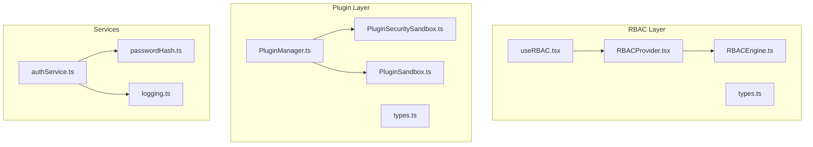
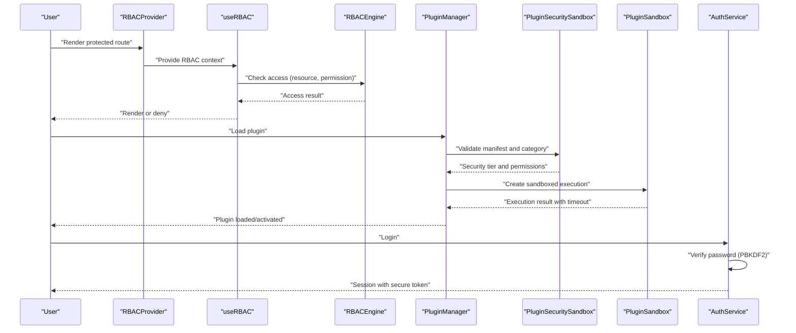
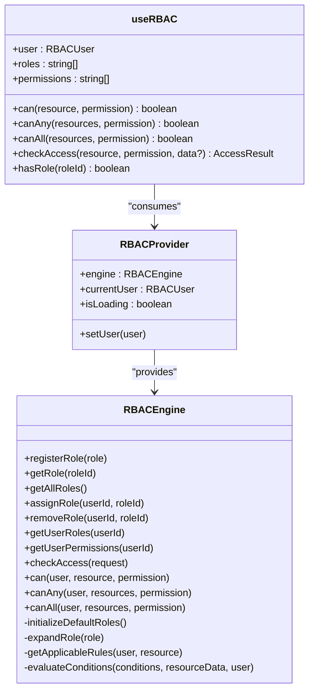
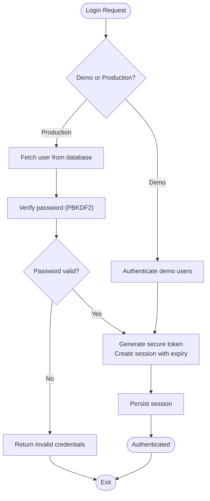
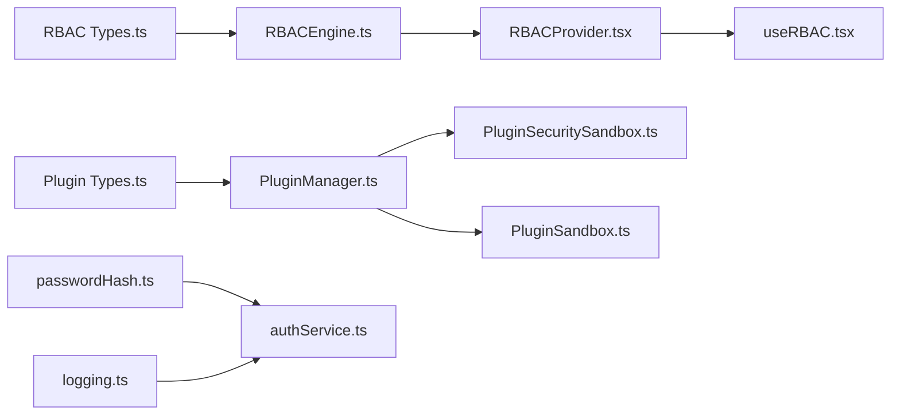

# Security Architecture

<cite>
**Referenced Files in This Document**
- [RBACEngine.ts](file://src/rbac/RBACEngine.ts)
- [useRBAC.tsx](file://src/rbac/useRBAC.tsx)
- [types.ts](file://src/rbac/types.ts)
- [RBACProvider.tsx](file://src/rbac/RBACProvider.tsx)
- [PluginSecuritySandbox.ts](file://src/plugins/PluginSecuritySandbox.ts)
- [PluginSandbox.ts](file://src/utils/PluginSandbox.ts)
- [PluginManager.ts](file://src/plugins/PluginManager.ts)
- [types.ts](file://src/plugins/types.ts)
- [authService.ts](file://src/services/auth/authService.ts)
- [passwordHash.ts](file://src/utils/passwordHash.ts)
- [logging.ts](file://src/utils/logging.ts)
- [logger.ts](file://src/utils/logger.ts)
- [RBAC_IMPLEMENTATION_GUIDE.md](file://docs/guides/RBAC_IMPLEMENTATION_GUIDE.md)
- [plugin-dev-guide.md](file://docs/guides/plugin-dev-guide.md)
</cite>

## Table of Contents
1. [Introduction](#introduction)
2. [Project Structure](#project-structure)
3. [Core Components](#core-components)
4. [Architecture Overview](#architecture-overview)
5. [Detailed Component Analysis](#detailed-component-analysis)
6. [Dependency Analysis](#dependency-analysis)
7. [Performance Considerations](#performance-considerations)
8. [Troubleshooting Guide](#troubleshooting-guide)
9. [Conclusion](#conclusion)
10. [Appendices](#appendices)

## Introduction
This document presents the multi-layered security architecture of SchoolPilot3, focusing on:
- Role-Based Access Control (RBAC) with route-level and component-level protection
- Plugin security sandboxing with tiered trust levels, circuit breaker protections, and code validation
- Data security measures including input validation, audit logging, and encryption options
- Security monitoring, threat detection, and incident response patterns
- Examples of secure plugin development and RBAC configuration

The system integrates a robust RBAC engine with React hooks, a modular plugin manager delegating security to a dedicated sandbox, and strong cryptographic primitives for authentication and session management.

## Project Structure
SchoolPilot3 organizes security across three primary domains:
- RBAC: Engine, provider, and React hooks for permission enforcement
- Plugins: Manager, sandbox, and utilities for safe third-party extension execution
- Services: Authentication and cryptography for secure user sessions



**Diagram sources**
- [RBACEngine.ts:1-431](file://src/rbac/RBACEngine.ts#L1-L431)
- [RBACProvider.tsx:1-73](file://src/rbac/RBACProvider.tsx#L1-L73)
- [useRBAC.tsx:1-162](file://src/rbac/useRBAC.tsx#L1-L162)
- [types.ts:1-115](file://src/rbac/types.ts#L1-L115)
- [PluginManager.ts:1-592](file://src/plugins/PluginManager.ts#L1-L592)
- [PluginSecuritySandbox.ts:1-311](file://src/plugins/PluginSecuritySandbox.ts#L1-L311)
- [PluginSandbox.ts:1-502](file://src/utils/PluginSandbox.ts#L1-L502)
- [types.ts:1-562](file://src/plugins/types.ts#L1-L562)
- [authService.ts:1-674](file://src/services/auth/authService.ts#L1-L674)
- [passwordHash.ts:1-151](file://src/utils/passwordHash.ts#L1-L151)
- [logging.ts:1-92](file://src/utils/logging.ts#L1-L92)

**Section sources**
- [RBACEngine.ts:1-431](file://src/rbac/RBACEngine.ts#L1-L431)
- [PluginManager.ts:1-592](file://src/plugins/PluginManager.ts#L1-L592)
- [authService.ts:1-674](file://src/services/auth/authService.ts#L1-L674)

## Core Components
- RBAC Engine: Centralized permission evaluation supporting system roles, attribute-based conditions, and inheritance.
- RBAC Provider and Hook: React context and hooks enabling route-level and component-level permission checks.
- Plugin Manager: Orchestrates plugin lifecycle with delegated security via PluginSecuritySandbox and PluginSandbox.
- Authentication Service: Session management with PBKDF2-based password hashing and secure token generation.
- Logging: Environment-aware logging for security events and diagnostics.

**Section sources**
- [RBACEngine.ts:1-431](file://src/rbac/RBACEngine.ts#L1-L431)
- [RBACProvider.tsx:1-73](file://src/rbac/RBACProvider.tsx#L1-L73)
- [useRBAC.tsx:1-162](file://src/rbac/useRBAC.tsx#L1-L162)
- [PluginManager.ts:1-592](file://src/plugins/PluginManager.ts#L1-L592)
- [PluginSecuritySandbox.ts:1-311](file://src/plugins/PluginSecuritySandbox.ts#L1-L311)
- [PluginSandbox.ts:1-502](file://src/utils/PluginSandbox.ts#L1-L502)
- [authService.ts:1-674](file://src/services/auth/authService.ts#L1-L674)
- [passwordHash.ts:1-151](file://src/utils/passwordHash.ts#L1-L151)
- [logging.ts:1-92](file://src/utils/logging.ts#L1-L92)

## Architecture Overview
The security architecture enforces protection at multiple layers:
- RBAC: Route and component gating using React context and hooks
- Plugin Sandboxing: Tiered trust levels with timeouts and restricted execution environments
- Authentication: Cryptographic hashing and secure tokens
- Logging: Structured, environment-aware logging for audit trails



**Diagram sources**
- [RBACProvider.tsx:1-73](file://src/rbac/RBACProvider.tsx#L1-L73)
- [useRBAC.tsx:1-162](file://src/rbac/useRBAC.tsx#L1-L162)
- [RBACEngine.ts:1-431](file://src/rbac/RBACEngine.ts#L1-L431)
- [PluginManager.ts:1-592](file://src/plugins/PluginManager.ts#L1-L592)
- [PluginSecuritySandbox.ts:1-311](file://src/plugins/PluginSecuritySandbox.ts#L1-L311)
- [PluginSandbox.ts:1-502](file://src/utils/PluginSandbox.ts#L1-L502)
- [authService.ts:1-674](file://src/services/auth/authService.ts#L1-L674)

## Detailed Component Analysis

### RBAC Implementation
RBAC provides:
- System roles with predefined permissions and inheritance
- Attribute-based access control with template variable substitution
- User-role assignment and effective permission calculation
- Route-level and component-level protection via React hooks



**Diagram sources**
- [RBACEngine.ts:1-431](file://src/rbac/RBACEngine.ts#L1-L431)
- [RBACProvider.tsx:1-73](file://src/rbac/RBACProvider.tsx#L1-L73)
- [useRBAC.tsx:1-162](file://src/rbac/useRBAC.tsx#L1-L162)

Key RBAC features:
- Super admin bypass and explicit deny reasons
- Attribute-based conditions with user template variables
- Role inheritance expanding permissions from parent roles
- Simplified permission checks for routes and components

**Section sources**
- [RBACEngine.ts:157-183](file://src/rbac/RBACEngine.ts#L157-L183)
- [RBACEngine.ts:367-412](file://src/rbac/RBACEngine.ts#L367-L412)
- [useRBAC.tsx:61-93](file://src/rbac/useRBAC.tsx#L61-L93)
- [RBAC_IMPLEMENTATION_GUIDE.md:1-506](file://docs/guides/RBAC_IMPLEMENTATION_GUIDE.md#L1-L506)

### Plugin Security Sandboxing
The plugin system separates concerns with:
- PluginSecuritySandbox: Security tiering, privilege validation, and manifest checks
- PluginSandbox: Execution sandboxing with Web Workers and iframes, timeouts, and global restrictions
- PluginManager: Orchestrates lifecycle and delegates security checks

```mermaid
classDiagram
class PluginSecuritySandbox {
+getSecurityTier(category) SecurityTier
+getTimeoutForTier(tier) number
+isSandboxEnabled(tier) boolean
+getSecurityConfig(tier) SecurityConfig
+hasPermission(pluginId, permission) boolean
+grantPermission(pluginId, permission)
+revokePermission(pluginId, permission)
+setPermissions(pluginId, permissions)
+getPermissions(pluginId) PluginPermission[]
+clearPermissions(pluginId)
+validateOperation(pluginId, operation, manifest?) boolean
+getPrivileges(manifest?) PluginPrivileges
+canAccessCollection(pluginId, collection, access, manifest?) boolean
+createSandboxedContext(plugin) Partial~PluginContext~
+validateManifest(manifest) {valid, errors}
+canLoadPlugin(manifest, allowedTypes?, allowedCategories?) {allowed, reason?}
}
class PluginSandbox {
+getConfig() SandboxConfig
+hasPrivilege(privilege) boolean
+executeInWorker(code, context?) SandboxResult
+executeInIframe(code, context?) SandboxResult
-executeDirect(code, context?) SandboxResult
-createWorkerCode(code, context) string
-getWorkerResult() Promise
-createTimeoutPromise(timeout) Promise
-injectRestrictedGlobals(window, context) void
+destroy() void
}
class PluginManager {
+registerHook(name, handler, pluginId?, priority?)
+removeHook(name, handler)
+doHook(name, ...args)
+applyHook(name, ...args)
+on(event, callback)
+loadPlugin(manifest) LoadedPlugin
+activatePlugin(pluginId)
+deactivatePlugin(pluginId)
+unloadPlugin(pluginId)
+getSecuritySandbox() PluginSecuritySandbox
}
PluginManager --> PluginSecuritySandbox : "delegates"
PluginManager --> PluginSandbox : "uses"
```

**Diagram sources**
- [PluginSecuritySandbox.ts:1-311](file://src/plugins/PluginSecuritySandbox.ts#L1-L311)
- [PluginSandbox.ts:1-502](file://src/utils/PluginSandbox.ts#L1-L502)
- [PluginManager.ts:1-592](file://src/plugins/PluginManager.ts#L1-L592)

Security controls:
- Tiered trust levels: trusted, verified, community with differing timeouts and sandboxing
- Privilege-based access: data read/write, UI injection, menu modification, settings access, network/file/system capabilities
- Manifest validation: required fields, ID format, version format
- Circuit breaker: execution timeouts per tier
- Code validation: pattern checks and sanitization helpers

**Section sources**
- [PluginSecuritySandbox.ts:49-82](file://src/plugins/PluginSecuritySandbox.ts#L49-L82)
- [PluginSecuritySandbox.ts:154-184](file://src/plugins/PluginSecuritySandbox.ts#L154-L184)
- [PluginSecuritySandbox.ts:239-273](file://src/plugins/PluginSecuritySandbox.ts#L239-L273)
- [PluginSandbox.ts:72-107](file://src/utils/PluginSandbox.ts#L72-L107)
- [PluginSandbox.ts:175-215](file://src/utils/PluginSandbox.ts#L175-L215)
- [PluginSandbox.ts:460-486](file://src/utils/PluginSandbox.ts#L460-L486)

### Authentication and Cryptography
Authentication relies on:
- PBKDF2 with SHA-256 for password hashing
- Secure random token generation for sessions
- Environment-aware logging for audit trails
- Session persistence with expiration checks



**Diagram sources**
- [authService.ts:215-633](file://src/services/auth/authService.ts#L215-L633)
- [passwordHash.ts:29-127](file://src/utils/passwordHash.ts#L29-L127)

**Section sources**
- [authService.ts:56-667](file://src/services/auth/authService.ts#L56-L667)
- [passwordHash.ts:29-127](file://src/utils/passwordHash.ts#L29-L127)
- [logging.ts:26-51](file://src/utils/logging.ts#L26-L51)

### Data Security Measures
- Input validation: RBAC attribute conditions and plugin code validation patterns
- Audit logging: Environment-aware logger with grouped and timed logging
- Encryption options: PBKDF2-based password hashing with configurable iterations

Recommendations:
- Enforce RBAC conditions on all resource mutations
- Sanitize plugin code before execution using provided validators
- Configure logging levels appropriately for production environments

**Section sources**
- [RBACEngine.ts:367-412](file://src/rbac/RBACEngine.ts#L367-L412)
- [PluginSandbox.ts:460-486](file://src/utils/PluginSandbox.ts#L460-L486)
- [logging.ts:6-24](file://src/utils/logging.ts#L6-L24)

### Security Monitoring, Threat Detection, and Incident Response
- Logging: Structured logging with levels and grouping for security events
- Error reporting: Centralized error reporting integrated with authentication failures
- Circuit breaker: Execution timeouts per security tier to prevent resource exhaustion
- Manifest validation: Prevents unsafe plugin installations

**Section sources**
- [logging.ts:26-92](file://src/utils/logging.ts#L26-L92)
- [authService.ts:230-243](file://src/services/auth/authService.ts#L230-L243)
- [PluginSecuritySandbox.ts:239-309](file://src/plugins/PluginSecuritySandbox.ts#L239-L309)
- [PluginSandbox.ts:393-399](file://src/utils/PluginSandbox.ts#L393-L399)

### Secure Plugin Development and RBAC Configuration Examples
- Plugin development pattern: Treat new features as modules until a formal plugin system exists
- RBAC configuration: Use system roles and attribute-based conditions for fine-grained access

**Section sources**
- [plugin-dev-guide.md:1-42](file://docs/guides/plugin-dev-guide.md#L1-L42)
- [RBAC_IMPLEMENTATION_GUIDE.md:55-70](file://docs/guides/RBAC_IMPLEMENTATION_GUIDE.md#L55-L70)

## Dependency Analysis
The security architecture exhibits low coupling and high cohesion:
- RBAC depends on types and engine; provider supplies context; hooks consume provider
- PluginManager delegates security to PluginSecuritySandbox and uses PluginSandbox for execution
- Authentication service depends on password hashing and logging utilities



**Diagram sources**
- [types.ts:1-115](file://src/rbac/types.ts#L1-L115)
- [RBACEngine.ts:1-431](file://src/rbac/RBACEngine.ts#L1-L431)
- [RBACProvider.tsx:1-73](file://src/rbac/RBACProvider.tsx#L1-L73)
- [useRBAC.tsx:1-162](file://src/rbac/useRBAC.tsx#L1-L162)
- [types.ts:1-562](file://src/plugins/types.ts#L1-L562)
- [PluginManager.ts:1-592](file://src/plugins/PluginManager.ts#L1-L592)
- [PluginSecuritySandbox.ts:1-311](file://src/plugins/PluginSecuritySandbox.ts#L1-L311)
- [PluginSandbox.ts:1-502](file://src/utils/PluginSandbox.ts#L1-L502)
- [passwordHash.ts:1-151](file://src/utils/passwordHash.ts#L1-L151)
- [logging.ts:1-92](file://src/utils/logging.ts#L1-L92)
- [authService.ts:1-674](file://src/services/auth/authService.ts#L1-L674)

**Section sources**
- [RBACEngine.ts:1-431](file://src/rbac/RBACEngine.ts#L1-L431)
- [PluginManager.ts:1-592](file://src/plugins/PluginManager.ts#L1-L592)
- [authService.ts:1-674](file://src/services/auth/authService.ts#L1-L674)

## Performance Considerations
- RBAC evaluation: Keep user roles and permissions compact; leverage inherited permissions to minimize duplication
- Plugin execution: Use appropriate security tiers to balance performance and safety; tune timeouts per tier
- Authentication: PBKDF2 iterations can be tuned for performance vs. security trade-offs

## Troubleshooting Guide
Common issues and resolutions:
- RBAC denies access unexpectedly: Verify user roles and attribute conditions; check inherited permissions
- Plugin fails to load: Review manifest validation errors and category-based security tier
- Authentication failures: Confirm password hashing and secure token generation; check session persistence and expiration
- Logging verbosity: Adjust log level via environment variables

**Section sources**
- [RBACEngine.ts:157-183](file://src/rbac/RBACEngine.ts#L157-L183)
- [PluginSecuritySandbox.ts:239-309](file://src/plugins/PluginSecuritySandbox.ts#L239-L309)
- [authService.ts:215-633](file://src/services/auth/authService.ts#L215-L633)
- [logging.ts:6-24](file://src/utils/logging.ts#L6-L24)

## Conclusion
SchoolPilot3’s security architecture combines a robust RBAC engine with a modular plugin system and strong cryptographic foundations. The layered approach ensures that route-level and component-level protections are enforced consistently, while plugin sandboxes and circuit breakers mitigate risks from untrusted extensions. Combined with environment-aware logging and validated authentication, the system provides a secure foundation for educational administration applications.

## Appendices
- RBAC configuration examples and best practices are documented in the RBAC Implementation Guide
- Plugin development patterns align with the modular architecture until a formal plugin system is introduced

**Section sources**
- [RBAC_IMPLEMENTATION_GUIDE.md:1-506](file://docs/guides/RBAC_IMPLEMENTATION_GUIDE.md#L1-L506)
- [plugin-dev-guide.md:1-42](file://docs/guides/plugin-dev-guide.md#L1-L42)