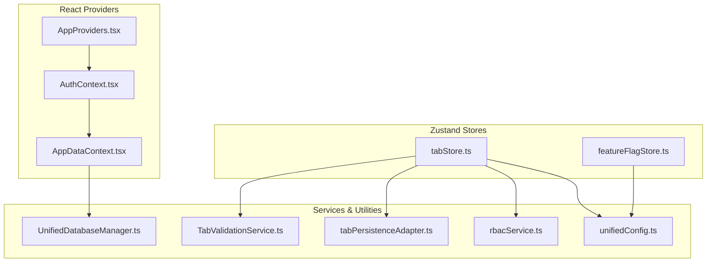
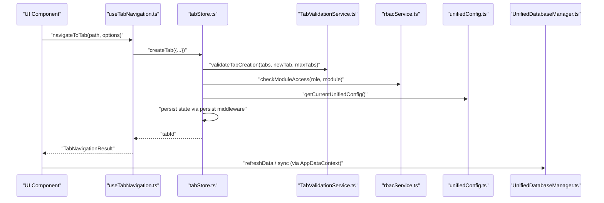
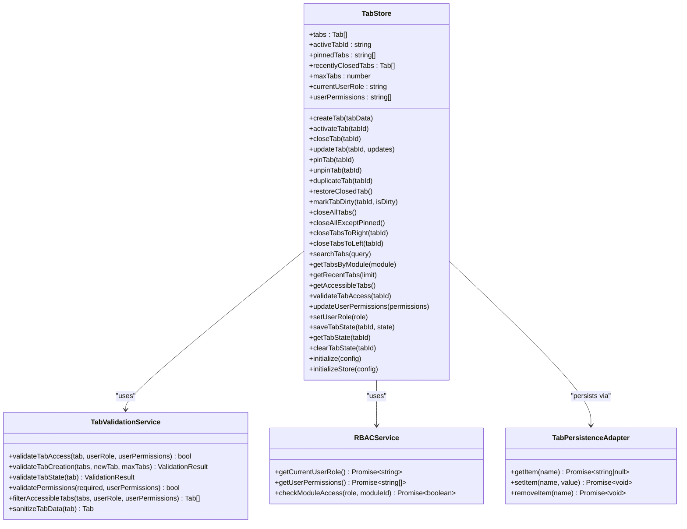
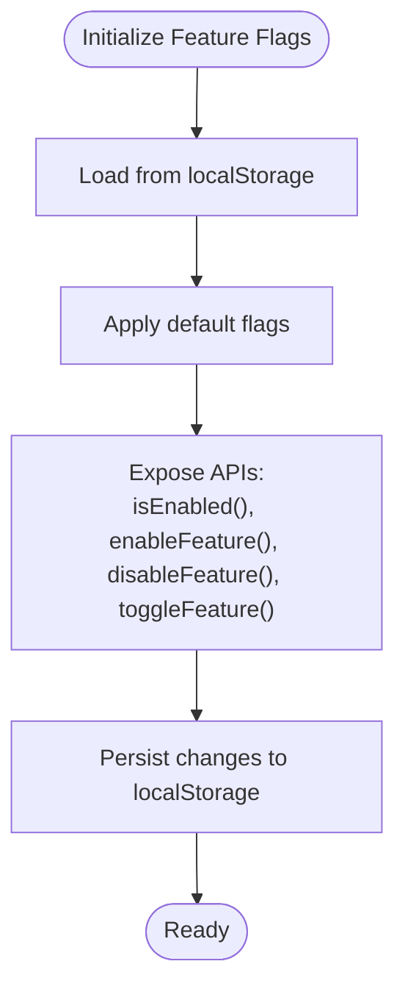
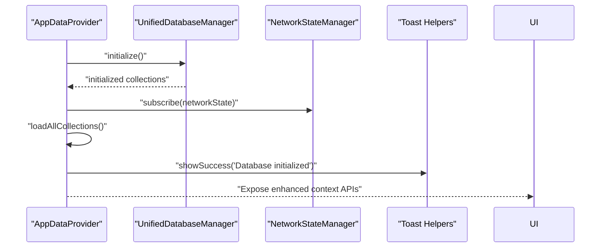
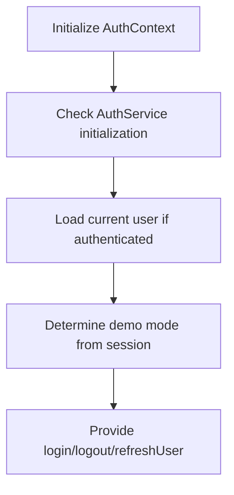
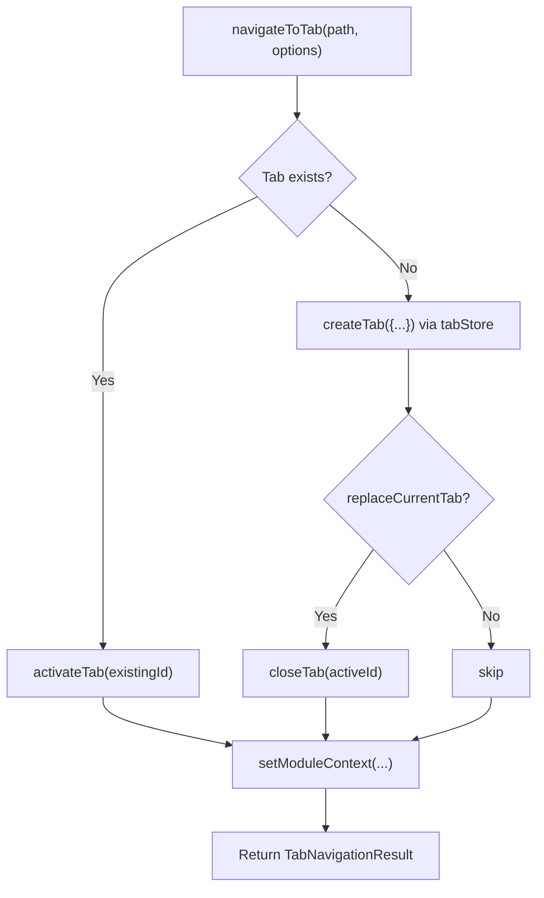
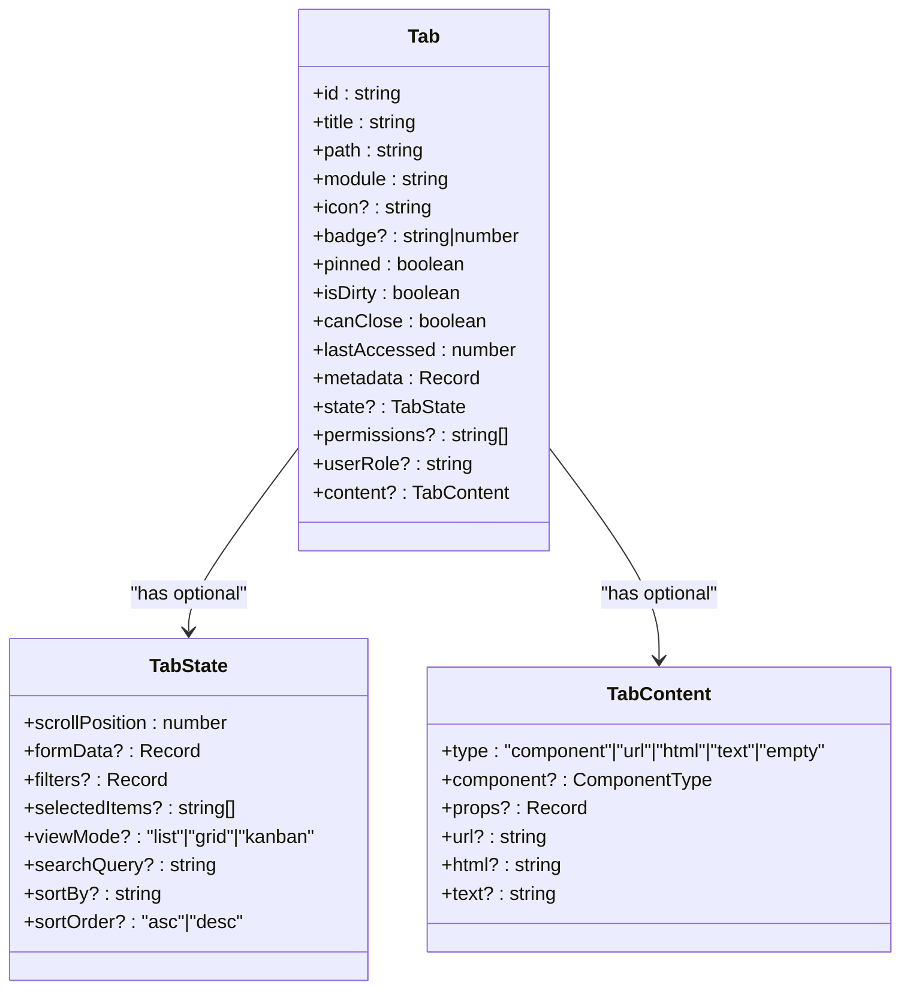
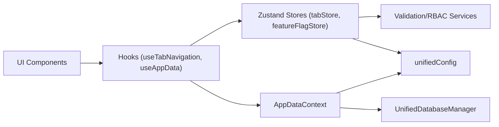

# State Management System

<cite>
**Referenced Files in This Document**
- [tabStore.ts](file://src/stores/tabStore.ts)
- [featureFlagStore.ts](file://src/stores/featureFlagStore.ts)
- [AppDataContext.tsx](file://src/contexts/AppDataContext.tsx)
- [AuthContext.tsx](file://src/contexts/AuthContext.tsx)
- [useAppData.ts](file://src/hooks/useAppData.ts)
- [UnifiedDatabaseManager.ts](file://src/services/database/UnifiedDatabaseManager.ts)
- [unifiedConfig.ts](file://src/config/unifiedConfig.ts)
- [tabPersistenceAdapter.ts](file://src/stores/adapters/tabPersistenceAdapter.ts)
- [AppProviders.tsx](file://src/contexts/AppProviders.tsx)
- [tabValidationService.ts](file://src/services/tabs/TabValidationService.ts)
- [tabbedWorkspace.ts](file://src/types/tabbedWorkspace.ts)
- [useTabNavigation.ts](file://src/hooks/useTabNavigation.ts)
- [rbacService.ts](file://src/core/rbacService.ts)
</cite>

## Table of Contents
1. [Introduction](#introduction)
2. [Project Structure](#project-structure)
3. [Core Components](#core-components)
4. [Architecture Overview](#architecture-overview)
5. [Detailed Component Analysis](#detailed-component-analysis)
6. [Dependency Analysis](#dependency-analysis)
7. [Performance Considerations](#performance-considerations)
8. [Troubleshooting Guide](#troubleshooting-guide)
9. [Conclusion](#conclusion)

## Introduction
This document explains SchoolPilot3's state management architecture that combines Zustand stores with React Context to achieve clear separation of concerns. Global state (authentication, configuration, feature flags) is managed via lightweight Zustand stores with persistence, while tab-specific state is handled by a dedicated Zustand store with robust validation and persistence. The AppDataContext serves as the central data abstraction layer, integrating database providers, sync orchestration, and data lifecycle management. Cross-tab synchronization is achieved through a provider-agnostic database manager and a unified configuration system, ensuring loose coupling between modules and services.

## Project Structure
The state management system is organized around three pillars:
- Global Zustand stores for authentication, configuration, and feature flags
- Tab-specific Zustand store with validation and persistence
- Central AppDataContext provider for database, sync, and data operations

**Diagram sources**
- [AppProviders.tsx:105-136](file://src/contexts/AppProviders.tsx#L105-L136)
- [AuthContext.tsx:28-159](file://src/contexts/AuthContext.tsx#L28-L159)
- [AppDataContext.tsx:219-599](file://src/contexts/AppDataContext.tsx#L219-L599)
- [tabStore.ts:139-800](file://src/stores/tabStore.ts#L139-L800)
- [featureFlagStore.ts:43-79](file://src/stores/featureFlagStore.ts#L43-L79)
- [UnifiedDatabaseManager.ts:44-169](file://src/services/database/UnifiedDatabaseManager.ts#L44-L169)
- [tabValidationService.ts:83-564](file://src/services/tabs/TabValidationService.ts#L83-L564)
- [tabPersistenceAdapter.ts:49-153](file://src/stores/adapters/tabPersistenceAdapter.ts#L49-L153)
- [rbacService.ts:70-405](file://src/core/rbacService.ts#L70-L405)
- [unifiedConfig.ts:114-221](file://src/config/unifiedConfig.ts#L114-L221)

**Section sources**
- [AppProviders.tsx:105-136](file://src/contexts/AppProviders.tsx#L105-L136)
- [tabStore.ts:139-800](file://src/stores/tabStore.ts#L139-L800)
- [AppDataContext.tsx:219-599](file://src/contexts/AppDataContext.tsx#L219-L599)

## Core Components
- Zustand Tab Store: Manages tab lifecycle, validation, RBAC integration, and persistence with a custom storage adapter.
- Feature Flag Store: Lightweight Zustand store for feature toggles with localStorage persistence.
- AppDataContext Provider: Central data layer orchestrating database initialization, sync, pagination, validation, and memory management.
- AuthContext: Authentication state with login/logout and permission checks.
- TabValidationService: Centralized validation for tabs, permissions, and state integrity.
- UnifiedDatabaseManager: Provider-agnostic database manager selecting optimal provider based on environment and capabilities.

**Section sources**
- [tabStore.ts:139-800](file://src/stores/tabStore.ts#L139-L800)
- [featureFlagStore.ts:43-79](file://src/stores/featureFlagStore.ts#L43-L79)
- [AppDataContext.tsx:219-599](file://src/contexts/AppDataContext.tsx#L219-L599)
- [AuthContext.tsx:28-159](file://src/contexts/AuthContext.tsx#L28-L159)
- [tabValidationService.ts:83-564](file://src/services/tabs/TabValidationService.ts#L83-L564)
- [UnifiedDatabaseManager.ts:44-169](file://src/services/database/UnifiedDatabaseManager.ts#L44-L169)

## Architecture Overview
The system separates global state (auth, config, flags) from tab-specific state while maintaining reactive data flow from UI components to services and database providers. UI hooks consume Zustand stores and AppDataContext, which coordinates database operations and sync. Cross-tab persistence and synchronization leverage a provider-agnostic database manager and unified configuration.

**Diagram sources**
- [useTabNavigation.ts:339-386](file://src/hooks/useTabNavigation.ts#L339-L386)
- [tabStore.ts:258-335](file://src/stores/tabStore.ts#L258-L335)
- [tabValidationService.ts:177-224](file://src/services/tabs/TabValidationService.ts#L177-L224)
- [rbacService.ts:395-401](file://src/core/rbacService.ts#L395-L401)
- [unifiedConfig.ts:114-114](file://src/config/unifiedConfig.ts#L114-L114)
- [UnifiedDatabaseManager.ts:99-169](file://src/services/database/UnifiedDatabaseManager.ts#L99-L169)

## Detailed Component Analysis

### Zustand Tab Store
The tab store encapsulates tab lifecycle, validation, RBAC checks, and persistence. It uses Zustand's persist middleware with a custom storage adapter to bridge Zustand and the TabPersistenceService. Validation is delegated to TabValidationService, ensuring consistent rules across creation, activation, and access checks. RBAC integration is performed via rbacService for module access and permission validation.

**Diagram sources**
- [tabStore.ts:18-107](file://src/stores/tabStore.ts#L18-L107)
- [tabStore.ts:258-335](file://src/stores/tabStore.ts#L258-L335)
- [tabValidationService.ts:120-166](file://src/services/tabs/TabValidationService.ts#L120-L166)
- [rbacService.ts:376-401](file://src/core/rbacService.ts#L376-L401)
- [tabPersistenceAdapter.ts:49-153](file://src/stores/adapters/tabPersistenceAdapter.ts#L49-L153)

**Section sources**
- [tabStore.ts:139-800](file://src/stores/tabStore.ts#L139-L800)
- [tabValidationService.ts:83-564](file://src/services/tabs/TabValidationService.ts#L83-L564)
- [rbacService.ts:70-405](file://src/core/rbacService.ts#L70-L405)
- [tabPersistenceAdapter.ts:49-153](file://src/stores/adapters/tabPersistenceAdapter.ts#L49-L153)

### Feature Flag Store
The feature flag store provides a simple, persistent mechanism to toggle features. It persists flags to localStorage and exposes helpers to query and modify flags. This enables gradual rollouts and environment-specific feature control.

**Diagram sources**
- [featureFlagStore.ts:43-79](file://src/stores/featureFlagStore.ts#L43-L79)

**Section sources**
- [featureFlagStore.ts:43-79](file://src/stores/featureFlagStore.ts#L43-L79)

### AppDataContext Provider
AppDataContext is the central data abstraction layer. It initializes the database manager, loads collections, manages sync status and settings, and exposes methods for refresh, backup/restore, pagination, validation, and memory cleanup. It integrates with UnifiedDatabaseManager and maintains network state and sync orchestration.

**Diagram sources**
- [AppDataContext.tsx:297-351](file://src/contexts/AppDataContext.tsx#L297-L351)
- [AppDataContext.tsx:395-417](file://src/contexts/AppDataContext.tsx#L395-L417)
- [AppDataContext.tsx:461-537](file://src/contexts/AppDataContext.tsx#L461-L537)
- [UnifiedDatabaseManager.ts:99-169](file://src/services/database/UnifiedDatabaseManager.ts#L99-L169)

**Section sources**
- [AppDataContext.tsx:219-599](file://src/contexts/AppDataContext.tsx#L219-L599)
- [UnifiedDatabaseManager.ts:44-169](file://src/services/database/UnifiedDatabaseManager.ts#L44-L169)

### AuthContext
AuthContext manages user authentication state, login/logout, and permission checks. It initializes asynchronously and determines demo mode from the current session, ensuring graceful fallbacks if the auth service is unavailable.

**Diagram sources**
- [AuthContext.tsx:34-74](file://src/contexts/AuthContext.tsx#L34-L74)
- [AuthContext.tsx:77-120](file://src/contexts/AuthContext.tsx#L77-L120)

**Section sources**
- [AuthContext.tsx:28-159](file://src/contexts/AuthContext.tsx#L28-L159)

### Tab Navigation Hook
The useTabNavigation hook provides a programmatic API for tab creation, activation, closing, duplication, and organization. It integrates with the tab store, router, and action provider to maintain consistent navigation behavior and module context.

**Diagram sources**
- [useTabNavigation.ts:339-386](file://src/hooks/useTabNavigation.ts#L339-L386)
- [useTabNavigation.ts:187-336](file://src/hooks/useTabNavigation.ts#L187-L336)

**Section sources**
- [useTabNavigation.ts:107-627](file://src/hooks/useTabNavigation.ts#L107-L627)

### Types and Contracts
The tabbed workspace types define the shape of tabs, tab content, tab state, and action definitions. These types underpin validation and ensure consistent data structures across the system.

**Diagram sources**
- [tabbedWorkspace.ts:20-49](file://src/types/tabbedWorkspace.ts#L20-L49)
- [tabbedWorkspace.ts:9-17](file://src/types/tabbedWorkspace.ts#L9-L17)

**Section sources**
- [tabbedWorkspace.ts:1-221](file://src/types/tabbedWorkspace.ts#L1-L221)

## Dependency Analysis
The system exhibits low coupling and high cohesion:
- UI hooks depend on Zustand stores and AppDataContext, not on internal service implementations.
- Tab store depends on TabValidationService and rbacService for validation and access control.
- AppDataContext depends on UnifiedDatabaseManager and configuration utilities for data operations.
- Feature flags depend on unified configuration for environment-aware feature control.

**Diagram sources**
- [useTabNavigation.ts:107-627](file://src/hooks/useTabNavigation.ts#L107-L627)
- [useAppData.ts:9-21](file://src/hooks/useAppData.ts#L9-L21)
- [tabStore.ts:139-800](file://src/stores/tabStore.ts#L139-L800)
- [AppDataContext.tsx:219-599](file://src/contexts/AppDataContext.tsx#L219-L599)
- [UnifiedDatabaseManager.ts:44-169](file://src/services/database/UnifiedDatabaseManager.ts#L44-L169)
- [unifiedConfig.ts:114-221](file://src/config/unifiedConfig.ts#L114-L221)

**Section sources**
- [useTabNavigation.ts:107-627](file://src/hooks/useTabNavigation.ts#L107-L627)
- [useAppData.ts:9-21](file://src/hooks/useAppData.ts#L9-L21)
- [tabStore.ts:139-800](file://src/stores/tabStore.ts#L139-L800)
- [AppDataContext.tsx:219-599](file://src/contexts/AppDataContext.tsx#L219-L599)
- [UnifiedDatabaseManager.ts:44-169](file://src/services/database/UnifiedDatabaseManager.ts#L44-L169)
- [unifiedConfig.ts:114-221](file://src/config/unifiedConfig.ts#L114-L221)

## Performance Considerations
- Zustand immutability with immer middleware reduces unnecessary re-renders while keeping updates efficient.
- Tab store uses localStorage-backed persistence with a custom adapter to offload heavy data to IndexedDB via TabPersistenceService, minimizing localStorage pressure.
- AppDataContext defers database initialization and uses timeouts to prevent blocking the UI; it also throttles refresh operations to avoid frequent re-renders.
- UnifiedDatabaseManager performs health checks and automatic repairs to maintain performance and reliability.
- Feature flags are persisted locally to avoid repeated computation and network requests.

[No sources needed since this section provides general guidance]

## Troubleshooting Guide
Common issues and resolutions:
- Tab creation failures: Validate tab creation rules via TabValidationService and ensure user role/module access via rbacService. Check max tabs limit and duplicate detection.
- Corrupted tab data: The tab store includes a cleanup routine that filters invalid tabs and cleans references; use the provided cleanup functions to recover.
- Persistence failures: The tab persistence adapter falls back to localStorage when IndexedDB is unavailable; verify IndexedDB support and localStorage access.
- Sync issues: AppDataContext monitors network state and provider capabilities; ensure provider supports sync and that auto-sync settings are configured correctly.
- Authentication initialization timeouts: AuthContext gracefully handles initialization timeouts and continues with unauthenticated state if needed.

**Section sources**
- [tabStore.ts:79-136](file://src/stores/tabStore.ts#L79-L136)
- [tabPersistenceAdapter.ts:56-93](file://src/stores/adapters/tabPersistenceAdapter.ts#L56-L93)
- [AppDataContext.tsx:360-393](file://src/contexts/AppDataContext.tsx#L360-L393)
- [AuthContext.tsx:34-74](file://src/contexts/AuthContext.tsx#L34-L74)

## Conclusion
SchoolPilot3’s state management architecture cleanly separates global and tab-specific concerns using Zustand stores and React Context. The AppDataContext acts as a central data abstraction layer, coordinating database operations, sync, and data lifecycle. Robust validation and RBAC enforcement ensure data integrity and access control. Persistence strategies and cross-tab synchronization are provider-agnostic, enabling flexible deployment modes while maintaining loose coupling across modules and services.