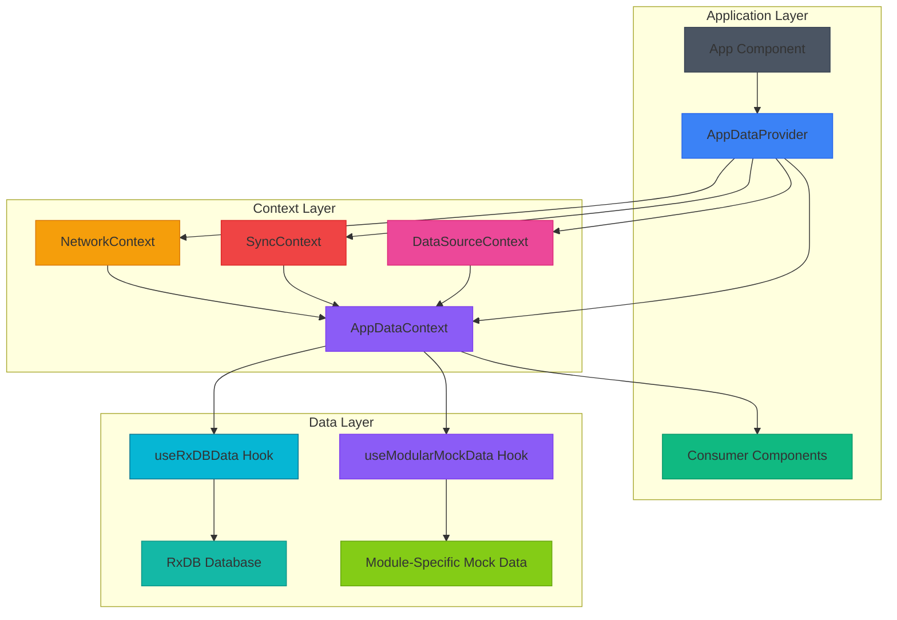
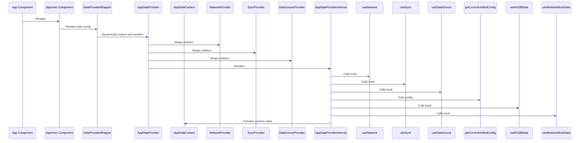
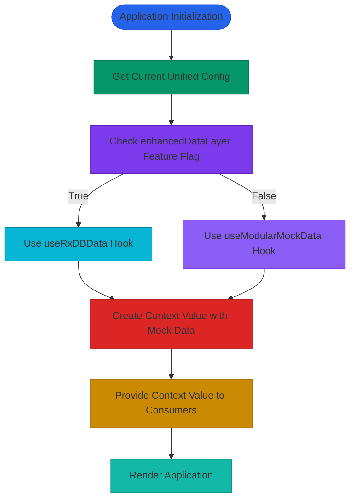
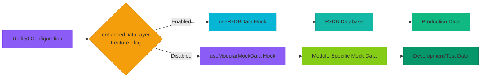
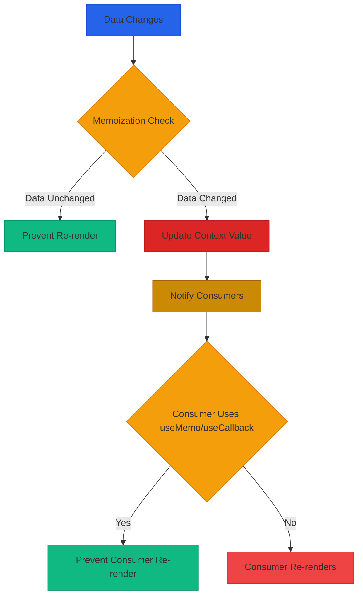

# App Data Context

<cite>
**Referenced Files in This Document**   
- [AppDataContext.tsx](file://src/contexts/AppDataContext.tsx)
- [useAppData.ts](file://src/hooks/useAppData.ts)
- [app.tsx](file://src/app.tsx)
- [useRxDBData.ts](file://src/hooks/useRxDBData.ts)
- [useModularMockData.ts](file://src/hooks/useModularMockData.ts)
- [types.ts](file://src/types.ts)
</cite>

## Table of Contents
1. [Introduction](#introduction)
2. [Architecture Overview](#architecture-overview)
3. [Core Components](#core-components)
4. [Data Flow and Initialization](#data-flow-and-initialization)
5. [State Structure and Data Management](#state-structure-and-data-management)
6. [Data Source Selection and Configuration](#data-source-selection-and-configuration)
7. [Component Integration and Consumption](#component-integration-and-consumption)
8. [Performance Considerations](#performance-considerations)
9. [Error Handling and Recovery](#error-handling-and-recovery)
10. [Conclusion](#conclusion)

## Introduction
The AppDataContext serves as the central state management system for the schoolpilot3 application, providing a unified interface for accessing and managing global application data. This context container orchestrates data from multiple sources, including RxDB database and modular mock data, to provide a consistent data layer across the application. The implementation follows React's Context API pattern with careful consideration for performance, error handling, and seamless integration with the application's modular architecture.

**Section sources**
- [AppDataContext.tsx](file://src/contexts/AppDataContext.tsx#L1-L28)

## Architecture Overview



**Diagram sources**
- [AppDataContext.tsx](file://src/contexts/AppDataContext.tsx#L1-L168)
- [app.tsx](file://src/app.tsx#L1-L510)

## Core Components

### AppDataContext Implementation
The AppDataContext is implemented as a React Context that provides a centralized state management solution for the application. It serves as the primary interface for components to access global data, with a sophisticated provider pattern that integrates multiple context dependencies.

```mermaid
classDiagram
class AppDataContext {
+createContext<AppDataContextType | undefined>(undefined)
}
class AppDataProvider {
+AppDataProvider({ children })
+wraps NetworkProvider
+wraps SyncProvider
+wraps DataSourceProvider
+wraps AppDataProviderInternal
}
class AppDataProviderInternal {
-isOnline : boolean
-syncStatus : SyncStatus
-dataStrategy : DataStrategy
-currentConfig : UnifiedAppConfig
-rxdbResult : RxDBResult
-mockResult : MockResult
-selectedData : SelectedData
-contextValue : AppDataContextType
+render()
}
class useAppData {
+useContext(AppDataContext)
+throws Error if context is undefined
+returns EnhancedAppDataContextType
}
AppDataProvider --> AppDataProviderInternal : "composes"
AppDataProviderInternal --> AppDataContext : "provides value"
useAppData --> AppDataContext : "consumes"
AppDataProvider --> NetworkProvider : "wraps"
AppDataProvider --> SyncProvider : "wraps"
AppDataProvider --> DataSourceProvider : "wraps"
```

**Diagram sources**
- [AppDataContext.tsx](file://src/contexts/AppDataContext.tsx#L1-L168)

**Section sources**
- [AppDataContext.tsx](file://src/contexts/AppDataContext.tsx#L1-L168)

### useAppData Hook
The useAppData hook provides a clean interface for components to access the AppDataContext. It includes error handling to ensure the hook is used within the appropriate provider context.

```typescript
export function useAppData(): EnhancedAppDataContextType {
  const context = useContext(AppDataContext);
  if (context === undefined) {
    throw new Error('useAppData must be used within an AppDataProvider');
  }
  return context;
}
```

This hook is separated from the AppDataContext implementation to maintain Fast Refresh compatibility during development, following React best practices for context usage.

**Section sources**
- [useAppData.ts](file://src/hooks/useAppData.ts#L0-L20)

## Data Flow and Initialization

### Application Integration
The AppDataProvider is integrated into the application's component tree through the main app.tsx file, where it's wrapped with other context providers and initialized with the application's configuration.



**Diagram sources**
- [app.tsx](file://src/app.tsx#L1-L510)
- [AppDataContext.tsx](file://src/contexts/AppDataContext.tsx#L1-L168)

**Section sources**
- [app.tsx](file://src/app.tsx#L1-L510)

### Data Source Selection Process
The AppDataContext implements a dynamic data source selection mechanism based on the application's configuration, specifically the enhancedDataLayer feature flag.



**Diagram sources**
- [AppDataContext.tsx](file://src/contexts/AppDataContext.tsx#L1-L168)

**Section sources**
- [AppDataContext.tsx](file://src/contexts/AppDataContext.tsx#L1-L168)

## State Structure and Data Management

### Context Value Structure
The AppDataContext provides a rich set of data and functionality to consumer components, structured to support both core application features and module-specific requirements.

```typescript
interface AppDataContextType {
  // Core data collections
  schoolDetails: any | null;
  users: any[];
  students: any[];
  staff: any[];
  classes: any[];
  subjects: any[];
  
  // Module-specific data
  academicYears: any[];
  examSessions: any[];
  gradingSchemes: any[];
  studentExamResults: any[];
  timetableEntries: any[];
  
  // Loading and error states
  loading: boolean | AppDataLoadingStates;
  error: Error | null;
  
  // Data operations
  refresh: () => Promise<void>;
  getStudentDetailsById: (id: string) => any | null;
}
```

The context value is memoized using useMemo to prevent unnecessary re-renders when the data hasn't changed, optimizing performance across the application.

**Section sources**
- [AppDataContext.tsx](file://src/contexts/AppDataContext.tsx#L1-L168)

### Enhanced Context Type
The AppDataContext extends the base type with additional properties specifically for settings pages, demonstrating the flexibility of the context system.

```typescript
export interface EnhancedAppDataContextType extends AppDataContextType {
  isDatabaseModeActive?: boolean;
}
```

This extension pattern allows for specialized context interfaces without modifying the core context implementation, supporting different consumer requirements while maintaining type safety.

**Section sources**
- [AppDataContext.tsx](file://src/contexts/AppDataContext.tsx#L1-L28)

## Data Source Selection and Configuration

### Configuration-Driven Data Strategy
The AppDataContext leverages the application's unified configuration to determine which data source to use, enabling different behavior in development, testing, and production environments.



**Diagram sources**
- [AppDataContext.tsx](file://src/contexts/AppDataContext.tsx#L1-L168)

**Section sources**
- [AppDataContext.tsx](file://src/contexts/AppDataContext.tsx#L1-L168)

### useRxDBData Implementation
The useRxDBData hook provides access to the RxDB database, implementing a simplified interface for retrieving and manipulating data.

```typescript
export const useRxDBData = (): Partial<AppDataContextType> => {
  const [dbInstance, setDbInstance] = useState<SchoolDatabase | null>(null);
  const [loading, setLoading] = useState<AppDataLoadingStates>(createInitialLoadingStates());
  const [initializationError, setInitializationError] = useState<Error | null>(null);
  
  // Database initialization effect
  useEffect(() => {
    let isMounted = true;
    
    const initializeDatabase = async () => {
      try {
        const db = await getDatabase();
        if (isMounted) {
          setDbInstance(db);
          setInitializationError(null);
          setLoading(prev => ({ ...prev, all: false }));
        }
      } catch (error: any) {
        console.error('Database initialization error:', error);
        if (isMounted) {
          setInitializationError(error);
          setLoading(prev => ({ ...prev, all: false }));
        }
      }
    };
    
    initializeDatabase();
    
    return () => {
      isMounted = false;
    };
  }, []);
  
  return useMemo(() => ({
    loading,
    initializationError,
    isRxDBModeActive: true,
    schoolDetails: null,
    users: [],
    students: [],
    staff: [],
    classes: [],
    subjects: [],
    // Additional data collections...
    refresh: async () => {
      console.log('RxDB refresh triggered');
    }
  }), [loading, initializationError]);
};
```

This implementation follows React best practices with proper cleanup in the useEffect cleanup function and memoization of the returned value to prevent unnecessary re-renders.

**Section sources**
- [useRxDBData.ts](file://src/hooks/useRxDBData.ts#L1-L306)

### useModularMockData Implementation
The useModularMockData hook aggregates mock data from various modules, providing a fallback data source when RxDB is not available or enabled.

```typescript
export const useModularMockData = (): AppDataContextType => {
  console.log('🔧 [useModularMockData] DEBUG: Running with ACADEMICS hooks enabled.');
  
  const [loading, setLoading] = useState<AppDataLoadingStates>(createLoadingStates());
  
  // Import module-specific data hooks
  const { data: academicyears } = useAcademicYearData();
  const { data: classsubjectallocations } = useClassSubjectAllocationData();
  // ... other module hooks
  
  useEffect(() => {
    const timer = setTimeout(() => {
      setLoading({ all: false });
    }, 500);
    return () => clearTimeout(timer);
  }, []);
  
  const emptyFunc = async () => { 
    console.warn("Called a no-op function from debug mock data."); 
  };
  
  const fullData: AppDataType = {
    // ACADEMICS DATA (LIVE)
    academicYears: academicyears || [],
    classSubjectAllocations: classsubjectallocations || [],
    // ... other academic data
    
    // OTHER MODULES (FALLBACK MOCK)
    schoolDetails: rawInitialData.schoolDetails || null,
    users: rawInitialData.users || [],
    // ... other mock data
  };
  
  return {
    ...fullData,
    loading: loading.all,
    error: null,
    refresh: emptyFunc,
    getStudentDetailsById: emptyFunc,
    // ... CRUD operations as no-ops
  };
};
```

This implementation demonstrates a hybrid approach, using live module hooks for academics data while falling back to static mock data for other modules, allowing for targeted testing and development.

**Section sources**
- [useModularMockData.ts](file://src/hooks/useModularMockData.ts#L1-L260)

## Component Integration and Consumption

### Provider Hierarchy
The AppDataProvider is integrated into the application's component tree with a specific hierarchy that ensures all dependencies are properly resolved.

```mermaid
graph TD
A[App] --> B[UnifiedConfigProvider]
B --> C[ToastProvider]
C --> D[Suspense]
D --> E[AppInner]
E --> F[HashRouter]
F --> G[DataProviderWrapper]
G --> H[AuthProvider]
H --> I[UserProvider]
I --> J[AppContent]
J --> K[ActionProvider]
K --> L[Layout]
L --> M[ErrorBoundary]
M --> N[DynamicRoutes]
N --> O[Consumer Components]
style A fill:#2563EB,stroke:#1D4ED8
style B fill:#7C3AED,stroke:#5B21B6
style C fill:#059669,stroke:#047857
style D fill:#F59E0B,stroke:#D97706
style E fill:#DC2626,stroke:#B91C1C
style F fill:#CA8A04,stroke:#A16207
style G fill:#8B5CF6,stroke:#7C3AED
style H fill:#06B6D4,stroke:#0E7490
style I fill:#14B8A6,stroke:#0D9488
style J fill:#10B981,stroke:#059669
style K fill:#059669,stroke:#047857
style L fill:#172554,stroke:#1E293B
style M fill:#4B5563,stroke:#374151
style N fill:#3B82F6,stroke:#2563EB
style O fill:#84CC16,stroke:#65A30D
```



**Diagram sources**
- [app.tsx](file://src/app.tsx#L1-L510)

**Section sources**
- [app.tsx](file://src/app.tsx#L1-L510)

### Consumer Component Usage
Components consume the AppDataContext through the useAppData hook, accessing the global state in a type-safe manner.

```typescript
// Example consumer component
const StudentList: React.FC = () => {
  const { students, loading, error } = useAppData();
  
  if (loading) {
    return <Spinner />;
  }
  
  if (error) {
    return <div>Error: {error.message}</div>;
  }
  
  return (
    <ul>
      {students.map(student => (
        <li key={student.id}>{student.name}</li>
      ))}
    </ul>
  );
};
```

This pattern allows components to selectively access only the data they need, minimizing re-renders when unrelated state changes occur.

**Section sources**
- [AppDataContext.tsx](file://src/contexts/AppDataContext.tsx#L1-L168)

## Performance Considerations

### Memoization and Re-renders
The AppDataContext implementation employs several performance optimization techniques to minimize unnecessary re-renders and improve application responsiveness.



Key optimization strategies include:
- Using useMemo to memoize the context value
- Structuring data to enable selective consumption
- Implementing stable callback functions with useCallback
- Minimizing state updates through batched operations

**Section sources**
- [AppDataContext.tsx](file://src/contexts/AppDataContext.tsx#L1-L168)

### Memory Management
The context implementation includes considerations for memory management, particularly in the cleanup of subscriptions and effects.

```typescript
useEffect(() => {
  let isMounted = true;
  let subscription: Subscription | null = null;
  
  const initializeDatabase = async () => {
    // ... initialization logic
  };
  
  initializeDatabase();
  
  return () => {
    isMounted = false;
    if (subscription) {
      subscription.unsubscribe();
    }
  };
}, []);
```

This pattern prevents memory leaks by ensuring that subscriptions and other resources are properly cleaned up when components are unmounted.

**Section sources**
- [useRxDBData.ts](file://src/hooks/useRxDBData.ts#L1-L306)

## Error Handling and Recovery

### Production Error Handling
The AppDataContext includes specific error handling for production environments, providing a user-friendly experience when data loading fails.

```tsx
if (currentConfig.environment === 'production' && contextValue.error) {
  return (
    <div className="flex items-center justify-center min-h-screen bg-red-50">
      <div className="text-center p-6">
        <div className="text-red-600 text-xl mb-2">⚠️ Application Error</div>
        <div className="text-gray-700 mb-4">We're experiencing technical difficulties. Please try again later.</div>
        <button 
          onClick={() => window.location.reload()} 
          className="px-4 py-2 bg-red-600 text-white rounded hover:bg-red-700"
        >
          Reload Application
        </button>
      </div>
    </div>
  );
}
```

This approach ensures that users are informed of issues and provided with a clear recovery path, rather than being presented with a technical error message.

**Section sources**
- [AppDataContext.tsx](file://src/contexts/AppDataContext.tsx#L1-L168)

### Status Banners
The context provider renders status banners to inform users of network and synchronization status, enhancing the user experience during data operations.

```tsx
{/* Status banners */}
{!isOnline && (
  <div className="fixed top-0 left-0 right-0 bg-yellow-500 text-white text-center py-2 z-50">
    📡 Offline Mode - Changes will sync when connection is restored
  </div>
)}

{syncStatus.state === 'syncing' && (
  <div className="fixed top-0 left-0 right-0 bg-blue-500 text-white text-center py-2 z-50">
    🔄 Syncing data... ({Math.round(syncStatus.progress)}%)
  </div>
)}

{syncStatus.state === 'error' && syncStatus.lastError && (
  <div className="fixed top-0 left-0 right-0 bg-red-500 text-white text-center py-2 z-50">
    ❌ Sync Error: {syncStatus.lastError.message}
  </div>
)}
```

These banners provide real-time feedback on the application's state, helping users understand when their actions might be delayed or require manual intervention.

**Section sources**
- [AppDataContext.tsx](file://src/contexts/AppDataContext.tsx#L1-L168)

## Conclusion
The AppDataContext implementation in schoolpilot3 provides a robust and flexible solution for global state management, effectively balancing the needs of a complex educational application with performance, maintainability, and developer experience. By leveraging React's Context API with careful attention to optimization and error handling, the implementation enables seamless data access across the application while supporting multiple data sources and deployment scenarios.

Key strengths of the implementation include:
- Clear separation of concerns between data providers and consumers
- Flexible data source selection based on configuration
- Comprehensive error handling for production environments
- Performance optimizations through memoization and selective re-renders
- Integration with the application's modular architecture

This documentation provides a comprehensive overview of the AppDataContext system, serving as a reference for developers working with or extending the application's data management capabilities.

**Section sources**
- [AppDataContext.tsx](file://src/contexts/AppDataContext.tsx#L1-L168)
- [useAppData.ts](file://src/hooks/useAppData.ts#L0-L20)
- [app.tsx](file://src/app.tsx#L1-L510)
- [useRxDBData.ts](file://src/hooks/useRxDBData.ts#L1-L306)
- [useModularMockData.ts](file://src/hooks/useModularMockData.ts#L1-L260)