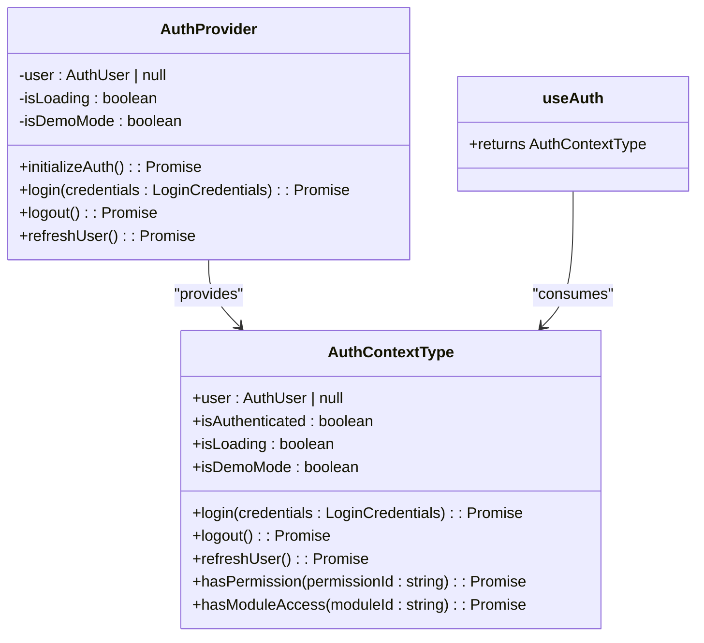
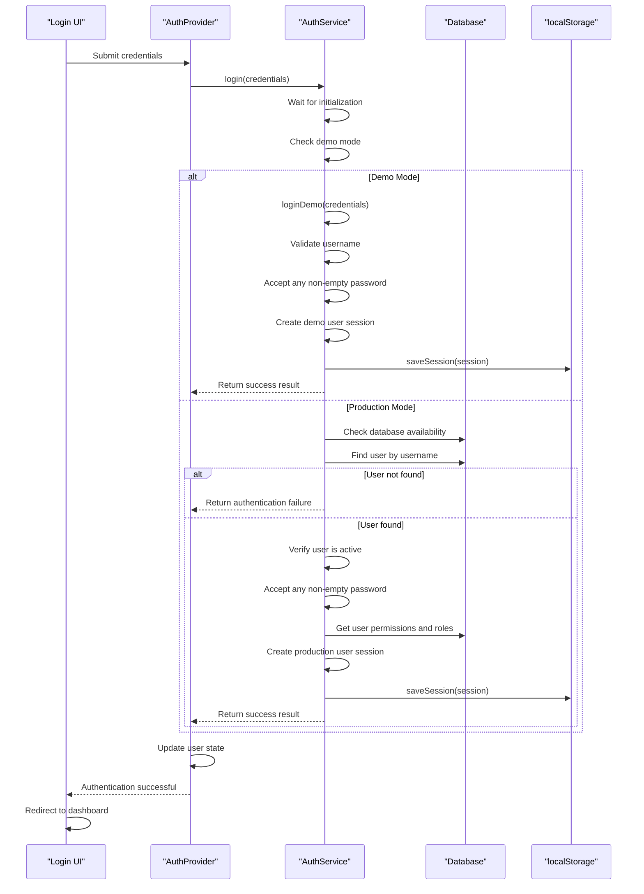
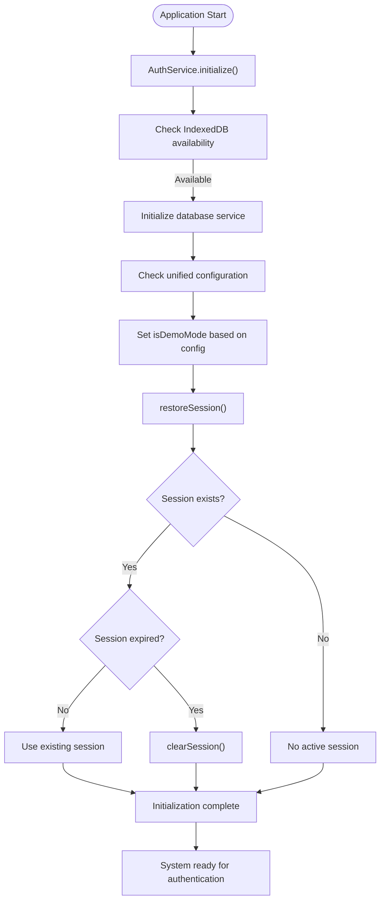
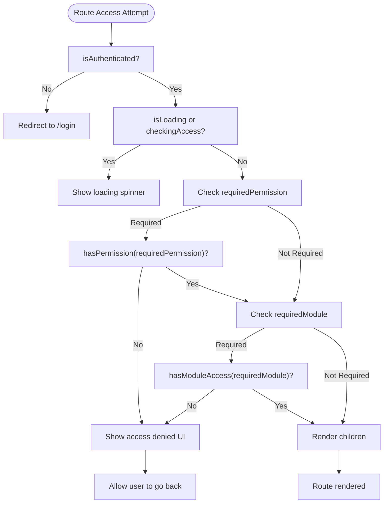
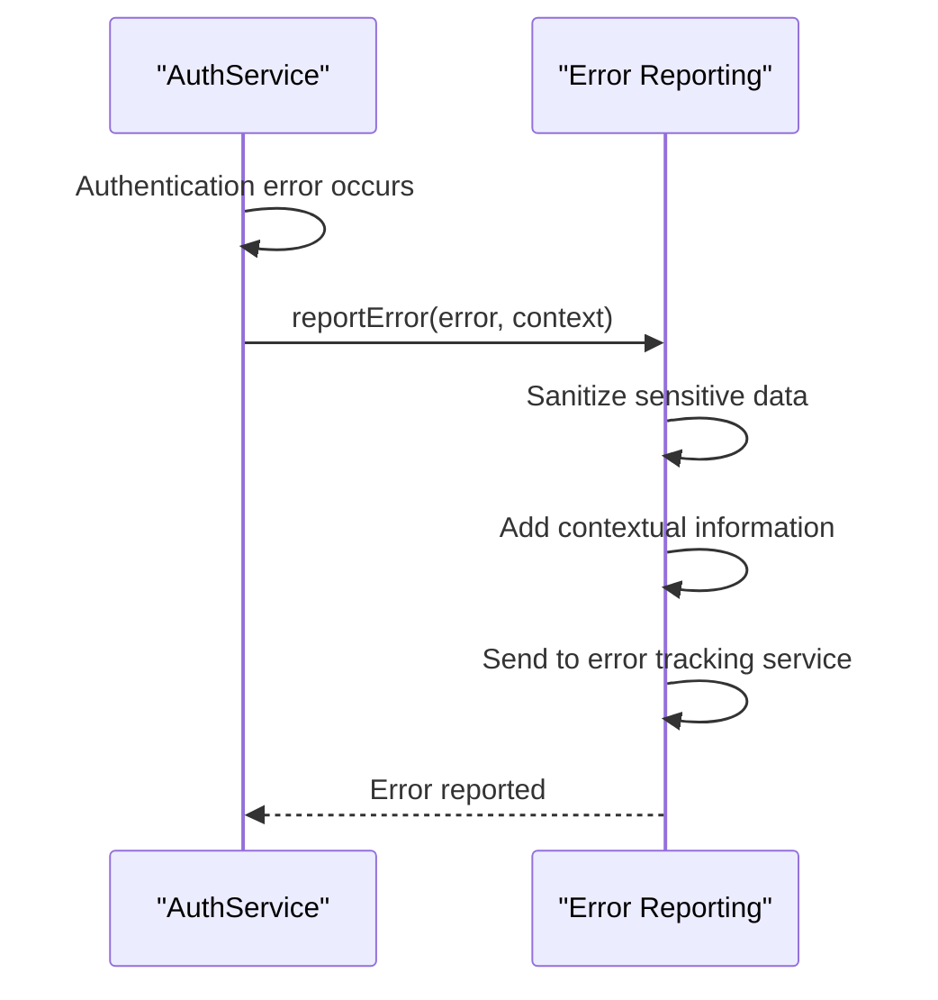

# Authentication Context

<cite>
**Referenced Files in This Document**   
- [AuthContext.tsx](file://src/contexts/AuthContext.tsx)
- [authService.ts](file://src/services/authService.ts)
- [ProtectedRoute.tsx](file://src/components/ProtectedRoute.tsx)
- [LoginPage.tsx](file://src/modules/core/pages/LoginPage.tsx)
</cite>

## Table of Contents
1. [Introduction](#introduction)
2. [Core Components](#core-components)
3. [Authentication Flow](#authentication-flow)
4. [Token Management and Session Persistence](#token-management-and-session-persistence)
5. [Protected Routes and Access Control](#protected-routes-and-access-control)
6. [Security Considerations](#security-considerations)
7. [Error Handling](#error-handling)
8. [Integration with External Systems](#integration-with-external-systems)

## Introduction
The Authentication Context system in schoolpilot3 provides a comprehensive solution for managing user authentication state, session persistence, and secure access to protected resources. This system implements a robust authentication mechanism that supports both demo mode for testing and production mode for real-world usage. The architecture is built around React Context for state management, with a dedicated authentication service handling the core logic. The system manages user sessions across application restarts through localStorage persistence and provides fine-grained access control through permission and module-based authorization.

## Core Components

The authentication system consists of several key components that work together to provide a seamless authentication experience:

### AuthProvider and useAuth Hook
The AuthProvider component serves as the central state management container for authentication data, while the useAuth hook provides components with access to authentication status, user profile, and authentication methods.

**Diagram sources**
- [AuthContext.tsx](file://src/contexts/AuthContext.tsx#L10-L38)

**Section sources**
- [AuthContext.tsx](file://src/contexts/AuthContext.tsx#L1-L159)

### AuthService Implementation
The authService is a singleton class that handles all authentication operations, including login, logout, session management, and permission checking. It serves as the bridge between the React context and the underlying data storage.

```mermaid
classDiagram
class AuthService {
-isDemoMode : boolean
-currentSession : AuthSession | null
-sessionKey : string
-rxDBAvailable : boolean
-initializationComplete : boolean
+initialize() : Promise<void>
+login(credentials : LoginCredentials) : Promise<AuthResult>
+logout() : Promise<ServiceResult<void>)
+getCurrentUser() : Promise<AuthUser | null>
+refreshSession() : Promise<AuthResult>
+hasPermission(permissionId : string) : Promise<boolean>
+hasModuleAccess(moduleId : string) : Promise<boolean>
+isAuthenticated() : Promise<boolean>
+isInitialized() : boolean
}
class AuthSession {
+user : AuthUser
+token : string
+expiresAt : Date
+isDemo : boolean
}
class AuthUser {
+id : string
+username : string
+email : string
+fullName : string
+role : string
+isActive : boolean
+lastLoginAt : Date
+createdAt : Date
+updatedAt : Date
+permissions : string[]
+moduleAccess : string[]
}
class LoginCredentials {
+username : string
+password : string
}
class AuthResult {
+success : boolean
+user : AuthUser
+session : AuthSession
+message : string
+errors : string[]
}
AuthService --> AuthSession : "manages"
AuthService --> AuthUser : "creates"
AuthService --> LoginCredentials : "accepts"
AuthService --> AuthResult : "returns"
```

**Diagram sources**
- [authService.ts](file://src/services/authService.ts#L15-L120)

**Section sources**
- [authService.ts](file://src/services/authService.ts#L1-L627)

## Authentication Flow

The authentication flow in schoolpilot3 follows a well-defined sequence of operations that ensures secure user authentication and session management.

**Diagram sources**
- [authService.ts](file://src/services/authService.ts#L202-L249)
- [AuthContext.tsx](file://src/contexts/AuthContext.tsx#L72-L75)

**Section sources**
- [authService.ts](file://src/services/authService.ts#L202-L249)
- [AuthContext.tsx](file://src/contexts/AuthContext.tsx#L72-L75)

## Token Management and Session Persistence

The authentication system implements robust token management and session persistence mechanisms to maintain user state across application restarts.

### Session Management
The system uses localStorage to persist authentication sessions, allowing users to remain logged in across browser sessions. Each session includes a token, user data, expiration timestamp, and demo mode flag.

**Diagram sources**
- [authService.ts](file://src/services/authService.ts#L115-L161)

**Section sources**
- [authService.ts](file://src/services/authService.ts#L115-L161)

### Session Lifecycle
The session lifecycle is managed through a series of methods that handle session creation, restoration, and cleanup:

- **saveSession**: Serializes the session object and stores it in localStorage with ISO string conversion for the expiresAt date
- **restoreSession**: Retrieves and parses the session from localStorage, validating expiration before use
- **clearSession**: Removes the session from localStorage and clears the in-memory reference
- **getCurrentSession**: Returns the current session, attempting restoration if not already loaded

The session automatically expires after 24 hours of inactivity, at which point the user must log in again. The system also provides a refreshSession method that extends the session duration by another 24 hours.

## Protected Routes and Access Control

The system implements a comprehensive access control mechanism through the ProtectedRoute component, which ensures that only authorized users can access specific application resources.

### ProtectedRoute Component
The ProtectedRoute component acts as a gatekeeper for protected application routes, performing authentication and authorization checks before rendering the requested content.

**Diagram sources**
- [ProtectedRoute.tsx](file://src/components/ProtectedRoute.tsx#L37-L76)

**Section sources**
- [ProtectedRoute.tsx](file://src/components/ProtectedRoute.tsx#L1-L110)

### Permission and Module-Based Authorization
The system supports two levels of authorization:

1. **Permission-based access**: Checks if the user has a specific permission (e.g., "dashboard.view", "academics.update")
2. **Module-based access**: Checks if the user has access to a specific application module (e.g., "dashboard", "finance", "hr")

The authorization logic follows these rules:
- Super administrators (role: 'super_admin') have access to all modules and permissions
- Users with the wildcard permission '*' have all permissions
- Regular users are granted access based on their assigned permissions and module access

When a ProtectedRoute is configured with both requiredPermission and requiredModule, the user must satisfy both conditions to gain access. The component performs these checks asynchronously and provides appropriate feedback when access is denied.

## Security Considerations

The authentication system incorporates several security measures to protect user data and prevent unauthorized access.

### Token Storage and XSS Protection
Authentication tokens are stored in localStorage, which provides persistence across browser sessions but requires careful consideration of XSS (Cross-Site Scripting) risks. The system mitigates these risks through:

- **Short session duration**: Sessions expire after 24 hours of inactivity
- **No sensitive data in tokens**: The token itself contains minimal information, with user data stored separately
- **Input validation**: All user inputs are validated before processing
- **Error handling**: Authentication errors are logged without exposing sensitive information

### Session Timeout Handling
The system implements automatic session expiration to enhance security:

- Sessions are set to expire after 24 hours from creation
- The expiration timestamp is stored as an ISO string in localStorage
- On application startup, the system checks for expired sessions and clears them
- Users are automatically logged out when attempting to access resources with an expired session

### Demo Mode Security
The system includes a demo mode for testing purposes, which has specific security considerations:

- Demo mode is automatically enabled when IndexedDB is not available or when the database is empty
- Demo users have predefined credentials that are documented in the code
- In demo mode, any non-empty password is accepted for authentication
- The system logs when it switches to demo mode for monitoring purposes

## Error Handling

The authentication system implements comprehensive error handling to provide meaningful feedback and maintain system stability.

### Authentication Failure Handling
The system handles various authentication failure scenarios:

- **Invalid credentials**: Returns a generic "Invalid username or password" message to prevent user enumeration
- **Empty password**: Returns "Password is required" to guide users
- **Inactive account**: Returns "Account is deactivated" for deactivated users
- **Database errors**: Returns "Login failed" with internal logging for debugging

All authentication errors are reported to the error tracking system with contextual information including username, login type (demo/production), and error context, while avoiding the exposure of sensitive information.

### Error Reporting
The system uses a centralized error reporting mechanism through the reportError function:

**Diagram sources**
- [authService.ts](file://src/services/authService.ts#L215-L230)

**Section sources**
- [authService.ts](file://src/services/authService.ts#L215-L230)

The error reporting includes contextual information such as:
- Username (without password)
- Login type (demo or production)
- Error context (e.g., "authentication_failure", "user_not_found")
- Timestamp of the error
- Available demo users (in demo mode failures)

## Integration with External Systems

The authentication system is designed to integrate with various external systems and services.

### Database Integration
The system integrates with the application's database layer through the databaseService:

- Uses RxDB or PouchDB as the underlying database provider
- Queries the 'users' collection for authentication
- Retrieves user roles and permissions from related collections
- Updates the last login timestamp on successful authentication

The system automatically detects database availability and falls back to demo mode if the database is not accessible, ensuring the application remains functional in development or testing environments.

### Configuration Integration
The authentication system integrates with the unified configuration system:

- Uses unifiedConfigManager to determine the application mode (demo/production)
- Can switch to demo mode programmatically through switchToDemo()
- Respects configuration settings for database initialization and service availability

### Permission System Integration
The system integrates with the RBAC (Role-Based Access Control) service:

- Uses rbacService to assign roles to users on login
- Uses userPermissionsService to retrieve user-specific permissions
- Supports hierarchical role structures through the RBAC system
- Implements fine-grained permission checking for specific actions

This integration allows for flexible permission management and role-based access control across the application.