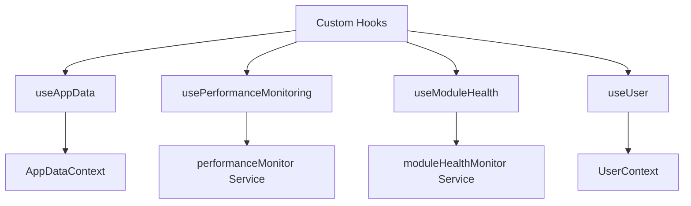
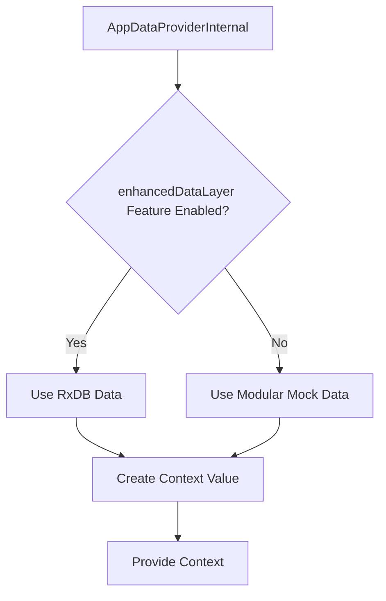
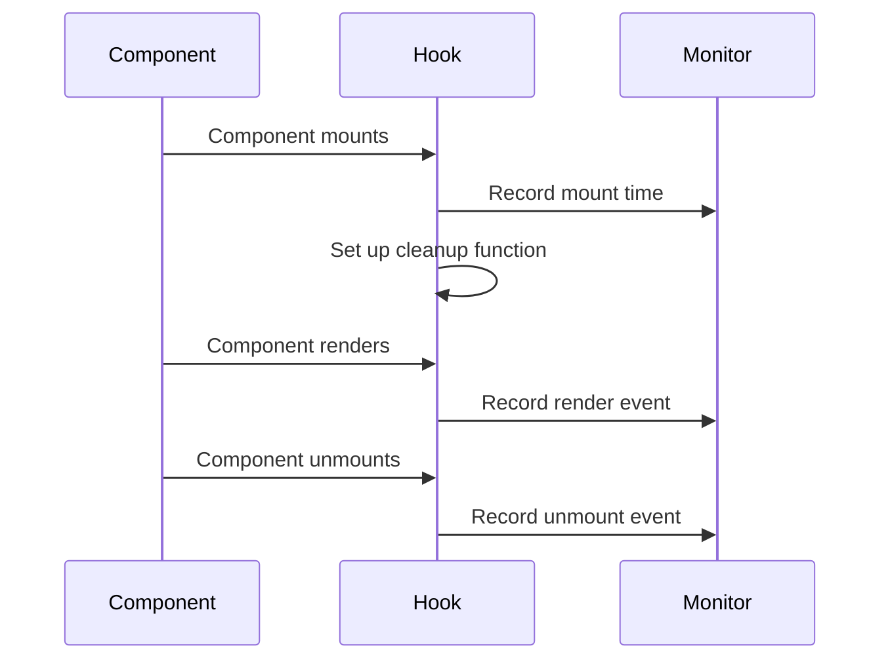
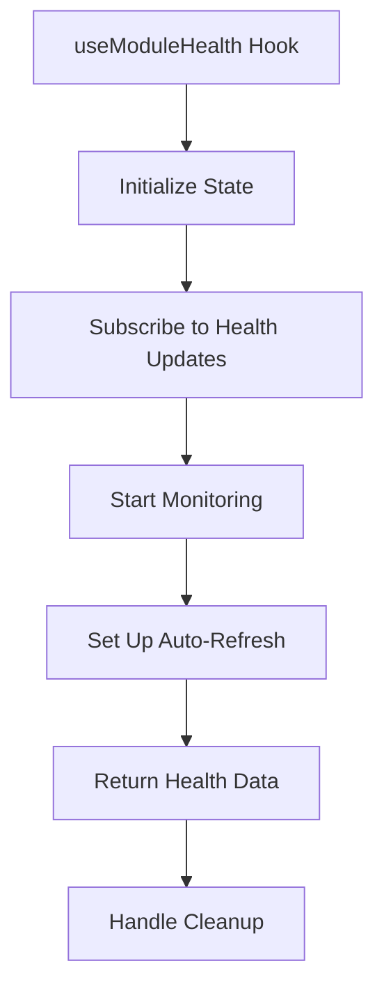
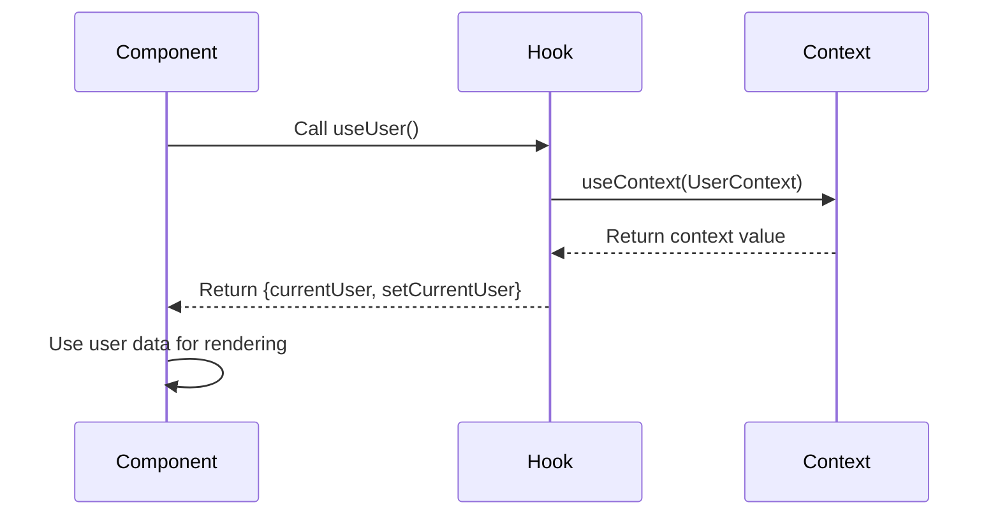

# Custom State Hooks

<cite>
**Referenced Files in This Document**   
- [useAppData.ts](file://src/hooks/useAppData.ts)
- [AppDataContext.tsx](file://src/contexts/AppDataContext.tsx)
- [usePerformanceMonitoring.ts](file://src/hooks/usePerformanceMonitoring.ts)
- [performanceMonitor.ts](file://src/services/performanceMonitor.ts)
- [useModuleHealth.ts](file://src/hooks/useModuleHealth.ts)
- [moduleHealthMonitor.ts](file://src/services/moduleHealthMonitor.ts)
- [dynamicModuleLoader.ts](file://src/services/dynamicModuleLoader.ts)
- [UserContext.tsx](file://src/contexts/UserContext.tsx)
- [types.ts](file://src/core/types.ts)
</cite>

## Table of Contents
1. [Introduction](#introduction)
2. [Core Custom Hooks Overview](#core-custom-hooks-overview)
3. [useAppData Hook](#useappdata-hook)
4. [usePerformanceMonitoring Hook](#useperformancemonitoring-hook)
5. [useModuleHealth Hook](#usemodulehealth-hook)
6. [useUser Hook](#useuser-hook)
7. [Performance Implications and Best Practices](#performance-implications-and-best-practices)
8. [Conclusion](#conclusion)

## Introduction
This document provides a comprehensive analysis of the custom React hooks used in schoolpilot3's state management system. These hooks abstract context access and provide specialized state management capabilities across the application. The documentation covers four primary hooks: `useAppData` for accessing application data, `usePerformanceMonitoring` for tracking UI performance metrics, `useModuleHealth` for monitoring module loading status, and `useUser` for accessing user profile information. Each hook is analyzed in detail, including its internal implementation, dependency arrays, memoization strategies, error handling, and usage patterns.

**Section sources**
- [useAppData.ts](file://src/hooks/useAppData.ts#L1-L21)
- [usePerformanceMonitoring.ts](file://src/hooks/usePerformanceMonitoring.ts#L1-L294)
- [useModuleHealth.ts](file://src/hooks/useModuleHealth.ts#L1-L162)
- [UserContext.tsx](file://src/contexts/UserContext.tsx#L1-L39)

## Core Custom Hooks Overview
The schoolpilot3 application implements a robust custom hook system to manage state and provide specialized functionality across components. These hooks serve as abstraction layers over React contexts and services, enabling clean separation of concerns and promoting reusability. The hooks follow consistent patterns for error handling, memoization, and dependency management, ensuring optimal performance and reliability.

The custom hooks are organized in the `src/hooks` directory and are designed to work with the application's context system. They provide type-safe access to various aspects of the application state, including data, performance metrics, module health, and user information. Each hook is implemented with careful consideration of React's rules of hooks and best practices for state management.



**Diagram sources**
- [useAppData.ts](file://src/hooks/useAppData.ts#L1-L21)
- [usePerformanceMonitoring.ts](file://src/hooks/usePerformanceMonitoring.ts#L1-L294)
- [useModuleHealth.ts](file://src/hooks/useModuleHealth.ts#L1-L162)
- [UserContext.tsx](file://src/contexts/UserContext.tsx#L1-L39)

**Section sources**
- [useAppData.ts](file://src/hooks/useAppData.ts#L1-L21)
- [usePerformanceMonitoring.ts](file://src/hooks/usePerformanceMonitoring.ts#L1-L294)
- [useModuleHealth.ts](file://src/hooks/useModuleHealth.ts#L1-L162)
- [UserContext.tsx](file://src/contexts/UserContext.tsx#L1-L39)

## useAppData Hook

The `useAppData` hook provides access to the application's main data context, which manages data sources and state across the application. It serves as the primary interface for components to access application data, including school details, users, and other core entities.

### Implementation Details
The hook is implemented as a simple wrapper around React's `useContext` hook, accessing the `AppDataContext`. It includes error handling to ensure the hook is used within the appropriate provider context.

```typescript
export function useAppData(): EnhancedAppDataContextType {
  const context = useContext(AppDataContext);
  if (context === undefined) {
    throw new Error('useAppData must be used within an AppDataProvider');
  }
  return context;
}
```

The `EnhancedAppDataContextType` extends the base `AppDataContextType` with additional properties for settings pages, including `isDatabaseModeActive`. The context value is memoized using `useMemo` to prevent unnecessary re-renders when the data source changes.

### Data Source Selection
The `AppDataProviderInternal` component determines which data source to use based on the current configuration. It conditionally selects between RxDB data and modular mock data:



**Diagram sources**
- [AppDataContext.tsx](file://src/contexts/AppDataContext.tsx#L1-L168)

**Section sources**
- [AppDataContext.tsx](file://src/contexts/AppDataContext.tsx#L1-L168)
- [useAppData.ts](file://src/hooks/useAppData.ts#L1-L21)

### Usage Examples
Components use the `useAppData` hook to access application data and state:

```typescript
const MyComponent = () => {
  const { users, schoolDetails, loading, error } = useAppData();
  
  if (loading) return <Spinner />;
  if (error) return <div>Error: {error.message}</div>;
  
  return (
    <div>
      <h1>{schoolDetails?.name}</h1>
      <p>Total users: {users.length}</p>
    </div>
  );
};
```

The hook provides access to loading and error states, allowing components to handle these conditions appropriately. It also exposes a `refresh` function to manually refresh the data when needed.

## usePerformanceMonitoring Hook

The `usePerformanceMonitoring` hook provides comprehensive performance tracking capabilities for React components. It integrates with the `performanceMonitor` service to collect metrics on component lifecycle, user interactions, and data operations.

### Hook Interface and Options
The hook accepts configuration options to control which metrics are tracked:

```typescript
interface UsePerformanceMonitoringOptions {
  componentName: string;
  trackRenders?: boolean;
  trackInteractions?: boolean;
  trackMounts?: boolean;
}

interface PerformanceHookReturn {
  trackUserInteraction: (action: string, metadata?: Record<string, any>) => void;
  trackDataOperation: (operation: string, entity: string, recordCount?: number) => Promise<void>;
  measureAsync: <T>(operation: () => Promise<T>, operationName: string) => Promise<T>;
  startTimer: () => () => number;
}
```

### Component Lifecycle Tracking
The hook uses `useEffect` to track component mount and unmount events:



**Diagram sources**
- [usePerformanceMonitoring.ts](file://src/hooks/usePerformanceMonitoring.ts#L1-L294)
- [performanceMonitor.ts](file://src/services/performanceMonitor.ts#L1-L316)

**Section sources**
- [usePerformanceMonitoring.ts](file://src/hooks/usePerformanceMonitoring.ts#L1-L294)

### Performance Monitoring Service
The underlying `performanceMonitor` service is implemented as a singleton class that collects and manages performance metrics:

```typescript
class PerformanceMonitorService {
  private metrics: PerformanceMetric[] = [];
  private moduleMetrics: ModuleLoadingMetric[] = [];
  private dataMetrics: DataOperationMetric[] = [];
  private interactionMetrics: UserInteractionMetric[] = [];
  
  // Methods for recording different types of metrics
  recordMetric(metric: PerformanceMetric)
  recordModuleLoading(metric: ModuleLoadingMetric)
  recordDataOperation(metric: DataOperationMetric)
  recordUserInteraction(metric: UserInteractionMetric)
}
```

The service uses `PerformanceObserver` API to automatically collect navigation and resource timing data, providing insights into application startup and module loading performance.

### Specialized Tracking Hooks
The main hook exports specialized variants for specific use cases:

- `useInteractionTracking`: Simplified interface for tracking user interactions like clicks and form submissions
- `useDataOperationTracking`: Focused on tracking CRUD operations with automatic timing

These specialized hooks provide convenient abstractions for common performance monitoring scenarios.

## useModuleHealth Hook

The `useModuleHealth` hook provides monitoring capabilities for module loading status and health. It integrates with the module health monitoring system to provide real-time status information about application modules.

### Hook Interface and Return Values
The hook returns comprehensive module health information:

```typescript
interface UseModuleHealthReturn {
  health: ModuleHealth | undefined;
  allHealth: Map<string, ModuleHealth>;
  isHealthy: boolean;
  hasWarnings: boolean;
  hasErrors: boolean;
  isLoading: boolean;
  reloadModule: (moduleId: string) => Promise<boolean>;
  refreshHealth: () => Promise<void>;
  modulesWithIssues: ModuleHealth[];
  modulesWithCriticalIssues: ModuleHealth[];
  statusCounts: Record<ModuleHealthStatus, number>;
}
```

### Implementation and State Management
The hook uses `useState` and `useEffect` to manage module health state and set up subscriptions:



**Diagram sources**
- [useModuleHealth.ts](file://src/hooks/useModuleHealth.ts#L1-L162)
- [moduleHealthMonitor.ts](file://src/services/moduleHealthMonitor.ts)
- [dynamicModuleLoader.ts](file://src/services/dynamicModuleLoader.ts)

**Section sources**
- [useModuleHealth.ts](file://src/hooks/useModuleHealth.ts#L1-L162)

### Health Status and Derived State
The hook calculates derived state values based on the raw health data:

- `isHealthy`: Whether the module (or all modules) is in a healthy state
- `hasWarnings`: Whether there are any warning-level issues
- `hasErrors`: Whether there are any error-level issues
- `statusCounts`: Count of modules in each health status category

These derived values simplify conditional rendering and status display in components.

### Usage Patterns
Components use the hook to display module status and provide recovery options:

```typescript
const ModuleStatusIndicator = () => {
  const { 
    isHealthy, 
    hasWarnings, 
    hasErrors, 
    statusCounts,
    refreshHealth,
    reloadModule 
  } = useModuleHealth();
  
  return (
    <div>
      <StatusBadge 
        status={isHealthy ? 'healthy' : hasErrors ? 'error' : 'warning'}
      />
      <button onClick={refreshHealth}>Refresh</button>
      {hasErrors && (
        <button onClick={() => reloadModule('academics')}>
          Reload Module
        </button>
      )}
    </div>
  );
};
```

## useUser Hook

The `useUser` hook provides access to the current user's profile information and authentication state. It serves as the primary interface for components to access user data and manage authentication-related functionality.

### Implementation and Context Access
The hook is implemented as a simple wrapper around the `UserContext`:

```typescript
export const useUser = (): UserContextType => {
  const context = useContext(UserContext);
  if (context === undefined) {
    throw new Error('useUser must be used within a UserProvider');
  }
  return context;
};
```

The `UserContextType` interface defines the shape of the context value:

```typescript
interface UserContextType {
  currentUser: User | null;
  setCurrentUser: Dispatch<SetStateAction<User | null>>;
}
```

### User Data Structure
The `User` interface defines the structure of user data:

```typescript
export interface User {
  id: string;
  username: string;
  hashed_password?: string | null;
  password?: string | null;
  email: string;
  role_id?: number | null;
  role?: string | null;
  display_name?: string | null;
  userType: string;
  isActive: boolean;
}
```

The context provider initializes with a mock user for development purposes, which would be replaced with actual authentication logic in production.

### Authentication Flow Integration
The hook integrates with the application's authentication system, allowing components to:

- Access current user information
- Check user roles and permissions
- Update user state
- Handle authentication state changes



**Diagram sources**
- [UserContext.tsx](file://src/contexts/UserContext.tsx#L1-L39)
- [types.ts](file://src/core/types.ts#L337-L349)

**Section sources**
- [UserContext.tsx](file://src/contexts/UserContext.tsx#L1-L39)
- [types.ts](file://src/core/types.ts#L337-L349)

## Performance Implications and Best Practices

### Re-render Optimization
All custom hooks implement memoization strategies to prevent unnecessary re-renders:

- `useAppData`: Uses `useMemo` in the provider to memoize the context value
- `usePerformanceMonitoring`: Uses `useCallback` for tracking functions to maintain referential equality
- `useModuleHealth`: Subscribes to specific module health updates rather than re-rendering on all changes

### Memory Leak Prevention
The hooks implement proper cleanup in `useEffect` cleanup functions:

```typescript
useEffect(() => {
  // Setup subscriptions and timers
  const unsubscribe = moduleHealthMonitor.subscribeToModuleHealth(moduleId, callback);
  const refreshTimer = setInterval(refreshHealth, refreshInterval);
  
  // Cleanup function
  return () => {
    if (unsubscribe) unsubscribe();
    if (refreshTimer) clearInterval(refreshTimer);
  };
}, [moduleId, refreshInterval]);
```

### Best Practices for Creating New Hooks
When creating new custom hooks, follow these guidelines:

1. **Consistent Error Handling**: Always check for proper context usage and throw descriptive errors
2. **Memoization**: Use `useMemo` and `useCallback` appropriately to prevent unnecessary re-renders
3. **Cleanup**: Implement proper cleanup in `useEffect` to prevent memory leaks
4. **Type Safety**: Provide comprehensive TypeScript interfaces for props and return values
5. **Documentation**: Include clear JSDoc comments explaining the hook's purpose and usage

### Integration with Existing Context System
New hooks should integrate with the existing context system by:

- Using existing contexts when possible
- Following the same error handling patterns
- Maintaining consistent naming conventions
- Respecting the application's state management architecture

## Conclusion
The custom state hooks in schoolpilot3 provide a robust foundation for state management across the application. Each hook serves a specific purpose while following consistent patterns for implementation, error handling, and performance optimization. The hooks abstract complex state management logic, making it easier for components to access data and functionality without dealing with implementation details.

By leveraging React's context API and hooks system, these custom hooks enable clean separation of concerns, promote reusability, and ensure optimal performance. The comprehensive documentation and consistent patterns make it easy for developers to understand and extend the state management system as needed.