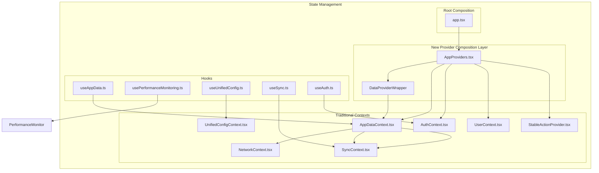
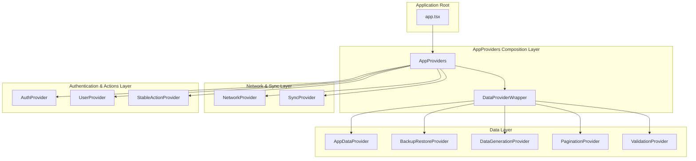
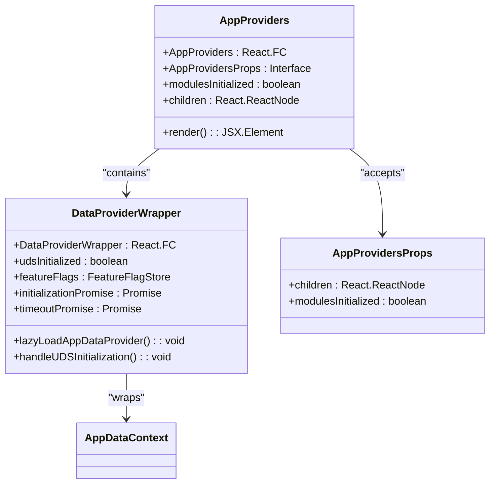
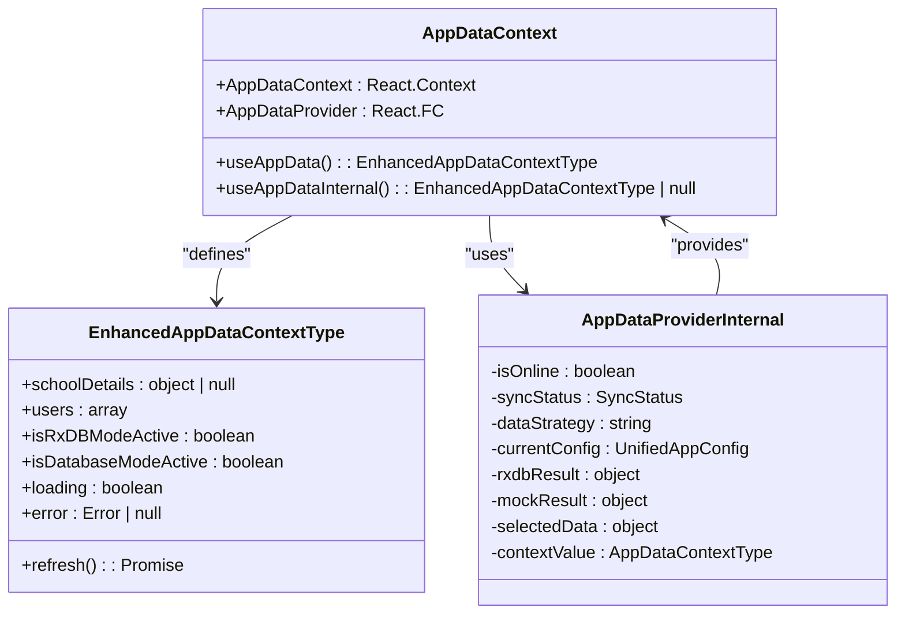
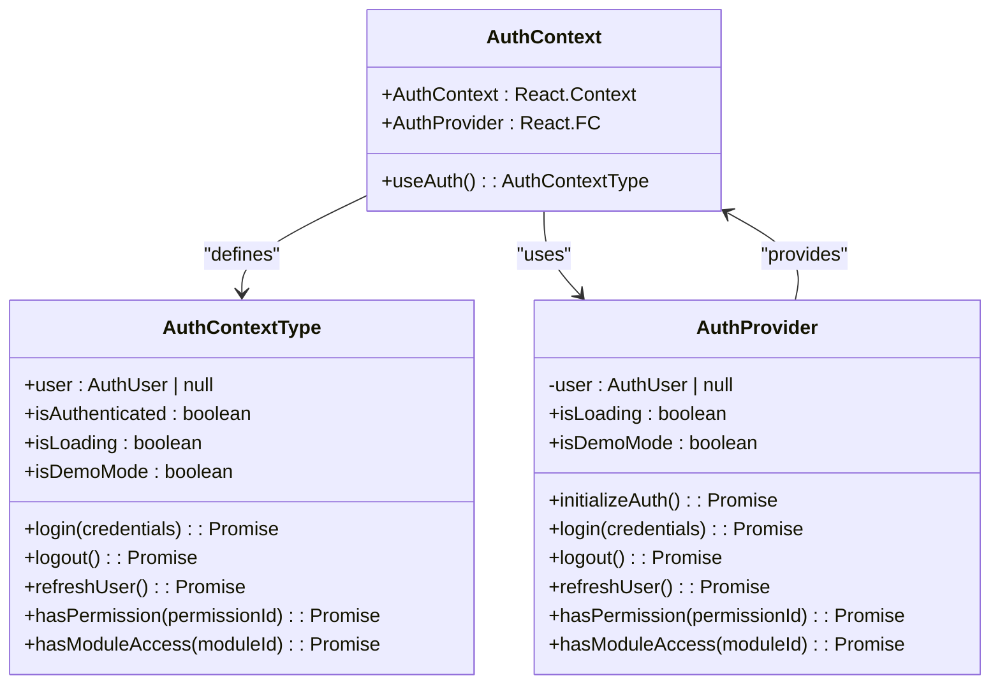
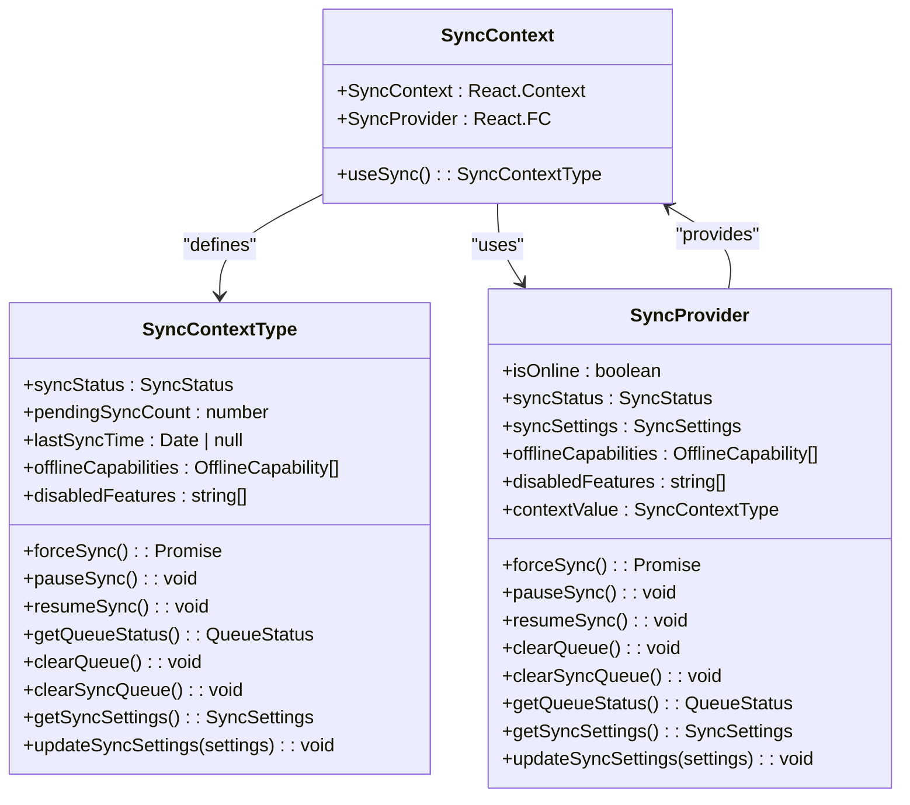
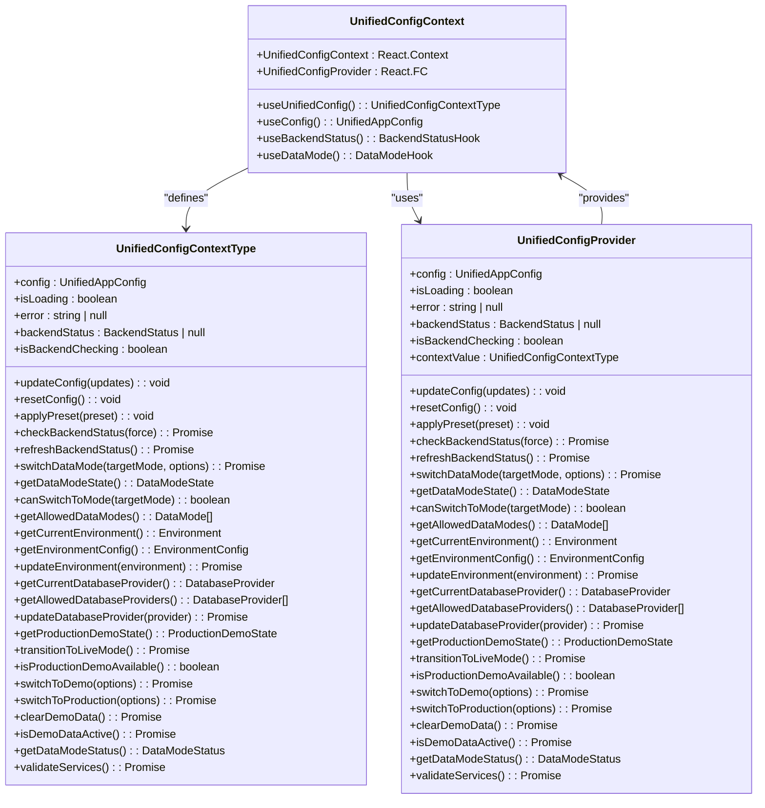
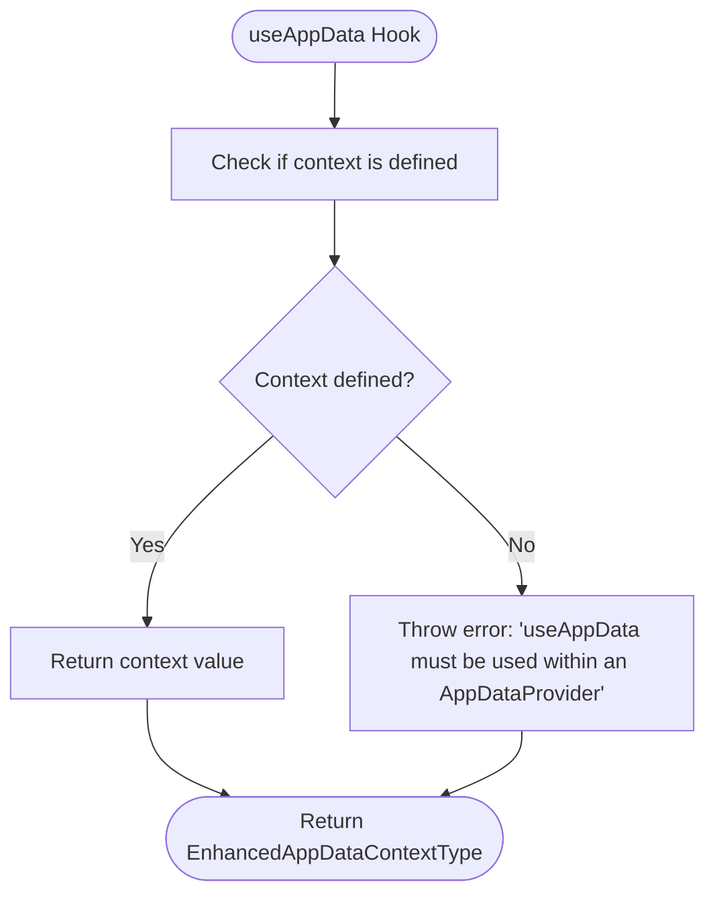
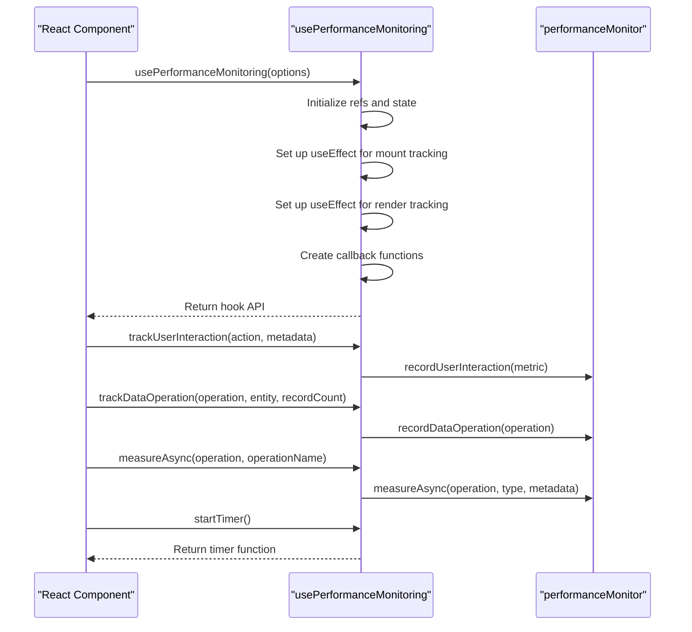
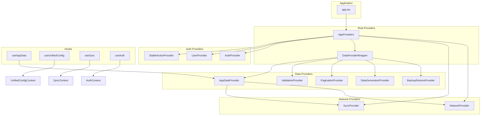

# State Management

<cite>
**Referenced Files in This Document**
- [AppProviders.tsx](file://src/contexts/AppProviders.tsx)
- [AppDataContext.tsx](file://src/contexts/AppDataContext.tsx)
- [AuthContext.tsx](file://src/contexts/AuthContext.tsx)
- [SyncContext.tsx](file://src/contexts/SyncContext.tsx)
- [UnifiedConfigContext.tsx](file://src/contexts/UnifiedConfigContext.tsx)
- [NetworkContext.tsx](file://src/contexts/NetworkContext.tsx)
- [UserContext.tsx](file://src/contexts/UserContext.tsx)
- [StableActionProvider.tsx](file://src/contexts/StableActionProvider.tsx)
- [app.tsx](file://src/app.tsx)
- [useAppData.ts](file://src/hooks/useAppData.ts)
- [usePerformanceMonitoring.ts](file://src/hooks/usePerformanceMonitoring.ts)
</cite>

## Update Summary
**Changes Made**
- Added comprehensive documentation for the new AppProviders component that serves as the central provider composition layer
- Updated architecture diagrams to reflect the new provider hierarchy with AppProviders as the main orchestration component
- Enhanced context provider documentation to include the new AppProviders.tsx component and its role in the state management system
- Updated dependency analysis to show the relationship between AppProviders and the traditional context providers
- Added documentation for the new provider composition patterns and lazy loading strategies

## Table of Contents
1. [Introduction](#introduction)
2. [Project Structure](#project-structure)
3. [Core Components](#core-components)
4. [Architecture Overview](#architecture-overview)
5. [Detailed Component Analysis](#detailed-component-analysis)
6. [Dependency Analysis](#dependency-analysis)
7. [Performance Considerations](#performance-considerations)
8. [Troubleshooting Guide](#troubleshooting-guide)
9. [Conclusion](#conclusion)

## Introduction
This document provides comprehensive architectural documentation for the state management system in schoolpilot3, a comprehensive educational management platform. The system employs a context-driven architecture using React Context API to manage global application state across various domains including data, configuration, synchronization, and authentication. The documentation details the purpose, structure, and integration of five primary context systems: AppProviders (new composition layer), AppDataContext, UnifiedConfigContext, SyncContext, and AuthContext. It explains how these contexts provide centralized state management, their provider hierarchy as implemented in app.tsx, and the data flow from context consumers to UI components. The document also covers custom hooks that abstract context access, performance optimizations, challenges of context proliferation, and best practices for context usage and error handling.

## Project Structure
The state management system in schoolpilot3 is organized in a modular and hierarchical structure, with context providers and hooks separated into dedicated directories for maintainability and scalability. The core state management components are located in the `src/contexts` directory, while custom hooks that abstract context access are located in the `src/hooks` directory. The main application file `app.tsx` serves as the root component that composes all context providers through the new AppProviders component in a specific hierarchy.



**Diagram sources**
- [AppProviders.tsx:103-130](file://src/contexts/AppProviders.tsx#L103-L130)
- [AppDataContext.tsx:1-200](file://src/contexts/AppDataContext.tsx#L1-L200)
- [UnifiedConfigContext.tsx:1-200](file://src/contexts/UnifiedConfigContext.tsx#L1-L200)
- [SyncContext.tsx:1-198](file://src/contexts/SyncContext.tsx#L1-L198)
- [AuthContext.tsx:1-167](file://src/contexts/AuthContext.tsx#L1-L167)
- [app.tsx:638-655](file://src/app.tsx#L638-L655)

**Section sources**
- [AppProviders.tsx:1-133](file://src/contexts/AppProviders.tsx#L1-L133)
- [AppDataContext.tsx:1-200](file://src/contexts/AppDataContext.tsx#L1-L200)
- [UnifiedConfigContext.tsx:1-200](file://src/contexts/UnifiedConfigContext.tsx#L1-L200)
- [SyncContext.tsx:1-198](file://src/contexts/SyncContext.tsx#L1-L198)
- [AuthContext.tsx:1-167](file://src/contexts/AuthContext.tsx#L1-L167)
- [app.tsx:638-655](file://src/app.tsx#L638-L655)

## Core Components
The state management system in schoolpilot3 consists of five primary components that work together to provide a comprehensive global state management solution. The new AppProviders component serves as the central orchestration layer, while the traditional context components provide domain-specific state management. These components include AppProviders (new), AppDataContext, UnifiedConfigContext, SyncContext, and AuthContext, each serving a specific purpose in the application's state management architecture.

**Section sources**
- [AppProviders.tsx:1-133](file://src/contexts/AppProviders.tsx#L1-L133)
- [AppDataContext.tsx:1-200](file://src/contexts/AppDataContext.tsx#L1-L200)
- [UnifiedConfigContext.tsx:1-200](file://src/contexts/UnifiedConfigContext.tsx#L1-L200)
- [SyncContext.tsx:1-198](file://src/contexts/SyncContext.tsx#L1-L198)
- [AuthContext.tsx:1-167](file://src/contexts/AuthContext.tsx#L1-L167)

## Architecture Overview
The state management architecture in schoolpilot3 follows a hierarchical composition pattern where the new AppProviders component orchestrates multiple context providers through a structured hierarchy. The AppProviders component serves as the main composition layer, wrapping traditional context providers like AppDataContext, AuthContext, and others. This architecture is designed to provide centralized state management for data, configuration, synchronization, and authentication, with each context serving a specific domain of functionality.



**Diagram sources**
- [app.tsx:638-655](file://src/app.tsx#L638-L655)
- [AppProviders.tsx:103-130](file://src/contexts/AppProviders.tsx#L103-L130)
- [AppDataContext.tsx:207-400](file://src/contexts/AppDataContext.tsx#L207-L400)

## Detailed Component Analysis

### AppProviders Component Analysis
The AppProviders component serves as the new central orchestration layer for all application-level React contexts. It extracts from App.tsx to reduce nesting depth and establish a stable provider contract, implementing sophisticated lazy loading and initialization strategies for the data layer.



**Diagram sources**
- [AppProviders.tsx:98-130](file://src/contexts/AppProviders.tsx#L98-L130)
- [AppProviders.tsx:27-96](file://src/contexts/AppProviders.tsx#L27-L96)

**Section sources**
- [AppProviders.tsx:1-133](file://src/contexts/AppProviders.tsx#L1-L133)

### AppDataContext Analysis
AppDataContext serves as the primary data context for the application, managing data sources and state across the entire application. It provides a centralized location for data that can be accessed by any component in the application through the useAppData hook.



**Diagram sources**
- [AppDataContext.tsx:174-205](file://src/contexts/AppDataContext.tsx#L174-L205)

**Section sources**
- [AppDataContext.tsx:1-200](file://src/contexts/AppDataContext.tsx#L1-L200)

### AuthContext Analysis
AuthContext manages user authentication state and provides authentication methods and permission checks across the application. It handles login, logout, and user state management, ensuring that authentication state is consistent throughout the application.



**Diagram sources**
- [AuthContext.tsx:1-167](file://src/contexts/AuthContext.tsx#L1-L167)

**Section sources**
- [AuthContext.tsx:1-167](file://src/contexts/AuthContext.tsx#L1-L167)

### SyncContext Analysis
SyncContext manages synchronization state and provides controls for data synchronization between the client and server. It handles sync status, controls, and queue management, enabling offline capabilities and background data synchronization.



**Diagram sources**
- [SyncContext.tsx:1-198](file://src/contexts/SyncContext.tsx#L1-L198)

**Section sources**
- [SyncContext.tsx:1-198](file://src/contexts/SyncContext.tsx#L1-L198)

### UnifiedConfigContext Analysis
UnifiedConfigContext provides a unified configuration system for the application, managing configuration state and providing configuration management functions to React components. It handles configuration updates, environment management, and backend detection.



**Diagram sources**
- [UnifiedConfigContext.tsx:35-93](file://src/contexts/UnifiedConfigContext.tsx#L35-L93)

**Section sources**
- [UnifiedConfigContext.tsx:1-200](file://src/contexts/UnifiedConfigContext.tsx#L1-L200)

### Custom Hooks Analysis
Custom hooks in schoolpilot3 abstract context access and provide a cleaner API for components to interact with the state management system. These hooks encapsulate the complexity of context usage and provide additional functionality such as error handling and performance optimizations.

#### useAppData Hook
The useAppData hook provides access to the AppDataContext, allowing components to consume application data and state. It includes error handling to ensure the hook is used within the appropriate provider.



**Diagram sources**
- [useAppData.ts:1-20](file://src/hooks/useAppData.ts#L1-L20)

**Section sources**
- [useAppData.ts:1-20](file://src/hooks/useAppData.ts#L1-L20)

#### usePerformanceMonitoring Hook
The usePerformanceMonitoring hook provides performance monitoring capabilities for React components, tracking renders, mounts, user interactions, and data operations.



**Diagram sources**
- [usePerformanceMonitoring.ts:1-293](file://src/hooks/usePerformanceMonitoring.ts#L1-L293)

**Section sources**
- [usePerformanceMonitoring.ts:1-293](file://src/hooks/usePerformanceMonitoring.ts#L1-L293)

## Dependency Analysis
The state management system in schoolpilot3 has a well-defined dependency structure where the new AppProviders component orchestrates multiple context providers. The AppProviders component serves as the central composition layer, wrapping traditional context providers and implementing sophisticated initialization strategies.



**Diagram sources**
- [app.tsx:638-655](file://src/app.tsx#L638-L655)
- [AppProviders.tsx:103-130](file://src/contexts/AppProviders.tsx#L103-L130)
- [AppDataContext.tsx:207-400](file://src/contexts/AppDataContext.tsx#L207-L400)

**Section sources**
- [app.tsx:638-655](file://src/app.tsx#L638-L655)
- [AppProviders.tsx:1-133](file://src/contexts/AppProviders.tsx#L1-L133)

## Performance Considerations
The state management system in schoolpilot3 incorporates several performance optimizations to ensure efficient rendering and minimal re-renders. The new AppProviders component implements sophisticated lazy loading and initialization strategies to optimize application startup performance.

### Lazy Loading and Initialization Strategies
The AppProviders component implements lazy loading for the AppDataProvider and sophisticated initialization strategies for the Unified Data Service (UDS). The DataProviderWrapper component handles conditional initialization based on feature flags and implements timeout mechanisms to prevent application hangs.

```typescript
const DataProviderWrapper: React.FC<{ children: React.ReactNode }> = ({ children }) => {
  const { config } = useUnifiedConfig();
  const [udsInitialized, setUdsInitialized] = useState(true);
  const featureFlags = useFeatureFlagStore(state => state.flags);

  useEffect(() => {
    if (featureFlags.useUnifiedDataService) {
      debugLog('🚀 [AppProviders] Initializing Unified Data Service...');
      
      const initializationPromise = uds.initialize('standalone', {
        pouchdb: {
          localDbName: 'schoolpilot_standalone',
        }
      });

      const timeoutPromise = new Promise((_, reject) => {
        setTimeout(() => reject(new Error('UDS initialization timeout')), 10000);
      });

      Promise.race([initializationPromise, timeoutPromise])
        .then(() => {
          setUdsInitialized(true);
          debugLog('✅ [AppProviders] Unified Data Service initialized');
        })
        .catch(error => {
          warnLog('⚠️ [AppProviders] UDS initialization failed or timed out, falling back to mock:', error);
          setUdsInitialized(true);
        });

      return () => {
        uds.destroy();
      };
    }
  }, []);
  
  // ... rest of implementation
};
```

### Memoization and Selective Re-renders
The system uses React's useMemo hook to memoize expensive computations and prevent unnecessary re-renders. In AppDataContext, the contextValue is memoized based on the selected data source, ensuring that the context value only changes when the underlying data changes.

```typescript
const contextValue = useMemo((): AppDataContextType => {
  // Create context value with all necessary properties
  return {
    // Core data from selected data source
    ...selectedData,
    
    // Settings page specific properties
    schoolDetails,
    users,
    isRxDBModeActive,
    isDatabaseModeActive,
    
    // Loading and error states
    loading: selectedData.loading || false,
    error: selectedData.error || null,
    
    // Refresh function
    refresh: selectedData.refresh || (async () => {})
  };
}, [selectedData, shouldUseEnhancedData, currentConfig.dataMode]);
```

This memoization ensures that components consuming the AppDataContext only re-render when the actual data changes, rather than on every render cycle.

### Context Proliferation Challenges
One challenge with the context-driven architecture is context proliferation, where multiple contexts can lead to performance issues and complexity. The schoolpilot3 system addresses this by:

1. **Centralized Composition**: Using the AppProviders component to orchestrate all context providers, reducing the number of providers needed at the root level.
2. **Lazy Loading**: Implementing lazy loading for heavy components like AppDataProvider to improve initial load performance.
3. **Conditional Initialization**: Using feature flags to conditionally initialize certain providers based on application needs.
4. **Selective Context Usage**: Providing lighter alternative hooks like useConfig that only subscribe to specific parts of the context.
5. **Efficient Context Updates**: Using state management patterns that minimize unnecessary context updates.

### Best Practices for Context Usage
The system follows several best practices for context usage:

1. **Provider Hierarchy**: Organizing providers in a logical hierarchy through the AppProviders component to ensure dependencies are resolved correctly.
2. **Error Boundaries**: Implementing error boundaries to handle context-related failures gracefully.
3. **Type Safety**: Using TypeScript to ensure type safety and prevent runtime errors.
4. **Documentation**: Providing clear documentation and examples for context usage.
5. **Performance Monitoring**: Integrating performance monitoring hooks to track context usage and identify optimization opportunities.

**Section sources**
- [AppProviders.tsx:27-96](file://src/contexts/AppProviders.tsx#L27-L96)
- [AppDataContext.tsx:196-205](file://src/contexts/AppDataContext.tsx#L196-L205)
- [usePerformanceMonitoring.ts:1-293](file://src/hooks/usePerformanceMonitoring.ts#L1-L293)

## Troubleshooting Guide
When working with the state management system in schoolpilot3, several common issues may arise. This section provides guidance on identifying and resolving these issues, with special attention to the new AppProviders component.

### AppProviders Initialization Issues
If the application fails to initialize properly or shows loading spinners indefinitely:

1. Check the DataProviderWrapper initialization logic for UDS initialization failures.
2. Verify that feature flags are properly configured in the featureFlagStore.
3. Ensure that the AppProviders component receives the correct modulesInitialized prop.
4. Check for timeout errors in the UDS initialization promise race.

### Context Not Found Errors
If a component throws an error like "useAppData must be used within an AppDataProvider", it means the component is trying to access a context without being wrapped in the appropriate provider. To resolve this:

1. Ensure the component is wrapped in the AppProviders component in the component tree.
2. Check the AppProviders hierarchy to ensure all necessary providers are present.
3. Verify that the component is not being rendered outside the AppProviders scope.
4. Confirm that the DataProviderWrapper is properly loading the AppDataProvider.

### Unnecessary Re-renders
If components are re-rendering more frequently than expected, check the following:

1. Ensure that context values are properly memoized using useMemo in the AppDataContext.
2. Verify that only the necessary parts of the context are being consumed by the component.
3. Consider using lighter alternative hooks like useConfig instead of useUnifiedConfig if only configuration data is needed.
4. Check for unnecessary re-renders in the AppProviders component hierarchy.

### Synchronization Issues
If data synchronization is not working as expected:

1. Check the network status using the useNetwork hook within the NetworkProvider.
2. Verify that the SyncProvider is properly configured and initialized.
3. Check the sync settings and ensure autoSync is enabled if background synchronization is required.
4. Monitor the DataProviderWrapper initialization to ensure UDS is properly initialized before AppDataProvider loads.

**Section sources**
- [AppProviders.tsx:1-133](file://src/contexts/AppProviders.tsx#L1-L133)
- [AppDataContext.tsx:1-200](file://src/contexts/AppDataContext.tsx#L1-L200)
- [AuthContext.tsx:1-167](file://src/contexts/AuthContext.tsx#L1-L167)
- [SyncContext.tsx:1-198](file://src/contexts/SyncContext.tsx#L1-L198)
- [UnifiedConfigContext.tsx:1-200](file://src/contexts/UnifiedConfigContext.tsx#L1-L200)

## Conclusion
The state management system in schoolpilot3 provides a robust and scalable solution for managing global application state using React Context API. The new AppProviders component serves as the central orchestration layer, implementing sophisticated lazy loading and initialization strategies to optimize application performance. By organizing state into five primary components—AppProviders (new composition layer), AppDataContext, UnifiedConfigContext, SyncContext, and AuthContext—the system achieves a clear separation of concerns while maintaining centralized state management. The provider hierarchy in app.tsx, orchestrated through the AppProviders component, ensures that contexts are initialized in the correct order and that dependent contexts have access to the necessary state. Custom hooks like useAppData and usePerformanceMonitoring abstract context access and provide additional functionality, making it easier for components to interact with the state management system. Performance optimizations such as lazy loading, memoization, and selective re-renders ensure efficient rendering, while best practices for context usage and error handling contribute to a maintainable and reliable architecture. The new AppProviders component addresses context proliferation challenges through centralized composition and conditional initialization, making it a cornerstone of the enhanced state management architecture. This comprehensive state management solution enables schoolpilot3 to deliver a responsive and consistent user experience across its various modules and features.