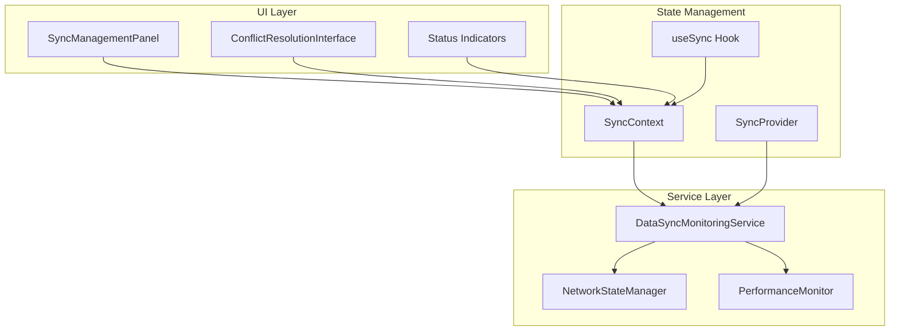
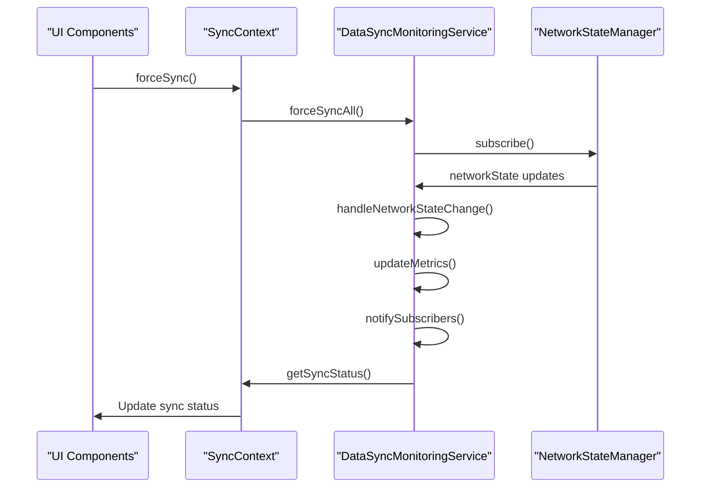
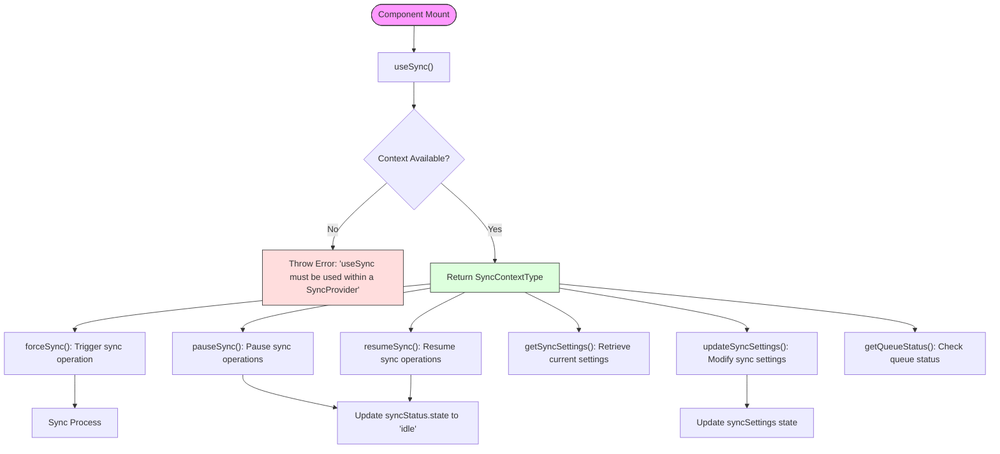
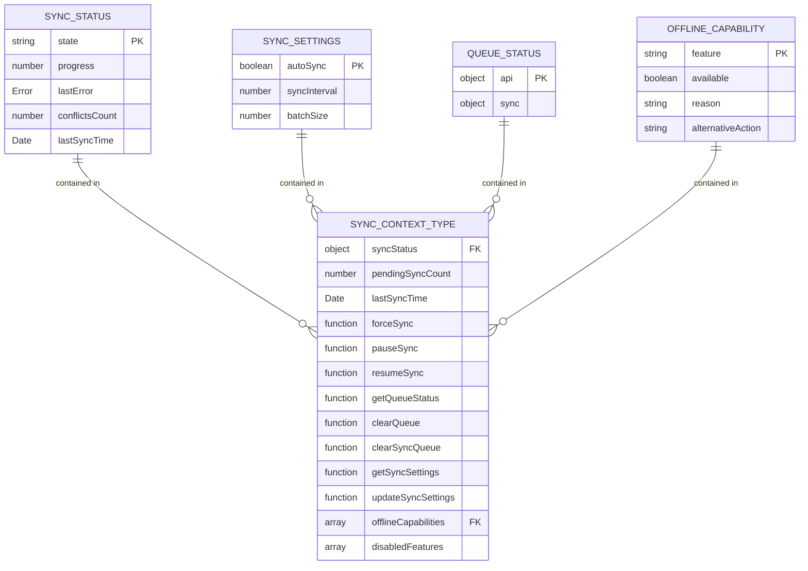
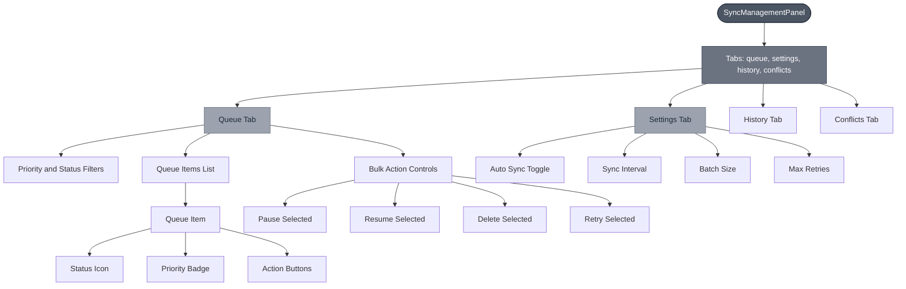
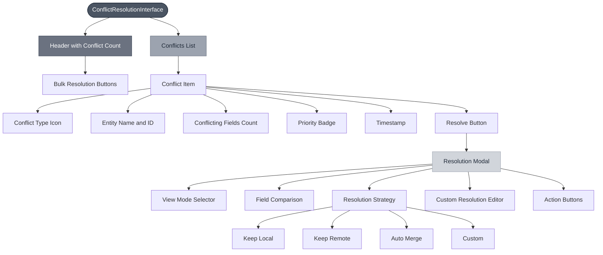
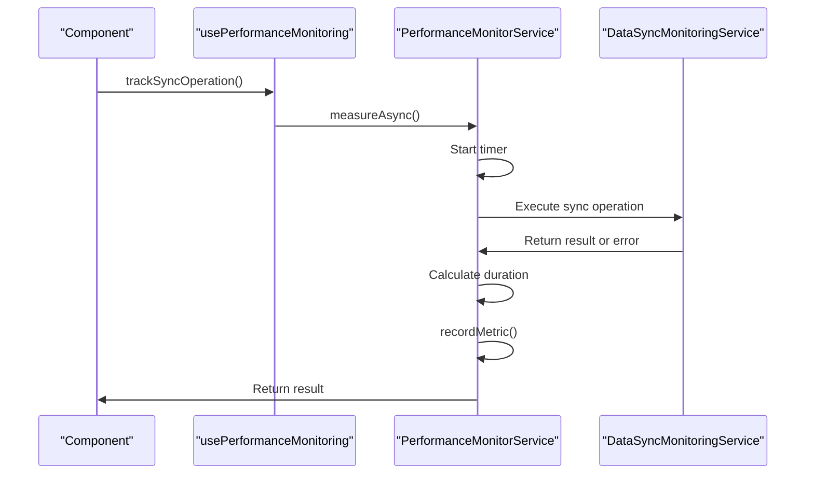
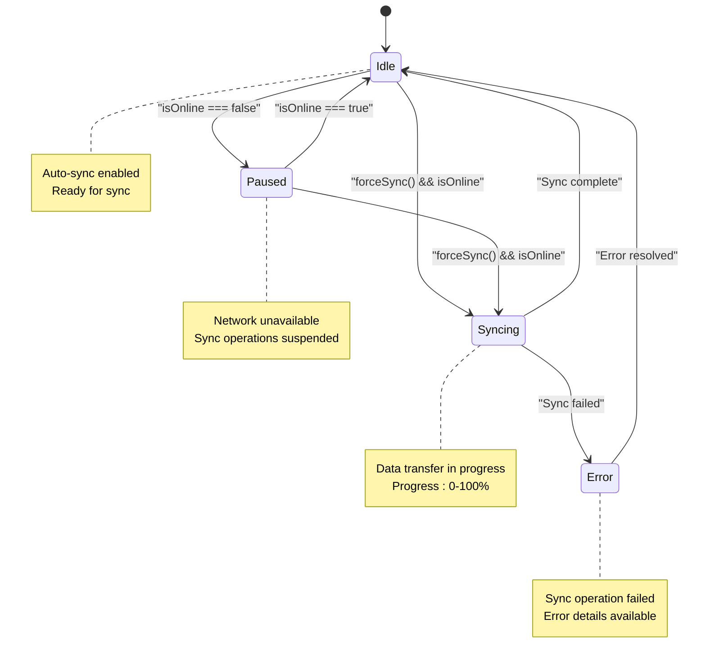

# Synchronization Context

<cite>
**Referenced Files in This Document**   
- [SyncContext.tsx](file://src/contexts/SyncContext.tsx)
- [DataSyncMonitoringService.ts](file://src/services/DataSyncMonitoringService.ts)
- [SyncManagementPanel.tsx](file://src/components/SyncManagementPanel.tsx)
- [ConflictResolutionInterface.tsx](file://src/components/ConflictResolutionInterface.tsx)
- [NetworkContext.tsx](file://src/contexts/NetworkContext.tsx)
- [AppDataContext.tsx](file://src/contexts/AppDataContext.tsx)
- [usePerformanceMonitoring.ts](file://src/hooks/usePerformanceMonitoring.ts)
</cite>

## Table of Contents
1. [Introduction](#introduction)
2. [Core Architecture](#core-architecture)
3. [SyncContext Implementation](#synccontext-implementation)
4. [DataSyncMonitoringService Integration](#datasynmonitoringservice-integration)
5. [useSync Hook Interface](#usesync-hook-interface)
6. [Internal State Model](#internal-state-model)
7. [UI Components and User Interfaces](#ui-components-and-user-interfaces)
8. [Error Handling and Conflict Resolution](#error-handling-and-conflict-resolution)
9. [Performance Monitoring Integration](#performance-monitoring-integration)
10. [Network State Integration](#network-state-integration)

## Introduction
The Synchronization Context system in schoolpilot3 provides a comprehensive state management solution for tracking and exposing data synchronization status between local and remote databases. This system enables the application to maintain data consistency across different network conditions while providing users with real-time feedback on synchronization operations. The implementation combines React Context API with service-oriented architecture to create a robust synchronization framework that supports offline capabilities, conflict resolution, and performance monitoring.

**Section sources**
- [SyncContext.tsx](file://src/contexts/SyncContext.tsx#L1-L197)

## Core Architecture
The synchronization system follows a layered architecture pattern with clear separation of concerns between state management, monitoring services, and user interface components. The core components work together to provide a seamless synchronization experience that handles both automatic and manual sync operations.



**Diagram sources**
- [SyncContext.tsx](file://src/contexts/SyncContext.tsx#L1-L197)
- [DataSyncMonitoringService.ts](file://src/services/DataSyncMonitoringService.ts#L1-L483)
- [SyncManagementPanel.tsx](file://src/components/SyncManagementPanel.tsx#L1-L484)

## SyncContext Implementation
The SyncContext implementation provides the foundational state management for synchronization operations using React Context API. It exposes a comprehensive interface for controlling and monitoring sync operations through the SyncProvider component.

```mermaid
classDiagram
class SyncContextType {
+syncStatus : SyncStatus
+pendingSyncCount : number
+lastSyncTime : Date | null
+forceSync() : Promise~void~
+pauseSync() : void
+resumeSync() : void
+getQueueStatus() : QueueStatus
+clearQueue() : void
+clearSyncQueue() : void
+getSyncSettings() : SyncSettings
+updateSyncSettings(settings : Partial~SyncSettings~) : void
+offlineCapabilities : OfflineCapability[]
+disabledFeatures : string[]
}
class SyncStatus {
+state : 'idle' | 'syncing' | 'error' | 'paused'
+progress : number
+lastError : Error | null
+conflictsCount : number
+lastSyncTime : Date | null
}
class SyncSettings {
+autoSync : boolean
+syncInterval : number
+batchSize : number
}
class QueueStatus {
+api : { pending : number, processing : boolean, byPriority : Record~string, number~ }
+sync : { pending : number, processing : boolean, byPriority : Record~string, number~, errors : number }
}
class OfflineCapability {
+feature : string
+available : boolean
+reason? : string
+alternativeAction? : string
}
class SyncProvider {
-syncStatus : SyncStatus
-syncSettings : SyncSettings
+forceSync() : Promise~void~
+pauseSync() : void
+resumeSync() : void
+getQueueStatus() : QueueStatus
+updateSyncSettings(settings : Partial~SyncSettings~) : void
}
SyncProvider --> SyncContextType : "provides"
SyncProvider --> SyncStatus : "manages"
SyncProvider --> SyncSettings : "manages"
SyncProvider --> QueueStatus : "manages"
SyncProvider --> OfflineCapability : "provides"
```

**Diagram sources**
- [SyncContext.tsx](file://src/contexts/SyncContext.tsx#L1-L197)

**Section sources**
- [SyncContext.tsx](file://src/contexts/SyncContext.tsx#L1-L197)

## DataSyncMonitoringService Integration
The DataSyncMonitoringService integrates with the SyncContext to provide comprehensive monitoring of synchronization operations. It tracks sync status, manages conflicts, records errors, and maintains performance metrics for all data synchronization activities.



**Diagram sources**
- [DataSyncMonitoringService.ts](file://src/services/DataSyncMonitoringService.ts#L1-L483)
- [SyncContext.tsx](file://src/contexts/SyncContext.tsx#L1-L197)

**Section sources**
- [DataSyncMonitoringService.ts](file://src/services/DataSyncMonitoringService.ts#L1-L483)

## useSync Hook Interface
The useSync hook provides a clean interface for components to access synchronization functionality. It serves as the primary mechanism for components to interact with the synchronization system, enabling them to respond to sync status changes and trigger sync operations.



**Diagram sources**
- [SyncContext.tsx](file://src/contexts/SyncContext.tsx#L191-L197)

**Section sources**
- [SyncContext.tsx](file://src/contexts/SyncContext.tsx#L191-L197)

## Internal State Model
The internal state model of the synchronization system consists of several key interfaces that define the structure of sync-related data. These interfaces provide type safety and clear documentation of the data structures used throughout the synchronization process.



**Section sources**
- [SyncContext.tsx](file://src/contexts/SyncContext.tsx#L1-L197)

## UI Components and User Interfaces
The synchronization system includes several UI components that allow users to monitor and control sync operations. These components provide visual feedback on sync status and enable users to manage synchronization settings and resolve conflicts.

### SyncManagementPanel
The SyncManagementPanel component provides a comprehensive interface for managing synchronization operations. It displays the current sync status, allows users to filter and manage sync queue items, and provides controls for bulk actions on queue items.



**Diagram sources**
- [SyncManagementPanel.tsx](file://src/components/SyncManagementPanel.tsx#L1-L484)

**Section sources**
- [SyncManagementPanel.tsx](file://src/components/SyncManagementPanel.tsx#L1-L484)

## Error Handling and Conflict Resolution
The synchronization system implements robust error handling and conflict resolution mechanisms to ensure data integrity during sync operations. It provides both automated and manual conflict resolution strategies to handle data inconsistencies between local and remote databases.

### ConflictResolutionInterface
The ConflictResolutionInterface component provides a sophisticated UI for resolving data conflicts that occur during synchronization. It offers multiple resolution strategies and detailed comparison views to help users make informed decisions.



**Diagram sources**
- [ConflictResolutionInterface.tsx](file://src/components/ConflictResolutionInterface.tsx#L1-L439)

**Section sources**
- [ConflictResolutionInterface.tsx](file://src/components/ConflictResolutionInterface.tsx#L1-L439)

## Performance Monitoring Integration
The synchronization system integrates with the performance monitoring infrastructure to track and log sync operations. This integration enables detailed performance analysis and helps identify bottlenecks in the synchronization process.



**Section sources**
- [usePerformanceMonitoring.ts](file://src/hooks/usePerformanceMonitoring.ts#L267-L293)

## Network State Integration
The synchronization system integrates with the NetworkContext to respond to changes in network connectivity. This integration ensures that sync operations are automatically paused when offline and resumed when connectivity is restored.



**Diagram sources**
- [SyncContext.tsx](file://src/contexts/SyncContext.tsx#L1-L197)
- [NetworkContext.tsx](file://src/contexts/NetworkContext.tsx#L1-L48)

**Section sources**
- [SyncContext.tsx](file://src/contexts/SyncContext.tsx#L1-L197)
- [NetworkContext.tsx](file://src/contexts/NetworkContext.tsx#L1-L48)