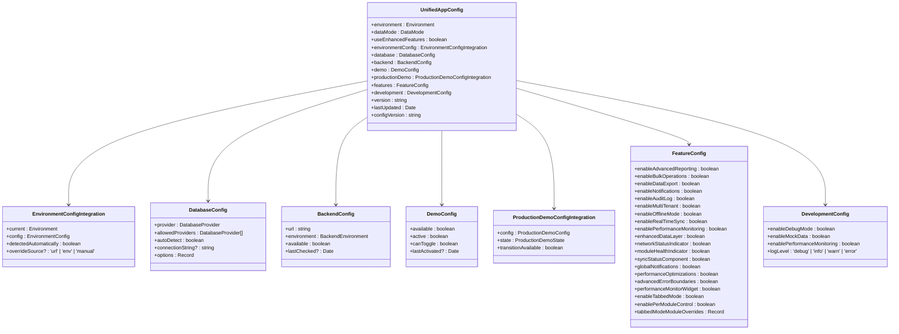
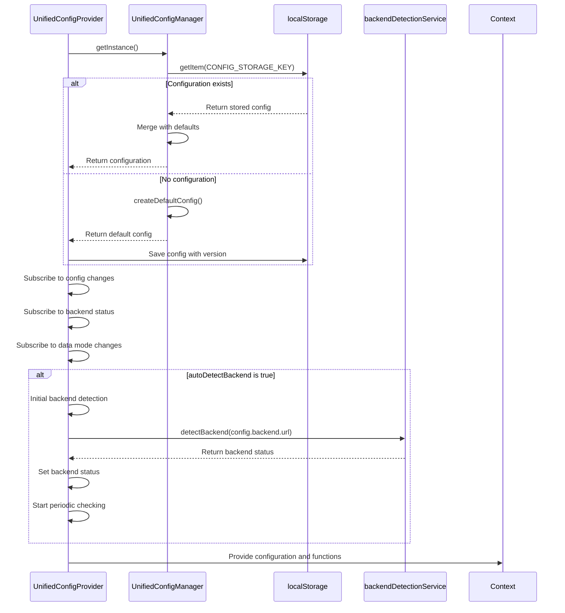
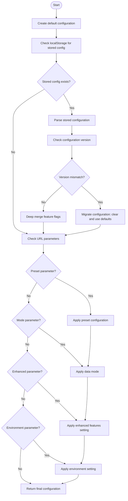
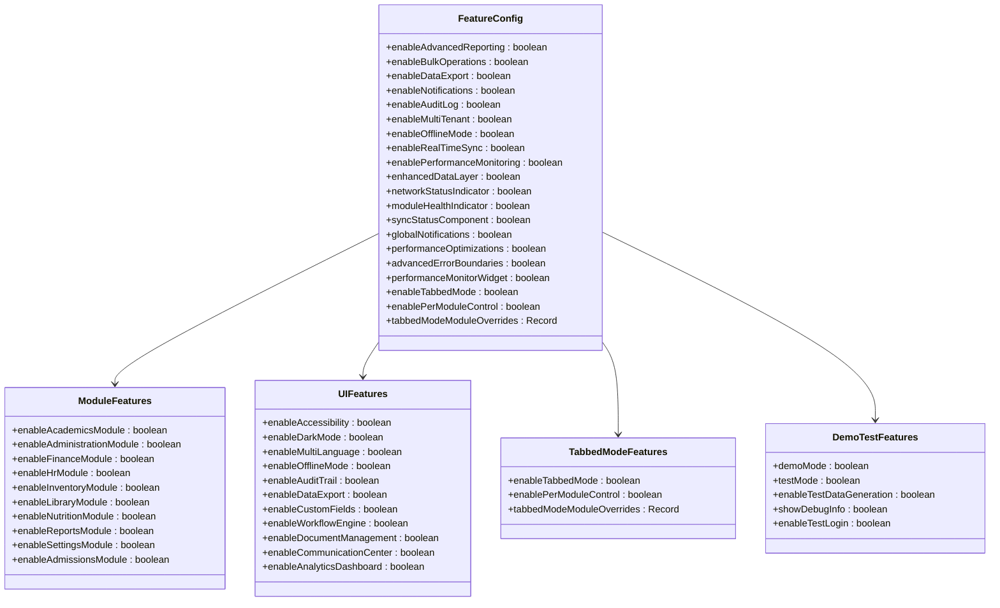
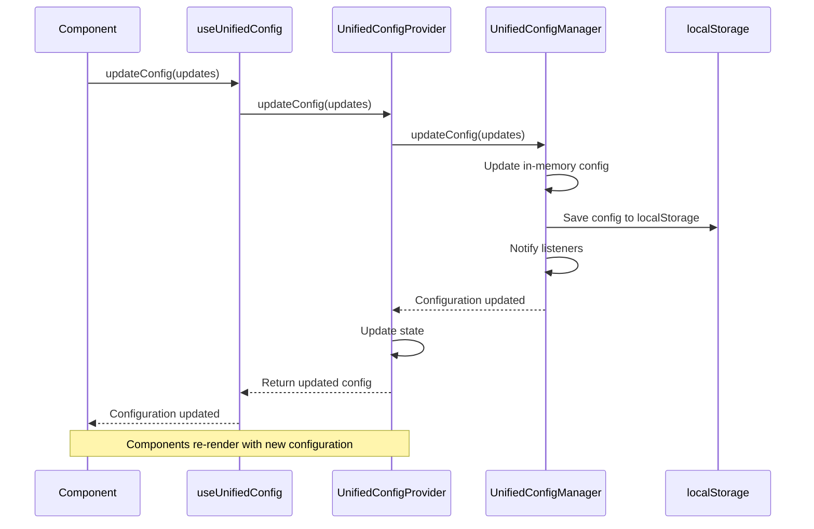
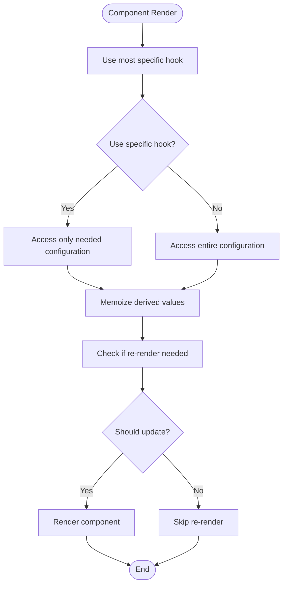
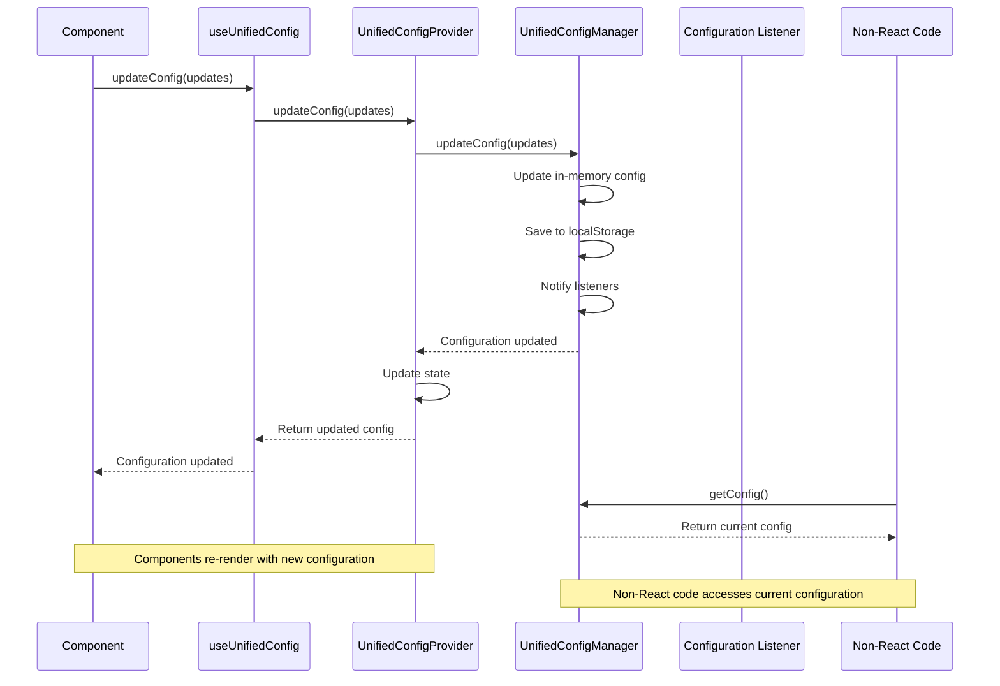

# Unified Configuration Context

<cite>
**Referenced Files in This Document**   
- [UnifiedConfigContext.tsx](file://src/contexts/UnifiedConfigContext.tsx)
- [unifiedConfig.ts](file://src/config/unifiedConfig.ts)
- [environmentMatrix.ts](file://src/config/environmentMatrix.ts)
- [dataModePolicies.ts](file://src/config/dataModePolicies.ts)
- [productionDemo.ts](file://src/config/productionDemo.ts)
- [app.tsx](file://src/app.tsx)
</cite>

## Table of Contents
1. [Introduction](#introduction)
2. [Configuration Schema](#configuration-schema)
3. [UnifiedConfigProvider Implementation](#unifiedconfigprovider-implementation)
4. [useUnifiedConfig Hook](#useunifiedconfig-hook)
5. [Configuration Merging Strategy](#configuration-merging-strategy)
6. [Feature Flag Usage](#feature-flag-usage)
7. [Runtime Configuration Updates](#runtime-configuration-updates)
8. [Performance Considerations](#performance-considerations)
9. [Configuration Propagation](#configuration-propagation)
10. [Conclusion](#conclusion)

## Introduction

The Unified Configuration Context system in schoolpilot3 provides a centralized mechanism for managing application configuration across different environments and deployment targets. This system enables consistent configuration management for development, staging, and production environments while supporting various data modes and feature flags. The implementation uses React Context to expose configuration values to components throughout the application, ensuring that configuration state is accessible and consistent across the entire application.

The system integrates with environment-specific configurations, data mode policies, and production demo capabilities to provide a comprehensive configuration management solution. It supports persistent storage of configuration settings, URL parameter overrides, and environment detection to ensure the application adapts appropriately to different deployment scenarios.

**Section sources**
- [UnifiedConfigContext.tsx](file://src/contexts/UnifiedConfigContext.tsx#L1-L50)
- [unifiedConfig.ts](file://src/config/unifiedConfig.ts#L1-L50)

## Configuration Schema

The Unified Configuration system is built around the `UnifiedAppConfig` interface, which defines the complete configuration schema for the application. This schema includes core configuration properties, environment integration, database configuration, backend configuration, demo configuration, production demo integration, feature flags, development configuration, and metadata.



**Diagram sources**
- [unifiedConfig.ts](file://src/config/unifiedConfig.ts#L100-L200)

**Section sources**
- [unifiedConfig.ts](file://src/config/unifiedConfig.ts#L100-L300)

## UnifiedConfigProvider Implementation

The `UnifiedConfigProvider` component implements the provider pattern for the Unified Configuration Context. It initializes the configuration state using the `UnifiedConfigManager` singleton and exposes configuration values and management functions through the React Context API.

The provider component manages several key aspects of the configuration system:

1. **State Management**: Maintains the current configuration state, loading status, error state, backend status, and backend checking status using React hooks.

2. **Configuration Management**: Provides functions to update, reset, and apply presets to the configuration.

3. **Backend Detection**: Integrates with the backend detection service to monitor backend status and availability.

4. **Data Mode Management**: Supports both legacy and enhanced data mode switching functionality.

5. **Environment Management**: Allows updating the application environment with validation.

6. **Database Provider Management**: Enables switching between different database providers.

7. **Production Demo Management**: Provides functionality for transitioning from demo to live mode in production.



**Diagram sources**
- [UnifiedConfigContext.tsx](file://src/contexts/UnifiedConfigContext.tsx#L100-L200)
- [unifiedConfig.ts](file://src/config/unifiedConfig.ts#L800-L900)

**Section sources**
- [UnifiedConfigContext.tsx](file://src/contexts/UnifiedConfigContext.tsx#L100-L500)

## useUnifiedConfig Hook

The `useUnifiedConfig` hook provides components with access to the unified configuration context. This hook returns an object containing the current configuration state and various management functions, enabling components to read configuration values and modify the application's configuration.

The hook implementation includes several specialized hooks that provide focused access to specific aspects of the configuration:

- `useConfig`: Returns only the configuration object (lighter alternative)
- `useBackendStatus`: Provides access to backend status information
- `useDataMode`: Offers enhanced data mode management capabilities
- `useEnvironment`: Enables environment management
- `useDatabaseProvider`: Facilitates database provider management
- `useProductionDemo`: Supports production demo management
- `useConfigManagement`: Combines multiple configuration hooks for comprehensive management

```mermaid
classDiagram
class useUnifiedConfig {
+config : UnifiedAppConfig
+isLoading : boolean
+error : string | null
+backendStatus : BackendStatus | null
+isBackendChecking : boolean
+updateConfig(updates : Partial<UnifiedAppConfig>) : void
+resetConfig() : void
+applyPreset(preset : 'development' | 'staging' | 'production') : void
+checkBackendStatus(force? : boolean) : Promise<BackendStatus>
+refreshBackendStatus() : Promise<void>
+switchDataMode(targetMode : DataMode, options? : { requiresReload? : boolean }) : Promise<DataModeSwitchResult>
+getDataModeState() : DataModeState
+canSwitchToMode(targetMode : DataMode) : boolean
+getAllowedDataModes() : DataMode[]
+getCurrentEnvironment() : Environment
+getEnvironmentConfig() : EnvironmentConfig
+updateEnvironment(environment : Environment) : Promise<void>
+getCurrentDatabaseProvider() : DatabaseProvider
+getAllowedDatabaseProviders() : DatabaseProvider[]
+updateDatabaseProvider(provider : DatabaseProvider) : Promise<void>
+getProductionDemoState() : ProductionDemoState
+transitionToLiveMode() : Promise<DataModeSwitchResult>
+isProductionDemoAvailable() : boolean
+switchToDemo(options? : DataModeManagerOptions) : Promise<{ success : boolean; message : string }>
+switchToProduction(options? : DataModeManagerOptions) : Promise<{ success : boolean; message : string }>
+clearDemoData() : Promise<{ success : boolean; message : string }>
+isDemoDataActive() : Promise<boolean>
+getDataModeStatus() : { mode : DataMode; isDemo : boolean; canSwitchToDemo : boolean; canSwitchToProduction : boolean }
+validateServices() : Promise<{ rxdbAvailable : boolean; mockDataAvailable : boolean; allServicesReady : boolean }>
}
class useConfig {
+config : UnifiedAppConfig
}
class useBackendStatus {
+status : BackendStatus | null
+isChecking : boolean
+refresh() : Promise<void>
}
class useDataMode {
+state : DataModeState
+switchMode(targetMode : DataMode, options? : { requiresReload? : boolean }) : Promise<DataModeSwitchResult>
+canSwitchTo(targetMode : DataMode) : boolean
+allowedModes : DataMode[]
+status : ReturnType<typeof dataModeManager.getDataModeStatus>
+switchToDemo(options? : DataModeManagerOptions) : Promise<{ success : boolean; message : string }>
+switchToProduction(options? : DataModeManagerOptions) : Promise<{ success : boolean; message : string }>
+clearDemoData() : Promise<{ success : boolean; message : string }>
+isDemoActive() : Promise<boolean>
}
class useEnvironment {
+current : Environment
+config : EnvironmentConfig
+update(environment : Environment) : Promise<void>
}
class useDatabaseProvider {
+current : DatabaseProvider
+allowed : DatabaseProvider[]
+update(provider : DatabaseProvider) : Promise<void>
}
class useProductionDemo {
+state : ProductionDemoState
+isAvailable : boolean
+transitionToLive() : Promise<DataModeSwitchResult>
}
class useConfigManagement {
+environment : ReturnType<typeof useEnvironment>
+dataMode : ReturnType<typeof useDataMode>
+database : ReturnType<typeof useDatabaseProvider>
+productionDemo : ReturnType<typeof useProductionDemo>
+backend : ReturnType<typeof useBackendStatus>
}
useConfig --> useUnifiedConfig
useBackendStatus --> useUnifiedConfig
useDataMode --> useUnifiedConfig
useEnvironment --> useUnifiedConfig
useDatabaseProvider --> useUnifiedConfig
useProductionDemo --> useUnifiedConfig
useConfigManagement --> useEnvironment
useConfigManagement --> useDataMode
useConfigManagement --> useDatabaseProvider
useConfigManagement --> useProductionDemo
useConfigManagement --> useBackendStatus
```

**Diagram sources**
- [UnifiedConfigContext.tsx](file://src/contexts/UnifiedConfigContext.tsx#L490-L638)

**Section sources**
- [UnifiedConfigContext.tsx](file://src/contexts/UnifiedConfigContext.tsx#L490-L638)

## Configuration Merging Strategy

The Unified Configuration system employs a sophisticated merging strategy to handle configuration overrides from different sources. The system prioritizes configuration values based on their source, with URL parameters taking precedence over stored configuration, which in turn takes precedence over default values.

The merging process occurs in the `loadConfig` method of the `UnifiedConfigManager` class and follows these steps:

1. **Create Default Configuration**: The system starts by creating a default configuration based on environment detection and environment-specific defaults.

2. **Load Stored Configuration**: If a configuration exists in localStorage, it is retrieved and parsed.

3. **Migrate Configuration**: If the stored configuration version differs from the current version, the system performs migration by clearing the old configuration and using defaults.

4. **Deep Merge Features**: The system performs a deep merge of feature flags, ensuring that new feature flags are included while preserving user preferences.

5. **Apply URL Parameter Overrides**: Configuration values from URL parameters (preset, mode, enhanced, environment) are applied, taking precedence over stored values.



**Diagram sources**
- [unifiedConfig.ts](file://src/config/unifiedConfig.ts#L500-L600)

**Section sources**
- [unifiedConfig.ts](file://src/config/unifiedConfig.ts#L500-L600)

## Feature Flag Usage

The Unified Configuration system implements a comprehensive feature flag system that enables conditional rendering of UI components and activation of experimental functionality. Feature flags are defined in the `FeatureConfig` interface and can be accessed through the `useUnifiedConfig` hook.

The system supports several categories of feature flags:

1. **Enhanced Features**: Flags for enabling enhanced data layer, network status indicator, module health indicator, sync status component, global notifications, performance optimizations, advanced error boundaries, and performance monitor widget.

2. **Module-Specific Features**: Flags for enabling or disabling specific modules (academics, administration, finance, HR, inventory, library, nutrition, reports, settings, admissions).

3. **Feature-Specific Flags**: Flags for accessibility, dark mode, multi-language support, offline mode, audit trail, data export, custom fields, workflow engine, document management, communication center, and analytics dashboard.

4. **Tabbed Mode Features**: Flags for enabling tabbed mode globally and per-module control with overrides.

5. **Demo/Test Mode Features**: Flags for demo mode, test mode, test data generation, debug info, and test login.



**Diagram sources**
- [unifiedConfig.ts](file://src/config/unifiedConfig.ts#L50-L100)

**Section sources**
- [unifiedConfig.ts](file://src/config/unifiedConfig.ts#L50-L150)

## Runtime Configuration Updates

The Unified Configuration system supports runtime configuration updates through the `updateConfig` method exposed by the `useUnifiedConfig` hook. When configuration values are updated, the system performs the following steps:

1. **Update Configuration**: The `UnifiedConfigManager` updates the in-memory configuration object with the provided changes.

2. **Persist Configuration**: The updated configuration is saved to localStorage to ensure persistence across sessions.

3. **Notify Listeners**: All registered listeners are notified of the configuration change, triggering re-renders in components that use the configuration.

4. **Update Dependent State**: The provider component updates its state, which triggers re-renders in consuming components.

The system also supports configuration presets that can be applied at runtime. These presets (development, staging, production) provide predefined configuration values for different environments.



**Diagram sources**
- [UnifiedConfigContext.tsx](file://src/contexts/UnifiedConfigContext.tsx#L150-L200)
- [unifiedConfig.ts](file://src/config/unifiedConfig.ts#L750-L800)

**Section sources**
- [UnifiedConfigContext.tsx](file://src/contexts/UnifiedConfigContext.tsx#L150-L200)
- [unifiedConfig.ts](file://src/config/unifiedConfig.ts#L750-L800)

## Performance Considerations

The Unified Configuration system implements several strategies to minimize performance impact and prevent unnecessary re-renders:

1. **Memoization**: The `useCallback` hook is used to memoize configuration management functions, preventing unnecessary re-creation on each render.

2. **Selective State Updates**: The provider component only updates state when necessary, reducing the frequency of re-renders.

3. **Lightweight Hooks**: Specialized hooks like `useConfig` provide access to specific parts of the configuration, allowing components to avoid subscribing to the entire configuration object.

4. **Efficient Storage**: Configuration is stored in localStorage with versioning to prevent unnecessary migrations.

5. **Throttled Backend Detection**: Backend status checking is performed periodically with a configurable interval, preventing excessive network requests.

6. **Event-Based Updates**: The system uses an event-based approach to notify listeners of configuration changes, rather than polling.

The system also provides guidance on best practices for minimizing re-renders:

- Use the most specific hook possible (e.g., `useConfig` instead of `useUnifiedConfig` when only the configuration object is needed)
- Avoid destructuring the entire configuration object in components
- Use memoization for derived values based on configuration
- Implement shouldComponentUpdate or React.memo for components that depend on configuration



**Diagram sources**
- [UnifiedConfigContext.tsx](file://src/contexts/UnifiedConfigContext.tsx#L150-L200)
- [UnifiedConfigContext.tsx](file://src/contexts/UnifiedConfigContext.tsx#L300-L350)

**Section sources**
- [UnifiedConfigContext.tsx](file://src/contexts/UnifiedConfigContext.tsx#L150-L200)
- [UnifiedConfigContext.tsx](file://src/contexts/UnifiedConfigContext.tsx#L300-L350)

## Configuration Propagation

Configuration changes propagate through the system via a combination of React Context and event listeners. When a configuration value is updated, the change flows through the system as follows:

1. **Update Initiation**: A component calls a configuration management function (e.g., `updateConfig`) through the `useUnifiedConfig` hook.

2. **Manager Update**: The `UnifiedConfigManager` updates the in-memory configuration and persists it to localStorage.

3. **Event Notification**: The manager notifies all registered listeners of the configuration change.

4. **Provider Update**: The `UnifiedConfigProvider` receives the update through its subscription and updates its internal state.

5. **Context Update**: The provider updates the context value, triggering re-renders in all consuming components.

6. **Component Re-render**: Components that use the configuration re-render with the updated values.

The system also supports direct access to the configuration manager for non-React code, ensuring that configuration changes are consistent across the entire application.



**Diagram sources**
- [UnifiedConfigContext.tsx](file://src/contexts/UnifiedConfigContext.tsx#L350-L400)
- [unifiedConfig.ts](file://src/config/unifiedConfig.ts#L850-L900)

**Section sources**
- [UnifiedConfigContext.tsx](file://src/contexts/UnifiedConfigContext.tsx#L350-L400)
- [unifiedConfig.ts](file://src/config/unifiedConfig.ts#L850-L900)

## Conclusion

The Unified Configuration Context system in schoolpilot3 provides a robust and flexible solution for managing application configuration across different environments and deployment targets. By centralizing configuration management through React Context and a singleton manager, the system ensures consistency and accessibility of configuration values throughout the application.

Key features of the system include:

- Centralized configuration management with persistent storage
- Support for multiple environments (development, staging, production)
- Flexible data mode switching (demo/production)
- Comprehensive feature flag system for conditional rendering
- Runtime configuration updates with proper state management
- Efficient configuration propagation with minimal re-renders
- Integration with backend detection and status monitoring
- Support for production demo capabilities and live mode transitions

The system's architecture enables developers to easily manage application behavior across different deployment scenarios while providing a clean API for components to access configuration settings. The implementation follows best practices for performance, maintainability, and scalability, making it a reliable foundation for the schoolpilot3 application.