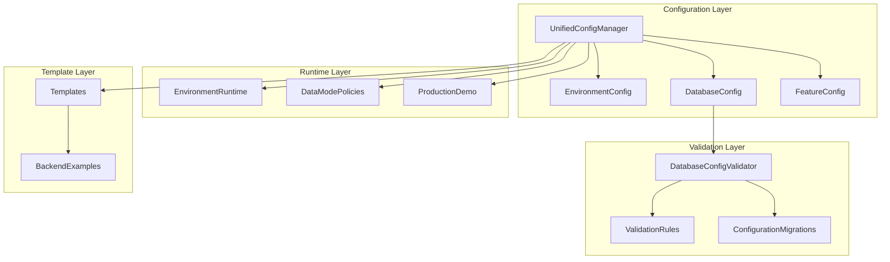
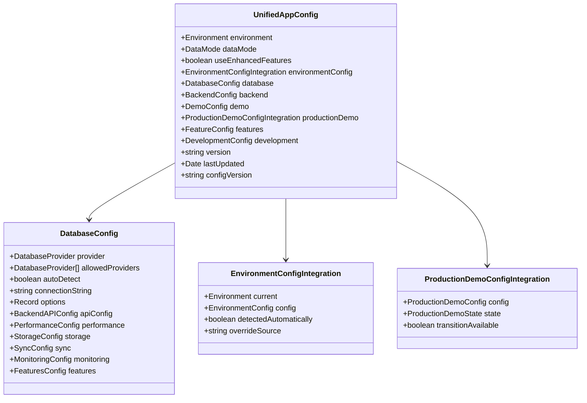
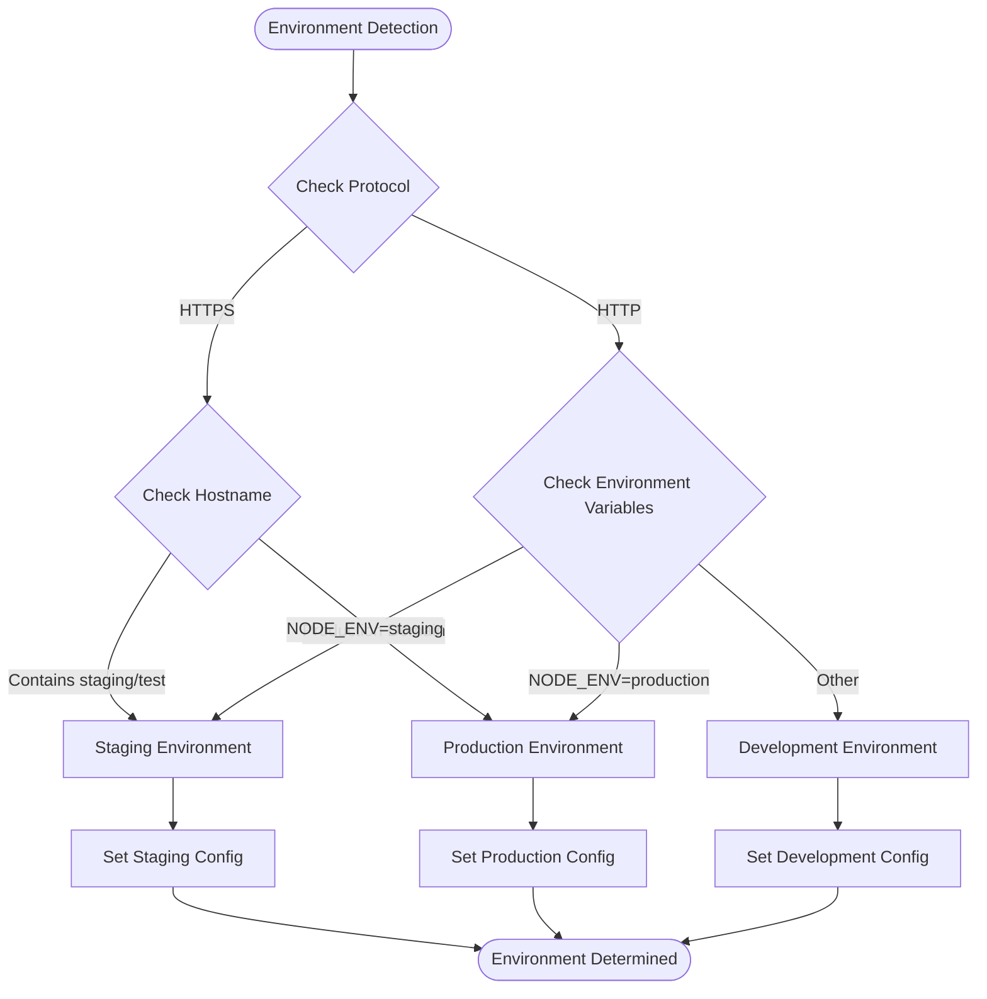
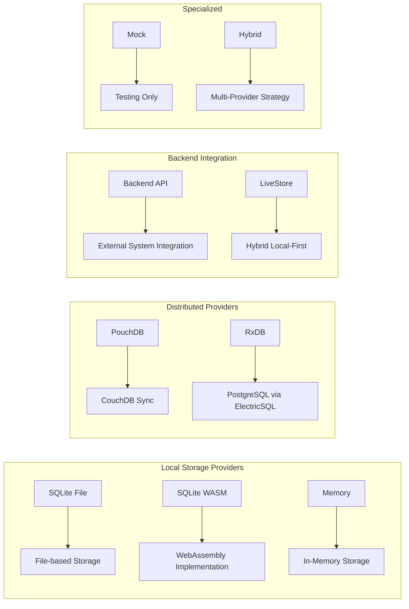
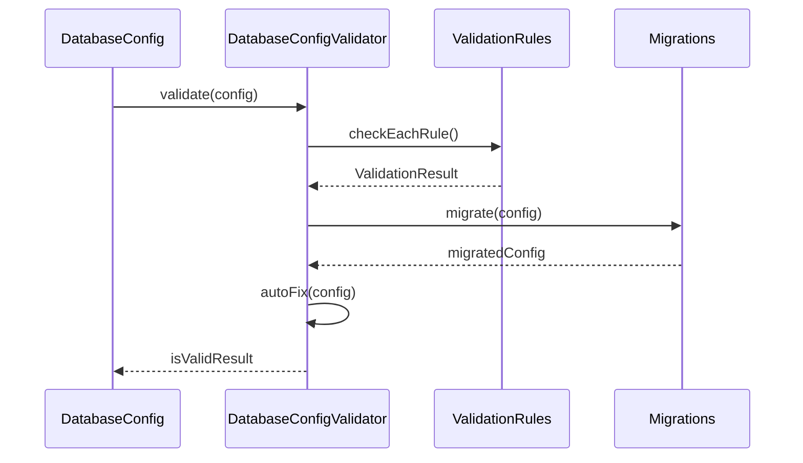
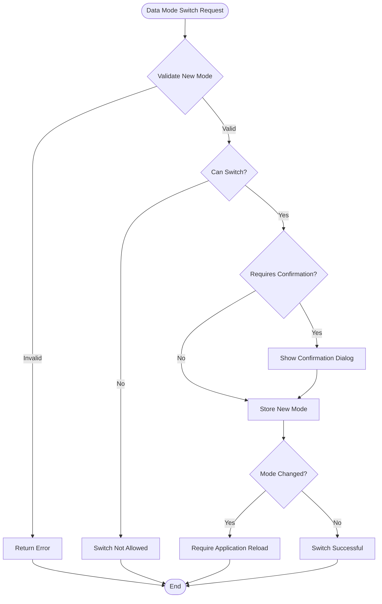
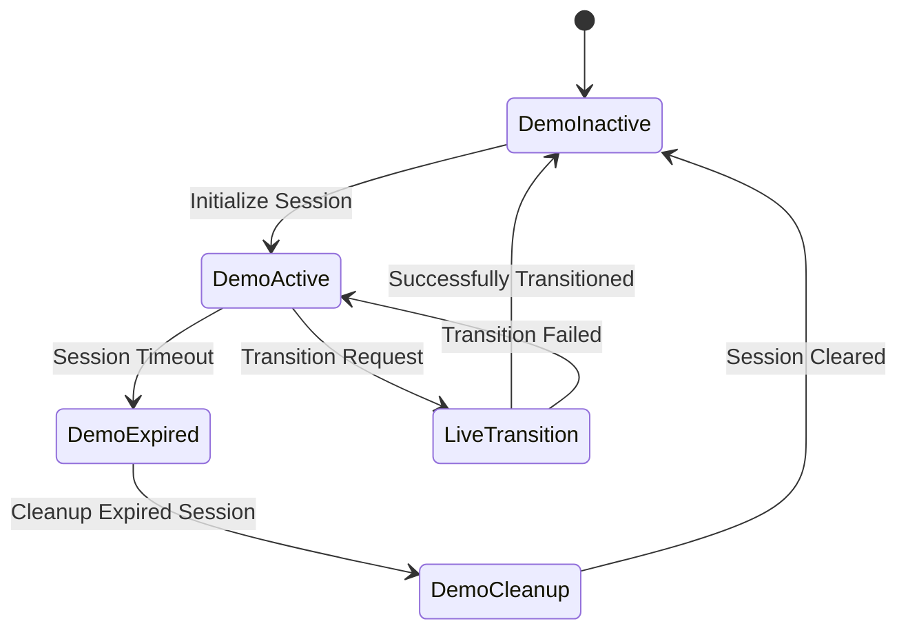
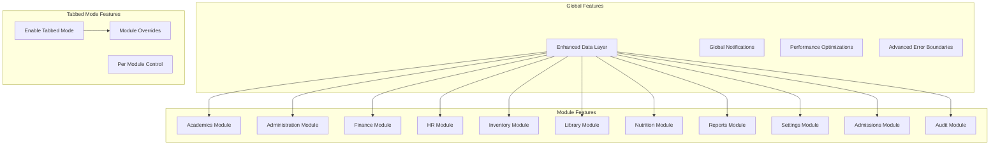
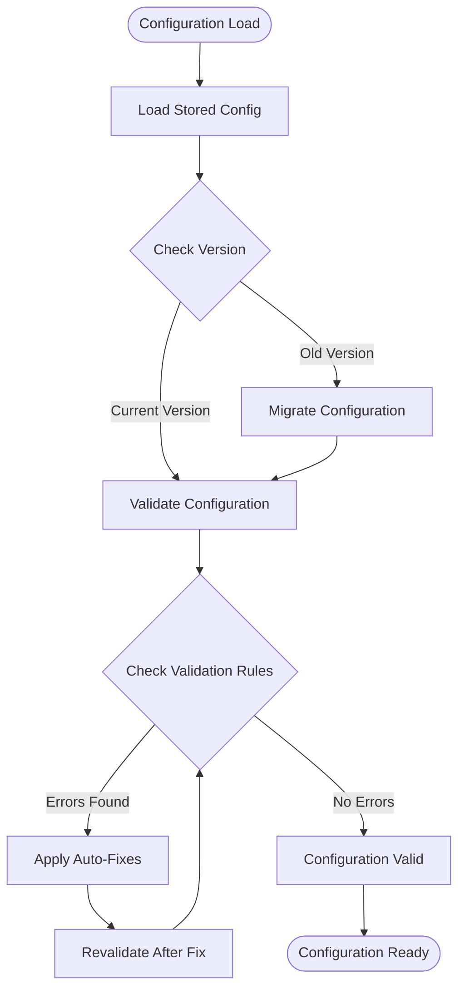
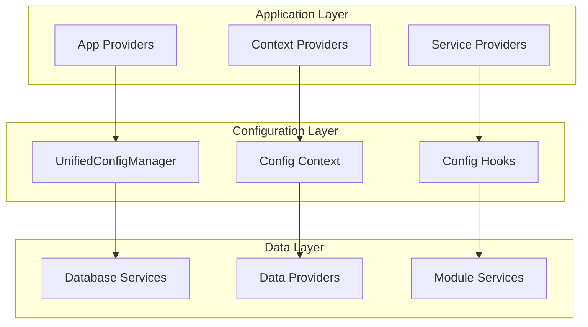

# Unified Configuration System

<cite>
**Referenced Files in This Document**
- [unifiedConfig.ts](file://src/config/unifiedConfig.ts)
- [databaseConfigSchema.ts](file://src/config/databaseConfigSchema.ts)
- [databaseConfigRuntime.ts](file://src/config/databaseConfigRuntime.ts)
- [environmentMatrix.ts](file://src/config/environmentMatrix.ts)
- [dataModePolicies.ts](file://src/config/dataModePolicies.ts)
- [productionDemo.ts](file://src/config/productionDemo.ts)
- [databaseEnvVars.ts](file://src/config/databaseEnvVars.ts)
- [environmentRuntime.ts](file://src/config/environmentRuntime.ts)
- [dataLayerConfig.ts](file://src/config/dataLayerConfig.ts)
- [tabbedModeConfig.ts](file://src/config/tabbedModeConfig.ts)
- [modules.json](file://src/config/modules.json)
- [backend-api-config.example.ts](file://src/config/examples/backend-api-config.example.ts)
- [standalone-browser.json](file://src/config/templates/standalone-browser.json)
- [lan-sync.json](file://src/config/templates/lan-sync.json)
- [hybrid.json](file://src/config/templates/hybrid.json)
</cite>

## Table of Contents
1. [Introduction](#introduction)
2. [System Architecture](#system-architecture)
3. [Core Configuration Components](#core-configuration-components)
4. [Environment Management](#environment-management)
5. [Database Configuration System](#database-configuration-system)
6. [Data Mode Management](#data-mode-management)
7. [Production Demo System](#production-demo-system)
8. [Configuration Templates](#configuration-templates)
9. [Feature Flag Management](#feature-flag-management)
10. [Configuration Validation and Migration](#configuration-validation-and-migration)
11. [Integration Patterns](#integration-patterns)
12. [Best Practices](#best-practices)

## Introduction

The Unified Configuration System is a comprehensive configuration management solution designed for the SchoolPilot3 educational management platform. This system provides centralized control over application behavior, database connectivity, environment-specific settings, and feature toggles across different deployment scenarios.

The system supports multiple environments (development, staging, production), various data modes (demo, production), and numerous database providers while maintaining consistency and reliability across all deployment types. It integrates seamlessly with the existing module architecture and provides robust validation, migration, and runtime detection capabilities.

## System Architecture

The Unified Configuration System follows a layered architecture pattern that separates concerns between environment detection, configuration validation, runtime management, and template-based provisioning.

**Diagram sources**
- [unifiedConfig.ts:646-800](file://src/config/unifiedConfig.ts#L646-L800)
- [databaseConfigSchema.ts:304-529](file://src/config/databaseConfigSchema.ts#L304-L529)
- [environmentRuntime.ts:31-127](file://src/config/environmentRuntime.ts#L31-L127)

## Core Configuration Components

The Unified Configuration System centers around the `UnifiedAppConfig` interface, which serves as the single source of truth for all application configuration needs.

### Unified Configuration Interface

The core configuration object encompasses multiple subsystems that work together to provide comprehensive application control:

**Diagram sources**
- [unifiedConfig.ts:215-304](file://src/config/unifiedConfig.ts#L215-L304)
- [unifiedConfig.ts:146-197](file://src/config/unifiedConfig.ts#L146-L197)
- [unifiedConfig.ts:206-212](file://src/config/unifiedConfig.ts#L206-L212)
- [unifiedConfig.ts:199-204](file://src/config/unifiedConfig.ts#L199-L204)

**Section sources**
- [unifiedConfig.ts:215-304](file://src/config/unifiedConfig.ts#L215-L304)
- [unifiedConfig.ts:146-197](file://src/config/unifiedConfig.ts#L146-L197)

## Environment Management

The environment management system provides automatic detection and configuration of different deployment environments with appropriate defaults and restrictions.

### Environment Matrix Configuration

The system defines three primary environments with distinct characteristics and capabilities:

| Environment | Allowed Data Modes | Default Provider | Features |
|-------------|-------------------|------------------|----------|
| Development | demo, production | sqlite | Advanced reporting, performance monitoring |
| Staging | demo, production | rxdb | All development features + real-time sync |
| Production | production | rxdb | Production-ready features only |

**Diagram sources**
- [environmentMatrix.ts:86-112](file://src/config/environmentMatrix.ts#L86-L112)

**Section sources**
- [environmentMatrix.ts:31-83](file://src/config/environmentMatrix.ts#L31-L83)
- [environmentMatrix.ts:86-112](file://src/config/environmentMatrix.ts#L86-L112)

## Database Configuration System

The database configuration system provides comprehensive management of database providers, connection parameters, and operational settings with built-in validation and migration capabilities.

### Database Provider Support

The system supports multiple database providers optimized for different deployment scenarios:

**Diagram sources**
- [environmentMatrix.ts:9](file://src/config/environmentMatrix.ts#L9)
- [dataLayerConfig.ts:13-36](file://src/config/dataLayerConfig.ts#L13-L36)

### Database Configuration Validation

The validation system ensures configuration integrity through comprehensive rule checking and automatic repair capabilities:

**Diagram sources**
- [databaseConfigSchema.ts:316-359](file://src/config/databaseConfigSchema.ts#L316-L359)
- [databaseConfigSchema.ts:384-409](file://src/config/databaseConfigSchema.ts#L384-L409)

**Section sources**
- [databaseConfigSchema.ts:54-200](file://src/config/databaseConfigSchema.ts#L54-L200)
- [databaseConfigSchema.ts:304-529](file://src/config/databaseConfigSchema.ts#L304-L529)

## Data Mode Management

The data mode management system controls whether the application operates in demo or production data modes, with environment-specific restrictions and capabilities.

### Data Mode Switching Logic

**Diagram sources**
- [dataModePolicies.ts:107-162](file://src/config/dataModePolicies.ts#L107-L162)

**Section sources**
- [dataModePolicies.ts:85-104](file://src/config/dataModePolicies.ts#L85-L104)
- [dataModePolicies.ts:107-162](file://src/config/dataModePolicies.ts#L107-L162)

## Production Demo System

The production demo system enables controlled demonstration of the application in production environments with session management, data retention policies, and seamless transitions to live mode.

### Production Demo Lifecycle

**Diagram sources**
- [productionDemo.ts:135-194](file://src/config/productionDemo.ts#L135-L194)
- [productionDemo.ts:197-252](file://src/config/productionDemo.ts#L197-L252)

**Section sources**
- [productionDemo.ts:9-32](file://src/config/productionDemo.ts#L9-L32)
- [productionDemo.ts:135-194](file://src/config/productionDemo.ts#L135-L194)

## Configuration Templates

The system provides pre-defined templates for common deployment scenarios, ensuring consistent and validated configurations across different environments.

### Template Categories

| Template Type | Purpose | Key Features |
|---------------|---------|--------------|
| Standalone Browser | Single-user browser deployment | SQLite WASM + OPFS storage, no sync |
| LAN Sync | Local network synchronization | PouchDB with CouchDB, bidirectional sync |
| Hybrid | Backend API with local caching | Backend API + SQLite WASM cache, offline-first |

**Section sources**
- [standalone-browser.json:1-67](file://src/config/templates/standalone-browser.json#L1-L67)
- [lan-sync.json:1-77](file://src/config/templates/lan-sync.json#L1-L77)
- [hybrid.json:1-116](file://src/config/templates/hybrid.json#L1-L116)

## Feature Flag Management

The feature flag system provides granular control over feature availability across different modules and environments, enabling gradual rollouts and environment-specific feature sets.

### Feature Configuration Hierarchy

**Diagram sources**
- [unifiedConfig.ts:237-295](file://src/config/unifiedConfig.ts#L237-L295)

**Section sources**
- [unifiedConfig.ts:63-86](file://src/config/unifiedConfig.ts#L63-L86)
- [unifiedConfig.ts:237-295](file://src/config/unifiedConfig.ts#L237-L295)

## Configuration Validation and Migration

The system includes comprehensive validation and migration capabilities to ensure configuration integrity and smooth upgrades between versions.

### Validation Workflow

**Diagram sources**
- [databaseConfigSchema.ts:470-491](file://src/config/databaseConfigSchema.ts#L470-L491)

**Section sources**
- [databaseConfigSchema.ts:202-299](file://src/config/databaseConfigSchema.ts#L202-L299)
- [databaseConfigSchema.ts:470-491](file://src/config/databaseConfigSchema.ts#L470-L491)

## Integration Patterns

The Unified Configuration System integrates with various parts of the application architecture to provide seamless configuration management.

### Integration Architecture

**Diagram sources**
- [unifiedConfig.ts:646-800](file://src/config/unifiedConfig.ts#L646-L800)

**Section sources**
- [unifiedConfig.ts:646-800](file://src/config/unifiedConfig.ts#L646-L800)

## Best Practices

### Configuration Management Guidelines

1. **Environment-Specific Defaults**: Always use environment-specific configurations as base defaults
2. **Validation First**: Validate configurations before applying to ensure integrity
3. **Migration Planning**: Plan configuration migrations carefully with version tracking
4. **Feature Flag Strategy**: Use feature flags for gradual rollouts and environment-specific features
5. **Template Usage**: Leverage predefined templates for common deployment scenarios
6. **Security Considerations**: Never store sensitive credentials in configuration files
7. **Performance Monitoring**: Monitor configuration impact on application performance
8. **Testing Strategy**: Test configuration changes across all supported environments

### Deployment Strategies

- **Development**: Use SQLite file provider with full feature set enabled
- **Staging**: Enable real-time sync capabilities with production-like settings
- **Production**: Use LiveStore or backend API providers with conservative feature sets

The Unified Configuration System provides a robust foundation for managing complex application configurations while maintaining flexibility and reliability across diverse deployment scenarios. Its comprehensive validation, migration, and runtime detection capabilities ensure consistent behavior and smooth operation across all supported environments.