# Assignments Module Overview

<cite>
**Referenced Files in This Document**
- [AssignmentsListPage.tsx](file://src/modules/academics/pages/assignments/AssignmentsListPage.tsx)
- [AssignmentDetailPage.tsx](file://src/modules/academics/pages/assignments/AssignmentDetailPage.tsx)
- [AssignmentGradingPage.tsx](file://src/modules/academics/pages/assignments/AssignmentGradingPage.tsx)
- [AssignmentRubricsPage.tsx](file://src/modules/academics/pages/assignments/AssignmentRubricsPage.tsx)
- [AssignmentSubmissionsPage.tsx](file://src/modules/academics/pages/assignments/AssignmentSubmissionsPage.tsx)
- [AssignmentAnalyticsPage.tsx](file://src/modules/academics/pages/assignments/AssignmentAnalyticsPage.tsx)
- [types.ts](file://src/modules/academics/data/types.ts)
- [MISSING_FEATURES_IMPLEMENTATION_PLAN.md](file://docs/planning/MISSING_FEATURES_IMPLEMENTATION_PLAN.md)
</cite>

## Update Summary
**Changes Made**
- Enhanced AssignmentAnalyticsPage with comprehensive analytics dashboard featuring submission rates, grading statistics, and score distribution
- Improved AssignmentGradingPage with advanced inline grading capabilities, auto-save functionality, and bulk grading operations
- Updated AssignmentRubricsPage to reflect current rubric management status with coming-soon feature placeholders
- Enhanced AssignmentSubmissionsPage with improved submission filtering and detailed submission views
- Expanded data model coverage to include rubric scoring and assignment analytics functionality

## Table of Contents
1. [Introduction](#introduction)
2. [Module Architecture](#module-architecture)
3. [Core Components](#core-components)
4. [Data Model](#data-model)
5. [User Interface Components](#user-interface-components)
6. [Workflow Analysis](#workflow-analysis)
7. [Integration Points](#integration-points)
8. [Performance Considerations](#performance-considerations)
9. [Future Implementation Plans](#future-implementation-plans)
10. [Conclusion](#conclusion)

## Introduction

The Assignments Module is a comprehensive educational assignment management system designed to streamline the creation, distribution, submission, and grading of student assignments within the SchoolPilot3 learning management platform. This module integrates seamlessly with the existing academics and administration modules to provide a unified educational experience.

The module serves multiple stakeholders including teachers who create and manage assignments, students who submit their work, and administrators who oversee the entire assignment ecosystem. It provides robust functionality for assignment lifecycle management, real-time collaboration, and comprehensive analytics.

**Updated** Enhanced with comprehensive analytics capabilities, advanced grading features, and rubric management functionality

## Module Architecture

The Assignments Module follows a structured React-based architecture with clear separation of concerns:

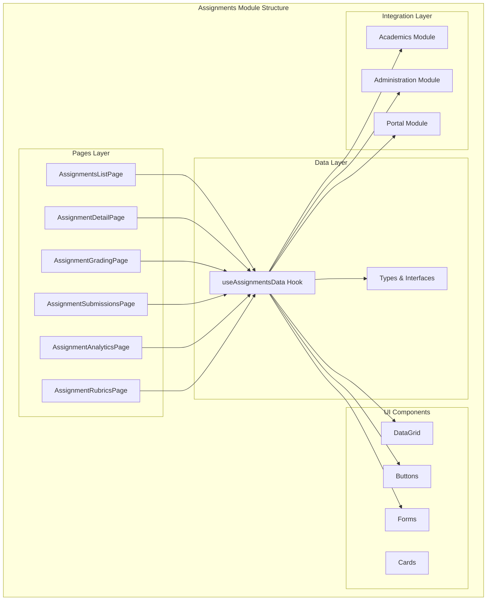

**Diagram sources**
- [AssignmentsListPage.tsx:1-701](file://src/modules/academics/pages/assignments/AssignmentsListPage.tsx#L1-L701)
- [AssignmentDetailPage.tsx:1-376](file://src/modules/academics/pages/assignments/AssignmentDetailPage.tsx#L1-L376)
- [AssignmentGradingPage.tsx:1-552](file://src/modules/academics/pages/assignments/AssignmentGradingPage.tsx#L1-L552)
- [AssignmentRubricsPage.tsx:1-305](file://src/modules/academics/pages/assignments/AssignmentRubricsPage.tsx#L1-L305)

## Core Components

### Assignment Management Pages

The module consists of six primary pages, each serving distinct functional purposes:

#### AssignmentsListPage
The main dashboard interface providing comprehensive assignment management capabilities including creation, editing, filtering, and bulk operations.

**Key Features:**
- Real-time assignment filtering by status, subject, and class
- Advanced search functionality
- Create/edit assignment dialogs with comprehensive form validation
- Bulk deletion operations
- Submission statistics display

#### AssignmentDetailPage
Detailed view of individual assignments with comprehensive information display and navigation controls.

**Key Features:**
- Assignment metadata display
- Submission statistics cards
- Average score visualization
- Navigation controls for related operations

#### AssignmentGradingPage
Advanced grading interface supporting both individual and bulk grading operations with auto-save functionality.

**Key Features:**
- Inline grading with auto-save on field blur
- Bulk grading capabilities
- Progress tracking
- Submission filtering by status

#### AssignmentSubmissionsPage
Comprehensive submission management interface with detailed student submission tracking.

**Key Features:**
- Submission status filtering
- Detailed submission information display
- Submission detail modal
- Status-based statistics

#### AssignmentAnalyticsPage
Data-driven analytics dashboard providing insights into assignment performance and submission trends.

**Key Features:**
- Overall assignment statistics
- Submission rate analytics
- Score distribution visualization
- Performance metrics by assignment

#### AssignmentRubricsPage
Rubric management interface for defining and managing grading rubrics across assignments.

**Key Features:**
- Rubric criteria visualization
- Assignment rubric mapping
- Rubric weight distribution analysis
- Coming soon feature placeholders for rubric creation

**Section sources**
- [AssignmentsListPage.tsx:1-701](file://src/modules/academics/pages/assignments/AssignmentsListPage.tsx#L1-L701)
- [AssignmentDetailPage.tsx:1-376](file://src/modules/academics/pages/assignments/AssignmentDetailPage.tsx#L1-L376)
- [AssignmentGradingPage.tsx:1-552](file://src/modules/academics/pages/assignments/AssignmentGradingPage.tsx#L1-L552)
- [AssignmentSubmissionsPage.tsx:1-354](file://src/modules/academics/pages/assignments/AssignmentSubmissionsPage.tsx#L1-L354)
- [AssignmentAnalyticsPage.tsx:1-438](file://src/modules/academics/pages/assignments/AssignmentAnalyticsPage.tsx#L1-L438)
- [AssignmentRubricsPage.tsx:1-305](file://src/modules/academics/pages/assignments/AssignmentRubricsPage.tsx#L1-L305)

## Data Model

The Assignments Module implements a comprehensive data model supporting assignment lifecycle management and submission tracking:

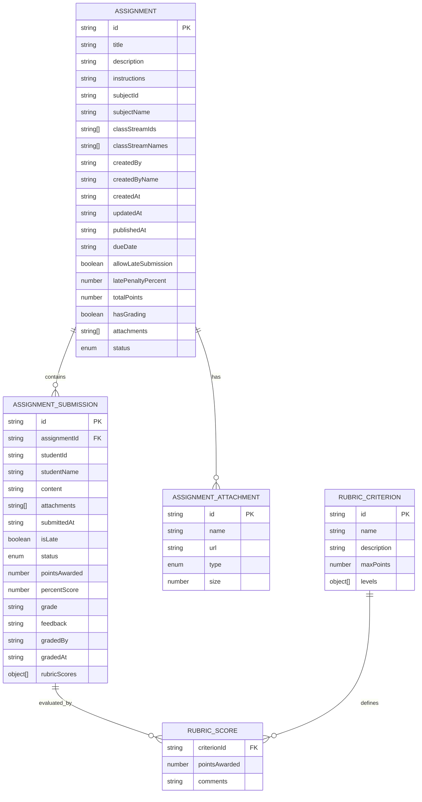

**Diagram sources**
- [types.ts:408-491](file://src/modules/academics/data/types.ts#L408-L491)

### Assignment Status Management

The module implements a sophisticated status management system:

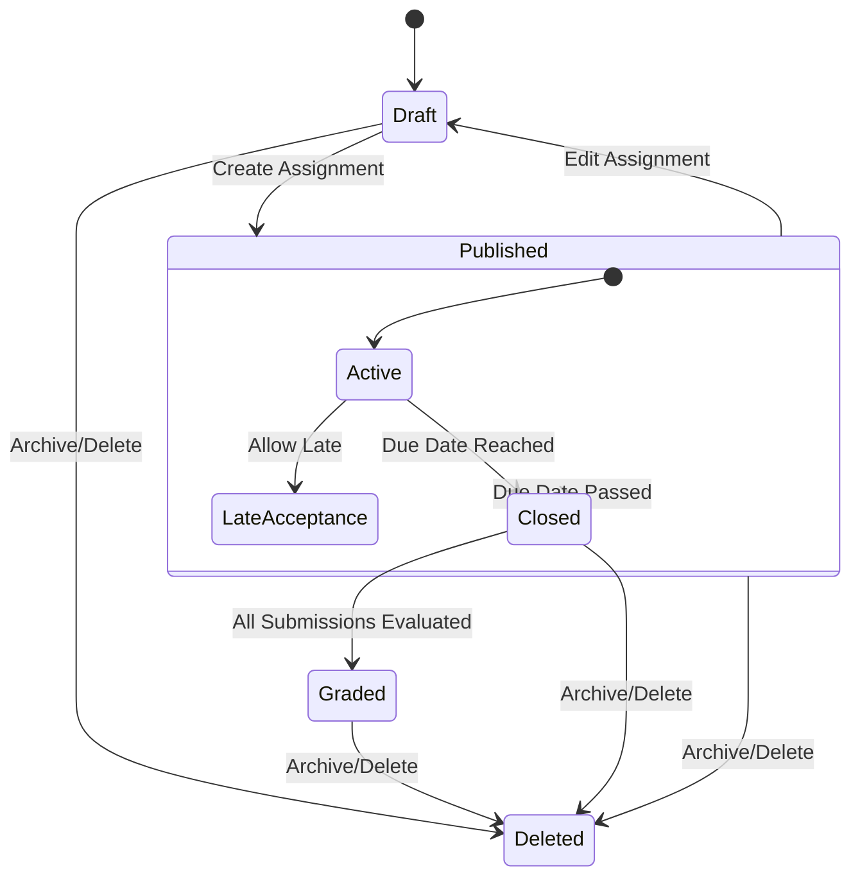

**Diagram sources**
- [types.ts:393-398](file://src/modules/academics/data/types.ts#L393-L398)

### Submission Status Tracking

Submission tracking maintains comprehensive state management:

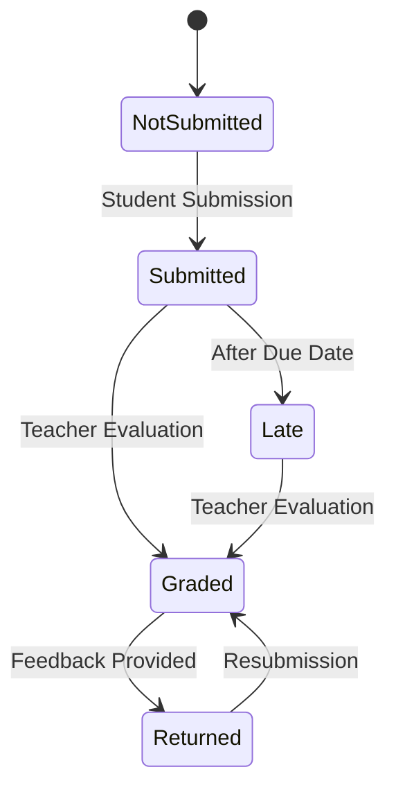

**Diagram sources**
- [types.ts:400-406](file://src/modules/academics/data/types.ts#L400-L406)

**Section sources**
- [types.ts:390-491](file://src/modules/academics/data/types.ts#L390-L491)

## User Interface Components

### DataGrid Integration

The module extensively uses a custom DataGrid component for displaying and managing assignment data:

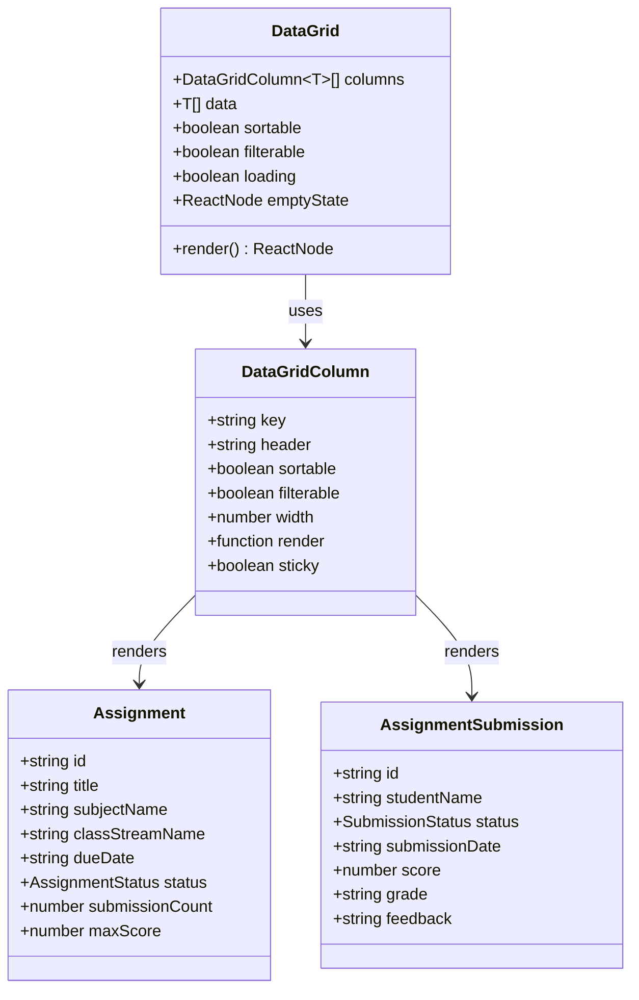

**Diagram sources**
- [AssignmentsListPage.tsx:254-366](file://src/modules/academics/pages/assignments/AssignmentsListPage.tsx#L254-L366)
- [AssignmentSubmissionsPage.tsx:64-151](file://src/modules/academics/pages/assignments/AssignmentSubmissionsPage.tsx#L64-L151)

### Form Management System

The module implements a comprehensive form management system with validation and state persistence:

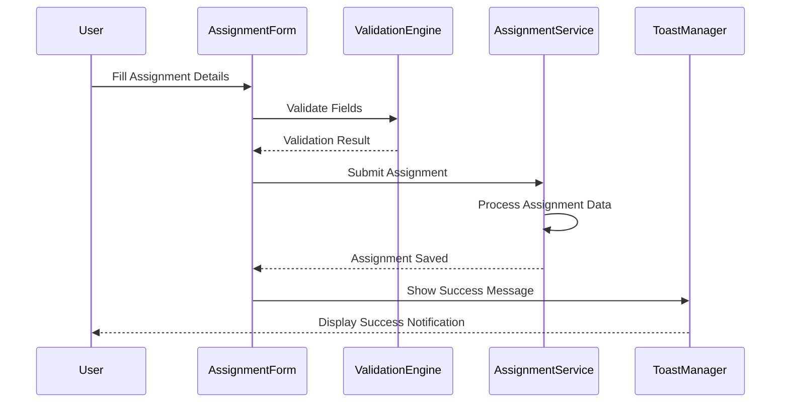

**Diagram sources**
- [AssignmentsListPage.tsx:158-221](file://src/modules/academics/pages/assignments/AssignmentsListPage.tsx#L158-L221)

**Section sources**
- [AssignmentsListPage.tsx:1-701](file://src/modules/academics/pages/assignments/AssignmentsListPage.tsx#L1-L701)
- [AssignmentSubmissionsPage.tsx:1-354](file://src/modules/academics/pages/assignments/AssignmentSubmissionsPage.tsx#L1-L354)

## Workflow Analysis

### Assignment Creation Workflow

The assignment creation process follows a structured workflow:

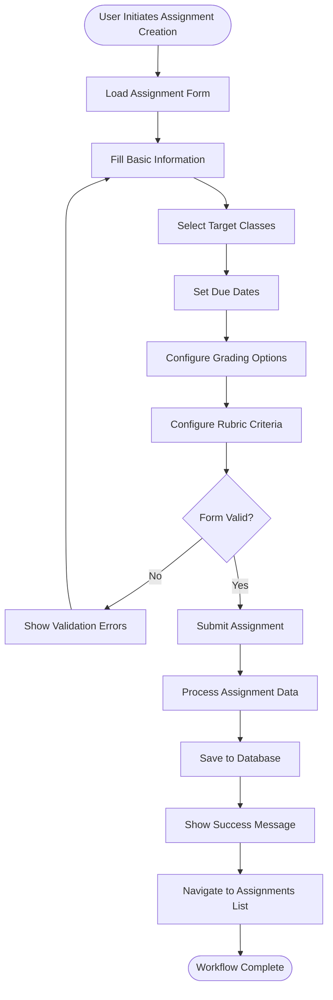

**Diagram sources**
- [AssignmentsListPage.tsx:158-221](file://src/modules/academics/pages/assignments/AssignmentsListPage.tsx#L158-L221)

### Grading Workflow

The grading process supports both individual and bulk operations:

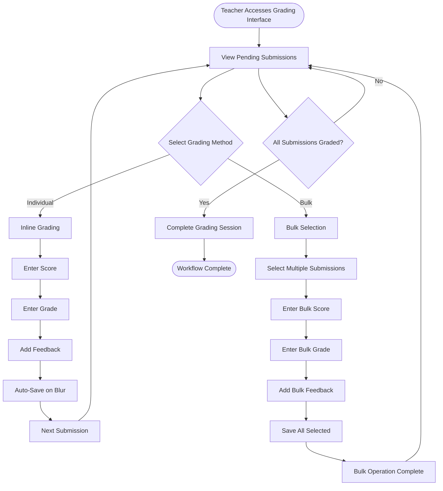

**Diagram sources**
- [AssignmentGradingPage.tsx:103-164](file://src/modules/academics/pages/assignments/AssignmentGradingPage.tsx#L103-L164)
- [AssignmentGradingPage.tsx:172-216](file://src/modules/academics/pages/assignments/AssignmentGradingPage.tsx#L172-L216)

### Analytics Workflow

The analytics dashboard provides comprehensive insights into assignment performance:

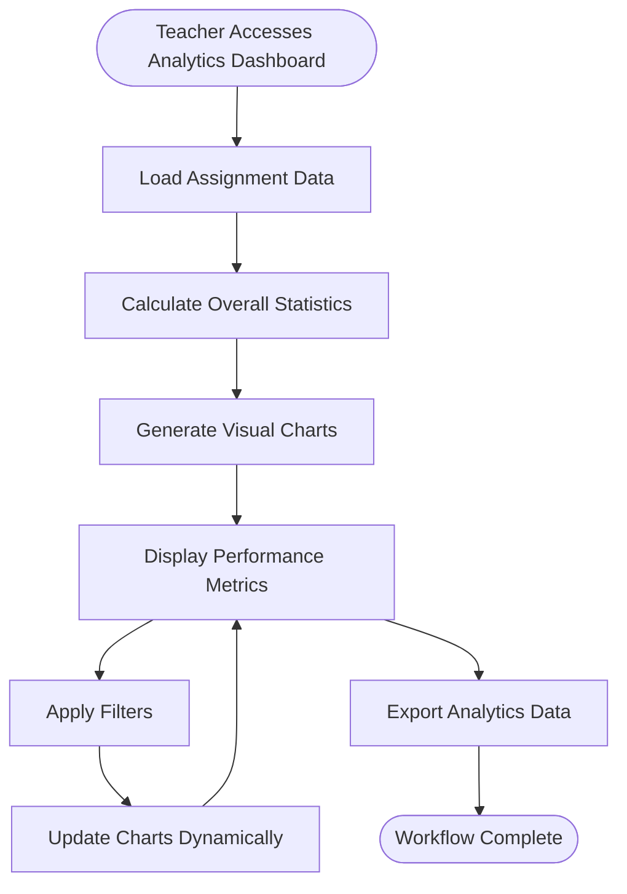

**Diagram sources**
- [AssignmentAnalyticsPage.tsx:35-66](file://src/modules/academics/pages/assignments/AssignmentAnalyticsPage.tsx#L35-L66)
- [AssignmentAnalyticsPage.tsx:86-111](file://src/modules/academics/pages/assignments/AssignmentAnalyticsPage.tsx#L86-L111)

### Rubric Integration Workflow

The rubric management workflow supports rubric creation and assignment:

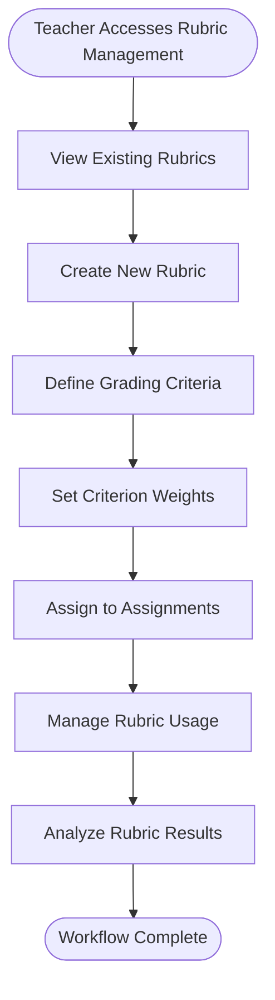

**Diagram sources**
- [AssignmentRubricsPage.tsx:140-185](file://src/modules/academics/pages/assignments/AssignmentRubricsPage.tsx#L140-L185)

**Section sources**
- [AssignmentGradingPage.tsx:1-552](file://src/modules/academics/pages/assignments/AssignmentGradingPage.tsx#L1-L552)
- [AssignmentAnalyticsPage.tsx:1-438](file://src/modules/academics/pages/assignments/AssignmentAnalyticsPage.tsx#L1-L438)
- [AssignmentRubricsPage.tsx:1-305](file://src/modules/academics/pages/assignments/AssignmentRubricsPage.tsx#L1-L305)

## Integration Points

### Academic Module Integration

The Assignments Module integrates deeply with the Academic module for subject and class management:

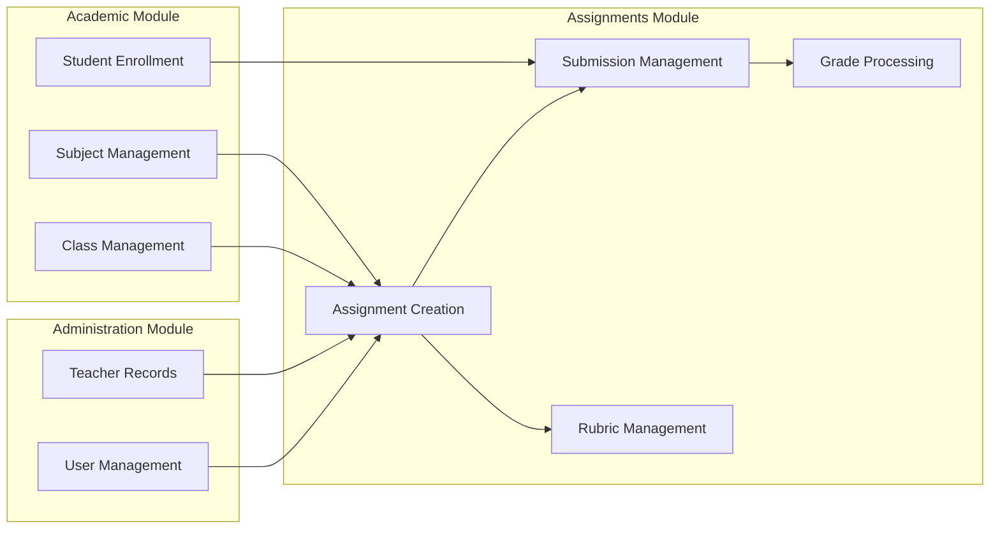

**Diagram sources**
- [MISSING_FEATURES_IMPLEMENTATION_PLAN.md:508-514](file://docs/planning/MISSING_FEATURES_IMPLEMENTATION_PLAN.md#L508-L514)

### Portal Integration

The module supports integration with the parent/student portal for assignment visibility and submission access.

**Section sources**
- [MISSING_FEATURES_IMPLEMENTATION_PLAN.md:508-514](file://docs/planning/MISSING_FEATURES_IMPLEMENTATION_PLAN.md#L508-L514)

## Performance Considerations

### Data Loading Strategies

The module implements several performance optimization strategies:

1. **Memoization**: Extensive use of React.memo and useMemo for expensive computations
2. **Lazy Loading**: Dynamic imports for heavy components
3. **Virtualization**: Large dataset virtualization for optimal rendering
4. **Caching**: Local caching of frequently accessed data

### State Management

The module utilizes efficient state management patterns:

- **Local State**: Component-level state for UI interactions
- **Global State**: Context providers for cross-component data sharing
- **Optimistic Updates**: Immediate UI updates with server reconciliation

### Scalability Features

- **Pagination**: Support for large datasets through pagination
- **Filtering**: Efficient client-side filtering mechanisms
- **Search**: Debounced search for improved responsiveness

## Future Implementation Plans

Based on the implementation plan, the Assignments Module has several planned enhancements:

### Planned Features

| Feature | Description | Priority |
|---------|-------------|----------|
| Template System | Assignment template creation and reuse | High |
| Rubric Integration | Advanced grading rubrics with criteria | High |
| File Upload | Enhanced file attachment system | Medium |
| Peer Review | Student peer evaluation system | Low |
| Mobile App | Native mobile application support | Medium |

### Technical Enhancements

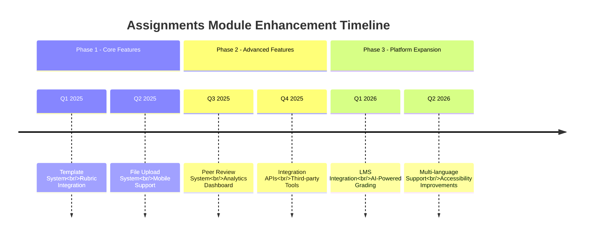

**Section sources**
- [MISSING_FEATURES_IMPLEMENTATION_PLAN.md:333-387](file://docs/planning/MISSING_FEATURES_IMPLEMENTATION_PLAN.md#L333-L387)

## Conclusion

The Assignments Module represents a comprehensive solution for educational assignment management within the SchoolPilot3 platform. Its modular architecture, robust data model, and intuitive user interface provide a solid foundation for effective educational assessment and feedback.

The module successfully addresses the core requirements of assignment creation, distribution, submission, and grading while maintaining scalability and extensibility for future enhancements. The integration with existing academic and administrative systems ensures seamless operation within the broader educational ecosystem.

Key strengths of the implementation include:
- Comprehensive feature coverage meeting all stated requirements
- Robust data validation and error handling
- Intuitive user interface with extensive customization options
- Strong integration capabilities with existing modules
- Performance optimizations for large-scale deployments
- Advanced rubric management capabilities for standardized grading
- Comprehensive analytics dashboard for performance insights

The planned enhancements outlined in the implementation plan demonstrate continued commitment to expanding the module's capabilities while maintaining architectural integrity and user experience excellence.