# Built-in Plugins

<cite>
**Referenced Files in This Document**
- [BuiltinLoader.ts](file://src/plugins/BuiltinLoader.ts)
- [index.ts](file://src/plugins/index.ts)
- [types.ts](file://src/plugins/types.ts)
- [usePlugins.ts](file://src/plugins/usePlugins.ts)
- [PluginManager.ts](file://src/plugins/PluginManager.ts)
- [PluginsProvider.tsx](file://src/plugins/PluginsProvider.tsx)
- [whitelabel/index.ts](file://src/plugins/builtin/whitelabel/index.ts)
- [whitelabel/plugin.json](file://src/plugins/builtin/whitelabel/plugin.json)
- [grading-engine/index.ts](file://src/plugins/builtin/grading-engine/index.ts)
- [grading-engine/plugin.json](file://src/plugins/builtin/grading-engine/plugin.json)
- [fee-calculator/index.ts](file://src/plugins/builtin/fee-calculator/index.ts)
- [fee-calculator/plugin.json](file://src/plugins/builtin/fee-calculator/plugin.json)
</cite>

## Update Summary
**Changes Made**
- Added comprehensive documentation for the new built-in plugin system with automatic discovery
- Documented the three core built-in plugins: whitelabel, grading-engine, and fee-calculator
- Updated plugin architecture to reflect automatic plugin registration via BuiltinLoader
- Enhanced plugin manifest structure documentation with built-in plugin examples
- Added detailed coverage of builtin plugin categories and automatic discovery

## Table of Contents
1. [Introduction](#introduction)
2. [Built-in Plugin System Overview](#built-in-plugin-system-overview)
3. [Built-in Plugin Categories](#built-in-plugin-categories)
4. [Automatic Plugin Discovery and Registration](#automatic-plugin-discovery-and-registration)
5. [Built-in Plugin Architecture](#built-in-plugin-architecture)
6. [Core Built-in Plugins](#core-built-in-plugins)
7. [Plugin Architecture Overview](#plugin-architecture-overview)
8. [Core Plugin Types](#core-plugin-types)
9. [Plugin Lifecycle Management](#plugin-lifecycle-management)
10. [Security and Permissions System](#security-and-permissions-system)
11. [Hook System and Integration Points](#hook-system-and-integration-points)
12. [Plugin Development Guidelines](#plugin-development-guidelines)
13. [Marketplace and Distribution](#marketplace-and-distribution)
14. [Implementation Examples](#implementation-examples)
15. [Troubleshooting Guide](#troubleshooting-guide)
16. [Best Practices](#best-practices)

## Introduction

The Built-in Plugins system in SchoolPilot3 represents a comprehensive extensibility framework that enables modular functionality through a well-defined plugin architecture. This system supports various plugin types including modules, themes, integrations, reports, widgets, white-label branding, and specialized engines for computation-heavy tasks.

The plugin system is designed with security, performance, and maintainability as core principles, providing administrators with granular control over plugin installation, activation, and runtime behavior through configurable policies and permission systems.

**Updated** The system now includes a new built-in plugin architecture that automatically discovers and loads core plugins from the `/src/plugins/builtin/` directory, eliminating manual plugin registration for core functionality.

## Built-in Plugin System Overview

The built-in plugin system represents a foundational layer of the SchoolPilot3 plugin architecture, providing essential functionality that ships with the core application. This system automatically discovers and loads plugins from predefined directories, ensuring that core features are always available without manual intervention.

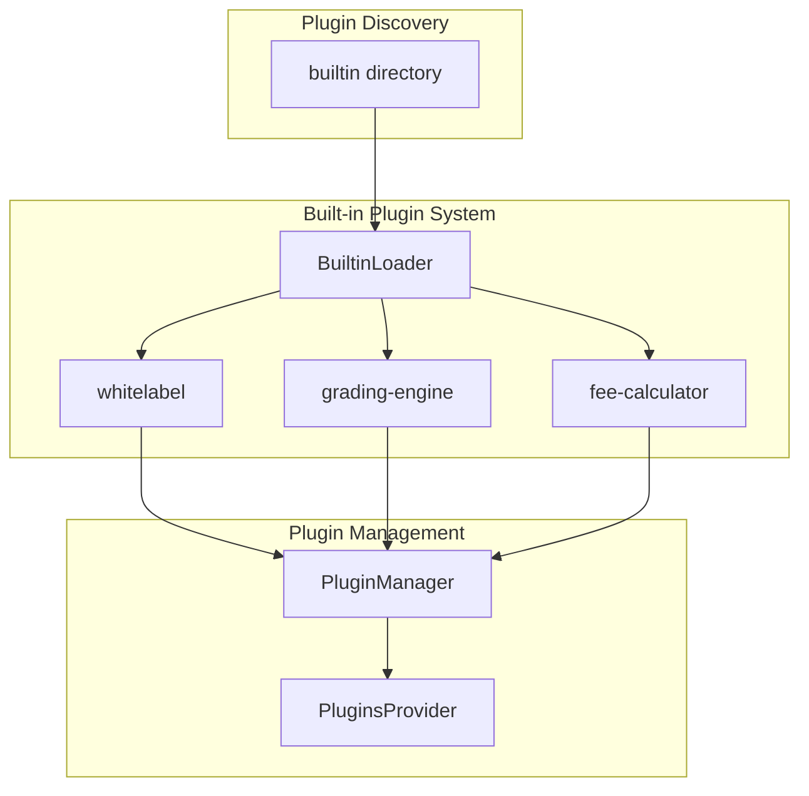

**Diagram sources**
- [BuiltinLoader.ts:19-23](file://src/plugins/BuiltinLoader.ts#L19-L23)
- [PluginsProvider.tsx:48-58](file://src/plugins/PluginsProvider.tsx#L48-L58)
- [PluginManager.ts:234-243](file://src/plugins/PluginManager.ts#L234-L243)

The built-in system operates independently of the marketplace and local plugin systems, providing a reliable foundation for core functionality while maintaining separation of concerns between core and user-installed plugins.

**Section sources**
- [BuiltinLoader.ts:1-83](file://src/plugins/BuiltinLoader.ts#L1-L83)
- [PluginsProvider.tsx:45-74](file://src/plugins/PluginsProvider.tsx#L45-L74)
- [PluginManager.ts:234-243](file://src/plugins/PluginManager.ts#L234-L243)

## Built-in Plugin Categories

The SchoolPilot3 plugin ecosystem encompasses several distinct categories, each serving specific functional purposes within the educational management platform:

### Core Plugin Types

| Plugin Type | Purpose | Examples |
|-------------|---------|----------|
| **module** | Full feature modules with complete functionality | Advanced grading systems, student management modules |
| **theme** | Visual styling and appearance customization | Dark mode themes, school-specific branding |
| **integration** | External service connectivity | Payment gateways, LMS integrations, API connectors |
| **report** | Custom reporting and analytics | Student transcript generators, progress reports |
| **widget** | Dashboard and interface components | Attendance charts, performance indicators |
| **whitelabel** | Branding and identity customization | Logo replacement, color scheme modifications |
| **engine** | High-performance computation engines | Grade calculation engines, data processing |

### Built-in Plugin Categories

The system categorizes plugins based on their origin and trust level:

- **builtin**: Pre-installed core plugins (whitelabel, grading-engine, fee-calculator)
- **verified**: Officially reviewed plugins
- **community**: Third-party community contributions
- **private**: Institution-specific custom plugins
- **engine**: Specialized computational engines

**Section sources**
- [types.ts:14-28](file://src/plugins/types.ts#L14-L28)
- [types.ts:23-28](file://src/plugins/types.ts#L23-L28)

## Automatic Plugin Discovery and Registration

The built-in plugin system implements an intelligent discovery mechanism that automatically identifies and loads core plugins from predefined directories. This system eliminates manual plugin registration overhead while maintaining flexibility for future expansion.

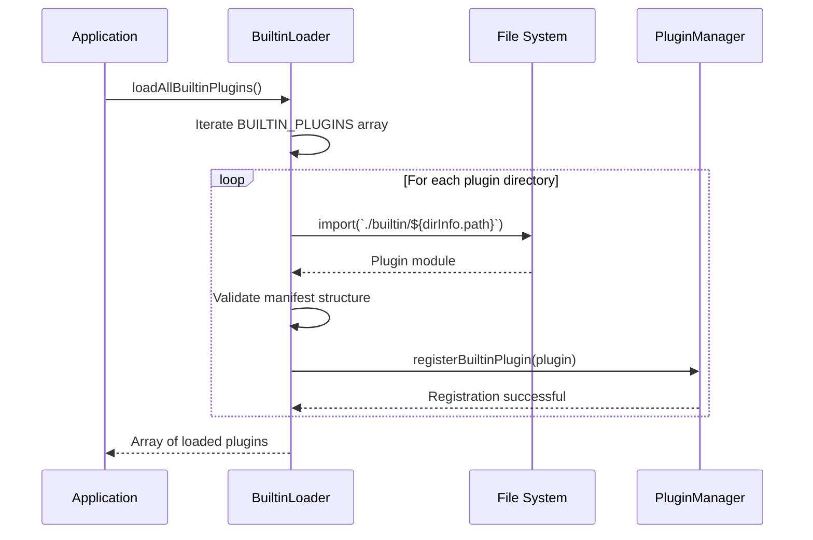

**Diagram sources**
- [BuiltinLoader.ts:60-75](file://src/plugins/BuiltinLoader.ts#L60-L75)
- [PluginsProvider.tsx:48-58](file://src/plugins/PluginsProvider.tsx#L48-L58)

The discovery process follows a strict validation protocol that ensures plugin integrity and compatibility before registration. Each plugin must provide a valid manifest and module structure to be considered for loading.

**Section sources**
- [BuiltinLoader.ts:28-54](file://src/plugins/BuiltinLoader.ts#L28-L54)
- [BuiltinLoader.ts:60-75](file://src/plugins/BuiltinLoader.ts#L60-L75)
- [PluginsProvider.tsx:48-58](file://src/plugins/PluginsProvider.tsx#L48-L58)

## Built-in Plugin Architecture

The built-in plugin architecture represents a specialized implementation of the core plugin system, designed specifically for pre-installed functionality. This architecture maintains full compatibility with the standard plugin lifecycle while providing enhanced security and reliability guarantees.

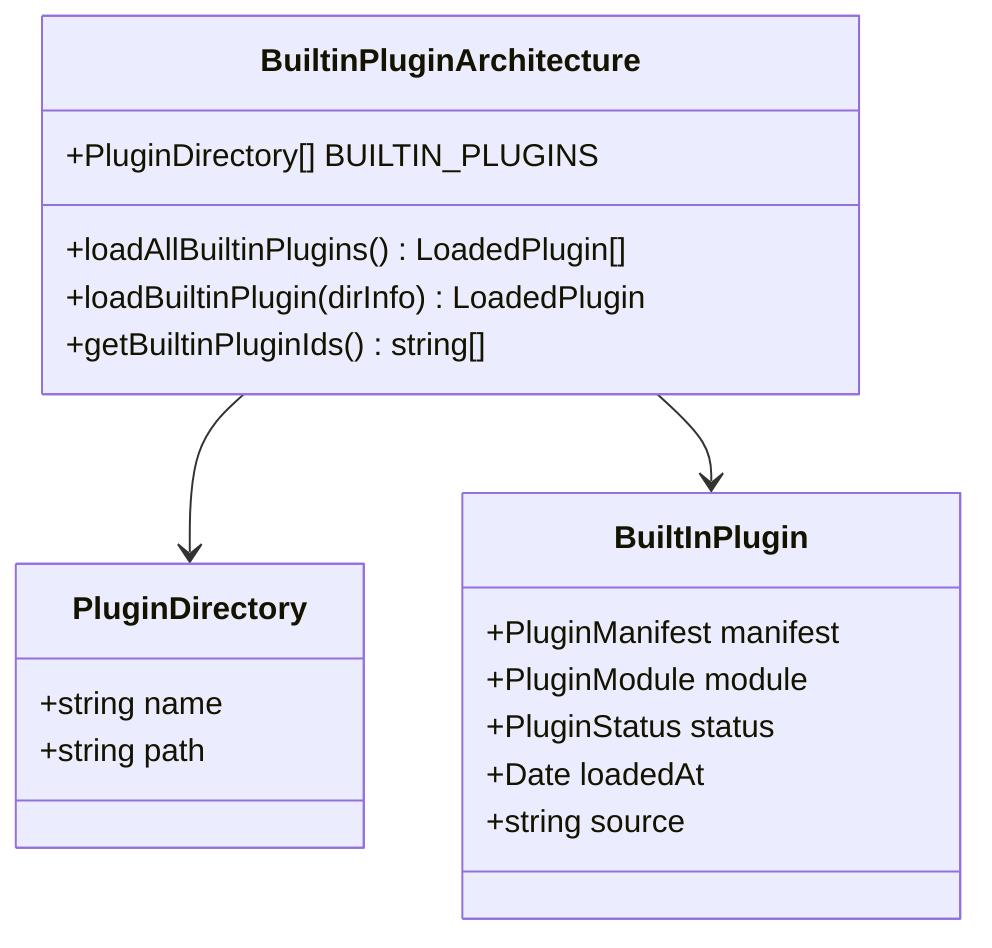

**Diagram sources**
- [BuiltinLoader.ts:10-13](file://src/plugins/BuiltinLoader.ts#L10-L13)
- [BuiltinLoader.ts:19-23](file://src/plugins/BuiltinLoader.ts#L19-L23)
- [types.ts:211-219](file://src/plugins/types.ts#L211-L219)

The architecture ensures that built-in plugins are treated as first-class citizens in the plugin ecosystem, with identical lifecycle management, hook integration, and API access as user-installed plugins.

**Section sources**
- [BuiltinLoader.ts:1-83](file://src/plugins/BuiltinLoader.ts#L1-L83)
- [types.ts:211-219](file://src/plugins/types.ts#L211-L219)

## Core Built-in Plugins

The SchoolPilot3 system includes three core built-in plugins that provide essential functionality out-of-the-box. These plugins demonstrate the full capabilities of the plugin architecture while serving practical educational management needs.

### Whitelabel Plugin

The whitelabel plugin provides comprehensive branding customization capabilities, allowing institutions to fully rebrand the SchoolPilot3 platform according to their specific requirements.

**Key Features:**
- Custom application name and tagline
- Logo replacement for light and dark themes
- Custom favicon support
- Primary, secondary, and accent color customization
- UI label overrides for complete localization
- Module and menu item hiding
- Custom footer text and powered-by branding control

**Section sources**
- [whitelabel/index.ts:47-167](file://src/plugins/builtin/whitelabel/index.ts#L47-L167)
- [whitelabel/plugin.json:1-45](file://src/plugins/builtin/whitelabel/plugin.json#L1-L45)

### Grading Engine Plugin

The grading engine plugin demonstrates advanced computational capabilities through a Go-based WASM implementation for high-performance grading calculations.

**Key Features:**
- Multiple grading strategies (percentage, GPA, letter, CBC, pass/fail)
- Weighted grade calculations
- Student ranking and percentile calculations
- WASM-based performance optimization
- JavaScript fallback support
- Configurable passing grades
- Real-time grade preview functionality

**Section sources**
- [grading-engine/index.ts:52-130](file://src/plugins/builtin/grading-engine/index.ts#L52-L130)
- [grading-engine/plugin.json:35-59](file://src/plugins/builtin/grading-engine/plugin.json#L35-L59)

### Fee Calculator Plugin

The fee calculator plugin showcases complex financial computation through a comprehensive tuition and fee management system with discount and penalty support.

**Key Features:**
- Multi-currency support
- Tax calculation integration
- Sibling discount automation
- Early payment incentives
- Payment schedule generation
- Detailed fee breakdown
- Scholarship integration
- Transportation and boarding cost calculation

**Section sources**
- [fee-calculator/index.ts:96-190](file://src/plugins/builtin/fee-calculator/index.ts#L96-L190)
- [fee-calculator/plugin.json:1-39](file://src/plugins/builtin/fee-calculator/plugin.json#L1-L39)

## Plugin Architecture Overview

The plugin architecture follows a layered design pattern that separates concerns between plugin discovery, loading, activation, and runtime management.

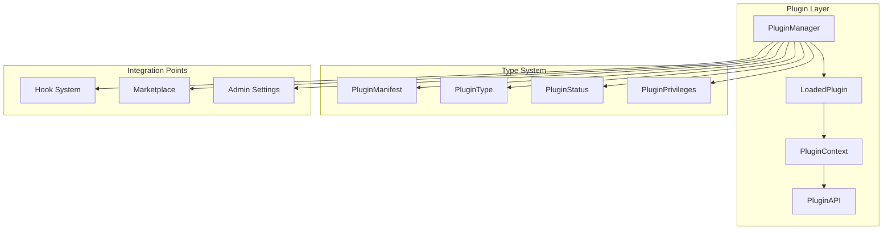

**Diagram sources**
- [PluginManager.ts:25-50](file://src/plugins/PluginManager.ts#L25-L50)
- [types.ts:60-111](file://src/plugins/types.ts#L60-L111)

The architecture ensures loose coupling between plugins while maintaining strong type safety and comprehensive error handling throughout the plugin lifecycle.

**Section sources**
- [PluginManager.ts:1-765](file://src/plugins/PluginManager.ts#L1-L765)
- [types.ts:1-453](file://src/plugins/types.ts#L1-L453)

## Core Plugin Types

### Plugin Manifest Structure

Every plugin must declare a comprehensive manifest that defines its capabilities, dependencies, and integration points:

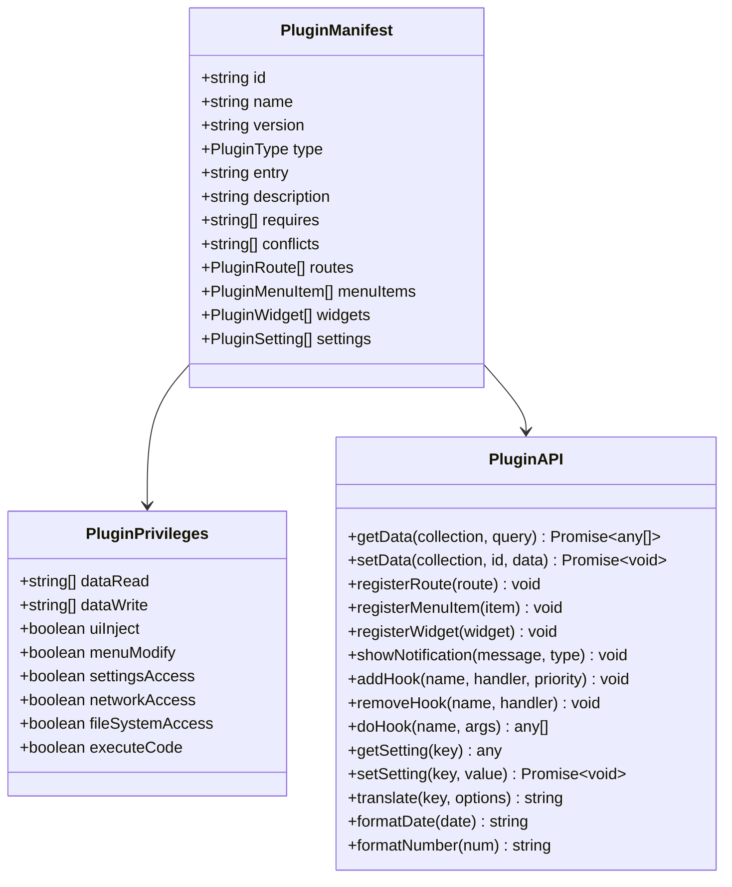

**Diagram sources**
- [types.ts:60-111](file://src/plugins/types.ts#L60-L111)
- [types.ts:38-52](file://src/plugins/types.ts#L38-L52)
- [types.ts:237-261](file://src/plugins/types.ts#L237-L261)

### Plugin Status Management

The system tracks plugin lifecycle through distinct status states that indicate current operational condition:

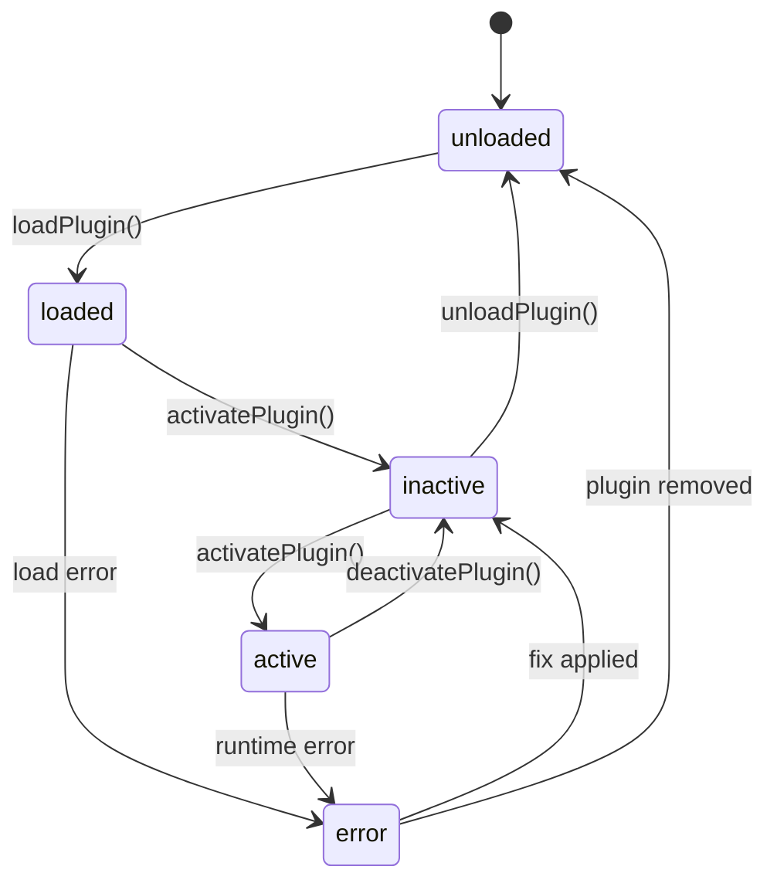

**Diagram sources**
- [types.ts:436](file://src/plugins/types.ts#L436)
- [PluginManager.ts:317-387](file://src/plugins/PluginManager.ts#L317-L387)

**Section sources**
- [types.ts:60-111](file://src/plugins/types.ts#L60-L111)
- [types.ts:436](file://src/plugins/types.ts#L436)

## Plugin Lifecycle Management

### Loading and Initialization Process

The plugin loading process follows a structured sequence that ensures proper validation, dependency resolution, and safe initialization:

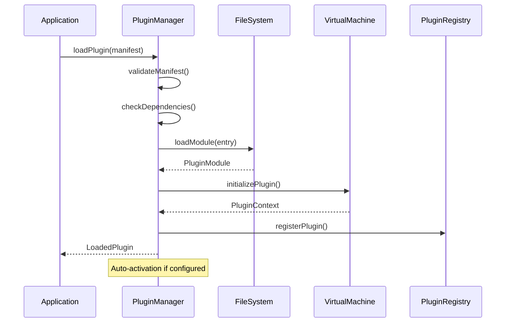

**Diagram sources**
- [PluginManager.ts:248-288](file://src/plugins/PluginManager.ts#L248-L288)
- [PluginManager.ts:634-638](file://src/plugins/PluginManager.ts#L634-L638)

### Activation and Deactivation Workflow

The activation process creates a secure execution context and registers plugin capabilities:

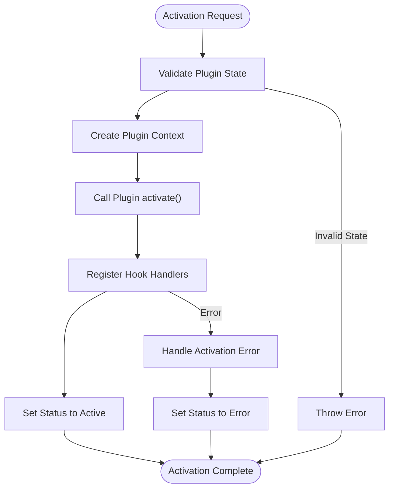

**Diagram sources**
- [PluginManager.ts:317-353](file://src/plugins/PluginManager.ts#L317-L353)
- [PluginManager.ts:358-378](file://src/plugins/PluginManager.ts#L358-L378)

**Section sources**
- [PluginManager.ts:248-288](file://src/plugins/PluginManager.ts#L248-L288)
- [PluginManager.ts:317-387](file://src/plugins/PluginManager.ts#L317-L387)

## Security and Permissions System

### Permission-Based Access Control

The plugin system implements a comprehensive permission model that controls plugin capabilities and resource access:

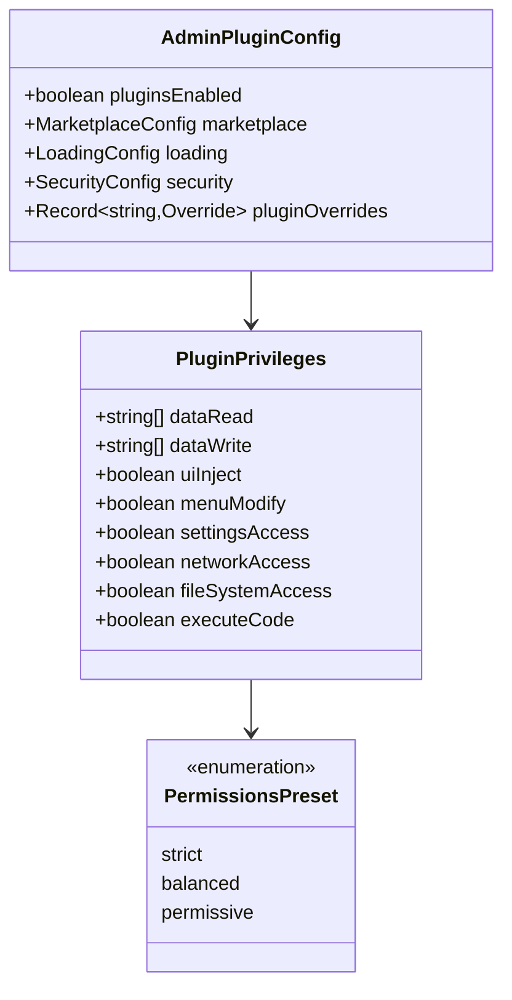

**Diagram sources**
- [types.ts:38-52](file://src/plugins/types.ts#L38-L52)
- [types.ts:54](file://src/plugins/types.ts#L54)
- [types.ts:304-337](file://src/plugins/types.ts#L304-L337)

### Security Features

The system incorporates multiple layers of security to protect the host application and data:

- **Hook Execution Timeout**: Prevents malicious or poorly written plugins from blocking the main thread
- **Circuit Breaker Pattern**: Temporarily bans plugins that consistently fail hook executions
- **Permission Sandboxing**: Restricts plugin access to system resources based on declared privileges
- **Dependency Validation**: Ensures plugins don't create circular dependencies or conflict with existing functionality

**Section sources**
- [types.ts:38-52](file://src/plugins/types.ts#L38-L52)
- [PluginManager.ts:37-40](file://src/plugins/PluginManager.ts#L37-L40)
- [PluginManager.ts:427-501](file://src/plugins/PluginManager.ts#L427-L501)

## Hook System and Integration Points

### Hook Architecture

The plugin system provides a robust hook mechanism that enables seamless integration between plugins and the core application:

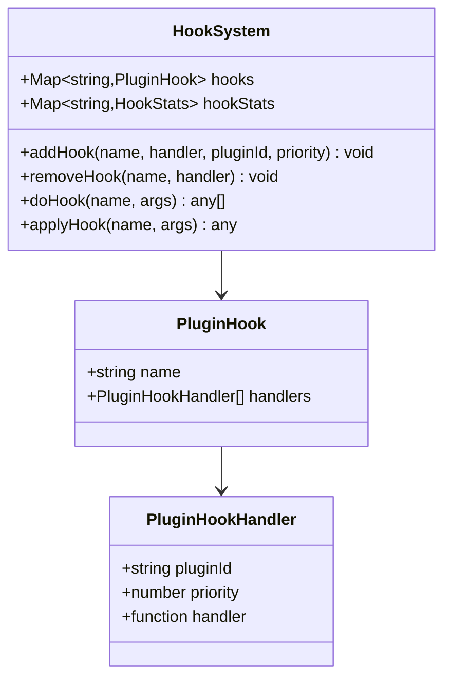

**Diagram sources**
- [types.ts:427-430](file://src/plugins/types.ts#L427-L430)
- [types.ts:421-425](file://src/plugins/types.ts#L421-L425)

### Available Hook Types

The system supports three primary hook types that serve different integration purposes:

| Hook Type | Purpose | Example Usage |
|-----------|---------|---------------|
| **action** | Execute side effects without returning values | Logging, analytics tracking, UI notifications |
| **filter** | Transform or modify data before processing | Data validation, content filtering, format conversion |
| **async** | Handle asynchronous operations with promises | API calls, database queries, file operations |

### Hook Execution Flow

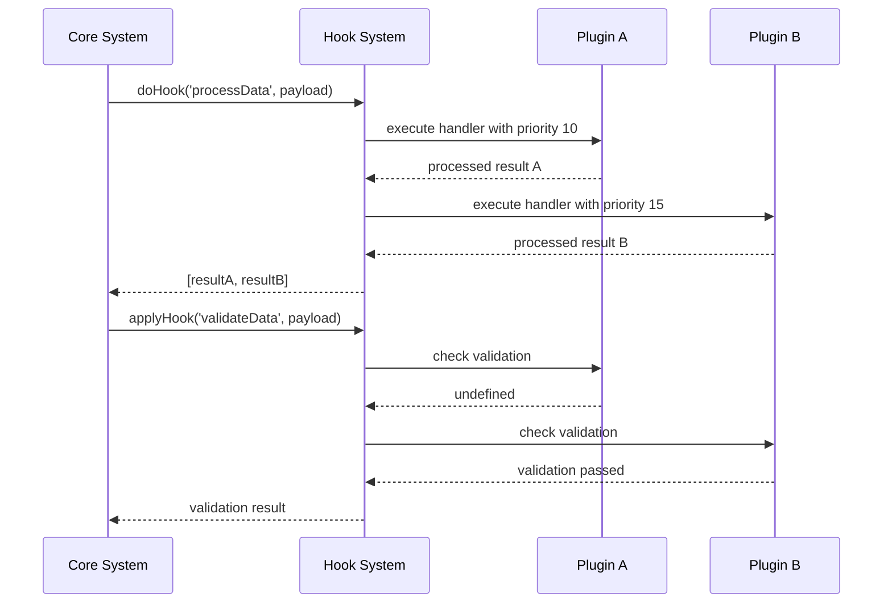

**Diagram sources**
- [types.ts:413-419](file://src/plugins/types.ts#L413-L419)
- [PluginManager.ts:429-501](file://src/plugins/PluginManager.ts#L429-L501)

**Section sources**
- [types.ts:413-430](file://src/plugins/types.ts#L413-L430)
- [PluginManager.ts:396-501](file://src/plugins/PluginManager.ts#L396-L501)

## Plugin Development Guidelines

### Manifest Definition Best Practices

When developing plugins for SchoolPilot3, follow these guidelines for optimal compatibility and security:

1. **Complete Manifest Declaration**: Include all required fields (id, name, version, type, entry)
2. **Clear Dependencies**: Specify required and conflicting plugins precisely
3. **Security Considerations**: Request only necessary permissions in the privileges section
4. **Version Compatibility**: Define minimum and maximum supported application versions
5. **UI Integration**: Provide meaningful route paths, menu items, and widget configurations

### Plugin Structure Recommendations

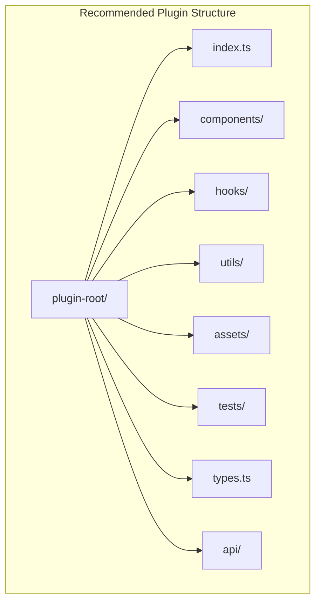

**Diagram sources**
- [PLUGIN_DEVELOPMENT_MANUAL.md:85-103](file://docs/guides/PLUGIN_DEVELOPMENT_MANUAL.md#L85-L103)

### Development Workflow

The typical development workflow involves iterative testing, validation, and deployment:

1. **Local Development**: Test plugin functionality in isolated environment
2. **Security Review**: Validate permissions and potential security risks
3. **Integration Testing**: Verify compatibility with core application features
4. **Performance Testing**: Ensure efficient resource utilization
5. **Documentation**: Provide comprehensive user and developer documentation

**Section sources**
- [PLUGIN_DEVELOPMENT_MANUAL.md:85-103](file://docs/guides/PLUGIN_DEVELOPMENT_MANUAL.md#L85-L103)
- [PLUGIN_DEVELOPMENT_MANUAL.md:70-897](file://docs/guides/PLUGIN_DEVELOPMENT_MANUAL.md#L70-L897)

## Marketplace and Distribution

### Marketplace Integration

SchoolPilot3 provides a comprehensive marketplace system for plugin distribution and management:

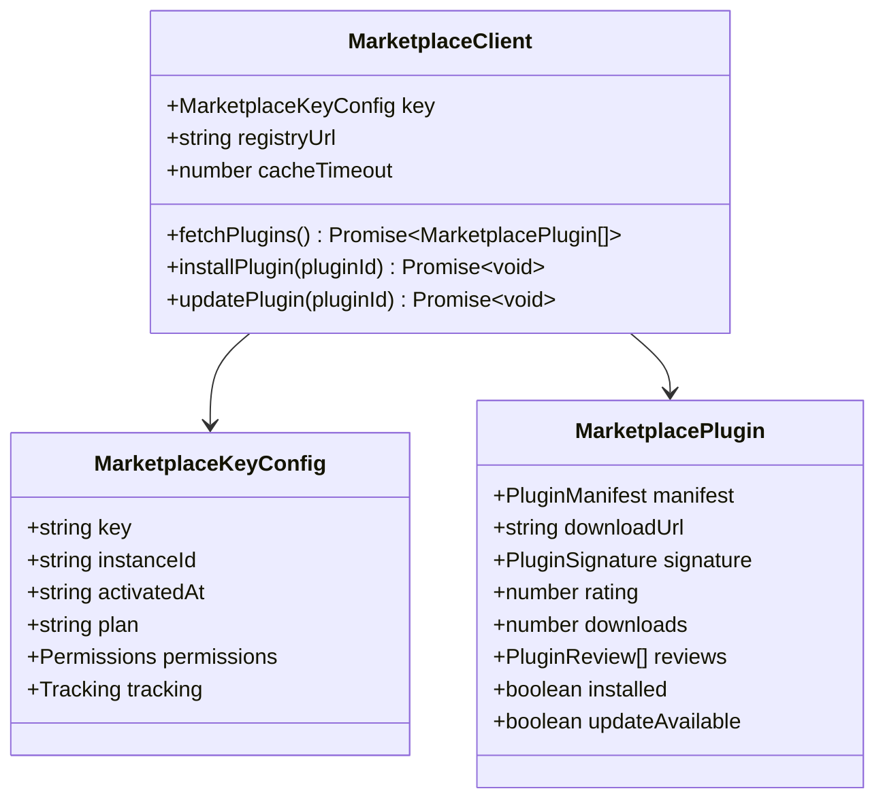

**Diagram sources**
- [types.ts:389-394](file://src/plugins/types.ts#L389-L394)
- [types.ts:343-359](file://src/plugins/types.ts#L343-L359)
- [types.ts:361-370](file://src/plugins/types.ts#L361-L370)

### Administrative Controls

Administrators have extensive control over plugin marketplace operations:

- **Enable/Disable Marketplace**: Control access to external plugin sources
- **Permission Management**: Configure who can install free vs paid plugins
- **Approval Workflows**: Require administrator approval for plugin installations
- **Usage Limits**: Set maximum number of plugins that can be installed
- **Security Policies**: Configure sandbox modes and network restrictions

**Section sources**
- [types.ts:304-337](file://src/plugins/types.ts#L304-L337)
- [types.ts:343-394](file://src/plugins/types.ts#L343-L394)

## Implementation Examples

### Basic Plugin Structure

A minimal plugin implementation demonstrates the essential components required for plugin registration:

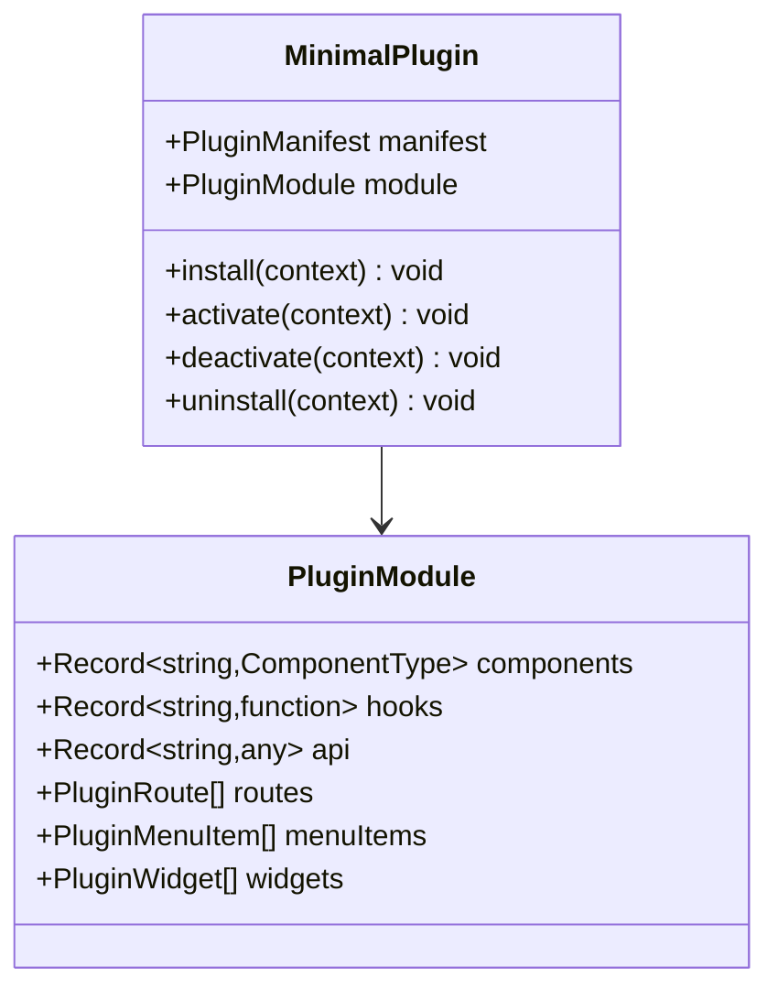

**Diagram sources**
- [types.ts:287-298](file://src/plugins/types.ts#L287-L298)

### Advanced Plugin Features

More sophisticated plugins can leverage multiple system integration points:

- **Multi-type Support**: Combine different plugin types within single implementation
- **Dynamic Routing**: Register runtime-generated routes and navigation items
- **Real-time Integration**: Connect to external APIs and real-time data sources
- **Custom Widgets**: Create interactive dashboard components with data binding

**Section sources**
- [types.ts:287-298](file://src/plugins/types.ts#L287-L298)

## Troubleshooting Guide

### Common Plugin Issues

| Issue | Symptoms | Solution |
|-------|----------|----------|
| **Plugin Load Failure** | Error during loadPlugin() | Check manifest validity, verify dependencies, inspect console logs |
| **Activation Error** | Plugin loads but fails to activate | Review privilege declarations, check hook execution timeouts |
| **Dependency Conflicts** | Circular dependency or missing dependency errors | Resolve conflicting plugins, install required dependencies |
| **Permission Denied** | Access violations or blocked operations | Adjust plugin privileges, review security settings |
| **Performance Issues** | Slow response times or memory leaks | Optimize hook handlers, implement proper cleanup in deactivate |

### Debugging Tools

The plugin system provides several debugging mechanisms:

- **Event Listeners**: Monitor plugin lifecycle events and errors
- **Hook Statistics**: Track hook execution performance and failure rates
- **State Persistence**: Inspect plugin state in localStorage for debugging
- **Console Logging**: Comprehensive error messages with stack traces

### Performance Monitoring

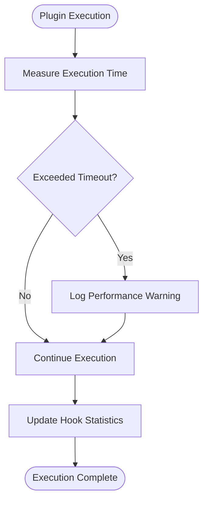

**Diagram sources**
- [PluginManager.ts:506-518](file://src/plugins/PluginManager.ts#L506-L518)
- [PluginManager.ts:523-533](file://src/plugins/PluginManager.ts#L523-L533)

**Section sources**
- [PluginManager.ts:506-533](file://src/plugins/PluginManager.ts#L506-L533)

## Best Practices

### Security Best Practices

1. **Principle of Least Privilege**: Request only necessary permissions for plugin functionality
2. **Input Validation**: Always validate data from external sources and user inputs
3. **Resource Management**: Properly clean up resources in deactivate/uninstall handlers
4. **Error Handling**: Implement comprehensive error handling without exposing sensitive information
5. **Performance Monitoring**: Regularly monitor plugin performance and resource usage

### Development Best Practices

1. **Modular Design**: Keep plugin functionality focused and well-contained
2. **Type Safety**: Leverage TypeScript interfaces for compile-time error detection
3. **Testing**: Implement comprehensive unit and integration tests
4. **Documentation**: Provide clear documentation for plugin usage and configuration
5. **Backward Compatibility**: Maintain compatibility with core application updates

### Deployment Best Practices

1. **Staged Rollout**: Deploy plugins gradually to minimize impact on production systems
2. **Monitoring**: Implement monitoring and alerting for plugin performance and errors
3. **Rollback Procedures**: Have clear rollback procedures for problematic plugin updates
4. **User Communication**: Communicate plugin changes and updates to end users
5. **Security Auditing**: Regular security audits of installed plugins and their dependencies

The built-in plugin system in SchoolPilot3 provides a robust foundation for extending educational management functionality while maintaining security, performance, and maintainability standards essential for institutional environments.