# AuthContext Mechanism

<cite>
**Referenced Files in This Document**   
- [AuthContext.tsx](file://src/contexts/AuthContext.tsx)
- [authService.ts](file://src/services/authService.ts)
- [app.tsx](file://src/app.tsx)
- [ProtectedRoute.tsx](file://src/components/ProtectedRoute.tsx)
- [LoginPage.tsx](file://src/modules/core/pages/LoginPage.tsx)
</cite>

## Table of Contents
1. [Introduction](#introduction)
2. [State Structure and Initialization](#state-structure-and-initialization)
3. [Authentication Workflows](#authentication-workflows)
4. [Context Provider Implementation](#context-provider-implementation)
5. [Consumer Patterns and Usage](#consumer-patterns-and-usage)
6. [Integration with Global State Management](#integration-with-global-state-management)
7. [Session Persistence and Token Management](#session-persistence-and-token-management)
8. [Permission and Access Control](#permission-and-access-control)
9. [Performance and Optimization](#performance-and-optimization)
10. [Common Issues and Best Practices](#common-issues-and-best-practices)

## Introduction
The AuthContext implementation in schoolpilot3 provides a comprehensive authentication state management system using React Context API. This mechanism centralizes user authentication state, token management, and permission checking across the application. The system supports both production mode with database-backed authentication and demo mode with predefined user accounts. The AuthContext works in conjunction with authService to handle authentication workflows, session persistence, and access control, providing a seamless experience for users while maintaining security and performance.

**Section sources**
- [AuthContext.tsx](file://src/contexts/AuthContext.tsx#L1-L160)
- [authService.ts](file://src/services/authService.ts#L1-L628)

## State Structure and Initialization

### Authentication State Structure
The AuthContext maintains a comprehensive state structure that tracks user authentication status, user information, and application mode:

```typescript
interface AuthContextType {
  // User state
  user: AuthUser | null;
  isAuthenticated: boolean;
  isLoading: boolean;
  
  // Authentication methods
  login: (credentials: LoginCredentials) => Promise<AuthResult>;
  logout: () => Promise<void>;
  refreshUser: () => Promise<void>;
  
  // Permission checks
  hasPermission: (permissionId: string) => Promise<boolean>;
  hasModuleAccess: (moduleId: string) => Promise<boolean>;
  
  // Utility
  isDemoMode: boolean;
}
```

The state includes three primary properties:
- **user**: Contains the authenticated user's information including ID, username, email, role, permissions, and module access
- **isAuthenticated**: Boolean flag indicating whether a user is currently authenticated
- **isLoading**: Boolean flag indicating whether authentication operations are in progress
- **isDemoMode**: Boolean flag indicating whether the application is running in demo mode

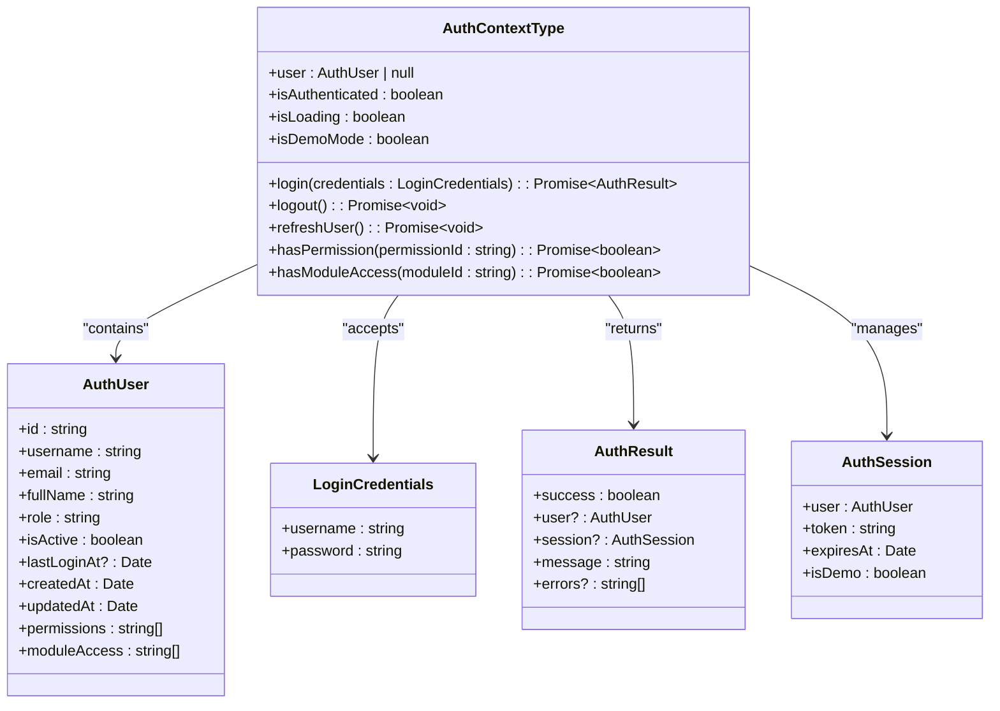

**Diagram sources**
- [AuthContext.tsx](file://src/contexts/AuthContext.tsx#L10-L38)
- [authService.ts](file://src/services/authService.ts#L15-L60)

### Context Initialization Process
The AuthContext initializes authentication state during component mounting through an useEffect hook that runs once when the provider is mounted. The initialization process follows these steps:

1. Set isLoading to true to indicate initialization is in progress
2. Wait for authService initialization with a maximum wait time of 5 seconds
3. Check if a user is already authenticated by calling authService.isAuthenticated()
4. If authenticated, retrieve the current user from authService.getCurrentUser()
5. Determine if the application is in demo mode by checking the session
6. Set the initial state values and set isLoading to false

The initialization process handles potential errors gracefully by logging errors to the console and ensuring isLoading is set to false in the finally block to prevent the application from hanging.

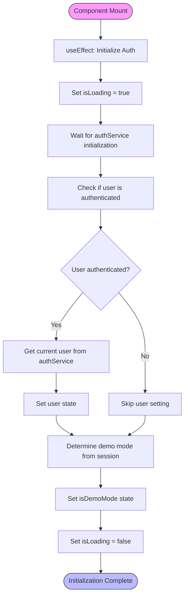

**Diagram sources**
- [AuthContext.tsx](file://src/contexts/AuthContext.tsx#L45-L75)

**Section sources**
- [AuthContext.tsx](file://src/contexts/AuthContext.tsx#L45-L80)

## Authentication Workflows

### Login Workflow
The login workflow in AuthContext is implemented through the login method, which serves as a bridge between the UI components and the underlying authService. When a user submits login credentials, the following process occurs:

1. The login method is called with LoginCredentials containing username and password
2. isLoading is set to true to indicate the login operation is in progress
3. The method delegates to authService.login() which handles the actual authentication
4. If authentication is successful, the user state is updated with the authenticated user
5. The isDemoMode state is updated based on the session
6. The result is returned to the caller
7. isLoading is set to false in the finally block to ensure the loading state is always cleared

The login method includes comprehensive error handling that catches any exceptions, logs them to the console, and returns a standardized AuthResult with success: false and appropriate error messages.

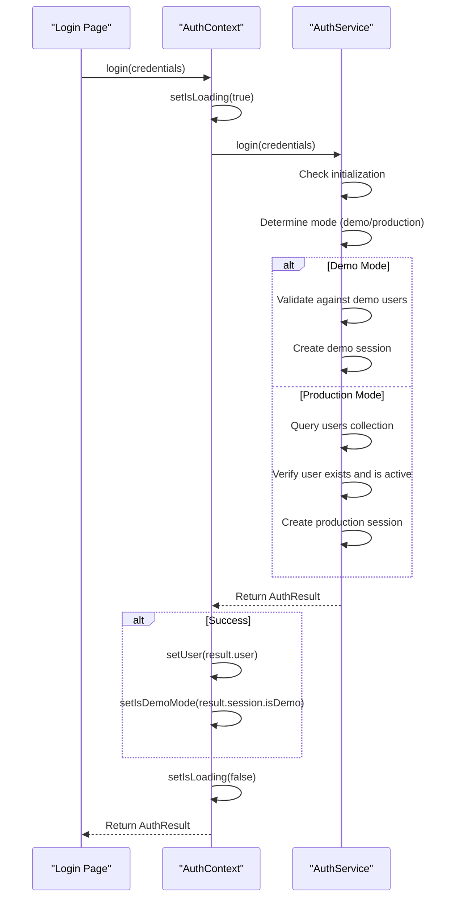

**Diagram sources**
- [AuthContext.tsx](file://src/contexts/AuthContext.tsx#L82-L110)
- [authService.ts](file://src/services/authService.ts#L200-L400)

### Logout Workflow
The logout workflow is implemented through the logout method in AuthContext, which provides a clean way to terminate user sessions:

1. isLoading is set to true to indicate the logout operation is in progress
2. authService.logout() is called to clear the authentication session
3. The user state is set to null to indicate no authenticated user
4. isDemoMode is reset to true as a default state
5. Any stored route information is cleared from sessionStorage
6. isLoading is set to false in the finally block

The logout method ensures that all authentication state is properly cleared and handles errors gracefully by logging them to the console without preventing the logout process from completing.

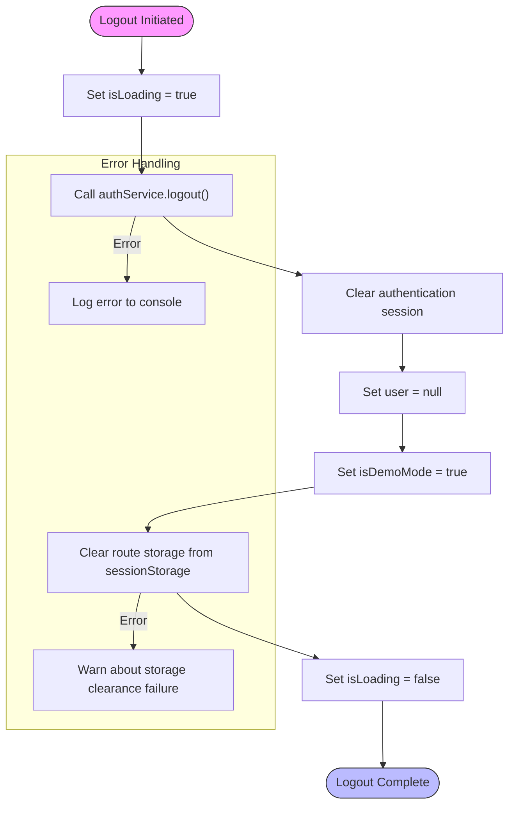

**Diagram sources**
- [AuthContext.tsx](file://src/contexts/AuthContext.tsx#L112-L135)

### Session Persistence Workflow
The session persistence mechanism in schoolpilot3 uses localStorage to maintain authentication state across page refreshes. The workflow involves:

1. **Session Creation**: When a user successfully logs in, a session object is created containing user information, token, expiration time, and demo mode status
2. **Session Storage**: The session is serialized to JSON and stored in localStorage with a key of 'schoolpilot_auth_session'
3. **Session Restoration**: During application initialization, the AuthContext attempts to restore the session from localStorage
4. **Session Validation**: The restored session is checked for expiration by comparing the expiresAt timestamp with the current time
5. **Session Expiration**: If the session is expired, it is cleared from localStorage and the user is treated as unauthenticated

The session persistence workflow ensures that users don't need to log in repeatedly during a session while maintaining security through session expiration.

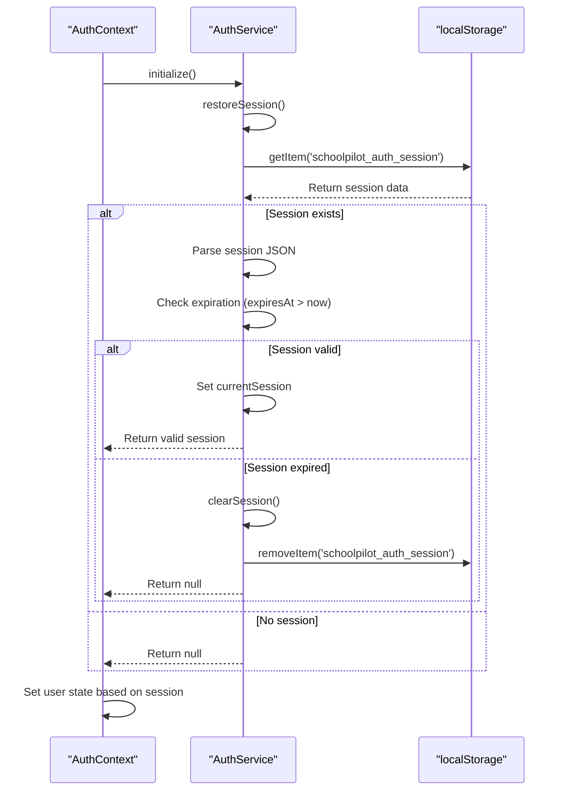

**Diagram sources**
- [authService.ts](file://src/services/authService.ts#L150-L190)

**Section sources**
- [AuthContext.tsx](file://src/contexts/AuthContext.tsx#L45-L80)
- [authService.ts](file://src/services/authService.ts#L150-L190)

## Context Provider Implementation

### AuthProvider Component Structure
The AuthProvider component is implemented as a React functional component that wraps its children with the AuthContext.Provider. The component structure follows the provider pattern, encapsulating the authentication state and methods while making them available to all descendants through the context.

The AuthProvider uses multiple useState hooks to manage:
- user: The authenticated user object or null
- isLoading: A boolean indicating whether authentication operations are in progress
- isDemoMode: A boolean indicating whether the application is running in demo mode

These state variables are combined into a value object that is passed to the AuthContext.Provider, making the authentication state and methods available to all components within the provider's scope.

```mermaid
classDiagram
class AuthProvider {
+user : AuthUser | null
+isLoading : boolean
+isDemoMode : boolean
+value : AuthContextType
}
class AuthContextType {
+user : AuthUser | null
+isAuthenticated : boolean
+isLoading : boolean
+login : Function
+logout : Function
+refreshUser : Function
+hasPermission : Function
+hasModuleAccess : Function
+isDemoMode : boolean
}
AuthProvider --> AuthContextType : "creates value"
AuthProvider --> AuthContext : "provides value"
AuthContext <.. AuthProvider : "uses"
note right of AuthProvider
Manages authentication state and
provides it to all descendants
through React Context API
end
```

**Diagram sources**
- [AuthContext.tsx](file://src/contexts/AuthContext.tsx#L38-L145)

### Provider Integration in Application Tree
The AuthProvider is integrated into the application's component tree in the main app.tsx file, ensuring that authentication state is available to all components that need it. The integration follows a hierarchical structure where the AuthProvider is nested within other context providers:

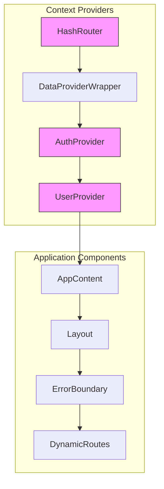

The AuthProvider is positioned after the DataProviderWrapper and before the UserProvider, establishing the proper dependency order where authentication state is available before user-specific data is loaded. This hierarchical structure ensures that components can access authentication state as soon as they are rendered.

**Diagram sources**
- [app.tsx](file://src/app.tsx#L450-L470)

**Section sources**
- [app.tsx](file://src/app.tsx#L450-L470)
- [AuthContext.tsx](file://src/contexts/AuthContext.tsx#L38-L145)

## Consumer Patterns and Usage

### useAuth Hook Implementation
The useAuth hook is a custom React hook that provides a convenient way for functional components to access the authentication context. The hook is implemented using React's useContext hook and includes error handling to ensure it is only used within an AuthProvider.

```typescript
export const useAuth = (): AuthContextType => {
  const context = useContext(AuthContext);
  if (context === undefined) {
    throw new Error('useAuth must be used within an AuthProvider');
  }
  return context;
};
```

The hook returns the entire AuthContextType interface, giving components access to:
- Current user information
- Authentication status
- Loading state
- Login and logout methods
- Permission checking methods
- Demo mode status

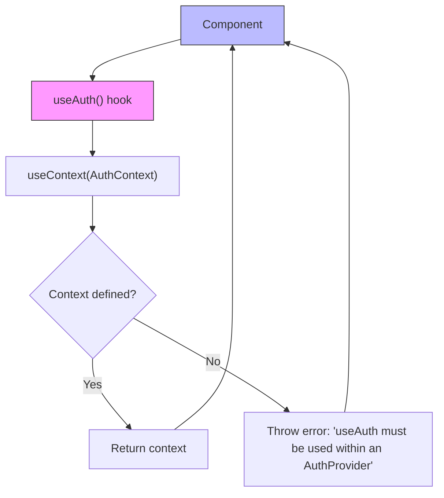

**Diagram sources**
- [AuthContext.tsx](file://src/contexts/AuthContext.tsx#L147-L153)

### Component Consumption Examples
Components consume the AuthContext through the useAuth hook to access authentication state and perform authentication operations. The LoginPage component is a primary consumer that uses the context for login functionality:

```typescript
const LoginPage: React.FC = () => {
  const { login, isDemoMode } = useAuth();
  const [credentials, setCredentials] = useState({ username: '', password: '' });
  const [isLoading, setIsLoading] = useState(false);
  const [error, setError] = useState('');

  const handleLogin = async (e: React.FormEvent) => {
    e.preventDefault();
    setIsLoading(true);
    setError('');

    try {
      const result = await login(credentials);
      
      if (result.success) {
        // Handle successful login
        navigate('/dashboard');
      } else {
        setError(result.message);
      }
    } catch (error) {
      setError('An unexpected error occurred');
    } finally {
      setIsLoading(false);
    }
  };
  
  // Render login form
};
```

The ProtectedRoute component is another key consumer that uses the AuthContext to enforce authentication and authorization:

```typescript
const ProtectedRoute: React.FC<ProtectedRouteProps> = ({
  children,
  requiredPermission,
  requiredModule
}) => {
  const { isAuthenticated, isLoading, hasPermission, hasModuleAccess } = useAuth();
  const location = useLocation();

  // Check access permissions
  useEffect(() => {
    const checkAccess = async () => {
      if (requiredPermission) {
        const hasPerm = await hasPermission(requiredPermission);
        setHasAccess(hasPerm);
      }
      
      if (requiredModule) {
        const hasModule = await hasModuleAccess(requiredModule);
        setHasAccess(hasModule);
      }
    };

    checkAccess();
  }, [isAuthenticated, requiredPermission, requiredModule, hasPermission, hasModuleAccess]);
  
  // Handle authentication and authorization
};
```

```mermaid
classDiagram
class LoginPage {
+credentials : LoginCredentials
+isLoading : boolean
+error : string
+success : string
}
class ProtectedRoute {
+children : ReactNode
+requiredPermission? : string
+requiredModule? : string
+fallbackPath? : string
+hasAccess : boolean | null
+checkingAccess : boolean
}
class AuthContextConsumer {
<<interface>>
+useAuth() : AuthContextType
}
LoginPage --> AuthContextConsumer : "uses"
ProtectedRoute --> AuthContextConsumer : "uses"
AuthContextConsumer <.. AuthContext : "implements"
note right of LoginPage
Uses useAuth to access login method
and isDemoMode status for UI rendering
end
note right of ProtectedRoute
Uses useAuth to check authentication
status and permissions for route protection
end
```

**Diagram sources**
- [LoginPage.tsx](file://src/modules/core/pages/LoginPage.tsx#L1-L244)
- [ProtectedRoute.tsx](file://src/components/ProtectedRoute.tsx#L1-L111)

**Section sources**
- [LoginPage.tsx](file://src/modules/core/pages/LoginPage.tsx#L1-L244)
- [ProtectedRoute.tsx](file://src/components/ProtectedRoute.tsx#L1-L111)
- [AuthContext.tsx](file://src/contexts/AuthContext.tsx#L147-L153)

## Integration with Global State Management

### Context Hierarchy and Dependencies
The AuthContext is integrated into a broader context hierarchy that manages various aspects of the application state. The context hierarchy follows a specific order to ensure proper dependency resolution:

1. **UnifiedConfigProvider**: Provides application configuration and feature flags
2. **ToastProvider**: Manages toast notifications
3. **HashRouter**: Handles client-side routing
4. **DataProviderWrapper**: Manages data layer configuration
5. **AuthProvider**: Manages authentication state
6. **UserProvider**: Manages user-specific data
7. **AppContent**: Contains the main application content

This hierarchy ensures that each context has access to the dependencies it requires. For example, the AuthProvider needs access to the application configuration to determine the operating mode (demo vs. production), which is provided by the UnifiedConfigProvider.

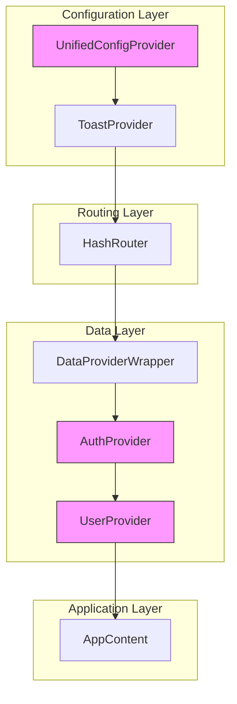

**Diagram sources**
- [app.tsx](file://src/app.tsx#L450-L470)

### Interaction with Other Contexts
The AuthContext interacts with several other contexts in the application, creating a cohesive state management system:

**UserContext**: The AuthProvider is nested within the UserProvider, allowing user-specific data to be loaded based on the authenticated user. The UserContext can access the current user from AuthContext to load user-specific data.

**UnifiedConfigContext**: The AuthContext depends on the unified configuration to determine the application mode (demo vs. production). The authService uses the configuration to decide whether to use mock data or connect to the actual database.

**AppDataContext**: The data layer configuration affects authentication, as the authService needs to know whether the database is available to store and retrieve user information.

The integration between AuthContext and other contexts enables features like:
- Route persistence based on user preferences
- Theme management based on user settings
- Module loading based on user permissions
- Data access based on user roles

```mermaid
graph TD
AuthContext --> UserContext : "Provides current user"
AuthContext --> UnifiedConfigContext : "Uses mode configuration"
AuthContext --> AppDataContext : "Affects data layer availability"
UserContext --> AuthContext : "May update user profile"
UnifiedConfigContext --> AuthContext : "Triggers mode changes"
subgraph "Authentication"
AuthContext
end
subgraph "User Data"
UserContext
end
subgraph "Configuration"
UnifiedConfigContext
AppDataContext
end
style AuthContext fill:#f9f,stroke:#333
```

**Diagram sources**
- [app.tsx](file://src/app.tsx#L450-L470)
- [AuthContext.tsx](file://src/contexts/AuthContext.tsx#L1-L160)

**Section sources**
- [app.tsx](file://src/app.tsx#L450-L470)
- [AuthContext.tsx](file://src/contexts/AuthContext.tsx#L1-L160)

## Session Persistence and Token Management

### LocalStorage Session Management
The session persistence mechanism in schoolpilot3 relies on localStorage to maintain authentication state across browser sessions. The authService handles session storage and retrieval through the following methods:

**saveSession**: Serializes the session object to JSON and stores it in localStorage with the key 'schoolpilot_auth_session'. The method ensures that dates are properly serialized by converting the expiresAt property to ISO string format.

**restoreSession**: Retrieves the session data from localStorage, parses it from JSON, and validates it. The method checks if the session has expired by comparing the expiresAt timestamp with the current time. If the session is valid, it is returned; otherwise, it is cleared and null is returned.

**clearSession**: Removes the session data from localStorage and sets the currentSession property to null.

The session data includes:
- User information (id, username, email, role, permissions, etc.)
- Authentication token
- Session expiration time (24 hours from creation)
- Demo mode status

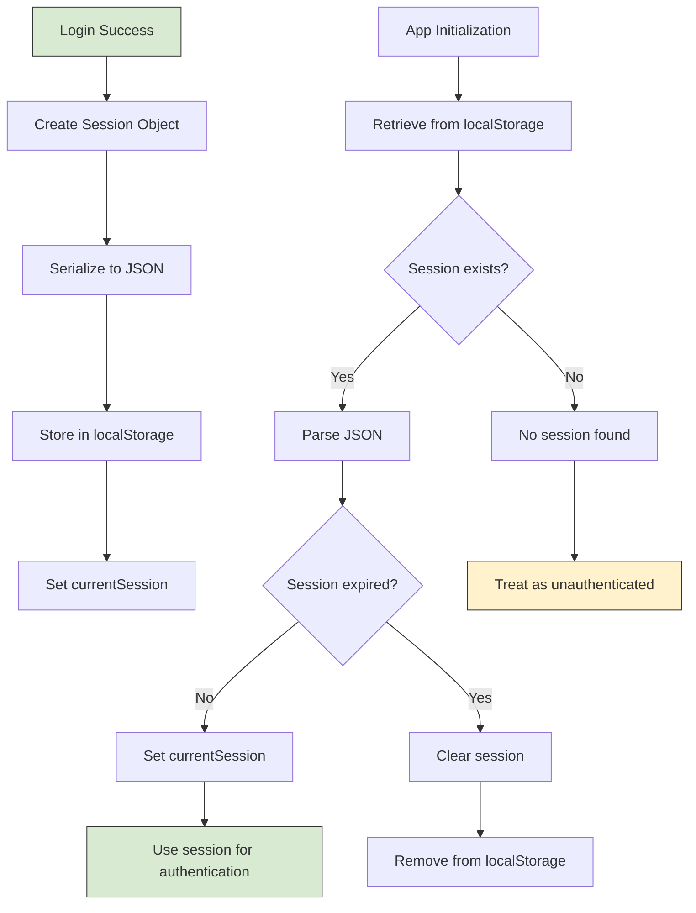

**Diagram sources**
- [authService.ts](file://src/services/authService.ts#L150-L190)

### Token Generation and Expiration
The authentication system in schoolpilot3 implements a token-based authentication mechanism with 24-hour expiration. Tokens are generated during the login process and are used to maintain the user's authenticated state.

**Token Generation**:
- In demo mode: Tokens are generated with the format 'demo_token_' followed by the current timestamp
- In production mode: Tokens are generated with the format 'prod_token_' followed by the current timestamp
- Tokens are stored in the session object but are not used for server-side validation (since this is a client-side application)

**Session Expiration**:
- Sessions are set to expire 24 hours after creation
- The expiration time is stored in the expiresAt property of the session object
- During application initialization, the system checks if the current time is past the expiration time
- Expired sessions are automatically cleared, requiring the user to log in again

The system also includes a refreshSession method that extends the session expiration by 24 hours, which could be used to keep users logged in during active usage.

```mermaid
classDiagram
class AuthSession {
+user : AuthUser
+token : string
+expiresAt : Date
+isDemo : boolean
}
class AuthService {
+saveSession(session : AuthSession) : void
+restoreSession() : AuthSession | null
+clearSession() : void
+getCurrentSession() : AuthSession | null
+refreshSession() : AuthResult
}
AuthService --> AuthSession : "manages"
note right of AuthSession
Token format : \n
- Demo : demo_token_timestamp\n
- Production : prod_token_timestamp\n
\n
expiresAt : 24 hours from creation
end
```

**Diagram sources**
- [authService.ts](file://src/services/authService.ts#L50-L60)
- [authService.ts](file://src/services/authService.ts#L150-L190)

**Section sources**
- [authService.ts](file://src/services/authService.ts#L150-L190)

## Permission and Access Control

### Role-Based Access Control (RBAC) Implementation
The authentication system in schoolpilot3 implements a role-based access control (RBAC) system that determines user permissions and module access based on their role. The RBAC implementation is integrated with the AuthContext through the authService, which provides methods for checking permissions and module access.

The system defines several roles with different permission levels:
- **super_admin**: Has all permissions and access to all modules
- **teacher**: Has permissions for academics and settings modules
- **finance_officer**: Has permissions for finance and settings modules
- **student**: Has read-only access to academics module

The RBAC system is implemented through the following components:
- **userPermissionsService**: Retrieves user-specific permissions from the database
- **rbacService**: Manages role assignments and permission inheritance
- **AuthContext**: Provides permission checking methods to components

```mermaid
classDiagram
class AuthUser {
+id : string
+username : string
+email : string
+fullName : string
+role : string
+isActive : boolean
+permissions : string[]
+moduleAccess : string[]
}
class AuthService {
+hasPermission(permissionId : string) : Promise~boolean~
+hasModuleAccess(moduleId : string) : Promise~boolean~
+getUserRoles() : Promise~string[]~
}
class userPermissionsService {
+getUserPermissions(userId : string) : Promise~string[]~
}
class rbacService {
+assignRoleToUser(userId : string, roleId : string, source : string) : void
+getRolePermissions(roleId : string) : string[]
}
AuthService --> AuthUser : "contains"
AuthService --> userPermissionsService : "uses"
AuthService --> rbacService : "uses"
AuthUser --> rbacService : "role-based access"
note right of AuthService
Delegates permission checks to\n
userPermissionsService and rbacService\n
while providing a unified interface\n
to the AuthContext
end
```

**Diagram sources**
- [authService.ts](file://src/services/authService.ts#L515-L550)

### Permission Checking Methods
The AuthContext provides two primary methods for access control: hasPermission and hasModuleAccess. These methods are implemented as useCallback hooks to prevent unnecessary re-renders and are exposed through the useAuth hook.

**hasPermission**: Checks whether the current user has a specific permission. The method follows these rules:
1. If the user is not authenticated, returns false
2. If the user is a super_admin or has the '*' permission, returns true (all permissions)
3. Otherwise, checks if the specific permission is included in the user's permissions array

**hasModuleAccess**: Checks whether the current user has access to a specific module. The method follows these rules:
1. If the user is not authenticated, returns false
2. If the user is a super_admin, returns true (access to all modules)
3. Otherwise, checks if the module ID is included in the user's moduleAccess array

Both methods return promises to accommodate potential asynchronous operations, such as fetching permissions from the database.

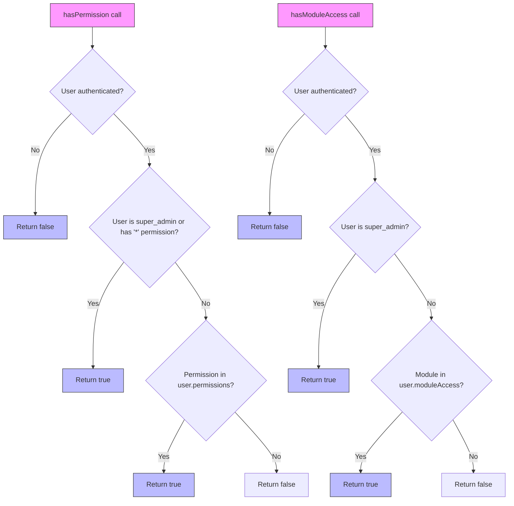

**Diagram sources**
- [authService.ts](file://src/services/authService.ts#L515-L550)

### Protected Route Implementation
The ProtectedRoute component implements route-level access control by leveraging the permission checking methods from AuthContext. When a user attempts to access a protected route, the component performs the following checks:

1. If the user is not authenticated, redirects to the login page
2. If a requiredPermission is specified, checks if the user has that permission
3. If a requiredModule is specified, checks if the user has access to that module
4. If any check fails, displays an access denied message

The ProtectedRoute component is used throughout the application to protect routes based on user roles and permissions, ensuring that users can only access functionality they are authorized to use.

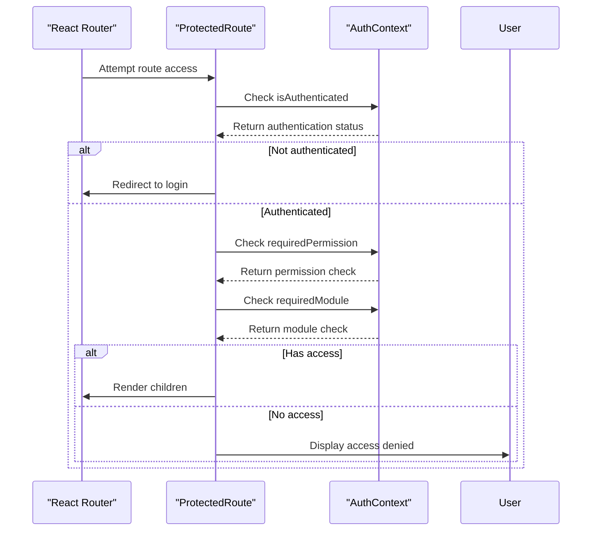

**Diagram sources**
- [ProtectedRoute.tsx](file://src/components/ProtectedRoute.tsx#L1-L111)

**Section sources**
- [authService.ts](file://src/services/authService.ts#L515-L550)
- [ProtectedRoute.tsx](file://src/components/ProtectedRoute.tsx#L1-L111)

## Performance and Optimization

### Context Re-rendering Considerations
The AuthContext implementation includes several optimizations to minimize unnecessary re-renders and improve performance:

**useCallback for Methods**: Authentication methods like login, logout, refreshUser, hasPermission, and hasModuleAccess are wrapped in useCallback hooks with empty dependency arrays. This prevents these functions from being recreated on every render, which could trigger unnecessary re-renders in consuming components.

**State Co-location**: The AuthProvider component keeps authentication state local to the provider rather than spreading it across multiple contexts. This reduces the complexity of state management and minimizes the number of context updates.

**Loading State Management**: The isLoading state is used to provide visual feedback during authentication operations while preventing components from rendering with incomplete state.

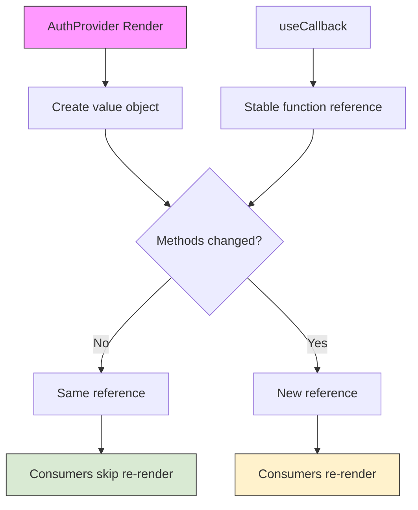

**Diagram sources**
- [AuthContext.tsx](file://src/contexts/AuthContext.tsx#L137-L145)

### Async Operation Management
The AuthContext handles asynchronous operations carefully to avoid common issues like stale closures and race conditions:

**Error Boundaries**: The application uses ErrorBoundary components to catch and handle errors that might occur during authentication operations, preventing the entire application from crashing.

**Loading States**: isLoading state is set before async operations begin and cleared in finally blocks to ensure it is always reset, even if an error occurs.

**Sequential Operations**: The initialization process waits for authService initialization before checking authentication status, preventing race conditions between context setup and service availability.

The system also handles potential issues with async operations by:
- Using async/await syntax for clear control flow
- Implementing proper error handling with try/catch blocks
- Ensuring state updates are performed correctly even when operations fail

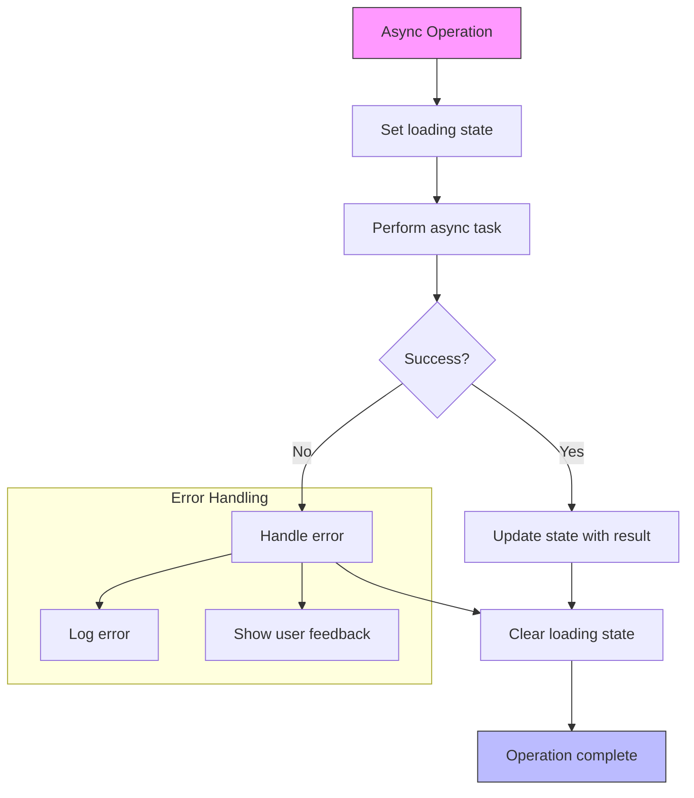

**Diagram sources**
- [AuthContext.tsx](file://src/contexts/AuthContext.tsx#L82-L110)
- [AuthContext.tsx](file://src/contexts/AuthContext.tsx#L112-L135)

**Section sources**
- [AuthContext.tsx](file://src/contexts/AuthContext.tsx#L82-L135)

## Common Issues and Best Practices

### Common Authentication Issues
The AuthContext implementation addresses several common authentication issues:

**Session Expiration**: The system handles session expiration by checking the expiresAt timestamp during initialization and clearing expired sessions. This prevents users from being authenticated with stale sessions.

**Database Availability**: The authService checks for database availability during initialization and automatically switches to demo mode if the database is not available, ensuring the application remains functional.

**Circular Dependencies**: The codebase avoids circular dependencies by exporting the useAuth hook from AuthContext.tsx while keeping the authService implementation separate.

**Error Reporting**: Authentication errors are reported to the error tracking system (Bugsink) with contextual information, aiding in debugging and monitoring.

### Best Practices for Consuming AuthContext
When consuming the AuthContext in functional components, follow these best practices:

**Always Use useAuth Hook**: Use the useAuth hook rather than importing the context directly to ensure proper error handling and type safety.

**Handle Loading States**: Always check the isLoading state before rendering components that depend on authentication state to provide a smooth user experience.

**Check Authentication Status**: Verify isAuthenticated before accessing user data to prevent null reference errors.

**Use Specific Dependencies**: When using useEffect with authentication methods, include the methods in the dependency array to prevent stale closure issues.

**Handle Errors Gracefully**: Wrap authentication operations in try/catch blocks and provide user-friendly error messages.

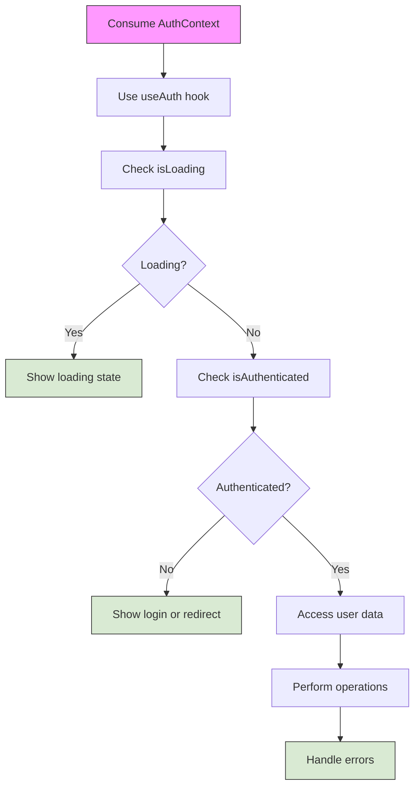

**Diagram sources**
- [AuthContext.tsx](file://src/contexts/AuthContext.tsx#L147-L153)
- [LoginPage.tsx](file://src/modules/core/pages/LoginPage.tsx#L1-L244)

**Section sources**
- [AuthContext.tsx](file://src/contexts/AuthContext.tsx#L147-L153)
- [LoginPage.tsx](file://src/modules/core/pages/LoginPage.tsx#L1-L244)
- [ProtectedRoute.tsx](file://src/components/ProtectedRoute.tsx#L1-L111)