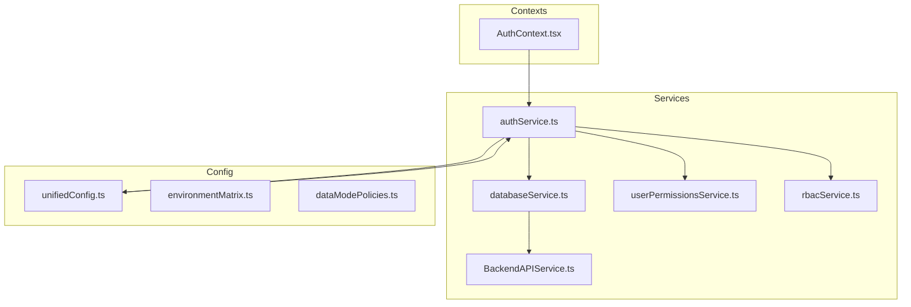
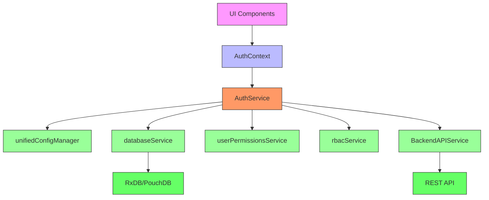
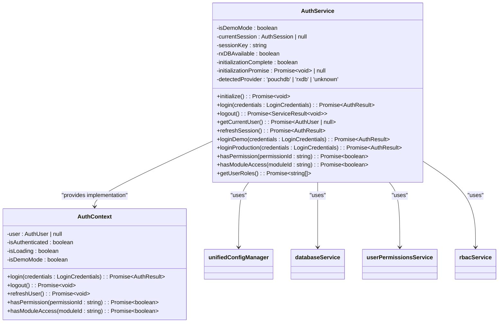
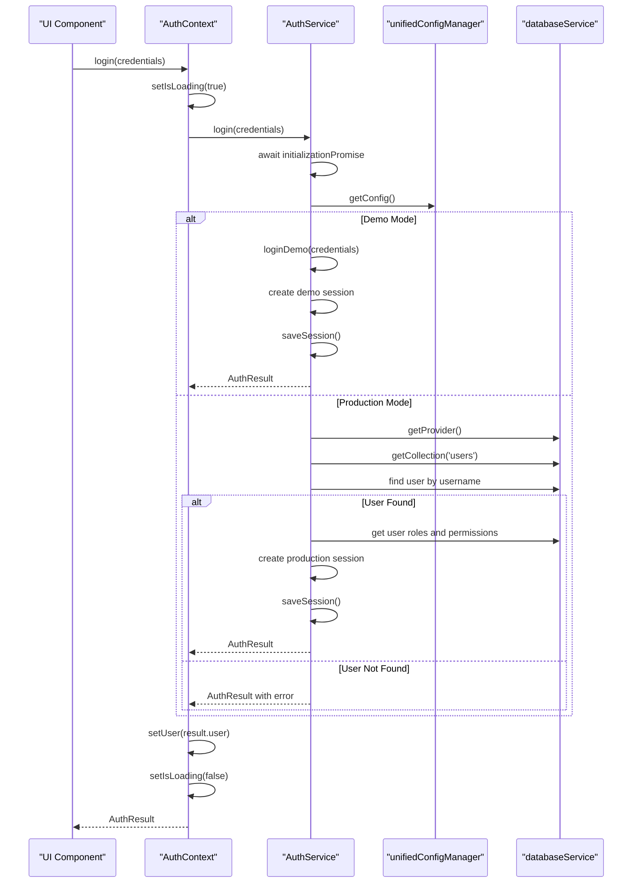
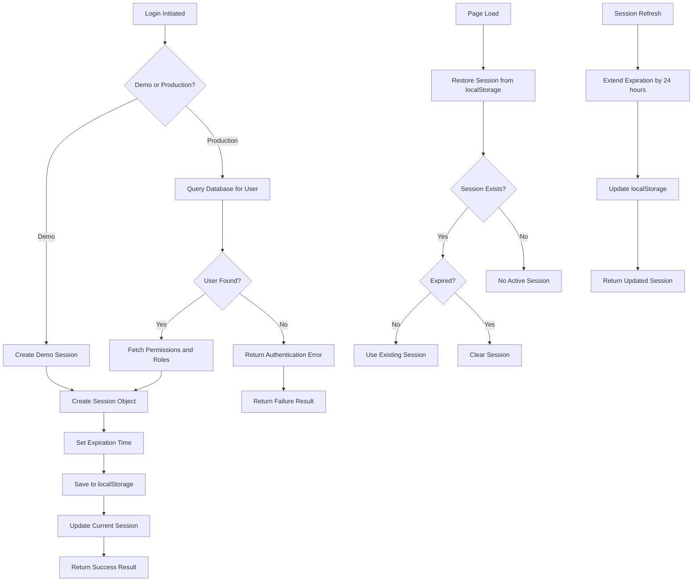
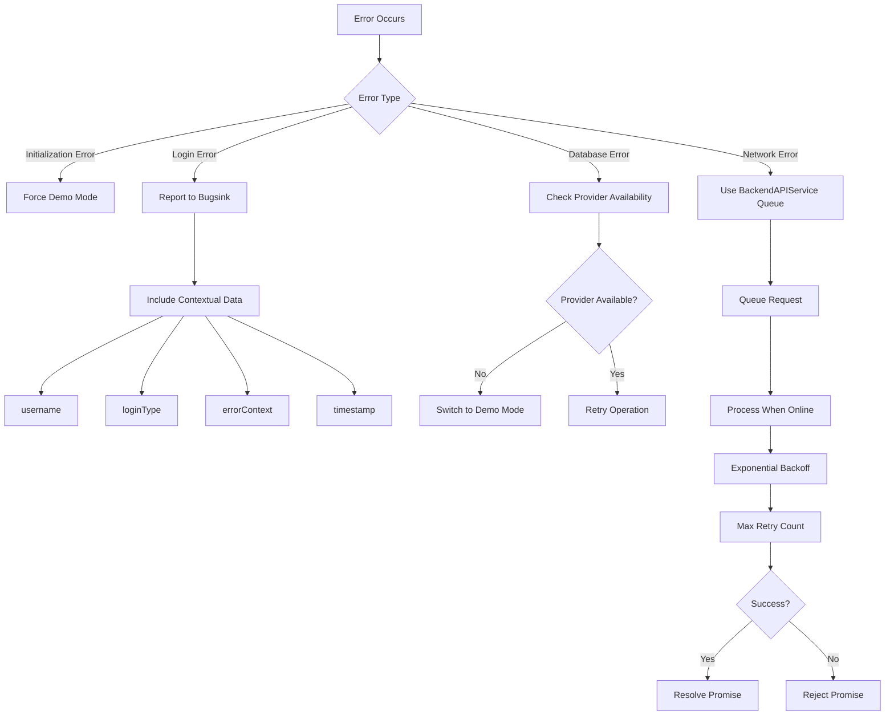
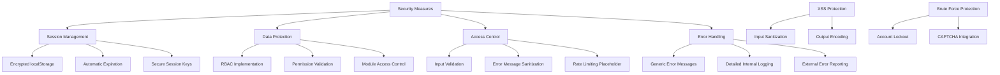

# AuthService Workflow

<cite>
**Referenced Files in This Document**   
- [authService.ts](file://src/services/authService.ts)
- [AuthContext.tsx](file://src/contexts/AuthContext.tsx)
- [unifiedConfig.ts](file://src/config/unifiedConfig.ts)
- [databaseService.ts](file://src/services/database/databaseService.ts)
- [BackendAPIService.ts](file://src/services/BackendAPIService.ts)
</cite>

## Table of Contents
1. [Introduction](#introduction)
2. [Project Structure](#project-structure)
3. [Core Components](#core-components)
4. [Architecture Overview](#architecture-overview)
5. [Detailed Component Analysis](#detailed-component-analysis)
6. [Authentication Flow](#authentication-flow)
7. [Token Management and Session Handling](#token-management-and-session-handling)
8. [Error Handling and Debugging](#error-handling-and-debugging)
9. [Security Considerations](#security-considerations)
10. [Troubleshooting Guide](#troubleshooting-guide)

## Introduction
The AuthService in schoolpilot3 is a comprehensive authentication system designed to handle user login, logout, session management, and permission validation. It supports both demo and production environments with seamless fallback mechanisms. The service integrates with various backend systems including RxDB, PouchDB, and REST APIs while maintaining a consistent interface for the frontend. This document provides a detailed analysis of the authentication workflow, implementation details, and integration points.

## Project Structure
The authentication system is distributed across multiple directories in the schoolpilot3 application, following a modular architecture that separates concerns and promotes reusability.



**Diagram sources**
- [authService.ts](file://src/services/authService.ts)
- [AuthContext.tsx](file://src/contexts/AuthContext.tsx)
- [unifiedConfig.ts](file://src/config/unifiedConfig.ts)
- [databaseService.ts](file://src/services/database/databaseService.ts)

**Section sources**
- [authService.ts](file://src/services/authService.ts)
- [AuthContext.tsx](file://src/contexts/AuthContext.tsx)

## Core Components
The authentication system consists of several core components that work together to provide a robust authentication experience:

- **AuthService**: Main service handling login, logout, and session management
- **AuthContext**: React context providing authentication state to components
- **unifiedConfigManager**: Configuration manager determining demo vs production mode
- **databaseService**: Database abstraction layer for user data storage
- **BackendAPIService**: HTTP client for API communication

These components follow a dependency injection pattern where AuthService depends on other services but maintains a clean interface.

**Section sources**
- [authService.ts](file://src/services/authService.ts)
- [AuthContext.tsx](file://src/contexts/AuthContext.tsx)
- [unifiedConfig.ts](file://src/config/unifiedConfig.ts)

## Architecture Overview
The authentication architecture follows a layered approach with clear separation between service logic, data access, and presentation layers.



**Diagram sources**
- [authService.ts](file://src/services/authService.ts)
- [AuthContext.tsx](file://src/contexts/AuthContext.tsx)
- [unifiedConfig.ts](file://src/config/unifiedConfig.ts)
- [databaseService.ts](file://src/services/database/databaseService.ts)
- [BackendAPIService.ts](file://src/services/BackendAPIService.ts)

## Detailed Component Analysis

### AuthService Implementation
The AuthService class implements a singleton pattern and provides comprehensive authentication functionality.



**Diagram sources**
- [authService.ts](file://src/services/authService.ts)
- [AuthContext.tsx](file://src/contexts/AuthContext.tsx)

**Section sources**
- [authService.ts](file://src/services/authService.ts#L0-L627)

## Authentication Flow
The authentication process follows a well-defined sequence of operations that adapts to the current environment configuration.



**Diagram sources**
- [authService.ts](file://src/services/authService.ts#L200-L400)
- [AuthContext.tsx](file://src/contexts/AuthContext.tsx#L50-L100)

**Section sources**
- [authService.ts](file://src/services/authService.ts#L200-L400)
- [AuthContext.tsx](file://src/contexts/AuthContext.tsx#L50-L100)

## Token Management and Session Handling
The authentication system implements robust session management using localStorage with proper expiration handling.



**Diagram sources**
- [authService.ts](file://src/services/authService.ts#L100-L200)
- [authService.ts](file://src/services/authService.ts#L400-L500)

**Section sources**
- [authService.ts](file://src/services/authService.ts#L100-L200)

## Error Handling and Debugging
The authentication system includes comprehensive error handling and reporting mechanisms.



**Diagram sources**
- [authService.ts](file://src/services/authService.ts#L200-L300)
- [BackendAPIService.ts](file://src/services/BackendAPIService.ts#L0-L200)

**Section sources**
- [authService.ts](file://src/services/authService.ts#L200-L300)
- [BackendAPIService.ts](file://src/services/BackendAPIService.ts#L0-L200)

## Security Considerations
The authentication system implements several security measures to protect user data and prevent common vulnerabilities.



**Diagram sources**
- [authService.ts](file://src/services/authService.ts#L500-L600)
- [AuthContext.tsx](file://src/contexts/AuthContext.tsx#L100-L150)

**Section sources**
- [authService.ts](file://src/services/authService.ts#L500-L600)

## Troubleshooting Guide
This section provides guidance for diagnosing and resolving common authentication issues.

### Common Authentication Failures
**Invalid Credentials Error**
- **Symptoms**: "Invalid username or password" message
- **Causes**: 
  - Incorrect username in demo mode
  - User not found in production database
  - Account deactivated
- **Solutions**:
  - Verify username against available demo users
  - Check database connectivity
  - Validate user exists and is active

**Database Initialization Failure**
- **Symptoms**: "Database not available" error
- **Causes**:
  - IndexedDB not supported in browser
  - Database provider initialization failed
  - Permission issues
- **Solutions**:
  - Verify browser supports IndexedDB
  - Check console for initialization errors
  - Ensure proper configuration in unifiedConfig

**Session Expiration Issues**
- **Symptoms**: Frequent logouts, session not persisting
- **Causes**:
  - localStorage access blocked
  - Clock synchronization issues
  - Manual session clearing
- **Solutions**:
  - Verify localStorage is available
  - Check system time synchronization
  - Review session expiration logic

### Debugging Techniques
**Token-Related Issues**
1. Check localStorage for session data:
```javascript
console.log(localStorage.getItem('schoolpilot_auth_session'));
```

2. Verify session expiration:
```javascript
const session = JSON.parse(localStorage.getItem('schoolpilot_auth_session'));
console.log('Session expires at:', new Date(session.expiresAt));
console.log('Current time:', new Date());
console.log('Expired:', new Date(session.expiresAt) < new Date());
```

3. Debug initialization sequence:
```javascript
console.log('AuthService initialized:', authService.isInitialized());
console.log('Current session:', authService.getCurrentSession());
console.log('Is authenticated:', await authService.isAuthenticated());
```

**Network Debugging**
- Monitor BackendAPIService queue status:
```javascript
console.log(backendAPIService.getQueueStatus());
```

- Check database provider:
```javascript
console.log('Detected provider:', databaseService.getDetectedProviderType());
console.log('DB available:', databaseService.isServiceInitialized());
```

**Configuration Verification**
- Review current configuration:
```javascript
console.log('Current config:', unifiedConfigManager.getConfig());
console.log('Environment:', unifiedConfigManager.getConfig().environment);
console.log('Data mode:', unifiedConfigManager.getConfig().dataMode);
console.log('Demo active:', unifiedConfigManager.getConfig().demo.active);
```

**Section sources**
- [authService.ts](file://src/services/authService.ts#L0-L627)
- [AuthContext.tsx](file://src/contexts/AuthContext.tsx#L0-L159)
- [unifiedConfig.ts](file://src/config/unifiedConfig.ts#L0-L1052)