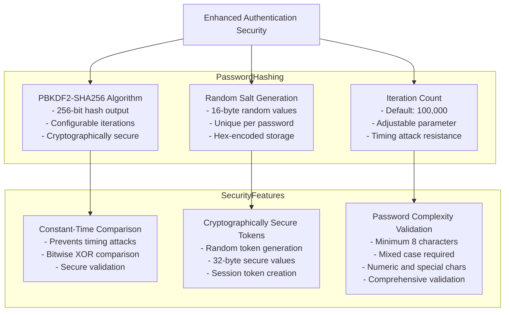
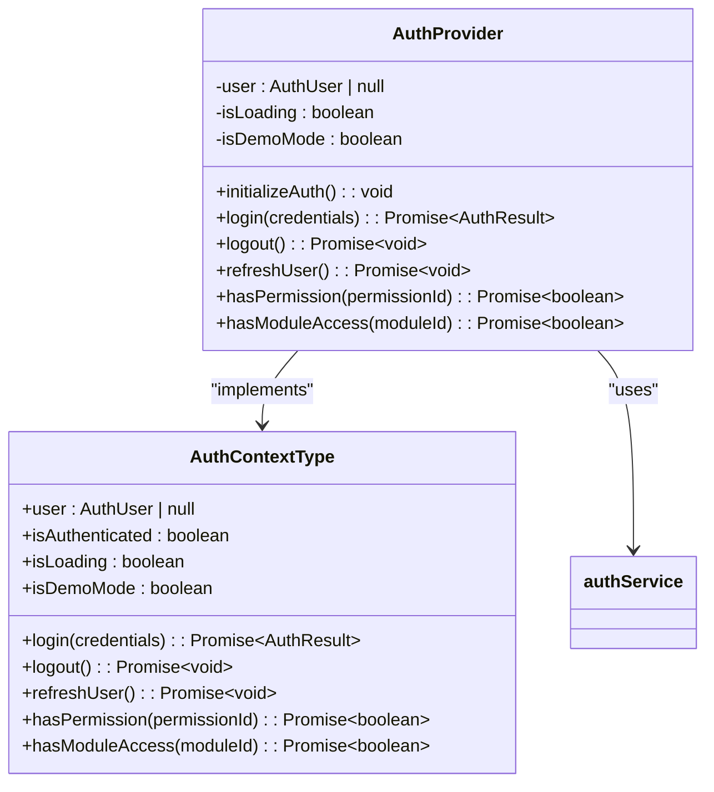
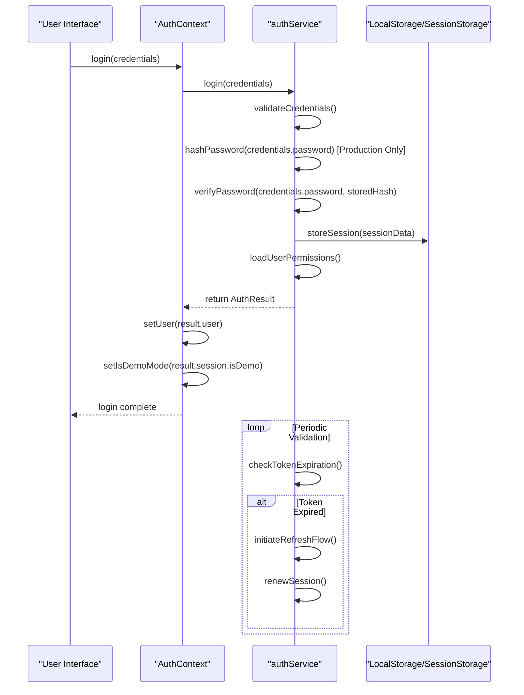
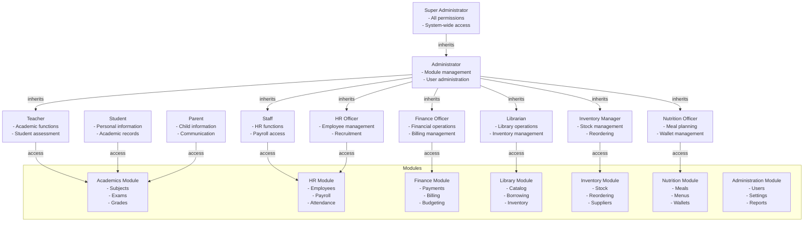
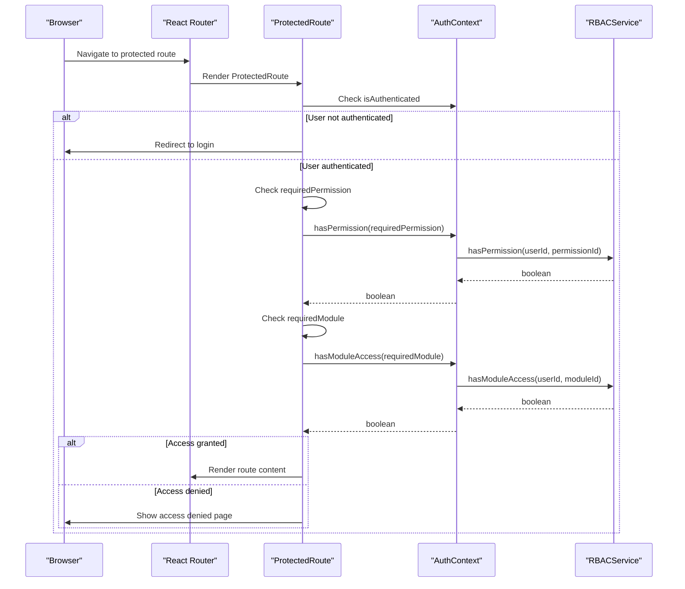
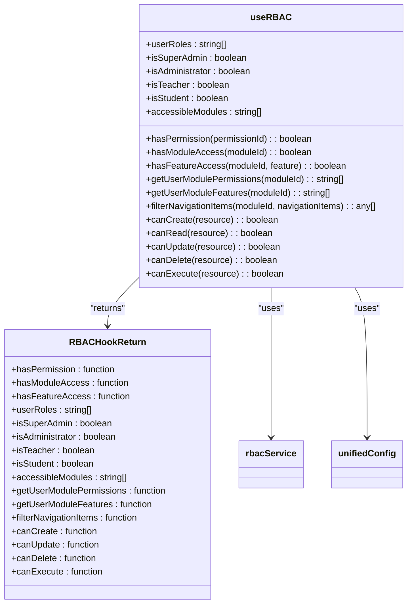
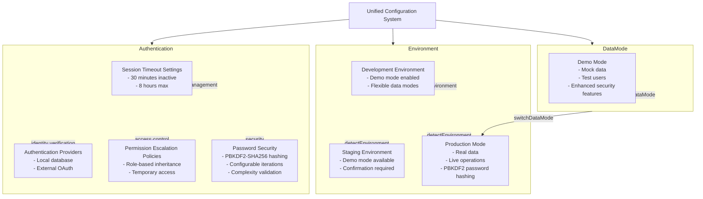
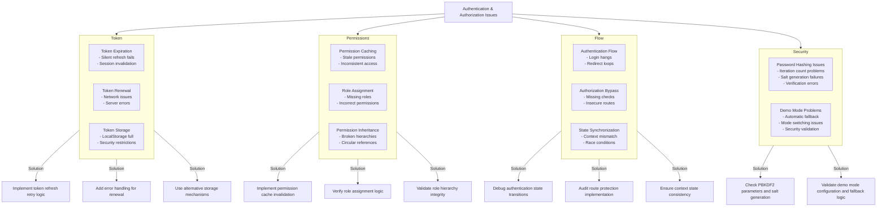

# Authentication & Authorization

<cite>
**Referenced Files in This Document**
- [AuthContext.tsx:1-167](file://src/contexts/AuthContext.tsx#L1-L167)
- [authService.ts](file://src/services/authService.ts)
- [rbacService.ts:1-697](file://src/core/rbacService.ts#L1-L697)
- [ProtectedRoute.tsx:1-111](file://src/components/ProtectedRoute.tsx#L1-L111)
- [useRBAC.ts:1-289](file://src/hooks/useRBAC.ts#L1-L289)
- [academics/rbac.ts:1-78](file://src/modules/academics/rbac.ts#L1-L78)
- [administration/rbac.ts:1-245](file://src/modules/administration/rbac.ts#L1-L245)
- [unifiedConfig.ts:1-1668](file://src/config/unifiedConfig.ts#L1-L1668)
- [environmentMatrix.ts:1-149](file://src/config/environmentMatrix.ts#L1-L149)
- [dataModePolicies.ts:1-190](file://src/config/dataModePolicies.ts#L1-L190)
- [passwordHash.ts](file://src/utils/passwordHash.ts)
- [productionDemo.ts:1-301](file://src/config/productionDemo.ts#L1-L301)
- [schema.ts:1-475](file://src/livestore/schema.ts#L1-L475)
</cite>

## Update Summary
**Changes Made**
- Added comprehensive documentation for PBKDF2-SHA256 password hashing implementation
- Updated authentication service workflow to reflect enhanced security measures
- Enhanced authentication demo mode handling documentation
- Added password security utility functions and validation
- Updated authentication context to support new password hashing features

## Table of Contents
1. [Introduction](#introduction)
2. [Enhanced Authentication Security with PBKDF2-SHA256](#enhanced-authentication-security-with-pbkdf2-sha256)
3. [Authentication Context Implementation](#authentication-context-implementation)
4. [Authentication Service Workflow](#authentication-service-workflow)
5. [RBAC Architecture](#rbac-architecture)
6. [Role Definitions and Permission Inheritance](#role-definitions-and-permission-inheritance)
7. [Route Protection and Access Validation](#route-protection-and-access-validation)
8. [Configuration Options](#configuration-options)
9. [Common Issues and Troubleshooting](#common-issues-and-troubleshooting)
10. [Conclusion](#conclusion)

## Introduction
The schoolpilot3 application implements a comprehensive authentication and authorization system that manages user identity, session persistence, and access control across its modular architecture. This system combines token-based authentication with a sophisticated Role-Based Access Control (RBAC) framework to ensure secure access to application resources. The implementation leverages React Context for state management, RxDB for data persistence, and a hierarchical permission system that supports both module-level and granular action-level access control. This document provides a detailed analysis of the authentication and authorization mechanisms, focusing on the integration between AuthContext, authService, and RBACService components.

**Section sources**
- [AuthContext.tsx:1-167](file://src/contexts/AuthContext.tsx#L1-L167)
- [rbacService.ts:1-697](file://src/core/rbacService.ts#L1-L697)

## Enhanced Authentication Security with PBKDF2-SHA256

The authentication system now implements enhanced security measures using PBKDF2-SHA256 password hashing for production environments. This cryptographic approach provides robust password protection through key derivation with configurable iteration counts and secure salt generation.



**Diagram sources**
- [passwordHash.ts:1-172](file://src/utils/passwordHash.ts#L1-L172)
- [authService.ts:517-522](file://src/services/authService.ts#L517-L522)

**Section sources**
- [passwordHash.ts:1-172](file://src/utils/passwordHash.ts#L1-L172)
- [authService.ts:517-522](file://src/services/authService.ts#L517-L522)

The password hashing implementation provides several key security features:

- **PBKDF2-SHA256 Algorithm**: Uses the industry-standard PBKDF2 key derivation function with SHA-256 hashing
- **Configurable Iterations**: Default 100,000 iterations provide strong computational cost for brute force attacks
- **Cryptographically Secure Salts**: Random 16-byte salts ensure unique hash values even for identical passwords
- **Constant-Time Verification**: Prevents timing attacks through secure comparison algorithms
- **Password Complexity Validation**: Enforces strong password policies including minimum length and character variety requirements

The authentication service integrates these security features through the `verifyPassword` function, which reconstructs the PBKDF2 key derivation process using stored hash parameters and compares the results securely.

## Authentication Context Implementation

The AuthContext provides a centralized mechanism for managing user authentication state throughout the application. Implemented as a React Context, it exposes user state and authentication methods to all components while maintaining session persistence.



**Diagram sources**
- [AuthContext.tsx:1-167](file://src/contexts/AuthContext.tsx#L1-L167)

**Section sources**
- [AuthContext.tsx:1-167](file://src/contexts/AuthContext.tsx#L1-L167)

The AuthContext initialization process begins when the application loads, checking for existing authentication state and determining whether the system is operating in demo mode. The context manages several key states:

- **User State**: Stores the authenticated user object or null if unauthenticated
- **Authentication Status**: Boolean indicating whether a user is currently authenticated
- **Loading State**: Indicates whether authentication operations are in progress
- **Demo Mode Status**: Flag indicating whether the application is running in demo mode

The context provides several methods for authentication management:
- `login()`: Authenticates a user with provided credentials
- `logout()`: Terminates the current user session
- `refreshUser()`: Updates the current user data from the authentication service
- `hasPermission()`: Checks if the current user has a specific permission
- `hasModuleAccess()`: Checks if the current user has access to a specific module

The implementation includes robust error handling and loading state management to ensure a smooth user experience during authentication operations.

## Authentication Service Workflow

The authService.ts implementation handles the core authentication workflows, including login, token management, and identity verification. This service acts as the intermediary between the AuthContext and the underlying authentication mechanisms.



**Diagram sources**
- [authService.ts](file://src/services/authService.ts)
- [AuthContext.tsx:1-167](file://src/contexts/AuthContext.tsx#L1-L167)

**Section sources**
- [authService.ts](file://src/services/authService.ts)
- [AuthContext.tsx:1-167](file://src/contexts/AuthContext.tsx#L1-L167)

The authentication workflow follows these key steps:

1. **Credential Validation**: The service validates the provided login credentials against the system's authentication rules
2. **Password Hashing**: In production mode, passwords are hashed using PBKDF2-SHA256 before verification
3. **Session Creation**: Upon successful authentication, a session token is generated and stored securely
4. **User Data Loading**: The authenticated user's profile and permission data are loaded from the database
5. **Session Persistence**: Authentication state is persisted across application restarts using localStorage
6. **Token Management**: The service handles token expiration and renewal automatically

The authService also implements identity verification workflows that validate user credentials and ensure the integrity of the authentication process. This includes checking for expired sessions, handling token refresh operations, and managing the lifecycle of authentication tokens.

## RBAC Architecture

The RBAC (Role-Based Access Control) system in schoolpilot3 provides granular permission management for the application's modular architecture. Implemented in rbacService.ts, this service manages roles, permissions, and user-role assignments.

```mermaid
classDiagram
class RBACService {
-roles : Map~string, RbacRole~
-permissions : Map~string, Permission~
-userRoles : Map~string, UserRole[]~
-modules : Map~string, ModuleDefinition~
+loadFromDb() : Promise~void~
+addPermission(permission) : Promise~void~
+updatePermission(permission) : Promise~void~
+deletePermission(id) : Promise~void~
+addRole(role) : Promise~void~
+updateRoleDb(role) : Promise~void~
+deleteRoleDb(id) : Promise~void~
+assignRoleToUserDb(userRole) : Promise~void~
+removeRoleFromUserDb(userId, roleId) : Promise~void~
+hasPermission(userId, permissionId) : boolean
+hasModuleAccess(userId, moduleId) : boolean
+getUserModules(userId) : string[]
+getUserModulePermissions(userId, moduleId) : string[]
+assignRoleToUser(userId, roleId, assignedBy) : boolean
+removeRoleFromUser(userId, roleId) : boolean
+getAllRoles() : RbacRole[]
+getAllPermissions() : Permission[]
+getModulePermissions(moduleId) : Permission[]
+createRole(role) : string
+updateRole(roleId, updates) : boolean
+deleteRole(roleId) : boolean
+initializeSuperAdminRole() : void
+filterNavigationItems(userId, moduleId, navigationItems) : any[]
+getUserModuleFeatures(userId, moduleId) : string[]
+getCurrentUserRole() : Promise~string~
+getUserPermissions() : Promise~string[]
+checkModuleAccess(userRole, moduleId) : Promise~boolean~
}
class Permission {
+id : string
+name : string
+description : string
+resource : string
+action : 'create' | 'read' | 'update' | 'delete' | 'execute'
+moduleId : string
+feature? : string
}
class Role {
+id : string
+name : string
+description : string
+permissions : string[]
+isActive : boolean
+isSystem : boolean
+moduleAccess : { [moduleId : string] : { enabled : boolean; permissions : string[] } }
}
class UserRole {
+userId : string
+roleId : string
+assignedAt : Date
+assignedBy : string
+expiresAt? : Date
}
class ModulePermission {
+moduleId : string
+permissions : Permission[]
+navigationItems : string[]
+features : string[]
}
RBACService --> Permission : "manages"
RBACService --> Role : "manages"
RBACService --> UserRole : "manages"
RBACService --> ModulePermission : "provides"
RBACService --> ModuleDefinition : "references"
```

**Diagram sources**
- [rbacService.ts:1-697](file://src/core/rbacService.ts#L1-L697)

**Section sources**
- [rbacService.ts:1-697](file://src/core/rbacService.ts#L1-L697)

The RBAC architecture is built around several key components:

- **Permissions**: Represent atomic actions that can be performed on resources (e.g., "academics.subjects.create")
- **Roles**: Collections of permissions that can be assigned to users
- **User Roles**: Assignments of roles to specific users with metadata
- **Module Access**: Controls access to entire application modules

The service provides comprehensive CRUD operations for managing permissions and roles, with appropriate validation and error handling. It also implements permission inheritance, where roles can inherit permissions from other roles, creating a hierarchical access control system.

## Role Definitions and Permission Inheritance

The RBAC system defines a comprehensive set of roles and permissions that govern access to application functionality. These definitions are organized by module and follow a consistent naming convention.



**Diagram sources**
- [rbacService.ts:1-697](file://src/core/rbacService.ts#L1-L697)
- [academics/rbac.ts:1-78](file://src/modules/academics/rbac.ts#L1-L78)
- [administration/rbac.ts:1-245](file://src/modules/administration/rbac.ts#L1-L245)

**Section sources**
- [rbacService.ts:1-697](file://src/core/rbacService.ts#L1-L697)
- [academics/rbac.ts:1-78](file://src/modules/academics/rbac.ts#L1-L78)
- [administration/rbac.ts:1-245](file://src/modules/administration/rbac.ts#L1-L245)

The system defines several system roles that cannot be deleted:

- **SUPER_ADMIN**: Has all permissions in the system
- **ADMINISTRATOR**: Manages users and system settings
- **TEACHER**: Handles academic functions and student assessment
- **STUDENT**: Accesses personal academic records
- **PARENT**: Views child information and communicates with school
- **STAFF**: General staff with limited access
- **FINANCE_OFFICER**: Manages financial operations
- **HR_OFFICER**: Handles human resources functions
- **LIBRARIAN**: Manages library operations
- **INVENTORY_MANAGER**: Oversees inventory management
- **NUTRITION_OFFICER**: Handles nutrition and meal planning

Each module defines its own set of permissions following a consistent pattern:
- `moduleId.resource.action` (e.g., "academics.subjects.create")
- `moduleId.feature.action` (e.g., "academics.exams.read")

The permission system supports inheritance through role hierarchies, where higher-level roles inherit the permissions of lower-level roles. This reduces redundancy and simplifies permission management.

## Route Protection and Access Validation

The application implements route protection through the ProtectedRoute component, which integrates with AuthContext to secure routes based on authentication status and permissions.



**Diagram sources**
- [ProtectedRoute.tsx:1-111](file://src/components/ProtectedRoute.tsx#L1-L111)
- [AuthContext.tsx:1-167](file://src/contexts/AuthContext.tsx#L1-L167)
- [rbacService.ts:1-697](file://src/core/rbacService.ts#L1-L697)

**Section sources**
- [ProtectedRoute.tsx:1-111](file://src/components/ProtectedRoute.tsx#L1-L111)
- [AuthContext.tsx:1-167](file://src/contexts/AuthContext.tsx#L1-L167)

The ProtectedRoute component provides several features for access control:

- **Authentication Check**: Redirects unauthenticated users to the login page
- **Permission Validation**: Checks if the user has specific permissions
- **Module Access Check**: Verifies access to specific application modules
- **Loading State**: Displays a spinner while checking access
- **Access Denied Page**: Shows a user-friendly error page when access is denied

The useRBAC hook provides a convenient way to check permissions in React components:



**Diagram sources**
- [useRBAC.ts:1-289](file://src/hooks/useRBAC.ts#L1-L289)
- [rbacService.ts:1-697](file://src/core/rbacService.ts#L1-L697)
- [unifiedConfig.ts:1-1668](file://src/config/unifiedConfig.ts#L1-L1668)

**Section sources**
- [useRBAC.ts:1-289](file://src/hooks/useRBAC.ts#L1-L289)

## Configuration Options

The authentication and authorization system is highly configurable through the unified configuration system, which manages settings across different environments.



**Diagram sources**
- [unifiedConfig.ts:1-1668](file://src/config/unifiedConfig.ts#L1-L1668)
- [environmentMatrix.ts:1-149](file://src/config/environmentMatrix.ts#L1-L149)
- [dataModePolicies.ts:1-190](file://src/config/dataModePolicies.ts#L1-L190)
- [productionDemo.ts:1-301](file://src/config/productionDemo.ts#L1-L301)

**Section sources**
- [unifiedConfig.ts:1-1668](file://src/config/unifiedConfig.ts#L1-L1668)
- [environmentMatrix.ts:1-149](file://src/config/environmentMatrix.ts#L1-L149)
- [dataModePolicies.ts:1-190](file://src/config/dataModePolicies.ts#L1-L190)
- [productionDemo.ts:1-301](file://src/config/productionDemo.ts#L1-L301)

Key configuration options include:

- **Environment Configuration**: Different settings for development, staging, and production environments
- **Data Mode Policies**: Controls whether demo mode is available and if mode switching is allowed
- **Session Timeout Settings**: Configurable inactivity and maximum session durations
- **Authentication Providers**: Support for multiple authentication methods
- **Permission Escalation Policies**: Rules for temporary access and role elevation
- **Password Security Configuration**: PBKDF2 iteration counts and hashing parameters

The system uses environment detection to automatically configure appropriate settings based on the deployment environment. In production environments, demo mode is restricted and data mode switching is disabled to ensure data integrity.

## Common Issues and Troubleshooting

Several common issues can occur in the authentication and authorization system, along with their troubleshooting approaches.



**Diagram sources**
- [authService.ts](file://src/services/authService.ts)
- [AuthContext.tsx:1-167](file://src/contexts/AuthContext.tsx#L1-L167)
- [rbacService.ts:1-697](file://src/core/rbacService.ts#L1-L697)
- [passwordHash.ts:1-172](file://src/utils/passwordHash.ts#L1-L172)

**Section sources**
- [authService.ts](file://src/services/authService.ts)
- [AuthContext.tsx:1-167](file://src/contexts/AuthContext.tsx#L1-L167)
- [rbacService.ts:1-697](file://src/core/rbacService.ts#L1-L697)
- [passwordHash.ts:1-172](file://src/utils/passwordHash.ts#L1-L172)

### Token Expiration Handling
Token expiration issues typically manifest as unexpected logouts or access denied errors. The system should implement silent token refresh to maintain user sessions without requiring re-authentication. Troubleshooting steps include:

- Verify token expiration times are correctly configured
- Check that token refresh endpoints are accessible
- Ensure refresh tokens are securely stored
- Implement retry logic for failed refresh attempts

### Permission Caching Inconsistencies
Permission caching issues can lead to inconsistent access control behavior. Solutions include:

- Implement cache invalidation when permissions change
- Use versioned permission caches to detect staleness
- Add logging to track permission cache operations
- Implement fallback mechanisms for cache failures

### Role Assignment Bugs
Role assignment issues often result from incorrect role-to-permission mappings. Troubleshooting involves:

- Verifying role definitions in module rbac.ts files
- Checking user role assignments in the database
- Validating permission inheritance logic
- Testing role changes with appropriate user accounts

### Authentication Flow Failures
Authentication flow failures can cause login hangs or redirect loops. Debugging steps include:

- Checking network requests during the login process
- Verifying session state persistence
- Reviewing error handling in authService and AuthContext
- Testing with different user types and roles

### Authorization Bypass Scenarios
Authorization bypass vulnerabilities can occur when route protection is incomplete. Prevention measures include:

- Auditing all routes for proper ProtectedRoute usage
- Verifying permission checks in server-side APIs
- Testing with low-privilege accounts
- Implementing automated security testing

### Password Hashing Issues
Password hashing problems can cause authentication failures or security vulnerabilities. Troubleshooting includes:

- Verifying PBKDF2 iteration counts and salt generation
- Checking password complexity validation rules
- Ensuring constant-time password verification
- Validating stored hash parameters in the database

### Demo Mode Problems
Demo mode configuration issues can affect authentication behavior. Solutions include:

- Verifying automatic fallback to demo mode
- Checking demo mode configuration settings
- Validating security implications of demo mode
- Testing demo mode transitions and limitations

## Conclusion
The authentication and authorization system in schoolpilot3 provides a robust foundation for securing the application and managing user access. The recent enhancements with PBKDF2-SHA256 password hashing significantly strengthen the security posture while maintaining the system's comprehensive RBAC framework and configurable environment policies. The implementation demonstrates several best practices, including centralized state management, granular permission control, environment-specific configuration, and enhanced security measures. The addition of cryptographically secure password hashing, constant-time verification, and comprehensive password complexity validation addresses critical security concerns. While the system is generally well-architected, attention should be paid to potential issues like token expiration handling, permission caching inconsistencies, role assignment bugs, and the proper implementation of password security features to ensure a secure and reliable user experience.