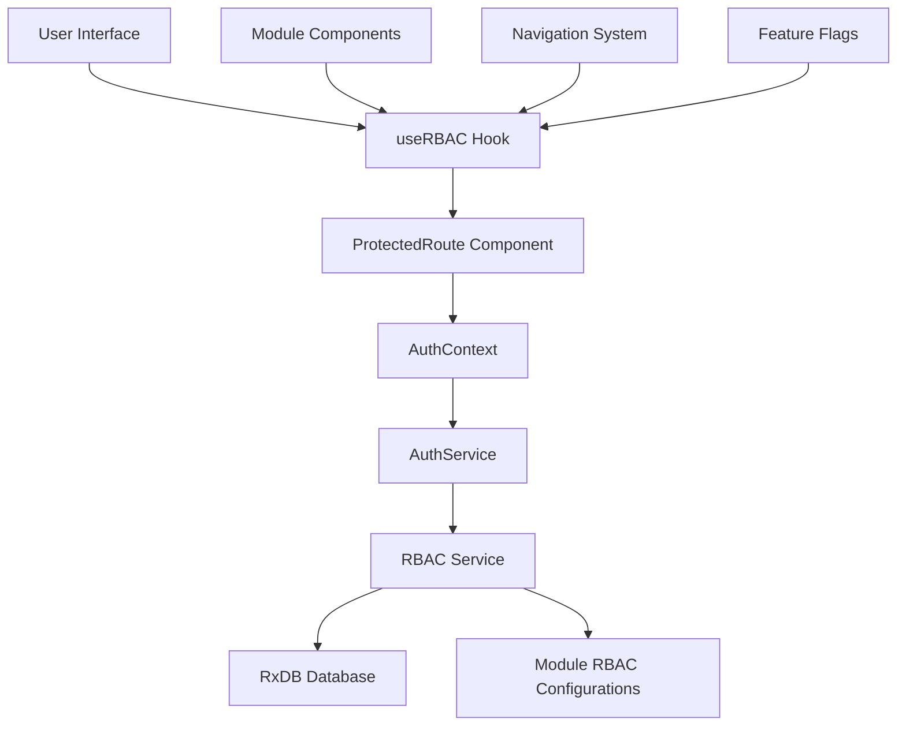
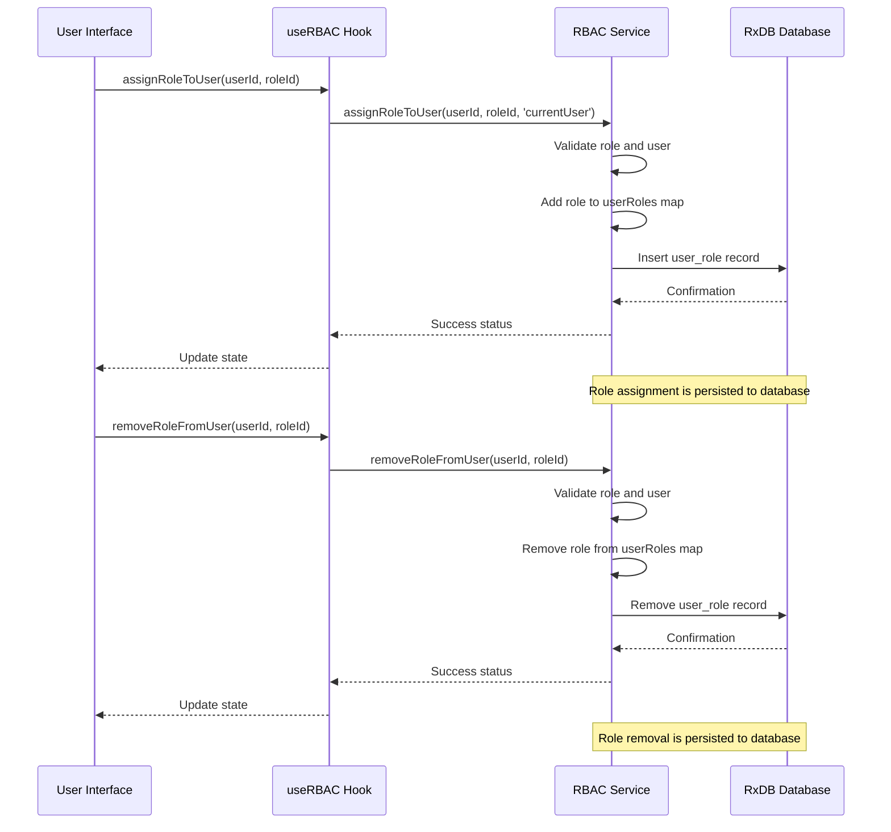
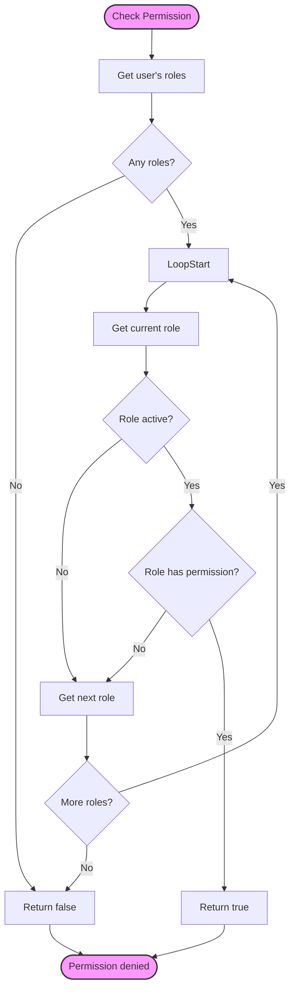
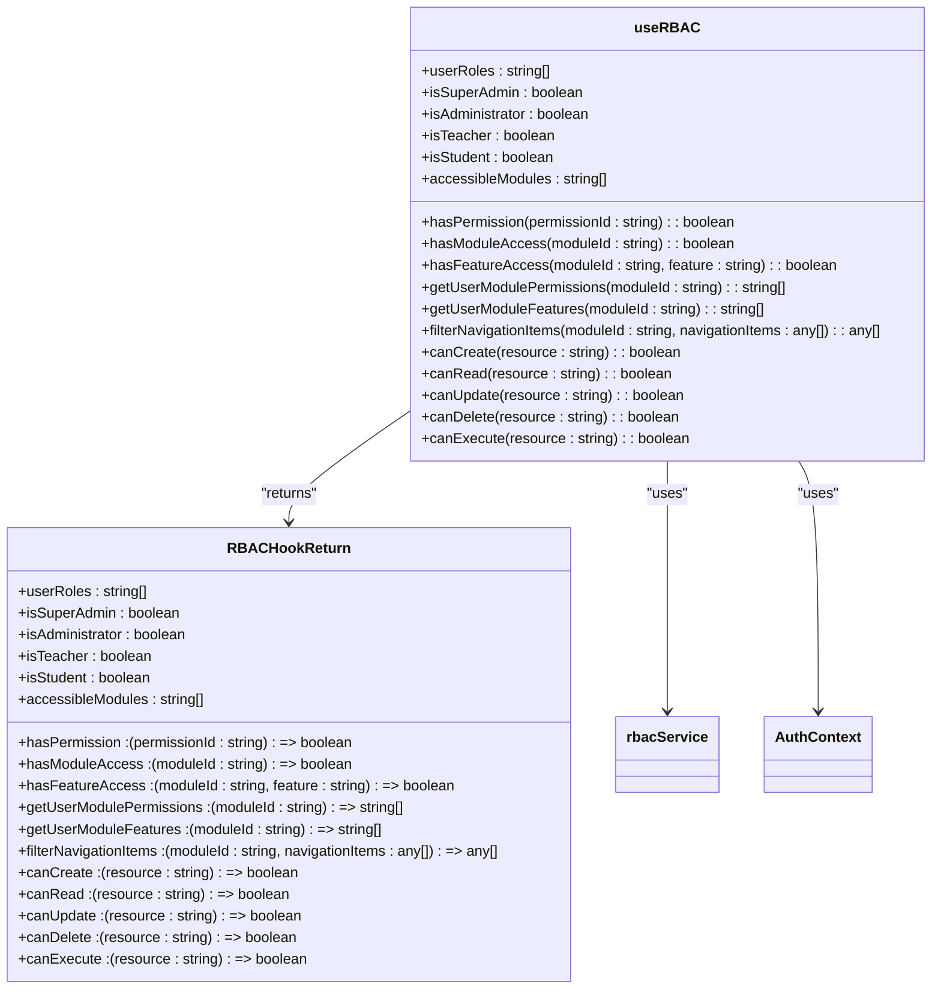
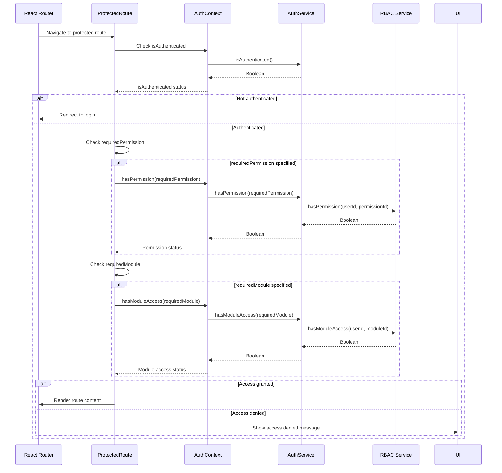
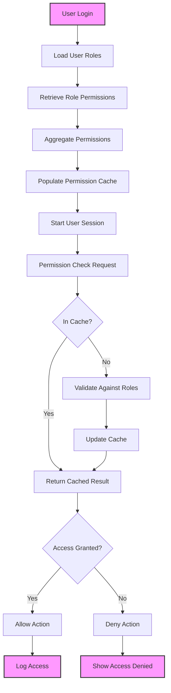
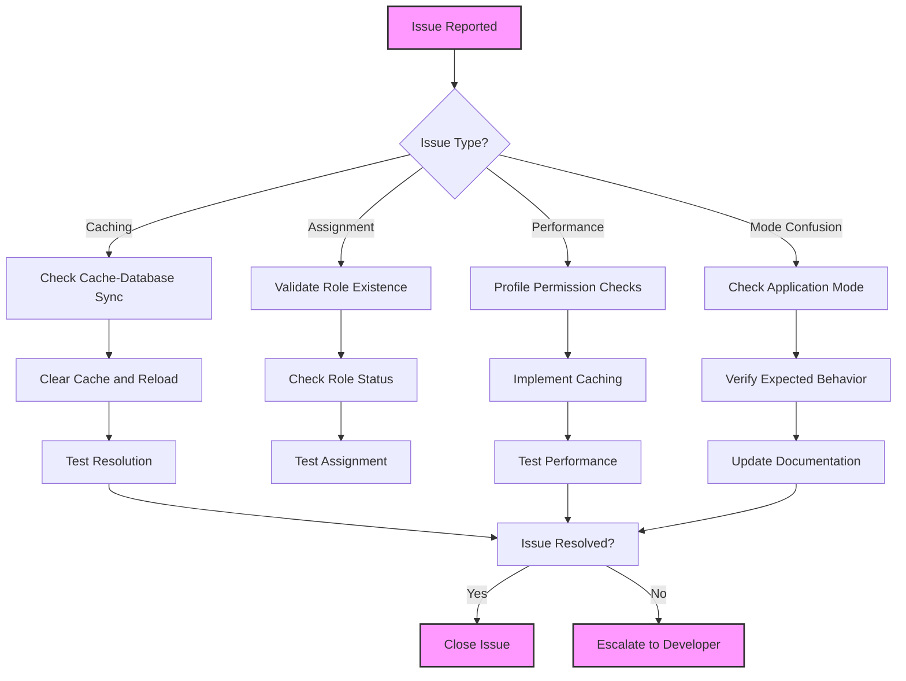

# RBAC Architecture

<cite>
**Referenced Files in This Document**   
- [rbacService.ts](file://src/core/rbacService.ts)
- [useRBAC.ts](file://src/hooks/useRBAC.ts)
- [ProtectedRoute.tsx](file://src/components/ProtectedRoute.tsx)
- [AuthContext.tsx](file://src/contexts/AuthContext.tsx)
- [authService.ts](file://src/services/authService.ts)
- [academics/rbac.ts](file://src/modules/academics/rbac.ts)
- [administration/rbac.ts](file://src/modules/administration/rbac.ts)
- [finance/rbac.ts](file://src/modules/finance/rbac.ts)
- [hr/rbac.ts](file://src/modules/hr/rbac.ts)
- [inventory/rbac.ts](file://src/modules/inventory/rbac.ts)
- [library/rbac.ts](file://src/modules/library/rbac.ts)
- [nutrition/rbac.ts](file://src/modules/nutrition/rbac.ts)
- [reports/rbac.ts](file://src/modules/reports/rbac.ts)
- [settings/rbac.ts](file://src/modules/settings/rbac.ts)
</cite>

## Table of Contents
1. [Introduction](#introduction)
2. [RBAC System Overview](#rbac-system-overview)
3. [Core RBAC Service Architecture](#core-rbac-service-architecture)
4. [Permission Structure and Hierarchy](#permission-structure-and-hierarchy)
5. [Role Management and Assignment](#role-management-and-assignment)
6. [Access Validation Logic](#access-validation-logic)
7. [useRBAC Hook Implementation](#userbac-hook-implementation)
8. [Route Guarding and Feature Access](#route-guarding-and-feature-access)
9. [Permission Resolution Process](#permission-resolution-process)
10. [Common Issues and Troubleshooting](#common-issues-and-troubleshooting)
11. [Extending the RBAC System](#extending-the-rbac-system)
12. [Conclusion](#conclusion)

## Introduction
The Role-Based Access Control (RBAC) system in schoolpilot3 provides granular permission management for the modular architecture of the educational platform. This comprehensive documentation details the architecture, implementation, and usage patterns of the RBAC system, focusing on the core `rbacService.ts` implementation, the `useRBAC` hook for component-level permission checks, and the integration with UI elements for conditional rendering. The system supports a hierarchical permission model with role inheritance, module-specific access control, and dynamic permission validation for both authentication and authorization workflows.

**Section sources**
- [rbacService.ts](file://src/core/rbacService.ts)
- [useRBAC.ts](file://src/hooks/useRBAC.ts)

## RBAC System Overview
The RBAC system in schoolpilot3 is designed as a centralized service that manages user roles, permissions, and access control across all modules of the application. The architecture follows a layered approach with the core RBAC service handling data persistence and business logic, while React hooks provide a clean interface for components to check permissions and render content conditionally.

The system supports multiple user roles including super administrators, administrators, teachers, students, parents, and specialized officers for finance, HR, library, inventory, and nutrition. Each role has a defined set of permissions that determine what actions users can perform and what data they can access within each module of the application.

The RBAC implementation is tightly integrated with the authentication system, ensuring that permission checks are performed consistently across the application, from route guarding to UI element visibility. The system also supports both demo and production modes, with different permission resolution strategies for each environment.



**Diagram sources**
- [rbacService.ts](file://src/core/rbacService.ts)
- [useRBAC.ts](file://src/hooks/useRBAC.ts)
- [AuthContext.tsx](file://src/contexts/AuthContext.tsx)
- [authService.ts](file://src/services/authService.ts)

## Core RBAC Service Architecture
The core RBAC service is implemented as a singleton class in `rbacService.ts` that manages all aspects of role-based access control. The service maintains in-memory caches of roles, permissions, and user-role assignments, while also providing persistence through RxDB for production environments.

The service architecture is built around several key interfaces that define the structure of permissions, roles, and user-role assignments. The `Permission` interface defines individual permissions with unique IDs, names, descriptions, resources, actions, and module associations. The `Role` interface defines roles with IDs, names, descriptions, assigned permissions, active status, system status, and module access configurations.

```mermaid
classDiagram
class RBACService {
+roles : Map<string, RbacRole>
+permissions : Map<string, Permission>
+userRoles : Map<string, UserRole[]>
+modules : Map<string, ModuleDefinition>
+db : SchoolDatabase | null
+setDatabase(db : SchoolDatabase) : void
+loadFromDb() : Promise<void>
+addPermission(permission : Permission) : Promise<void>
+updatePermission(permission : Permission) : Promise<void>
+deletePermission(id : string) : Promise<void>
+addRole(role : RbacRole) : Promise<void>
+updateRoleDb(role : RbacRole) : Promise<void>
+deleteRoleDb(id : string) : Promise<void>
+assignRoleToUserDb(userRole : UserRole) : Promise<void>
+removeRoleFromUserDb(userId : string, roleId : string) : Promise<void>
+hasPermission(userId : string, permissionId : string) : boolean
+hasModuleAccess(userId : string, moduleId : string) : boolean
+getUserModules(userId : string) : string[]
+getUserModulePermissions(userId : string, moduleId : string) : string[]
+getUserModuleFeatures(userId : string, moduleId : string) : string[]
+assignRoleToUser(userId : string, roleId : string, assignedBy : string) : boolean
+removeRoleFromUser(userId : string, roleId : string) : boolean
+getAllRoles() : RbacRole[]
+getAllPermissions() : Permission[]
+getModulePermissions(moduleId : string) : Permission[]
+createRole(role : Omit<RbacRole, 'id'>) : string
+updateRole(roleId : string, updates : Partial<RbacRole>) : boolean
+deleteRole(roleId : string) : boolean
+initializeSuperAdminRole() : void
+filterNavigationItems(userId : string, moduleId : string, navigationItems : any[]) : any[]
}
class Permission {
+id : string
+name : string
+description : string
+resource : string
+action : 'create' | 'read' | 'update' | 'delete' | 'execute'
+moduleId : string
+feature? : string
}
class Role {
+id : string
+name : string
+description : string
+permissions : string[]
+isActive : boolean
+isSystem : boolean
+moduleAccess : { [moduleId : string] : { enabled : boolean; permissions : string[] } }
}
class UserRole {
+userId : string
+roleId : string
+assignedAt : Date
+assignedBy : string
+expiresAt? : Date
}
class ModulePermission {
+moduleId : string
+permissions : Permission[]
+navigationItems : string[]
+features : string[]
}
RBACService --> Permission : "manages"
RBACService --> Role : "manages"
RBACService --> UserRole : "manages"
RBACService --> ModulePermission : "manages"
RBACService --> SchoolDatabase : "persists to"
```

**Diagram sources**
- [rbacService.ts](file://src/core/rbacService.ts#L15-L696)

**Section sources**
- [rbacService.ts](file://src/core/rbacService.ts#L15-L696)

## Permission Structure and Hierarchy
The permission system in schoolpilot3 follows a hierarchical structure with permissions organized by module, resource, and action. Each permission is uniquely identified by an ID that follows a consistent naming convention: `[module].[resource].[action]` or `[module].[action]` for module-level permissions.

The system defines five standard actions for permissions:
- **create**: Allows creating new records or resources
- **read**: Allows viewing or reading data
- **update**: Allows modifying existing data
- **delete**: Allows removing records or resources
- **execute**: Allows performing specific operations or functions

Permissions are organized by module, with each module defining its own set of permissions based on its functionality. For example, the administration module defines permissions like `administration.users.create` and `administration.settings.read`, while the finance module defines permissions like `finance.payments.create` and `finance.reports.read`.

The system also supports feature-level permissions, allowing for more granular control over specific features within a module. These are defined using the optional `feature` property in the Permission interface and can be used to control access to specific UI components or functionality.

```mermaid
graph TD
A[Permissions] --> B[Module Level]
A --> C[Resource Level]
A --> D[Feature Level]
B --> B1[administration.read]
B --> B2[administration.write]
B --> B3[academics.read]
B --> B4[academics.write]
B --> B5[finance.read]
B --> B6[finance.write]
C --> C1[administration.users.read]
C --> C2[administration.users.create]
C --> C3[administration.settings.read]
C --> C4[administration.settings.create]
C --> C5[finance.payments.read]
C --> C6[finance.payments.create]
C --> C7[finance.reports.read]
C --> C8[finance.reports.create]
D --> D1[academics.grading.bulk_entry]
D --> D2[academics.scheduling.exam]
D --> D3[finance.budgeting.approve]
D --> D4[hr.payroll.process]
style A fill:#f9f,stroke:#333,stroke-width:2px
style B fill:#bbf,stroke:#333,stroke-width:1px
style C fill:#bbf,stroke:#333,stroke-width:1px
style D fill:#bbf,stroke:#333,stroke-width:1px
```



**Diagram sources**
- [rbacService.ts](file://src/core/rbacService.ts#L15-L696)
- [administration/rbac.ts](file://src/modules/administration/rbac.ts)
- [finance/rbac.ts](file://src/modules/finance/rbac.ts)

**Section sources**
- [rbacService.ts](file://src/core/rbacService.ts#L15-L696)

## Role Management and Assignment
The RBAC system implements a flexible role management system that supports both predefined system roles and custom user-defined roles. System roles are defined as constants in the `SYSTEM_ROLES` object and cannot be deleted, while custom roles can be created, modified, and deleted through the RBAC service API.

Roles are assigned to users through the `UserRole` interface, which establishes a many-to-many relationship between users and roles. Each user-role assignment includes metadata such as the assignment timestamp, the user who assigned the role, and an optional expiration date for time-limited access.

The role assignment process involves several key methods in the RBAC service:
- `assignRoleToUser`: Adds a role to a user in memory
- `assignRoleToUserDb`: Persists the role assignment to the database
- `removeRoleFromUser`: Removes a role from a user in memory
- `removeRoleFromUserDb`: Removes the role assignment from the database

When a role is deleted, the system automatically removes the role from all users who have been assigned that role, ensuring data consistency and preventing orphaned role assignments.



**Diagram sources**
- [rbacService.ts](file://src/core/rbacService.ts#L15-L696)

**Section sources**
- [rbacService.ts](file://src/core/rbacService.ts#L15-L696)

## Access Validation Logic
The access validation logic in the RBAC system is implemented through a series of methods that check whether a user has the necessary permissions or module access to perform specific actions. The core validation methods are `hasPermission` and `hasModuleAccess`, which are used throughout the application to control access to resources and functionality.

The `hasPermission` method checks whether a user has a specific permission by:
1. Retrieving all roles assigned to the user
2. Checking each role to see if it includes the requested permission
3. Returning true if any active role has the permission, false otherwise

The `hasModuleAccess` method checks whether a user has access to a specific module by:
1. Retrieving all roles assigned to the user
2. Checking each role's module access configuration for the requested module
3. Returning true if any active role has enabled access to the module, false otherwise

The system also implements additional validation methods for more specific use cases:
- `getUserModulePermissions`: Returns all permissions a user has for a specific module
- `getUserModuleFeatures`: Returns all features a user can access within a specific module
- `filterNavigationItems`: Filters navigation items based on user permissions



**Diagram sources**
- [rbacService.ts](file://src/core/rbacService.ts#L15-L696)

**Section sources**
- [rbacService.ts](file://src/core/rbacService.ts#L15-L696)

## useRBAC Hook Implementation
The `useRBAC` hook provides a React-friendly interface for components to check user permissions and access rights. The hook abstracts the complexity of the underlying RBAC service and provides a simple API for conditional rendering and access control in UI components.

The hook returns an object with several methods and properties:
- **Permission checks**: `hasPermission`, `hasModuleAccess`, `hasFeatureAccess`
- **User role information**: `userRoles`, `isSuperAdmin`, `isAdministrator`, `isTeacher`, `isStudent`
- **Module access**: `accessibleModules`, `getUserModulePermissions`, `getUserModuleFeatures`
- **Navigation filtering**: `filterNavigationItems`
- **Utility functions**: `canCreate`, `canRead`, `canUpdate`, `canDelete`, `canExecute`

The hook is designed to work in both demo and production modes, with different behavior based on the current application mode. In demo mode, the hook grants super admin privileges to all users, while in production mode, it performs actual permission checks based on the user's assigned roles and permissions.



**Diagram sources**
- [useRBAC.ts](file://src/hooks/useRBAC.ts#L15-L288)

**Section sources**
- [useRBAC.ts](file://src/hooks/useRBAC.ts#L15-L288)

## Route Guarding and Feature Access
The RBAC system is integrated with the application's routing system through the `ProtectedRoute` component, which provides route-level access control. This component wraps protected routes and checks whether the current user has the necessary permissions or module access before allowing navigation to the route.

The `ProtectedRoute` component accepts several props to define access requirements:
- `requiredPermission`: The specific permission required to access the route
- `requiredModule`: The module that must be accessible to access the route
- `fallbackPath`: The path to redirect to if access is denied (default: '/login')

When a user attempts to access a protected route, the component performs the following checks:
1. Verifies the user is authenticated
2. Checks for the required permission if specified
3. Checks for module access if specified
4. Renders the route content if all checks pass, or shows an access denied message if any check fails

The system also provides specialized hooks for feature-level access control:
- `usePermissionGate`: Returns a boolean indicating whether the user has a specific permission
- `useModuleGate`: Returns a boolean indicating whether the user has access to a specific module
- `useFeatureGate`: Returns a boolean indicating whether the user has access to a specific feature within a module



**Diagram sources**
- [ProtectedRoute.tsx](file://src/components/ProtectedRoute.tsx#L15-L110)
- [AuthContext.tsx](file://src/contexts/AuthContext.tsx#L15-L159)
- [authService.ts](file://src/services/authService.ts#L15-L627)

**Section sources**
- [ProtectedRoute.tsx](file://src/components/ProtectedRoute.tsx#L15-L110)

## Permission Resolution Process
The permission resolution process in schoolpilot3 follows a hierarchical approach that combines role-based access control with resource-based permissions. The process begins when a user logs in and their roles and permissions are loaded from the database, then continues with real-time permission checks throughout the user's session.

The resolution process involves several key steps:
1. **Role Assignment**: When a user logs in, their roles are retrieved from the database and assigned to them in the RBAC service
2. **Permission Aggregation**: The system aggregates all permissions from the user's assigned roles, including both direct permissions and inherited permissions from parent roles
3. **Cache Population**: The aggregated permissions are stored in memory for fast access during the user's session
4. **Real-time Validation**: When a permission check is requested, the system validates the user's access rights against the cached permissions
5. **Conflict Resolution**: In cases where a user has multiple roles with conflicting permissions, the system follows a "least privilege" principle, requiring explicit permission grants

The system also implements inheritance rules for permissions:
- **Role Inheritance**: Custom roles can inherit permissions from system roles
- **Module Inheritance**: Module-level permissions grant access to all resources within that module
- **Action Inheritance**: Higher-level actions (e.g., "write") imply lower-level actions (e.g., "read")



**Diagram sources**
- [rbacService.ts](file://src/core/rbacService.ts#L15-L696)
- [authService.ts](file://src/services/authService.ts#L15-L627)

**Section sources**
- [rbacService.ts](file://src/core/rbacService.ts#L15-L696)

## Common Issues and Troubleshooting
The RBAC system in schoolpilot3 may encounter several common issues that can affect permission validation and user access. Understanding these issues and their solutions is critical for maintaining system security and usability.

### Permission Caching Inconsistencies
One common issue is permission caching inconsistencies, where the in-memory cache of permissions becomes out of sync with the database. This can occur when permissions are updated directly in the database without updating the cache, or when the cache is not properly invalidated after role changes.

**Solution**: Always use the RBAC service methods to modify permissions and roles, as these methods automatically update both the database and the cache. For bulk operations, use the service's batch update methods to ensure consistency.

### Role Assignment Errors
Role assignment errors can occur when attempting to assign non-existent roles to users, or when trying to assign system roles that have been deleted. These errors can prevent users from accessing necessary functionality.

**Solution**: Validate role existence before assignment using the `getAllRoles()` method. Implement proper error handling to catch and report assignment errors to administrators.

### Performance Bottlenecks in Permission Validation
In large deployments with many users and complex role hierarchies, permission validation can become a performance bottleneck, especially when checking permissions for multiple users simultaneously.

**Solution**: Implement permission caching at the component level using React's `useMemo` and `useCallback` hooks. For frequently accessed permissions, consider pre-fetching and caching the results during user login.

### Demo Mode vs Production Mode Confusion
The system operates differently in demo and production modes, which can lead to confusion when testing permission logic. In demo mode, all users have super admin privileges, while in production mode, permissions are strictly enforced.

**Solution**: Clearly document the differences between demo and production modes. Implement logging to indicate which mode the system is running in, and provide visual indicators in the UI for demo mode.



**Diagram sources**
- [rbacService.ts](file://src/core/rbacService.ts#L15-L696)
- [useRBAC.ts](file://src/hooks/useRBAC.ts#L15-L288)

**Section sources**
- [rbacService.ts](file://src/core/rbacService.ts#L15-L696)

## Extending the RBAC System
The RBAC system in schoolpilot3 is designed to be extensible, allowing for the addition of custom roles and dynamic permission updates. The system provides several methods for extending and modifying the permission model to meet evolving business requirements.

### Adding Custom Roles
Custom roles can be created using the `createRole` method of the RBAC service. This method accepts a role definition without an ID and returns a generated role ID. Custom roles can be assigned specific permissions and module access configurations.

```typescript
const roleId = rbacService.createRole({
  name: 'Academic Coordinator',
  description: 'Manages academic programs and curriculum',
  permissions: [
    'academics.programs.read',
    'academics.programs.create',
    'academics.curriculum.read',
    'academics.curriculum.update'
  ],
  isActive: true,
  isSystem: false,
  moduleAccess: {
    academics: {
      enabled: true,
      permissions: [
        'academics.programs.read',
        'academics.programs.create',
        'academics.curriculum.read',
        'academics.curriculum.update'
      ]
    }
  }
});
```

### Dynamic Permission Updates
The system supports dynamic permission updates through the `updateRole` and `updatePermission` methods. These methods allow administrators to modify existing roles and permissions without requiring a system restart.

```typescript
// Update role permissions
rbacService.updateRole(roleId, {
  permissions: [...existingPermissions, 'new.permission']
});

// Update permission details
rbacService.updatePermission({
  id: 'existing.permission',
  name: 'Updated Permission Name',
  description: 'Updated permission description'
});
```

### Module-Specific RBAC Configuration
Each module can define its own RBAC configuration in a `rbac.ts` file, which exports the module's permissions and role definitions. This allows modules to extend the global RBAC system with module-specific permissions and access controls.

```typescript
// Example from src/modules/academics/rbac.ts
export const ACADEMICS_PERMISSIONS = {
  READ: 'academics.read',
  WRITE: 'academics.write',
  GRADES_VIEW: 'academics.grades.view',
  GRADES_EDIT: 'academics.grades.edit',
  SCHEDULING_VIEW: 'academics.scheduling.view',
  SCHEDULING_EDIT: 'academics.scheduling.edit'
};

export const ACADEMICS_ROLES = {
  ACADEMIC_COORDINATOR: 'academic_coordinator',
  EXAM_OFFICER: 'exam_officer',
  CURRICULUM_SPECIALIST: 'curriculum_specialist'
};
```

**Section sources**
- [rbacService.ts](file://src/core/rbacService.ts#L15-L696)
- [academics/rbac.ts](file://src/modules/academics/rbac.ts)
- [administration/rbac.ts](file://src/modules/administration/rbac.ts)

## Conclusion
The RBAC system in schoolpilot3 provides a robust and flexible framework for managing user access and permissions across the educational platform. The system's architecture, centered around the `rbacService.ts` implementation and the `useRBAC` hook, enables granular control over user access while maintaining performance and scalability.

Key strengths of the system include its hierarchical permission model, support for both system and custom roles, integration with the authentication system, and comprehensive tooling for route guarding and feature access control. The system also provides mechanisms for extending the permission model with custom roles and dynamic permission updates, ensuring it can adapt to changing business requirements.

For optimal use of the RBAC system, developers should follow best practices such as using the provided hooks for permission checks, implementing proper error handling for permission-related operations, and thoroughly testing permission logic in both demo and production modes. Administrators should regularly review role assignments and permissions to ensure compliance with security policies and the principle of least privilege.

The RBAC system represents a critical component of schoolpilot3's security architecture, providing the foundation for secure, role-based access to the platform's extensive functionality.