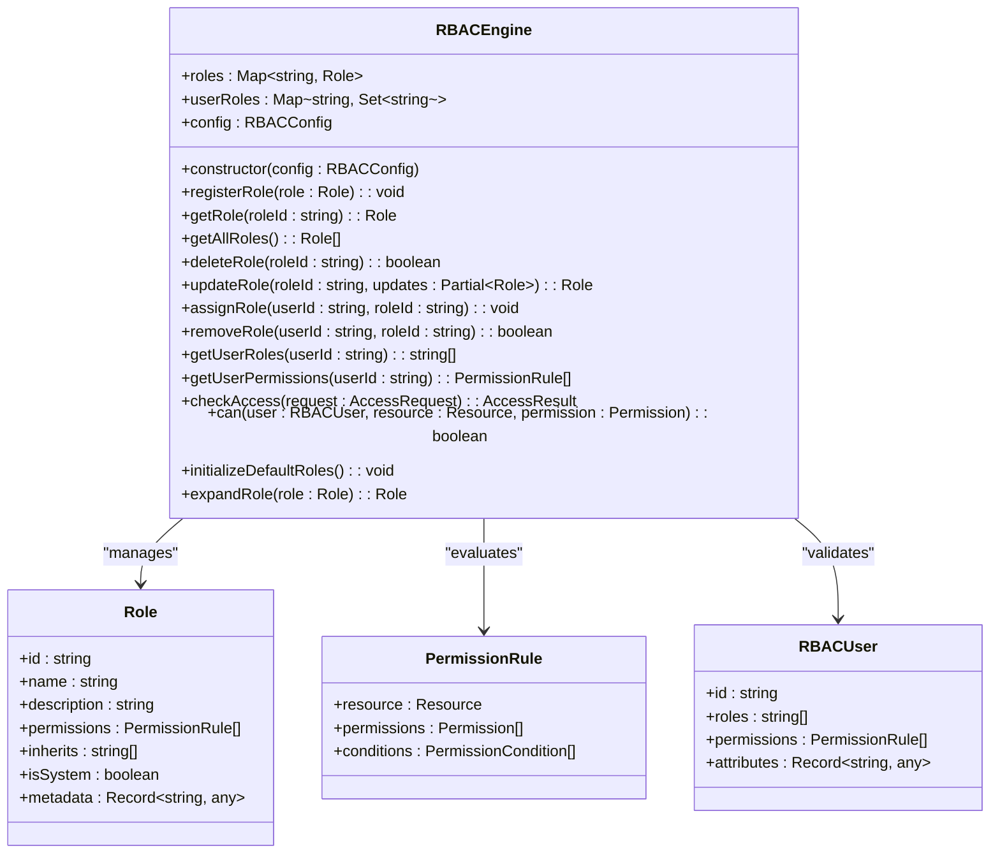
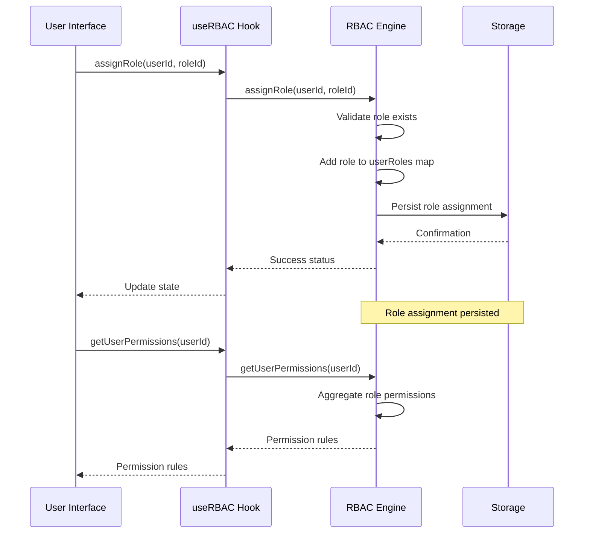
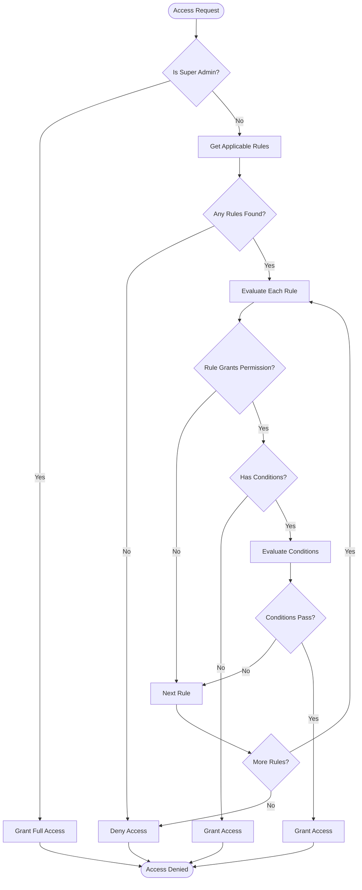
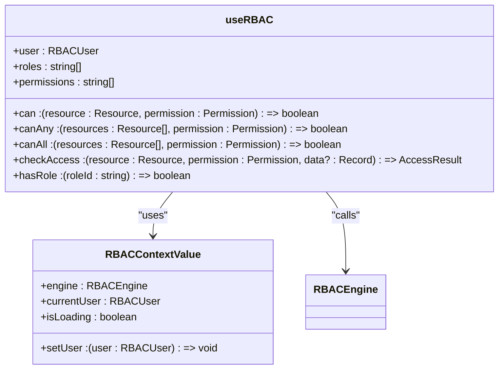
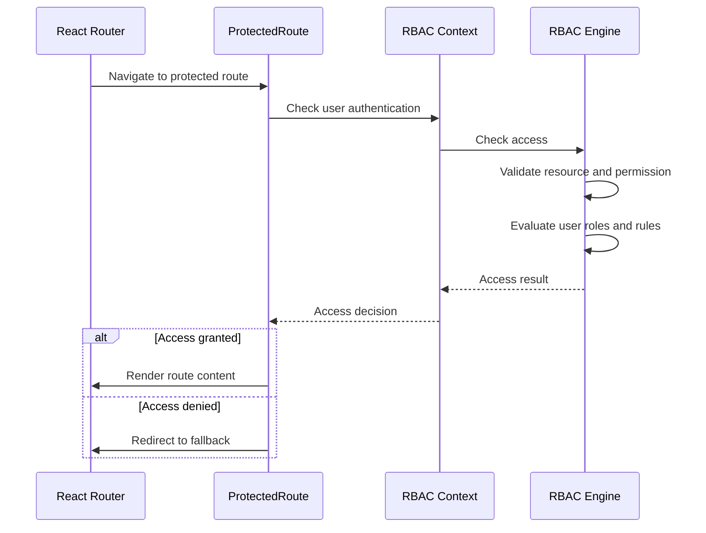
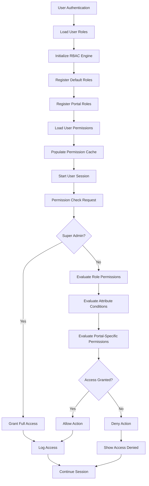
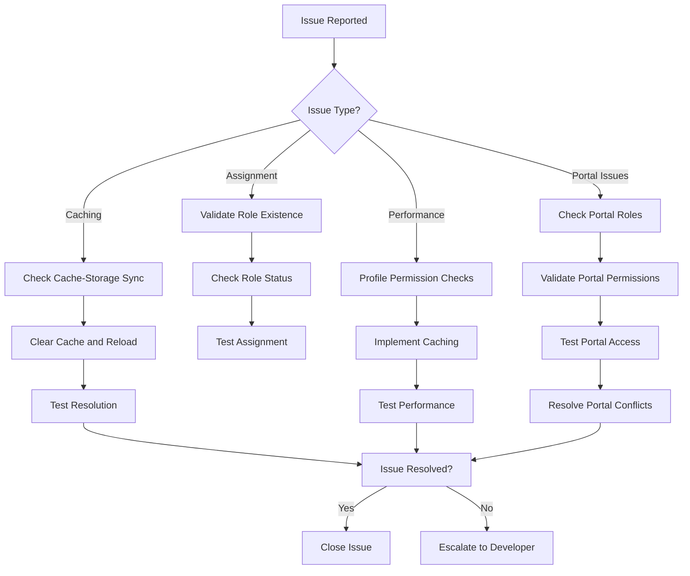

# RBAC Architecture

<cite>
**Referenced Files in This Document**
- [types.ts](file://src/rbac/types.ts)
- [RBACEngine.ts](file://src/rbac/RBACEngine.ts)
- [RBACProvider.tsx](file://src/rbac/RBACProvider.tsx)
- [useRBAC.tsx](file://src/rbac/useRBAC.tsx)
- [index.ts](file://src/rbac/index.ts)
- [portal/rbac.ts](file://src/modules/portal/rbac.ts)
- [portal/moduleDefinition.tsx](file://src/modules/portal/moduleDefinition.tsx)
- [useRBAC.ts](file://src/hooks/useRBAC.ts)
- [ProtectedRoute.tsx](file://src/components/ProtectedRoute.tsx)
- [AuthContext.tsx](file://src/contexts/AuthContext.tsx)
- [authService.ts](file://src/services/authService.ts)
- [rbacService.ts](file://src/core/rbacService.ts)
- [academics/rbac.ts](file://src/modules/academics/rbac.ts)
- [administration/rbac.ts](file://src/modules/administration/rbac.ts)
- [finance/rbac.ts](file://src/modules/finance/rbac.ts)
- [hr/rbac.ts](file://src/modules/hr/rbac.ts)
- [inventory/rbac.ts](file://src/modules/inventory/rbac.ts)
- [library/rbac.ts](file://src/modules/library/rbac.ts)
- [nutrition/rbac.ts](file://src/modules/nutrition/rbac.ts)
- [reports/rbac.ts](file://src/modules/reports/rbac.ts)
- [settings/rbac.ts](file://src/modules/settings/rbac.ts)
</cite>

## Update Summary
**Changes Made**
- Updated portal-specific roles section to reflect new portal roles (STUDENT_PORTAL, PARENT_PORTAL, GUARDIAN_PORTAL) in RBAC types
- Enhanced RBAC system overview to include portal module integration
- Updated role management section to document portal role inheritance and configuration
- Added portal-specific permission structure documentation
- Updated system roles with new portal role constants
- Enhanced permission resolution process to handle portal role assignments

## Table of Contents
1. [Introduction](#introduction)
2. [RBAC System Overview](#rbac-system-overview)
3. [Core RBAC Service Architecture](#core-rbac-service-architecture)
4. [Permission Structure and Hierarchy](#permission-structure-and-hierarchy)
5. [Role Management and Assignment](#role-management-and-assignment)
6. [Access Validation Logic](#access-validation-logic)
7. [useRBAC Hook Implementation](#userbac-hook-implementation)
8. [Route Guarding and Feature Access](#route-guarding-and-feature-access)
9. [Permission Resolution Process](#permission-resolution-process)
10. [Common Issues and Troubleshooting](#common-issues-and-troubleshooting)
11. [Extending the RBAC System](#extending-the-rbac-system)
12. [Conclusion](#conclusion)

## Introduction
The Role-Based Access Control (RBAC) system in schoolpilot3 provides granular permission management for the modular architecture of the educational platform. This comprehensive documentation details the architecture, implementation, and usage patterns of the RBAC system, focusing on the core RBAC engine, the useRBAC hook for component-level permission checks, and the integration with UI elements for conditional rendering. The system supports a hierarchical permission model with role inheritance, module-specific access control, and dynamic permission validation for both authentication and authorization workflows.

**Updated** The system now includes expanded portal-specific roles that provide dedicated access to the student/parent portal functionality, enabling role-based access control for educational stakeholders beyond traditional administrative roles. The new portal roles (STUDENT_PORTAL, PARENT_PORTAL, GUARDIAN_PORTAL) integrate seamlessly with the existing RBAC architecture while maintaining backward compatibility.

## RBAC System Overview
The RBAC system in schoolpilot3 is designed as a centralized engine that manages user roles, permissions, and access control across all modules of the application. The architecture follows a layered approach with the RBAC engine handling data persistence and business logic, while React hooks provide a clean interface for components to check permissions and render content conditionally.

The system supports multiple user roles including super administrators, administrators, teachers, students, parents, and specialized officers for finance, HR, library, inventory, and nutrition. **Updated** The system now includes portal-specific roles that provide access to portal module functionality, with STUDENT_PORTAL, PARENT_PORTAL, and GUARDIAN_PORTAL roles supporting different levels of portal access.

Each role has a defined set of permissions that determine what actions users can perform and what data they can access within each module of the application. The RBAC implementation is tightly integrated with the authentication system, ensuring that permission checks are performed consistently across the application, from route guarding to UI element visibility.

```mermaid
graph TD
A[User Interface] --> B[useRBAC Hook]
B --> C[ProtectedRoute Component]
C --> D[RBAC Context]
D --> E[RBAC Engine]
E --> F[Role Registry]
E --> G[Permission Rules]
H[Portal Module] --> I[Portal RBAC Config]
I --> J[Portal Permissions]
I --> K[Portal Roles]
L[RBAC Types] --> M[SYSTEM_ROLES]
M --> N[STUDENT_PORTAL]
M --> O[PARENT_PORTAL]
M --> P[GUARDIAN_PORTAL]
```



**Diagram sources**
- [RBACEngine.ts](file://src/rbac/RBACEngine.ts)
- [useRBAC.tsx](file://src/rbac/useRBAC.tsx)
- [RBACProvider.tsx](file://src/rbac/RBACProvider.tsx)
- [types.ts](file://src/rbac/types.ts)
- [portal/moduleDefinition.tsx](file://src/modules/portal/moduleDefinition.tsx)

## Core RBAC Service Architecture
The core RBAC engine is implemented as a singleton class in RBACEngine.ts that manages all aspects of role-based access control. The engine maintains in-memory caches of roles, permissions, and user-role assignments, while also providing persistence through configurable storage mechanisms.

The engine architecture is built around several key interfaces that define the structure of permissions, roles, and user-role assignments. The `PermissionRule` interface defines individual permissions with unique identifiers, resource specifications, permission arrays, and optional conditions. The `Role` interface defines roles with IDs, names, descriptions, permission rules, inheritance configurations, and system status flags.

**Updated** The RBAC engine now supports portal module integration through the `SYSTEM_ROLES` constant, which includes the new portal-specific role identifiers: STUDENT_PORTAL, PARENT_PORTAL, and GUARDIAN_PORTAL. These roles are treated as system roles and cannot be deleted, ensuring consistent portal access control across the application.



**Diagram sources**
- [RBACEngine.ts:20-431](file://src/rbac/RBACEngine.ts#L20-L431)
- [types.ts:47-70](file://src/rbac/types.ts#L47-L70)

**Section sources**
- [RBACEngine.ts:20-431](file://src/rbac/RBACEngine.ts#L20-L431)
- [types.ts:47-70](file://src/rbac/types.ts#L47-L70)

## Permission Structure and Hierarchy
The permission system in schoolpilot3 follows a hierarchical structure with permissions organized by resource and action. Each permission is uniquely identified by an ID that follows a consistent naming convention: `[resource].[action]` for resource-level permissions and `[module].[resource].[action]` for module-specific permissions.

The system defines nine standard actions for permissions:
- **create**: Allows creating new records or resources
- **read**: Allows viewing or reading data
- **update**: Allows modifying existing data
- **delete**: Allows removing records or resources
- **export**: Allows exporting data to external formats
- **import**: Allows importing data from external sources
- **approve**: Allows approving pending actions or requests
- **reject**: Allows rejecting actions or requests
- **manage**: Allows full administrative control over resources

**Updated** The permission system now includes portal-specific permissions that enable role-based access to student and parent portal functionality. These permissions include attendance viewing, academic results access, children records viewing, fee statements access, announcements viewing, profile management, and dashboard access. The portal permissions are defined in the portal module's RBAC configuration and are automatically registered with the RBAC engine.

```mermaid
graph TD
A[Permissions] --> B[Resource Level]
A --> C[Action Level]
A --> D[Portal Level]
B --> B1[students]
B --> B2[teachers]
B --> B3[classes]
B --> B4[subjects]
B --> B5[attendance]
B --> B6[exams]
B --> B7[grades]
B --> B8[fees]
C --> C1[create]
C --> C2[read]
C --> C3[update]
C --> C4[delete]
C --> C5[export]
C --> C6[import]
C --> C7[approve]
C --> C8[reject]
C --> C9[manage]
D --> D1[portal.attendance.read]
D --> D2[portal.results.read]
D --> D3[portal.children.read]
D --> D4[portal.fees.read]
D --> D5[portal.announcements.read]
D --> D6[portal.profile.read]
D --> D7[portal.profile.update]
D --> D8[portal.dashboard.read]
```



**Diagram sources**
- [types.ts:7-17](file://src/rbac/types.ts#L7-L17)
- [portal/rbac.ts:3-79](file://src/modules/portal/rbac.ts#L3-L79)

**Section sources**
- [types.ts:7-17](file://src/rbac/types.ts#L7-L17)
- [portal/rbac.ts:3-79](file://src/modules/portal/rbac.ts#L3-L79)

## Role Management and Assignment
The RBAC system implements a flexible role management system that supports both predefined system roles and custom user-defined roles. **Updated** The system now includes portal-specific system roles managed through the `SYSTEM_ROLES` constant, which defines STUDENT_PORTAL, PARENT_PORTAL, and GUARDIAN_PORTAL as immutable role identifiers.

System roles are defined as constants in the `SYSTEM_ROLES` object and cannot be deleted, while custom roles can be created, modified, and deleted through the RBAC engine API. The portal roles are automatically registered during RBAC initialization and are available for assignment to users through the RBAC engine's role assignment methods.

Roles are assigned to users through the `assignRole` method, which establishes a many-to-many relationship between users and roles. Each user-role assignment includes metadata such as the assignment timestamp, the user who assigned the role, and an optional expiration date for time-limited access.

**Updated** The role assignment process now supports portal role inheritance and configuration. When a user is assigned a portal role, the RBAC engine automatically expands the role's permissions based on the portal module's permission rules. The portal roles ('student', 'parent', 'guardian') provide access to portal-specific permissions and are integrated with the portal module's RBAC configuration.



**Diagram sources**
- [RBACEngine.ts:97-114](file://src/rbac/RBACEngine.ts#L97-L114)
- [RBACEngine.ts:136-148](file://src/rbac/RBACEngine.ts#L136-L148)

**Section sources**
- [RBACEngine.ts:97-114](file://src/rbac/RBACEngine.ts#L97-L114)
- [RBACEngine.ts:136-148](file://src/rbac/RBACEngine.ts#L136-L148)

## Access Validation Logic
The access validation logic in the RBAC system is implemented through the `checkAccess` method, which validates whether a user has the necessary permissions to access a specific resource and perform an action. The core validation method evaluates access requests through a systematic process.

The `checkAccess` method performs the following validation steps:
1. **Super Admin Check**: Immediately grants access if the user has the super admin role
2. **Rule Collection**: Retrieves all applicable permission rules for the user and resource
3. **Permission Evaluation**: Checks if any rule grants the requested permission
4. **Condition Evaluation**: Validates any additional conditions specified in permission rules
5. **Result Generation**: Returns an access result with allowed status and matched rule information

**Updated** The access validation logic now supports portal role-based access control. When evaluating access for portal resources, the system checks if the user has the appropriate portal role (STUDENT_PORTAL, PARENT_PORTAL, or GUARDIAN_PORTAL) and the corresponding permissions for portal-specific resources. The validation process handles portal-specific conditions and resource constraints defined in the portal module's RBAC configuration.



**Diagram sources**
- [RBACEngine.ts:157-183](file://src/rbac/RBACEngine.ts#L157-L183)

**Section sources**
- [RBACEngine.ts:157-183](file://src/rbac/RBACEngine.ts#L157-L183)

## useRBAC Hook Implementation
The `useRBAC` hook provides a React-friendly interface for components to check user permissions and access rights. The hook abstracts the complexity of the underlying RBAC engine and provides a simple API for conditional rendering and access control in UI components.

The hook returns an object with several methods and properties:
- **Permission checks**: `can`, `canAny`, `canAll`, `checkAccess`
- **User information**: `user`, `roles`, `permissions`
- **Role checks**: `hasRole`
- **Resource-based operations**: `canCreate`, `canRead`, `canUpdate`, `canDelete`, `canExecute`

The hook is designed to work with the RBAC provider context and provides reactive access to the RBAC engine's functionality. It automatically handles user authentication state and provides memoized callbacks for efficient re-renders.

**Updated** The `useRBAC` hook now includes enhanced support for portal role-based access control. The hook can detect when users have portal-specific roles and provide appropriate access to portal features and navigation items. The hook integrates with the RBAC engine's role management system to handle portal role assignments and permission validation.



**Diagram sources**
- [useRBAC.tsx:51-132](file://src/rbac/useRBAC.tsx#L51-L132)
- [RBACProvider.tsx:11-18](file://src/rbac/RBACProvider.tsx#L11-L18)

**Section sources**
- [useRBAC.tsx:51-132](file://src/rbac/useRBAC.tsx#L51-L132)
- [RBACProvider.tsx:11-18](file://src/rbac/RBACProvider.tsx#L11-L18)

## Route Guarding and Feature Access
The RBAC system is integrated with the application's routing system through the `ProtectedRoute` component, which provides route-level access control. This component wraps protected routes and checks whether the current user has the necessary permissions or module access before allowing navigation to the route.

The `ProtectedRoute` component accepts several props to define access requirements:
- `resource`: The resource being accessed
- `permission`: The specific permission required
- `fallbackPath`: The path to redirect to if access is denied

When a user attempts to access a protected route, the component performs the following checks:
1. Verifies the user is authenticated
2. Checks for the required permission using the RBAC engine
3. Renders the route content if access is granted, or shows an access denied message if denied

**Updated** The route guarding system now includes enhanced support for portal module access. Routes within the portal module are protected and require appropriate portal-specific permissions based on the user's role. The system handles portal-specific navigation items and feature access through the RBAC engine's permission evaluation system.



**Diagram sources**
- [ProtectedRoute.tsx](file://src/components/ProtectedRoute.tsx)
- [RBACProvider.tsx](file://src/rbac/RBACProvider.tsx)
- [RBACEngine.ts](file://src/rbac/RBACEngine.ts)

**Section sources**
- [ProtectedRoute.tsx](file://src/components/ProtectedRoute.tsx)

## Permission Resolution Process
The permission resolution process in schoolpilot3 follows a hierarchical approach that combines role-based access control with resource-based permissions and attribute-based conditions. The process begins when a user logs in and their roles and permissions are loaded from storage, then continues with real-time permission checks throughout the user's session.

The resolution process involves several key steps:
1. **Role Assignment**: When a user logs in, their roles are retrieved from storage and assigned to them in the RBAC engine
2. **Permission Aggregation**: The system aggregates all permissions from the user's assigned roles, including both direct permissions and inherited permissions from parent roles
3. **Cache Population**: The aggregated permissions are stored in memory for fast access during the user's session
4. **Real-time Validation**: When a permission check is requested, the system validates the user's access rights against the cached permissions
5. **Condition Evaluation**: The system evaluates any attribute-based conditions specified in permission rules
6. **Conflict Resolution**: In cases where a user has multiple roles with conflicting permissions, the system follows a "least privilege" principle

**Updated** The permission resolution process now includes portal module integration through the portal-specific role system. When resolving permissions for portal resources, the system checks if the user has the appropriate portal role (STUDENT_PORTAL, PARENT_PORTAL, or GUARDIAN_PORTAL) and the corresponding permissions for portal-specific resources. The process handles portal-specific conditions and resource constraints defined in the portal module's RBAC configuration.



**Diagram sources**
- [RBACEngine.ts:210-322](file://src/rbac/RBACEngine.ts#L210-L322)
- [types.ts:93-106](file://src/rbac/types.ts#L93-L106)

**Section sources**
- [RBACEngine.ts:210-322](file://src/rbac/RBACEngine.ts#L210-L322)
- [types.ts:93-106](file://src/rbac/types.ts#L93-L106)

## Common Issues and Troubleshooting
The RBAC system in schoolpilot3 may encounter several common issues that can affect permission validation and user access. Understanding these issues and their solutions is critical for maintaining system security and usability.

### Permission Caching Inconsistencies
One common issue is permission caching inconsistencies, where the in-memory cache of permissions becomes out of sync with the storage backend. This can occur when permissions are updated directly in storage without updating the cache, or when the cache is not properly invalidated after role changes.

**Solution**: Always use the RBAC engine methods to modify permissions and roles, as these methods automatically update both the storage and the cache. For bulk operations, use the engine's batch update methods to ensure consistency.

### Role Assignment Errors
Role assignment errors can occur when attempting to assign non-existent roles to users, or when trying to assign system roles that have been deleted. These errors can prevent users from accessing necessary functionality.

**Solution**: Validate role existence before assignment using the `getAllRoles()` method. Implement proper error handling to catch and report assignment errors to administrators.

### Performance Bottlenecks in Permission Validation
In large deployments with many users and complex role hierarchies, permission validation can become a performance bottleneck, especially when checking permissions for multiple users simultaneously.

**Solution**: Implement permission caching at the component level using React's `useMemo` and `useCallback` hooks. For frequently accessed permissions, consider pre-fetching and caching the results during user login.

### Portal Role-Specific Issues
**Updated** The system now includes portal-specific challenges that require special attention:
- **Portal Role Assignment**: Ensure that portal roles (STUDENT_PORTAL, PARENT_PORTAL, GUARDIAN_PORTAL) are properly assigned and validated
- **Portal Permission Conflicts**: Monitor for conflicts between portal permissions and other module permissions
- **Portal Module Dependencies**: Verify that portal module dependencies are properly configured for portal access
- **Portal Role Inheritance**: Ensure that portal roles inherit appropriate permissions from base roles



**Diagram sources**
- [RBACEngine.ts:66-88](file://src/rbac/RBACEngine.ts#L66-L88)
- [types.ts:93-106](file://src/rbac/types.ts#L93-L106)

**Section sources**
- [RBACEngine.ts:66-88](file://src/rbac/RBACEngine.ts#L66-L88)
- [types.ts:93-106](file://src/rbac/types.ts#L93-L106)

## Extending the RBAC System
The RBAC system in schoolpilot3 is designed to be extensible, allowing for the addition of custom roles and dynamic permission updates. **Updated** The system now supports portal-specific role extensions through the portal module's RBAC configuration, enabling the creation of custom portal roles that integrate with the existing portal role system.

### Adding Custom Roles
Custom roles can be created using the `registerRole` method of the RBAC engine. This method accepts a role definition with permission rules and registers it with the engine. Custom roles can inherit permissions from system roles and can be assigned specific resources and actions.

**Updated** The system now supports portal-specific role extensions through the portal module's role configuration. Custom portal roles can be created and integrated with the existing STUDENT_PORTAL, PARENT_PORTAL, and GUARDIAN_PORTAL roles to provide additional portal functionality.

```typescript
const customPortalRole: Role = {
  id: 'custom-portal-role',
  name: 'Custom Portal Role',
  description: 'Custom portal access role',
  isSystem: false,
  permissions: [
    {
      resource: 'portal.dashboard',
      permissions: ['read', 'update'],
      conditions: [
        {
          field: 'portalType',
          operator: 'eq',
          value: 'premium'
        }
      ]
    }
  ],
  inherits: ['STUDENT_PORTAL']
};
```

### Dynamic Permission Updates
The system supports dynamic permission updates through the `updateRole` method. This method allows administrators to modify existing roles and permissions without requiring a system restart. The RBAC engine automatically expands inherited permissions and updates the user's effective permissions.

**Updated** Portal module permissions can be dynamically updated to accommodate changing portal functionality. The portal role system ensures that permission updates are properly propagated to all portal roles, maintaining consistency across the portal access control system.

```typescript
// Update role permissions
const updatedRole = rbacEngine.updateRole(roleId, {
  permissions: [...existingPermissions, {
    resource: 'portal.new-feature',
    permissions: ['read', 'create']
  }]
});
```

### Module-Specific RBAC Configuration
Each module can define its own RBAC configuration in a `rbac.ts` file, which exports the module's permissions and role definitions. **Updated** The portal module provides a comprehensive RBAC configuration through `portal/rbac.ts`, which defines portal-specific permissions and default roles. The portal module registration includes the portal permissions and default roles in the module's RBAC configuration.

**Updated** The portal module's RBAC configuration now includes portal-specific roles that extend the base RBAC system. The portal roles ('student', 'parent', 'guardian') are automatically registered with the RBAC engine and provide access to portal-specific permissions and features.

```typescript
// Example from portal/rbac.ts
export const portalPermissions = [
  {
    id: 'portal.attendance.read',
    name: 'View Attendance',
    description: 'View own attendance records',
    resource: 'portal.attendance',
    permissions: ['read'],
    conditions: [
      {
        field: 'portalType',
        operator: 'eq',
        value: 'standard'
      }
    ]
  },
  // ... more portal permissions
];
```

**Section sources**
- [RBACEngine.ts:43-88](file://src/rbac/RBACEngine.ts#L43-L88)
- [portal/rbac.ts:3-79](file://src/modules/portal/rbac.ts#L3-L79)
- [portal/moduleDefinition.tsx:16-123](file://src/modules/portal/moduleDefinition.tsx#L16-L123)

## Conclusion
The RBAC system in schoolpilot3 provides a robust and flexible framework for managing user access and permissions across the educational platform. **Updated** The recent expansion of the RBAC system with new portal-specific roles (STUDENT_PORTAL, PARENT_PORTAL, and GUARDIAN_PORTAL) enhances the system's ability to provide role-based access control for educational stakeholders beyond traditional administrative roles.

The system's architecture, centered around the RBAC engine and the useRBAC hook, enables granular control over user access while maintaining performance and scalability. The integration of portal module permissions and default roles creates a comprehensive access control framework that supports diverse user needs within the educational ecosystem.

Key strengths of the system include its hierarchical permission model, support for both system and custom roles, integration with the authentication system, and comprehensive tooling for route guarding and feature access control. The system also provides mechanisms for extending the permission model with custom roles and dynamic permission updates, ensuring it can adapt to changing business requirements.

**Updated** The portal-specific role system represents a significant enhancement to the RBAC architecture, providing dedicated access control for student and parent portal functionality. The integration of STUDENT_PORTAL, PARENT_PORTAL, and GUARDIAN_PORTAL roles demonstrates the system's flexibility and extensibility, while maintaining backward compatibility with existing RBAC configurations.

For optimal use of the RBAC system, developers should follow best practices such as using the provided hooks for permission checks, implementing proper error handling for permission-related operations, and thoroughly testing permission logic in both demo and production modes. Administrators should regularly review role assignments and permissions to ensure compliance with security policies and the principle of least privilege.

The RBAC system represents a critical component of schoolpilot3's security architecture, providing the foundation for secure, role-based access to the platform's extensive functionality, including the newly integrated portal module access control.