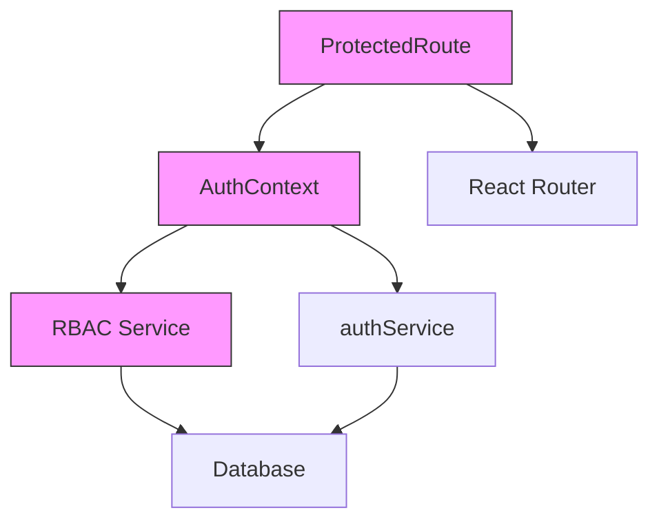
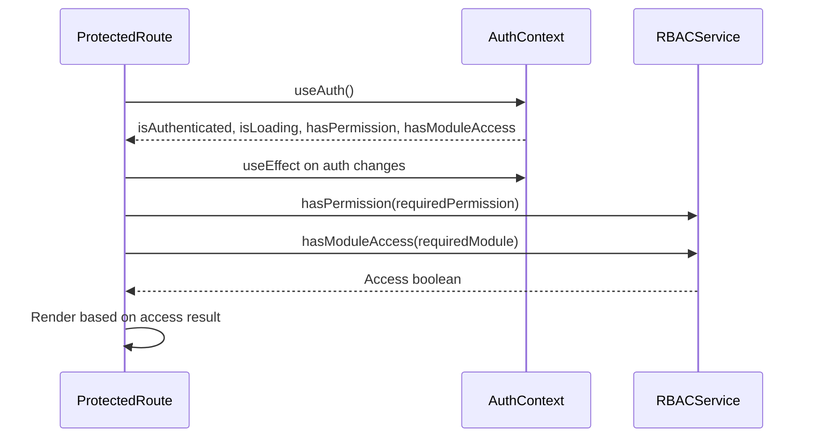
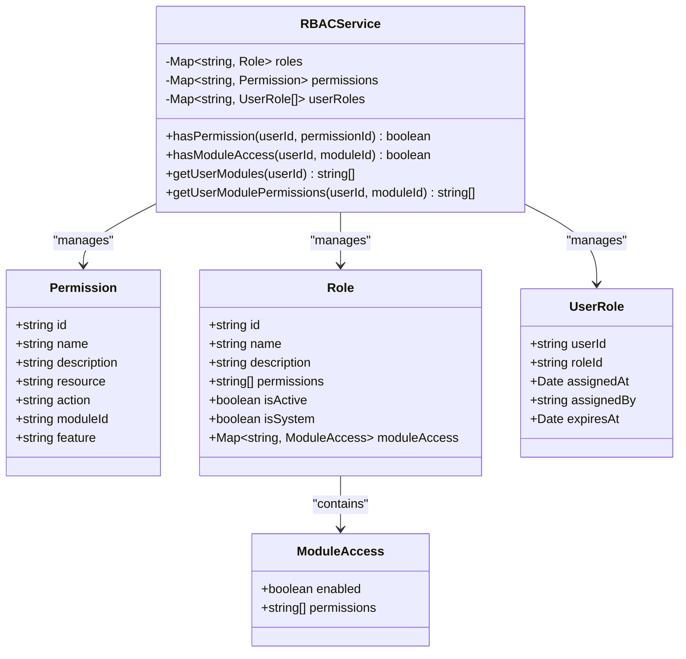
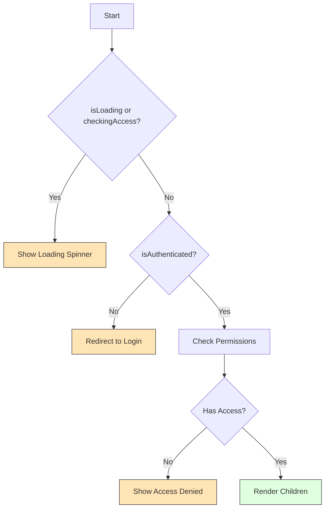
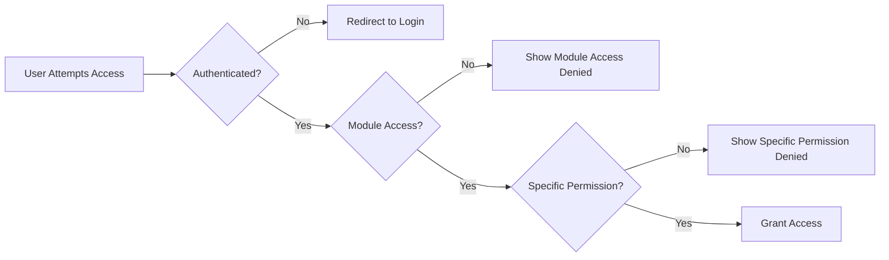

# Route Protection Mechanism

<cite>
**Referenced Files in This Document**   
- [ProtectedRoute.tsx](file://src/components/ProtectedRoute.tsx)
- [AuthContext.tsx](file://src/contexts/AuthContext.tsx)
- [rbacService.ts](file://src/core/rbacService.ts)
- [academics/rbac.ts](file://src/modules/academics/rbac.ts)
- [finance/rbac.ts](file://src/modules/finance/rbac.ts)
- [administration/rbac.ts](file://src/modules/administration/rbac.ts)
- [app.tsx](file://src/app.tsx)
- [AppLegacy.tsx](file://src/AppLegacy.tsx)
</cite>

## Table of Contents
1. [Introduction](#introduction)
2. [Core Architecture](#core-architecture)
3. [ProtectedRoute Component](#protectedroute-component)
4. [Authentication Context Integration](#authentication-context-integration)
5. [RBAC Permission System](#rbac-permission-system)
6. [Rendering Logic and State Management](#rendering-logic-and-state-management)
7. [Integration with React Router](#integration-with-react-router)
8. [Module-Specific Usage Examples](#module-specific-usage-examples)
9. [Common Issues and Solutions](#common-issues-and-solutions)
10. [Best Practices](#best-practices)

## Introduction
The Route Protection Mechanism in schoolpilot3 is a comprehensive security system that ensures only authorized users can access protected application routes. This mechanism combines authentication state management with Role-Based Access Control (RBAC) to provide granular access control across the modular application architecture. The system prevents unauthorized access through redirect behavior, handles loading states appropriately, and provides clear feedback for access denial scenarios.

**Section sources**
- [ProtectedRoute.tsx](file://src/components/ProtectedRoute.tsx#L0-L110)
- [AuthContext.tsx](file://src/contexts/AuthContext.tsx#L0-L38)

## Core Architecture
The route protection system is built on three core components: ProtectedRoute, AuthContext, and the RBAC service. These components work together to provide a robust authorization framework that integrates seamlessly with React Router.



**Diagram sources**
- [ProtectedRoute.tsx](file://src/components/ProtectedRoute.tsx#L0-L110)
- [AuthContext.tsx](file://src/contexts/AuthContext.tsx#L0-L38)
- [rbacService.ts](file://src/core/rbacService.ts#L0-L697)

## ProtectedRoute Component
The ProtectedRoute component serves as a higher-order component that wraps protected routes and enforces access control policies. It evaluates both authentication status and authorization requirements before rendering child components.

### Props Interface
The component accepts the following props:

**ProtectedRouteProps**
- `children`: React.ReactNode - The protected content to render upon successful authorization
- `requiredPermission`: string | undefined - Specific permission ID required to access the route
- `requiredModule`: string | undefined - Module ID that must be accessible to the user
- `fallbackPath`: string - Redirect path when access is denied (defaults to '/login')

```typescript
interface ProtectedRouteProps {
  children: React.ReactNode;
  requiredPermission?: string;
  requiredModule?: string;
  fallbackPath?: string;
}
```

**Section sources**
- [ProtectedRoute.tsx](file://src/components/ProtectedRoute.tsx#L0-L38)

## Authentication Context Integration
The ProtectedRoute component integrates with AuthContext to access the user's authentication state and permission checking methods. AuthContext provides a centralized state management system for authentication-related data.

### AuthContext Type Definition
```typescript
interface AuthContextType {
  user: AuthUser | null;
  isAuthenticated: boolean;
  isLoading: boolean;
  login: (credentials: LoginCredentials) => Promise<AuthResult>;
  logout: () => Promise<void>;
  refreshUser: () => Promise<void>;
  hasPermission: (permissionId: string) => Promise<boolean>;
  hasModuleAccess: (moduleId: string) => Promise<boolean>;
  isDemoMode: boolean;
}
```

The component consumes the following values from AuthContext:
- `isAuthenticated`: Boolean indicating whether the user is currently authenticated
- `isLoading`: Boolean indicating whether authentication state is being initialized
- `hasPermission`: Async function to check specific permission access
- `hasModuleAccess`: Async function to check module-level access



**Diagram sources**
- [ProtectedRoute.tsx](file://src/components/ProtectedRoute.tsx#L0-L110)
- [AuthContext.tsx](file://src/contexts/AuthContext.tsx#L0-L38)

**Section sources**
- [ProtectedRoute.tsx](file://src/components/ProtectedRoute.tsx#L0-L110)
- [AuthContext.tsx](file://src/contexts/AuthContext.tsx#L0-L38)

## RBAC Permission System
The RBAC (Role-Based Access Control) system provides granular permission management across different modules in the application. Each module defines its own set of permissions that can be assigned to user roles.

### Permission Structure
Each permission follows a standardized structure:
- `id`: Unique identifier in the format "module.resource.action"
- `name`: Human-readable name of the permission
- `description`: Detailed description of what the permission allows
- `resource`: The resource being accessed
- `action`: The action being performed (create, read, update, delete, execute)
- `moduleId`: The module to which the permission belongs
- `feature`: Optional feature grouping within the module

### Module-Specific Permissions
Different modules define their own permission sets:

**Academics Module Permissions**
```typescript
{
  id: 'academics.subjects.read',
  name: 'View Subjects',
  resource: 'academics.subjects',
  action: 'read',
  moduleId: 'academics'
}
```

**Finance Module Permissions**
```typescript
{
  id: 'finance.payments.create',
  name: 'Create Payments',
  resource: 'finance.payments',
  action: 'create',
  moduleId: 'finance'
}
```

**Administration Module Permissions**
```typescript
{
  id: 'administration.students.delete',
  name: 'Delete Students',
  resource: 'administration.students',
  action: 'delete',
  moduleId: 'administration'
}
```



**Diagram sources**
- [rbacService.ts](file://src/core/rbacService.ts#L0-L697)
- [academics/rbac.ts](file://src/modules/academics/rbac.ts#L0-L77)
- [finance/rbac.ts](file://src/modules/finance/rbac.ts#L0-L50)
- [administration/rbac.ts](file://src/modules/administration/rbac.ts#L0-L244)

**Section sources**
- [rbacService.ts](file://src/core/rbacService.ts#L0-L697)
- [academics/rbac.ts](file://src/modules/academics/rbac.ts#L0-L77)
- [finance/rbac.ts](file://src/modules/finance/rbac.ts#L0-L50)
- [administration/rbac.ts](file://src/modules/administration/rbac.ts#L0-L244)

## Rendering Logic and State Management
The ProtectedRoute component implements a sophisticated state management system to handle various access scenarios and provide appropriate user feedback.

### State Variables
- `hasAccess`: Tracks whether the user has permission to access the route (null = checking, boolean = result)
- `checkingAccess`: Indicates whether permission checks are in progress

### Rendering States
The component handles four distinct states:

1. **Loading State**: Displayed when authentication state or permissions are being checked
```tsx
if (isLoading || checkingAccess) {
  return <LoadingSpinner message="Checking access..." />;
}
```

2. **Unauthenticated State**: Redirects to login page when user is not authenticated
```tsx
if (!isAuthenticated) {
  return <Navigate to={fallbackPath} state={{ from: location }} replace />;
}
```

3. **Access Denied State**: Shows access denied page when user lacks required permissions
```tsx
if (hasAccess === false) {
  return <AccessDeniedPage requiredPermission={requiredPermission} requiredModule={requiredModule} />;
}
```

4. **Authorized State**: Renders child components when all checks pass
```tsx
return <>{children}</>;
```



**Diagram sources**
- [ProtectedRoute.tsx](file://src/components/ProtectedRoute.tsx#L0-L110)

**Section sources**
- [ProtectedRoute.tsx](file://src/components/ProtectedRoute.tsx#L0-L110)

## Integration with React Router
The ProtectedRoute component is designed to integrate seamlessly with React Router, serving as a wrapper for route elements that require protection.

### Basic Usage Pattern
```tsx
<Route
  path="/dashboard"
  element={
    <ProtectedRoute requiredModule="dashboard" requiredPermission="dashboard.view">
      <Suspense fallback={<LoadingSpinner />}>
        <DashboardPage />
      </Suspense>
    </ProtectedRoute>
  }
/>
```

### Dynamic Route Generation
In modular applications, ProtectedRoute is used programmatically when generating routes:

```tsx
navigationItems.map((route) => (
  <Route
    key={route.path}
    path={route.path}
    element={
      <ProtectedRoute 
        requiredModule={moduleName} 
        requiredPermission={requiredPermission}
      >
        <Suspense fallback={<LoadingSpinner />}>
          <PageComponent />
        </Suspense>
      </ProtectedRoute>
    }
  />
))
```

This pattern is implemented in both app.tsx and AppLegacy.tsx, ensuring consistent protection across the application.

**Section sources**
- [app.tsx](file://src/app.tsx#L91-L129)
- [AppLegacy.tsx](file://src/AppLegacy.tsx#L129-L165)

## Module-Specific Usage Examples
The ProtectedRoute component is used throughout the application to protect module-specific routes based on their unique permission requirements.

### Dashboard Module
```tsx
<Route
  path="/dashboard"
  element={
    <ProtectedRoute 
      requiredModule="dashboard" 
      requiredPermission="dashboard.view"
    >
      <Suspense>
        <DashboardPage />
      </Suspense>
    </ProtectedRoute>
  }
/>
```

### Academics Module
```tsx
<Route
  path="/academics/subjects"
  element={
    <ProtectedRoute 
      requiredModule="academics" 
      requiredPermission="academics.subjects.read"
    >
      <Suspense>
        <SubjectsPage />
      </Suspense>
    </ProtectedRoute>
  }
/>
```

### Finance Module
```tsx
<Route
  path="/finance/payments"
  element={
    <ProtectedRoute 
      requiredModule="finance" 
      requiredPermission="finance.payments.create"
    >
      <Suspense>
        <StudentPaymentsPage />
      </Suspense>
    </ProtectedRoute>
  }
/>
```

### Administration Module
```tsx
<Route
  path="/administration/students"
  element={
    <ProtectedRoute 
      requiredModule="administration" 
      requiredPermission="administration.students.create"
    >
      <Suspense>
        <StudentsListPage />
      </Suspense>
    </ProtectedRoute>
  }
/>
```

These examples demonstrate how the same ProtectedRoute component adapts to different modules by changing the requiredPermission and requiredModule props.

**Section sources**
- [app.tsx](file://src/app.tsx#L91-L129)
- [AppLegacy.tsx](file://src/AppLegacy.tsx#L129-L165)
- [app.tsx](file://src/app.tsx#L205-L242)

## Common Issues and Solutions
The route protection system may encounter several common issues that require specific solutions.

### Flash of Unauthenticated Content
**Issue**: Brief display of protected content before redirection occurs.
**Solution**: Ensure isLoading state is properly managed in AuthContext and maintained until authentication state is confirmed.

### Infinite Redirect Loops
**Issue**: Continuous redirection between login and protected routes.
**Solution**: Verify that the login route is not wrapped in ProtectedRoute and that the fallbackPath is correctly set.

### Permission Check Timing Problems
**Issue**: Delayed permission checks causing temporary access denial.
**Solution**: Implement proper loading states and consider caching permission results for the session duration.

### Module Access Conflicts
**Issue**: Users having module access but lacking specific permissions.
**Solution**: Implement hierarchical permission checking where module access is required before specific permission checks.



**Diagram sources**
- [ProtectedRoute.tsx](file://src/components/ProtectedRoute.tsx#L0-L110)

**Section sources**
- [ProtectedRoute.tsx](file://src/components/ProtectedRoute.tsx#L0-L110)

## Best Practices
Implementing effective route protection requires adherence to several best practices.

### Implementation Guidelines
1. **Consistent Permission Naming**: Use the standardized format "module.resource.action" for all permissions
2. **Granular Permissions**: Define specific permissions rather than broad ones to enable fine-grained control
3. **Default Deny**: Assume access is denied unless explicitly granted
4. **Loading State Management**: Always handle loading states to prevent race conditions
5. **Error Handling**: Implement proper error handling for permission checks

### Performance Optimization
- **Cache Permission Results**: Store permission check results to avoid repeated database queries
- **Batch Permission Checks**: When multiple permissions are required, check them in a single operation
- **Lazy Loading**: Combine ProtectedRoute with React.lazy and Suspense for optimal performance

### Security Considerations
- **Never Trust Client-Side Checks**: Always validate permissions on the server side as well
- **Regular Permission Audits**: Periodically review permission assignments and access logs
- **Principle of Least Privilege**: Assign only the minimum permissions necessary for a user's role

### Testing Strategies
- **Unit Test Permission Logic**: Verify that permission checking functions work correctly
- **Integration Test Route Protection**: Test the complete flow from unauthenticated state to authorized access
- **Edge Case Testing**: Test scenarios like expired sessions, revoked permissions, and role changes during active sessions

**Section sources**
- [ProtectedRoute.tsx](file://src/components/ProtectedRoute.tsx#L0-L110)
- [AuthContext.tsx](file://src/contexts/AuthContext.tsx#L0-L38)
- [rbacService.ts](file://src/core/rbacService.ts#L0-L697)