# Configuration System

<cite>
**Referenced Files in This Document**
- [unifiedConfig.ts](file://src/config/unifiedConfig.ts)
- [UnifiedConfigContext.tsx](file://src/contexts/UnifiedConfigContext.tsx)
- [environmentMatrix.ts](file://src/config/environmentMatrix.ts)
- [environmentRuntime.ts](file://src/config/environmentRuntime.ts)
- [dataModePolicies.ts](file://src/config/dataModePolicies.ts)
- [databaseConfigRuntime.ts](file://src/config/databaseConfigRuntime.ts)
- [databaseConfigSchema.ts](file://src/config/databaseConfigSchema.ts)
- [databaseEnvVars.ts](file://src/config/databaseEnvVars.ts)
- [productionDemo.ts](file://src/config/productionDemo.ts)
- [backendArchitecture.ts](file://src/config/backendArchitecture.ts)
- [ConfigurationMigration.ts](file://src/config/ConfigurationMigration.ts)
- [deployment.ts](file://src/config/deployment.ts)
- [DEPLOYMENT_SPECIFICATION.md](file://docs/architecture/deployment-modes/DEPLOYMENT_SPECIFICATION.md)
- [setup-self-hosted.cjs](file://scripts/setup-self-hosted.cjs)
- [database-config.example.json](file://public/database-config.example.json)
- [backend-api-config.example.ts](file://src/config/examples/backend-api-config.example.ts)
- [LANServer.ts](file://src/server/LANServer.ts)
</cite>

## Update Summary
**Changes Made**
- Added comprehensive documentation for the new ConfigurationMigration system with versioned migration support
- Documented template-based configuration files for hybrid, LAN sync, and standalone deployments
- Enhanced unified configuration framework with environment-specific templates and deployment mode integration
- Updated database configuration management with migration capabilities and template support
- Added LAN server integration for networked deployment mode with auto-discovery capabilities
- Enhanced deployment mode templates with comprehensive configuration examples and setup procedures

## Table of Contents
1. [Introduction](#introduction)
2. [Core Architecture](#core-architecture)
3. [Unified Configuration Manager](#unified-configuration-manager)
4. [Configuration Migration System](#configuration-migration-system)
5. [Environment Runtime Detection](#environment-runtime-detection)
6. [Database Configuration Runtime](#database-configuration-runtime)
7. [Database Configuration Schema Validation](#database-configuration-schema-validation)
8. [Environment Matrix System](#environment-matrix-system)
9. [Data Mode Policies](#data-mode-policies)
10. [Production Demo Configuration](#production-demo-configuration)
11. [Context Propagation Mechanism](#context-propagation-mechanism)
12. [Feature Flag Implementation](#feature-flag-implementation)
13. [Backend Architecture Configuration](#backend-architecture-configuration)
14. [Deployment Mode Templates](#deployment-mode-templates)
15. [LAN Server Integration](#lan-server-integration)
16. [Practical Examples](#practical-examples)
17. [Common Issues and Troubleshooting](#common-issues-and-troubleshooting)
18. [Best Practices](#best-practices)

## Introduction

The unified configuration system in schoolpilot3 serves as the single source of truth for application settings across all environments. This comprehensive framework governs feature availability, environment-specific behavior, data mode policies, and database configuration management. The system has been significantly enhanced with modular architecture components that provide runtime environment detection, database configuration management, production demo capabilities, deployment mode templates, and a robust configuration migration system.

The enhanced configuration system addresses several critical requirements:
- Centralized management of application settings with modular architecture
- Runtime environment detection and optimal configuration recommendations
- Database configuration management with environment variable support and migration capabilities
- Comprehensive database schema validation and repair capabilities
- Production demo configuration and lifecycle management
- Environment-specific configuration overrides and policies
- Real-time configuration access across components
- Feature flag management for gradual rollouts
- Backend architecture preferences and deployment-specific integration
- Deployment mode templates for hybrid, LAN sync, and standalone configurations
- Configuration migration system for versioned upgrades and data preservation
- Template-based configuration files for streamlined deployment setup

This document provides a comprehensive overview of the enhanced unified configuration system, detailing its modular architecture, implementation patterns, deployment templates, configuration migration capabilities, and usage across different deployment environments.

**Section sources**
- [unifiedConfig.ts](file://src/config/unifiedConfig.ts)
- [UnifiedConfigContext.tsx](file://src/contexts/UnifiedConfigContext.tsx)

## Core Architecture

The unified configuration system follows a modular layered architecture with clear separation of concerns. The system is built around the `UnifiedConfigManager` class, which serves as the central authority for configuration state, integrated with specialized modules for environment detection, database management, production demo handling, deployment mode templates, and configuration migration.

```mermaid
graph TD
A[UnifiedConfigManager] --> B[Environment Runtime Detection]
A --> C[Database Configuration Runtime]
A --> D[Database Schema Validation]
A --> E[Environment Matrix]
A --> F[Data Mode Policies]
A --> G[Production Demo Management]
A --> H[Backend Architecture]
A --> I[Deployment Mode Templates]
A --> J[Configuration Migration System]
B --> K[detectOptimalConfigurationRuntime]
C --> L[loadDatabaseConfigFromEnvironment]
C --> M[loadDatabaseConfigFromFile]
C --> N[applyDatabaseConfigPreset]
D --> O[DatabaseConfigValidator]
E --> P[Environment Detection]
F --> Q[Data Mode Switching]
G --> R[Production Demo State]
H --> S[Backend Type Detection]
I --> T[Hybrid Deployment Config]
I --> U[LANSync Deployment Config]
I --> V[Standalone Deployment Config]
J --> W[ConfigurationMigration]
J --> X[Version Migration]
J --> Y[Template Processing]
A --> Z[Configuration Storage]
Z --> AA[localStorage]
A --> AB[Event System]
AB --> AC[Configuration Listeners]
```

**Diagram sources**
- [unifiedConfig.ts](file://src/config/unifiedConfig.ts)
- [environmentRuntime.ts](file://src/config/environmentRuntime.ts)
- [databaseConfigRuntime.ts](file://src/config/databaseConfigRuntime.ts)
- [databaseConfigSchema.ts](file://src/config/databaseConfigSchema.ts)
- [environmentMatrix.ts](file://src/config/environmentMatrix.ts)
- [dataModePolicies.ts](file://src/config/dataModePolicies.ts)
- [productionDemo.ts](file://src/config/productionDemo.ts)
- [backendArchitecture.ts](file://src/config/backendArchitecture.ts)
- [ConfigurationMigration.ts](file://src/config/ConfigurationMigration.ts)
- [DEPLOYMENT_SPECIFICATION.md](file://docs/architecture/deployment-modes/DEPLOYMENT_SPECIFICATION.md)

**Section sources**
- [unifiedConfig.ts](file://src/config/unifiedConfig.ts)
- [environmentRuntime.ts](file://src/config/environmentRuntime.ts)
- [databaseConfigRuntime.ts](file://src/config/databaseConfigRuntime.ts)
- [databaseConfigSchema.ts](file://src/config/databaseConfigSchema.ts)

## Unified Configuration Manager

The `UnifiedConfigManager` class is the central component of the enhanced configuration system, implemented as a singleton to ensure a single source of truth throughout the application. This manager handles configuration persistence, updates, validation, and event propagation across all configuration modules.

### Enhanced Configuration Structure

The `UnifiedAppConfig` interface defines the complete configuration structure with enhanced database configuration management, production demo integration, deployment mode templates, and configuration migration capabilities:

- **Core Configuration**: Environment, data mode, and enhanced features flag
- **Environment Integration**: Current environment and configuration with runtime detection
- **Enhanced Database Configuration**: Comprehensive database settings with validation and migration support
- **Production Demo Integration**: Complete production demo state and management
- **Feature Flags**: Comprehensive feature toggle system with module-specific controls
- **Development Configuration**: Debug settings and log levels
- **Backend Architecture**: Flexible backend integration options with deployment templates
- **Deployment Mode Templates**: Pre-configured deployment strategies for different environments
- **Configuration Migration**: Version tracking and migration capabilities for configuration upgrades

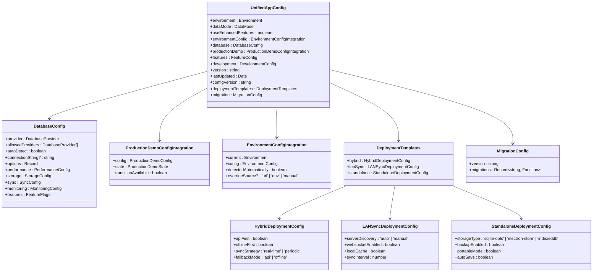

**Diagram sources**
- [unifiedConfig.ts:146-235](file://src/config/unifiedConfig.ts#L146-L235)
- [ConfigurationMigration.ts:27-30](file://src/config/ConfigurationMigration.ts#L27-L30)
- [DEPLOYMENT_SPECIFICATION.md:22-121](file://docs/architecture/deployment-modes/DEPLOYMENT_SPECIFICATION.md#L22-L121)
- [DEPLOYMENT_SPECIFICATION.md:124-267](file://docs/architecture/deployment-modes/DEPLOYMENT_SPECIFICATION.md#L124-L267)
- [DEPLOYMENT_SPECIFICATION.md:271-398](file://docs/architecture/deployment-modes/DEPLOYMENT_SPECIFICATION.md#L271-L398)

**Section sources**
- [unifiedConfig.ts:146-235](file://src/config/unifiedConfig.ts#L146-L235)

### Manager Implementation Enhancements

The `UnifiedConfigManager` class implements several key enhancements:

- **Modular Architecture**: Integrates with specialized modules for different configuration aspects
- **Runtime Detection**: Uses environment runtime detection for optimal feature recommendations
- **Database Management**: Comprehensive database configuration management with validation and migration support
- **Production Demo**: Full production demo lifecycle management
- **Deployment Templates**: Integrated deployment mode configuration templates
- **Configuration Migration**: Handles version upgrades and data migration across modules
- **Template Processing**: Supports template-based configuration files for streamlined deployment
- **Deep Merging**: Ensures new feature flags are included when loading stored configurations

The manager's constructor initializes the configuration by first attempting to load from localStorage, then applying defaults, and finally processing URL parameter overrides and environment variable configurations.

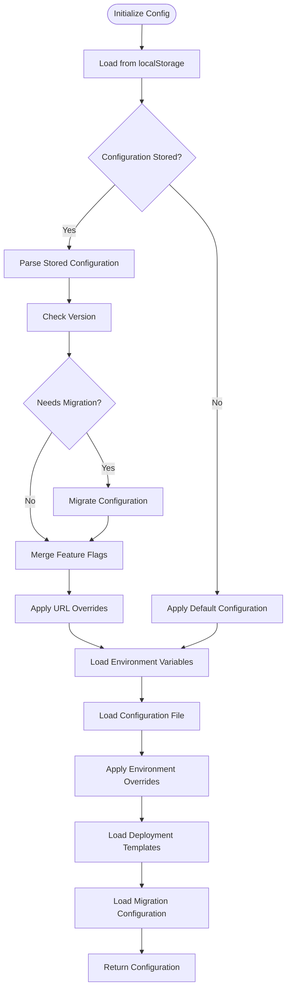

**Diagram sources**
- [unifiedConfig.ts:665-761](file://src/config/unifiedConfig.ts#L665-L761)

**Section sources**
- [unifiedConfig.ts:665-761](file://src/config/unifiedConfig.ts#L665-L761)

## Configuration Migration System

The ConfigurationMigration system provides comprehensive version management and migration capabilities for configuration schemas. This system ensures seamless upgrades between configuration versions while preserving user data and settings.

### Migration Architecture

The `ConfigurationMigration` class implements a robust migration framework with version tracking, step-by-step migration execution, and comprehensive validation:

- **Version Tracking**: Maintains current configuration version and migration history
- **Step-based Migration**: Executes migrations in discrete steps with rollback support
- **Dry-run Mode**: Allows previewing migration effects without applying changes
- **Template Processing**: Supports template-based configuration file processing
- **Validation Integration**: Validates migrated configurations against current schema requirements
- **Error Handling**: Provides detailed error reporting and recovery mechanisms

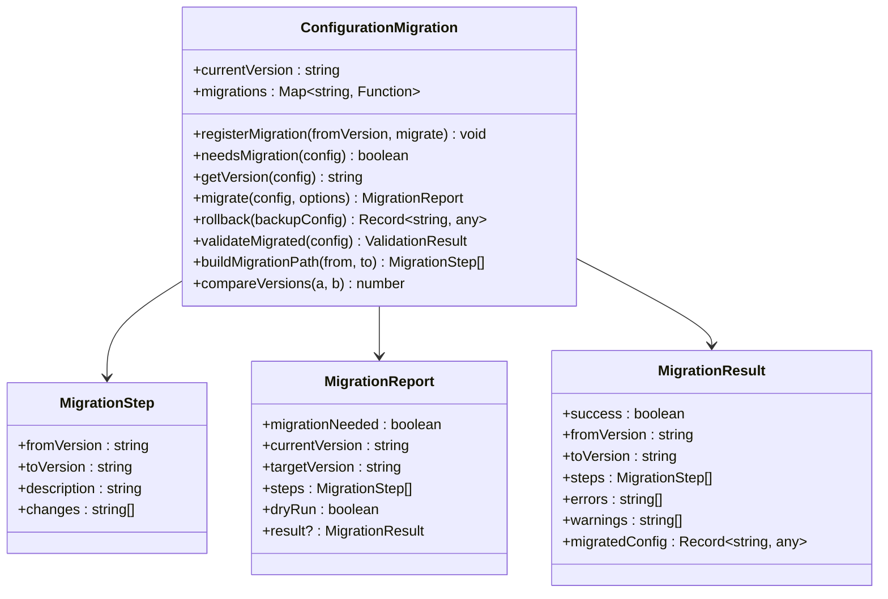

**Diagram sources**
- [ConfigurationMigration.ts:44-51](file://src/config/ConfigurationMigration.ts#L44-L51)
- [ConfigurationMigration.ts:10-15](file://src/config/ConfigurationMigration.ts#L10-L15)
- [ConfigurationMigration.ts:32-39](file://src/config/ConfigurationMigration.ts#L32-L39)
- [ConfigurationMigration.ts:17-25](file://src/config/ConfigurationMigration.ts#L17-L25)

**Section sources**
- [ConfigurationMigration.ts:44-176](file://src/config/ConfigurationMigration.ts#L44-L176)

### Migration Steps and Version Chain

The system supports a structured migration path with predefined version transitions:

- **Version 1.0.0 → 1.1.0**: Nested configuration structure migration
- **Version 1.1.0 → 1.2.0**: Feature flags and monitoring configuration addition
- **Version 1.2.0 → 2.0.0**: Deployment scenarios and hybrid provider configuration
- **Version 2.0.0 → 2.1.0**: Capability-based provider selection and monitoring enhancements

Each migration step includes detailed change descriptions and validation requirements.

**Section sources**
- [ConfigurationMigration.ts:228-261](file://src/config/ConfigurationMigration.ts#L228-L261)
- [ConfigurationMigration.ts:263-342](file://src/config/ConfigurationMigration.ts#L263-L342)

### Migration Execution and Validation

The migration system provides comprehensive execution and validation capabilities:

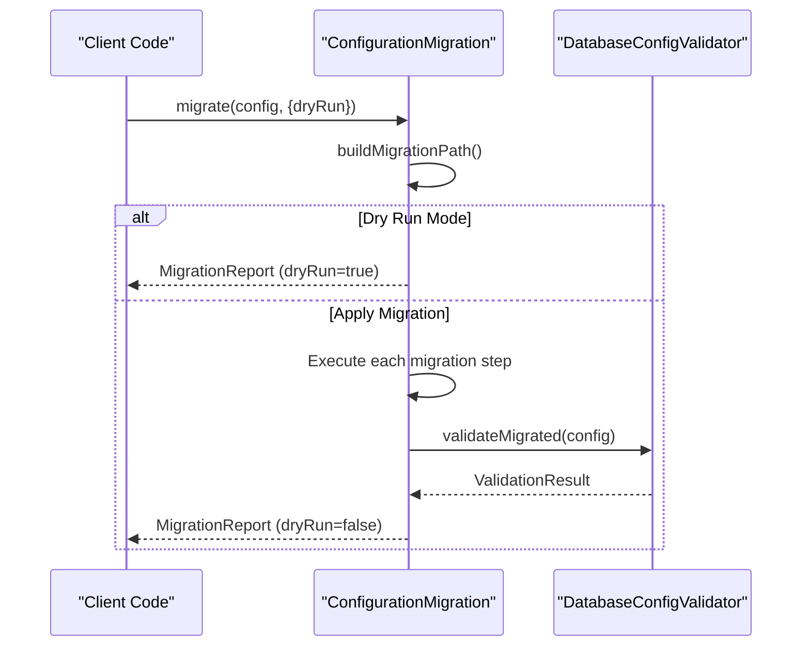

**Diagram sources**
- [ConfigurationMigration.ts:78-146](file://src/config/ConfigurationMigration.ts#L78-L146)
- [databaseConfigSchema.ts:158-176](file://src/config/databaseConfigSchema.ts#L158-L176)

**Section sources**
- [ConfigurationMigration.ts:78-146](file://src/config/ConfigurationMigration.ts#L78-L146)

## Environment Runtime Detection

The environment runtime detection system provides optimal configuration recommendations based on the current runtime environment capabilities and deployment context.

### Runtime Configuration Detection

The `detectOptimalConfigurationRuntime` function analyzes the current runtime environment to determine optimal feature configurations:

- **Service Worker Support**: Determines if service workers are available for offline capabilities
- **IndexedDB Support**: Checks for IndexedDB availability for client-side database operations
- **Network Connectivity**: Assesses online/offline status for real-time features
- **Production Environment**: Identifies production deployment for performance optimizations

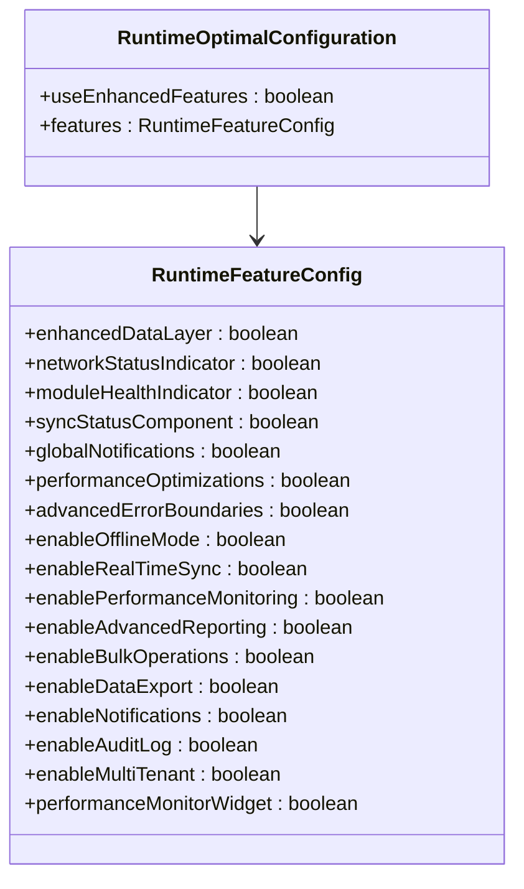

**Diagram sources**
- [environmentRuntime.ts:24-27](file://src/config/environmentRuntime.ts#L24-L27)

**Section sources**
- [environmentRuntime.ts:29-57](file://src/config/environmentRuntime.ts#L29-L57)

### Integration with Unified Configuration

The runtime detection integrates seamlessly with the unified configuration system:

- **Automatic Detection**: Runtime configuration is automatically detected during initialization
- **Environment-Based Defaults**: Provides environment-specific feature recommendations
- **Backward Compatibility**: Maintains compatibility with existing configuration patterns
- **Dynamic Updates**: Allows runtime configuration updates based on changing conditions

**Section sources**
- [unifiedConfig.ts:1644-1646](file://src/config/unifiedConfig.ts#L1644-L1646)

## Database Configuration Runtime

The database configuration runtime system provides comprehensive management of database configuration through environment variables, configuration files, and template processing.

### Environment Variable Configuration

The `loadDatabaseConfigFromEnvironment` function processes environment variables for database configuration:

- **Provider Selection**: Configures database provider from environment variables
- **Connection String**: Processes database connection strings with validation
- **Performance Settings**: Configures caching, indexing, and query optimization
- **Storage Configuration**: Manages storage limits, compression, and encryption
- **Sync Settings**: Configures synchronization intervals and conflict resolution
- **Monitoring**: Sets up health checks, performance metrics, and error reporting
- **Feature Flags**: Controls database-specific feature availability

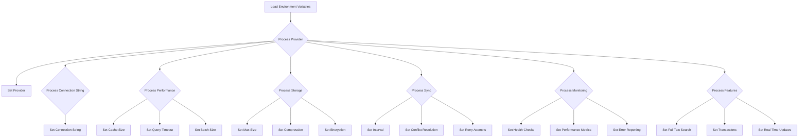

**Diagram sources**
- [databaseConfigRuntime.ts:77-247](file://src/config/databaseConfigRuntime.ts#L77-L247)

**Section sources**
- [databaseConfigRuntime.ts:77-247](file://src/config/databaseConfigRuntime.ts#L77-L247)

### Configuration File Support

The system supports configuration files for database settings with template processing capabilities:

- **File Loading**: Asynchronously loads database configuration from `/database-config.json`
- **Template Processing**: Processes template-based configuration files with environment variable substitution
- **Fallback Handling**: Graceful handling when configuration file is not present
- **Merge Strategy**: Combines file configuration with environment variable overrides
- **Validation**: Validates loaded configuration against schema requirements

**Section sources**
- [databaseConfigRuntime.ts:250-265](file://src/config/databaseConfigRuntime.ts#L250-L265)

### Environment Variable Registry

The system maintains a comprehensive registry of database-related environment variables:

- **Provider Variables**: `REACT_APP_DATABASE_PROVIDER`, `REACT_APP_DATABASE_AUTO_DETECT`
- **Connection Variables**: `REACT_APP_DATABASE_URL`, `REACT_APP_DATABASE_NAME`
- **Performance Variables**: `REACT_APP_DATABASE_CACHE_SIZE`, `REACT_APP_DATABASE_QUERY_TIMEOUT`
- **Storage Variables**: `REACT_APP_DATABASE_MAX_SIZE`, `REACT_APP_DATABASE_COMPRESSION`
- **Sync Variables**: `REACT_APP_DATABASE_SYNC_INTERVAL`, `REACT_APP_DATABASE_SYNC_RETRY_ATTEMPTS`
- **Monitoring Variables**: `REACT_APP_DATABASE_HEALTH_CHECK_INTERVAL`, `REACT_APP_DATABASE_LOG_LEVEL`
- **Feature Variables**: `REACT_APP_DATABASE_FULL_TEXT_SEARCH`, `REACT_APP_DATABASE_TRANSACTIONS`

**Section sources**
- [databaseEnvVars.ts:4-40](file://src/config/databaseEnvVars.ts#L4-L40)

## Database Configuration Schema Validation

The database configuration schema validation system provides comprehensive validation, auto-fix capabilities, and configuration migration support.

### Validation Rules System

The system implements a comprehensive validation rule system with severity levels:

- **Provider Validation**: Validates database provider against allowed values
- **Performance Validation**: Ensures performance settings are within acceptable ranges
- **Storage Validation**: Validates storage limits and retention policies
- **Sync Validation**: Checks synchronization settings for optimal operation
- **Monitoring Validation**: Validates monitoring configuration and logging levels
- **API Configuration Validation**: Validates external API endpoint configurations

```mermaid
classDiagram
class DatabaseConfigValidator {
+rules : ValidationRule[]
+migrations : ConfigurationMigration[]
+validate(config) ValidationResult
+autoFix(config) {fixed, changes}
+migrate(config, version) {migrated, appliedMigrations}
+repair(config, version) {repaired, changes, migrations}
+resetToDefaults(environment) any
}
class ValidationRule {
+field : string
+validator : Function
+message : string
+severity : 'error' | 'warning' | 'info'
+autoFix? : Function
}
class ValidationResult {
+isValid : boolean
+errors : ValidationError[]
+warnings : ValidationWarning[]
+info : ValidationInfo[]
+canAutoFix : boolean
+autoFixAvailable : string[]
}
DatabaseConfigValidator --> ValidationRule
DatabaseConfigValidator --> ValidationResult
```

**Diagram sources**
- [databaseConfigSchema.ts:304-359](file://src/config/databaseConfigSchema.ts#L304-L359)

**Section sources**
- [databaseConfigSchema.ts:54-200](file://src/config/databaseConfigSchema.ts#L54-L200)

### Migration System

The system provides comprehensive configuration migration support with integration to the ConfigurationMigration system:

- **Version Tracking**: Tracks configuration versions for migration purposes
- **Automated Migration**: Applies migrations automatically when upgrading
- **Validation Integration**: Validates migrated configurations
- **Rollback Support**: Provides rollback capabilities for failed migrations
- **Template Processing**: Supports migration of template-based configurations

**Section sources**
- [databaseConfigSchema.ts:202-299](file://src/config/databaseConfigSchema.ts#L202-L299)

### Auto-Fix and Repair Capabilities

The system offers automated configuration repair with enhanced migration integration:

- **Auto-Fix**: Automatically corrects configuration issues based on validation rules
- **Repair Process**: Combines migration and auto-fix for comprehensive repair
- **Change Tracking**: Tracks all changes made during repair process
- **Validation Feedback**: Provides feedback on repair success and remaining issues

**Section sources**
- [databaseConfigSchema.ts:467-491](file://src/config/databaseConfigSchema.ts#L467-L491)

## Environment Matrix System

The environment matrix system defines environment-specific configurations and policies, ensuring appropriate behavior for development, staging, and production environments.

### Enhanced Environment Configuration

The `EnvironmentConfig` interface defines comprehensive environment configurations:

- **Allowed Data Modes**: Specifies which data modes are permitted
- **Default Data Mode**: Sets the default mode for the environment
- **Allowed Database Providers**: Defines permitted database providers
- **Default Database Provider**: Sets the default provider
- **Data Mode Switching**: Controls whether mode switching is allowed
- **Confirmation Requirements**: Specifies if user confirmation is needed
- **Feature Flags**: Environment-specific feature configurations

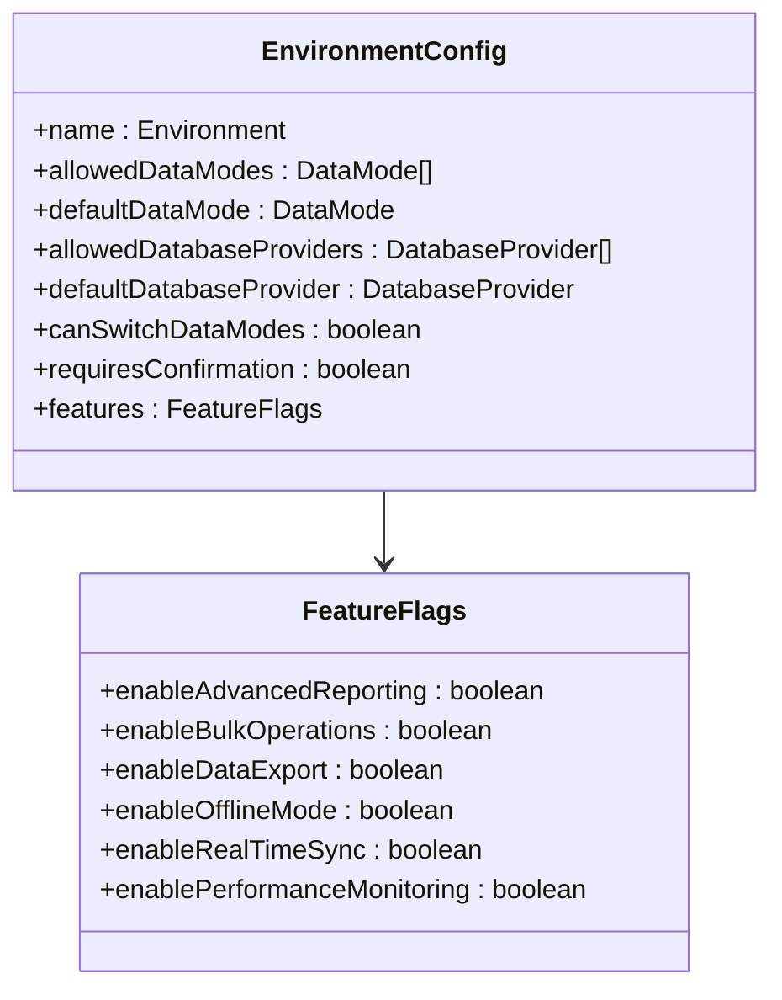

**Diagram sources**
- [environmentMatrix.ts:12-28](file://src/config/environmentMatrix.ts#L12-L28)

**Section sources**
- [environmentMatrix.ts:12-28](file://src/config/environmentMatrix.ts#L12-L28)

### Environment Detection Enhancement

The system enhances environment detection with runtime capabilities:

- **Production Detection**: Enhanced detection for production environments
- **Staging Detection**: Improved staging environment identification
- **Development Detection**: Optimized development environment detection
- **Environment Variable Override**: Support for environment variable overrides
- **URL Parameter Override**: Runtime environment override via URL parameters

**Section sources**
- [environmentMatrix.ts:85-112](file://src/config/environmentMatrix.ts#L85-L112)

## Data Mode Policies

The data mode policies system governs data strategy selection, controlling whether the application operates in demo mode or production mode with enhanced validation and switching capabilities.

### Enhanced Data Mode State

The `DataModeState` interface provides comprehensive information about the current data mode:

- **Current Mode**: The active data mode
- **Available Modes**: Modes permitted in the current environment
- **Switching Capability**: Whether mode switching is allowed
- **Confirmation Requirement**: Whether user confirmation is needed
- **Last Switched**: Timestamp of the last mode switch

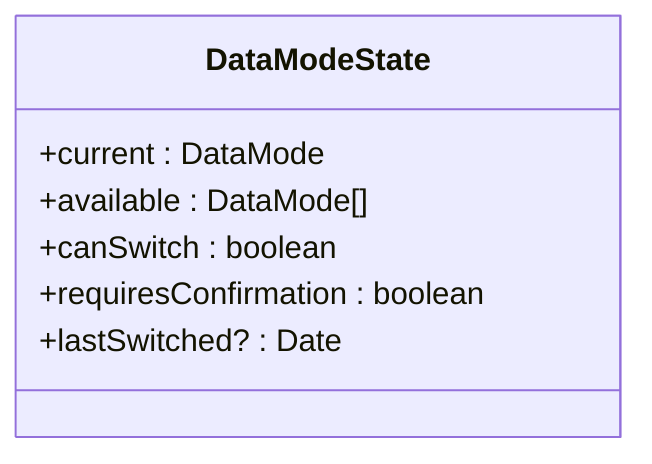

**Diagram sources**
- [dataModePolicies.ts:19-25](file://src/config/dataModePolicies.ts#L19-L25)

**Section sources**
- [dataModePolicies.ts:19-25](file://src/config/dataModePolicies.ts#L19-L25)

### Enhanced Switching Logic

The data mode switching process includes comprehensive validation and error handling:

1. Validate the requested mode against environment permissions
2. Check if switching is allowed in the current environment
3. Determine if user confirmation is required
4. Store the new mode in localStorage with timestamp
5. Update configuration state and notify listeners
6. Handle errors gracefully with detailed error messages

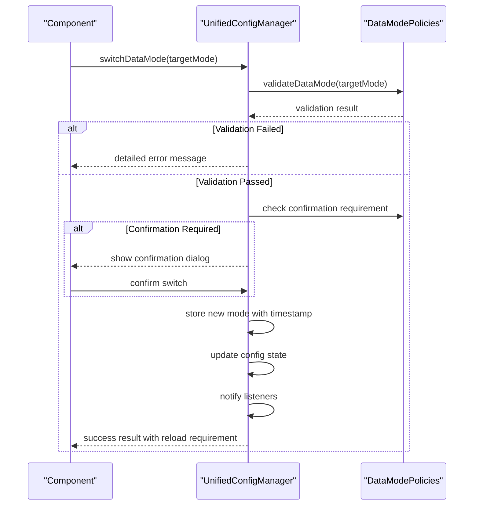

**Diagram sources**
- [dataModePolicies.ts:107-162](file://src/config/dataModePolicies.ts#L107-L162)
- [unifiedConfig.ts:816-843](file://src/config/unifiedConfig.ts#L816-L843)

**Section sources**
- [dataModePolicies.ts:107-162](file://src/config/dataModePolicies.ts#L107-L162)
- [unifiedConfig.ts:816-843](file://src/config/unifiedConfig.ts#L816-L843)

## Production Demo Configuration

The production demo configuration system manages production demo capabilities and provides complete lifecycle management for demo sessions.

### Production Demo State Management

The `ProductionDemoState` interface provides comprehensive state management for production demos:

- **Active Status**: Indicates if demo session is currently active
- **Session Information**: Session ID, start time, and expiry time
- **Transition Capability**: Whether transition to live mode is allowed
- **Data Management**: Data clearing status and user count tracking
- **Configuration Integration**: Seamless integration with unified configuration

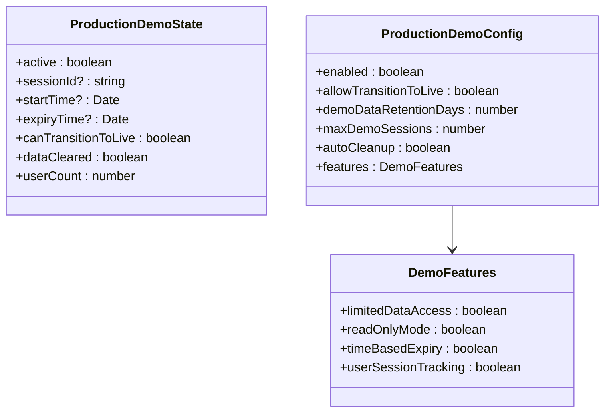

**Diagram sources**
- [productionDemo.ts:24-32](file://src/config/productionDemo.ts#L24-L32)
- [productionDemo.ts:9-21](file://src/config/productionDemo.ts#L9-L21)

**Section sources**
- [productionDemo.ts:24-32](file://src/config/productionDemo.ts#L24-L32)
- [productionDemo.ts:9-21](file://src/config/productionDemo.ts#L9-L21)

### Demo Lifecycle Management

The system provides comprehensive demo lifecycle management:

- **Session Initialization**: Creates new demo sessions with unique IDs
- **Session Expiration**: Automatic expiration based on configured duration
- **Transition Management**: Controlled transition from demo to live mode
- **Data Cleanup**: Automated cleanup of demo data and sessions
- **Session Tracking**: User session tracking and management

**Section sources**
- [productionDemo.ts:135-194](file://src/config/productionDemo.ts#L135-L194)
- [productionDemo.ts:197-252](file://src/config/productionDemo.ts#L197-L252)

## Context Propagation Mechanism

The UnifiedConfigContext provides React context integration, enabling real-time configuration access across components with enhanced capabilities for the unified configuration system.

### Enhanced Context Implementation

The `UnifiedConfigProvider` component provides comprehensive configuration management through React context:

- **Configuration State**: Full configuration state with loading and error handling
- **Backend Status Management**: Real-time backend status monitoring and updates
- **Enhanced Data Mode Management**: Complete data mode switching with validation
- **Environment Management**: Dynamic environment switching with validation
- **Database Provider Management**: Comprehensive database provider configuration
- **Production Demo Management**: Full production demo lifecycle management
- **Deployment Template Management**: Access to deployment mode templates
- **Configuration Migration Management**: Integration with migration system
- **Legacy Compatibility**: Maintains backward compatibility with existing components

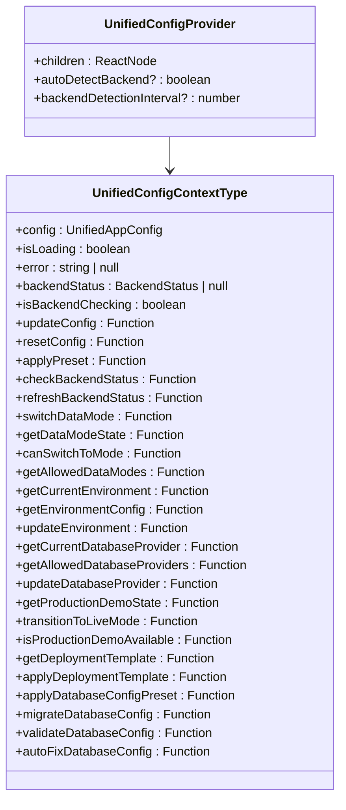

**Diagram sources**
- [UnifiedConfigContext.tsx:35-93](file://src/contexts/UnifiedConfigContext.tsx#L35-L93)

**Section sources**
- [UnifiedConfigContext.tsx:35-93](file://src/contexts/UnifiedConfigContext.tsx#L35-L93)

### Enhanced Hook System

The context provides an extensive hook system for different use cases:

- **useUnifiedConfig**: Full context access with enhanced configuration management
- **useConfig**: Configuration state only with enhanced features
- **useBackendStatus**: Backend status with enhanced monitoring capabilities
- **useDataMode**: Data mode management with validation and error handling
- **useEnvironment**: Environment management with runtime detection
- **useDatabaseProvider**: Database provider management with validation
- **useProductionDemo**: Production demo management with lifecycle control
- **useConfigManagement**: Comprehensive configuration access with enhanced capabilities
- **useDeploymentTemplates**: Access to deployment mode templates and configuration
- **useConfigurationMigration**: Integration with configuration migration system

**Section sources**
- [UnifiedConfigContext.tsx:432-481](file://src/contexts/UnifiedConfigContext.tsx#L432-L481)

## Feature Flag Implementation

The feature flag system enables gradual rollouts and controlled feature activation with enhanced module-specific controls.

### Enhanced Tabbed Mode Configuration

The tabbed mode feature is configured through an enhanced hierarchical system:

- **Global Enable/Disable**: Overall feature toggle with enhanced controls
- **Per-Module Control**: Module-specific overrides with comprehensive coverage
- **Development vs Production**: Different configurations for different environments
- **Feature Flag Management**: Comprehensive feature flag lifecycle management

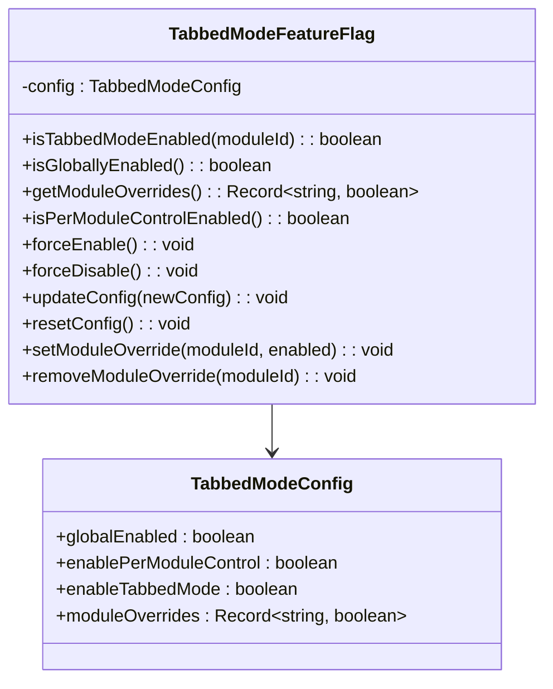

**Diagram sources**
- [tabbedModeFeatureFlag.ts:10-50](file://src/services/tabbedModeFeatureFlag.ts#L10-L50)
- [tabbedModeConfig.ts:10-50](file://src/config/tabbedModeConfig.ts#L10-L50)

**Section sources**
- [tabbedModeFeatureFlag.ts:10-50](file://src/services/tabbedModeFeatureFlag.ts#L10-L50)
- [tabbedModeConfig.ts:10-50](file://src/config/tabbedModeConfig.ts#L10-L50)

### Enhanced Evaluation Logic

The feature flag evaluation follows an enhanced priority order:

1. If global flag is disabled, feature is off everywhere
2. If per-module control is disabled, use global setting
3. Check for module-specific override
4. Default to global setting if no override
5. Enhanced validation and error handling

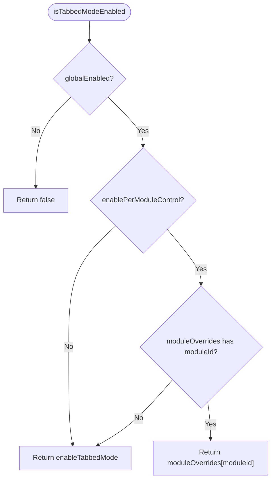

**Diagram sources**
- [tabbedModeFeatureFlag.ts:50-100](file://src/services/tabbedModeFeatureFlag.ts#L50-L100)

**Section sources**
- [tabbedModeFeatureFlag.ts:50-100](file://src/services/tabbedModeFeatureFlag.ts#L50-L100)

## Backend Architecture Configuration

The backend architecture system supports multiple backend scenarios with intelligent routing and enhanced configuration management.

### Enhanced Backend Types

The system supports four enhanced backend types:

- **Frontend-only**: PouchDB (client) + CouchDB (server) for direct database sync
- **Frappe Education**: ERPNext Education module API integration with comprehensive capabilities
- **Custom API**: Custom backend server with custom APIs and flexible configuration
- **Hybrid**: Mix of direct database access and API calls with intelligent routing

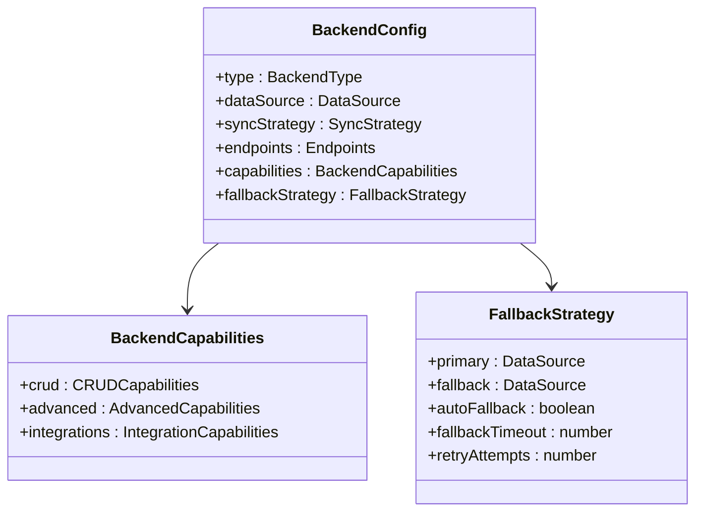

**Diagram sources**
- [backendArchitecture.ts:19-30](file://src/config/backendArchitecture.ts#L19-L30)

**Section sources**
- [backendArchitecture.ts:19-30](file://src/config/backendArchitecture.ts#L19-L30)

### Enhanced Function Routing

The system uses enhanced function routing to determine the appropriate data source:

- **Frontend-only Functions**: Work with PouchDB/CouchDB only with comprehensive coverage
- **API-required Functions**: Require full backend API with advanced capabilities
- **Hybrid Functions**: Can work with both, using intelligent routing with fallback support
- **Backend Availability**: Dynamic backend availability detection and routing decisions

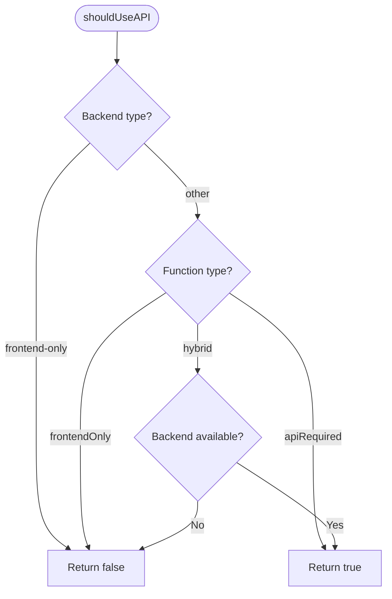

**Diagram sources**
- [backendArchitecture.ts:362-387](file://src/config/backendArchitecture.ts#L362-L387)

**Section sources**
- [backendArchitecture.ts:362-387](file://src/config/backendArchitecture.ts#L362-L387)

## Deployment Mode Templates

The deployment mode templates system provides pre-configured deployment strategies for different school environments and technical capabilities. This system supports six distinct deployment modes, each optimized for specific use cases and infrastructure requirements.

### Hybrid Deployment Configuration

Hybrid deployment combines API-first and offline-first strategies for maximum flexibility and reliability:

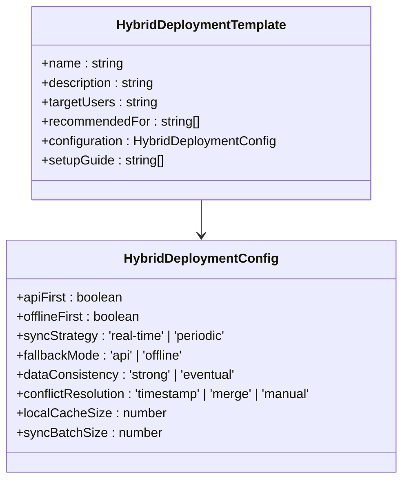

**Diagram sources**
- [DEPLOYMENT_SPECIFICATION.md:513-649](file://docs/architecture/deployment-modes/DEPLOYMENT_SPECIFICATION.md#L513-L649)

**Section sources**
- [DEPLOYMENT_SPECIFICATION.md:513-649](file://docs/architecture/deployment-modes/DEPLOYMENT_SPECIFICATION.md#L513-L649)

### LAN Sync Deployment Configuration

LAN sync deployment provides real-time synchronization for small school networks with automatic server discovery:

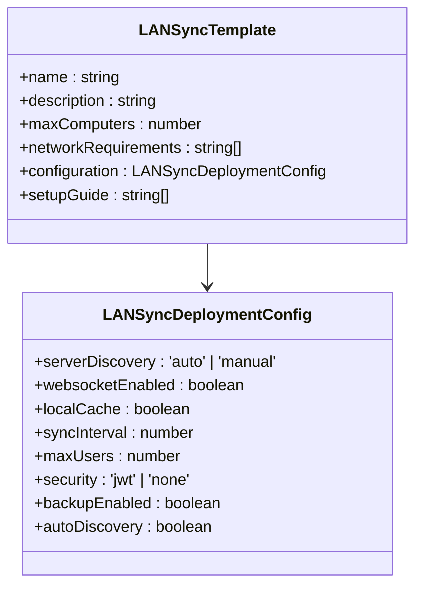

**Diagram sources**
- [DEPLOYMENT_SPECIFICATION.md:124-267](file://docs/architecture/deployment-modes/DEPLOYMENT_SPECIFICATION.md#L124-L267)

**Section sources**
- [DEPLOYMENT_SPECIFICATION.md:124-267](file://docs/architecture/deployment-modes/DEPLOYMENT_SPECIFICATION.md#L124-L267)

### Standalone Deployment Configuration

Standalone deployment provides single-laptop operation with optional desktop and portable modes:

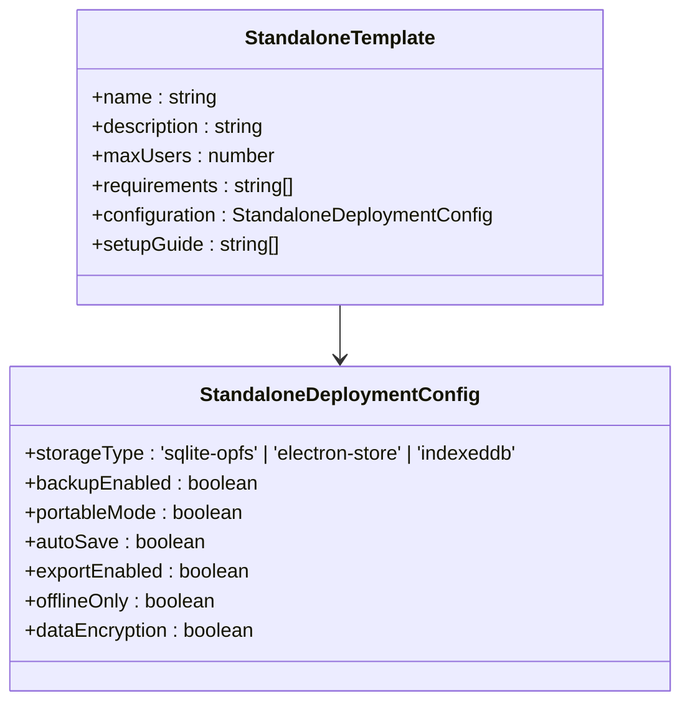

**Diagram sources**
- [DEPLOYMENT_SPECIFICATION.md:22-121](file://docs/architecture/deployment-modes/DEPLOYMENT_SPECIFICATION.md#L22-L121)

**Section sources**
- [DEPLOYMENT_SPECIFICATION.md:22-121](file://docs/architecture/deployment-modes/DEPLOYMENT_SPECIFICATION.md#L22-L121)

### Deployment Mode Matrix

The system defines six distinct deployment modes with comprehensive specifications:

| Mode | Target User | Users | Database | Network | Sync | Complexity |
|------|-------------|-------|----------|---------|------|------------|
| **Standalone** | Single laptop schools | 1 | SQLite OPFS | None | None | ⭐ |
| **Networked** | Small school LAN | 2-20 | SQLite (shared) | LAN | WebSocket | ⭐⭐ |
| **Hosted** | Medium school server | 20-100 | PostgreSQL | LAN/WAN | Real-time | ⭐⭐⭐ |
| **SaaS Backend** | Multi-tenant cloud | 100+ | PostgreSQL | Internet | Continuous | ⭐⭐⭐⭐ |
| **ERPNext** | ERPNext users | Varies | ERPNext | Internet | API Bridge | ⭐⭐⭐⭐ |
| **Mobile** | Teachers on-field | 1/device | SQLite | Varies | Periodic | ⭐⭐ |

**Section sources**
- [DEPLOYMENT_SPECIFICATION.md:9-18](file://docs/architecture/deployment-modes/DEPLOYMENT_SPECIFICATION.md#L9-L18)

### Self-Hosting Configuration Templates

The system provides comprehensive self-hosting configuration templates with environment variable support:

```mermaid
classDiagram
class SelfHostingConfig {
+vitePort : string
+viteHost : string
+viteDBProvider : string
+viteDBMode : string
+viteDeploymentEnv : string
+viteSQLiteWALMode : string
+viteBackendAPIURL : string
+viteBackendAPIKey : string
+viteEnableHTTPS : string
+viteEnableAuditLog : string
}
class SelfHostingTemplate {
+name : string
+description : string
+requiredPackages : string[]
+environmentVariables : SelfHostingConfig
+setupCommands : string[]
}
SelfHostingTemplate --> SelfHostingConfig
```

**Diagram sources**
- [setup-self-hosted.cjs:14-38](file://scripts/setup-self-hosted.cjs#L14-L38)

**Section sources**
- [setup-self-hosted.cjs:14-38](file://scripts/setup-self-hosted.cjs#L14-L38)

### Backend Integration Templates

The system provides comprehensive backend integration templates for different backend systems:

```mermaid
classDiagram
class BackendIntegrationTemplate {
+name : string
+backendType : string
+configuration : BackendAPIConfig
+endpointMappings : EndpointMapping[]
+syncStrategies : string[]
+securityConfig : SecurityConfig
}
class BackendAPIConfig {
+apiBaseUrl : string
+authType : string
+authToken : string
+timeout : number
+retryAttempts : number
+syncInterval : number
+conflictResolution : string
+endpoints : Endpoints
}
class EndpointMapping {
+collection : string
+backendEndpoint : string
+fieldMappings : FieldMapping[]
}
BackendIntegrationTemplate --> BackendAPIConfig
BackendIntegrationTemplate --> EndpointMapping
```

**Diagram sources**
- [backend-api-config.example.ts:6-74](file://src/config/examples/backend-api-config.example.ts#L6-L74)

**Section sources**
- [backend-api-config.example.ts:6-74](file://src/config/examples/backend-api-config.example.ts#L6-L74)

## LAN Server Integration

The LAN Server integration provides comprehensive support for networked deployment mode with automatic server discovery and real-time synchronization capabilities.

### LAN Server Architecture

The LAN Server provides a lightweight server solution for small school LAN deployments:

- **SQLite Database**: Shared SQLite database with file-based locking
- **REST API**: Complete REST API for CRUD operations and data synchronization
- **WebSocket Support**: Real-time WebSocket connections for instant updates
- **Auto-Discovery**: mDNS/Bonjour service advertisement for automatic server discovery
- **Authentication**: Optional authentication with configurable security settings
- **Cross-platform**: Runs on Windows, Linux, and macOS

```mermaid
classDiagram
class LANServer {
+config : LANServerConfig
+app : Application
+httpServer : HTTPServer
+wss : WebSocketServer
+state : ServerState
+db : Database
+start() Promise~void~
+stop() Promise~void~
+setupRoutes() void
+setupWebSocket() void
+setupDiscovery() Promise~void~
+initializeDatabase() void
}
class LANServerConfig {
+dataDir : string
+port : number
+host? : string
+enableCors? : boolean
+auth? : AuthConfig
}
class ServerState {
+running : boolean
+clients : Map~string, WebSocketClient~
+startTime : Date
}
class WebSocketClient {
+id : string
+socket : WebSocket
+subscriptions : Set~string~
+lastPing : number
}
LANServer --> LANServerConfig
LANServer --> ServerState
LANServer --> WebSocketClient
```

**Diagram sources**
- [LANServer.ts:46-56](file://src/server/LANServer.ts#L46-L56)
- [LANServer.ts:22-44](file://src/server/LANServer.ts#L22-L44)

**Section sources**
- [LANServer.ts:1-567](file://src/server/LANServer.ts#L1-L567)

### Server Discovery and Auto-configuration

The LAN Server implements sophisticated discovery mechanisms:

- **mDNS/Bonjour**: Service advertisement and discovery using standard protocols
- **IP Range Scanning**: Fallback scanning of common IP ranges for server detection
- **Manual Configuration**: Support for manual server address specification
- **Reconnection Logic**: Automatic reconnection attempts with configurable intervals
- **Health Monitoring**: Server health checks and status reporting

**Section sources**
- [LANServer.ts:513-533](file://src/server/LANServer.ts#L513-L533)

### Networked Mode Configuration

The networked deployment mode integrates seamlessly with the LAN Server:

- **Client Configuration**: Automatic server discovery with manual fallback support
- **Real-time Sync**: WebSocket-based real-time synchronization between clients
- **Offline Support**: Local caching with automatic synchronization when online
- **Multi-user Support**: Concurrent access to shared database with transaction support
- **Security**: Optional authentication and authorization for server access

**Section sources**
- [DEPLOYMENT_SPECIFICATION.md:204-270](file://docs/architecture/deployment-modes/DEPLOYMENT_SPECIFICATION.md#L204-L270)

## Practical Examples

### Enhanced Database Configuration Management

Database configuration management now includes comprehensive environment variable support, migration capabilities, and template processing:

```typescript
// Enhanced database configuration with environment variable overrides
const DATABASE_CONFIG = {
  provider: process.env.REACT_APP_DATABASE_PROVIDER || 'sqlite-wasm',
  autoDetect: process.env.REACT_APP_DATABASE_AUTO_DETECT === 'true',
  connectionString: process.env.REACT_APP_DATABASE_URL || '',
  performance: {
    enableIndexing: process.env.REACT_APP_DATABASE_ENABLE_INDEXING === 'true',
    enableCaching: process.env.REACT_APP_DATABASE_ENABLE_CACHING === 'true',
    cacheSize: parseInt(process.env.REACT_APP_DATABASE_CACHE_SIZE || '100'),
    queryTimeout: parseInt(process.env.REACT_APP_DATABASE_QUERY_TIMEOUT || '30000'),
    batchSize: parseInt(process.env.REACT_APP_DATABASE_BATCH_SIZE || '100'),
  },
  storage: {
    maxSize: parseInt(process.env.REACT_APP_DATABASE_MAX_SIZE || '0'),
    compressionEnabled: process.env.REACT_APP_DATABASE_COMPRESSION === 'true',
    encryptionEnabled: process.env.REACT_APP_DATABASE_ENCRYPTION === 'true',
    backupEnabled: process.env.REACT_APP_DATABASE_BACKUP === 'true',
    retentionDays: parseInt(process.env.REACT_APP_DATABASE_RETENTION_DAYS || '30'),
  },
  // ... other configuration sections
};

// Validate and repair database configuration
const validator = databaseConfigValidator;
const validationResult = validator.validate(DATABASE_CONFIG);
if (!validationResult.isValid) {
  const repairResult = validator.repair(DATABASE_CONFIG);
  console.log('Database configuration repaired:', repairResult.changes);
}

// Apply configuration migration
const migration = new ConfigurationMigration('2.1.0');
if (migration.needsMigration(DATABASE_CONFIG)) {
  const migrationResult = await migration.migrate(DATABASE_CONFIG, { dryRun: false });
  console.log('Configuration migrated successfully:', migrationResult.result?.migratedConfig);
}
```

**Section sources**
- [databaseConfigRuntime.ts:77-247](file://src/config/databaseConfigRuntime.ts#L77-L247)
- [databaseConfigSchema.ts:316-359](file://src/config/databaseConfigSchema.ts#L316-L359)
- [ConfigurationMigration.ts:78-146](file://src/config/ConfigurationMigration.ts#L78-L146)

### Enhanced Production Demo Configuration

Production demo configuration includes comprehensive lifecycle management with migration support:

```typescript
// Initialize production demo with enhanced configuration
const initializeDemo = async () => {
  const demoConfig = getProductionDemoConfig('production');
  const demoState = getProductionDemoState();
  
  if (demoConfig.enabled && !demoState.active) {
    const result = await initializeProductionDemo('production', 'demo', {
      sessionDurationHours: 24,
      clearExistingData: true,
    });
    
    if (result.success) {
      console.log('Production demo initialized with session ID:', result.sessionId);
    }
  }
};

// Monitor and manage demo session lifecycle
const monitorDemoSession = () => {
  const state = getProductionDemoState();
  
  if (state.active && isProductionDemoExpired()) {
    console.log('Demo session expired, cleaning up...');
    cleanupExpiredDemoSessions();
  }
};
```

**Section sources**
- [productionDemo.ts:135-194](file://src/config/productionDemo.ts#L135-L194)
- [productionDemo.ts:255-301](file://src/config/productionDemo.ts#L255-L301)

### Enhanced Environment Runtime Detection

Environment runtime detection provides optimal configuration recommendations:

```typescript
// Detect optimal configuration based on runtime environment
const detectOptimalConfig = () => {
  const runtimeConfig = detectOptimalConfigurationRuntime();
  
  return {
    useEnhancedFeatures: runtimeConfig.useEnhancedFeatures,
    features: {
      enhancedDataLayer: runtimeConfig.features.enhancedDataLayer,
      networkStatusIndicator: runtimeConfig.features.networkStatusIndicator,
      moduleHealthIndicator: runtimeConfig.features.moduleHealthIndicator,
      syncStatusComponent: runtimeConfig.features.syncStatusComponent,
      globalNotifications: runtimeConfig.features.globalNotifications,
      performanceOptimizations: runtimeConfig.features.performanceOptimizations,
      advancedErrorBoundaries: runtimeConfig.features.advancedErrorBoundaries,
      enableOfflineMode: runtimeConfig.features.enableOfflineMode,
      enableRealTimeSync: runtimeConfig.features.enableRealTimeSync,
      enablePerformanceMonitoring: runtimeConfig.features.enablePerformanceMonitoring,
      enableAdvancedReporting: runtimeConfig.features.enableAdvancedReporting,
      enableBulkOperations: runtimeConfig.features.enableBulkOperations,
      enableDataExport: runtimeConfig.features.enableDataExport,
      enableNotifications: runtimeConfig.features.enableNotifications,
      enableAuditLog: runtimeConfig.features.enableAuditLog,
      enableMultiTenant: runtimeConfig.features.enableMultiTenant,
      performanceMonitorWidget: runtimeConfig.features.performanceMonitorWidget,
    },
  };
};
```

**Section sources**
- [environmentRuntime.ts:29-57](file://src/config/environmentRuntime.ts#L29-L57)

### Deployment Mode Template Application

Deployment mode templates can be applied programmatically for different environments with template processing support:

```typescript
// Apply deployment template based on environment
const applyDeploymentTemplate = (environment: string) => {
  let template: DeploymentTemplate;
  
  switch(environment) {
    case 'standalone':
      template = getStandaloneTemplate();
      break;
    case 'lan-sync':
      template = getLANSyncTemplate();
      break;
    case 'hybrid':
      template = getHybridTemplate();
      break;
    default:
      template = getDefaultTemplate();
  }
  
  // Apply template configuration
  const config = unifiedConfigManager.getConfig();
  const updatedConfig = {
    ...config,
    ...template.configuration,
    deploymentMode: template.name
  };
  
  unifiedConfigManager.updateConfig(updatedConfig);
  return updatedConfig;
};
```

**Section sources**
- [DEPLOYMENT_SPECIFICATION.md:22-121](file://docs/architecture/deployment-modes/DEPLOYMENT_SPECIFICATION.md#L22-L121)
- [DEPLOYMENT_SPECIFICATION.md:124-267](file://docs/architecture/deployment-modes/DEPLOYMENT_SPECIFICATION.md#L124-L267)
- [DEPLOYMENT_SPECIFICATION.md:513-649](file://docs/architecture/deployment-modes/DEPLOYMENT_SPECIFICATION.md#L513-L649)

## Common Issues and Troubleshooting

### Configuration Loading Race Conditions

**Issue**: Configuration not available when components mount
**Solution**: Use enhanced loading state in context and conditional rendering

```typescript
function MyComponent() {
  const { config, isLoading, error } = useUnifiedConfig();
  
  if (isLoading) {
    return <LoadingScreen />;
  }
  
  if (error) {
    return <ErrorMessage message={error} />;
  }
  
  return <MyContent config={config} />;
}
```

**Section sources**
- [UnifiedConfigContext.tsx](file://src/contexts/UnifiedConfigContext.tsx)

### Environment Variable Resolution Failures

**Issue**: Environment variables not resolving correctly
**Solution**: Provide fallback values and comprehensive validation

```typescript
// Enhanced environment variable resolution with validation
const loadEnvDatabaseConfig = () => {
  const config = {};
  
  // Process all environment variables with validation
  const envVars = [
    { key: DB_ENV_VARS.DATABASE_PROVIDER, parser: (val) => val },
    { key: DB_ENV_VARS.DATABASE_AUTO_DETECT, parser: (val) => val === 'true' },
    { key: DB_ENV_VARS.DATABASE_CACHE_SIZE, parser: (val) => parseInt(val) },
    { key: DB_ENV_VARS.DATABASE_QUERY_TIMEOUT, parser: (val) => parseInt(val) },
    // ... other variables
  ];
  
  envVars.forEach(({ key, parser }) => {
    const value = process.env[key];
    if (value !== undefined) {
      const parsed = parser(value);
      if (parsed !== undefined) {
        config[key] = parsed;
      }
    }
  });
  
  return config;
};
```

**Section sources**
- [databaseConfigRuntime.ts:63-76](file://src/config/databaseConfigRuntime.ts#L63-L76)

### Database Configuration Validation Errors

**Issue**: Database configuration validation failures
**Solution**: Use comprehensive validation and auto-fix capabilities with migration support

```typescript
// Enhanced database configuration validation with migration
const validateDatabaseConfig = () => {
  const validator = databaseConfigValidator;
  const config = unifiedConfigManager.getDatabaseConfig();
  
  // Validate configuration
  const validation = validator.validate(config);
  
  if (!validation.isValid) {
    console.log('Database configuration validation errors:', validation.errors);
    
    // Attempt auto-fix
    if (validation.canAutoFix) {
      const fixResult = validator.autoFix(config);
      console.log('Auto-fixed configuration:', fixResult.changes);
      
      // Update configuration
      unifiedConfigManager.updateDatabaseConfig(fixResult.fixed);
    }
  }
  
  return validation;
};
```

**Section sources**
- [databaseConfigSchema.ts:316-359](file://src/config/databaseConfigSchema.ts#L316-L359)
- [unifiedConfig.ts:1285-1344](file://src/config/unifiedConfig.ts#L1285-L1344)

### Feature Flag Synchronization Problems

**Issue**: Feature flags not updating across components
**Solution**: Ensure proper context propagation and event handling

```typescript
// Enhanced feature flag subscription
useEffect(() => {
  const unsubscribe = unifiedConfigManager.subscribe((newConfig) => {
    setConfig(newConfig);
  });

  return () => unsubscribe();
}, []);

// Enhanced feature flag access
const isFeatureEnabled = (featureName) => {
  const config = unifiedConfigManager.getConfig();
  return config.features[featureName] || false;
};
```

**Section sources**
- [UnifiedConfigContext.tsx](file://src/contexts/UnifiedConfigContext.tsx)

### Configuration Migration Issues

**Issue**: Configuration migration failures or incomplete migrations
**Solution**: Use dry-run mode and comprehensive error handling

```typescript
// Enhanced configuration migration with error handling
const migrateConfiguration = async (config: any) => {
  const migration = new ConfigurationMigration('2.1.0');
  
  // Check if migration is needed
  if (!migration.needsMigration(config)) {
    return { success: true, message: 'No migration needed' };
  }
  
  // Preview migration
  const dryRunResult = await migration.migrate(config, { dryRun: true });
  console.log('Migration preview:', dryRunResult.steps);
  
  // Execute migration
  try {
    const result = await migration.migrate(config, { dryRun: false });
    if (result.result?.success) {
      console.log('Configuration migrated successfully');
      return { success: true, migratedConfig: result.result.migratedConfig };
    } else {
      console.error('Migration failed:', result.result?.errors);
      return { success: false, errors: result.result?.errors };
    }
  } catch (error) {
    console.error('Migration error:', error);
    return { success: false, error: error instanceof Error ? error.message : 'Unknown error' };
  }
};
```

**Section sources**
- [ConfigurationMigration.ts:78-146](file://src/config/ConfigurationMigration.ts#L78-L146)

### Deployment Template Application Issues

**Issue**: Deployment templates not applying correctly
**Solution**: Validate template compatibility and apply incrementally

```typescript
// Enhanced deployment template application
const applyDeploymentTemplate = (templateName: string) => {
  const template = getDeploymentTemplate(templateName);
  
  if (!template) {
    console.error(`Deployment template '${templateName}' not found`);
    return false;
  }
  
  // Validate template compatibility
  const compatibility = validateTemplateCompatibility(template);
  if (!compatibility.valid) {
    console.error('Template compatibility issues:', compatibility.errors);
    return false;
  }
  
  // Apply template incrementally
  const config = unifiedConfigManager.getConfig();
  const updatedConfig = deepMergeIncremental(config, template.configuration);
  
  try {
    unifiedConfigManager.updateConfig(updatedConfig);
    console.log(`Deployment template '${templateName}' applied successfully`);
    return true;
  } catch (error) {
    console.error('Failed to apply deployment template:', error);
    return false;
  }
};
```

**Section sources**
- [DEPLOYMENT_SPECIFICATION.md:22-121](file://docs/architecture/deployment-modes/DEPLOYMENT_SPECIFICATION.md#L22-L121)
- [DEPLOYMENT_SPECIFICATION.md:124-267](file://docs/architecture/deployment-modes/DEPLOYMENT_SPECIFICATION.md#L124-L267)
- [DEPLOYMENT_SPECIFICATION.md:513-649](file://docs/architecture/deployment-modes/DEPLOYMENT_SPECIFICATION.md#L513-L649)

## Best Practices

### Extending the Configuration System

When adding new configuration modules:

1. **Define Clear Interfaces**: Create TypeScript interfaces for new configuration sections
2. **Implement Runtime Detection**: Add runtime detection capabilities for optimal configuration
3. **Provide Environment Variable Support**: Support configuration through environment variables
4. **Include Validation**: Implement comprehensive validation and auto-fix capabilities
5. **Handle Migration**: Implement versioning and migration logic for configuration changes
6. **Document Changes**: Update documentation with new configuration options
7. **Template Support**: Consider adding template-based configuration file support

```typescript
// Example: Adding a new configuration module
interface NewFeatureConfig {
  enableNewFeature: boolean;
  newFeatureSetting: string;
  newFeatureThreshold: number;
}

// Add to UnifiedAppConfig
interface UnifiedAppConfig {
  // ... existing properties
  newFeature: NewFeatureConfig;
}

// Provide runtime detection
export function detectNewFeatureRuntime(): Partial<NewFeatureConfig> {
  return {
    enableNewFeature: typeof window !== 'undefined' && 'serviceWorker' in navigator,
    newFeatureSetting: 'default',
    newFeatureThreshold: 100,
  };
}

// Provide environment variable support
export function loadNewFeatureConfigFromEnvironment(): Partial<NewFeatureConfig> {
  return {
    enableNewFeature: process.env.REACT_APP_ENABLE_NEW_FEATURE === 'true',
    newFeatureSetting: process.env.REACT_APP_NEW_FEATURE_SETTING || 'default',
    newFeatureThreshold: parseInt(process.env.REACT_APP_NEW_FEATURE_THRESHOLD || '100'),
  };
}
```

**Section sources**
- [unifiedConfig.ts](file://src/config/unifiedConfig.ts)
- [environmentRuntime.ts](file://src/config/environmentRuntime.ts)
- [databaseConfigRuntime.ts](file://src/config/databaseConfigRuntime.ts)

### Maintaining Backward Compatibility

To maintain backward compatibility:

1. **Version Configuration**: Implement configuration versioning with migration support
2. **Graceful Migration**: Handle configuration migration gracefully with validation
3. **Deprecation Warnings**: Add warnings for deprecated configuration options
4. **Default Fallbacks**: Ensure new configuration options have sensible defaults
5. **Legacy Support**: Maintain support for legacy configuration formats
6. **Template Processing**: Support migration of template-based configurations

```typescript
// Enhanced configuration versioning with migration
const CONFIG_VERSION = '2.1.0';

// Migration logic with comprehensive validation
private loadConfig(): UnifiedAppConfig {
  let config = createDefaultConfig();
  const storedVersion = localStorage.getItem(CONFIG_VERSION_KEY);
  
  if (storedVersion !== CONFIG_VERSION) {
    console.log('Migrating unified configuration from version', storedVersion, 'to', CONFIG_VERSION);
    
    // Apply migrations in order
    const migrations = this.getAvailableMigrations(storedVersion);
    for (const migration of migrations) {
      try {
        config = migration(config);
        console.log(`Applied migration: ${migration.description}`);
      } catch (error) {
        console.error(`Migration failed: ${migration.description}`, error);
        break;
      }
    }
    
    localStorage.setItem(CONFIG_VERSION_KEY, CONFIG_VERSION);
  }
  
  return config;
}
```

**Section sources**
- [unifiedConfig.ts:680-716](file://src/config/unifiedConfig.ts#L680-L716)

### Database Configuration Best Practices

When working with database configuration:

1. **Environment Variable Priority**: Environment variables override configuration files
2. **Validation First**: Always validate configuration before applying
3. **Auto-Fix Integration**: Use auto-fix capabilities for common issues
4. **Migration Support**: Implement comprehensive migration support
5. **Security Considerations**: Handle sensitive configuration data securely
6. **Performance Optimization**: Optimize configuration for different environments
7. **Template Processing**: Support template-based configuration files with environment variable substitution

```typescript
// Enhanced database configuration with template support
const configureDatabase = () => {
  // 1. Load configuration from environment variables
  const envConfig = loadDatabaseConfigFromEnvironment();
  
  // 2. Load configuration from file
  const fileConfig = loadDatabaseConfigFromFile();
  
  // 3. Process template files with environment variable substitution
  const templateProcessed = processTemplateConfig(fileConfig, envConfig);
  
  // 4. Merge configurations with priority: environment > file > defaults
  const mergedConfig = mergeConfigs(envConfig, templateProcessed, getDefaultConfig());
  
  // 5. Validate configuration
  const validator = databaseConfigValidator;
  const validation = validator.validate(mergedConfig);
  
  if (!validation.isValid) {
    // 6. Attempt auto-fix
    const fixedConfig = validator.autoFix(mergedConfig);
    return fixedConfig.fixed;
  }
  
  return mergedConfig;
};
```

**Section sources**
- [databaseConfigRuntime.ts:250-265](file://src/config/databaseConfigRuntime.ts#L250-L265)
- [databaseConfigSchema.ts:316-359](file://src/config/databaseConfigSchema.ts#L316-L359)

### Deployment Template Best Practices

When working with deployment templates:

1. **Template Validation**: Always validate deployment templates before application
2. **Incremental Application**: Apply templates incrementally to avoid conflicts
3. **Environment Compatibility**: Ensure templates are compatible with target environments
4. **Backup Before Application**: Create configuration backups before applying templates
5. **Testing Strategy**: Test templates in staging environments first
6. **Documentation**: Document template usage and configuration options
7. **Migration Support**: Ensure templates support configuration version migrations

```typescript
// Enhanced deployment template application with migration support
const applyDeploymentTemplate = (templateName: string, environment: string) => {
  // 1. Validate template existence and compatibility
  const template = getDeploymentTemplate(templateName);
  if (!template) {
    throw new Error(`Template '${templateName}' not found`);
  }
  
  // 2. Validate environment compatibility
  if (!isEnvironmentCompatible(template, environment)) {
    throw new Error(`Template '${templateName}' not compatible with environment '${environment}'`);
  }
  
  // 3. Create backup
  const backup = createConfigBackup();
  
  // 4. Apply template incrementally
  const config = unifiedConfigManager.getConfig();
  const updatedConfig = applyTemplateIncrementally(config, template);
  
  // 5. Validate new configuration
  const validation = validateConfig(updatedConfig);
  if (!validation.isValid) {
    // 6. Restore backup on failure
    restoreConfigBackup(backup);
    throw new Error(`Template application failed: ${validation.errors.join(', ')}`);
  }
  
  // 7. Apply configuration
  unifiedConfigManager.updateConfig(updatedConfig);
  return updatedConfig;
};
```

**Section sources**
- [DEPLOYMENT_SPECIFICATION.md:22-121](file://docs/architecture/deployment-modes/DEPLOYMENT_SPECIFICATION.md#L22-L121)
- [DEPLOYMENT_SPECIFICATION.md:124-267](file://docs/architecture/deployment-modes/DEPLOYMENT_SPECIFICATION.md#L124-L267)
- [DEPLOYMENT_SPECIFICATION.md:513-649](file://docs/architecture/deployment-modes/DEPLOYMENT_SPECIFICATION.md#L513-L649)

### Configuration Migration Best Practices

When implementing configuration migrations:

1. **Version Tracking**: Maintain explicit version tracking for all configuration changes
2. **Step-wise Migration**: Break complex migrations into discrete, testable steps
3. **Dry-run Support**: Always provide dry-run mode for migration previews
4. **Error Recovery**: Implement comprehensive error handling and rollback mechanisms
5. **Validation Integration**: Integrate migration validation with configuration schema validation
6. **Template Processing**: Support migration of template-based configuration files
7. **Testing Strategy**: Thoroughly test migrations with representative configuration datasets

```typescript
// Enhanced migration implementation with best practices
class EnhancedConfigurationMigration extends ConfigurationMigration {
  constructor(currentVersion: string) {
    super(currentVersion);
    this.registerDefaultMigrations();
  }
  
  async migrateWithValidation(
    config: Record<string, any>, 
    options: MigrationOptions = {}
  ): Promise<EnhancedMigrationResult> {
    // 1. Validate configuration before migration
    const initialValidation = this.validateConfig(config);
    if (!initialValidation.isValid) {
      throw new Error(`Invalid configuration before migration: ${initialValidation.errors.join(', ')}`);
    }
    
    // 2. Execute migration with comprehensive error handling
    const result = await this.migrate(config, options);
    
    // 3. Validate migrated configuration
    if (result.result?.success) {
      const finalValidation = this.validateMigrated(result.result.migratedConfig);
      if (!finalValidation.isValid) {
        throw new Error(`Invalid configuration after migration: ${finalValidation.errors.join(', ')}`);
      }
    }
    
    return result;
  }
}
```

**Section sources**
- [ConfigurationMigration.ts:44-176](file://src/config/ConfigurationMigration.ts#L44-L176)
- [databaseConfigSchema.ts:158-176](file://src/config/databaseConfigSchema.ts#L158-L176)