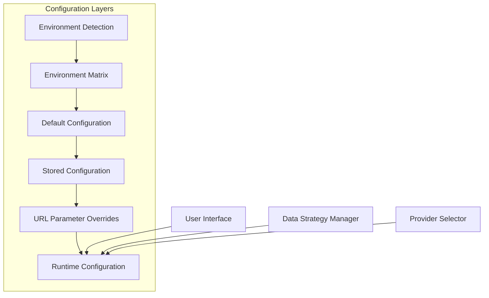
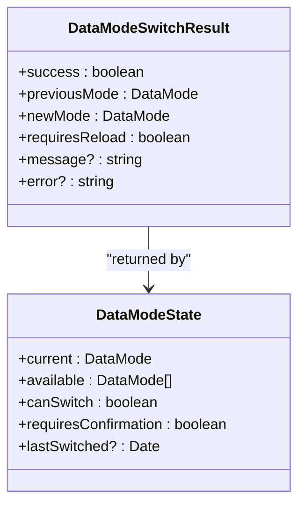
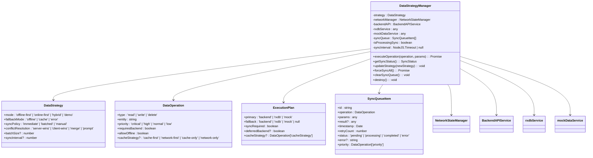
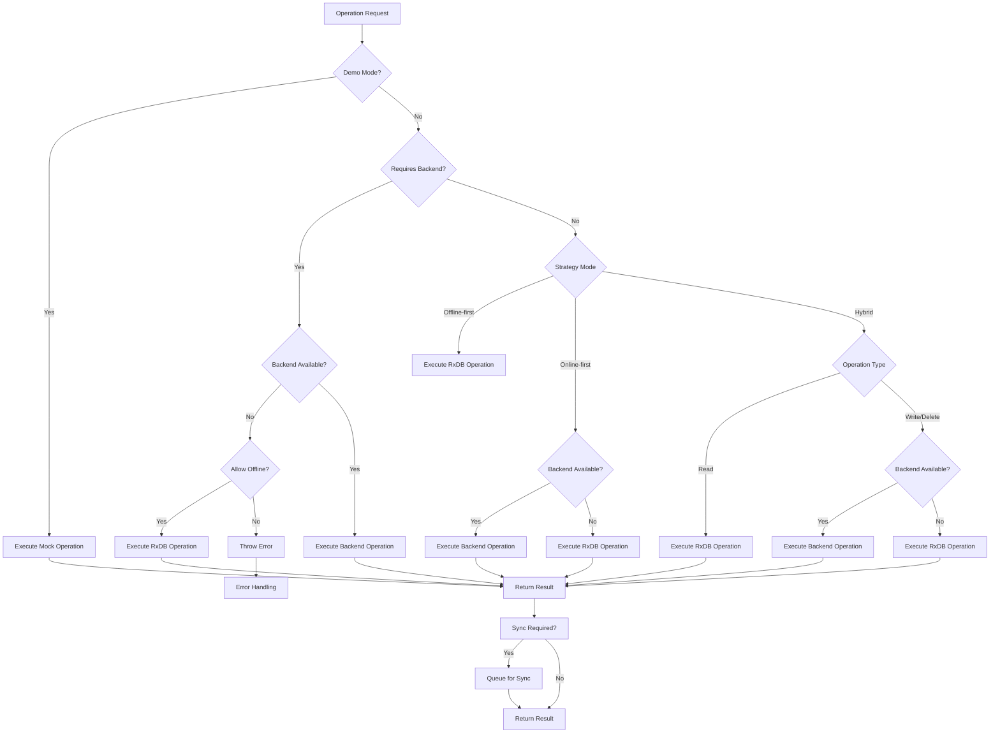
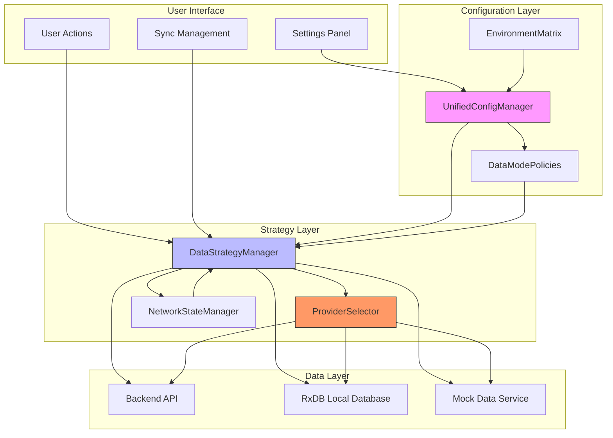

# Data Mode Strategy Configuration

<cite>
**Referenced Files in This Document**   
- [dataModePolicies.ts](file://src/config/dataModePolicies.ts)
- [DataStrategyManager.ts](file://src/services/DataStrategyManager.ts)
- [ProviderSelector.ts](file://src/services/database/ProviderSelector.ts)
- [unifiedConfig.ts](file://src/config/unifiedConfig.ts)
- [environmentMatrix.ts](file://src/config/environmentMatrix.ts)
- [dataModeManager.ts](file://src/services/dataModeManager.ts)
- [DataSourceContext.tsx](file://src/contexts/DataSourceContext.tsx)
</cite>

## Table of Contents
1. [Introduction](#introduction)
2. [Core Configuration System](#core-configuration-system)
3. [Data Mode Policies and Rules](#data-mode-policies-and-rules)
4. [Data Strategy Manager Implementation](#data-strategy-manager-implementation)
5. [Runtime Strategy Selection Process](#runtime-strategy-selection-process)
6. [Configuration Options by Data Mode](#configuration-options-by-data-mode)
7. [Practical Configuration Examples](#practical-configuration-examples)
8. [Common Issues and Troubleshooting](#common-issues-and-troubleshooting)
9. [Best Practices](#best-practices)
10. [Architecture Overview](#architecture-overview)

## Introduction

The Data Mode Strategy Configuration system in schoolpilot3 governs how the application handles data access patterns across different environments and user scenarios. This comprehensive system enables the application to dynamically select between API-first, offline-first, hybrid, and mock data strategies based on environment, user role, and network conditions. The architecture is designed to ensure data consistency, optimize performance, and provide a seamless user experience regardless of connectivity status.

The system consists of several interconnected components that work together to determine the optimal data access strategy. At its core, the configuration system evaluates environmental variables, user permissions, and network state to make intelligent decisions about data retrieval, storage, and synchronization. This documentation provides a detailed analysis of the system's architecture, implementation, and practical usage patterns.

**Section sources**
- [dataModePolicies.ts](file://src/config/dataModePolicies.ts#L1-L190)
- [DataStrategyManager.ts](file://src/services/DataStrategyManager.ts#L1-L573)

## Core Configuration System

The foundation of the data mode strategy system is built upon a hierarchical configuration architecture that integrates environment detection, feature flags, and persistent user preferences. The Unified Configuration System, implemented in `unifiedConfig.ts`, serves as the central authority for all application settings, including data mode policies.

The configuration system follows a multi-layered approach with the following key components:



**Diagram sources**
- [unifiedConfig.ts](file://src/config/unifiedConfig.ts#L1-L1052)
- [environmentMatrix.ts](file://src/config/environmentMatrix.ts#L1-L149)

The environment detection mechanism automatically identifies whether the application is running in development, staging, or production environments by analyzing the hostname, protocol, and environment variables. This detection informs the configuration system about the appropriate data mode policies to apply.

The environment matrix defines strict rules for each environment, including:
- **Allowed data modes**: Specifies which data modes are permitted (demo, production)
- **Default data mode**: Determines the initial mode when no preference is stored
- **Database provider constraints**: Limits available database technologies
- **Feature flag configurations**: Enables or disables specific functionality
- **Security policies**: Controls data mode switching capabilities

Configuration persistence is handled through localStorage, with versioning to support seamless migrations between configuration schema versions. The system also supports URL parameter overrides, allowing developers and administrators to temporarily modify configuration settings for testing or demonstration purposes.

**Section sources**
- [unifiedConfig.ts](file://src/config/unifiedConfig.ts#L1-L1052)
- [environmentMatrix.ts](file://src/config/environmentMatrix.ts#L1-L149)

## Data Mode Policies and Rules

The data mode policies system, implemented in `dataModePolicies.ts`, defines the rules and validation logic for switching between different data modes. This system ensures that mode transitions are secure, predictable, and appropriate for the current environment.

The core interfaces governing data mode policies include:



**Diagram sources**
- [dataModePolicies.ts](file://src/config/dataModePolicies.ts#L1-L190)

The policy system enforces several critical rules:

1. **Environment-based restrictions**: Production environments only allow the production data mode, while development and staging environments permit both demo and production modes.

2. **Switching permissions**: The ability to switch between data modes is controlled by the `canSwitchDataModes` flag in the environment configuration. Production environments typically disable mode switching to prevent accidental data loss.

3. **Confirmation requirements**: Mode changes in production and staging environments require explicit user confirmation to prevent accidental data overwrites.

4. **Validation pipeline**: Before any mode switch, the system validates that the requested mode is allowed in the current environment and that switching is permitted.

The policy implementation includes utility functions for:
- Retrieving the currently stored data mode
- Storing the selected data mode with timestamp
- Getting the complete state of data mode availability
- Validating mode switch requests
- Executing mode switches with proper error handling
- Clearing stored mode preferences
- Retrieving mode switch history

These policies work in conjunction with the environment matrix to create a robust system that prevents invalid configurations while providing flexibility in appropriate contexts.

**Section sources**
- [dataModePolicies.ts](file://src/config/dataModePolicies.ts#L1-L190)
- [environmentMatrix.ts](file://src/config/environmentMatrix.ts#L1-L149)

## Data Strategy Manager Implementation

The DataStrategyManager class is the core runtime component responsible for implementing the selected data strategy. This manager orchestrates data operations across different providers (backend API, RxDB, mock services) based on the current strategy configuration and network conditions.



**Diagram sources**
- [DataStrategyManager.ts](file://src/services/DataStrategyManager.ts#L1-L573)

The manager's primary responsibility is the `executeOperation` method, which processes data operations according to the current strategy. The execution process follows these steps:

1. **Network state assessment**: The manager queries the NetworkStateManager to determine current connectivity and backend availability.

2. **Execution planning**: Based on the operation type, network state, and configured strategy, the manager creates an execution plan that specifies the primary and fallback data sources.

3. **Operation execution**: The manager attempts to execute the operation on the primary data source.

4. **Fallback handling**: If the primary execution fails and a fallback is configured, the manager attempts the operation on the fallback source.

5. **Synchronization management**: For operations that modify data, the manager queues changes for synchronization with the backend when connectivity is available.

The manager supports four primary strategy modes:
- **Offline-first**: Prioritizes local data access, synchronizing with the backend in the background
- **Online-first**: Prefers real-time data from the backend, falling back to local cache when unavailable
- **Hybrid**: Uses a context-aware approach, reading from local cache for speed while writing directly to the backend for consistency
- **Demo**: Uses mock data services for development and demonstration purposes

**Section sources**
- [DataStrategyManager.ts](file://src/services/DataStrategyManager.ts#L1-L573)

## Runtime Strategy Selection Process

The runtime strategy selection process is a sophisticated decision-making system that determines the optimal data access pattern for each operation. This process considers multiple factors including environment, user role, network conditions, and operation characteristics.



**Diagram sources**
- [DataStrategyManager.ts](file://src/services/DataStrategyManager.ts#L1-L573)

The selection process begins with the `planExecution` method, which evaluates the current context and returns an `ExecutionPlan` specifying the primary and fallback data sources. The decision tree considers:

1. **Demo mode override**: When demo mode is active, all operations use mock data services regardless of other factors.

2. **Operation requirements**: Critical operations that require backend connectivity are handled differently than those that can operate offline.

3. **Network state**: The current network connectivity and backend availability are assessed to determine viable data sources.

4. **Strategy mode**: The configured strategy (offline-first, online-first, hybrid) provides the primary decision framework.

5. **Operation type**: Read operations are typically faster from local storage, while write operations may prioritize backend consistency.

6. **User role and permissions**: Administrative users may have different data access patterns than field workers.

The process is designed to be resilient, with fallback mechanisms that ensure operations can complete even when primary data sources are unavailable. For example, in hybrid mode, read operations use local data for immediate response, while write operations attempt to reach the backend for consistency, falling back to local storage if necessary.

Synchronization is handled asynchronously through a prioritized queue that processes pending operations when network connectivity is restored. The queue supports different sync policies (immediate, batched, manual) and handles retry logic for failed operations.

**Section sources**
- [DataStrategyManager.ts](file://src/services/DataStrategyManager.ts#L1-L573)

## Configuration Options by Data Mode

Each data mode in the schoolpilot3 system has specific configuration options that control its behavior, caching policies, synchronization intervals, and conflict resolution rules. These options are defined in the `DataStrategy` interface and can be customized based on user roles and operational requirements.

### Offline-First Mode Configuration

The offline-first mode is optimized for users with intermittent connectivity, such as field workers or mobile users. Key configuration options include:

```typescript
const offlineFirstStrategy: DataStrategy = {
  mode: 'offline-first',
  fallbackMode: 'cache',
  syncPolicy: 'batched',
  conflictResolution: 'merge',
  batchSize: 20,
  syncInterval: 300000 // 5 minutes
};
```

- **Sync policy**: Batched synchronization collects changes and sends them in groups at regular intervals
- **Conflict resolution**: Merge strategy attempts to combine changes from multiple sources
- **Cache strategy**: Local cache is the primary data source, with background synchronization
- **Batch size**: Controls the number of operations sent in each synchronization batch
- **Sync interval**: Frequency of synchronization attempts when connectivity is available

### Hybrid Mode Configuration

The hybrid mode balances performance and consistency, making it ideal for administrative users who need both speed and data accuracy:

```typescript
const hybridStrategy: DataStrategy = {
  mode: 'hybrid',
  fallbackMode: 'cache',
  syncPolicy: 'immediate',
  conflictResolution: 'server-wins',
  batchSize: 10
};
```

- **Read operations**: Served from local cache for immediate response
- **Write operations**: Sent directly to the backend for consistency, with local cache updated on success
- **Conflict resolution**: Server-wins strategy ensures backend data is authoritative
- **Sync policy**: Immediate synchronization for critical operations
- **Cache invalidation**: Cache is invalidated or updated based on backend response

### Mock Data Mode Configuration

The mock data mode is designed for development and testing, providing realistic data without requiring backend connectivity:

```typescript
const mockStrategy: DataStrategy = {
  mode: 'demo',
  fallbackMode: 'error',
  syncPolicy: 'manual',
  conflictResolution: 'prompt'
};
```

- **Data source**: Mock data service with predefined datasets
- **Synchronization**: Disabled or manual, as no backend integration is needed
- **Conflict resolution**: Prompt strategy allows developers to choose resolution method
- **Performance**: Simulated network latency to mimic real-world conditions
- **Data variety**: Multiple datasets for different testing scenarios

### API-First Mode Configuration

The API-first mode prioritizes real-time data from the backend, suitable for users with reliable connectivity:

```typescript
const apiFirstStrategy: DataStrategy = {
  mode: 'online-first',
  fallbackMode: 'cache',
  syncPolicy: 'immediate',
  conflictResolution: 'server-wins',
  syncInterval: 60000 // 1 minute
};
```

- **Primary source**: Backend API for all operations
- **Fallback**: Local cache used only when backend is unavailable
- **Cache strategy**: Network-first, with cache used as backup
- **Synchronization**: Continuous synchronization to keep local cache updated
- **Error handling**: Strict validation and error reporting for backend issues

These configuration options can be customized per user role, module, or operational context, allowing the system to adapt to different usage patterns and requirements.

**Section sources**
- [DataStrategyManager.ts](file://src/services/DataStrategyManager.ts#L5-L12)
- [dataModePolicies.ts](file://src/config/dataModePolicies.ts#L1-L190)

## Practical Configuration Examples

This section provides concrete examples of configuring the data mode strategy system for different user roles and operational scenarios.

### Configuring Offline-First Mode for Field Workers

Field workers often operate in areas with limited or intermittent connectivity. The following configuration optimizes their experience:

```typescript
// Field worker data strategy configuration
const fieldWorkerStrategy: DataStrategy = {
  mode: 'offline-first',
  fallbackMode: 'cache',
  syncPolicy: 'batched',
  conflictResolution: 'merge',
  batchSize: 25,
  syncInterval: 300000 // 5 minutes
};

// Apply strategy for field worker role
const configureFieldWorkerMode = async () => {
  const strategyManager = new DataStrategyManager(
    fieldWorkerStrategy,
    rxdbService,
    mockDataService
  );
  
  // Ensure offline capabilities are enabled
  unifiedConfigManager.updateConfig({
    features: {
      ...unifiedConfigManager.getConfig().features,
      enableOfflineMode: true
    }
  });
  
  return strategyManager;
};
```

Key considerations for field workers:
- **Large batch sizes**: Reduce the frequency of synchronization attempts
- **Long sync intervals**: Conserve battery and data usage
- **Merge conflict resolution**: Preserve all data changes when multiple workers edit the same records
- **Offline form validation**: Ensure data quality even when disconnected
- **Background sync**: Automatically synchronize when connectivity is restored

### Setting Up Hybrid Mode for Administrators

Administrative users require both performance and data consistency. The hybrid mode configuration balances these needs:

```typescript
// Administrator data strategy configuration
const adminStrategy: DataStrategy = {
  mode: 'hybrid',
  fallbackMode: 'cache',
  syncPolicy: 'immediate',
  conflictResolution: 'server-wins',
  batchSize: 10
};

// Apply strategy for administrator role
const configureAdminMode = async () => {
  const strategyManager = new DataStrategyManager(
    adminStrategy,
    rxdbService,
    mockDataService
  );
  
  // Enable real-time sync and performance monitoring
  unifiedConfigManager.updateConfig({
    features: {
      ...unifiedConfigManager.getConfig().features,
      enableRealTimeSync: true,
      enablePerformanceMonitoring: true
    }
  });
  
  return strategyManager;
};
```

Key considerations for administrators:
- **Immediate synchronization**: Ensure data changes are reflected across the system quickly
- **Server-wins conflict resolution**: Maintain data consistency with central records
- **Smaller batch sizes**: Faster processing of individual operations
- **Real-time updates**: Notify users of changes made by others
- **Audit trails**: Track all data modifications for compliance

### Enabling Mock Data for Development

The mock data mode is essential for development and testing, allowing teams to work without dependency on backend services:

```typescript
// Development mock data configuration
const devMockStrategy: DataStrategy = {
  mode: 'demo',
  fallbackMode: 'error',
  syncPolicy: 'manual',
  conflictResolution: 'prompt'
};

// Initialize mock data environment
const setupDevelopmentEnvironment = async () => {
  // Switch to demo mode
  await dataModeManager.switchToDemo({
    confirmationRequired: false,
    preserveUserSettings: true
  });
  
  // Configure data strategy
  const strategyManager = new DataStrategyManager(
    devMockStrategy,
    rxdbService,
    mockDataService
  );
  
  // Enable debug features
  unifiedConfigManager.updateConfig({
    development: {
      enableDebugMode: true,
      enableMockData: true,
      logLevel: 'debug'
    }
  });
  
  return strategyManager;
};
```

Key considerations for development:
- **Manual synchronization**: Developers can control when data is synchronized
- **Prompt conflict resolution**: Interactive resolution helps test different scenarios
- **Debug mode**: Enhanced logging and error reporting
- **Multiple datasets**: Support for different test scenarios
- **Performance simulation**: Mimic various network conditions for testing

These examples demonstrate how the data mode strategy system can be tailored to specific user needs and operational contexts, ensuring optimal performance and user experience across different scenarios.

**Section sources**
- [dataModeManager.ts](file://src/services/dataModeManager.ts#L1-L394)
- [DataStrategyManager.ts](file://src/services/DataStrategyManager.ts#L1-L573)
- [unifiedConfig.ts](file://src/config/unifiedConfig.ts#L1-L1052)

## Common Issues and Troubleshooting

Despite the robust design of the data mode strategy system, several common issues may arise during implementation and operation. This section addresses these issues and provides troubleshooting guidance.

### Data Consistency Across Modes

**Issue**: Data discrepancies occur when switching between different data modes or when multiple users modify the same records.

**Root Causes**:
- Incomplete synchronization between local and remote databases
- Conflicting conflict resolution strategies
- Timestamp inconsistencies across devices
- Network interruptions during critical operations

**Solutions**:
1. Implement comprehensive audit trails to track all data modifications
2. Use consistent conflict resolution policies across the system
3. Ensure proper synchronization queue management
4. Validate data integrity after mode transitions
5. Implement data reconciliation processes

```typescript
// Example: Data consistency check
const checkDataConsistency = async () => {
  const syncStatus = dataStrategyManager.getSyncStatus();
  if (syncStatus.pending > 0) {
    console.warn(`Pending sync operations: ${syncStatus.pending}`);
    await dataStrategyManager.forceSyncAll();
  }
  
  // Verify critical data integrity
  const localCount = await rxdbService.count('students');
  const remoteCount = await backendAPI.get('/students/count');
  
  if (localCount !== remoteCount.data) {
    console.error(`Data inconsistency detected: local=${localCount}, remote=${remoteCount.data}`);
    // Trigger data reconciliation
  }
};
```

### Incorrect Provider Selection

**Issue**: The system selects an inappropriate data provider, leading to performance issues or operation failures.

**Root Causes**:
- Misconfigured strategy rules
- Incorrect network state detection
- Priority inversion in execution planning
- Race conditions in provider selection

**Solutions**:
1. Review and validate strategy configuration rules
2. Enhance network state monitoring
3. Implement provider health checks
4. Add logging for provider selection decisions
5. Create fallback mechanisms for provider failures

```typescript
// Example: Provider selection debugging
const debugProviderSelection = (operation: DataOperation) => {
  const networkState = networkManager.getState();
  const executionPlan = dataStrategyManager['planExecution'](operation, networkState);
  
  console.log('Provider Selection Debug:', {
    operation,
    networkState,
    executionPlan,
    strategy: dataStrategyManager['strategy']
  });
  
  return executionPlan;
};
```

### Synchronization Conflicts

**Issue**: Conflicts occur when multiple users or devices modify the same data simultaneously.

**Root Causes**:
- Inadequate conflict resolution policies
- Insufficient version tracking
- Overlapping edit windows
- Poor user feedback on data status

**Solutions**:
1. Implement robust versioning and timestamping
2. Choose appropriate conflict resolution strategies
3. Provide real-time collaboration indicators
4. Implement optimistic locking
5. Create user-friendly conflict resolution interfaces

```typescript
// Example: Conflict resolution handler
const handleConflict = async (conflict: SyncQueueItem) => {
  const strategy = dataStrategyManager['strategy'].conflictResolution;
  
  switch (strategy) {
    case 'server-wins':
      return await resolveServerWins(conflict);
    case 'client-wins':
      return await resolveClientWins(conflict);
    case 'merge':
      return await resolveMerge(conflict);
    case 'prompt':
      return await promptUserForResolution(conflict);
    default:
      throw new Error(`Unsupported conflict resolution strategy: ${strategy}`);
  }
};
```

Additional common issues include:
- **Performance degradation**: Caused by excessive synchronization or inefficient queries
- **Storage limitations**: Local database size constraints
- **Authentication failures**: Token expiration during offline periods
- **Data corruption**: Improper handling of edge cases

Monitoring tools and comprehensive logging are essential for identifying and resolving these issues promptly.

**Section sources**
- [DataStrategyManager.ts](file://src/services/DataStrategyManager.ts#L1-L573)
- [dataModeManager.ts](file://src/services/dataModeManager.ts#L1-L394)
- [ProviderSelector.ts](file://src/services/database/ProviderSelector.ts#L1-L450)

## Best Practices

To ensure optimal performance, reliability, and user experience when implementing the data mode strategy system, follow these best practices:

### Monitoring Data Mode Performance

Effective monitoring is critical for maintaining system health and identifying potential issues before they impact users.

**Key Metrics to Monitor**:
- **Synchronization latency**: Time between local operation and successful backend sync
- **Queue size**: Number of pending operations in the synchronization queue
- **Error rates**: Frequency of failed operations and sync attempts
- **Cache hit ratio**: Percentage of read operations served from cache
- **Network availability**: Duration and frequency of connectivity interruptions

```typescript
// Example: Performance monitoring setup
const setupPerformanceMonitoring = () => {
  // Monitor sync status
  setInterval(() => {
    const syncStatus = dataStrategyManager.getSyncStatus();
    performanceMonitor.trackMetric('sync.pending', syncStatus.pending);
    performanceMonitor.trackMetric('sync.errors', syncStatus.errors);
    
    // Log by priority
    Object.entries(syncStatus.byPriority).forEach(([priority, count]) => {
      performanceMonitor.trackMetric(`sync.priority.${priority}`, count);
    });
  }, 30000); // Every 30 seconds
  
  // Monitor network state changes
  networkManager.subscribe((state) => {
    performanceMonitor.trackEvent('network.state.change', {
      isOnline: state.isOnline,
      backendAvailable: state.backendAvailable,
      connectionQuality: state.connectionQuality
    });
  });
};
```

**Monitoring Tools**:
- Real-time dashboards for system administrators
- Alerting for critical issues (e.g., large sync queues)
- Historical trend analysis
- User-level performance reporting

### Handling Mode Transitions

Smooth transitions between data modes are essential for maintaining data integrity and user productivity.

**Best Practices**:
1. **Graceful degradation**: Ensure functionality remains available during mode transitions
2. **Data preservation**: Never lose user data during mode switches
3. **Clear user communication**: Inform users about mode changes and their implications
4. **Validation before transition**: Verify system readiness before switching modes
5. **Rollback capability**: Allow users to revert to previous modes if needed

```typescript
// Example: Safe mode transition
const safeModeTransition = async (newMode: DataMode) => {
  // Validate transition
  const validation = validateDataMode(newMode, currentEnvironment);
  if (!validation.valid) {
    throw new Error(validation.error);
  }
  
  // Check for pending operations
  const syncStatus = dataStrategyManager.getSyncStatus();
  if (syncStatus.pending > 0 && newMode !== 'demo') {
    const confirmed = await promptUser(
      'Pending Operations',
      `There are ${syncStatus.pending} pending operations. Continue with mode transition?`
    );
    if (!confirmed) return false;
  }
  
  // Execute transition
  const result = await unifiedConfigManager.switchDataMode(newMode);
  if (result.requiresReload) {
    await promptUserAndReload('Mode transition complete. Reloading application...');
  }
  
  return result.success;
};
```

### Ensuring Data Integrity During Network Interruptions

Maintaining data integrity during network interruptions is crucial for user trust and system reliability.

**Best Practices**:
1. **Atomic operations**: Ensure data modifications are all-or-nothing
2. **Transaction logging**: Maintain a complete record of all operations
3. **Checksum verification**: Validate data integrity after transmission
4. **Idempotent operations**: Design operations to be safely retryable
5. **Consistent error handling**: Provide clear feedback for failed operations

```typescript
// Example: Data integrity protection
const createOperationWithIntegrity = async (operation: DataOperation, params: any) => {
  // Generate operation ID and timestamp
  const operationId = generateId();
  const timestamp = new Date().toISOString();
  
  // Create operation with metadata
  const operationWithMetadata = {
    ...params,
    __operation: {
      id: operationId,
      type: operation.type,
      entity: operation.entity,
      timestamp,
      checksum: calculateChecksum(params)
    }
  };
  
  try {
    const result = await dataStrategyManager.executeOperation(operation, operationWithMetadata);
    
    // Verify integrity
    if (result && result.__operation) {
      const expectedChecksum = calculateChecksum(result);
      if (result.__operation.checksum !== expectedChecksum) {
        throw new Error('Data integrity check failed');
      }
    }
    
    return result;
  } catch (error) {
    // Log failed operation for recovery
    await logFailedOperation(operation, operationWithMetadata, error);
    throw error;
  }
};
```

Additional best practices include:
- Regular system audits and data validation
- Comprehensive backup and recovery procedures
- User training on offline capabilities
- Clear documentation of data access patterns
- Performance testing under various network conditions

Following these best practices will help ensure a reliable, performant, and user-friendly data mode strategy implementation.

**Section sources**
- [DataStrategyManager.ts](file://src/services/DataStrategyManager.ts#L1-L573)
- [dataModeManager.ts](file://src/services/dataModeManager.ts#L1-L394)
- [unifiedConfig.ts](file://src/config/unifiedConfig.ts#L1-L1052)

## Architecture Overview

The data mode strategy system in schoolpilot3 follows a layered architecture that separates concerns and enables flexible configuration. The system integrates multiple components to provide a comprehensive solution for data access pattern management.



**Diagram sources**
- [unifiedConfig.ts](file://src/config/unifiedConfig.ts#L1-L1052)
- [DataStrategyManager.ts](file://src/services/DataStrategyManager.ts#L1-L573)
- [ProviderSelector.ts](file://src/services/database/ProviderSelector.ts#L1-L450)

The architecture consists of four main layers:

1. **User Interface Layer**: Provides user-facing components for interacting with the data mode system, including settings panels and synchronization management tools.

2. **Configuration Layer**: Centralized configuration management that determines the appropriate data mode policies based on environment, user role, and system settings.

3. **Strategy Layer**: Runtime decision-making components that determine the optimal data access pattern for each operation based on current conditions.

4. **Data Layer**: Multiple data providers that store and retrieve data according to the selected strategy.

The UnifiedConfigManager serves as the central configuration authority, integrating environment detection, policy rules, and user preferences. The DataStrategyManager implements the selected strategy by coordinating between different data providers. The ProviderSelector dynamically chooses the appropriate data provider based on the execution plan.

This architecture enables the system to adapt to changing conditions while maintaining data consistency and providing a seamless user experience. The separation of concerns allows for independent evolution of each layer, making the system more maintainable and extensible.

**Section sources**
- [unifiedConfig.ts](file://src/config/unifiedConfig.ts#L1-L1052)
- [DataStrategyManager.ts](file://src/services/DataStrategyManager.ts#L1-L573)
- [ProviderSelector.ts](file://src/services/database/ProviderSelector.ts#L1-L450)