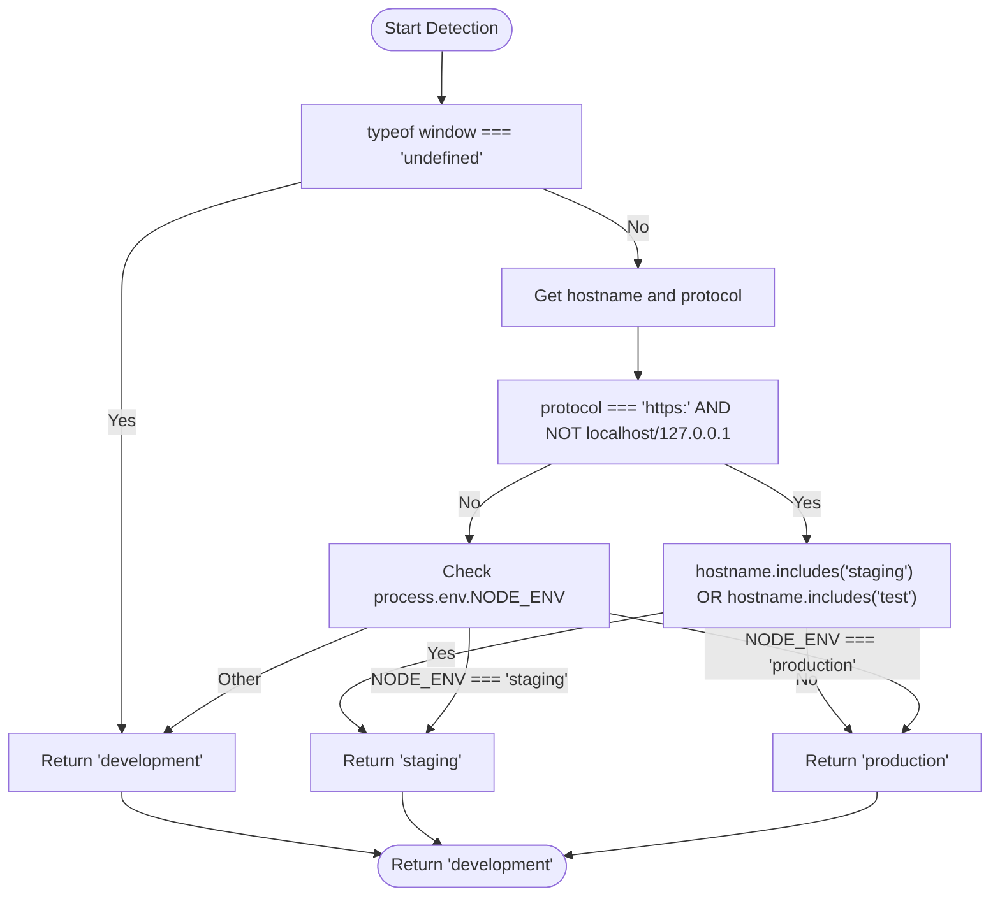
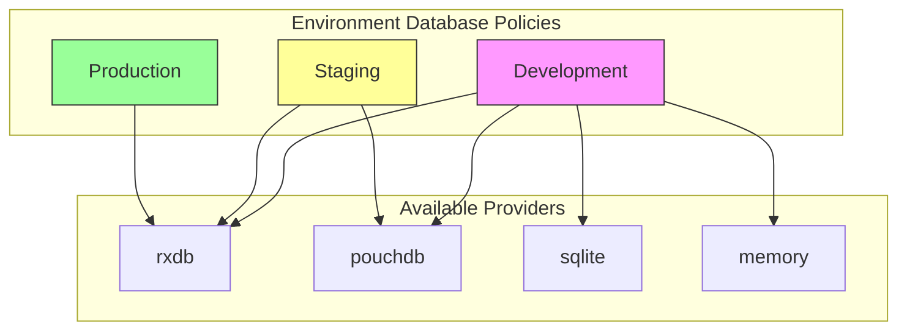
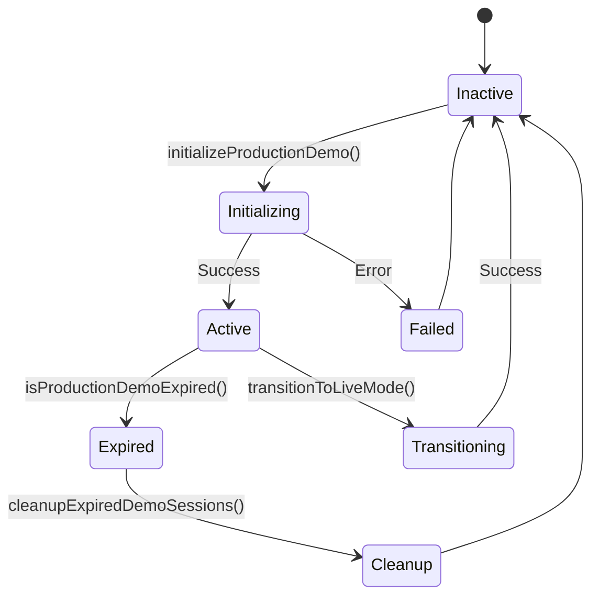

# Environment Management

<cite>
**Referenced Files in This Document**   
- [environmentMatrix.ts](file://src/config/environmentMatrix.ts)
- [productionDemo.ts](file://src/config/productionDemo.ts)
- [dataModePolicies.ts](file://src/config/dataModePolicies.ts)
</cite>

## Table of Contents
1. [Introduction](#introduction)
2. [Environment Matrix Configuration](#environment-matrix-configuration)
3. [Environment Detection Mechanism](#environment-detection-mechanism)
4. [Environment-Specific Configuration Details](#environment-specific-configuration-details)
5. [Production Demo Mode Functionality](#production-demo-mode-functionality)
6. [Configuration Access and Validation](#configuration-access-and-validation)
7. [Common Issues and Troubleshooting](#common-issues-and-troubleshooting)
8. [Best Practices](#best-practices)

## Introduction
The environment management system in schoolpilot3 enables the application to adapt its behavior across different deployment contexts. This system is primarily governed by two key configuration files: `environmentMatrix.ts` and `productionDemo.ts`. These files define environment-specific configurations for development, staging, and production environments, including backend endpoints, feature availability, database providers, and performance settings. The system supports environment detection, fallback strategies, and override patterns to ensure consistent behavior across deployment contexts.

**Section sources**
- [environmentMatrix.ts](file://src/config/environmentMatrix.ts#L0-L27)
- [productionDemo.ts](file://src/config/productionDemo.ts#L0-L30)

## Environment Matrix Configuration

### Environment Types and Configuration Structure
The environment management system defines three primary environment types and associated configuration interfaces:

```typescript
export type Environment = 'development' | 'staging' | 'production';
export type DataMode = 'demo' | 'production';
export type DatabaseProvider = 'rxdb' | 'pouchdb' | 'sqlite' | 'memory';

export interface EnvironmentConfig {
  name: Environment;
  allowedDataModes: DataMode[];
  defaultDataMode: DataMode;
  allowedDatabaseProviders: DatabaseProvider[];
  defaultDatabaseProvider: DatabaseProvider;
  canSwitchDataModes: boolean;
  requiresConfirmation: boolean;
  features: {
    enableAdvancedReporting: boolean;
    enableBulkOperations: boolean;
    enableDataExport: boolean;
    enableOfflineMode: boolean;
    enableRealTimeSync: boolean;
    enablePerformanceMonitoring: boolean;
  };
}
```

The `EnvironmentConfig` interface defines comprehensive settings for each environment, including:
- **Data mode policies**: Allowed and default data modes
- **Database provider options**: Available database technologies
- **Feature flags**: Environment-specific feature availability
- **Security and confirmation requirements**

**Section sources**
- [environmentMatrix.ts](file://src/config/environmentMatrix.ts#L0-L27)

### Environment-Specific Configuration Matrix
The `ENVIRONMENT_MATRIX` constant defines specific configurations for each environment:

```mermaid
flowchart TD
A[Environment Matrix] --> B[Development]
A --> C[Staging]
A --> D[Production]
B --> B1[Allowed Data Modes: demo, production]
B --> B2[Default Data Mode: demo]
B --> B3[Database Providers: rxdb, pouchdb, sqlite, memory]
B --> B4[Default Provider: sqlite]
B --> B5[Can Switch Data Modes: true]
B --> B6[Features: Advanced reporting, bulk operations, data export, offline mode]
C --> C1[Allowed Data Modes: demo, production]
C --> C2[Default Data Mode: demo]
C --> C3[Database Providers: rxdb, pouchdb]
C --> C4[Default Provider: rxdb]
C --> C5[Can Switch Data Modes: true]
C --> C6[Features: All development features plus real-time sync]
D --> D1[Allowed Data Modes: production only]
D --> D2[Default Data Mode: production]
D --> D3[Database Providers: rxdb only]
D --> D4[Default Provider: rxdb]
D --> D5[Can Switch Data Modes: false]
D --> D6[Features: No offline mode, real-time sync enabled]
```



**Diagram sources**
- [environmentMatrix.ts](file://src/config/environmentMatrix.ts#L29-L82)

#### Development Environment
The development environment provides maximum flexibility for testing and debugging:
- **Data modes**: Supports both 'demo' and 'production' modes
- **Database providers**: All available providers (rxdb, pouchdb, sqlite, memory)
- **Default settings**: Demo mode with SQLite database
- **Feature availability**: All advanced features enabled except real-time sync
- **Flexibility**: Allows data mode switching without confirmation

#### Staging Environment
The staging environment serves as a pre-production testing ground:
- **Data modes**: Supports both 'demo' and 'production' modes
- **Database providers**: Limited to rxdb and pouchdb
- **Default settings**: Demo mode with rxdb provider
- **Feature availability**: All features enabled, including real-time sync
- **Safety**: Requires confirmation for data mode switching

#### Production Environment
The production environment prioritizes stability and security:
- **Data modes**: Restricted to 'production' mode only
- **Database providers**: Limited to rxdb only
- **Default settings**: Production mode with rxdb provider
- **Feature availability**: Offline mode disabled, all other features enabled
- **Security**: Data mode switching disabled, requires confirmation for critical operations

**Section sources**
- [environmentMatrix.ts](file://src/config/environmentMatrix.ts#L29-L82)

## Environment Detection Mechanism

### Environment Detection Logic
The `detectEnvironment()` function implements a multi-layered approach to determine the current environment:



**Diagram sources**
- [environmentMatrix.ts](file://src/config/environmentMatrix.ts#L84-L132)

The detection mechanism follows this priority order:
1. **Server-side detection**: If running on the server (no window object), defaults to development
2. **URL-based detection**: Checks protocol and hostname for production indicators
3. **Environment variable fallback**: Uses NODE_ENV if URL detection is inconclusive

This layered approach ensures reliable environment detection across different deployment scenarios.

**Section sources**
- [environmentMatrix.ts](file://src/config/environmentMatrix.ts#L84-L132)

## Environment-Specific Configuration Details

### Feature Flag Management
The environment matrix controls feature availability through boolean flags:

| Feature | Development | Staging | Production |
|--------|------------|--------|-----------|
| **Advanced Reporting** | Enabled | Enabled | Enabled |
| **Bulk Operations** | Enabled | Enabled | Enabled |
| **Data Export** | Enabled | Enabled | Enabled |
| **Offline Mode** | Enabled | Enabled | Disabled |
| **Real-Time Sync** | Disabled | Enabled | Enabled |
| **Performance Monitoring** | Enabled | Enabled | Enabled |

This configuration ensures that resource-intensive features like offline mode are disabled in production to maintain system stability, while development environments have maximum functionality for testing.

### Database Provider Configuration
Each environment has specific database provider policies:



**Diagram sources**
- [environmentMatrix.ts](file://src/config/environmentMatrix.ts#L29-L82)

The progressive restriction of database providers from development to production ensures that only battle-tested, production-ready database technologies are available in live environments.

**Section sources**
- [environmentMatrix.ts](file://src/config/environmentMatrix.ts#L29-L82)

## Production Demo Mode Functionality

### Production Demo Configuration
The `productionDemo.ts` file manages demo capabilities in production environments:

```typescript
export interface ProductionDemoConfig {
  enabled: boolean;
  allowTransitionToLive: boolean;
  demoDataRetentionDays: number;
  maxDemoSessions: number;
  autoCleanup: boolean;
  features: {
    limitedDataAccess: boolean;
    readOnlyMode: boolean;
    timeBasedExpiry: boolean;
    userSessionTracking: boolean;
  };
}
```

Key configuration options include:
- **Session management**: Time-based expiry and session tracking
- **Data retention**: Configurable retention period for demo data
- **Transition controls**: Ability to transition from demo to live mode
- **Security features**: Limited data access and optional read-only mode

### Production Demo State Management
The system maintains demo state in localStorage with automatic cleanup:



**Diagram sources**
- [productionDemo.ts](file://src/config/productionDemo.ts#L0-L30)

The state management system ensures that demo sessions are automatically cleaned up when expired, preventing data leakage and maintaining system security.

**Section sources**
- [productionDemo.ts](file://src/config/productionDemo.ts#L0-L30)

## Configuration Access and Validation

### Configuration Access Functions
The environment system provides getter functions for safe configuration access:

```typescript
export const getEnvironmentConfig = (environment: Environment): EnvironmentConfig => {
  return ENVIRONMENT_MATRIX[environment];
};

export const getDefaultDataMode = (environment: Environment): DataMode => {
  return ENVIRONMENT_MATRIX[environment].defaultDataMode;
};

export const canSwitchDataModes = (environment: Environment): boolean => {
  return ENVIRONMENT_MATRIX[environment].canSwitchDataModes;
};

export const getAllowedDataModes = (environment: Environment): DataMode[] => {
  return ENVIRONMENT_MATRIX[environment].allowedDataModes;
};
```

These functions provide a clean API for accessing environment-specific configurations without direct access to the underlying matrix.

### Validation Functions
The system includes validation functions to ensure configuration integrity:

```typescript
export const isValidDataMode = (dataMode: DataMode, environment: Environment): boolean => {
  return ENVIRONMENT_MATRIX[environment].allowedDataModes.includes(dataMode);
};

export const isValidDatabaseProvider = (provider: DatabaseProvider, environment: Environment): boolean => {
  return ENVIRONMENT_MATRIX[environment].allowedDatabaseProviders.includes(provider);
};
```

These validation functions prevent invalid configuration combinations and ensure that only approved settings are used in each environment.

**Section sources**
- [environmentMatrix.ts](file://src/config/environmentMatrix.ts#L134-L148)

## Common Issues and Troubleshooting

### Environment Variable Misconfiguration
**Issue**: Environment detection fails due to incorrect NODE_ENV settings
**Solution**: Ensure NODE_ENV is properly set in deployment scripts:
- Development: `NODE_ENV=development`
- Staging: `NODE_ENV=staging`
- Production: `NODE_ENV=production`

### Incorrect Environment Detection
**Issue**: Application runs in wrong environment mode
**Troubleshooting steps**:
1. Verify hostname and protocol settings
2. Check for conflicting environment variables
3. Test URL-based detection logic
4. Validate server-side vs client-side detection

### Unintended Feature Exposure
**Issue**: Development features exposed in production
**Prevention**:
- Regularly audit feature flag configurations
- Implement automated tests for environment-specific features
- Use code reviews to verify production configurations
- Monitor logs for unauthorized feature usage

### Data Mode Switching Problems
**Issue**: Unable to switch data modes in staging environment
**Resolution**:
- Verify `canSwitchDataModes` is true for the environment
- Check that target data mode is in `allowedDataModes`
- Ensure confirmation requirements are met
- Validate storage permissions for configuration persistence

**Section sources**
- [environmentMatrix.ts](file://src/config/environmentMatrix.ts#L84-L148)
- [productionDemo.ts](file://src/config/productionDemo.ts#L0-L30)

## Best Practices

### Securing Environment Configurations
- **Never store secrets in environment configuration files**
- **Use environment variables for sensitive settings**
- **Implement access controls for configuration modification**
- **Regularly audit configuration files for security vulnerabilities**
- **Encrypt sensitive configuration data at rest**

### Managing Environment Transitions
- **Implement automated testing across all environments**
- **Use feature flags to gradually roll out changes**
- **Maintain consistent configuration management practices**
- **Document environment-specific requirements and limitations**
- **Implement monitoring for environment-specific metrics**

### Testing Environment-Specific Behaviors
- **Create comprehensive test suites for each environment**
- **Test edge cases in environment detection logic**
- **Validate feature flag behavior across environments**
- **Test database provider compatibility**
- **Verify performance characteristics in each environment**

- [environmentMatrix.ts](file://src/config/environmentMatrix.ts#L0-L148)
- [productionDemo.ts](file://src/config/productionDemo.ts#L0-L300)
- [dataModePolicies.ts](file://src/config/dataModePolicies.ts#L0-L53)