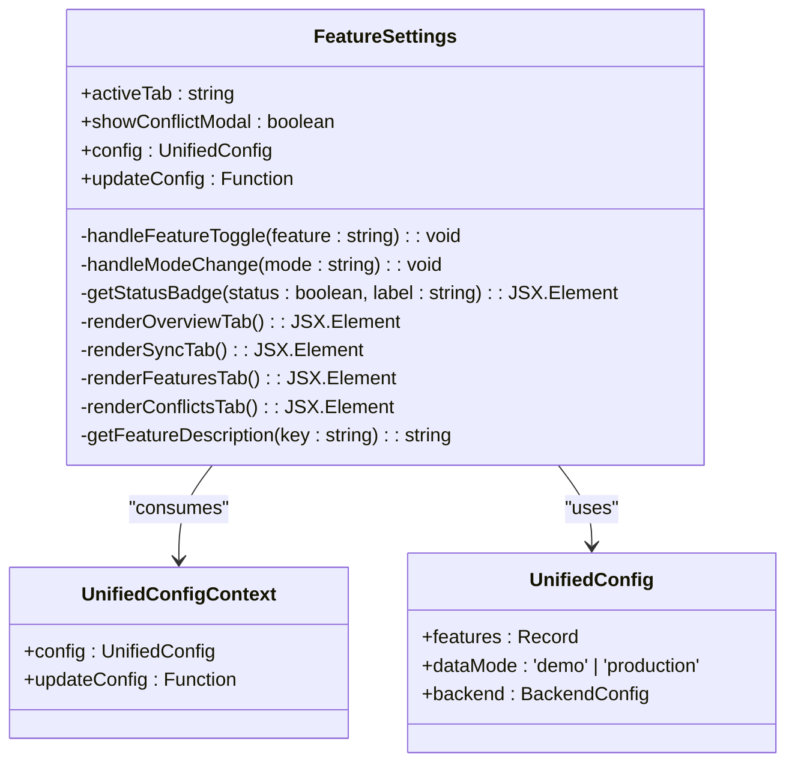
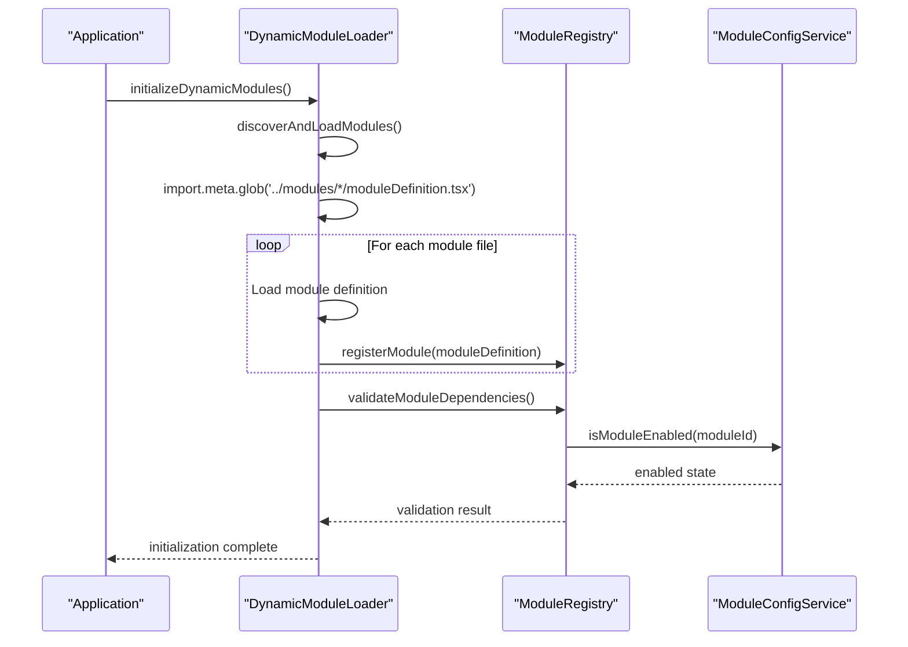
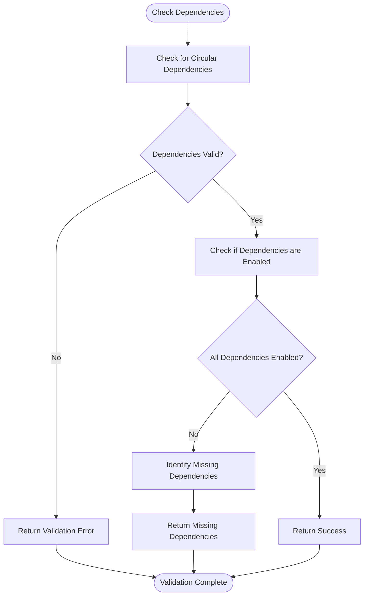
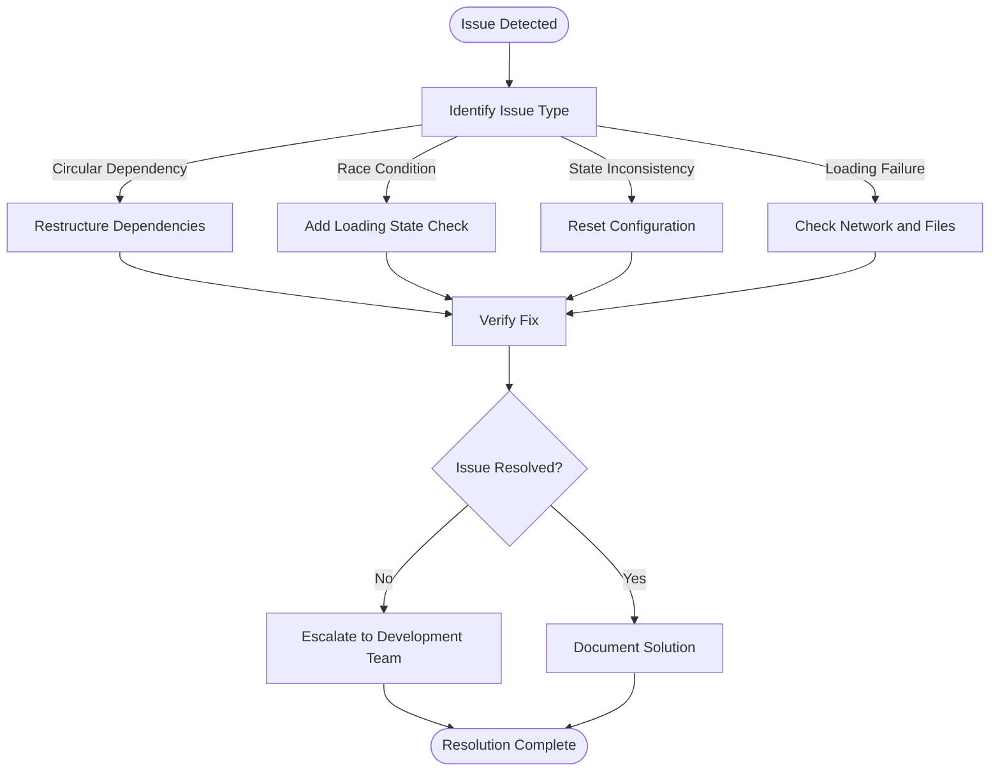

# Feature Flags and Module Configuration

<cite>
**Referenced Files in This Document**   
- [modules.json](file://src/config/modules.json)
- [FeatureSettings.tsx](file://src/components/FeatureSettings.tsx)
- [ModuleManagementPanel.tsx](file://src/components/settings/ModuleManagementPanel.tsx)
- [moduleRegistry.ts](file://src/core/moduleRegistry.ts)
- [moduleConfigService.ts](file://src/services/moduleConfigService.ts)
- [moduleManagementService.ts](file://src/services/moduleManagementService.ts)
- [dynamicModuleLoader.ts](file://src/services/dynamicModuleLoader.ts)
- [moduleDefinition.tsx](file://src/modules/academics/moduleDefinition.tsx)
- [moduleDefinition.tsx](file://src/modules/administration/moduleDefinition.tsx)
- [types.ts](file://src/core/types.ts)
</cite>

## Table of Contents
1. [Introduction](#introduction)
2. [Module Configuration System](#module-configuration-system)
3. [Feature Flag Management](#feature-flag-management)
4. [Module Registry and Dynamic Loading](#module-registry-and-dynamic-loading)
5. [Module Dependencies and Validation](#module-dependencies-and-validation)
6. [Creating and Configuring Modules](#creating-and-configuring-modules)
7. [Common Issues and Troubleshooting](#common-issues-and-troubleshooting)
8. [Best Practices](#best-practices)
9. [Conclusion](#conclusion)

## Introduction

The schoolpilot3 application implements a sophisticated module and feature flag system that enables dynamic configuration of functionality availability. This system allows administrators to enable or disable modules and features without requiring code changes or application redeployment. The architecture combines configuration files, runtime services, and user interfaces to provide comprehensive control over the application's behavior.

The system is built around three core components: the module configuration system that manages which modules are available, the feature flag system that controls specific functionality within modules, and the dynamic module loading system that enables on-demand loading of module code. These components work together to provide a flexible and extensible architecture that supports gradual feature rollouts, A/B testing, and environment-specific configurations.

**Section sources**
- [modules.json](file://src/config/modules.json)
- [FeatureSettings.tsx](file://src/components/FeatureSettings.tsx)
- [ModuleManagementPanel.tsx](file://src/components/settings/ModuleManagementPanel.tsx)

## Module Configuration System

The module configuration system in schoolpilot3 is centered around the `modules.json` configuration file, which defines the module registry with dependencies, load order, and initial state. This JSON file serves as the source of truth for module availability and relationships.

```json
{
  "enabledModules": [
    "dashboard",
    "administration", 
    "academics",
    "finance",
    "hr",
    "inventory",
    "library",
    "nutrition",
    "reports",
    "settings"
  ],
  "disabledModules": [],
  "moduleSettings": {
    "dashboard": {
      "enabled": true,
      "required": true,
      "description": "Core dashboard functionality"
    },
    "administration": {
      "enabled": true,
      "required": false,
      "description": "Student and staff administration"
    },
    // Additional module configurations...
  },
  "moduleDependencies": {
    "academics": ["administration"],
    "finance": ["administration"],
    "hr": ["administration"],
    "nutrition": ["administration"],
    "reports": ["administration", "academics", "finance"]
  }
}
```

The configuration file contains several key sections:
- **enabledModules**: List of modules that are initially enabled
- **disabledModules**: List of modules that are initially disabled (currently empty)
- **moduleSettings**: Configuration for each module including enabled state, required status, and description
- **moduleDependencies**: Dependency relationships between modules

The system uses localStorage to persist module configuration changes made at runtime. The `moduleConfigService` handles loading and saving configurations, with a storage key of `module_configurations`. When no configuration exists in localStorage, the system defaults to enabling all available modules except core modules which are always enabled.

```mermaid
classDiagram
class ModuleConfigService {
+STORAGE_KEY : string
+configs : Map<string, ModuleConfig>
+isLoading : boolean
-loadConfigurations() : void
-saveConfigurations() : void
+enableModule(moduleId : string) : boolean
+disableModule(moduleId : string) : boolean
+isModuleEnabled(moduleId : string) : boolean
+getEnabledModules() : string[]
+getAllModuleInfo() : ModuleInfo[]
+validateConfig() : { valid : boolean; errors : string[] }
}
class ModuleInfo {
+id : string
+name : string
+description? : string
+enabled : boolean
+required : boolean
+dependencies : string[]
+dependencySatisfied : boolean
+missingDependencies : string[]
}
class ModuleConfig {
+id : string
+enabled : boolean
+settings? : Record<string, any>
+lastModified : Date
}
ModuleConfigService --> ModuleInfo : "provides"
ModuleConfigService --> ModuleConfig : "manages"
```

**Diagram sources**
- [moduleConfigService.ts](file://src/services/moduleConfigService.ts#L15-L324)
- [types.ts](file://src/core/types.ts#L800-L900)

**Section sources**
- [modules.json](file://src/config/modules.json)
- [moduleConfigService.ts](file://src/services/moduleConfigService.ts#L15-L324)

## Feature Flag Management

The feature flag system in schoolpilot3 is implemented through the `FeatureSettings.tsx` component, which provides a comprehensive UI for managing application features and capabilities. This component allows users to toggle feature flags, manage application mode, and configure enhanced capabilities.

The feature flag system is integrated with the `UnifiedConfigContext` which provides access to the application's configuration, including the `features` object that contains all available feature flags. The component displays feature flags in a toggleable list, showing the current state and description of each feature.



**Diagram sources**
- [FeatureSettings.tsx](file://src/components/FeatureSettings.tsx#L25-L543)
- [types.ts](file://src/core/types.ts#L1200-L1300)

The `FeatureSettings` component organizes features into several tabs:
- **Overview**: System status, quick statistics, and feature status
- **Sync Management**: Synchronization settings and management
- **Feature Flags**: Toggle individual feature flags
- **Conflicts**: Resolution of data conflicts
- **Performance**: Performance monitoring and diagnostics
- **Memory**: Memory usage and management
- **UI Components**: UI component demonstrations

Each feature flag can be toggled independently, with the state persisted through the `updateConfig` function. The component also provides utility buttons for resetting configurations, fixing missing flags, and restoring defaults. For example, the "Fix Missing Flags" button adds the `enablePerformanceMonitoring` flag if it's missing from the configuration.

The system includes several built-in feature flags:
- **enhancedDataLayer**: Advanced data management with RxDB integration
- **networkStatusIndicator**: Real-time network connectivity display
- **moduleHealthIndicator**: Module loading status and health monitoring
- **syncStatusComponent**: Detailed sync progress and queue management
- **enableOfflineMode**: Enable offline-first data operations
- **performanceMonitorWidget**: Show floating performance monitor widget

These flags control the availability of specific features and can be used for gradual rollouts, A/B testing, or environment-specific configurations.

**Section sources**
- [FeatureSettings.tsx](file://src/components/FeatureSettings.tsx#L25-L543)

## Module Registry and Dynamic Loading

The module registry system is implemented in `moduleRegistry.ts` and serves as the central hub for module management and navigation generation. This singleton class maintains a registry of all available modules and provides methods for enabling, disabling, and retrieving modules.

```mermaid
classDiagram
class ModuleRegistry {
-modules : Map<string, ModuleDefinition>
+registerModule(module : ModuleDefinition) : void
+unregisterModule(moduleId : string) : void
+enableModule(moduleId : string) : boolean
+disableModule(moduleId : string) : boolean
+getAllModules() : ModuleDefinition[]
+getEnabledModules() : ModuleDefinition[]
+getModule(moduleId : string) : ModuleDefinition | undefined
+isModuleEnabled(moduleId : string) : boolean
+getNavigationItems() : NavItem[]
+getModuleNavigation(moduleId : string) : NavItem[]
+checkDependencies(moduleId : string) : { satisfied : boolean; missing : string[] }
+validateModuleDependencies(moduleId : string) : Promise<boolean>
+getModulesByFeature(feature : string) : ModuleDefinition[]
+getAllFeatures() : string[]
+getModuleSettings() : Array<{ moduleId : string; settings : any }>
}
class ModuleDefinition {
+id : string
+name : string
+description? : string
+icon : React.ComponentType
+path : string
+isActive : boolean
+version : string
+navigation : NavItem[]
+features : string[]
+dependencies : Array<string | { moduleId : string; version : string; required : boolean }>
+settings : ModuleSettings
+rbacPermissions : string[]
+defaultRoles : string[]
}
class NavItem {
+name : string
+path : string
+icon : React.ComponentType
+isGroup : boolean
+modulePath : string
+children : NavItem[]
+isActive : boolean
}
class ModuleSettings {
+category : string
+items : Array<{ key : string; type : string; defaultValue : any }>
}
ModuleRegistry --> ModuleDefinition : "contains"
ModuleRegistry --> NavItem : "generates"
ModuleDefinition --> ModuleSettings : "has"
```

**Diagram sources**
- [moduleRegistry.ts](file://src/core/moduleRegistry.ts#L15-L194)
- [types.ts](file://src/core/types.ts#L1000-L1100)

The registry integrates with the `moduleConfigService` to determine module enabled states. Core modules (dashboard, settings, reports) are always enabled, while other modules check their enabled state against the configuration service. The registry also handles navigation generation by collecting navigation items from all enabled modules and sorting them according to the `MODULE_ORDER` defined in `moduleOrder.ts`.

Dynamic module loading is handled by the `dynamicModuleLoader.ts` service, which discovers and loads module definitions at runtime using Vite's `import.meta.glob` functionality. This allows for code splitting and on-demand loading of module code.



**Diagram sources**
- [dynamicModuleLoader.ts](file://src/services/dynamicModuleLoader.ts#L15-L262)
- [moduleRegistry.ts](file://src/core/moduleRegistry.ts#L15-L194)
- [moduleConfigService.ts](file://src/services/moduleConfigService.ts#L15-L324)

The dynamic loader includes several important features:
- **Fallback mechanism**: If module discovery fails, it uses a predefined list of modules
- **Timeout protection**: Prevents infinite loading states with a 5-second timeout
- **Force completion**: Can force loading to complete if stuck
- **Error handling**: Gracefully handles module loading errors

**Section sources**
- [moduleRegistry.ts](file://src/core/moduleRegistry.ts#L15-L194)
- [dynamicModuleLoader.ts](file://src/services/dynamicModuleLoader.ts#L15-L262)

## Module Dependencies and Validation

The module system implements a comprehensive dependency management system that ensures modules are only enabled when their dependencies are satisfied. Dependencies are defined in both the `modules.json` configuration file and individual module definitions.

In `modules.json`, dependencies are defined as a simple mapping:
```json
"moduleDependencies": {
  "academics": ["administration"],
  "finance": ["administration"],
  "hr": ["administration"],
  "nutrition": ["administration"],
  "reports": ["administration", "academics", "finance"]
}
```

Module definitions can also specify dependencies with additional metadata:
```typescript
dependencies: [
  {
    moduleId: 'administration',
    version: '^1.0.0',
    required: true
  },
  {
    moduleId: 'finance',
    version: '^1.0.0',
    required: false
  }
]
```

The system validates dependencies through several mechanisms:
1. **Circular dependency detection**: The `moduleConfigService` includes a `hasCircularDependency` method that uses depth-first search to detect circular dependencies
2. **Dependency satisfaction checking**: Both `moduleRegistry` and `moduleConfigService` provide methods to check if a module's dependencies are satisfied
3. **Runtime validation**: The `ModuleDependencyValidator` service performs comprehensive validation of module dependencies



**Diagram sources**
- [moduleConfigService.ts](file://src/services/moduleConfigService.ts#L250-L324)
- [moduleRegistry.ts](file://src/core/moduleRegistry.ts#L150-L180)

The `ModuleManagementPanel` component provides a user interface for managing module dependencies, displaying dependency status and missing dependencies when they exist. When a module's dependencies are not satisfied, the component prevents the module from being enabled and displays the missing dependencies.

The system also prevents the disabling of modules that have dependent modules. For example, the administration module cannot be disabled if the academics, finance, or HR modules are enabled, as they depend on it.

**Section sources**
- [modules.json](file://src/config/modules.json)
- [moduleConfigService.ts](file://src/services/moduleConfigService.ts#L250-L324)
- [moduleRegistry.ts](file://src/core/moduleRegistry.ts#L150-L180)
- [ModuleManagementPanel.tsx](file://src/components/settings/ModuleManagementPanel.tsx#L15-L251)

## Creating and Configuring Modules

Creating a new module in schoolpilot3 involves several steps and follows a standardized pattern. Each module is defined in its own directory under `src/modules/` and includes a `moduleDefinition.tsx` file that exports the module configuration.

Here's an example of a module definition from the academics module:

```typescript
export const academicsModule: ModuleDefinition = {
  id: 'academics',
  name: 'navigation:academics.title',
  description: 'navigation:academics.description',
  icon: AcademicCapIcon,
  path: '/academics',
  isActive: true,
  version: '1.0.0',
  navigation: [
    { name: 'navigation:academics.dashboard', path: '/academics/dashboard', icon: AcademicCapIcon, page: 'AcademicsDashboardPage' },
    // Additional navigation items...
  ],
  features: ['subject-management', 'class-management', 'timetable', 'exam-management', 'grading'],
  dependencies: [
    {
      moduleId: 'administration',
      version: '^1.0.0',
      required: true
    }
  ],
  settings: {
    category: 'academics',
    items: [
      {
        key: 'enableExamManagement',
        type: 'boolean',
        defaultValue: true
      }
    ]
  },
  rbacPermissions: academicsPermissions,
  defaultRoles: academicsDefaultRoles,
};
```

Key elements of a module definition include:
- **id**: Unique identifier for the module
- **name**: Display name (supports i18n)
- **description**: Module description (supports i18n)
- **icon**: Icon component for navigation
- **path**: Base URL path for the module
- **navigation**: Array of navigation items with names, paths, icons, and associated pages
- **features**: Array of feature identifiers that can be used for conditional rendering
- **dependencies**: Array of module dependencies with version constraints
- **settings**: Module-specific settings that can be configured
- **rbacPermissions**: Role-based access control permissions
- **defaultRoles**: Default roles for the module

To create a new module:
1. Create a new directory under `src/modules/` with the module name
2. Create a `moduleDefinition.tsx` file that exports the module configuration
3. Create subdirectories for components, pages, data, services, etc.
4. Register any required routes in the application router
5. Add the module to `modules.json` if it should be enabled by default

Conditional feature rendering can be implemented using the feature flags system. For example:

```typescript
// In a component
const { config } = useUnifiedConfig();
if (config.features.enableAdvancedAnalytics) {
  // Render advanced analytics component
}
```

Or using module features:

```typescript
// In a component
const { moduleRegistry } = useModuleRegistry();
const hasExamManagement = moduleRegistry.getModulesByFeature('exam-management').length > 0;
if (hasExamManagement) {
  // Render exam management components
}
```

**Section sources**
- [moduleDefinition.tsx](file://src/modules/academics/moduleDefinition.tsx)
- [moduleDefinition.tsx](file://src/modules/administration/moduleDefinition.tsx)
- [types.ts](file://src/core/types.ts#L1000-L1100)

## Common Issues and Troubleshooting

The module and feature flag system in schoolpilot3 can encounter several common issues that administrators and developers should be aware of:

### Circular Module Dependencies
Circular dependencies occur when Module A depends on Module B, and Module B depends on Module A. The system detects circular dependencies during configuration validation and prevents the modules from being enabled.

**Solution**: Restructure the modules to eliminate the circular dependency. This might involve:
- Creating a third module that contains shared functionality
- Moving shared code to a utility library
- Re-evaluating the module boundaries and responsibilities

### Feature Flag Race Conditions
Race conditions can occur when feature flags are accessed before the configuration is fully loaded, resulting in inconsistent behavior.

**Solution**: Always check that the configuration is available before accessing feature flags:
```typescript
const { config, isLoading } = useUnifiedConfig();
if (isLoading) {
  return <LoadingSpinner />;
}
if (config.features.enableNewUI) {
  // Render new UI
}
```

### Inconsistent Module State Across Sessions
Module state inconsistencies can occur when localStorage becomes corrupted or when configuration changes are not properly synchronized.

**Solution**: Implement configuration reset mechanisms:
- Provide a "Reset Config" button in the FeatureSettings component
- Use versioned configurations to handle schema changes
- Implement configuration import/export functionality

### Module Loading Failures
Module loading can fail due to network issues, file not found errors, or syntax errors in module definitions.

**Solution**: The system includes several safeguards:
- Fallback module list for when discovery fails
- Timeout protection to prevent infinite loading
- Error boundaries to contain module loading errors
- Comprehensive logging for debugging

The `ModuleManagementPanel` component includes built-in troubleshooting features:
- Visual feedback for dependency status
- Error messages when operations fail
- Statistics showing enabled/disabled modules
- Reload functionality for individual modules



**Diagram sources**
- [moduleConfigService.ts](file://src/services/moduleConfigService.ts#L250-L324)
- [dynamicModuleLoader.ts](file://src/services/dynamicModuleLoader.ts#L15-L262)
- [ModuleManagementPanel.tsx](file://src/components/settings/ModuleManagementPanel.tsx#L15-L251)

**Section sources**
- [moduleConfigService.ts](file://src/services/moduleConfigService.ts#L250-L324)
- [dynamicModuleLoader.ts](file://src/services/dynamicModuleLoader.ts#L15-L262)
- [ModuleManagementPanel.tsx](file://src/components/settings/ModuleManagementPanel.tsx#L15-L251)

## Best Practices

To ensure a robust and maintainable module and feature flag system, follow these best practices:

### Naming Conventions
- Use lowercase, hyphen-separated module IDs (e.g., `student-management`)
- Use camelCase for feature flags (e.g., `enableEnhancedSearch`)
- Use consistent prefixing for related features (e.g., `search-*`, `export-*`)
- Use descriptive names that clearly indicate the feature's purpose

### Versioning Feature Flags
- Include version information in the configuration schema
- Use semantic versioning for module dependencies (e.g., `^1.0.0`)
- Implement configuration migration scripts for breaking changes
- Maintain backward compatibility when possible

### Gradual Feature Rollouts
- Use feature flags to enable gradual rollouts to specific user groups
- Implement percentage-based rollouts for A/B testing
- Monitor feature usage and performance before full release
- Provide easy rollback mechanisms

### Module Design Principles
- Keep modules focused on a single responsibility
- Minimize inter-module dependencies
- Use interfaces to define module contracts
- Document module dependencies and integration points

### Configuration Management
- Store configuration in version control
- Use environment-specific configuration files
- Implement configuration validation
- Provide import/export functionality for backup and migration

### Testing Strategies
- Test modules in isolation
- Test dependency resolution scenarios
- Test feature flag combinations
- Test configuration edge cases (missing flags, invalid values)

### Performance Considerations
- Lazy-load module code to reduce initial bundle size
- Cache configuration to minimize localStorage access
- Optimize dependency checking algorithms
- Monitor module loading performance

Following these best practices will help ensure a stable, maintainable, and scalable module and feature flag system.

**Section sources**
- [modules.json](file://src/config/modules.json)
- [FeatureSettings.tsx](file://src/components/FeatureSettings.tsx#L25-L543)
- [moduleRegistry.ts](file://src/core/moduleRegistry.ts#L15-L194)

## Conclusion

The feature flag and module configuration system in schoolpilot3 provides a powerful and flexible way to control functionality availability and application behavior. By combining configuration files, runtime services, and user interfaces, the system enables dynamic management of modules and features without requiring code changes or application redeployment.

The architecture is built around several key components:
- The `modules.json` configuration file that defines the initial module state and dependencies
- The `moduleConfigService` that manages module configuration persistence
- The `moduleRegistry` that maintains the registry of modules and handles navigation generation
- The `dynamicModuleLoader` that discovers and loads modules at runtime
- The `FeatureSettings` component that provides a user interface for managing feature flags
- The `ModuleManagementPanel` that allows enabling and disabling modules

This system supports important use cases such as gradual feature rollouts, A/B testing, environment-specific configurations, and modular application architecture. By following the best practices outlined in this document, teams can effectively leverage this system to deliver features safely and efficiently.

The comprehensive dependency management, error handling, and troubleshooting capabilities ensure that the system remains robust and maintainable as the application grows. With proper implementation and management, this module and feature flag system can significantly enhance the flexibility and reliability of the schoolpilot3 application.