# Specialized Configuration Modules

<cite>
**Referenced Files in This Document**   
- [backendArchitecture.ts](file://src/config/backendArchitecture.ts)
- [tabbedModeConfig.ts](file://src/config/tabbedModeConfig.ts)
- [errorTracking.ts](file://src/config/errorTracking.ts)
- [unifiedConfig.ts](file://src/config/unifiedConfig.ts)
</cite>

## Table of Contents
1. [Introduction](#introduction)
2. [Backend Architecture Configuration](#backend-architecture-configuration)
3. [Tabbed Mode Configuration](#tabbed-mode-configuration)
4. [Error Tracking Configuration](#error-tracking-configuration)
5. [Unified Configuration System](#unified-configuration-system)
6. [Configuration Integration and Relationships](#configuration-integration-and-relationships)
7. [Practical Configuration Examples](#practical-configuration-examples)
8. [Common Issues and Troubleshooting](#common-issues-and-troubleshooting)
9. [Best Practices](#best-practices)
10. [Conclusion](#conclusion)

## Introduction

The schoolpilot3 application implements a sophisticated configuration system that manages domain-specific settings through specialized modules. These modules handle backend integration strategy, user interface behavior, and error reporting services. The system is designed to support flexible deployment scenarios, from frontend-only applications using PouchDB/CouchDB to full-featured installations with custom backend APIs.

This document provides a comprehensive analysis of the specialized configuration modules: backendArchitecture.ts for backend integration, tabbedModeConfig.ts for tabbed workspace behavior, and errorTracking.ts for error reporting services. It also examines how these specialized configurations integrate with the unified configuration system that coordinates all application settings.

**Section sources**
- [backendArchitecture.ts](file://src/config/backendArchitecture.ts#L1-L455)
- [tabbedModeConfig.ts](file://src/config/tabbedModeConfig.ts#L1-L86)
- [errorTracking.ts](file://src/config/errorTracking.ts#L1-L151)
- [unifiedConfig.ts](file://src/config/unifiedConfig.ts#L1-L1052)

## Backend Architecture Configuration

The backendArchitecture.ts module provides a comprehensive system for configuring the application's backend integration strategy. It supports multiple backend scenarios including frontend-only (PouchDB/CouchDB), Frappe Education API, custom backend APIs, and hybrid configurations.

### Backend Configuration Model

The configuration system defines several key types that describe the backend architecture:

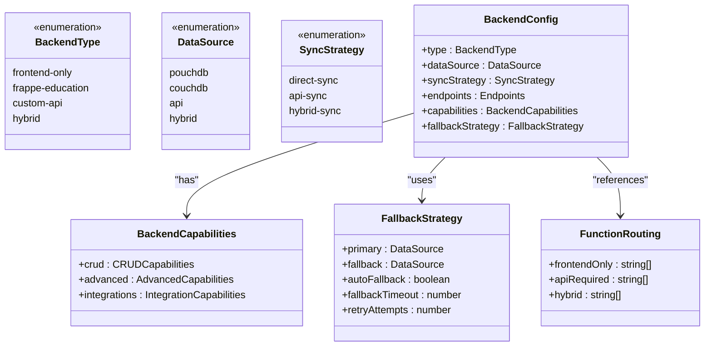

**Diagram sources**
- [backendArchitecture.ts](file://src/config/backendArchitecture.ts#L10-L200)

**Section sources**
- [backendArchitecture.ts](file://src/config/backendArchitecture.ts#L1-L455)

### Backend Configuration Options

The system supports four primary backend types, each with specific characteristics:

1. **Frontend-only**: Uses PouchDB for client-side storage with direct sync to CouchDB
2. **Frappe Education**: Integrates with ERPNext Education module API
3. **Custom API**: Connects to a custom backend server with tailored APIs
4. **Hybrid**: Combines direct database access with API calls based on functionality

Each configuration includes detailed endpoint definitions, capability flags, and fallback strategies. The capability system categorizes features into three groups:

- **CRUD operations**: Basic data management capabilities
- **Advanced features**: Reporting, analytics, bulk operations
- **Integrations**: External services like SMS, email, and payments

### Backend Architecture Manager

The `BackendArchitectureManager` class provides runtime management of backend configurations:

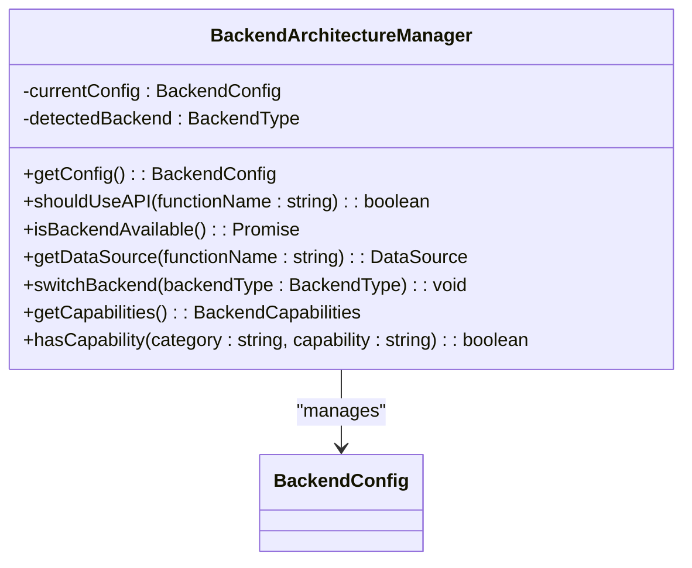

**Diagram sources**
- [backendArchitecture.ts](file://src/config/backendArchitecture.ts#L201-L400)

**Section sources**
- [backendArchitecture.ts](file://src/config/backendArchitecture.ts#L201-L455)

The manager implements intelligent routing logic that determines whether to use the API or local database based on the function being called and the current backend availability. It includes methods for:

- Detecting the appropriate backend type based on environment variables
- Checking backend API availability through health checks
- Determining the appropriate data source for specific functions
- Switching between backend configurations at runtime

## Tabbed Mode Configuration

The tabbedModeConfig.ts module controls the tabbed workspace behavior and user interface layout. It implements a feature flag system that enables granular control over which modules use the tabbed interface versus traditional navigation.

### Tabbed Mode Configuration Structure

The configuration system defines a `TabbedModeConfig` interface that controls tabbed mode behavior:

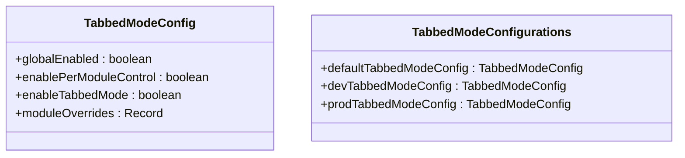

**Diagram sources**
- [tabbedModeConfig.ts](file://src/config/tabbedModeConfig.ts#L1-L86)

**Section sources**
- [tabbedModeConfig.ts](file://src/config/tabbedModeConfig.ts#L1-L86)

### Configuration Profiles

The system provides three configuration profiles for different environments:

1. **Default Configuration**: Conservative rollout with tabbed mode enabled only for core modules
2. **Development Configuration**: All modules have tabbed mode enabled for testing
3. **Production Configuration**: Conservative rollout similar to default, with gradual module enablement

The configuration follows a progressive enhancement strategy, enabling tabbed mode first for core modules (dashboard, settings, reports) before gradually rolling out to academic and administrative modules.

### Module-Specific Overrides

The tabbed mode system supports per-module control through the `moduleOverrides` property:

```typescript
moduleOverrides: {
  // Core modules - enabled
  'dashboard': true,
  'settings': true,
  'reports': true,
  
  // Academic modules - disabled for gradual rollout
  'academics': false,
  'administration': false,
  'finance': false,
  'hr': false,
  'inventory': false,
  'library': false,
  'nutrition': false,
  'admissions': false,
  'audit': false,
}
```

This approach allows for controlled testing and user feedback before full deployment of the tabbed interface across all modules.

## Error Tracking Configuration

The errorTracking.ts module configures error reporting services and monitoring endpoints using the Sentry SDK with a self-hosted Bugsink instance.

### Error Tracking Configuration

The configuration system sets up comprehensive error tracking with the following parameters:

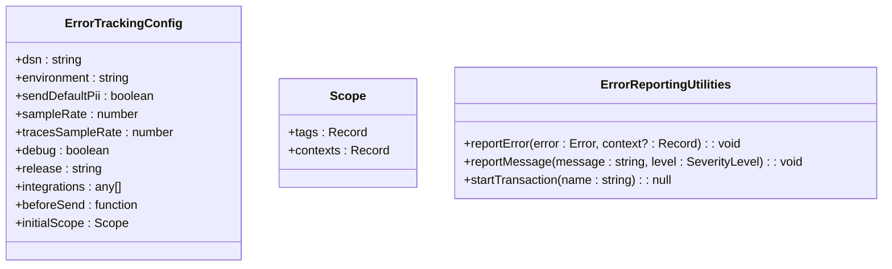

**Diagram sources**
- [errorTracking.ts](file://src/config/errorTracking.ts#L1-L151)

**Section sources**
- [errorTracking.ts](file://src/config/errorTracking.ts#L1-L151)

### Key Configuration Settings

The error tracking system includes several important settings:

- **DSN Configuration**: Uses environment variables for the Bugsink DSN, with a fallback URL
- **Environment Detection**: Automatically detects development vs. production environments
- **PII Handling**: Enables sending personally identifiable information for better debugging in self-hosted environment
- **Sampling**: Sets 100% sample rate for complete error capture
- **Trace Disabling**: Disables transaction tracing as Bugsink doesn't support this feature

### Error Filtering and Processing

The system implements intelligent error filtering through the `beforeSend` callback:

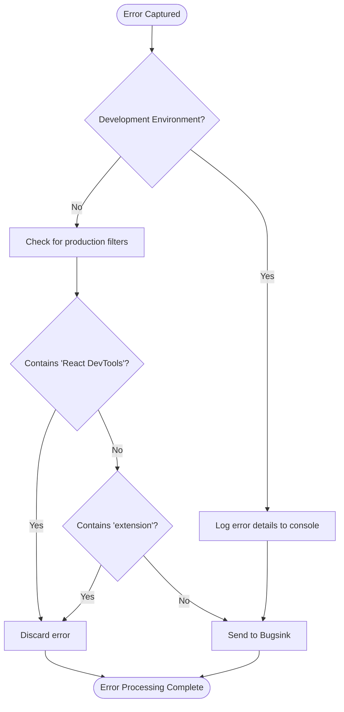

**Diagram sources**
- [errorTracking.ts](file://src/config/errorTracking.ts#L60-L100)

**Section sources**
- [errorTracking.ts](file://src/config/errorTracking.ts#L60-L100)

The filtering system prevents noise from development tools and browser extensions while ensuring genuine application errors are captured and reported.

### Manual Error Reporting

The module provides utility functions for manual error reporting:

- `reportError`: Captures specific errors with additional context
- `reportMessage`: Reports informational messages at various severity levels
- `startTransaction`: Placeholder function that returns null (Bugsink doesn't support transactions)

## Unified Configuration System

The unifiedConfig.ts module serves as the central configuration system that integrates all specialized configurations and provides a consistent interface for application settings.

### Unified Configuration Model

The unified configuration system defines a comprehensive interface that encompasses all application settings:

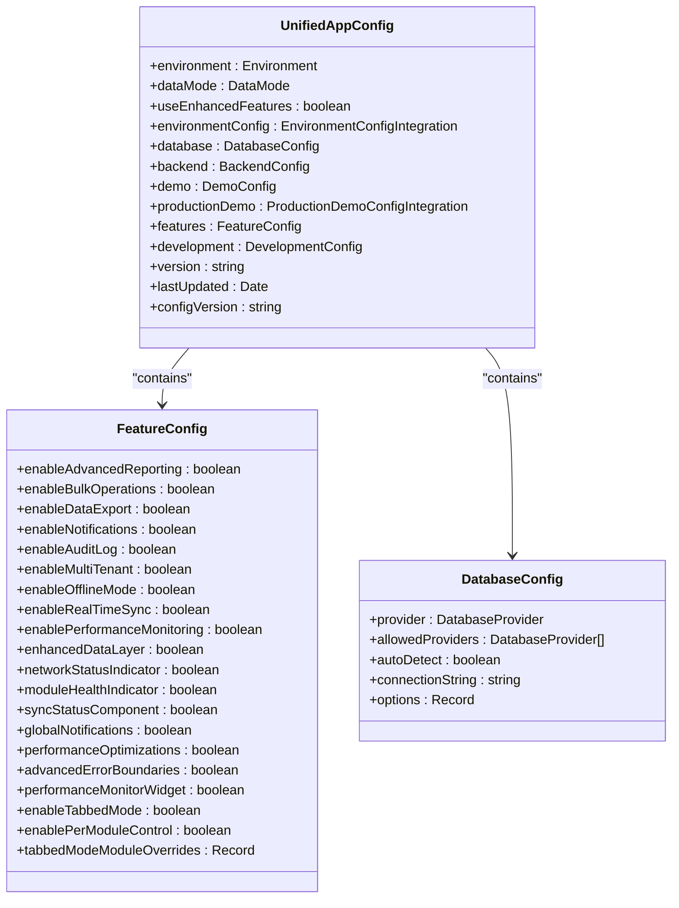

**Diagram sources**
- [unifiedConfig.ts](file://src/config/unifiedConfig.ts#L50-L200)

**Section sources**
- [unifiedConfig.ts](file://src/config/unifiedConfig.ts#L1-L1052)

### Configuration Management

The `UnifiedConfigManager` class provides runtime management of the unified configuration:

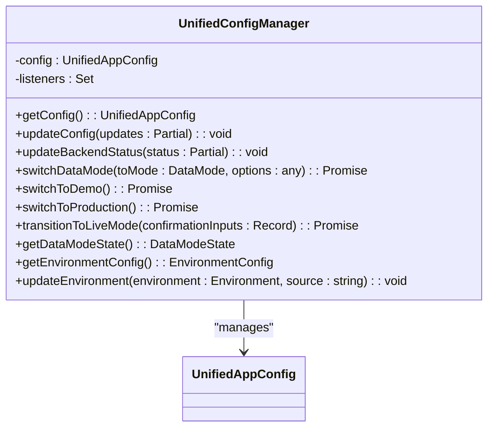

**Diagram sources**
- [unifiedConfig.ts](file://src/config/unifiedConfig.ts#L700-L1000)

**Section sources**
- [unifiedConfig.ts](file://src/config/unifiedConfig.ts#L700-L1052)

The manager implements several key features:

- **Persistent Storage**: Configuration is stored in localStorage with version tracking
- **Migration Support**: Handles configuration migrations when version changes
- **URL Parameter Overrides**: Allows configuration overrides via URL parameters
- **Environment Integration**: Integrates with environment detection and configuration
- **Data Mode Management**: Coordinates data mode switching with validation

### Configuration Presets

The system includes predefined configuration presets for different scenarios:

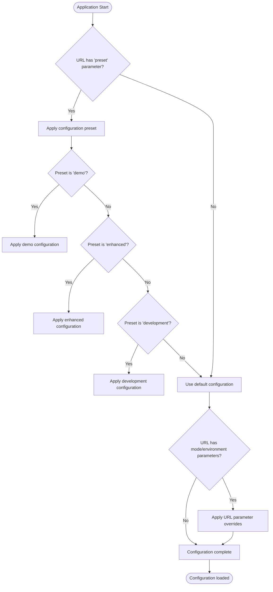

**Diagram sources**
- [unifiedConfig.ts](file://src/config/unifiedConfig.ts#L400-L600)

**Section sources**
- [unifiedConfig.ts](file://src/config/unifiedConfig.ts#L400-L600)

## Configuration Integration and Relationships

The specialized configuration modules are integrated within the unified configuration system to provide a cohesive settings management approach.

### Configuration Hierarchy

The configuration system follows a hierarchical structure where specialized modules contribute to the unified configuration:

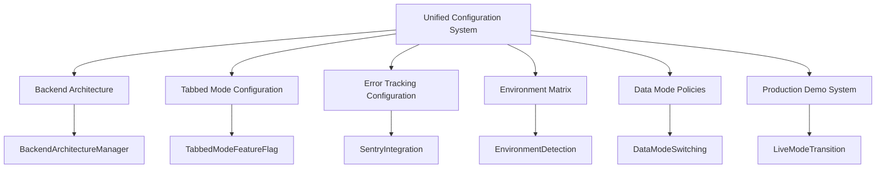

**Diagram sources**
- [unifiedConfig.ts](file://src/config/unifiedConfig.ts#L1-L1052)
- [backendArchitecture.ts](file://src/config/backendArchitecture.ts#L1-L455)
- [tabbedModeConfig.ts](file://src/config/tabbedModeConfig.ts#L1-L86)
- [errorTracking.ts](file://src/config/errorTracking.ts#L1-L151)

**Section sources**
- [unifiedConfig.ts](file://src/config/unifiedConfig.ts#L1-L1052)

### Feature Flag Integration

The unified configuration system integrates feature flags from specialized modules, particularly for tabbed mode:

```typescript
features: {
  // ... other features
  enableTabbedMode: true,
  enablePerModuleControl: true,
  tabbedModeModuleOverrides: {
    'dashboard': true,
    'settings': true,
    'reports': true,
    'academics': false,
    // ... other modules
  },
}
```

This integration allows the tabbed mode configuration from tabbedModeConfig.ts to be accessible through the unified configuration system, enabling consistent feature flag management.

### Configuration Flow

The configuration initialization process follows a specific sequence:

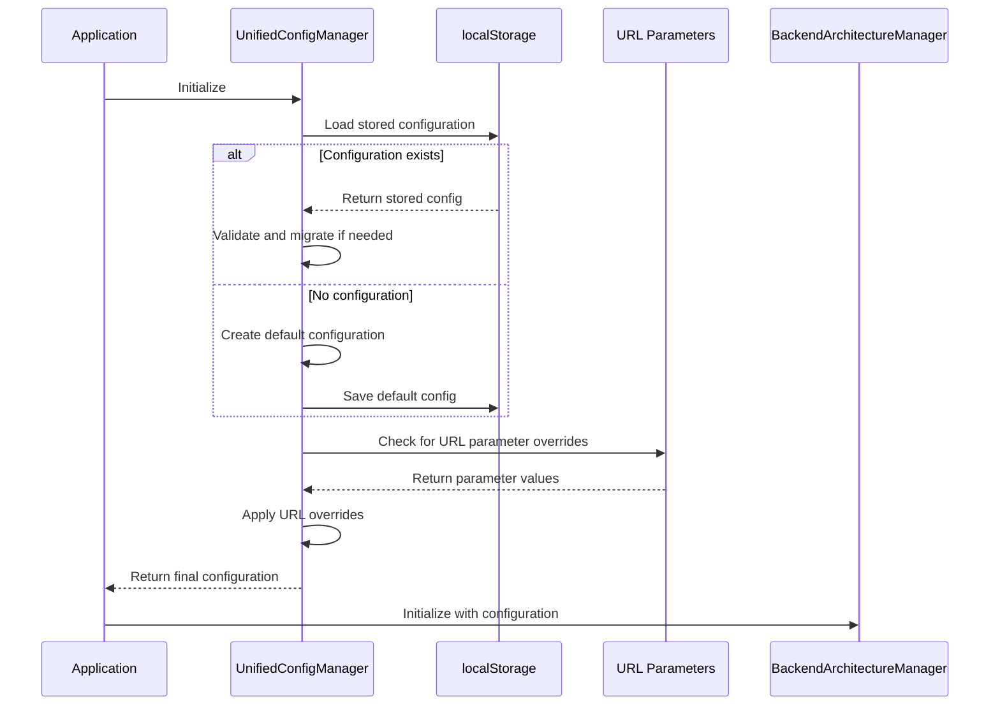

**Diagram sources**
- [unifiedConfig.ts](file://src/config/unifiedConfig.ts#L700-L900)
- [backendArchitecture.ts](file://src/config/backendArchitecture.ts#L201-L400)

**Section sources**
- [unifiedConfig.ts](file://src/config/unifiedConfig.ts#L700-L900)

## Practical Configuration Examples

### Configuring Multiple Backend Architectures

The system supports configuration of multiple backend architectures through environment variables and runtime switching.

#### RxDB Configuration
```typescript
// For RxDB-based local storage
process.env.VITE_BACKEND_TYPE = 'frontend-only';
process.env.VITE_COUCHDB_URL = 'http://localhost:5984';

// The system will automatically configure:
const config = backendArchitecture.getConfig();
// Result:
// type: 'frontend-only'
// dataSource: 'pouchdb'
// syncStrategy: 'direct-sync'
// endpoints: { couchdb: 'http://localhost:5984' }
```

#### PouchDB Configuration
```typescript
// For PouchDB with remote CouchDB
process.env.VITE_BACKEND_TYPE = 'frontend-only';
process.env.VITE_COUCHDB_URL = 'https://your-couchdb-server.com';

// This enables offline-first capabilities with cloud synchronization
```

#### SQLite Configuration
```typescript
// For SQLite hybrid configuration
process.env.VITE_BACKEND_TYPE = 'hybrid';
process.env.VITE_API_URL = 'http://localhost:3000/api';
process.env.VITE_COUCHDB_URL = 'http://localhost:5984';

// This enables hybrid mode with both API and database access
const hybridConfig = BACKEND_CONFIGS['hybrid'];
// The system will route functions appropriately based on FUNCTION_ROUTING
```

### Customizing Tabbed Mode Behavior

The tabbed mode configuration can be customized for different user roles through environment-specific configurations.

#### Administrator Configuration
```typescript
// Admin users get full tabbed mode access
export const adminTabbedModeConfig: TabbedModeConfig = {
  globalEnabled: true,
  enablePerModuleControl: true,
  enableTabbedMode: true,
  moduleOverrides: {
    'dashboard': true,
    'settings': true,
    'reports': true,
    'academics': true,      // Admins can access academics in tabbed mode
    'administration': true, // Admins can access administration in tabbed mode
    'finance': true,        // Admins can access finance in tabbed mode
    // ... other modules enabled
  }
};
```

#### Teacher Configuration
```typescript
// Teachers have limited tabbed mode access
export const teacherTabbedModeConfig: TabbedModeConfig = {
  globalEnabled: true,
  enablePerModuleControl: true,
  enableTabbedMode: true,
  moduleOverrides: {
    'dashboard': true,
    'academics': true,      // Teachers can access academics
    'attendance': true,     // Teachers can access attendance
    'grading': true,        // Teachers can access grading
    'reports': true,        // Teachers can access reports
    'settings': false,      // Teachers use traditional navigation for settings
    'finance': false,       // Teachers cannot access finance
    'hr': false,            // Teachers cannot access HR
    // ... other restricted modules
  }
};
```

#### Student Configuration
```typescript
// Students have minimal tabbed mode access
export const studentTabbedModeConfig: TabbedModeConfig = {
  globalEnabled: true,
  enablePerModuleControl: true,
  enableTabbedMode: true,
  moduleOverrides: {
    'dashboard': true,
    'academics': true,      // Students can view academics
    'attendance': true,     // Students can view attendance
    'grades': true,         // Students can view grades
    'reports': true,        // Students can view reports
    'settings': false,      // Students use traditional navigation for settings
    // ... all administrative modules disabled
  }
};
```

### Setting Up Error Tracking with External Services

The error tracking system can be configured for different external services.

#### Bugsink Configuration (Self-hosted)
```typescript
// Self-hosted Bugsink instance
const BUGSINK_DSN = 'https://your-bugsink-instance.com/project-id';

export const errorTrackingConfig: Sentry.BrowserOptions = {
  dsn: BUGSINK_DSN,
  environment: import.meta.env.PROD ? 'production' : 'development',
  sendDefaultPii: true,  // Safe for self-hosted environment
  sampleRate: 1.0,       // 100% sampling for complete error capture
  tracesSampleRate: 0,   // Disable traces (Bugsink limitation)
  debug: import.meta.env.DEV,
  release: import.meta.env.VITE_APP_VERSION,
  beforeSend: (event, hint) => {
    // Custom filtering for self-hosted environment
    if (event.exception?.values?.[0]?.value?.includes('React DevTools')) {
      return null; // Filter out development tool errors
    }
    return event;
  }
};
```

#### Sentry Configuration (Cloud)
```typescript
// For cloud-based Sentry
const SENTRY_DSN = 'https://public@o123456.ingest.sentry.io/1234567';

export const sentryConfig: Sentry.BrowserOptions = {
  dsn: SENTRY_DSN,
  environment: import.meta.env.PROD ? 'production' : 'development',
  sendDefaultPii: false,  // Disable PII for cloud service
  sampleRate: 0.5,        // 50% sampling to manage costs
  tracesSampleRate: 0.2,  // 20% sampling for performance monitoring
  debug: import.meta.env.DEV,
  release: import.meta.env.VITE_APP_VERSION,
  integrations: [
    Sentry.browserTracingIntegration(),
    Sentry.replayIntegration({
      maskAllText: true,
      blockAllMedia: true,
    }),
  ],
  replaysSessionSampleRate: 0.1,
  replaysOnErrorSampleRate: 1.0,
};
```

#### Multiple Error Tracking Services
```typescript
// Configuration for multiple error tracking services
class MultiErrorTracker {
  private sentryClient: typeof Sentry;
  private bugsinkClient: typeof Sentry;
  private enabledServices: string[];
  
  constructor() {
    this.enabledServices = ['sentry', 'bugsink']; // Can be configured
    
    if (this.enabledServices.includes('sentry')) {
      this.sentryClient = this.initializeSentry();
    }
    
    if (this.enabledServices.includes('bugsink')) {
      this.bugsinkClient = this.initializeBugsink();
    }
  }
  
  reportError(error: Error, context?: Record<string, any>) {
    if (this.sentryClient) {
      this.sentryClient.withScope((scope) => {
        if (context) scope.setContext('additional', context);
        this.sentryClient.captureException(error);
      });
    }
    
    if (this.bugsinkClient) {
      this.bugsinkClient.withScope((scope) => {
        if (context) scope.setContext('additional', context);
        this.bugsinkClient.captureException(error);
      });
    }
  }
}
```

**Section sources**
- [backendArchitecture.ts](file://src/config/backendArchitecture.ts#L1-L455)
- [tabbedModeConfig.ts](file://src/config/tabbedModeConfig.ts#L1-L86)
- [errorTracking.ts](file://src/config/errorTracking.ts#L1-L151)

## Common Issues and Troubleshooting

### Configuration Conflicts Between Specialized Modules

Configuration conflicts can occur when specialized modules have contradictory settings. The unified configuration system resolves these through a priority hierarchy.

#### Conflict Resolution Strategy
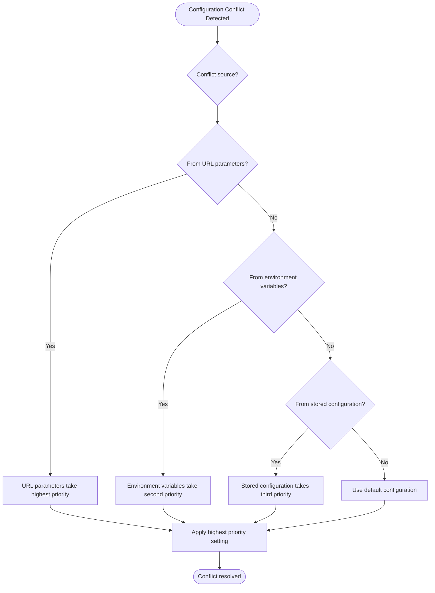

**Diagram sources**
- [unifiedConfig.ts](file://src/config/unifiedConfig.ts#L700-L900)

**Section sources**
- [unifiedConfig.ts](file://src/config/unifiedConfig.ts#L700-L900)

#### Example: Backend Type Conflict
```typescript
// Scenario: URL specifies 'custom-api' but environment specifies 'frontend-only'
// Resolution: URL parameter takes precedence

// In unifiedConfig.ts, the URL parameter processing occurs after environment detection
const urlParams = new URLSearchParams(window.location.search);
const preset = urlParams.get('preset'); // This overrides environment detection

// The URL parameter is applied after the initial environment-based configuration
// creating an override mechanism
```

### Incorrect Backend Provider Initialization

Issues with backend provider initialization can occur due to misconfiguration or environment detection failures.

#### Diagnosis Steps
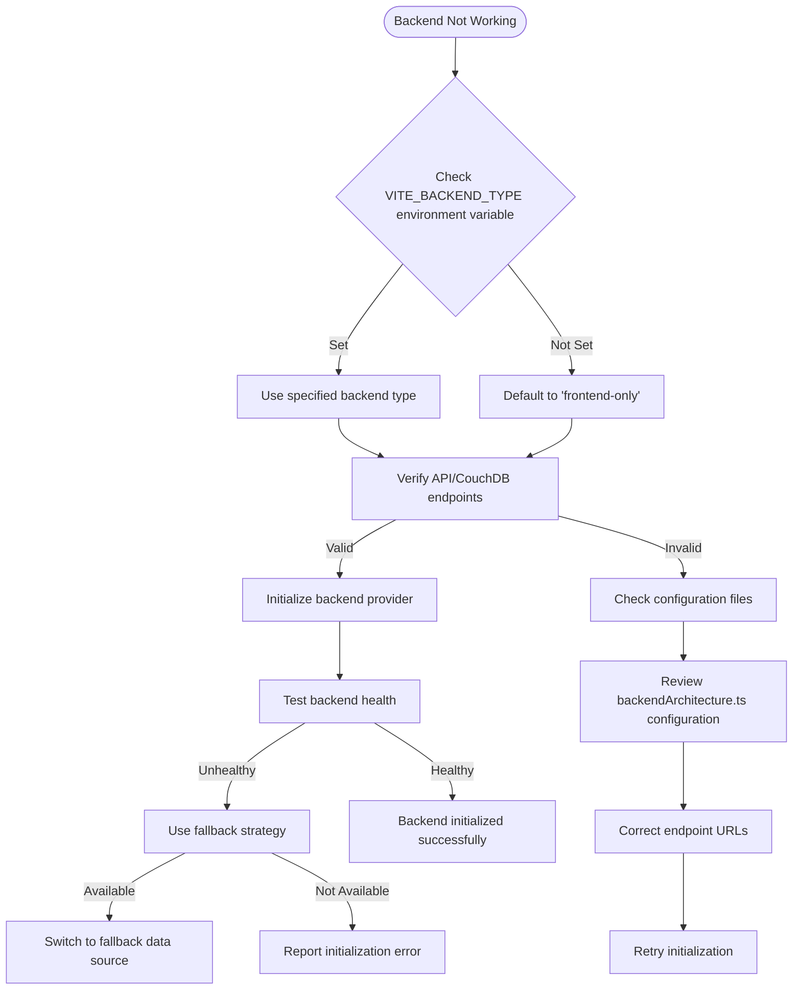

**Diagram sources**
- [backendArchitecture.ts](file://src/config/backendArchitecture.ts#L201-L400)

**Section sources**
- [backendArchitecture.ts](file://src/config/backendArchitecture.ts#L201-L400)

#### Common Fixes
1. **Verify Environment Variables**: Ensure VITE_BACKEND_TYPE and endpoint URLs are correctly set
2. **Check Service Availability**: Confirm that CouchDB or API services are running
3. **Validate Configuration**: Review the BACKEND_CONFIGS object in backendArchitecture.ts
4. **Test Fallback Strategy**: Ensure fallback data sources are properly configured

### Tabbed Mode Rendering Problems

Tabbed mode rendering issues can occur due to configuration mismatches or component loading problems.

#### Troubleshooting Checklist
- **Verify Configuration**: Ensure tabbed mode is enabled in both unified and tabbed mode configurations
- **Check Module Overrides**: Confirm the specific module is enabled in moduleOverrides
- **Validate Component Imports**: Ensure tabbed workspace components are properly imported
- **Review CSS Styles**: Check for styling conflicts that might affect tab rendering
- **Inspect Console Errors**: Look for JavaScript errors that might prevent tab initialization

#### Debugging Example
```typescript
// Add debug logging to identify tabbed mode issues
console.log('Tabbed mode status:', {
  globalEnabled: config.features.enableTabbedMode,
  perModuleControl: config.features.enablePerModuleControl,
  moduleOverride: config.features.tabbedModeModuleOverrides['academics'],
  finalDecision: config.features.enableTabbedMode && 
                (config.features.enablePerModuleControl ? 
                 config.features.tabbedModeModuleOverrides['academics'] : true)
});
```

**Section sources**
- [tabbedModeConfig.ts](file://src/config/tabbedModeConfig.ts#L1-L86)
- [unifiedConfig.ts](file://src/config/unifiedConfig.ts#L50-L200)

## Best Practices

### Extending the Configuration System

When adding new specialized modules to the configuration system, follow these best practices:

#### Module Creation Pattern
```typescript
// 1. Create the specialized configuration file
// src/config/newModuleConfig.ts
export interface NewModuleConfig {
  enabled: boolean;
  setting1: string;
  setting2: number;
  featureFlags: Record<string, boolean>;
}

export const defaultNewModuleConfig: NewModuleConfig = {
  enabled: true,
  setting1: 'default',
  setting2: 42,
  featureFlags: {}
};

// 2. Integrate with unified configuration
// src/config/unifiedConfig.ts
export interface UnifiedAppConfig {
  // ... existing properties
  newModule: NewModuleConfig; // Add to unified interface
}

// 3. Update default configuration
function createDefaultConfig(): UnifiedAppConfig {
  return {
    // ... existing defaults
    newModule: defaultNewModuleConfig, // Include in default config
  };
}
```

#### Type Safety and Validation
```typescript
// Implement runtime validation for new configuration
class NewModuleConfigValidator {
  static validate(config: any): config is NewModuleConfig {
    return (
      typeof config.enabled === 'boolean' &&
      typeof config.setting1 === 'string' &&
      typeof config.setting2 === 'number' &&
      typeof config.featureFlags === 'object'
    );
  }
  
  static getDefaults(): NewModuleConfig {
    return { ...defaultNewModuleConfig };
  }
}
```

### Maintaining Configuration Consistency

To ensure consistency across configuration domains, follow these practices:

#### Centralized Configuration Management
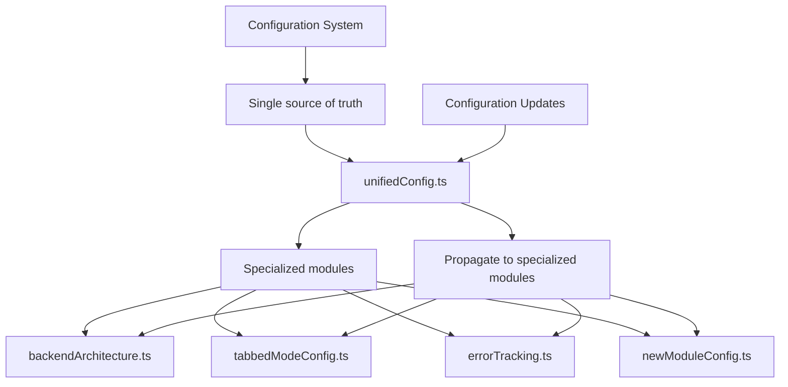

**Diagram sources**
- [unifiedConfig.ts](file://src/config/unifiedConfig.ts#L1-L1052)

**Section sources**
- [unifiedConfig.ts](file://src/config/unifiedConfig.ts#L1-L1052)

#### Configuration Synchronization
```typescript
// Implement configuration synchronization
class ConfigSynchronizer {
  private static instance: ConfigSynchronizer;
  
  private constructor() {
    // Listen for configuration changes
    UnifiedConfigManager.getInstance().addListener(
      this.handleConfigChange.bind(this)
    );
  }
  
  private handleConfigChange(config: UnifiedAppConfig) {
    // Synchronize specialized modules
    this.syncBackendConfig(config);
    this.syncTabbedModeConfig(config);
    this.syncErrorTrackingConfig(config);
    this.syncNewModuleConfig(config);
  }
  
  private syncBackendConfig(config: UnifiedAppConfig) {
    // Update backend architecture based on unified config
    if (config.features.enableAdvancedFeatures) {
      backendArchitecture.switchBackend('custom-api');
    } else {
      backendArchitecture.switchBackend('frontend-only');
    }
  }
  
  private syncTabbedModeConfig(config: UnifiedAppConfig) {
    // Update tabbed mode configuration
    // This would require a TabbedModeManager to be implemented
  }
  
  private syncErrorTrackingConfig(config: UnifiedAppConfig) {
    // Update error tracking based on configuration
    if (!config.features.enableErrorReporting) {
      // Disable error tracking
    }
  }
  
  private syncNewModuleConfig(config: UnifiedAppConfig) {
    // Update new module configuration
  }
}
```

#### Versioning and Migration
```typescript
// Implement configuration versioning
const CONFIG_VERSION = '3.0.0';
const CONFIG_MIGRATIONS = {
  '2.0.0': (config: any) => {
    // Migration from 2.0.0 to 3.0.0
    if (!config.newModule) {
      config.newModule = defaultNewModuleConfig;
    }
    return config;
  },
  '2.5.0': (config: any) => {
    // Migration from 2.5.0 to 3.0.0
    if (config.oldSetting && !config.newModule.setting1) {
      config.newModule.setting1 = config.oldSetting;
    }
    return config;
  }
};

// Apply migrations in unifiedConfig.ts
private loadConfig(): UnifiedAppConfig {
  // ... existing code
  if (storedVersion !== CONFIG_VERSION) {
    console.log('Migrating unified configuration from version', storedVersion, 'to', CONFIG_VERSION);
    
    // Apply migration chain
    let migrationVersion = storedVersion;
    while (migrationVersion !== CONFIG_VERSION) {
      const nextMigration = this.findNextMigration(migrationVersion);
      if (nextMigration) {
        parsed = nextMigration(parsed);
        migrationVersion = this.getNextVersion(migrationVersion);
      } else {
        break;
      }
    }
    
    localStorage.setItem(CONFIG_VERSION_KEY, CONFIG_VERSION);
  }
  // ... rest of method
}
```

**Section sources**
- [unifiedConfig.ts](file://src/config/unifiedConfig.ts#L700-L900)

## Conclusion

The specialized configuration modules in schoolpilot3 provide a robust and flexible system for managing domain-specific settings. The backendArchitecture.ts module enables support for multiple backend scenarios with intelligent routing and fallback strategies. The tabbedModeConfig.ts module offers granular control over UI behavior with environment-specific configurations. The errorTracking.ts module provides comprehensive error reporting with intelligent filtering and privacy considerations.

These specialized modules are effectively integrated into the unified configuration system, which serves as the central hub for all application settings. This architecture allows for both specialized configuration needs and consistent, centralized management.

Key takeaways for developers working with this system:

1. **Leverage the hierarchy**: Use the unified configuration system as the primary interface, with specialized modules providing domain-specific functionality
2. **Follow the patterns**: When extending the system, follow the established patterns for configuration definition, validation, and integration
3. **Prioritize consistency**: Maintain configuration consistency across domains through proper synchronization and versioning
4. **Use environment awareness**: Take advantage of the environment detection and configuration system for appropriate settings in different deployment scenarios

The configuration system demonstrates a well-architected approach to managing complex application settings while maintaining flexibility and extensibility.

**Section sources**
- [backendArchitecture.ts](file://src/config/backendArchitecture.ts#L1-L455)
- [tabbedModeConfig.ts](file://src/config/tabbedModeConfig.ts#L1-L86)
- [errorTracking.ts](file://src/config/errorTracking.ts#L1-L151)
- [unifiedConfig.ts](file://src/config/unifiedConfig.ts#L1-L1052)