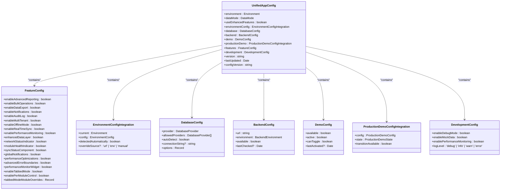
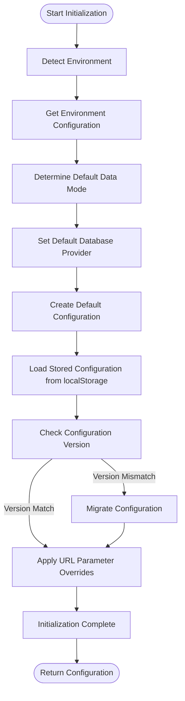
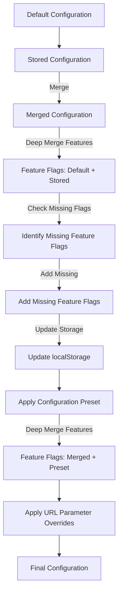
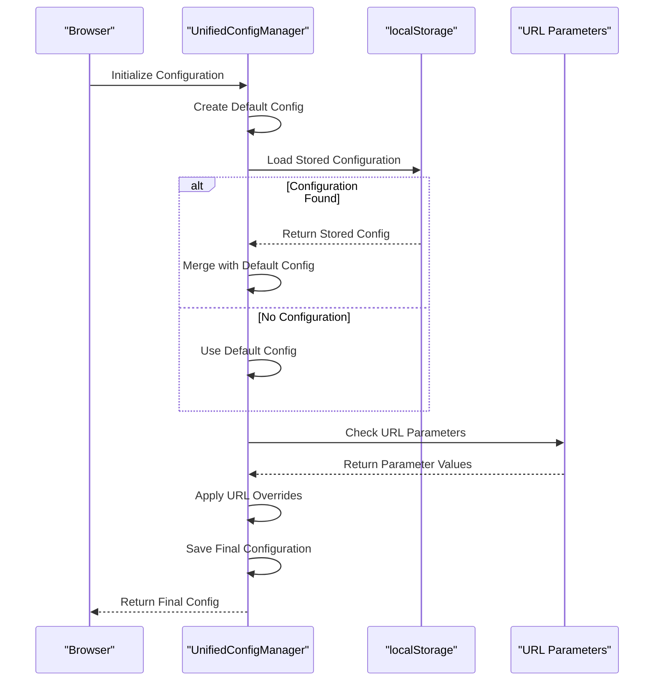
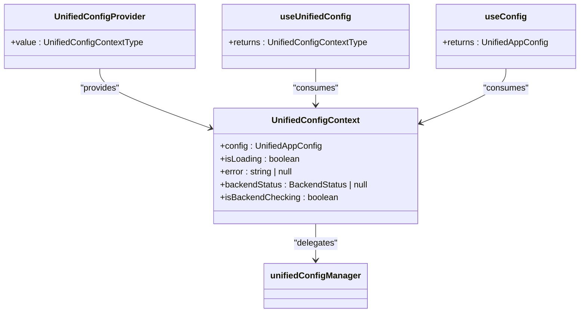
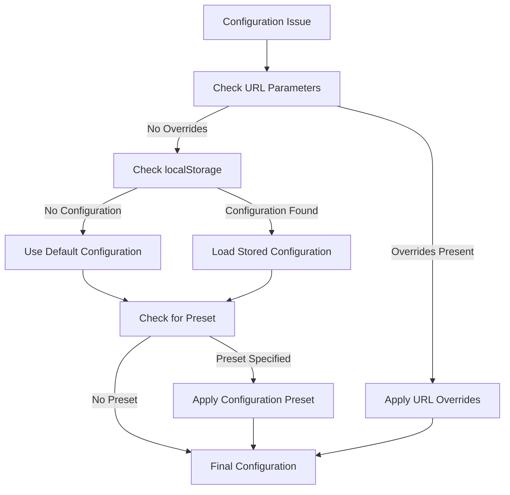
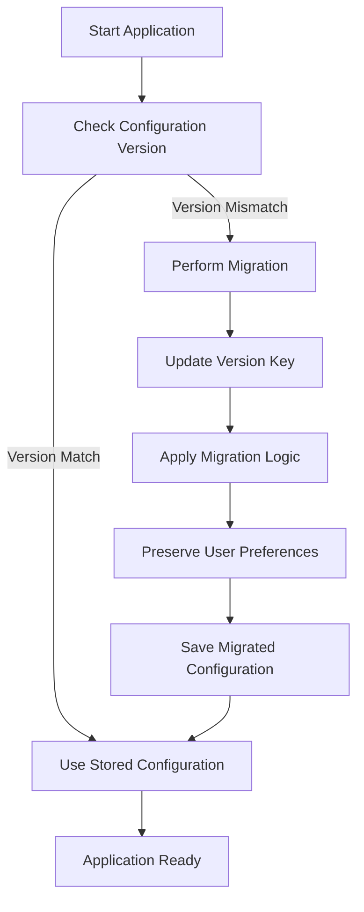

# Unified Configuration Framework

<cite>
**Referenced Files in This Document**   
- [unifiedConfig.ts](file://src/config/unifiedConfig.ts)
- [UnifiedConfigContext.tsx](file://src/contexts/UnifiedConfigContext.tsx)
- [moduleConfigService.ts](file://src/services/moduleConfigService.ts)
- [dataModePolicies.ts](file://src/config/dataModePolicies.ts)
- [environmentMatrix.ts](file://src/config/environmentMatrix.ts)
- [productionDemo.ts](file://src/config/productionDemo.ts)
</cite>

## Table of Contents
1. [Introduction](#introduction)
2. [Configuration Structure](#configuration-structure)
3. [Initialization Process](#initialization-process)
4. [Configuration Merging Strategy](#configuration-merging-strategy)
5. [Environment Variable Integration](#environment-variable-integration)
6. [Context Provider Implementation](#context-provider-implementation)
7. [Accessing Configuration Values](#accessing-configuration-values)
8. [Configuration Change Listeners](#configuration-change-listeners)
9. [Common Issues and Solutions](#common-issues-and-solutions)
10. [Type Safety with TypeScript](#type-safety-with-typescript)
11. [Configuration Key Organization](#configuration-key-organization)
12. [Schema Versioning and Backward Compatibility](#schema-versioning-and-backward-compatibility)
13. [Best Practices](#best-practices)

## Introduction

The Unified Configuration Framework serves as the single source of truth for schoolpilot3's application settings. This comprehensive system centralizes all configuration options including feature flags, module dependencies, and system preferences. The framework provides a robust mechanism for managing application state across different environments and deployment scenarios.

The unified configuration system is designed to handle complex configuration requirements while maintaining backward compatibility with legacy systems. It integrates seamlessly with the application's React component tree through a context provider, enabling real-time configuration access across all components.

**Section sources**
- [unifiedConfig.ts](file://src/config/unifiedConfig.ts#L1-L50)
- [UnifiedConfigContext.tsx](file://src/contexts/UnifiedConfigContext.tsx#L1-L45)

## Configuration Structure

The Unified Configuration Framework is built around the `UnifiedAppConfig` interface, which defines the complete structure of the application's configuration. This interface encompasses various aspects of the application's behavior, including environment settings, data modes, database providers, and feature flags.



**Diagram sources**
- [unifiedConfig.ts](file://src/config/unifiedConfig.ts#L166-L210)

**Section sources**
- [unifiedConfig.ts](file://src/config/unifiedConfig.ts#L166-L210)

## Initialization Process

The configuration initialization process begins with the creation of a default configuration using the `createDefaultConfig()` function. This function detects the current environment, determines the appropriate data mode, and sets up default values for all configuration properties.

The initialization process follows these steps:
1. Detect the current environment (development, staging, or production)
2. Retrieve environment-specific configuration from `environmentMatrix.ts`
3. Determine the default data mode based on the detected environment
4. Set up default database provider configuration
5. Create the base configuration object with all default values
6. Load any stored configuration from localStorage
7. Apply configuration overrides from URL parameters



**Diagram sources**
- [unifiedConfig.ts](file://src/config/unifiedConfig.ts#L284-L317)

**Section sources**
- [unifiedConfig.ts](file://src/config/unifiedConfig.ts#L284-L317)

## Configuration Merging Strategy

The Unified Configuration Framework employs a sophisticated merging strategy to combine default configuration values with user preferences and runtime overrides. This strategy ensures that new configuration options are properly initialized while preserving user-customized settings.

The merging process follows a specific hierarchy:
1. Start with the default configuration
2. Merge with stored configuration from localStorage
3. Apply configuration presets (if specified)
4. Apply URL parameter overrides

When merging feature flags, the system uses a deep merge strategy to ensure that new feature flags are included while preserving user preferences for existing flags. This approach prevents configuration drift and ensures that all feature flags have valid values.



**Diagram sources**
- [unifiedConfig.ts](file://src/config/unifiedConfig.ts#L525-L554)

**Section sources**
- [unifiedConfig.ts](file://src/config/unifiedConfig.ts#L525-L554)

## Environment Variable Integration

The Unified Configuration Framework integrates with environment variables through a combination of build-time and runtime mechanisms. Environment variables are primarily used to set default values for certain configuration properties, particularly those related to backend connectivity and deployment-specific settings.

Key environment variables used by the framework include:
- `REACT_APP_API_URL`: Sets the default backend URL
- `REACT_APP_DATABASE_URL`: Sets the default database connection string
- `NODE_ENV`: Determines the build environment (development, production)

The framework also supports runtime configuration overrides through URL parameters, which take precedence over environment variables. These URL parameters include:
- `preset`: Applies a predefined configuration preset
- `mode`: Sets the data mode (demo or live)
- `enhanced`: Enables or disables enhanced features
- `environment`: Overrides the detected environment



**Diagram sources**
- [unifiedConfig.ts](file://src/config/unifiedConfig.ts#L600-L650)

**Section sources**
- [unifiedConfig.ts](file://src/config/unifiedConfig.ts#L600-L650)

## Context Provider Implementation

The Unified Configuration Context is implemented as a React context provider that wraps the entire application. This provider makes the configuration state and management functions available to all components through the `useUnifiedConfig` hook.

The context provider is implemented in `UnifiedConfigContext.tsx` and follows the singleton pattern. It uses the `unifiedConfigManager` instance to access and modify the configuration state. The provider also handles backend status detection and updates the configuration accordingly.



**Diagram sources**
- [UnifiedConfigContext.tsx](file://src/contexts/UnifiedConfigContext.tsx#L440-L490)

**Section sources**
- [UnifiedConfigContext.tsx](file://src/contexts/UnifiedConfigContext.tsx#L440-L490)

## Accessing Configuration Values

Components can access configuration values using the `useUnifiedConfig` hook, which provides access to the complete configuration state and all management functions. For simpler use cases, the `useConfig` hook provides direct access to the configuration object.

### Using useUnifiedConfig Hook

```typescript
import { useUnifiedConfig } from '../contexts/UnifiedConfigContext';

const MyComponent = () => {
  const {
    config,
    updateConfig,
    resetConfig,
    applyPreset,
    getCurrentEnvironment,
    updateEnvironment,
    getCurrentDatabaseProvider,
    updateDatabaseProvider,
    getProductionDemoState,
    transitionToLiveMode,
    isProductionDemoAvailable,
    switchDataMode,
    canSwitchToMode,
    getAllowedDataModes,
    getDataModeState,
    validateServices
  } = useUnifiedConfig();

  // Example: Check if a feature is enabled
  const isAdvancedReportingEnabled = config.features.enableAdvancedReporting;

  // Example: Update a configuration value
  const handleToggleAdvancedReporting = () => {
    updateConfig({
      features: {
        ...config.features,
        enableAdvancedReporting: !config.features.enableAdvancedReporting
      }
    });
  };

  return (
    <div>
      <p>Current Environment: {getCurrentEnvironment()}</p>
      <p>Data Mode: {config.dataMode}</p>
      <button onClick={handleToggleAdvancedReporting}>
        {isAdvancedReportingEnabled ? 'Disable' : 'Enable'} Advanced Reporting
      </button>
    </div>
  );
};
```

### Using useConfig Hook

For components that only need to read configuration values, the `useConfig` hook provides a lighter alternative:

```typescript
import { useConfig } from '../contexts/UnifiedConfigContext';

const SimpleComponent = () => {
  const config = useConfig();
  
  return (
    <div>
      <p>Application Version: {config.version}</p>
      <p>Development Mode: {config.development.enableDebugMode ? 'Enabled' : 'Disabled'}</p>
    </div>
  );
};
```

**Section sources**
- [UnifiedConfigContext.tsx](file://src/contexts/UnifiedConfigContext.tsx#L440-L490)

## Configuration Change Listeners

The Unified Configuration Framework provides a subscription mechanism that allows components to listen for configuration changes. This enables real-time updates when configuration values are modified.

### Implementing Configuration Change Listeners

Components can subscribe to configuration changes using the `subscribe` method provided by the `unifiedConfigManager`. This method returns an unsubscribe function that should be called when the component is unmounted to prevent memory leaks.

```typescript
import { useEffect } from 'react';
import { unifiedConfigManager } from '../config/unifiedConfig';

const useConfigListener = (callback: (config: UnifiedAppConfig) => void) => {
  useEffect(() => {
    // Subscribe to configuration changes
    const unsubscribe = unifiedConfigManager.subscribe(callback);
    
    // Clean up subscription on unmount
    return () => {
      unsubscribe();
    };
  }, [callback]);
};

// Example usage in a component
const ConfigMonitor = () => {
  const [config, setConfig] = useState(unifiedConfigManager.getConfig());
  
  useConfigListener(setConfig);
  
  return (
    <div>
      <p>Last Updated: {config.lastUpdated.toLocaleString()}</p>
      <p>Environment: {config.environment}</p>
    </div>
  );
};
```

### Using Configuration Hooks

The framework also provides specialized hooks for monitoring specific aspects of the configuration:

```typescript
import { useDataMode, useEnvironment, useDatabaseProvider, useProductionDemo } from '../contexts/UnifiedConfigContext';

const ConfigurationMonitor = () => {
  const dataMode = useDataMode();
  const environment = useEnvironment();
  const database = useDatabaseProvider();
  const productionDemo = useProductionDemo();
  
  return (
    <div>
      <h3>Data Mode</h3>
      <p>Current: {dataMode.state.current}</p>
      <p>Allowed: {dataMode.allowedModes.join(', ')}</p>
      
      <h3>Environment</h3>
      <p>Current: {environment.current}</p>
      <p>Config: {JSON.stringify(environment.config)}</p>
      
      <h3>Database Provider</h3>
      <p>Current: {database.current}</p>
      <p>Allowed: {database.allowed.join(', ')}</p>
      
      <h3>Production Demo</h3>
      <p>State: {productionDemo.state}</p>
      <p>Available: {productionDemo.isAvailable ? 'Yes' : 'No'}</p>
    </div>
  );
};
```

**Section sources**
- [unifiedConfig.ts](file://src/config/unifiedConfig.ts#L802-L862)
- [UnifiedConfigContext.tsx](file://src/contexts/UnifiedConfigContext.tsx#L581-L638)

## Common Issues and Solutions

### Configuration Loading Delays

Configuration loading delays can occur due to various factors, including slow localStorage access, network latency when detecting backend status, or complex configuration merging operations. The framework addresses these issues through several mechanisms:

1. **Fallback Mechanisms**: The `dynamicModuleLoader` includes timeout handling to prevent infinite loading states:
```typescript
// Add timeout to prevent infinite loading
const timeoutPromise = new Promise((_, reject) => {
  setTimeout(() => reject(new Error('Module loading timeout')), 5000);
});

// Race between module loading and timeout
await Promise.race([
  this.discoverAndLoadModules(),
  timeoutPromise
]);
```

2. **Progress Simulation**: The `ModuleLoadingProgress` component simulates smooth progress while waiting for real completion:
```typescript
// Simulate smooth progress while waiting for real completion
setInterval(() => {
  setProgress(prev => {
    if (dynamicModuleLoader.isLoadingComplete()) {
      return 100;
    }
    const newProgress = prev + Math.random() * 5;
    return Math.min(newProgress, 95);
  });
}, 300);
```

### Debugging Configuration Overrides

When debugging configuration overrides, it's important to understand the hierarchy of configuration sources. The framework follows this priority order:
1. URL parameter overrides (highest priority)
2. Stored configuration in localStorage
3. Configuration presets
4. Environment-specific defaults
5. Global defaults (lowest priority)

To debug configuration issues, developers can:
1. Check the console logs for configuration migration messages
2. Inspect the localStorage entries for configuration data
3. Use URL parameters to test different configuration scenarios
4. Enable debug mode to see detailed configuration information



**Diagram sources**
- [dynamicModuleLoader.ts](file://src/services/dynamicModuleLoader.ts#L46-L76)
- [ModuleLoadingProgress.tsx](file://src/components/ModuleLoadingProgress.tsx#L37-L81)

**Section sources**
- [dynamicModuleLoader.ts](file://src/services/dynamicModuleLoader.ts#L46-L76)
- [ModuleLoadingProgress.tsx](file://src/components/ModuleLoadingProgress.tsx#L37-L81)

## Type Safety with TypeScript

The Unified Configuration Framework leverages TypeScript to ensure type safety throughout the configuration system. The framework uses interfaces to define the structure of configuration objects, ensuring that all configuration properties have the correct types.

### Configuration Interfaces

The main configuration interface `UnifiedAppConfig` defines the complete structure of the application's configuration:

```typescript
export interface UnifiedAppConfig {
  // Core Configuration
  environment: Environment;
  dataMode: DataMode;
  useEnhancedFeatures: boolean;
  
  // Environment Integration
  environmentConfig: EnvironmentConfigIntegration;
  
  // Database Configuration
  database: DatabaseConfig;
  
  // Backend Configuration (Legacy)
  backend: BackendConfig;
  
  // Demo Configuration (Enhanced)
  demo: DemoConfig;
  
  // Production Demo Integration
  productionDemo: ProductionDemoConfigIntegration;
  
  // Feature flags for experimental functionality
  features: FeatureConfig;
  
  // Development Configuration
  development: DevelopmentConfig;
  
  // Metadata
  version: string;
  lastUpdated: Date;
  configVersion: string;
}
```

### Strict Type Checking

The framework enables strict type checking in the `tsconfig.json` file:

```json
{
  "compilerOptions": {
    "strict": true,
    "noUnusedLocals": false,
    "noUnusedParameters": false,
    "noFallthroughCasesInSwitch": true,
    "noUncheckedSideEffectImports": true
  }
}
```

This ensures that:
- All variables have explicit types
- Null and undefined values are properly handled
- Function parameters and return types are correctly specified
- Unused variables and parameters are flagged

### Type Validation

The framework includes validation methods to ensure configuration integrity at runtime:

```typescript
public validate(): boolean {
  try {
    // Basic validation
    if (!this.config.environment || !this.config.dataMode) {
      return false;
    }
    
    // Validate backend URL
    if (this.config.backend.url && !this.isValidUrl(this.config.backend.url)) {
      return false;
    }
    
    return true;
  } catch {
    return false;
  }
}

private isValidUrl(url: string): boolean {
  try {
    new URL(url);
    return true;
  } catch {
    return false;
  }
}
```

**Section sources**
- [unifiedConfig.ts](file://src/config/unifiedConfig.ts#L802-L862)
- [tsconfig.json](file://tsconfig.json#L1-L33)

## Configuration Key Organization

The Unified Configuration Framework follows a structured approach to organizing configuration keys, grouping them by functional areas and using a consistent naming convention.

### Configuration Key Categories

Configuration keys are organized into the following categories:

1. **Core Configuration**: Fundamental settings that affect the application's basic behavior
   - `environment`: Current deployment environment
   - `dataMode`: Data mode (demo or live)
   - `useEnhancedFeatures`: Whether enhanced features are enabled

2. **Environment Integration**: Settings related to environment detection and configuration
   - `environmentConfig`: Environment-specific configuration
   - `environmentConfig.current`: Current environment
   - `environmentConfig.config`: Environment configuration object

3. **Database Configuration**: Database-related settings
   - `database.provider`: Current database provider
   - `database.allowedProviders`: List of allowed database providers
   - `database.connectionString`: Database connection string

4. **Feature Flags**: Boolean switches for enabling/disabling features
   - `features.enableAdvancedReporting`: Enable advanced reporting
   - `features.enableBulkOperations`: Enable bulk operations
   - `features.enableTabbedMode`: Enable tabbed mode interface

5. **Module-Specific Settings**: Configuration for individual modules
   - `features.enableAcademicsModule`: Enable academics module
   - `features.enableAdministrationModule`: Enable administration module
   - `features.enableFinanceModule`: Enable finance module

### Best Practices for Key Organization

1. **Use Descriptive Names**: Configuration keys should clearly describe their purpose
2. **Group Related Settings**: Use nested objects to group related configuration options
3. **Follow Consistent Naming**: Use camelCase for multi-word keys
4. **Document Key Purpose**: Include comments explaining the purpose of each key
5. **Avoid Abbreviations**: Use full words instead of abbreviations for clarity

```typescript
// Example of well-organized configuration keys
const config = {
  // Core settings
  core: {
    environment: 'production',
    dataMode: 'live',
    useEnhancedFeatures: true
  },
  
  // UI settings
  ui: {
    enableDarkMode: true,
    enableMultiLanguage: true,
    enableAccessibility: true
  },
  
  // Feature flags
  features: {
    enableAdvancedReporting: true,
    enableBulkOperations: true,
    enableDataExport: true,
    enableNotifications: true,
    enableAuditLog: true
  },
  
  // Module settings
  modules: {
    enableAcademicsModule: true,
    enableAdministrationModule: true,
    enableFinanceModule: true,
    enableHrModule: true
  }
};
```

**Section sources**
- [unifiedConfig.ts](file://src/config/unifiedConfig.ts#L166-L210)
- [tabbedModeConfig.ts](file://src/config/tabbedModeConfig.ts#L39-L85)

## Schema Versioning and Backward Compatibility

The Unified Configuration Framework implements a robust versioning system to ensure backward compatibility when modifying configuration schemas.

### Configuration Versioning

The framework uses a versioning system to track configuration schema changes:

```typescript
// Configuration version for migration
const CONFIG_VERSION = '2.0.0';
export const CONFIG_VERSION_KEY = 'unified_app_config_version';

// Check if we need to migrate configuration
if (storedVersion !== CONFIG_VERSION) {
  console.log('Migrating unified configuration from version', storedVersion, 'to', CONFIG_VERSION);
  // Clear old config and use defaults with any user preferences
  localStorage.setItem(CONFIG_VERSION_KEY, CONFIG_VERSION);
}
```

### Migration Strategy

When a configuration schema change requires migration, the framework follows these steps:

1. Check the stored configuration version against the current version
2. If versions don't match, perform the necessary migration steps
3. Update the version key in localStorage
4. Apply the migration while preserving user preferences where possible



### Backward Compatibility

The framework maintains backward compatibility through several mechanisms:

1. **Default Values**: New configuration options are added with sensible default values
2. **Graceful Degradation**: Missing configuration properties are filled with defaults
3. **Legacy Support**: Deprecated properties are supported during transition periods
4. **Type Safety**: TypeScript interfaces ensure proper type checking

```typescript
// Backward compatibility functions
export const getAppConfig = (): UnifiedAppConfig => unifiedConfigManager.getConfig();
export const updateAppConfig = (updates: Partial<UnifiedAppConfig>): void => unifiedConfigManager.updateConfig(updates);
export const isFeatureEnabled = (feature: keyof FeatureConfig): boolean => unifiedConfigManager.isFeatureEnabled(feature);
export const subscribeToConfig = (listener: (config: UnifiedAppConfig) => void): (() => void) => unifiedConfigManager.subscribe(listener);
```

**Diagram sources**
- [unifiedConfig.ts](file://src/config/unifiedConfig.ts#L525-L554)

**Section sources**
- [unifiedConfig.ts](file://src/config/unifiedConfig.ts#L525-L554)

## Best Practices

### Organizing Configuration Keys

1. **Use a Hierarchical Structure**: Group related configuration options into nested objects
2. **Follow Consistent Naming Conventions**: Use camelCase for multi-word keys
3. **Document Configuration Options**: Include comments explaining the purpose of each key
4. **Avoid Deep Nesting**: Limit nesting depth to improve readability and maintainability
5. **Use Feature Flags for Experimental Features**: Enable/disable features without code changes

### Versioning Configuration Schemas

1. **Incremental Versioning**: Use semantic versioning (major.minor.patch) for configuration schemas
2. **Document Changes**: Maintain a changelog for configuration schema changes
3. **Provide Migration Scripts**: Include scripts to migrate from older versions
4. **Test Migrations**: Verify migration scripts with test data
5. **Maintain Backward Compatibility**: Support older versions during transition periods

### Ensuring Backward Compatibility

1. **Add New Properties, Don't Remove**: When modifying schemas, add new properties instead of removing existing ones
2. **Provide Default Values**: Ensure new properties have sensible default values
3. **Deprecate Gradually**: Mark properties as deprecated before removing them
4. **Test with Older Configurations**: Verify that new code works with older configuration versions
5. **Document Breaking Changes**: Clearly document any breaking changes in the migration guide

### Performance Considerations

1. **Minimize Configuration Size**: Keep configuration objects lean to reduce storage and memory usage
2. **Cache Frequently Accessed Values**: Cache configuration values that are accessed frequently
3. **Debounce Configuration Updates**: Avoid excessive re-renders when configuration changes
4. **Use Selective Subscriptions**: Allow components to subscribe to specific configuration changes
5. **Optimize Storage Access**: Minimize localStorage read/write operations

### Security Considerations

1. **Avoid Sensitive Data**: Do not store sensitive information in configuration
2. **Validate Input**: Validate configuration values before applying them
3. **Sanitize URLs**: Validate and sanitize URL configuration values
4. **Use Secure Storage**: Consider using more secure storage mechanisms for sensitive configuration
5. **Implement Access Controls**: Restrict access to configuration modification functions

**Section sources**
- [unifiedConfig.ts](file://src/config/unifiedConfig.ts#L802-L862)
- [moduleConfigService.ts](file://src/services/moduleConfigService.ts#L151-L186)
- [tabbedModeConfig.ts](file://src/config/tabbedModeConfig.ts#L39-L85)