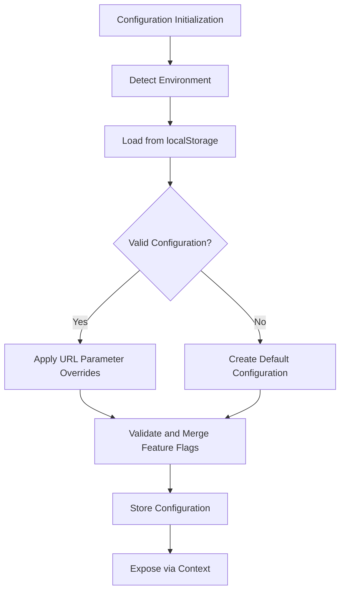
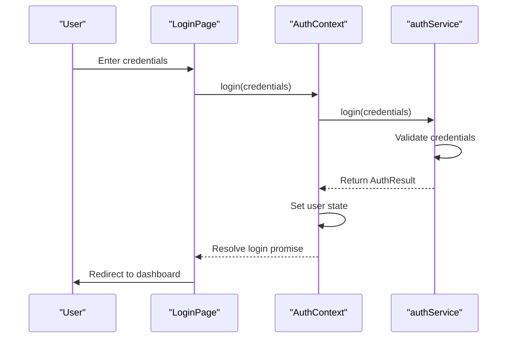
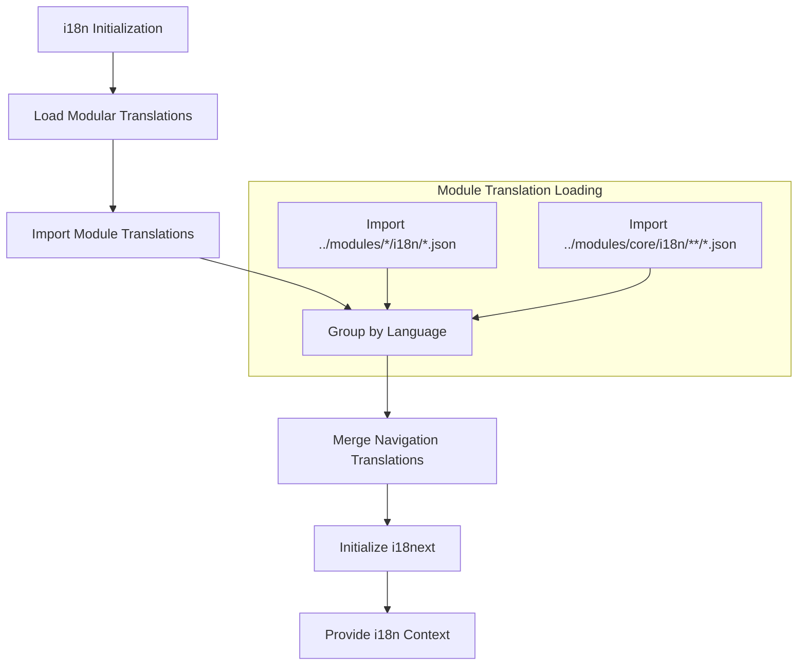
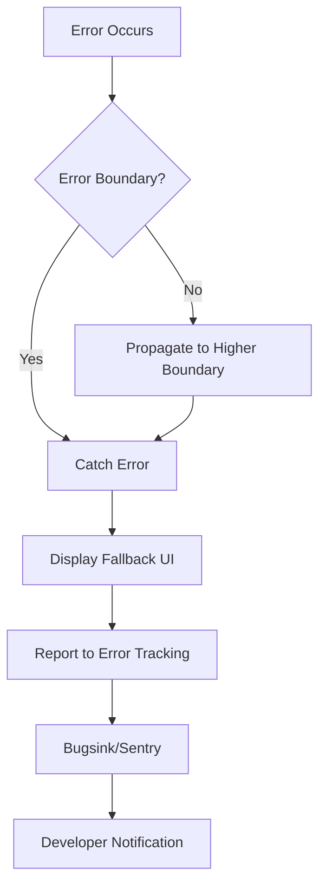

# Core Systems

<cite>
**Referenced Files in This Document**   
- [unifiedConfig.ts](file://src/config/unifiedConfig.ts)
- [AuthContext.tsx](file://src/contexts/AuthContext.tsx)
- [rbacService.ts](file://src/core/rbacService.ts)
- [i18n.ts](file://src/i18n/i18n.ts)
- [modularLoader.ts](file://src/i18n/modularLoader.ts)
- [ErrorBoundary.tsx](file://src/components/ErrorBoundary.tsx)
- [errorTracking.ts](file://src/config/errorTracking.ts)
- [ProtectedRoute.tsx](file://src/components/ProtectedRoute.tsx)
</cite>

## Table of Contents
1. [Unified Configuration System](#unified-configuration-system)
2. [Authentication Workflow](#authentication-workflow)
3. [Role-Based Access Control (RBAC)](#role-based-access-control-rbac)
4. [Internationalization Architecture](#internationalization-architecture)
5. [Error Handling Strategy](#error-handling-strategy)

## Unified Configuration System

The unified configuration system in schoolpilot3 provides a centralized mechanism for managing application settings across different environments. It integrates environment detection, data mode policies, and feature flag management to control feature availability.

The system is implemented in `unifiedConfig.ts` and exposes a `UnifiedAppConfig` interface that defines core configuration properties including environment, data mode, database settings, and feature flags. The configuration manager handles persistence through localStorage with versioning to support migrations.

Key features of the unified configuration system include:
- Environment detection and configuration based on environment matrix
- Data mode switching between demo and production modes
- Feature flags for enabling/disabling experimental functionality
- Configuration presets for development, staging, and production
- URL parameter overrides for dynamic configuration

Configuration is initialized with defaults and can be overridden through URL parameters such as `preset`, `mode`, `enhanced`, and `environment`. The system automatically detects the current environment and applies appropriate settings for database providers, allowed data modes, and feature availability.



**Diagram sources**
- [unifiedConfig.ts](file://src/config/unifiedConfig.ts#L1-L1052)

**Section sources**
- [unifiedConfig.ts](file://src/config/unifiedConfig.ts#L1-L1052)

### Configuring Feature Flags

Feature flags can be configured programmatically through the `UnifiedConfigManager`:

```typescript
const configManager = UnifiedConfigManager.getInstance();

// Update feature configuration
configManager.updateConfig({
  features: {
    enableAdvancedReporting: true,
    enableBulkOperations: true,
    enableTabbedMode: false,
    enhancedDataLayer: true
  }
});

// Switch data mode
await configManager.switchDataMode('demo');
```

## Authentication Workflow

The authentication workflow in schoolpilot3 follows a React context-based pattern that manages user state and provides authentication services throughout the application.

The workflow begins at the login page where users enter their credentials. These credentials are passed to the `authService` through the `AuthContext`, which handles the authentication logic and token management.



**Diagram sources**
- [AuthContext.tsx](file://src/contexts/AuthContext.tsx#L1-L160)
- [ProtectedRoute.tsx](file://src/components/ProtectedRoute.tsx#L1-L111)

**Section sources**
- [AuthContext.tsx](file://src/contexts/AuthContext.tsx#L1-L160)

### Authentication Context Implementation

The `AuthContext` provides the following key methods:
- `login(credentials)`: Authenticates user with provided credentials
- `logout()`: Logs out the current user and clears session
- `refreshUser()`: Refreshes the current user's data
- `hasPermission(permissionId)`: Checks if user has specific permission
- `hasModuleAccess(moduleId)`: Checks if user has access to a module

The context initializes by checking for an existing session and sets the authentication state accordingly. It also determines if the application is running in demo mode based on the current session.

## Role-Based Access Control (RBAC)

The RBAC implementation in schoolpilot3 provides granular permission management for the modular architecture. It governs access to modules and actions through a role-based system with support for custom roles and permission inheritance.

The RBAC service is implemented as a singleton class that manages roles, permissions, and user-role assignments. It integrates with the database to persist RBAC data and provides methods for checking permissions and module access.

```mermaid
classDiagram
class RBACService {
+roles : Map<string, RbacRole>
+permissions : Map<string, Permission>
+userRoles : Map<string, UserRole[]>
+db : SchoolDatabase
+setDatabase(db)
+loadFromDb()
+hasPermission(userId, permissionId)
+hasModuleAccess(userId, moduleId)
+getUserModules(userId)
+getUserModulePermissions(userId, moduleId)
}
class Permission {
+id : string
+name : string
+description : string
+resource : string
+action : 'create'|'read'|'update'|'delete'|'execute'
+moduleId : string
+feature? : string
}
class Role {
+id : string
+name : string
+description : string
+permissions : string[]
+isActive : boolean
+isSystem : boolean
+moduleAccess : { [moduleId : string] : { enabled : boolean, permissions : string[] } }
}
class UserRole {
+userId : string
+roleId : string
+assignedAt : Date
+assignedBy : string
+expiresAt? : Date
}
RBACService --> Permission : "manages"
RBACService --> Role : "manages"
RBACService --> UserRole : "manages"
Role --> Permission : "contains"
```

**Diagram sources**
- [rbacService.ts](file://src/core/rbacService.ts#L1-L697)

**Section sources**
- [rbacService.ts](file://src/core/rbacService.ts#L1-L697)

### Defining User Roles

Roles can be defined and managed through the RBAC service:

```typescript
// Create a custom role
const roleId = rbacService.createRole({
  name: 'Academic Coordinator',
  description: 'Manages academic programs and schedules',
  permissions: ['academics.read', 'academics.write', 'administration.classes.read'],
  isActive: true,
  isSystem: false,
  moduleAccess: {
    academics: {
      enabled: true,
      permissions: ['academics.read', 'academics.write']
    },
    administration: {
      enabled: true,
      permissions: ['administration.classes.read']
    }
  }
});

// Assign role to user
rbacService.assignRoleToUser('user123', roleId, 'admin456');
```

## Internationalization Architecture

The internationalization architecture in schoolpilot3 supports English, French, Kinyarwanda, and Swahili with modular translation loading. It uses i18next as the underlying library with a custom modular loader that dynamically loads translations from each module.

The system is designed to load only the necessary translation resources for the current language and modules, reducing bundle size and improving performance.



**Diagram sources**
- [i18n.ts](file://src/i18n/i18n.ts#L1-L117)
- [modularLoader.ts](file://src/i18n/modularLoader.ts#L1-L67)

**Section sources**
- [i18n.ts](file://src/i18n/i18n.ts#L1-L117)
- [modularLoader.ts](file://src/i18n/modularLoader.ts#L1-L67)

### Adding New Languages

To add a new language, create JSON translation files in each module's i18n directory:

```json
// src/modules/academics/i18n/es.json
{
  "title": "Académicos",
  "students": "Estudiantes",
  "courses": "Cursos",
  "grades": "Calificaciones",
  "attendance": "Asistencia",
  "navigation": {
    "dashboard": "Panel",
    "classes": "Clases",
    "exams": "Exámenes"
  }
}
```

The modular loader automatically detects and loads these files when the language is selected.

## Error Handling Strategy

The error handling strategy in schoolpilot3 uses React Error Boundaries at multiple levels combined with integration with error tracking services. This approach prevents application crashes and provides detailed error reports for debugging.

The system implements error boundaries at various levels:
- Application-level error boundary
- Module-level error boundaries
- Component-level error boundaries
- Hook error boundaries



**Diagram sources**
- [ErrorBoundary.tsx](file://src/components/ErrorBoundary.tsx#L1-L48)
- [errorTracking.ts](file://src/config/errorTracking.ts#L1-L151)

**Section sources**
- [ErrorBoundary.tsx](file://src/components/ErrorBoundary.tsx#L1-L48)
- [errorTracking.ts](file://src/config/errorTracking.ts#L1-L151)

### Error Tracking Integration

The application integrates with Bugsink (Sentry-compatible) for error tracking:

```typescript
// Initialize error tracking
initializeErrorTracking();

// Report errors manually
try {
  // Risky operation
} catch (error) {
  reportError(error, {
    context: 'academics-module',
    userId: 'user123'
  });
}

// Report messages
reportMessage('User completed onboarding', 'info');
```

The error tracking configuration includes:
- Self-hosted Bugsink integration
- PII collection for better debugging
- Error filtering to exclude development artifacts
- User context attachment
- Environment-specific sampling

Common issues and their solutions:
- **Permission inheritance bugs**: Ensure roles are properly initialized and user roles are correctly assigned
- **Translation key mismatches**: Use the translation completeness check script to identify missing keys
- **Error boundary loops**: Ensure fallback UI does not throw errors
- **Configuration persistence issues**: Verify localStorage access and handle migration properly