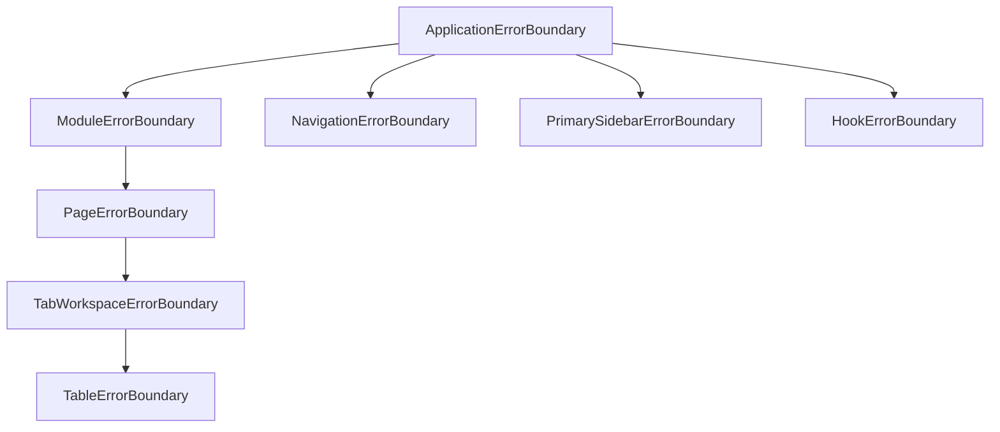
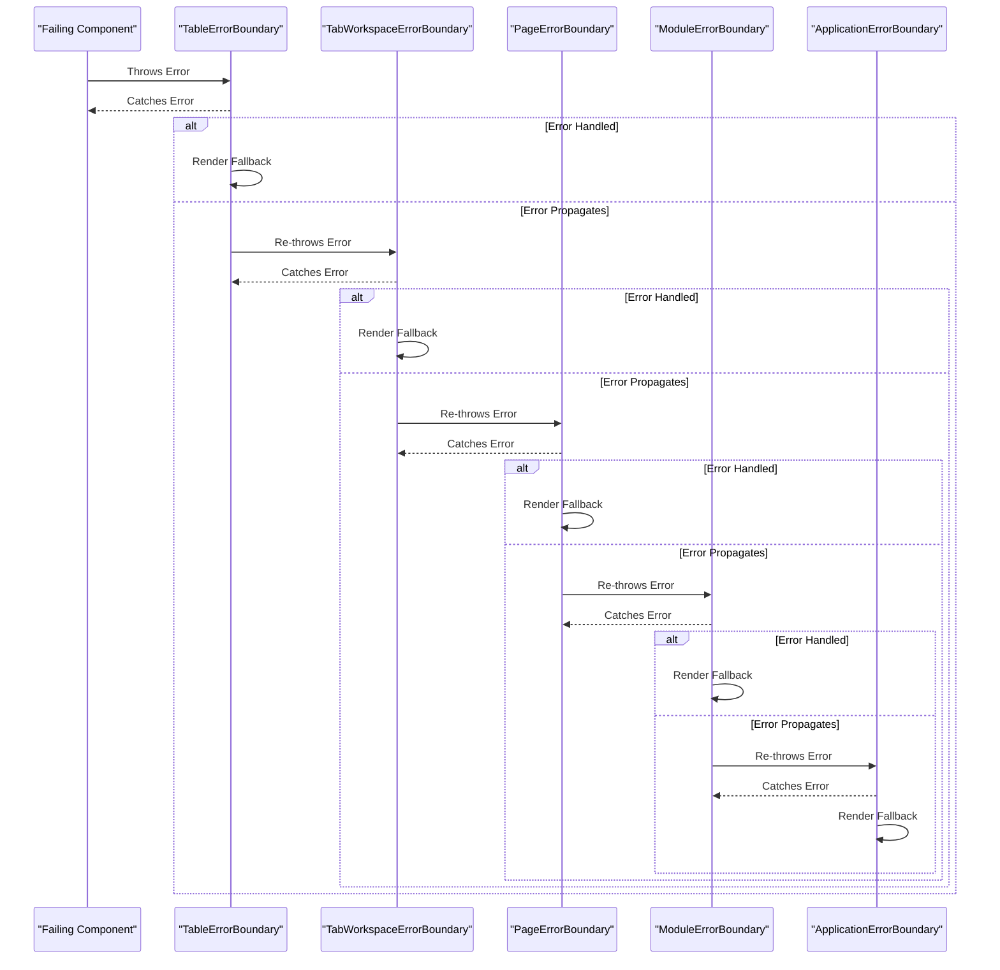
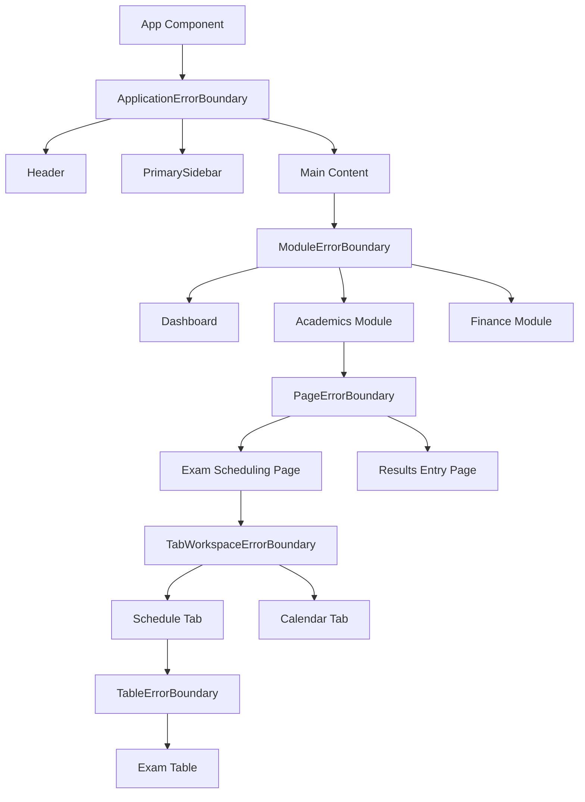

# Error Boundary Architecture

<cite>
**Referenced Files in This Document**   
- [ApplicationErrorBoundary.tsx](file://src/components/ApplicationErrorBoundary.tsx)
- [ModuleErrorBoundary.tsx](file://src/components/ModuleErrorBoundary.tsx)
- [PageErrorBoundary.tsx](file://src/components/PageErrorBoundary.tsx)
- [TabWorkspaceErrorBoundary.tsx](file://src/components/tabbedWorkspace/TabWorkspaceErrorBoundary.tsx)
- [TableErrorBoundary.tsx](file://src/components/ui/data/TableErrorBoundary.tsx)
- [HookErrorBoundary.tsx](file://src/components/HookErrorBoundary.tsx)
- [NavigationErrorBoundary.tsx](file://src/components/NavigationErrorBoundary.tsx)
- [PrimarySidebar.tsx](file://src/components/PrimarySidebar.tsx)
- [ErrorBoundary.tsx](file://src/components/ErrorBoundary.tsx)
</cite>

## Table of Contents
1. [Introduction](#introduction)
2. [Error Boundary Hierarchy](#error-boundary-hierarchy)
3. [Application-Level Error Boundary](#application-level-error-boundary)
4. [Module-Level Error Boundary](#module-level-error-boundary)
5. [Page-Level Error Boundary](#page-level-error-boundary)
6. [Tab Workspace Error Boundary](#tab-workspace-error-boundary)
7. [Table-Level Error Boundary](#table-level-error-boundary)
8. [Specialized Error Boundaries](#specialized-error-boundaries)
9. [Error Propagation and Containment](#error-propagation-and-containment)
10. [Placement Strategy](#placement-strategy)
11. [Best Practices](#best-practices)

## Introduction
The schoolpilot3 application implements a hierarchical error boundary architecture to ensure robust error handling and fault isolation. This multi-layered approach prevents cascading failures and maintains application stability by containing errors within specific scopes. The architecture follows React's error boundary pattern, with specialized boundaries at different levels of the component tree to handle various types of failures appropriately.

**Section sources**
- [ApplicationErrorBoundary.tsx](file://src/components/ApplicationErrorBoundary.tsx#L1-L20)
- [ModuleErrorBoundary.tsx](file://src/components/ModuleErrorBoundary.tsx#L1-L10)

## Error Boundary Hierarchy
The error boundary architecture in schoolpilot3 follows a layered containment strategy, with boundaries positioned at strategic levels of the component hierarchy:



**Diagram sources**
- [ApplicationErrorBoundary.tsx](file://src/components/ApplicationErrorBoundary.tsx#L15-L30)
- [ModuleErrorBoundary.tsx](file://src/components/ModuleErrorBoundary.tsx#L18-L25)
- [PageErrorBoundary.tsx](file://src/components/PageErrorBoundary.tsx#L16-L23)
- [TabWorkspaceErrorBoundary.tsx](file://src/components/tabbedWorkspace/TabWorkspaceErrorBoundary.tsx#L15-L22)
- [TableErrorBoundary.tsx](file://src/components/ui/data/TableErrorBoundary.tsx#L20-L27)

**Section sources**
- [ApplicationErrorBoundary.tsx](file://src/components/ApplicationErrorBoundary.tsx#L1-L50)
- [ModuleErrorBoundary.tsx](file://src/components/ModuleErrorBoundary.tsx#L1-L50)

## Application-Level Error Boundary
The ApplicationErrorBoundary serves as the top-level error boundary, catching unhandled errors that propagate up from lower levels. It provides a last line of defense against application crashes.

```typescript
class ApplicationErrorBoundary extends Component<Props, State> {
  static getDerivedStateFromError(error: Error): Partial<State> {
    return {
      hasError: true,
      error
    };
  }

  componentDidCatch(error: Error, errorInfo: ErrorInfo) {
    const errorId = generateErrorId();
    
    console.error('🚨 [ApplicationErrorBoundary] Critical application error:', {
      errorId,
      error: error.message,
      stack: error.stack,
      componentStack: errorInfo.componentStack
    });

    // Report error to external service
    try {
      reportError(error, {
        errorId,
        componentStack: errorInfo.componentStack,
        errorBoundary: 'ApplicationErrorBoundary',
        retryCount: this.state.retryCount,
        timestamp: new Date().toISOString(),
        userAgent: navigator.userAgent,
        url: window.location.href
      });
    } catch (reportingError) {
      console.error('Failed to report error to monitoring service:', reportingError);
    }

    if (onError) {
      onError(error, errorInfo, errorId);
    }
  }

  render() {
    if (this.state.hasError) {
      return (
        <div className="flex items-center justify-center min-h-screen bg-gray-100">
          <div className="max-w-md w-full bg-white rounded-lg shadow-lg p-6 text-center">
            <h1 className="text-2xl font-bold text-red-700 mb-4">Application Error</h1>
            <p className="text-gray-600 mb-4">
              Something went wrong. We've logged the error and our team has been notified.
            </p>
            <div className="flex space-x-3">
              {this.state.retryCount < this.props.maxRetries && (
                <button
                  onClick={this.handleRetry}
                  className="flex-1 bg-blue-600 text-white px-4 py-2 rounded-md text-sm font-medium"
                >
                  Try Again ({this.props.maxRetries - this.state.retryCount} left)
                </button>
              )}
              <button
                onClick={this.handleReload}
                className="flex-1 bg-gray-600 text-white px-4 py-2 rounded-md text-sm font-medium"
              >
                Reload Page
              </button>
            </div>
          </div>
        </div>
      );
    }

    return this.props.children;
  }
}
```

**Diagram sources**
- [ApplicationErrorBoundary.tsx](file://src/components/ApplicationErrorBoundary.tsx#L46-L96)

**Section sources**
- [ApplicationErrorBoundary.tsx](file://src/components/ApplicationErrorBoundary.tsx#L15-L160)

## Module-Level Error Boundary
The ModuleErrorBoundary isolates failures within specific feature modules, allowing other modules to continue functioning normally when one module encounters an error.

```typescript
class ModuleErrorBoundary extends Component<Props, State> {
  static getDerivedStateFromError(error: Error): Partial<State> {
    return {
      hasError: true,
      error
    };
  }

  componentDidCatch(error: Error, errorInfo: ErrorInfo) {
    const { moduleName, onError } = this.props;
    
    this.setState({ errorInfo });
    
    console.error(`🔥 [ModuleErrorBoundary] Module "${moduleName}" error:`, {
      error: error.message,
      stack: error.stack,
      componentStack: errorInfo.componentStack
    });

    if (onError) {
      onError(moduleName, error, errorInfo);
    }
  }

  handleRetry = () => {
    this.setState({
      hasError: false,
      error: null,
      errorInfo: null
    });
  };

  render() {
    if (this.state.hasError && this.state.error) {
      if (this.props.fallbackComponent) {
        return this.props.fallbackComponent;
      }

      return (
        <div className="p-4 bg-red-50 border border-red-200 rounded-lg">
          <div className="flex items-center mb-2">
            <svg className="h-5 w-5 text-red-500 mr-2" fill="none" viewBox="0 0 24 24" stroke="currentColor">
              <path strokeLinecap="round" strokeLinejoin="round" strokeWidth={2} d="M12 8v4m0 4h.01M21 12a9 9 0 11-18 0 9 9 0 0118 0z" />
            </svg>
            <h3 className="text-sm font-medium text-red-800">
              Module Error: {this.props.moduleName}
            </h3>
          </div>
          <p className="text-sm text-red-700 mb-3">
            {this.state.error.message}
          </p>
          <button
            onClick={this.handleRetry}
            className="text-sm bg-red-100 text-red-800 px-3 py-1 rounded hover:bg-red-200 transition-colors"
          >
            Retry Module
          </button>
        </div>
      );
    }

    return this.props.children;
  }
}
```

**Diagram sources**
- [ModuleErrorBoundary.tsx](file://src/components/ModuleErrorBoundary.tsx#L18-L95)

**Section sources**
- [ModuleErrorBoundary.tsx](file://src/components/ModuleErrorBoundary.tsx#L1-L95)

## Page-Level Error Boundary
The PageErrorBoundary handles errors at the route level, providing navigation alternatives when specific pages fail to load or render.

```typescript
class PageErrorBoundary extends Component<Props, State> {
  static getDerivedStateFromError(error: Error): Partial<State> {
    return {
      hasError: true,
      error
    };
  }

  componentDidCatch(error: Error, errorInfo: ErrorInfo) {
    const { pageName, onError } = this.props;
    
    console.error(`📄 [PageErrorBoundary] Page "${pageName}" error:`, {
      error: error.message,
      stack: error.stack,
      componentStack: errorInfo.componentStack
    });

    if (onError) {
      onError(pageName, error);
    }
  }

  handleRetry = () => {
    this.setState({
      hasError: false,
      error: null
    });
  };

  handleGoBack = () => {
    window.history.back();
  };

  handleGoHome = () => {
    window.location.hash = '#/dashboard';
  };

  render() {
    if (this.state.hasError && this.state.error) {
      return (
        <div className="min-h-screen flex items-center justify-center bg-gray-50 p-4">
          <div className="max-w-md w-full bg-white rounded-lg shadow-md p-6">
            <h2 className="text-xl font-bold text-red-700 mb-4">Page Error</h2>
            <p className="text-gray-600 mb-4">{this.state.error.message}</p>
            <div className="space-y-3">
              <button
                onClick={this.handleRetry}
                className="w-full bg-blue-600 text-white py-2 rounded-md hover:bg-blue-700"
              >
                Retry Page
              </button>
              <button
                onClick={this.handleGoBack}
                className="w-full bg-gray-600 text-white py-2 rounded-md hover:bg-gray-700"
              >
                Go Back
              </button>
              <button
                onClick={this.handleGoHome}
                className="w-full bg-gray-500 text-white py-2 rounded-md hover:bg-gray-600"
              >
                Go to Dashboard
              </button>
            </div>
          </div>
        </div>
      );
    }

    return this.props.children;
  }
}
```

**Section sources**
- [PageErrorBoundary.tsx](file://src/components/PageErrorBoundary.tsx#L16-L60)

## Tab Workspace Error Boundary
The TabWorkspaceErrorBoundary manages errors within tabbed interfaces, allowing users to continue working in other tabs when one tab encounters an issue.

```typescript
export class TabWorkspaceErrorBoundary extends Component<Props, State> {
  static getDerivedStateFromError(error: Error): Partial<State> {
    return {
      hasError: true,
      error
    };
  }

  componentDidCatch(error: Error, errorInfo: ErrorInfo) {
    const { tabId, onError } = this.props;
    
    console.error(`🧩 [TabWorkspaceErrorBoundary] Tab "${tabId}" error:`, {
      error: error.message,
      stack: error.stack,
      componentStack: errorInfo.componentStack,
      tabId
    });

    if (onError) {
      onError(tabId, error, errorInfo);
    }
  }

  handleRecover = () => {
    this.setState({
      hasError: false,
      error: null,
      errorInfo: null
    });
  };

  handleCloseTab = () => {
    const { tabId, onCloseTab } = this.props;
    if (onCloseTab) {
      onCloseTab(tabId);
    }
  };

  render() {
    if (this.state.hasError && this.state.error) {
      return (
        <div className="flex flex-col items-center justify-center h-full p-4 text-center">
          <div className="p-4 bg-orange-50 border border-orange-200 rounded-lg max-w-sm">
            <h3 className="text-sm font-medium text-orange-800 mb-2">
              Tab Error
            </h3>
            <p className="text-sm text-orange-700 mb-3">
              {this.state.error.message}
            </p>
            <div className="flex space-x-2">
              <button
                onClick={this.handleRecover}
                className="text-sm bg-orange-100 text-orange-800 px-3 py-1 rounded hover:bg-orange-200"
              >
                Recover Tab
              </button>
              <button
                onClick={this.handleCloseTab}
                className="text-sm bg-gray-100 text-gray-800 px-3 py-1 rounded hover:bg-gray-200"
              >
                Close Tab
              </button>
            </div>
          </div>
        </div>
      );
    }

    return this.props.children;
  }
}
```

**Section sources**
- [TabWorkspaceErrorBoundary.tsx](file://src/components/tabbedWorkspace/TabWorkspaceErrorBoundary.tsx#L15-L75)

## Table-Level Error Boundary
The TableErrorBoundary provides component-level resilience for data tables, preventing rendering issues in one table from affecting other components.

```typescript
export class TableErrorBoundary extends Component<Props, State> {
  static getDerivedStateFromError(error: Error): Partial<State> {
    return {
      hasError: true,
      error
    };
  }

  componentDidCatch(error: Error, errorInfo: ErrorInfo) {
    const { tableName, onError } = this.props;
    
    console.error(`📊 [TableErrorBoundary] Table "${tableName}" error:`, {
      error: error.message,
      stack: error.stack,
      componentStack: errorInfo.componentStack
    });

    if (onError) {
      onError(tableName, error, errorInfo);
    }
  }

  handleRefresh = () => {
    this.setState({
      hasError: false,
      error: null,
      errorInfo: null
    });
  };

  render() {
    if (this.state.hasError && this.state.error) {
      return (
        <div className="flex items-center justify-center h-40 bg-gray-50 border border-dashed border-gray-300 rounded">
          <div className="text-center p-4">
            <svg className="h-8 w-8 text-gray-400 mx-auto mb-2" fill="none" viewBox="0 0 24 24" stroke="currentColor">
              <path strokeLinecap="round" strokeLinejoin="round" strokeWidth={2} d="M12 8v4m0 4h.01M21 12a9 9 0 11-18 0 9 9 0 0118 0z" />
            </svg>
            <p className="text-sm text-gray-500 mb-2">Table failed to load</p>
            <button
              onClick={this.handleRefresh}
              className="text-xs bg-blue-100 text-blue-800 px-2 py-1 rounded hover:bg-blue-200"
            >
              Refresh
            </button>
          </div>
        </div>
      );
    }

    return this.props.children;
  }
}
```

**Section sources**
- [TableErrorBoundary.tsx](file://src/components/ui/data/TableErrorBoundary.tsx#L20-L70)

## Specialized Error Boundaries
The application includes several specialized error boundaries for specific use cases:

### Hook Error Boundary
The HookErrorBoundary specifically handles React Hook errors, which often occur due to module loading issues or hook order violations.

```typescript
class HookErrorBoundary extends Component<Props, State> {
  static getDerivedStateFromError(error: Error): Partial<State> {
    const isHookError = error.message.includes('hook') || 
                       error.message.includes('prevDeps') ||
                       error.message.includes('Rendered more hooks') ||
                       error.message.includes('Rendered fewer hooks');
    
    if (isHookError) {
      return {
        hasError: true,
        error
      };
    }
    
    // Let other errors bubble up
    throw error;
  }

  componentDidCatch(error: Error, errorInfo: ErrorInfo) {
    this.setState({ error, errorInfo });

    if (this.props.onError) {
      this.props.onError(error, errorInfo);
    }

    console.error('Hook Error Boundary caught an error:', error, errorInfo);

    // Auto-retry for hook errors (they might be transient)
    if (this.state.retryCount < this.maxRetries) {
      this.retryTimeout = setTimeout(() => {
        this.handleRetry();
      }, 1000 * (this.state.retryCount + 1));
    }
  }
}
```

### Navigation Error Boundary
The NavigationErrorBoundary handles route resolution errors and provides recovery options for navigation failures.

```typescript
class NavigationErrorBoundary extends React.Component<Props, State> {
  componentDidUpdate(prevProps: Props, prevState: State) {
    // Clear error state when route changes successfully
    if (!this.state.hasError && prevState.hasError) {
      const currentRoute = window.location.hash.replace('#', '') || '/';
      sessionStorage.setItem('lastWorkingRoute', currentRoute);
    }
  }

  private handleRetry = () => {
    const maxRetries = this.props.maxRetries || 2;
    
    if (this.state.retryCount >= maxRetries) {
      console.warn('Maximum navigation retry attempts reached');
      return;
    }

    this.setState(prevState => ({
      hasError: false,
      error: null,
      errorInfo: null,
      retryCount: prevState.retryCount + 1
    }));
  };
}
```

**Section sources**
- [HookErrorBoundary.tsx](file://src/components/HookErrorBoundary.tsx#L19-L155)
- [NavigationErrorBoundary.tsx](file://src/components/NavigationErrorBoundary.tsx#L30-L346)

## Error Propagation and Containment
The error boundary hierarchy follows a containment strategy where errors are caught at the most specific level possible:



**Diagram sources**
- [ApplicationErrorBoundary.tsx](file://src/components/ApplicationErrorBoundary.tsx#L15-L30)
- [ModuleErrorBoundary.tsx](file://src/components/ModuleErrorBoundary.tsx#L18-L25)
- [PageErrorBoundary.tsx](file://src/components/PageErrorBoundary.tsx#L16-L23)
- [TabWorkspaceErrorBoundary.tsx](file://src/components/tabbedWorkspace/TabWorkspaceErrorBoundary.tsx#L15-L22)
- [TableErrorBoundary.tsx](file://src/components/ui/data/TableErrorBoundary.tsx#L20-L27)

**Section sources**
- [ApplicationErrorBoundary.tsx](file://src/components/ApplicationErrorBoundary.tsx#L1-L50)
- [ModuleErrorBoundary.tsx](file://src/components/ModuleErrorBoundary.tsx#L1-L50)

## Placement Strategy
The error boundaries are strategically placed throughout the component tree to prevent cascading failures:



**Diagram sources**
- [ApplicationErrorBoundary.tsx](file://src/components/ApplicationErrorBoundary.tsx#L15-L30)
- [ModuleErrorBoundary.tsx](file://src/components/ModuleErrorBoundary.tsx#L18-L25)
- [PageErrorBoundary.tsx](file://src/components/PageErrorBoundary.tsx#L16-L23)
- [TabWorkspaceErrorBoundary.tsx](file://src/components/tabbedWorkspace/TabWorkspaceErrorBoundary.tsx#L15-L22)
- [TableErrorBoundary.tsx](file://src/components/ui/data/TableErrorBoundary.tsx#L20-L27)
- [PrimarySidebar.tsx](file://src/components/PrimarySidebar.tsx#L20-L35)

**Section sources**
- [ApplicationErrorBoundary.tsx](file://src/components/ApplicationErrorBoundary.tsx#L1-L50)
- [ModuleErrorBoundary.tsx](file://src/components/ModuleErrorBoundary.tsx#L1-L50)
- [PrimarySidebar.tsx](file://src/components/PrimarySidebar.tsx#L20-L35)

## Best Practices
The implementation follows several best practices for error boundary usage:

### Custom Fallback Interfaces
Error boundaries provide user-friendly fallback UIs that maintain application usability:

- **Informative messages**: Clearly explain what went wrong
- **Recovery options**: Provide actionable buttons to retry or navigate away
- **Contextual information**: Include relevant details like module or page names
- **Visual consistency**: Maintain the application's design system

### Error Logging
Error details are logged without exposing sensitive information:

```typescript
// Log only essential information
console.error(`🔥 [ModuleErrorBoundary] Module "${moduleName}" error:`, {
  error: error.message,  // Only the error message, not full stack in production
  componentStack: errorInfo.componentStack  // Component hierarchy for debugging
});

// Report to external service with controlled data
reportError(error, {
  errorId,
  componentStack: errorInfo.componentStack,
  errorBoundary: 'ApplicationErrorBoundary',
  retryCount: this.state.retryCount,
  timestamp: new Date().toISOString(),
  userAgent: navigator.userAgent,
  url: window.location.href
});
```

### Common Issues and Solutions
The architecture addresses common error boundary challenges:

**Boundary Overlap**: Boundaries are placed at appropriate levels to avoid redundant error handling.

**Error Masking**: The `getDerivedStateFromError` method in HookErrorBoundary re-throws non-hook errors to prevent masking.

**Proper Cleanup**: The `componentWillUnmount` lifecycle method in HookErrorBoundary clears retry timeouts to prevent memory leaks.

**Error Recovery**: State is properly reset when users retry operations, allowing components to re-render successfully.

**Section sources**
- [ApplicationErrorBoundary.tsx](file://src/components/ApplicationErrorBoundary.tsx#L46-L96)
- [ModuleErrorBoundary.tsx](file://src/components/ModuleErrorBoundary.tsx#L0-L54)
- [HookErrorBoundary.tsx](file://src/components/HookErrorBoundary.tsx#L51-L102)
- [NavigationErrorBoundary.tsx](file://src/components/NavigationErrorBoundary.tsx#L82-L128)