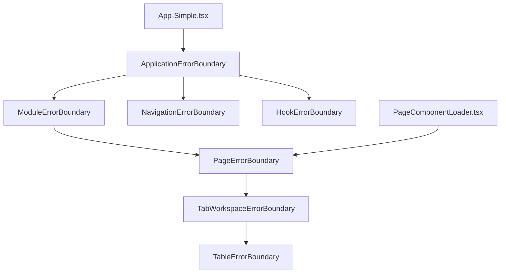
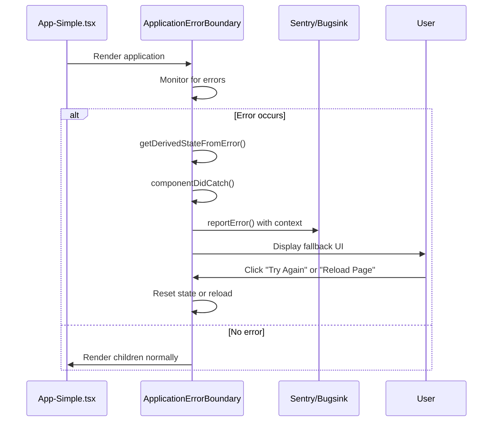
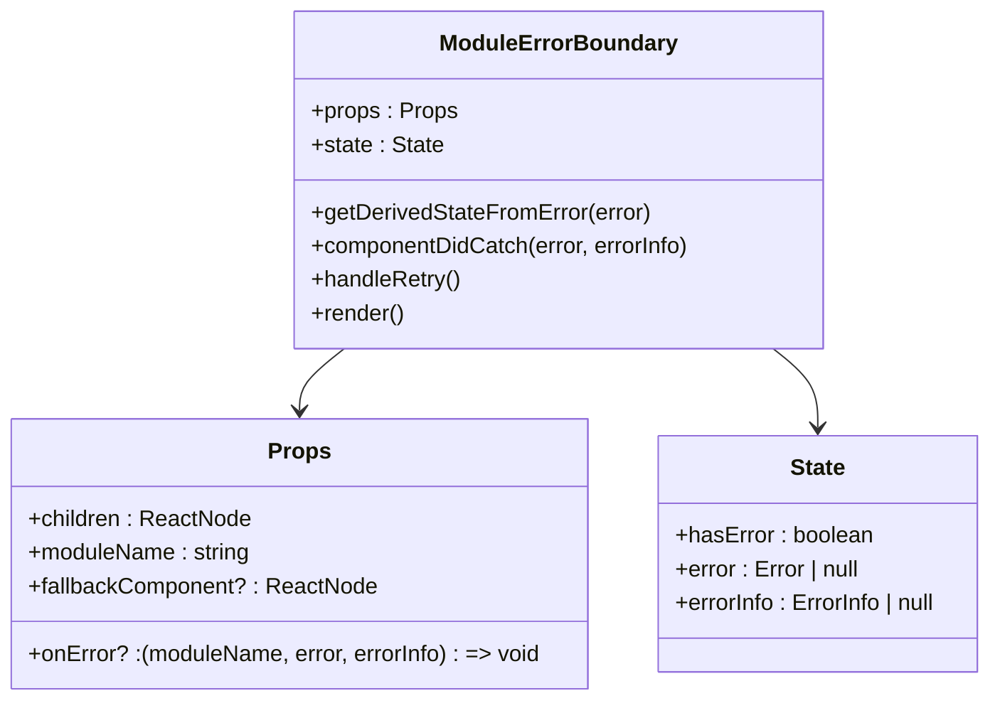
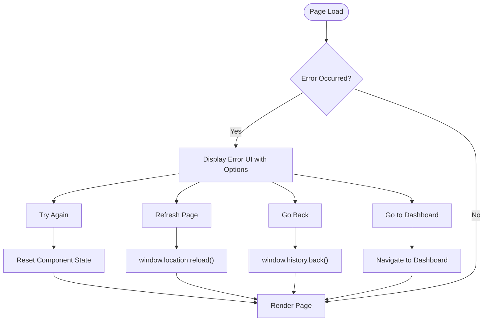
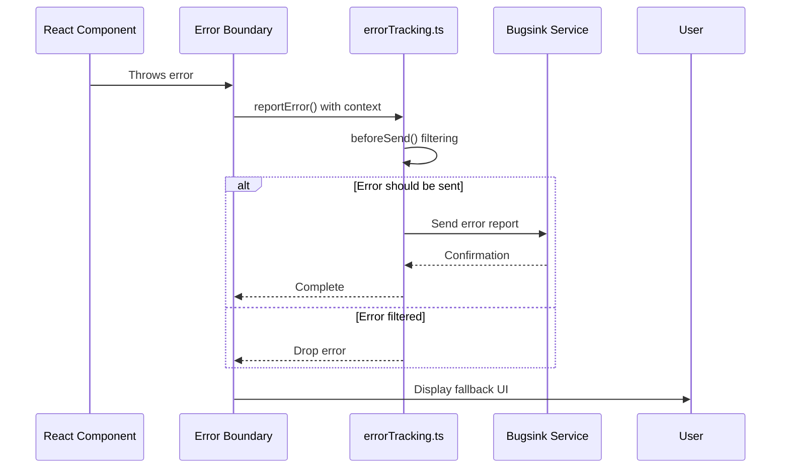
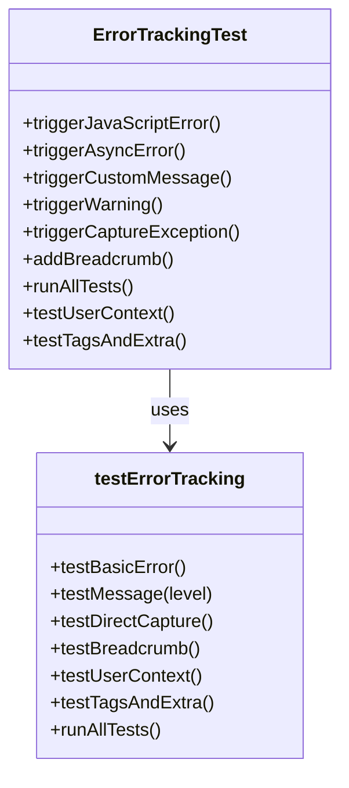

# Error Handling & Monitoring

<cite>
**Referenced Files in This Document**   
- [ApplicationErrorBoundary.tsx](file://src/components/ApplicationErrorBoundary.tsx)
- [ModuleErrorBoundary.tsx](file://src/components/ModuleErrorBoundary.tsx)
- [PageErrorBoundary.tsx](file://src/components/PageErrorErrorBoundary.tsx)
- [errorTracking.ts](file://src/config/errorTracking.ts)
- [testErrorTracking.ts](file://src/utils/testErrorTracking.ts)
- [ErrorTrackingTest.tsx](file://src/components/ErrorTrackingTest.tsx)
- [App-Simple.tsx](file://src/App-Simple.tsx)
- [PageComponentLoader.tsx](file://src/components/PageComponentLoader.tsx)
</cite>

## Table of Contents
1. [Introduction](#introduction)
2. [Error Boundary Architecture](#error-boundary-architecture)
3. [Application-Level Error Handling](#application-level-error-handling)
4. [Module-Level Error Handling](#module-level-error-handling)
5. [Page-Level Error Handling](#page-level-error-handling)
6. [Error Tracking Integration](#error-tracking-integration)
7. [Error Testing and Validation](#error-testing-and-validation)
8. [Common Issues and Troubleshooting](#common-issues-and-troubleshooting)
9. [Conclusion](#conclusion)

## Introduction
The schoolpilot3 application implements a comprehensive error handling and monitoring system designed to provide resilience against failures at multiple levels of the component hierarchy. This document details the multi-layered error boundary architecture, error tracking integration with Bugsink (Sentry-compatible), and testing methodologies for validating error handling workflows. The system is designed to prevent complete application crashes, isolate failures to specific components or modules, and provide graceful recovery mechanisms while capturing detailed diagnostic information for developers.

**Section sources**
- [ApplicationErrorBoundary.tsx](file://src/components/ApplicationErrorBoundary.tsx#L1-L160)
- [ModuleErrorBoundary.tsx](file://src/components/ModuleErrorBoundary.tsx#L1-L95)
- [PageErrorBoundary.tsx](file://src/components/PageErrorBoundary.tsx#L1-L147)

## Error Boundary Architecture

**Diagram sources**
- [ApplicationErrorBoundary.tsx](file://src/components/ApplicationErrorBoundary.tsx#L1-L160)
- [ModuleErrorBoundary.tsx](file://src/components/ModuleErrorBoundary.tsx#L1-L95)
- [PageErrorBoundary.tsx](file://src/components/PageErrorBoundary.tsx#L1-L147)
- [App-Simple.tsx](file://src/App-Simple.tsx#L1-L92)
- [PageComponentLoader.tsx](file://src/components/PageComponentLoader.tsx#L1-L351)

**Section sources**
- [ApplicationErrorBoundary.tsx](file://src/components/ApplicationErrorBoundary.tsx#L1-L160)
- [ModuleErrorBoundary.tsx](file://src/components/ModuleErrorBoundary.tsx#L1-L95)
- [PageErrorBoundary.tsx](file://src/components/PageErrorBoundary.tsx#L1-L147)

## Application-Level Error Handling

The ApplicationErrorBoundary component serves as the top-level error boundary that catches unhandled exceptions across the entire application. It is implemented as a React class component that uses the getDerivedStateFromError and componentDidCatch lifecycle methods to detect and handle errors.

When an error occurs, the boundary captures the error object and component stack trace, generates a unique error ID, and reports the error to the Bugsink error tracking service. The component provides a user-friendly fallback UI with retry functionality and page reload options.

**Diagram sources**
- [ApplicationErrorBoundary.tsx](file://src/components/ApplicationErrorBoundary.tsx#L1-L160)
- [App-Simple.tsx](file://src/App-Simple.tsx#L1-L92)

**Section sources**
- [ApplicationErrorBoundary.tsx](file://src/components/ApplicationErrorBoundary.tsx#L1-L160)
- [App-Simple.tsx](file://src/App-Simple.tsx#L1-L92)

## Module-Level Error Handling

The ModuleErrorBoundary component provides isolation for individual application modules, allowing the rest of the system to continue functioning when a specific module fails. This boundary is designed to wrap entire modules and display module-specific error messages.

Key features include:
- Module name identification in error messages
- Customizable fallback components
- Retry functionality to reinitialize the module
- Error reporting with module context

The boundary captures errors and displays a compact error message with a retry button, allowing users to attempt to reload the failed module without affecting other parts of the application.

**Diagram sources**
- [ModuleErrorBoundary.tsx](file://src/components/ModuleErrorBoundary.tsx#L1-L95)

**Section sources**
- [ModuleErrorBoundary.tsx](file://src/components/ModuleErrorBoundary.tsx#L1-L95)

## Page-Level Error Handling

The PageErrorBoundary component handles errors at the individual page level, providing navigation alternatives when specific pages fail to load. It is integrated with the PageComponentLoader to manage page loading errors and timeouts.

When a page error occurs, the boundary displays a comprehensive error UI with multiple recovery options:
- Retry the current page
- Refresh the entire page
- Navigate back to the previous page
- Go to the dashboard

The component also includes technical details in a collapsible section for developers and support personnel.

**Diagram sources**
- [PageErrorBoundary.tsx](file://src/components/PageErrorBoundary.tsx#L1-L147)
- [PageComponentLoader.tsx](file://src/components/PageComponentLoader.tsx#L1-L351)

**Section sources**
- [PageErrorBoundary.tsx](file://src/components/PageErrorBoundary.tsx#L1-L147)
- [PageComponentLoader.tsx](file://src/components/PageComponentLoader.tsx#L1-L351)

## Error Tracking Integration

The error tracking system is configured through the errorTracking.ts file, which sets up integration with Bugsink (a self-hosted Sentry-compatible service). The configuration includes environment detection, error filtering, and diagnostic data collection.

Key configuration options:
- **DSN Configuration**: The Bugsink DSN is loaded from environment variables
- **Environment Detection**: Different settings for development and production
- **Error Filtering**: Exclusion of development-specific errors in production
- **Sampling Rate**: 100% sampling for self-hosted Bugsink instance
- **PII Collection**: Personal Identifiable Information is safely collected due to self-hosting
- **User Context**: User information is attached to error reports when available

**Diagram sources**
- [errorTracking.ts](file://src/config/errorTracking.ts#L1-L150)

**Section sources**
- [errorTracking.ts](file://src/config/errorTracking.ts#L1-L150)

## Error Testing and Validation

The system includes comprehensive testing utilities to validate error handling workflows during development. The testErrorTracking.ts utility provides methods to test various aspects of the error tracking integration, while the ErrorTrackingTest component provides a UI for manual testing.

Key testing capabilities:
- Basic error reporting
- Message reporting at different severity levels
- Direct Sentry exception capture
- Breadcrumb functionality
- User context setting
- Tags and extra data attachment
- Comprehensive test suite execution

The ErrorTrackingTest component provides a user interface with buttons to trigger different types of errors and verify that they are properly captured by the Bugsink service.

**Diagram sources**
- [testErrorTracking.ts](file://src/utils/testErrorTracking.ts#L1-L152)
- [ErrorTrackingTest.tsx](file://src/components/ErrorTrackingTest.tsx#L1-L225)

**Section sources**
- [testErrorTracking.ts](file://src/utils/testErrorTracking.ts#L1-L152)
- [ErrorTrackingTest.tsx](file://src/components/ErrorTrackingTest.tsx#L1-L225)

## Common Issues and Troubleshooting

### Error Boundary Swallowing
Error boundaries can sometimes swallow errors without proper reporting. To prevent this:
- Always implement componentDidCatch to log errors
- Report errors to the tracking service
- Provide clear fallback UI
- Include development-mode error details

### Infinite Render Loops
When error recovery triggers another error, infinite loops can occur. Prevention strategies:
- Limit retry attempts (maxRetries parameter)
- Implement exponential backoff
- Clear component state on retry
- Use error state to prevent re-rendering while recovering

### Incomplete Error Context
To ensure complete diagnostic information:
- Capture component stack traces
- Include relevant context data in error reports
- Attach user and session information
- Record application state when possible

### Performance Optimization
For optimal error reporting performance:
- Use sampling in high-volume production environments
- Filter out noise (development tools, extensions)
- Batch error reports when appropriate
- Monitor error reporting impact on application performance

**Section sources**
- [ApplicationErrorBoundary.tsx](file://src/components/ApplicationErrorBoundary.tsx#L1-L160)
- [ModuleErrorBoundary.tsx](file://src/components/ModuleErrorBoundary.tsx#L1-L95)
- [PageErrorBoundary.tsx](file://src/components/PageErrorBoundary.tsx#L1-L147)
- [errorTracking.ts](file://src/config/errorTracking.ts#L1-L150)

## Conclusion
The schoolpilot3 error handling and monitoring system provides a robust, multi-layered approach to managing application failures. By implementing error boundaries at the application, module, and page levels, the system ensures that failures are contained and do not cascade through the entire application. The integration with Bugsink provides comprehensive error tracking and diagnostic capabilities, while the testing utilities ensure that the error handling system functions correctly during development. This comprehensive approach enhances application reliability, improves user experience during failures, and provides developers with the information needed to quickly diagnose and resolve issues.